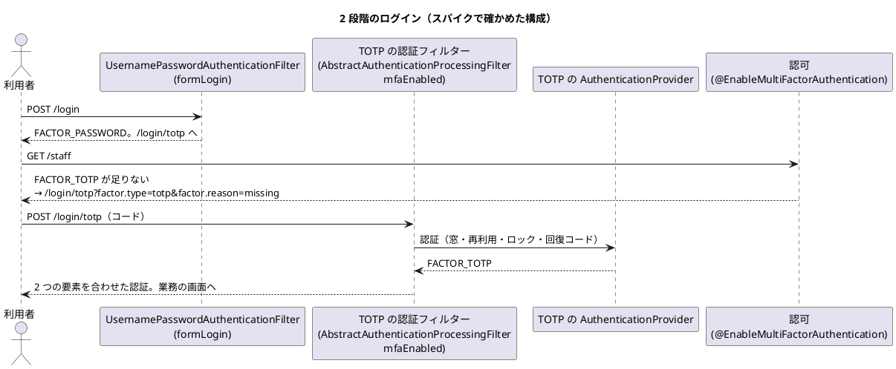
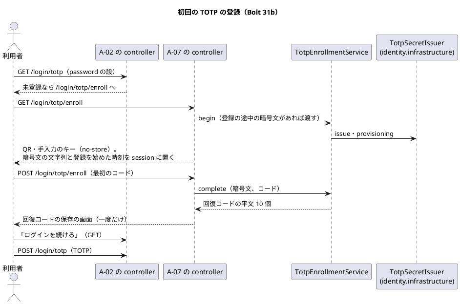
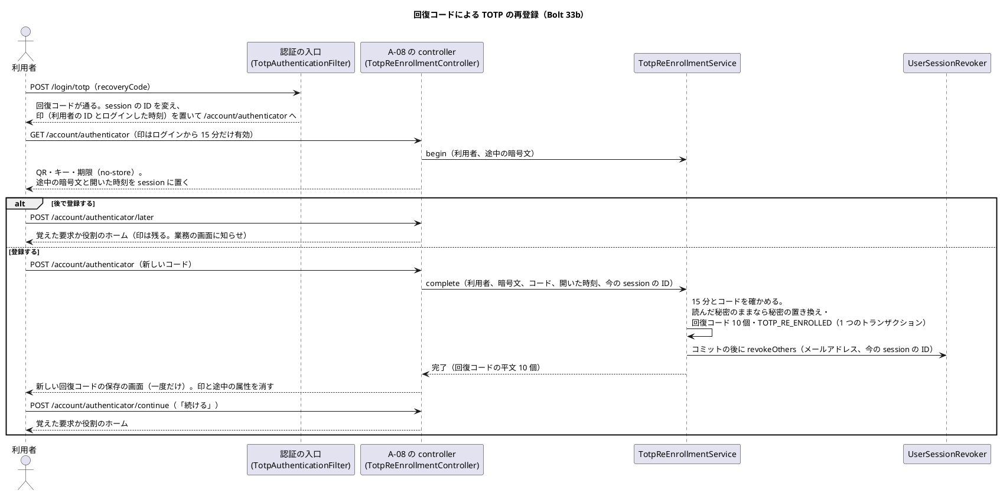

# ADR-011: 多要素認証は Spring Security 7 の要素の権限で組み、TOTP は java-otp で作る

password の後に TOTP を求める 2 段階のログインを、Spring Security 7 の多要素認証（要素ごとの権限）で組む。TOTP の生成は `com.eatthepath:java-otp` に任せ、時間の窓・再利用の拒否・失敗の数え方・回復コードはアプリケーションで持つ。

日付: 2026-10-06

## ステータス

承認（2026-10-11、human:kakimomokuri が Bolt 30 の計画の承認で採用した。Bolt 13 のスパイク TS-01 の結論）

採用のときに決めたこと（Bolt 30 の開始準備と計画の承認）:

- 表は関心事ごとに分ける（TOTP の資格・回復コード・ログインの失敗）。どれも利用者の行と版に触れずに条件付きの更新で書く
- ロックの方針（5 回・15 分）は、利用者の集約でなく、ログインの失敗の集約に置く（失敗のたびに利用者の版が上がると、利用者の管理の更新とぶつかるため）
- 失敗の数え方は H2 と PostgreSQL の共通の構文で書く（ADR-007）。`RETURNING` は使わず、更新の件数で判定し、回数は同じトランザクションで読み直す
- 回復コードは使ったら消さず、使った時刻を入れて残す。ハッシュは bcrypt で、作成と照合はドメインのポートにする
- TOTP の秘密の暗号化の鍵の管理は Bolt 31 の計画で決める（決めた。決定 5）。スパイク（`spikes/ts-01-totp/`）は Bolt 31d で消した（本体に登録と回復コードの発行（Bolt 31b）と回復コードによるログイン（Bolt 31c）がそろった後、本体のテストとの対応を確かめた。決定 8）

Bolt 31 の開始準備と計画の承認（2026-10-13、human:kakimomokuri）で決めたこと:

- K-02（2 段階の画面から password が正しいと分かる）は受け入れる。推測はロックと監査記録で抑える（下の「W5 で人が決める論点」）
- TOTP の秘密はアプリケーションで AES-GCM で暗号化し、暗号文に鍵の版の接頭辞を付ける（決定 5）。`TotpCodeGenerator` は暗号文を受ける
- 要素は全体の注釈で求める（R-08 の比較。代替案）。`SecurityFilterChain` は `identity.infrastructure.config` に置く（決定 4）
- password の段だけの session は、password を確かめた時刻から 5 分で失効させる（決定 2）
- dev のコードは dev 専用の部品を関数の型で注入する。Base32 は自分で書く（決定 1・3）

Bolt 31b の開始準備と計画の承認（2026-10-13、human:kakimomokuri）で決めたこと:

- US-18 の残りを 31b（AAD、初回の登録、回復コードの発行）と 31c（回復コードによるログイン、password の段の主体の型、ADR-012 の見直しの 4）に分ける（特性テストは Bolt 31c の開始準備で 31d に送った）
- 暗号文に AAD（`totp-secret:` と利用者 ID）を付け、別の利用者の暗号文では復号できないようにする（決定 5）
- QR は ZXing（`com.google.zxing:core`）でサーバーがインラインの SVG にする（決定 1・6）
- 登録の途中だけ password の段の上限を 15 分にする。回復コードの「保存した」は画面の必須だけにする。先取りの登録のリスクを受け入れる。`TotpProvisioning` はドメインの値に置き、値を隠す（決定 6）

Bolt 31c の開始準備と計画の承認（2026-10-13、human:kakimomokuri）で決めたこと:

- US-18 の残りを 31c（回復コードによるログイン、password の段の主体の型、ADR-012 の見直しの 4）と 31d（照合の 3 値、`REJECTED_NOT_ENROLLED` の監査の理由、`FACTOR_*` の ArchUnit の空振り対策、入口と暗号のパッケージ、特性テスト、スパイクの削除などの構造の直し）に分ける
- 回復コードは A-02 の `
` で開く別の欄（`recoveryCode`）で受け、同じ `POST /login/totp` に送る。通ったら `FACTOR_TOTP` を与え、監査は専用の操作（`RECOVERY_CODE_USED`）にする（決定 7）
- 回復コードの正規化はドメインに置き、照合はトランザクションの外、消費と監査記録だけを 1 つのトランザクションにする。A-01 の誤りの文言は TOTP と回復コードを区別しない（決定 7）

Bolt 31d の開始準備と計画の承認（2026-10-13、human:kakimomokuri）で決めたこと:

- 守りの直し（照合の 3 値、監査の理由、失敗へ倒す範囲、暗号の部品のパッケージ、見張り、特性テスト、スパイクの削除）を 31d に入れ、低の指摘は該当する部品に触る Bolt（32・33b）に送る
- TOTP の照合の結果をドメインの値 `TotpMatch` にし、保存した要素を読めないことを `UnreadableCredentialException` で表して、入口が拒否に倒す範囲をそれだけに絞る。暗号の部品を `identity.infrastructure.crypto` に分け、D-5 の認証の例外を入口だけにする。`FACTOR_TOTP`・`TotpAuthenticationToken` は改名しない（決定 8）

Bolt 32 の開始準備と計画の承認（2026-10-13、human:kakimomokuri）で決めたこと:

- US-18 の残りを 32（ロック、ADR-012 の見直しの 5、Bolt 30 の議題 2 の③、Bolt 31d から送った例外の扱い）と 32c（AC6 の request ごとの役割の確認、ADR-012 の見直しの 3、Bolt 31d から送った低の指摘）に分ける（Bolt 32c の開始準備で、31d から送った低の指摘を 32d に分けた）
- password・TOTP・回復コードの誤りを合わせて数え、5 回続いたら 15 分ロックする。数え方と監査記録はアプリケーションのサービス `LoginAttemptService` で 1 つのトランザクションにし、ロックの確かめは password の照合の後に行う（決定 9）
- ロック中も誤りと同じ応答と文言にし、A-01 の 2 つの誤りの文言に一般の予告だけを足す。解ける時刻は示さない（決定 9）
- S-02（複数の利用者への password の試し）は W10 の WAF の送信元ごとの流量の規則に送り、それまでは受け入れる（決定 9）
- `UnreadableCredentialException` は `RuntimeException` を継ぐ形に替える（決定 8 を改めた）

Bolt 32c の開始準備と計画の承認（2026-10-14、human:kakimomokuri）で決めたこと:

- US-18 の残りを 32c（AC6 の request ごとの確かめ、ADR-012 の見直しの 3）と 32d（Bolt 31d から送った低の指摘、Bolt 32 の既知の課題のテストの整理）に分ける
- Bolt 32 の議題 4（A-01 の予告の後に「15 分たってからもう一度ログインしてください」を足す）は採らない。A-01 の文言は決定 9 のまま（誤りと同じ文言と一般の予告）にし、待てば解けることはユーザーマニュアル（Bolt 33b の 2 章の書き直し）に書く。画面・UI 設計・ADR・US-18・シナリオの 5 か所を変えずに済み、文言は計画の承認どおりに保てる
- Bolt 32 の議題 5（ログインの監査の追記をすべて `LoginAttemptService` に寄せる）は採らない。数えない拒否と password の段の成功は、今のまま監査のリスナーが直接書く（決定 9 の表の「数え方の置き場所」）。利用者の管理の監査を作る Bolt 34 で、監査の書き込みの経路をあわせて見直す（見直した。Bolt 34c の決定で今のままにした）。Bolt 32c の `SESSION_REVOKED` はアプリケーションのサービスで書き、監査を直接書く入口の経路を増やさない（ADR-012 の決定 4）

Bolt 33b の開始準備と計画の承認（2026-10-15、human:kakimomokuri）で決めたこと:

- US-18 の残りを 33b（AC9 の回復コードによる再登録と、それが触る部品（`TotpEnrollmentService` の引数の型、`instanceof` の `switch` 化）とマニュアル）と 33c（振る舞いの変わらない直し。Bolt 33c の開始準備で 33c と 33d に分け、Bolt 33d の開始準備で 33d と 33e に、Bolt 33e の開始準備で 33e と 33f に分けた）に分け、#13 は 33b でクローズする
- 回復コードでログインしたら印を置いて再登録の画面（A-08）へ導き、「後で登録する」で業務の画面へ進める。印がある間は業務の画面に知らせを出す。入口はこの流れだけにする（決定 10）
- 新しいコードを確かめた時点で古い秘密を置き換え、回復コードを 10 個発行し直して 1 回だけ示し、監査 `TOTP_RE_ENROLLED` を書く。コミットの後に、その利用者のほかの session を失効させる（今の session は残す）。本人へのメールの通知は #47（決定 10）
- 刻みの使用の条件に、照合で読んだ秘密の暗号文との一致を足す。置き換えでは最後に使った刻みを大きい方にする。残りの回復コードが少ないときの案内は Bolt 38d2 で作った（A-08 と印の知らせに、3 個以下で残りの数を示す。決定 10）

Bolt 33c の開始準備と計画の承認（2026-10-15、human:kakimomokuri）で決めたこと:

- 振る舞いの変わらない直しを 33c と 33d に分ける。33c は置き場所の決定を伴う直し（session・request の属性の名前、期間、A-08・A-03 の URL、覚えた要求の属性の名前）と小さな直し。33d は TOTP の部品の整理（TOTP の桁数・周期・アルゴリズムの定数、QR の SVG の組み立ての分離、回復コードの形の知識の 2 か所と `normalize` の戻り値の型、A-07 と A-08 の途中の暗号文の扱いと回復コードの発行の重複）。Bolt 33d の開始準備（2026-10-16、human:kakimomokuri）で、認証の結果のトークンに経路（要素の種類）、`revokeOthers` の session の ID の値オブジェクト、期限の境界の判定、テンプレートの期間の数値を 33e に分けた。Bolt 33e の開始準備（2026-10-16、human:kakimomokuri）で、テンプレートの期間の数値・回復コードの生成のポートの型・ADR-012 の URL の記述と `SessionKeys` の命名を 33f に分けた
- 印の属性の名前と A-08 の URL は application 層の `SessionKeys`（`identity.application.internal.session`）に、印の 15 分・登録の途中の 15 分・再登録の 15 分はドメインルール `SessionPolicy`（`identity.domain.model.rules`）に寄せる（[ADR-012](012-authentication-principal-and-session.md) の決定 3・決定 6）
- 「始めたときの秘密を置き換えの条件にする」（Bolt 33b の開発レビューで 33c で扱うとした）は振る舞いが変わる直しなので、[#49](https://github.com/k2works/practical-domain-driven-design-in-enterpris-application/issues/49)（W10）に送る

Bolt 34c の開始準備と計画の承認（2026-10-17、human:kakimomokuri）で決めたこと:

- Bolt 34c の行を 34c（認証・監査の経路と文書と見張り）、34e（利用者の管理のドメインとサービス）、34f（S-20 の画面の構造）に分け、この順に進める
- ログインの監査の書き手は今のまま（監査のリスナーが直接書く分を残す）にし、Bolt 32c の決定の「Bolt 34 で見直す」を閉じる。リスナーが直接書くのは、Spring Security の認証のイベントを写すだけで数え方に関わらず、1 文の追記で済む記録（`PASSWORD_VERIFIED`・数えない `LOGIN_FAILED`・`LOGOUT`）。数え方と結び付く記録（成功・数える失敗・ロック）は、回数と同じトランザクションにするため `LoginAttemptService` が書く。ロック中の試行（理由 `LOCKED`）も数えないが、ロック中かどうかを決めるのはサービスの 1 か所（`isLocked` と条件付きの更新）なので、サービスが書く（ロック中の試行は `recordLockedAttempt` が 1 文で、ロック中に誤りの失敗が届いたら `recordFailure` が回数の条件付きの更新と同じトランザクションで書く）。リスナーの `default` 節は、ほかの失敗のイベントも監査記録に直接書く（理由は `BAD_CREDENTIALS`・`INVALID_TOTP` などに倒す）。利用者の管理の監査は、どれも状態の変更と同じトランザクションにするためアプリケーションのサービスが書く（範囲外の記録は単独で、確定の POST だけ。GET では書かない）。書き手は下の表のとおり
- 回復コードのログインで、成功のイベントのリスナーが書く `LOGIN_SUCCEEDED`（と回数の戻し）の追記が失敗すると、例外が伝わってログインは 500 になり通らない。session は password の段のまま残り（2 つ目の要素の入力に戻れる。業務の画面は A-02 の `/login/totp?factor.type=totp` へ導く）、同じ session で別の回復コードを送り直せるが、送るたびにまた 500 になり、コードが 1 つずつ使用済みになる。コードの使用と `RECOVERY_CODE_USED` は先に別のトランザクションでコミットしているので、使ったコードは戻らない。`RECOVERY_CODE_USED` は残り、`LOGIN_SUCCEEDED` と回数の戻しは書かれず、誤りとしても数えない（決定 7・決定 9。Bolt 34c のステップ 1 で `AuthenticationErrorHandlingIntegrationTest` の特性テストで固定した）。変えるかは後の Bolt の議題にし、この Bolt では変えない

| 記録 | 書き手 | トランザクション |
| :--- | :--- | :--- |
| `PASSWORD_VERIFIED` | `AuthenticationAuditListener` | 1 文 |
| `LOGIN_FAILED`（数えない: 理由 `SERVICE_ERROR`・`UNKNOWN_USER`・利用停止・無効な企業）、ほかの失敗のイベント（リスナーの `default` 節。理由は `BAD_CREDENTIALS`・`INVALID_TOTP` などに倒す） | `AuthenticationAuditListener` | 1 文 |
| `LOGOUT` | `AuthenticationAuditListener` | 1 文 |
| `LOGIN_SUCCEEDED`・数える `LOGIN_FAILED`・`ACCOUNT_LOCKED` | `LoginAttemptService` | 回数と同じ |
| `LOGIN_FAILED`（理由 `LOCKED`。数えない） | `LoginAttemptService`（ロック中の試行は `recordLockedAttempt`、ロック中に届いた誤りの失敗は `recordFailure`） | ロック中の試行は 1 文、ロック中に届いた誤りの失敗は回数の条件付きの更新と同じ（ロックの判定をサービスの 1 か所にするため） |
| `RECOVERY_CODE_USED` | `RecoveryCodeVerificationService` | コードの使用と同じ（`LOGIN_SUCCEEDED` と回数の戻しは別のトランザクション） |
| `SESSION_REVOKED` | `SessionRevalidationService` | 単独 |
| TOTP の登録・再登録、再設定の完了、役割と利用状態の変更 | それぞれのアプリケーションのサービス | 状態の変更と同じ |
| 再設定の依頼（受付・不受付） | `PasswordResetRequestService` | 単独（不受付は状態を変えない） |
| `ADMIN_SCOPE_DENIED` | `AdministrationScopeDenialService`（controller の確定の POST だけから） | 単独。GET では書かない |

## コンテキスト

- US-18 は、メールアドレス・password・TOTP で本人確認し、無操作 30 分・最長 8 時間の session を発行する（AC1）。password か TOTP の失敗が 5 回続いたら 15 分ロックする（AC3。回復コードの誤りも数えると Bolt 32 で決めた。決定 9）。初回は TOTP を登録し、一度だけ使える回復コードを発行する（AC7・AC9）。
- 非機能要件は、password を Argon2id か bcrypt で保存し（SEC-07）、回復コードを 10 個発行する（SEC-09）。
- 技術スタックは、TOTP のライブラリを候補（`dev.samstevens.totp`）として挙げただけで、評価していなかった（TS-01）。リスク台帳には「TOTP と Spring Security 7 の統合が想定より難しい（中・中）」がある。
- アクセス・監査は「単純なモデル」で、認証の仕組みは実績のある部品に任せる（[アーキテクチャ](../../design/cargo-tracker/architecture_backend.md)）。認証の成功・失敗・ロックは、Spring Security のイベントから同期で監査記録に書く（IA-INV-08）。
- 開発環境では、ログインの画面（A-01）と認証コードの画面（A-02）を入力済みにする（2026-10-06 の人の決定。Bolt 13 の確認ポイント 7）。
- Bolt 13 で、本体と分けたスパイク（[`spikes/ts-01-totp/`](https://github.com/k2works/practical-domain-driven-design-in-enterpris-application/tree/670589409f/spikes/ts-01-totp)）を Spring Boot 4.1.1（Spring Security 7.1.1）で作り、学習テストで確かめた（初めは 29 件。[Bolt 13 のレビュー](../../review/cargo-tracker/bolt_13_review_20261006.md)の指摘で直し、57 件）。

## 決定

### 1. TOTP の生成

**`com.eatthepath:java-otp` で TOTP を作る（HMAC-SHA1、6 桁、30 秒）。前後 1 つの時間の窓の照合、再利用の拒否、一定時間の比較はアプリケーションで持つ。**

| 候補 | RFC 6238 の試験ベクトル | 保守（最後の公開） | ライセンス | 推移的な依存 | 判断 |
| :--- | :--- | :--- | :--- | :--- | :--- |
| (a) JDK の HMAC だけの実装 | 6 件とも一致 | 自分で持つ | — | なし | 代わりの案。HMAC は JDK にあり、自分で持つのは切り詰めの約 10 行で、試験ベクトルで固定できる。差は小さい |
| (b) `java-otp` 1.0.0 | 8 桁で試した 3 件と、6 桁で 6 件とも一致 | 2026-08 | MIT | なし | **採る案**。小さく、依存がなく、保守されている。スパイクの 2 段階のログインはこの生成の上で通る |
| (c) `dev.samstevens.totp` 1.7.1 | 試した 3 件とも一致 | 2020-11 | POM に記載なし | `commons-codec`、ZXing（core・javase） | 採らない。6 年近く更新がなく、QR の画像の部品まで入る |
| `googleauth` 1.5.0 | 試していない | 2020-04 | — | — | 採らない（(c) と同じ理由。計画の確認ポイント 3） |

- (b) が担うのは HOTP の計算と切り詰めだけで、時間の窓での照合の API を持たない。照合は「前後 1 つの刻みのコードを作り、一定時間で比べる」をアプリケーションで書く（スパイクの `SpikeUsers`）。再利用の拒否・秘密の生成・Base32・`otpauth://` の URI もアプリケーションが持つ。
- (a) と (b) の差は小さく、生成をポートの裏に置けば後で替えられる判断である（下の「US-18 の Bolt で要るもの」）。
- 秘密は 160 ビット（20 バイト）の乱数で作り、Base32 で `otpauth://` の URI と、手で入力する文字列に使う案とする。Base32 は JDK にも (b) にもないため、`identity.infrastructure` に自分で書く（RFC 4648、30 行ほど。RFC 4648 の試験ベクトルで確かめる。Bolt 31 で決めた）。`commons-codec` は実行時の依存にないので足さない。dev の入力済み（Bolt 31）と `otpauth://` の URI（Bolt 31b）で使う。URI の組み立てと登録の QR の描き方は Bolt 31b で決めた（決定 6）。復号は次の 3 つを失敗へ倒す（Bolt 32d）。
  - 半角スペースを除き大文字にし、末尾の埋め草を除いた長さを 8 で割った余りが 1・3・6（RFC 4648 で現れない長さ）
  - 最後の文字の余りのビットが 0 でない（同じバイト列の 2 つ目の書き方）
  - 埋め草の数がデータの長さに合わない（データの文字を 8 の倍数にそろえる数だけを許す）

  それまでは黙って余りを捨てていた。復号を使うのは dev の固定の秘密の設定だけで、不正なら起動の時点で失敗する。

### 2. 2 段階のログイン（Spring Security 7）

**password（`FACTOR_PASSWORD`）と TOTP（独自の要素 `FACTOR_TOTP`）の両方を、認証が要るすべての画面に求める。**

| 項目 | 方針 | スパイクで分かったこと |
| :--- | :--- | :--- |
| 要素の要求 | `@EnableMultiFactorAuthentication(authorities = {FACTOR_PASSWORD, FACTOR_TOTP})` | 独自の要素の名前（`FACTOR_TOTP`）をそのまま使える |
| 足りない要素の画面へ導く | `DelegatingMissingAuthorityAccessDeniedHandler` で、`FACTOR_TOTP` が足りなければ A-02、`FACTOR_PASSWORD` が足りなければ A-01 | 枠組みが `factor.type`・`factor.reason` を付けて導く。A-02 で理由を示すのに使える |
| TOTP の認証 | `AbstractAuthenticationProcessingFilter` を継ぐフィルター（`POST /login/totp`）と `AuthenticationProvider`。password の要素がそろった session でだけ受け付ける | フィルターの `mfaEnabled` を有効にしても、**結果のトークンの型が `toBuilder()` を自分で宣言していないと、password の要素が合わさらず置き換わる**。独自のトークンにビルダーを持たせる。要素を合わせるのは主体の名前が同じときだけで、別の利用者の password を送っても先の利用者の `FACTOR_TOTP` は引き継がれない |
| session の固定化 | TOTP の段でも session の ID を変え、CSRF のトークンを作り直す（`ChangeSessionIdAuthenticationStrategy` と `CsrfAuthenticationStrategy`）。本体では `http.getSharedObject(SessionAuthenticationStrategy.class)` を渡すか、configurer で組んで formLogin とそろえる | `new` で足したフィルターの既定は何もしない戦略で、権限が上がる TOTP の段で ID が変わらなかった（レビューで見つけて直した） |
| 成功の後の行き先 | 保存した request（深いリンク）へ戻すか、役割ごとの既定の画面へ導く | スパイクは固定の `/staff`。荷主（`/customer`）と社内（`/staff`）の役割分け（US-16）と一緒に決める |
| session の保存 | TOTP のフィルターに `HttpSessionSecurityContextRepository` を設定する | 既定のままでは request の中だけに残る |
| session の直列化 | Spring Session JDBC に、独自のトークン・`FactorGrantedAuthority`・`Instant` を JDK の直列化で置く。要素の権限を足しても、配備の前の session は復元できた（`CargoUserDetails` と既存の型を変えていないため）。配備の前の session は password の段の時刻（`PASSWORD_VERIFIED_AT`）を持たないので、期限の判定で A-03 に送り、ログインし直してもらう。期限の上限は認証の要素で選び（2 つの要素なら TOTP の時刻から 8 時間、password の段だけなら password の時刻から 5 分）、利用者を切り替えた session に前の利用者の時刻が残っても上限を外さない（Bolt 31 の開発レビュー）。復元そのものが失敗する変更（型の移動や改名）の扱いは変えていない（ADR-012 のネガティブ。配備の手順で session の行を消す） | スパイクはメモリの session。本体のセキュリティの統合テスト（PostgreSQL の Testcontainers）で、要素の権限が次の request に残ることと TOTP の段の ID の変化を確かめる（Bolt 31） |
| 失敗の数え方 | password・TOTP・回復コードの誤りを、`AuthenticationFailureBadCredentialsEvent` から数える。5 回続いたら 15 分ロック。数えて監査記録を書くのはアプリケーションのサービス `LoginAttemptService` で、ロックは password の照合の後の確認と、TOTP・回復コードの provider で確かめる（`UserDetails` の `accountLocked` は使わない。Bolt 32 で改めた。決定 9） | 監査記録（IA-INV-08）を書く箇所と同じにできる。ロック中の拒否は数えない |
| 再利用の拒否 | 利用者ごとに最後に使った時間の刻みの番号を持ち、それ以下の刻みを拒否する | TOTP のライブラリの外の記録が要る（H3） |
| 回復コード | A-02 の別の欄（`
`）で受け付け（Bolt 31c。決定 7）、一度だけ使える（本体では使った時刻を入れて行を残す） | スパイクは TOTP の欄で受け付けた。本体ではハッシュ（bcrypt）で保存する |
| 無操作 30 分 | `spring.session.timeout=30m`（Spring Session JDBC の期限 `MAX_INACTIVE_INTERVAL`。[ADR-012](012-authentication-principal-and-session.md) の決定 3） | スパイクは `server.servlet.session.timeout` を設定しただけで、振る舞いを確かめていなかった。本体は Bolt 14 で `spring.session.timeout` にし、`server.servlet.session.timeout` が Spring Session に効かないことを既定と違う値のテストで、30 分の境界をセキュリティの統合テストで確かめた（ADR-012 のコンプライアンス）。失効の 5 分前の警告と延長は Bolt 32b |
| 最長 8 時間 | 本人確認の時刻（`AUTHENTICATED_AT`）を、その session で初めて TOTP が通ったときだけ残し、request ごとに比べるフィルター。**期限の確認を 2 つの要素の認証より前に置く**（フィルターの順序に頼らない形も W5 で比べる）。password の段だけの session は、password を確かめた時刻（`PASSWORD_VERIFIED_AT`）から 5 分で失効させ A-03 に送る（A-02 を開いたまま放置した session を残さない。Bolt 31 で決めた）。どちらの時刻もない認証済みの session は失効させる（fail-closed） | 確認を認可の直前に置いたら、期限切れの session に TOTP だけを送って 8 時間延ばせた（レビューで見つけて直した）。Spring Security の `RequiredFactor` には有効期間（`validDuration`）があり時計も替えられるが、期限切れは要素の再入力を求めるもので session を終わらせない。AC5 の再認証には session を捨てるフィルターを使う |
| password の保存 | `PasswordEncoderFactories` の既定（bcrypt、強さ 10） | Argon2id は Bouncy Castle を足さないと符号化で `NoClassDefFoundError` になる。SEC-07 は bcrypt で満たす |
| 更新の原子性 | 失敗の回数は、ロック中でないことを条件にした `UPDATE ... SET consecutive_failures = consecutive_failures + 1` の更新件数で判定し、回数を同じトランザクションで読み直す（H2 と PostgreSQL の共通の構文。ADR-007。採用のときに `RETURNING` から改めた）、再利用の拒否は `UPDATE ... SET last_used_step = :step WHERE last_used_step < :step` の更新件数で判定する。存在しないメールアドレスの失敗では行を作らない | スパイクは `synchronized` とメモリで守った。読んでから書く形では、並んだ試行や複数のインスタンスで 5 回を超えて試せ、同じコードが 2 回通る |

### 3. 開発環境の入力済み

`dev` プロファイルのときだけ、A-01 にメールアドレスと password、A-02 にその時点のコードを入れる。既定の設定（ステージング・本番を含む）では入力済みにしない。誤って入力済みが本番で効くと、password を知った者に A-02 が TOTP を差し出し、多要素認証が無効になるため、次の層で守る。

| 層 | 守り方 | スパイク |
| :--- | :--- | :--- |
| 1 | 入力済みの部品を `@Profile("dev")` の bean にする。controller はその部品の有無だけを見て、TOTP の生成器や利用者の秘密を直接参照しない | `DevLoginPrefill`。既定の設定で A-01・A-02 が空で出ることを確かめた |
| 2 | dev-login の設定（`cargotracker.dev-login.*`）が、`dev` でない、または `staging`・`prod` と併用のプロファイルで入っていたら、起動を失敗させる | `DevLoginGuard`。起動が `IllegalStateException` で失敗することを確かめた |
| 3 | コードを作れるのは、`dev` の設定に書いた開発用の固定の秘密だけにする。利用者の表の秘密（暗号化した値）は復号しない。開発用の利用者でない主体には何も入れない | スパイクは全員が固定の秘密。本体で守る |

dev のコードの部品（Bolt 31 で決めた）: 関数の型 `DevTotpCodeSource`（利用者のメールアドレスからその時点のコードを返す。dev の利用者でなければ空）を `identity.interfaces.web` に置き、`DevLoginPrefill` はこれだけを見る（1 層目）。実装 `DevTotpCodes` は `identity.infrastructure.devlogin` に置き（画面の層の型は実装しない）、`cargotracker.dev-login.accounts[n].totp-secret`（Base32、利用者ごとに別）だけからコードを作り、利用者の表を読まない（3 層目）。組み立ては `identity.infrastructure.config` で、dev プロファイルでだけ `DevTotpCodes` のメソッドを `DevTotpCodeSource` につなぐ。合成ルートが画面の層の型を参照するのは層の規則（interfaces はどの層からも参照されない）の例外で、`identity.infrastructure.config` から `DevTotpCodeSource` だけを許す（公開 API の合成ルートの例外と同じ書き方。Bolt 31 のステップ 6 で規則に当たり、2026-10-13 に human:kakimomokuri が決定）。集約でないドメインのポートは足さない。dev-data の TOTP の資格は、dev の固定の鍵で設定の `totp-secret` を暗号化した値にし、復号すると設定の秘密と一致することをテストで確かめる（4 層目）。
| 4 | 開発用の利用者と固定の秘密は、`spring.flyway.locations` の共通・ベンダーの場所に置かず、`dev` だけで足す場所か起動時の投入にし、その場所をテストで確かめる。利用者を 2 人以上にし、秘密が別であることも確かめる | 本体で守る |
| 5 | ステージング・本番で `SPRING_PROFILES_ACTIVE` を固定し、`dev` を拒否する確認を IaC・CD と運用の手順に足す | 本体で守る（W5） |

本体の `dev` プロファイルは今「H2 で bootRun」の意味で、入力済みの意味がそこに相乗りする。

### 4. `identity` への置き方と仮の主体の置き換え

（置き換えは Bolt 14 で行った。構成は [ADR-012](012-authentication-principal-and-session.md)）

- 認証の主体の型（例: `AuthenticatedActor(UserId, CompanyId, Role)`）は共有カーネル `shared` に置く。ほかのコンテキストは `@AuthenticationPrincipal` でそれだけを受け取り、`FACTOR_*` や認証方式を知らない。今の依存（`identity → quotation::events`）のまま `quotation` が `identity` の API から利用者を引くと、`quotation → identity → quotation::events` の循環になるため。
- `identity` は、利用者・TOTP の資格・回復コード・失敗の記録と、`UserDetailsService`・`AuthenticationProvider`・失敗のリスナーを持つ。TOTP のライブラリへの依存は `identity.infrastructure` に閉じ込める。
- `SecurityFilterChain`（URL ごとの規則、`/customer`・`/staff`）は `identity.infrastructure.config` に置く（Bolt 14 で置き、Bolt 31 で決定にした。`platform` には置かない）。TOTP の段の部品（フィルター、`toBuilder()` を宣言した独自のトークン、provider）は `identity.infrastructure.security` に置く。暗号化などの暗号の部品は `identity.infrastructure.crypto` に置く（Bolt 31d で `security` から分けた。決定 8）。
- 置き換えの順: ① 主体の型を `shared` に足す → ② 認証を入れて主体を解決する → ③ controller を 1 つずつ置き換える → ④ `ProvisionalActorProperties` を消す。

### 5. TOTP の秘密の暗号化（Bolt 31）

**TOTP の秘密は、アプリケーションで AES-GCM で暗号化して表に置き、復号から消去までを `identity.infrastructure` の中で済ませる。**

| 項目 | 方針 |
| :--- | :--- |
| 方式 | AES-GCM。鍵は 256 ビット、IV は 96 ビットで毎回乱数で作る。JDK の `Cipher` で組む（spring-security-crypto の `Encryptors` の既定の IV は 16 バイトのため。新しい依存なし） |
| 暗号文の形 | `v1:<Base64(IV + 暗号文 + タグ)>`。先頭に鍵の版を持つ。知らない版・タグの不一致・壊れた Base64 は例外にし、受け付けない（fail-closed） |
| 鍵 | プロパティ `cargotracker.totp-secret-keys.v1`（Base64）。環境変数 `CARGOTRACKER_TOTPSECRETKEYS_V1` から渡し、本番は Secrets Manager から注入する（W10 の IaC）。鍵がない・32 バイトでないときは起動で失敗する。dev とテストは固定の鍵（本物の秘密ではない） |
| 鍵の入れ替え | `v2` を足し、読むときは接頭辞の版の鍵で復号し、書くときは最新の版で暗号化する。入れ替えの手順は W10 の運用手順書に書く |
| AAD（Bolt 31b） | 暗号化と復号に、`totp-secret:` と利用者 ID（`UserId#value()` の UUID の小文字の形。`toString()` ではない）を UTF-8 にした AAD を付ける。DB で別の利用者の暗号文に入れ替えられても、タグが合わず復号できない（fail-closed）。用途の接頭辞で、将来ほかの値を同じ鍵で暗号化しても取り違えない。暗号文の列の形（`v1:<Base64>`）は変えない。本番の利用者はまだいない（Bolt 34 まで）ので、作り直すのは dev-data の暗号文だけで、適用済みの版は書き換えず新しい版のマイグレーション（`UPDATE`）で作り直す |
| 生成のポート | `TotpCodeGenerator#code(UserId, EncryptedSecret, long)`（Bolt 31b で AAD のため持ち主を受ける形にした）。実装（`JavaOtpTotpCodeGenerator`）の中で復号 → 生成 → 配列を消す。平文の秘密をドメインとアプリケーションの層に出さない（Bolt 30 の議題 2 の②）。`TotpCredential#match`（Bolt 31d で `matchingStep` から改めた。決定 8）は自分の利用者 ID と暗号文を生成器に渡す |
| dev のコードの部品の AAD | `DevTotpCodes` は設定の秘密を、開発用の利用者のメールアドレスから決める作り物の ID（`UUID.nameUUIDFromBytes`）を AAD にして内部で扱う。利用者の表を読まない（決定 3 の 3 層目）ため、DB の暗号文の利用者 ID とは別である。dev-data の暗号文は DB の利用者 ID を AAD にして作り、復号すると設定の秘密と一致することをテストで確かめる |
| 照合 | 前後 1 つの刻みでの照合は TOTP の資格（`TotpCredential#match`）が行い、結果をドメインの値 `TotpMatch` で返す（Bolt 31d。決定 8）。刻みの使用（条件付きの更新）は、アプリケーションのサービス `TotpVerificationService`（`identity.application.internal.commandservices`）が照合の結果を写して行う。Spring Security の provider は結果を認証の成否に直すだけにする（ADR-012 の D-5 の認証の例外） |

ArchUnit で、`javax.crypto` を参照するのが暗号の部品（`identity.infrastructure.crypto`）だけであることを守る（Bolt 31 では `identity.infrastructure` だけとし、Bolt 31d で狭めた）。`AesGcmSecretCipher` を参照してよいのは crypto・合成ルート・dev の部品だけにする（決定 8）。

### 6. 初回の TOTP の登録と回復コードの発行（Bolt 31b）

**TOTP を登録していない利用者は、password の後に A-02 を経て A-07 で登録する。サーバーが秘密を発行し、利用者が入れた最初のコードで確かめてから、TOTP の資格と回復コード 10 個を 1 つのトランザクションで保存し、回復コードの平文は登録を保存した応答で一度だけ示す。登録は TOTP の要素を与えず、登録の後は A-02 で TOTP を入れてログインを終える。**

| 項目 | 方針 |
| :--- | :--- |
| 登録の流れ | `LoginSuccessHandler`（認証の入口）は登録の有無を見ずに A-02 へ送り、A-02 の controller が未登録の利用者を A-07（`/login/totp/enroll`。GET・POST とも同じ URL）へ送る。A-07 は password の要素だけで開ける（R-08 の例外）。登録済みの利用者と 2 つの要素がそろった主体は A-02 へ送る（2 つの要素がそろった主体は登録済みなので、同じ振り分けでよい。画面の層は要素の権限を見ない） |
| 秘密の発行 | 160 ビットの秘密を乱数で作り、AAD を付けて暗号化して返す（`TotpSecretIssuer`）。平文の秘密は `identity.infrastructure` の実装の中だけで扱い、session には暗号文の文字列（`EncryptedSecret#value()`）だけを置く（`EncryptedSecret` は直列化できる型でなく、Spring Session JDBC は Java の直列化を使う。ドメインの値に `Serializable` は足さない）。登録の途中の暗号文が session にあり、同じ利用者の AAD で復号できる限りそれを使い続ける（GET の再読み込みやタブを 2 つ開いても秘密を変えない） |
| 最初のコードの確かめ | 暗号文と入れたコードで前後 1 つの刻みを照合する。誤りは保存せず、同じ秘密で A-07 に示し直す。password の要素は捨てない（登録は認証の段ではない）。誤りは失敗の回数に数えない（Bolt 32 で決めた。登録は認証のイベントを経ず、登録の誤りは自分の秘密の確かめで、他人の要素の推測にならない。決定 9） |
| 要素は与えない | 登録は `FACTOR_TOTP` を与えない。登録で確かめたコードの刻みは使ったことにしない（最後に使った刻みは 0）ので、同じコードを A-02 でもう一度使える。登録を認証のフィルターにせず、認証の流れと session の ID の変更・8 時間の起点を A-02 の 1 か所に保つ |
| 回復コード | 10 個を乱数で作る（`RecoveryCodeGenerator`。形は `1a2b-3c4d`。8 文字の 16 進を 4 文字ずつハイフンで区切る 32 ビット。総当たりはロック（5 回）と bcrypt で抑える。10 個のうちに重複がない）。ハッシュだけを保存し、平文は登録を保存した POST の応答で一度だけ示す（PRG にしない。再読み込みは登録済みとして A-02 へ送る）。登録の前の画面に示すと、平文の回復コードを登録の途中の session（Spring Session JDBC の表）に置くことになるため。「回復コードを安全な場所に保存した」の確認は画面の必須（`required`）だけにし、サーバーの状態を増やさない。Bolt 33f から、生成のポートは `NormalizedRecoveryCode` の一覧を返し、`RecoveryCode.issueSet` もそれを受ける（画面に平文を渡す結果は文字列のまま。値の `toString` は伏せるため） |
| QR と表示の値 | ZXing（`com.google.zxing:core`、Apache-2.0、実行時の推移的な依存なし）で QR の行列を作り、インラインの SVG にする。色は `fill` の属性で付け、`style` は使わない（CSP が `style-src` を許さないため。CSP は変えない）。URI は `otpauth://totp/cargo-tracker:<メールアドレス>?secret=…&issuer=cargo-tracker&digits=6&period=30&algorithm=SHA1`、手入力のキーは Base32 を 4 文字ずつ区切る。画面は `th:utext` で、自分で作った SVG にだけ使う。クライアントで描く案は、秘密を JavaScript に渡し、CSP に script を足すことになるので採らない。URI は URL エンコードした ASCII だけなので、QR の生成で文字セットを指定しない（ECI を付けると読めない認証アプリがある。Bolt 31b の開発レビュー） |
| `TotpProvisioning` を値に置く | 表示の値（URI、手入力のキー、QR の SVG）は秘密と同じ重さとして扱う。ZXing を `identity.infrastructure` に閉じるには、ポートが表示の値を返すしかないため、ドメインの値 `TotpProvisioning`（`identity.domain.model.valueobjects`、`@ValueObject`）にし、`toString` で値を隠す（`EncryptedSecret` の前例）。代わりに、QR の SVG という表示の形がドメインの値に入る（ドメインは中身を解釈せず、運ぶだけ）。ZXing をドメインに入れるより小さい代償として受け入れ、表示の形を変えるときはインフラ層の実装だけを変える（Bolt 31b の開発レビュー）。画面に一度だけ渡し、session・flash の属性・記録には置かない。A-07 の応答は `Cache-Control: no-store` |
| 新しいポートの置き場所 | 認証の要素のポート（生成 `TotpCodeGenerator`・発行 `TotpSecretIssuer`・ハッシュ `RecoveryCodeHasher`・回復コードの生成 `RecoveryCodeGenerator`）は、前例（`TrackingNumberIssuer`）にそろえて `identity.domain.model.aggregates` に置く。ポートの置き場所を分けるのは、ほかのコンテキストでも増えたときに ADR で諮る。登録のサービス `TotpEnrollmentService` は `identity.application.internal.commandservices`、登録済みかの問い合わせ `TotpEnrollmentQueryService` は `queryservices` に置く（`isEnrolled` を `TotpVerificationService` から移し、画面の層だけが呼ぶ。D-5 の認証の例外は広げない） |
| 同時の登録（Bolt 30 の議題 2 の①の初回の分） | TOTP の資格の追加（主キー）を先に行い、回復コード 10 個の置き換えと監査記録（`TOTP_ENROLLED`）と同じトランザクションにする。同時の 2 つの登録は主キーで片方が失敗してロールバックし、回復コードは 10 個のまま。主キーの違反はリポジトリの実装で `DuplicateTotpEnrollmentException` に写す。登録のサービスはトランザクションを `TransactionTemplate` で内側に持ち、その外側で違反を受けて「登録済み」（`AlreadyEnrolled`）を返す。負けた側も勝った後の再送も同じ結果で、A-02 へ送る（500 にしない。同じトランザクションで一意制約の違反を捕まえない規則を守りつつ、結果を 1 つの経路にする。Bolt 31b の開発レビュー）。回復コードの生成とハッシュ（bcrypt）は書き込みでないので、主キーの行ロックを取る前に済ませる。回復コードの発行し直しの競合（AC9）は Bolt 33b で確かめる（決定 10。再登録は読んだ秘密のままのときだけ置き換えて発行し直し、同時の 2 つの完了と、発行し直しと回復コードによるログインの重なりを統合テストで確かめる） |
| 回復コードの並び順（議題 2 の④） | 未使用の回復コードの並び順は約束しない（照合はすべての未使用のコードと比べる）。SQL の `ORDER BY` は残す（並びは決まるが約束はしない） |
| 登録の途中の上限 | A-07 を開いた時刻（登録を始めた時刻）を session に置き、それがある password の段だけ、その時刻から 15 分を上限にする（ほかの password の段は 5 分のまま）。認証アプリを入れて QR を読む時間を見込むため。登録の途中の時刻は password の段の 5 分の中でしか置けない（A-07 を開けるのは期限の確認の後）。2 つの要素がそろったら使わない。登録を始めた時刻は登録の後も A-02 で TOTP（Bolt 31c から回復コードも）が通るまで残し（通ったら消す。決定 7）、回復コードを書き写して A-02 でログインを終えるまでを同じ 15 分に含める。再読み込みでは延ばさない。A-07 と回復コードの保存の画面に、期限を時刻で示す（「… までに、登録とログインを終えてください」。SEC-03。Bolt 31b の開発レビュー） |
| 失敗へ倒す場面（T-42） | 登録の途中の暗号文が session にない POST は A-07 を開き直す（新しい秘密）。別の利用者の暗号文・鍵の版の違う暗号文・壊れた暗号文は使えないものとし（`UnreadableCredentialException`。登録のサービスはこれだけを捕まえる。Bolt 31d。決定 8）、A-07 を開き直して登録をやり直してもらう（500 にしない）。ZXing の生成の失敗は実装の誤りで、利用者の入力では起きないので 500 のままにし、エラーのログを出す |

先取りの登録のリスクを受け入れる（2026-10-13、human:kakimomokuri）: 未登録の利用者の password を知った者は、本人より先に自分の認証アプリを登録できる（初回の登録に共通する）。受け入れるリスクとし、`TOTP_ENROLLED` の監査記録（主体の利用者 ID と企業 ID）、ロック（Bolt 32）、システム管理者の別経路の解除と本人への通知（#47、W6）で抑える。初回の password の渡し方は利用者の管理（Bolt 34）で決めるとしていたが、W6 の開始準備で決めた（招待のリンクで渡し、登録は使えないハッシュで行い、本人が A-06 で設定する。招待のトークンだけ期限を 24 時間にする。release_plan の W6 節。実装は Bolt 38b〜38b4）。

ArchUnit で、ZXing を参照するのが暗号の部品（`identity.infrastructure.crypto`）だけであること（空振りを防ぐため、秘密の発行の実装が ZXing を使うことも確かめる）と、暗号の部品が application と認証の入口に依存しないことを守る（決定 8。Bolt 31b では `identity.infrastructure` に閉じ込め、入口でない部品はクラス名を挙げて application に依存しない規則で守っていた。Bolt 31d でパッケージを分け、D-5 の認証の例外を入口だけに狭めて、パッケージの規則に置き換えた）。

### 7. 回復コードによるログイン（Bolt 31c）

**TOTP の端末を持たない利用者は、A-02 の `
` で開く別の欄に回復コードを 1 つ入れてログインを終える。回復コードは TOTP と同じ入口で受け、通ったら TOTP と同じ結果の型と要素の権限（`FACTOR_TOTP`）を与える。使った回復コードは二度と使えない。**

| 項目 | 方針 |
| :--- | :--- |
| 入口と欄 | TOTP と同じ入口（`TotpAuthenticationFilter`、`POST /login/totp`）。A-02 の `
`（「認証アプリを使えない場合」）の中の別のフォームで、欄は `recoveryCode`（`autocomplete="off"`、`inputmode` は付けない）。欄の形で TOTP と取り違えない。JavaScript も CSP の変更も要らない。スパイクの「TOTP の欄で受け付け」（決定 2 の表）を改める |
| 入力のトークンと provider | フィルターは `recoveryCode` があるとき、確かめる前の入力だけを `RecoveryCodeAuthenticationToken` にする（平文は request の範囲でしか持たない。ProviderManager が平文を消すのは認証の結果だけで、入力には呼ばない。失敗のイベントに入るので、リスナーは `getCredentials()` を読まない。Bolt 31c の開発レビュー）。`RecoveryCodeAuthenticationProvider` が確かめ、照合と消費はアプリケーションのサービス `RecoveryCodeVerificationService`（`identity.application.internal.commandservices`）に任せる（決定 5 の「照合」と同じ分け方。D-5 の認証の例外の範囲） |
| 結果の型 | provider は TOTP と同じ `TotpAuthenticationToken.authenticated(details, FACTOR_TOTP)` を返す（Bolt 33e から経路の引数が加わり `authenticated(details, FACTOR_TOTP, RECOVERY_CODE)`）。結果の型を変えないので、mfaEnabled の要素の合わせ（`toBuilder()`）、成功の監査の判定（`LOGIN_SUCCEEDED`）、session の直列化、業務の認可、session の ID の変更、CSRF の作り直し、8 時間の起点（`AUTHENTICATED_AT`）が 1 か所に保たれる。別の結果の型にすると、これらの守りを重ねて作ることになる。`CargoUserDetails` と session の属性は変えない。Bolt 33e から、結果のトークンに 2 つ目の要素の経路（`SecondFactorPath`。回復コードの provider は `RECOVERY_CODE`）を `transient` の欄で持たせ、型と権限は変えない |
| 拒否の例外とイベント | 拒否は `RecoveryCodeRejectedException`（`BadCredentialsException` を継ぐ）で表し、`DefaultAuthenticationEventPublisher` の例外とイベントの対応表に足して失敗のイベントを出す（対応表にない例外ではイベントが出ず、監査記録が書かれない）。失敗の数え方（Bolt 32）も同じイベントの上に置く |
| 監査 | 通ったら回復コードの使用 `RECOVERY_CODE_USED` と `LOGIN_SUCCEEDED` の 2 行（`PASSWORD_VERIFIED` ではない）。拒否は理由 `INVALID_RECOVERY_CODE` を監査記録にだけ残す（誤り・使用済み・形の違い・回復コードがない・両方の欄を区別しない）。回復コードの平文は照合の後どこにも残さない（記録・監査・session・例外のメッセージ） |
| 正規化 | 形の知識はドメインに置く（`RecoveryCode.normalize`）。全角を半角に直し（NFKC。IME で入れたまま）、ハイフンに似た文字（長音など）をハイフンにそろえ、前後と中の空白（全角スペースを含む）を除き、小文字にし、ハイフンのない 8 文字は 4 文字目の後にハイフンを入れる。`^[0-9a-f]{4}-[0-9a-f]{4}$` に合わなければ照合せずに拒む（bcrypt を回さない）。手で書き写したコードを打ち直させない。Bolt 33d から、正規化の結果は値 `NormalizedRecoveryCode`（`Optional` で返す）で、照合はこの値だけを受ける。形の知識（ハイフンのない 8 文字の区切りの `parse`、生成の `fromBytes` を含む）は値 `NormalizedRecoveryCode` だけに置く |
| 照合とトランザクションの境界 | 未使用の回復コードのすべてとハッシュで照合する（1 回の送信で最大 10 回の bcrypt、約 1 秒）。読み出しと照合はトランザクションの外で行い、一致したコードの条件付きの更新（`use`）と監査記録 `RECOVERY_CODE_USED` だけを `TransactionTemplate` の 1 つのトランザクションにする（DB の接続を照合の間持たない。監査の追記が失敗したら使用も戻る）。更新できなかったら（同時の消費で負けた）拒む。同じコードを 2 つの session で同時に送っても 1 つだけが通る。照合の時間で一致の位置が分かる心配は、使用済みが一覧に出ない形なので受け入れる。`LOGIN_SUCCEEDED` と回数の戻しは、成功のイベントを受けた監査のリスナーが `LoginAttemptService` で別のトランザクションに書く（決定 9）。こちらの追記が失敗すると、例外が伝わってログインは 500 になり通らない。session は password の段のまま残り（2 つ目の要素の入力に戻れる）、同じ session で別の回復コードを送り直すたびにまた 500 になり、コードが 1 つずつ使用済みになる。使ったコードは戻らず、`RECOVERY_CODE_USED` は残り、`LOGIN_SUCCEEDED` と回数の戻しは書かれず、誤りとしても数えない（Bolt 34c のステップ 1 で特性テストで固定した。変えるかは後の Bolt の議題） |
| 失敗へ倒す場面（T-42） | 回復コードのない利用者（TOTP を登録していない利用者を含む）は拒む（TOTP の資格のリポジトリに依存しない）。`recoveryCode` と `code` の両方がある送信は、フィルターで投げずに回復コードの入力として provider に渡し、provider が照合せずに `RecoveryCodeRejectedException` で拒む（失敗のイベントが出て監査記録 `INVALID_RECOVERY_CODE` が残る）。どちらもない送信は TOTP の誤りと同じ。照合の途中の例外は、読めない要素（`UnreadableCredentialException`）は拒否してログを出し、実装の誤り（ほかの `IllegalArgumentException`）は 500 にしてエラーのログに残す（Bolt 31d で改めた。決定 8） |
| 誤りの扱い | TOTP の誤りと同じく password の要素を捨てて A-01 に戻す（1 つの session で試し続けさせない。K-02）。A-01 の誤りの文言は TOTP と回復コードを区別しない: 「認証コードまたは回復コードが正しくないか、すでに使われています。もう一度ログインして、認証アプリに表示された新しいコードか、まだ使っていない回復コードを入れてください。」（AC2。拒否の種類は監査記録にだけ残す）。回数の上限はロックで抑える（回復コードの誤りも数える。Bolt 32。決定 9） |
| 登録を始めた時刻 | TOTP・回復コードが通ったら、session の登録を始めた時刻（決定 6 の「登録の途中の上限」）を消す。登録の直後の A-02 の案内は登録を始めた時刻があるときだけ示すので、ログインを終えた後に A-02 を開き直しても出ない。8 時間の判定は要素で選ぶので、消しても上限は変わらない。新しい session の属性は足さない |
| 問い合わせ先 | A-02 の「認証アプリを使えない場合は…お問い合わせください」（SEC-10 の経路）は、`
` の中の回復コードの欄の下に「回復コードもない場合は…」として移す |

回復コードによる TOTP の再登録は Bolt 33b で決めた（決定 10）。残りが少ないときの案内は Bolt 33b では作らず、回復コードでログインした印の知らせで再登録を促した。Bolt 38d2 で、A-08 と印の知らせに残りの数を足した（[#47](https://github.com/k2works/practical-domain-driven-design-in-enterpris-application/issues/47)）。

### 8. 認証の部品の守りの直し（Bolt 31d）

**TOTP の照合の結果をドメインの値にし、保存した要素を読めないときだけを拒否に倒し、暗号の部品を入口から分けて層の規則 D-5 の認証の例外を入口だけにする。振る舞いの変更は、監査の理由 `TOTP_NOT_ENROLLED` と、失敗へ倒す範囲の 2 つだけである。**

| 項目 | 方針 |
| :--- | :--- |
| 照合の結果 | `TotpMatch`（`identity.domain.model.valueobjects`。sealed interface と入れ子の record `Matched(step)`・`Reused`・`Mismatch`）を `TotpCredential#match` が返す（`matchingStep` を置き換えた）。窓の刻みのすべてを一定時間で比べ、使っていない刻みで一致すれば `Matched(step)`、使った刻み以下でだけ一致すれば `Reused`、どれとも一致しなければ `Mismatch`。形の違うコード（数字以外、空）は生成器を呼ばずに `Mismatch`。`@ValueObject` は `TotpMatch` だけに付け、用語集は 1 行にする（`Matched` のような一般的な名前を用語集に並べない）。確かめのサービスは結果を写すだけになり、資格を作り直して再利用を見分ける回り道（`wasAlreadyUsed`）をなくした。アプリケーションの `TotpVerification`（4 値。未登録を含む）は残す |
| 回復コードの照合 | `RecoveryCodeVerification` は 2 値のまま。使用済みは未使用の一覧に出ないので、再利用と誤りを区別できない（区別するには使用済みのコードとも照合し、bcrypt が倍になる） |
| 監査の理由 `TOTP_NOT_ENROLLED` | TOTP を登録していない利用者の A-02 の送信（A-02 の画面は A-07 へ送るので、画面を経ない送信だけ）は、理由を `INVALID_TOTP` から `TOTP_NOT_ENROLLED` に分ける。運用で「登録していないのに TOTP を送った」と区別するため。利用者への応答は変えない（AC2）。理由の列は CHECK 制約のない文字列なので、マイグレーションは要らない |
| 読めない要素 | 保存した要素を読めないこと（復号の失敗・ハッシュの形の誤り）を `UnreadableCredentialException`（`identity.domain.model.aggregates`。ポートと同じ置き場所。`RuntimeException` を継ぐ）で表す。Bolt 31d では `IllegalArgumentException` を継いでいたが、どこかに `catch (IllegalArgumentException)` が書かれると、狭めた範囲が黙って元に戻る（実装の誤りまで拒否に倒れる）ので、Bolt 32 で `RuntimeException` に改めた（Bolt 31d の議題 4。捕まえる側は変えない）。暗号の部品が投げる（`AesGcmSecretCipher#decrypt` の知らない鍵の版・壊れた暗号文・別の利用者の暗号文、`JavaOtpTotpCodeGenerator` の鍵の誤り、`BcryptRecoveryCodeHasher#matches` の知らない `{id}` の接頭辞）。2 つの provider と登録のサービスがこれだけを捕まえる。ポートの Javadoc の `@throws` もこれに合わせる |
| 失敗へ倒す範囲（T-42 を改める） | 読めない要素は拒否（登録では A-07 を開き直す）。ほかの `IllegalArgumentException`（値の検証など実装の誤り）は 500 にしてエラーのログに残す。今までは拒否に倒れ、利用者に「コードの誤り」と見え、ログを見ないと気付けなかった。ログインは通さないので失敗へは倒れたまま。`RecoveryCode` の構築子の空のハッシュ（DB の破損）は 500 のまま（データの破損は利用者の誤りに見せない）。決定 7 の「照合の途中の例外は 500 にせず拒否」を改めた |
| 暗号の部品のパッケージ | `AesGcmSecretCipher`・`Base32`・`BcryptRecoveryCodeHasher`・`JavaOtpTotpCodeGenerator`・`RandomRecoveryCodeGenerator`・`RandomTotpSecretIssuer` の 6 つ（Bolt 33d で QR コードの SVG の組み立てを分けた `QrCodeSvg` を足して 7 つ。ほかに password と password の再設定の部品が 4 つある。[バックエンドのアーキテクチャ](../../design/cargo-tracker/architecture_backend.md)）を `identity.infrastructure.crypto` に置き、application にも入口（`security`）にも依存しない。D-5 の認証の例外は入口 `identity.infrastructure.security` だけにする。既存の規則（合成ルートと入口の外の infrastructure は application に依存しない）が `crypto` にもかかるので、足す規則は「`crypto` は `security` に依存しない」だけ。秘密の発行と回復コードの生成の実装を名指しした規則はパッケージの規則に置き換え、TOTP のライブラリ・ZXing・`AesGcmSecretCipher` の閉じ込めは `crypto` に狭める（`AesGcmSecretCipher` は合成ルートと dev の部品も参照してよい） |
| `FACTOR_TOTP` と `TotpAuthenticationToken` の名前 | 改名しない。回復コードでも同じ要素を与えるので、意味は「TOTP または回復コードで与える 2 つ目の要素」になったが、名前を変えると配備の前の session が復元できない（session の直列化の互換。ADR-012 のネガティブ）。意味は用語集と Javadoc に書く |
| スパイク | `spikes/ts-01-totp/` を、6 つのテストのクラス（34 のテストのメソッド）と本体のテスト・後の Bolt の計画・ADR の記録との対応表で、すべてが結び付いていることを確かめてから消す。本体にない確かめのうち本体の守りになるもの（bcrypt の強さ 10）は本体にテストを足す。対応表は Bolt 31d の終了報告に残す（消した。34 本はどれも本体のテスト・Bolt 32 の計画・この ADR の記録のどれかに対応し、本体に足すテストはなかった。bcrypt の強さ 10 は本体の回復コードのハッシュのテストで確かめている） |

### 9. ログインのロック（Bolt 32）

**password・TOTP・回復コードの誤りが合わせて 5 回続いたら、その時点から 15 分ロックし、追加の試行を拒む。数え方と監査記録はアプリケーションのサービス `LoginAttemptService` で 1 つのトランザクションにし、ロックは password の照合の後に確かめ、ロック中も誤りと同じ応答にする。**

| 項目 | 方針 |
| :--- | :--- |
| 数え方の置き場所 | 規則（5 回・15 分、ロック中は数えない・延ばさない）は、ログインの失敗の集約 `LoginFailure` と方針 `LockPolicy`（Bolt 30）のまま。数える・0 に戻す・監査記録を書くのは、アプリケーションのサービス `LoginAttemptService`（`identity.application.internal.commandservices`）で、回数と監査記録を `TransactionTemplate` の 1 つのトランザクションにする（IA-INV-08。ADR-012 の見直しの 5）。監査記録の追記が失敗したら回数も戻る。監査のリスナー（`AuthenticationAuditListener`）は、誤りの失敗（数える）とロック中の試行をサービスに写し、数えない拒否（利用停止・無効な企業、存在しない利用者、利用者の読み出しの DB の誤り）と password の段の成功は監査記録に直接書く。`default` 節は、ほかの失敗のイベントも直接書く（理由は `BAD_CREDENTIALS`・`INVALID_TOTP` などに倒す）。理由 `LOCKED` の `LOGIN_FAILED` は、ロック中の試行なら `recordLockedAttempt` が 1 文で、ロック中に誤りの失敗が届いたら `recordFailure` が回数の条件付きの更新と同じトランザクションで書く（Bolt 32 の開発レビューで、文書を実装に合わせた。ログインの監査をすべてサービスに寄せるかは終了報告の議題にし、Bolt 34c の決定で今のままにした。書き手の表はステータスの節）。回復コードのログインでは、コードの使用と `RECOVERY_CODE_USED` が 1 つのトランザクション、`LOGIN_SUCCEEDED` と回数の戻しが別のトランザクションになる。後者の追記が失敗すると 500 で、session は password の段のまま残り、送り直すたびにコードが 1 つずつ使用済みになり、誤りとしても数えない（決定 7。Bolt 34c）（決定 2 の表の「イベントの 1 か所で数える」を、数える場所をサービスに移す形に改めた） |
| 数える失敗 | password・TOTP・回復コードの誤り（`AuthenticationFailureBadCredentialsEvent`。TOTP・回復コードの拒否を含む）。利用停止の利用者でも password が誤っていれば数える。回復コードの誤りも数えるのは、回復コード（32 ビット。決定 6）の総当たりをロックで抑えるため |
| 数えない失敗 | ロック中の試行（期限も延ばさない）、存在しない利用者（行を作らない）、password が正しく利用停止・無効な企業で拒んだとき（Disabled のイベント。今の理由）、利用者の読み出しの DB の誤り（ロックの読み出しの誤りは 500。下の「DB の誤り」）、A-07 の登録のコードの誤り（登録は認証のイベントを経ず、登録の誤りは自分の秘密の確かめで、他人の要素の推測にならない） |
| 0 に戻す時点 | 2 つの要素（TOTP または回復コード）がそろったログインの成功だけ。password の段の成功では戻さない（password を知る者が、TOTP を試しながら password を通し直して回数を戻せないように）。ロック中は戻さない（IA-INV-03） |
| ロックの確かめ | 判定は `LoginAttemptService#isLocked` の 1 か所。password の段は `DaoAuthenticationProvider` の照合の後の確認で、今の `AccountStatusUserDetailsChecker` を包む入口の部品 `LockAwareUserDetailsChecker` が、まず `isLocked` を見て `LockedException`、次に今の利用停止の確認をする。照合の前に確かめると、応答の時間（bcrypt を回すか）でロックが分かる（Bolt 14 の利用停止と同じ理由）。TOTP・回復コードの段は、provider が確かめる前に `isLocked` を見て `LockedException`（失敗のハンドラーが `/login?totp-error` に戻す）。`LockedException` の失敗のイベントは `AuthenticationFailureLockedEvent`（枠組みの既定の対応） |
| `CargoUserDetails` | 項目を足さない。足すと配備の前の session の値が false で復元され、ロックの状態が session に写る（session の直列化の互換。ADR-012 のネガティブ）。ロックの状態は session に写さず、毎回 `isLocked` で確かめる |
| 理由の優先 | ロックが先。ロック中で利用停止の利用者は理由 `LOCKED` |
| ロック中の試行の監査 | ロックで確かめずに拒んだ試行（Locked のイベント。password の段の正しい password、TOTP・回復コードの段で照合の前）は `recordLockedAttempt`、誤った password（BadCredentials のイベント）は `recordFailure` がロック中と見分けて、どちらも `LOGIN_FAILED`（理由 `LOCKED`）を書き、数えない |
| ロックの監査 | この失敗でロックしたときだけ `ACCOUNT_LOCKED`（結果 `SUCCESS`、理由なし、操作者は利用者と企業）を同じトランザクションで書く。リポジトリの `recordFailure` が条件付きの更新の件数から「数えたか」と数えた後の状態（`FailureCount`）を返し、サービスはそれで見分ける。同時の 4・5 回目でも `ACCOUNT_LOCKED` は 1 行だけになる |
| 最初の失敗の作成の競合（Bolt 30 の議題 2 の③） | 主たるトランザクションの前に、トランザクションの外の 1 文（auto-commit）で 0 回の行を作る（`prepare`。なければ作る。入れ子にしないので接続を 2 本持たない）。サービスは作成を `PROPAGATION_NOT_SUPPORTED` で流し、外側にトランザクションがあっても中断して外で流す（採番の `prepareYear` は `REQUIRES_NEW` で守る。どちらも違反で外側を中断させない）。一意制約の違反はトランザクションの外で受けて、既にあるとして続ける（ADR-007 の「一意制約の違反は同じトランザクションで捕まえない」）。数える・監査は主たるトランザクションに残す。利用者を作るときに行を作る案は、利用者の管理（Bolt 34）と既存の利用者のデータの移行が要るので採らない |
| DB の誤り | 書き込み（数え方・監査）の DB の誤りは 500 にしてエラーのログを残す（監査記録なしにログインを通さない。IA-INV-08）。読み出しの誤りは、どこで起きるかで違う。利用者の読み出し（`loadUserByUsername`）の誤りだけは、枠組みが `InternalAuthenticationServiceException` に包んで失敗へ倒し `/login?error` になる（ログインは通さない）。これを受け入れ、監査の理由は `SERVICE_ERROR`（数えない）にする。この例外には既定の失敗のイベントの対応がない（対応は例外のクラス名の完全一致で選ばれ、親の型の対応は使われない）ので、`SecurityConfiguration` で `AuthenticationFailureServiceExceptionEvent` に対応させる。ロックの読み出しの誤りは、password の段（照合の後の確認。枠組みは包まない）でも TOTP・回復コードの段でも 500。計画では password の段のロックの読み出しも `/login?error` になると見ていたが、実装で照合の後の確認の例外は包まれないと分かった（Bolt 32。`AuthenticationErrorHandlingIntegrationTest` と特性テストで確かめる）。利用者の読み出しも 500 にそろえるには枠組みの失敗の扱いを変える必要があり、得るものが小さい。password の段のロックの読み出しの 500 は password が正しいときだけ起きるので、DB の障害の間に限り「500 なら password は正しい」という手がかりになる。攻撃者は DB の障害を起こせないので受け入れる |
| 応答と画面 | ロック中も誤りと同じ応答（password の段は `/login?error`、TOTP・回復コードの段は `/login?totp-error`。どちらも誤りと同じ文言）。存在しない利用者の応答とも同じ。A-01 の 2 つの誤りの文言（password の段、認証コードの段）に一般の予告「続けて 5 回誤ると、15 分ログインできなくなります。」を足す（TOTP・回復コードの誤りも数えるので、予告を見ないままロックされないように）。ロックの有無と解ける時刻は示さない（AC2） |

受け入れること（2026-10-13、human:kakimomokuri）:

- TOTP・回復コードの段は照合の前にロックを見るので、応答の時間（照合を回すか）でロックが分かる。この段に来た者は password が正しいことを既に知っている（K-02）ので受け入れる。
- `{bcrypt}` の接頭辞で中身が壊れた password のハッシュは、枠組みが false を返す（照合が一致しない。利用者の誤りとして数えられる）。読めない要素として扱うには bcrypt の形の知識を入口に持ち込むことになり、壊すには DB への書き込みが要るので、扱いを変えず、特性テストで固定する。
- S-02（利用者を変えながら password を試す攻撃。spraying）は、利用者ごとのロックでは止まらない。本番の前段の WAF の送信元ごとの流量の規則（W10。SEC-20）で扱い、それまでは受け入れる（パイロットの前で本番の利用者はいない）。リスク台帳に置く。
- ロックの解除の操作（システム管理者）は、利用者の管理（US-16）の W6 で作る（Bolt 34 の開始準備で 34 を 3 つに分け、W6 に送った。2026-10-16）。それまでは 15 分の経過だけで解ける。Bolt 38c で S-20 に作った（ロック中であることを条件にした更新で 0 回に戻し、監査 `ACCOUNT_UNLOCKED`。session は消さない）。
- TOTP・回復コードの段で、ロックを確かめてから成功を記録するまでの短い間（数十ミリ秒）に別の session の失敗でロックされると、そのログインは通る（回数とロックは消さない）。間は短く、この段に来た者は password を知っているので受け入れる（Bolt 32 の開発レビュー）。

### 10. 回復コードによる TOTP の再登録（Bolt 33b）

**回復コードでログインした利用者は、session に印を置いて認証アプリの再登録の画面（A-08）に導く。新しい秘密を発行し、新しいコードを確かめた時点で TOTP の秘密を置き換え、回復コード 10 個を発行し直し、監査 `TOTP_RE_ENROLLED` を書く。コミットの後に、その利用者のほかの session を失効させる（今の session は残す）。「後で登録する」で業務の画面に進め、印がある間は知らせを出す。印はログインから 15 分だけ有効にする（Bolt 33b の開発レビュー）。**

| 項目 | 方針 |
| :--- | :--- |
| 入口と印 | 認証の入口（`TotpAuthenticationFilter`）が `recoveryCode` の欄で回復コードの経路を選んだことを成功の扱い（`FirstTotpSuccessHandler`）に伝え（Bolt 33e から、request の属性でなく、認証の結果のトークンの経路 `SecondFactorPath` で伝える）、成功の扱いが session に印（2 つの属性。利用者の ID と、ログインした時刻。名前は Bolt 33c から `SessionKeys`）を置いて `/account/authenticator` に移す（覚えた要求は消さずに残す）。認証コードの経路は今のまま。session の ID は回復コードの経路でも認証の入口の `ChangeSessionIdAuthenticationStrategy` が変えているので足さない（`RecoveryCodeLoginSecurityIntegrationTest` が確かめている）。印は再登録の完了、ログアウト（session と一緒に消える）、password の段の成功（`LoginSuccessHandler`。同じ session で別の利用者に切り替えたときに前の利用者の印を残さない。2 つの属性をどちらも消す）で消す。画面（`RecoveryLogin.stateOf`）は印の状態を 3 つに分ける。NONE（印がない、または印の利用者の ID が今の主体と違う）、ACTIVE（印の利用者が今の主体で、ログインから 15 分未満）、EXPIRED（15 分を過ぎた）。A-08 を開けるのは ACTIVE だけ |
| 印の期限 | 印はログインから 15 分だけ有効にする（2026-10-15 の Bolt 33b の開発レビューで human:kakimomokuri が決定）。期限がないと、「後で登録する」の後も印が session の最大 8 時間残り、session を盗んだ者や離席中の端末に触れた者が、password なしで認証アプリを登録し直せる（一時的な乗っ取りが、続く乗っ取りになる）。期限を過ぎたら（EXPIRED）A-08 の GET・POST・「後で登録する」は役割のホームへ移し、業務の画面の知らせはリンクのない案内（ログアウトして回復コードでログインし直す）に変える。印の期限はログインから数えるので、A-08 の 15 分（開いた時刻から）より先に来る。そのため、サービスの期限切れ（`Expired`）は画面からはほぼ届かない守りになる |
| 印の属性の名前 | Bolt 33b では、認証の入口（`identity.infrastructure.security` の定数のクラス。Bolt 33c で名前と期間を `SessionKeys`・`SessionPolicy` に移して消した）と画面の層（`identity.interfaces.web`）に同じ値の定数を置き、一致をテストで守っていた（前例は登録の途中の秘密の属性。画面の層は infrastructure に依存できないため）。属性の名前と期間を 2 つの定数で持つ組は 5 組と A-08 の URL（テンプレートの直書きを含む）の 6 組目になり、Bolt 33c で、名前と URL を application 層の `SessionKeys`（`identity.application.internal.session`）に、印の 15 分・登録の途中の 15 分・再登録の 15 分をドメインルール `SessionPolicy`（`identity.domain.model.rules`）に寄せた。値の文字列は変えない（[ADR-012](012-authentication-principal-and-session.md) の決定 3・決定 6） |
| A-08 の画面と認可 | `GET`・`POST /account/authenticator`、`POST /account/authenticator/later`、`POST /account/authenticator/continue`（新しい回復コードの画面の「続ける」。GET のフォームは action の query を捨て、覚えた要求の query が消えるので POST にし、サーバーが覚えた要求か役割のホームへ redirect する。覚えた要求を読むのは「続ける」と「後で登録する」の時で、完了の応答では消さない）。ログインした画面のレイアウトで、ナビゲーションの対象外。2 つの要素がそろった主体（`AuthenticatedActor`）で、役割は問わない（`anyRequest().authenticated()` の範囲で、全体の注釈が 2 つの要素を求める。password の段の主体は A-02 へ）。印がない・期限を過ぎていれば、GET・POST・「後で登録する」とも役割のホームへ移す（403 にしない）。期限を過ぎた途中の値（暗号文・開いた時刻）は、GET で始め直すときに捨てる。A-07（`/login/totp/enroll`。password の段）とは URL も認可も分ける |
| 再認証と上限 | 再登録の前に password を求め直さない（回復コードを持つ本人が同じ session で、ログインの直後に続けることが前提。印は上の 3 つで消え、ログインから 15 分で使えなくなる）。15 分の上限は開いた時刻からで、再登録のサービスが判定する（2 つの要素がそろった session では `SessionLifetimeFilter` の登録の途中の上限（決定 6）が効かないため）。期限切れは置き換えず、新しいキーで示し直す |
| 置き換えの時点 | 新しいコードを確かめた時点で置き換える（それまでは古い秘密と残りの回復コードが有効。途中でやめても前の要素で入れる）。コードの誤りは置き換えず、失敗の回数に数えない（決定 9。登録の誤りと同じ） |
| 置き換えと発行し直し | 1 つのトランザクションで、TOTP の資格の秘密を再登録の前に読んだ秘密のままのときだけ置き換える条件付きの更新（`replace(資格, 読んだ秘密)`）で置き換え（0 件なら、ほかの画面で先に登録し直していた `Superseded` としてトランザクションを戻す。資格がないときは照合の前に利用できないとする）、回復コード 10 個を置き換え（`replaceAll`）、監査 `TOTP_RE_ENROLLED`（成功だけ。主体の利用者 ID と企業 ID）を書く。今の秘密が送られた暗号文と同じなら（二度押し）、照合の前に `Superseded` とする。同時の 2 つの完了は、後の置き換えが先の行ロックを待って 0 件になり 1 つに絞る。発行し直しと回復コードによるログインの重なりは、後の消費が消えた行の行ロックを待って 0 件になる（決定 6 の宿題。Bolt 33b の統合テストで確かめた。開発の途中で、計画の「利用者の行を占有する」から、TOTP の刻みの使用と同じ条件付きの更新に改めた） |
| 置き換えと照合の競合 | A-02 の照合は資格を読んでから刻みを使うまでに間がある。刻みの使用（`useStep(利用者, 読んだ暗号文, 刻み)`）は、読んだ暗号文が今の行と同じで、刻みが最後に使った刻みより大きいときだけ更新する。置き換えの後は 0 件になり、古い秘密で照合を終えた要求は通らない（再利用と同じ拒否）。置き換えは最後に使った刻みを古い値と新しいコードの刻みの大きい方にし、IA-INV-10 の単調性を保つ（再登録のコードは A-02 でもう一度使えない） |
| ほかの session | コミットの後に `UserSessionRevoker.revokeOthers(メールアドレス, 今の session の ID)` で、その利用者の今の session のほかを失効させる（Spring Session は自分のトランザクションで動くので、置き換えのトランザクションに入れない。Bolt 33a と同じ）。失敗は警告のログにとどめ、完了にする（[#49](https://github.com/k2works/practical-domain-driven-design-in-enterpris-application/issues/49) と同じく残りうる）。今の session は残し、session の ID も変えない（回復コードのログインで変えている）。ほかの端末は次の操作で A-03（文言に「認証アプリを登録し直したため」を足す） |
| メールアドレスと主体の型 | 再登録のサービスは利用者の ID で `User` を読んでメールアドレスを得る（利用停止・所属企業の無効は利用できない）。主体の型（`AuthenticatedActor`。ADR-012）は変えない。初回の登録のサービスも段に中立な値 `EnrollingUser` で受ける。A-07 と A-08 で共用するのは、秘密の発行のポート `TotpSecretIssuer`（QR を含む表示の値を返す）と値 `EnrollingUser` で、A-08 は `TotpEnrollmentService` を呼ばない。途中の暗号文を使い続ける処理と、回復コード 10 個の発行の重複は Bolt 33d で寄せる（Bolt 33c の開始準備で 33c から 33d に移した） |
| 新しい回復コード | 平文は完了の応答で一度だけ示す（PRG にしない。`Cache-Control: no-store`。A-07 の回復コードの保存の画面と同じ形）。再読み込みは印がないので役割のホームへ移し、もう示さない |
| 監査 | 成功だけ（`TOTP_RE_ENROLLED`）。失敗の試行の監査は書かない（#49 と同じ扱い） |
| 送ったもの | 本人へのメールの通知、管理者の別経路の解除、残りの回復コードが少ないときの案内は [#47](https://github.com/k2works/practical-domain-driven-design-in-enterpris-application/issues/47)（W6）に送り、Bolt 38c で管理者の解除、Bolt 38d で本人への通知、Bolt 38d2 で残りの数の案内（A-08 と印の知らせ）を作った |

受け入れること（2026-10-15、Bolt 33b の計画の承認の確認ポイント 2・11・13 で human:kakimomokuri が決定。3 つ目はその帰結）:

- 「後で登録する」を選んでログアウトすると印は消え、次のログインでも認証アプリがなければ回復コードを使う（また A-08 に導く）。回復コードを使い切る前に登録し直すことはマニュアルで補い、残りの数の案内は Bolt 38d2 で作った（A-08 と印の知らせに、3 個以下で示す）。
- 認証コードでログインした利用者は再登録できない（機種を変えるときも回復コードでログインする）。設定の画面は作らない。
- 再登録の前に password を求め直さないので、password と回復コードの両方を知る者は、ログインしてそのまま認証アプリを登録し直せる。その者は再登録しなくてもログインできるので、再登録で得るのは持続だけで、それは監査 `TOTP_RE_ENROLLED` と本人への通知（#47）で見つける。この受け入れは、印がログインから 15 分だけ有効であることを前提にする（印が session の間ずっと残ると、session を盗んだ者や離席中の端末に触れた者も、password なしで登録し直せてしまう。2026-10-15 の開発レビューで human:kakimomokuri が決定）。

### 代替案

| 案 | 却下理由 |
| :--- | :--- |
| 独自のフィルターの連鎖で段階を管理する（Spring Security 6 までのやり方） | Spring Security 7 の要素の権限で、足りない要素への誘導と認可の判定を枠組みに任せられる |
| password と TOTP を 1 つの画面で同時に送る | 誤った password でも TOTP を試せ、どちらが誤りかの扱いが複雑になる。US-18 の画面（A-01・A-02）と合わない。ただし 2 段階の画面は AC2 と緊張する（下の「W5 で人が決める論点」） |
| 開発環境では TOTP を飛ばす | 開発と本番で認証の流れが変わり、2 段階のログインを開発環境で確かめられない（確認ポイント 7） |
| 要素を全体の注釈でなく URL ごとに求める（`AuthorizationManagerFactories` 等で、登録の画面は `FACTOR_PASSWORD` だけ） | Bolt 31 で比べて採らなかった（R-08）。URL ごとでは、新しい URL を足したときに要素の要求を書き漏らすと TOTP なしで開ける。全体の注釈なら既定で 2 つの要素を求め、漏れても閉じる側に倒れる。password の要素だけで入れる例外は、A-02（`/login/totp`）と登録の案内（`/login/totp/enroll`。Bolt 31）、A-07（同じ URL。Bolt 31b）に限り、`requestMatchers` に足す。A-06（password の再設定。Bolt 33a）は password の要素を与えない公開の画面で、設定したら A-01 に戻して新しい password と TOTP でログインし直す（2026-10-15、Bolt 33 の開始準備の決定。[ADR-017](017-notification-module-and-mail.md)）ので、この例外に入れない。登録を終えていない利用者は、例外の URL のほかに入れない |
| Argon2id にする | Bouncy Castle が要る。bcrypt で SEC-07 を満たすため、足す理由がまだない |
| 再登録を認証アプリの設定の画面（ヘッダーの導線）に置き、誰でも開けるようにする（Bolt 33b） | 印のない利用者の再登録には、本人を確かめ直す手順（password の求め直しなど）が要り、画面と規則が増える。AC9 の範囲は端末を失った利用者の回復で、回復コードでログインした流れだけで満たせる |
| 回復コードでログインしたら再登録を終えるまで業務の画面に進ませない（Bolt 33b） | 出先で端末がないまま業務を続けたい利用者を止める。回復コードは 10 個あり、印の知らせで再登録を促せる |
| 再登録を始めた時点で古い秘密を無効にする（Bolt 33b） | 登録の途中でやめると、利用者が認証アプリでも回復コードでも入れなくなりうる。確かめた時点の置き換えなら途中でやめても前の要素が残る |

## 影響

### ポジティブ

- 認証の流れと認可の判定を枠組みに任せ、アプリケーションが持つのは TOTP の照合・再利用・失敗の数え方・回復コードだけになる。
- 失敗の数え方と監査記録を、Spring Security のイベントを受けるアプリケーションのサービスの 1 つのトランザクションにまとめられる（決定 9）。
- 新しい依存は `java-otp` と ZXing の core（Bolt 31b）の 2 つで、どちらも実行時の推移的な依存がない。

### ネガティブ

- Spring Security 7 の多要素認証は新しい仕組みで、「結果の型が `toBuilder()` を宣言していないと要素が合わさらない」「追加したフィルターは session の ID を変えない」のような資料の少ない振る舞いがある。US-18 で統合テストを厚くし、版を上げるときの回帰の守りにする。
- TOTP はサーバーの時計の正しさに依存する。前後 1 つの窓（±30 秒）を超えるずれは認証の障害になる。NTP（ECS なら Amazon Time Sync）の前提を、非機能要件か運用要件に書く。
- 要素の権限の発行時刻（`FactorGrantedAuthority` の `issuedAt`）はシステムの時計で決まり、アプリケーションの `Clock` で動かせない。時刻に頼る判定（最長 8 時間）は、session に残す自分の時刻で行う。
- 再利用の拒否・失敗の回数・ロック・回復コードの記録が、複数のアプリケーションの実行環境で共有される必要がある（本体では表）。
- 初回の登録では、未登録の利用者の password を知った者が本人より先に認証アプリを登録できる（決定 6 で受け入れたリスク）。
- 回復コードでログインした印は session にあり、「後で登録する」の後にログアウトすると消え、ログインから 15 分で使えなくなる（登録し直すには回復コードでログインし直す）。残りの回復コードの数は、Bolt 38d2 から 3 個以下のとき A-08 と印の知らせに示す（0 個で 15 分を過ぎた後は、登録の解除を頼む案内にする）。

### US-18 の Bolt で要るもの

| 種類 | 内容 |
| :--- | :--- |
| 表（`identity`） | 利用者（メールアドレス、password のハッシュ、状態、所属企業）、TOTP の資格（暗号化した秘密、最後に使った時間の刻み）、回復コード（ハッシュ、使った時刻）、ログインの失敗（連続の回数、ロックの期限） |
| 画面 | A-01（ログイン）、A-02（認証コード。回復コードの入力（Bolt 31c）。ロック中の案内と解ける時刻は示さず、誤りと同じ応答にする（Bolt 32。決定 9）。A-02 に来る理由は password の後だけなので、`factor.reason` に応じた案内は出さない（Bolt 31 で決めた））、TOTP の登録（A-07。QR と手入力のキー、登録の後の回復コードの保存の画面。Bolt 31b）、認証アプリの再登録（A-08。回復コードでログインした印があるときだけ開け、完了の後に新しい回復コードを示す。Bolt 33b。決定 10） |
| 置き換え | 仮の主体（`ProvisionalActorProperties`）を、認証の主体から利用者と荷主企業を引く形に置き換える。荷主の画面（`/customer`）と社内の画面（`/staff`）の役割を分ける（US-16） |
| 開発環境 | 開発用の利用者（荷主担当者・営業担当者）と固定の TOTP の秘密を `dev` プロファイルで投入し、A-01・A-02 を入力済みにする（決定 3 の 5 つの層） |
| 部品の分け方 | TOTP の生成は `TotpCodeGenerator` のポート（`identity.domain.model.aggregates`。Bolt 31 で暗号文と時間の刻みを受ける形 `code(EncryptedSecret, long)` にし、Bolt 31b で AAD のため `code(UserId, EncryptedSecret, long)` にした）と java-otp の実装（`identity.infrastructure`）に分け、RFC 6238 の試験ベクトルを契約テストにする。ロックの方針（5 回・15 分）はログインの失敗の集約（採用のときに利用者の集約から改めた）、再利用の不変条件（刻みは単調に増える）は TOTP の資格、一度だけ使う回復コードはハッシュの照合に置く |
| テストのデータ | スパイクは singleton の利用者と時計をテストで共有し、並列実行では壊れる。本体ではテストごとにデータを分ける |

### 未確認の項目

Bolt 31 で解いたもの（決定に移した）: TOTP の秘密の暗号化の鍵の管理（決定 5）、秘密の Base32 の出どころ（決定 1）、Spring Session JDBC の上の直列化と changeSessionId（決定 2 の「session の直列化」。統合テストで確かめる）。無操作 30 分の設定は Bolt 14 で `spring.session.timeout` と確かめた（ADR-012）。

Bolt 31b で解いたもの（決定 6 に移した）: 登録の QR の描き方と `otpauth://` の URI の組み立て、回復コード 10 個の発行（SEC-09。ハッシュでの保存は Bolt 30 で作った）、初回の登録（AC7）の画面の認可と登録を終えていない利用者の扱い（登録の完了時に `FACTOR_TOTP` は与えない）。

Bolt 33 で解いたもの: password の再設定（SEC-08）の流れ。A-01 の「password を忘れた場合」から A-05 で依頼し、登録された有効な利用者にだけ 1 回だけ使える 30 分のリンクを送る（登録の有無を示さない。依頼の応答から切り離したイベントのハンドラーでトークンを発行して送る。[ADR-017](017-notification-module-and-mail.md)）。リンクを開く A-06（Bolt 33a）は password の要素を与えず、設定したら A-01 に戻し、新しい password と TOTP でログインし直す（再設定の後も TOTP を求める。SEC-08）。

Bolt 33a で解いたもの: A-06 の設定。リンクを開くとトークンを確かめて session にトークンの ID だけを置き、トークンのない URL（`/password-reset/new`）の A-06 へ移す。A-06 で新しい password（SEC-04・SEC-05）を設定すると、今の認証と session を捨てて新しい session を作り、A-01 に完了の知らせを出す。A-06 は password の要素を与えない（Bolt 33 の決定のまま）。利用者は A-01 から新しい password と TOTP（または回復コード）でログインし直し、多要素を回復の手順でも迂回させない。ロックと失敗の数は変えない（決定 9 のロックを再設定で解かない。SEC-02）。完了のコミットの後に、その利用者の session をすべて失効させる（[ADR-012](012-authentication-principal-and-session.md) の決定 3）。

Bolt 33b で解いたもの（決定 10 に移した）: TOTP の再登録（SEC-10）の回復コードの経路。回復コードでログインしたら印を置いて A-08 に導き、確かめた時点で秘密を置き換えて回復コードを発行し直し、コミットの後にほかの session を失効させる。管理者の別経路の解除、本人への通知、残りの回復コードが少ないときの案内は #47（W6）に送り、Bolt 38c・38d・38d2 で作った。回復コードの発行し直しの競合（決定 6 の宿題）も決定 10 で扱う。

- java-otp の生成器のスレッドセーフ（スパイクは照合を `synchronized` の中で行う）。
- 最長 8 時間を即時失効（BR-14）と同じ経路にできるか（Bolt 32c で見た。同じ経路にはしない。8 時間・5 分は `SessionLifetimeFilter` が DB を読まずに判定し、利用停止などの即時の失効はその直後の `SessionRevalidationFilter` が DB を読んで判定する。どちらも A-03 に送る。ADR-012 の見直しの 3）。
- 同じ利用者の同時のログインと、同じコードの同時の送信（1 つだけ通ること）。学習テストは MockMvc だけ。
- 利用者の画面で「次に取れる操作」（T-35）: A-02 で誤ったときは A-01 からログインし直し、認証アプリの新しいコードか、まだ使っていない回復コードを入れる（A-01 の誤りの文言。Bolt 31c の決定 7）、端末を失ったときは回復コードか管理者への連絡。US-18 の計画の確認ポイントにする。ロック中は解ける時刻を示さず、誤りの文言の一般の予告（5 回・15 分）から待つことが分かるようにする（Bolt 32 で決めた。決定 9）。

### W5 で人が決める論点

- AC2（利用者の存在や失敗箇所を第三者が推測できる詳細を示さない）と 2 段階の画面の緊張。A-02 に進めば password が正しいと分かる。ロックの確認を password の照合より先に行い、ロックを表示すると、存在しない利用者はロックされないため、表示から利用者の存在が分かる。
  - 決定（K-02。2026-10-13、Bolt 31 の開始準備で human:kakimomokuri が決めた）: 受け入れる。password が正しいときだけ A-02 に進めるのは一般的な 2 段階のログインの形で、1 つの画面で同時に送る案（代替案）より扱いが単純になる。password の推測は、ロック（5 回・15 分。Bolt 32）と監査記録（失敗の利用者と理由）で抑える。A-02 の誤り・再利用は password の要素を捨てて A-01 に戻し、1 つの session で TOTP を試し続けられないようにする。
  - 決定（ロックの表示。2026-10-13、Bolt 32 の計画の承認）: ロックの確認は password の照合の後に行い、ロック中も誤りと同じ応答と文言にする。解ける時刻は示さず、誤りの文言に一般の予告だけを足す。ロックの表示から利用者の存在は分からない（決定 9）。
- 複数の利用者への password の総当たり（spraying。S-02）は利用者ごとのロックでは防げない。送信元ごとの流量の制限を非機能要件で扱うか。
  - 決定（S-02。2026-10-13、Bolt 32 の開始準備で human:kakimomokuri が決めた）: 本番の前段の WAF の送信元ごとの流量の規則（W10。SEC-20）で扱い、それまでは受け入れる（パイロットの前で本番の利用者はいない）。リスク台帳に置く（決定 9）。
- 本体の `same-site=lax` のつなぎ（D-21）と、US-18 で有効にする CSRF の防御との関係。
  - 決定（S-01。Bolt 31 の計画の承認）: 今の設定（`same-site=lax` と Spring Security の CSRF のトークン）を保つ。A-02 の POST にもトークンが要ることを統合テストで確かめる。lax は外のサイトからの POST に cookie を付けないので、トークンと二重に守る。

## コンプライアンス

- US-18 の Bolt で、本体の統合テストに次を加える。2 つの要素がそろわないと業務の画面を開けない（全 URL）、再利用の拒否、5 回の失敗のロックの境界（4・5 回、14 分 59 秒・15 分、解けた後の 1 回目。Bolt 32）、ロック中も誤りと同じ応答（Bolt 32）、最長 8 時間の境界（7 時間 59 分 59 秒・8 時間）、期限切れの session に TOTP を送っても延びない、TOTP の段で session の ID が変わる、ロック中の誤りで期限が延びない、認証の成功・失敗・ロックが同じ transaction で監査記録に書かれる（IA-INV-08）。
- 枠組みの振る舞いの特性テスト（R-16。Bolt 31d）を置き、Spring Security の版を上げるときの回帰の守りにする。どれも枠組みのどの部品の既定の振る舞いかを書き、その振る舞いを直接確かめる。①mfaEnabled の認証のフィルターは、認証の結果の型が `toBuilder()` を持つときだけ前の要素の権限を合わせる（持たない型では `FACTOR_PASSWORD` が落ちる。2 つの型の結果で比べる）。②`AbstractAuthenticationProcessingFilter` の既定の文脈の置き場所は request の属性で、次の request に残らない（`TotpAuthenticationFilter` が session の置き場所を明示する理由）。③`FactorGrantedAuthority` の `issuedAt` はアプリケーションの `Clock` でなく枠組みの時計で決まる（最長 8 時間の判定に使わない理由）。
- 既定・staging・prod の設定で A-01・A-02 が入力済みにならないこと、dev の外で dev-login の設定があると起動しないことを、本体のテストで守る。
- ArchUnit で、TOTP のライブラリと ZXing（Bolt 31b）への依存を `identity.infrastructure.crypto` に閉じ込め（Bolt 31d で `identity.infrastructure` から狭めた）、ほかのコンテキストが `FACTOR_*` を参照しないことを守る。`javax.crypto` を参照するのも `identity.infrastructure.crypto` だけにする（Bolt 31 では `identity.infrastructure`。Bolt 31d で狭めた）。`crypto` は `security` に依存しない（Bolt 31d。決定 8）。
- 見張り（Bolt 31d）。どれも確かめる対象がその時点で存在することを先に確かめる（T-107）。
  - `FACTOR_*` の参照: `src/main/java` を走査し、`"FACTOR_` の文字列と `FactorGrantedAuthority` を書いているファイルが入口（`identity/infrastructure/security`）と合成ルート（`identity/infrastructure/config`）の中だけであることを確かめる（コンパイル時の定数の埋め込みで ArchUnit が見落とす分）。
  - 全 URL: `RequestMappingHandlerMapping` の一覧から、認証の画面・`/error`・静的な資源を除くすべての URL（GET と POST）について、password の段だけの主体が A-02 へ導かれることを確かめる（代表の URL のテストを置き換えた）。
  - ログの平文: TOTP の秘密を復号できない利用者の A-02 の送信と、ハッシュの形の誤りの回復コードの送信の後、ログにその利用者の ID のエラーの行があり、送ったコード・回復コード・password・秘密の Base32 がないこと。

復号した平文の消去について（Bolt 31 の開発レビュー）: 生成器は復号した配列を使い終えたら消すが、JDK の `SecretKeySpec` と java-otp の `Mac` は内部に鍵の写しを持つので、JVM の中の写しまでは消せない。消せるのは呼び出し側の配列だけである。

## 改訂の経緯

- 2026-10-28: Bolt 38d2 で、決定 10 の残りの回復コードの案内を作った。回復コードでログインした後の A-08 と、「後で登録する」の後の印の知らせに、まだ使っていない回復コードが 3 個以下のとき残りの数を示し、0 個なら登録の解除の道を示す（帰結・決定 10・受け入れの 6 か所を直した）
- 2026-10-27: Bolt 38d で、決定 10 の「本人への通知」を実装した。管理者による解除（DE-26）、解除の後の A-07 の登録（DE-28。招待の後の最初の登録も含む）、回復コードの経路の再登録（DE-27）を、監査と同じトランザクションでイベントにし、コミットの後に本人の登録メールアドレスへお知らせを送る（通知の公開 API。ADR-017）。残りの回復コードの案内は Bolt 38d2（Bolt 38d の開始準備の決定 (1)・(2)。human:kakimomokuri が決定）。
- 2026-10-27: Bolt 38c のステップ 1 で、ロックの解除（決定 9 の運用）と管理者の経路の TOTP の解除（確認した登録の時刻を条件にした資格の削除、回復コードの削除、監査 `TOTP_RESET_BY_ADMIN`、確定の後の session の消去。本人への通知は Bolt 38d）を足した（Bolt 38c の開始準備の決定、human:kakimomokuri）
- 2026-10-17: Bolt 34c のステップ 1 で、ステータスに 34c の開始準備と計画の承認の決定（34c・34e・34f の分け方、ログインの監査の書き手は今のまま、理由と書き手の表）を書き、Bolt 32c の決定の「Bolt 34 で見直す」を閉じた。決定 7 の照合とトランザクションの境界と決定 9 の数え方の置き場所に、回復コードのログインのトランザクションの分かれ目（`LOGIN_SUCCEEDED` の追記が失敗すると 500 で、使ったコードは使用済みのまま残る。特性テストで固定した）を足した（Bolt 34c の開始準備の決定 1・2 と確認ポイント 7。human:kakimomokuri が決定）。開発レビューの後、確かめた事実に合わせて、回復コードの記述に session が password の段のまま残ることと送り直すたびにコードが減ることを、書き手の表に理由 `LOCKED` の 2 つの経路とリスナーの `default` 節のほかの失敗のイベントを書いた。
- 2026-10-16: Bolt 33f で、決定 6 の回復コードの生成のポートが `NormalizedRecoveryCode` の一覧を返すことと、A-08 の URL を `SessionKeys` から同じパッケージの `SessionPaths` に分けたことを書いた（Bolt 33f の開始準備の決定 1・2。human:kakimomokuri が決定）。
- 2026-10-16: Bolt 33e で、決定 7 の結果の型と決定 10 の入口と印に、認証の結果のトークンが 2 つ目の要素の経路（`SecondFactorPath`。`transient`）を持ち、成功の扱いがそれを読むこと（request の属性をやめた）を足した。ステータスに 33e と 33f の分け方を足した（Bolt 33e の開始準備の決定 1・4。human:kakimomokuri が決定）。
- 2026-10-15: Bolt 33c のステップ 1 で、ステータスに 33c の開始準備の決定（33c と 33d の分け方、属性の名前と URL は `SessionKeys`・期間は `SessionPolicy`、始めたときの秘密の条件は #49）を書いた。決定 10 の印の属性の名前を、2 つの定数の組から `SessionKeys`・`SessionPolicy` に寄せたことに直し、A-07 と A-08 の重複の行き先を 33d に改めた（Bolt 33c の開始準備の決定 1・2 と決定 2 の (6)。human:kakimomokuri が決定）。
- 2026-10-15: Bolt 33b の開発レビューで、決定 10 に印の期限（ログインから 15 分。状態 NONE・ACTIVE・EXPIRED。期限を過ぎたら A-08 は役割のホーム、知らせはリンクのない案内）、印の 2 つの属性、「続ける」を POST（`/account/authenticator/continue`）にしたこと、A-08 の URL を 33c で直す 6 組目に数えることを足した。共用の文を事実（ポート `TotpSecretIssuer` と値 `EnrollingUser`。A-08 は `TotpEnrollmentService` を呼ばない）に直し、受け入れること（再認証なし）の前提に印の期限を書いた（印の期限は human:kakimomokuri が決定）。
- 2026-10-15: Bolt 33b のステップ 1 で、回復コードによる TOTP の再登録（決定 10。印と A-08、置き換えの時点、置き換えと発行し直しのトランザクション、刻みの使用の秘密の一致の条件と大きい方の刻み、コミットの後のほかの session の失効、メールアドレスはサービスが読む、#47 に送るもの、受け入れること）を足し、ステータスに 33b の開始準備の決定を書いた。決定 6 の発行し直しの競合と決定 7 の末尾の宿題を決定 10 に結び、残りが少ないときの案内は #47 に送ると書いた。代替案に 3 つ、ネガティブに 1 つ足し、「未確認の項目」の TOTP の再登録を解いた側へ移した（Bolt 33b の開始準備の決定 1・2。human:kakimomokuri が決定）。
- 2026-10-15: Bolt 33a のステップ 1 で、「未確認の項目」に Bolt 33a で解いたもの（A-06 の設定、password の要素を与えないこと、ロックを再設定で解かないこと、完了の後の session の失効）を書いた（Bolt 33a の開始準備の決定 1・2。human:kakimomokuri が決定）。
- 2026-10-15: Bolt 33 の計画の承認で、代替案の「password の要素だけで入れる例外」から A-06 を外し（A-06 は password の要素を与えず、設定したら A-01 に戻してログインし直す）、「未確認の項目」の password の再設定（SEC-08）の流れを解いた側へ移した。TOTP の再登録（SEC-10）は Bolt 33b のまま残した（human:kakimomokuri が決定。[ADR-017](017-notification-module-and-mail.md)）。
- 2026-10-14: Bolt 32b のステップ 1 で、決定 2 の表の無操作 30 分の行を、本体の設定 `spring.session.timeout` と Bolt 14 で確かめたこと（ADR-012）に合わせて直した。
- 2026-10-14: Bolt 32d の計画の承認で、決定 1 の Base32 の復号が、不正な長さ・余りのビットが 0 でない最後の文字・データの長さに合わない数の埋め草を失敗へ倒すことを書いた（human:kakimomokuri が決定。埋め草の数は開発レビューで厳しくした）。
- 2026-10-14: Bolt 32c の計画の承認で、ステータスに 32c の開始準備の決定（32c と 32d の分け方、Bolt 32 の議題 4・5 を採らない理由と行き先）を足し、「未確認の項目」の最長 8 時間と即時失効の経路を解いた（human:kakimomokuri が決定）。
- 2026-10-13: Bolt 32 の計画の承認で、ログインのロック（決定 9。数え方の置き場所と 1 つのトランザクション、数える失敗と数えない失敗（回復コードを数え、A-07 の登録の誤りは数えない）、0 に戻す時点、ロックの確かめの位置と 1 か所の判定、理由の優先、ロック中の試行とロックの監査、最初の失敗の作成の競合、DB の誤りの扱い、応答と予告、受け入れること（TOTP の段の時間、`{bcrypt}` の壊れたハッシュ、S-02 を W10 の WAF に））を足した。決定 2 の表の失敗の数え方、決定 6 の登録の誤り、決定 7 の誤りの扱い、「US-18 の Bolt で要るもの」の A-02、「未確認の項目」の次に取れる操作、「W5 で人が決める論点」のロックの表示と spraying を決定に合わせ、決定 8 の `UnreadableCredentialException` の親の型を `RuntimeException` に改めた（human:kakimomokuri が決定）。
- 2026-10-13: Bolt 31d の計画の承認で、認証の部品の守りの直し（決定 8。照合の結果 `TotpMatch`、`UnreadableCredentialException` と失敗へ倒す範囲、暗号の部品のパッケージ `identity.infrastructure.crypto` と D-5 の例外を入口だけにすること、`FACTOR_TOTP`・`TotpAuthenticationToken` を改名しない理由、監査の理由 `TOTP_NOT_ENROLLED`、スパイクの削除）を足した。決定 7 の「照合の途中の例外は 500 にせず拒否」を「読めない要素は拒否、実装の誤りは 500」に改め、決定 4・5・6 とコンプライアンスの ArchUnit の範囲を crypto に合わせ、コンプライアンスに見張りと特性テストの形を足した（human:kakimomokuri が決定）。
- 2026-10-13: Bolt 31c の計画の承認で、回復コードによるログイン（決定 7。A-02 の別の欄、入力のトークンと TOTP と同じ結果の型、拒否の例外と失敗のイベントの対応表、監査 `RECOVERY_CODE_USED`・`INVALID_RECOVERY_CODE`、正規化、照合とトランザクションの境界、両方の欄がある送信の拒み方、登録を始めた時刻を消すこと、A-01 の誤りの文言）を足した。決定 2 の表の回復コードを「A-02 の別の欄」に改め、スパイクの削除・特性テスト・入口と暗号のパッケージを Bolt 31d に送った（31c と 31d に分けたため。human:kakimomokuri が決定）。
- 2026-10-13: Bolt 31b の開発レビューで、同時の登録の負けた側の結果をサービスの中で「登録済み」にまとめること、登録を始めた時刻を A-02 まで残し期限を時刻で示すこと、QR の生成で文字セットを指定しないこと、`TotpProvisioning` に表示の形が入る代償を足した。
- 2026-10-13: Bolt 31b の計画の承認で、暗号文の AAD（決定 5）と、初回の TOTP の登録と回復コードの発行（決定 6。登録の流れ、要素は与えない、QR は ZXing のインラインの SVG、`TotpProvisioning` を値に置く理由、新しいポートの置き場所、議題 2 の①④、登録の途中の上限 15 分、先取りの登録のリスクを受け入れること）を足した。QR・URI・回復コードの発行を「未確認の項目」から決定に移し、A-02 の回復コードの入力を Bolt 31c に、スパイクの削除の時期を「Bolt 31c の後」に改めた（31b と 31c に分けたため。human:kakimomokuri が決定）。
- 2026-10-13: Bolt 31 の開始準備と計画の承認で、TOTP の秘密の暗号化（決定 5。AES-GCM、鍵の版の接頭辞、環境変数の鍵）、`TotpCodeGenerator` が暗号文を受ける形、K-02 を受け入れる判断、R-08 の比較の結果（全体の注釈を採る）、`SecurityFilterChain` の置き場所、password の段の上限 5 分、dev のコードの部品の置き方、Base32 を自分で書くことを足した。「未確認の項目」から解いたものを決定に移し、スパイクの削除の時期を「Bolt 31b の後」に改めた（31 と 31b に分けたため。human:kakimomokuri が決定）。
- 2026-10-11: Bolt 30 の計画の承認で採用した。ロックの方針を利用者の集約からログインの失敗の集約に改め、失敗の数え方を `RETURNING` から更新の件数の判定に改めた（ステータスの「採用のときに決めたこと」）。

## 参考資料

- [Bolt 13 計画](../../development/cargo-tracker/bolt_13_plan.md)、[Bolt 13 終了報告](../../development/cargo-tracker/bolt_13_report.md)、[Bolt 13 のレビュー](../../review/cargo-tracker/bolt_13_review_20261006.md)
- スパイク: [`spikes/ts-01-totp/`](https://github.com/k2works/practical-domain-driven-design-in-enterpris-application/tree/670589409f/spikes/ts-01-totp)（`SpikeSetupTest`、`TotpCandidatesTest`、`MfaLoginTest`、`DevLoginPrefillTest`、`PasswordStorageTest`、`SessionTimeoutTest`。Bolt 31d で本体のテストとの対応を確かめて消した。リンクは消す前のコミットに固定した。対応表は [Bolt 31d 終了報告](../../development/cargo-tracker/bolt_31d_report.md)）
- RFC 6238（TOTP）、RFC 4226（HOTP）
- [ユーザーストーリー](../../requirements/cargo-tracker/user_story.md)（US-18）、[非機能要件](../../design/cargo-tracker/non_functional.md)（SEC-04〜10）、[技術スタック](../../design/cargo-tracker/tech_stack.md)（TS-01）
