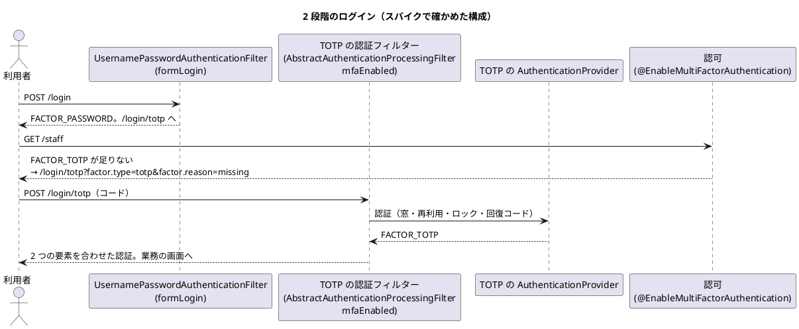

# ADR-011: 多要素認証は Spring Security 7 の要素の権限で組み、TOTP は java-otp で作る

password の後に TOTP を求める 2 段階のログインを、Spring Security 7 の多要素認証（要素ごとの権限）で組む。TOTP の生成は `com.eatthepath:java-otp` に任せ、時間の窓・再利用の拒否・失敗の数え方・回復コードはアプリケーションで持つ。

日付: 2026-10-06

## ステータス

承認（2026-10-11、human:kakimomokuri が Bolt 30 の計画の承認で採用した。Bolt 13 のスパイク TS-01 の結論）

採用のときに決めたこと（Bolt 30 の開始準備と計画の承認）:

- 表は関心事ごとに分ける（TOTP の資格・回復コード・ログインの失敗）。どれも利用者の行と版に触れずに条件付きの更新で書く
- ロックの方針（5 回・15 分）は、利用者の集約でなく、ログインの失敗の集約に置く（失敗のたびに利用者の版が上がると、利用者の管理の更新とぶつかるため）
- 失敗の数え方は H2 と PostgreSQL の共通の構文で書く（ADR-007）。`RETURNING` は使わず、更新の件数で判定し、回数は同じトランザクションで読み直す
- 回復コードは使ったら消さず、使った時刻を入れて残す。ハッシュは bcrypt で、作成と照合はドメインのポートにする
- TOTP の秘密の暗号化の鍵の管理は Bolt 31 の計画で決める（決めた。決定 5）。スパイク（`spikes/ts-01-totp/`）は Bolt 31b の後に消す（本体に登録と回復コードがそろってから。消すときにもう一度確かめる）

Bolt 31 の開始準備と計画の承認（2026-10-13、human:kakimomokuri）で決めたこと:

- K-02（2 段階の画面から password が正しいと分かる）は受け入れる。推測はロックと監査記録で抑える（下の「W5 で人が決める論点」）
- TOTP の秘密はアプリケーションで AES-GCM で暗号化し、暗号文に鍵の版の接頭辞を付ける（決定 5）。`TotpCodeGenerator` は暗号文を受ける
- 要素は全体の注釈で求める（R-08 の比較。代替案）。`SecurityFilterChain` は `identity.infrastructure.config` に置く（決定 4）
- password の段だけの session は、password を確かめた時刻から 5 分で失効させる（決定 2）
- dev のコードは dev 専用の部品を関数の型で注入する。Base32 は自分で書く（決定 1・3）

## コンテキスト

- US-18 は、メールアドレス・password・TOTP で本人確認し、無操作 30 分・最長 8 時間の session を発行する（AC1）。password か TOTP の失敗が 5 回続いたら 15 分ロックする（AC3）。初回は TOTP を登録し、一度だけ使える回復コードを発行する（AC7・AC9）。
- 非機能要件は、password を Argon2id か bcrypt で保存し（SEC-07）、回復コードを 10 個発行する（SEC-09）。
- 技術スタックは、TOTP のライブラリを候補（`dev.samstevens.totp`）として挙げただけで、評価していなかった（TS-01）。リスク台帳には「TOTP と Spring Security 7 の統合が想定より難しい（中・中）」がある。
- アクセス・監査は「単純なモデル」で、認証の仕組みは実績のある部品に任せる（[アーキテクチャ](../../design/cargo-tracker/architecture_backend.md)）。認証の成功・失敗・ロックは、Spring Security のイベントから同期で監査記録に書く（IA-INV-08）。
- 開発環境では、ログインの画面（A-01）と認証コードの画面（A-02）を入力済みにする（2026-10-06 の人の決定。Bolt 13 の確認ポイント 7）。
- Bolt 13 で、本体と分けたスパイク（[`spikes/ts-01-totp/`](https://github.com/k2works/practical-domain-driven-design-in-enterpris-application/tree/develop/spikes/ts-01-totp)）を Spring Boot 4.1.1（Spring Security 7.1.1）で作り、学習テストで確かめた（初めは 29 件。[Bolt 13 のレビュー](../../review/cargo-tracker/bolt_13_review_20261006.md)の指摘で直し、57 件）。

## 決定

### 1. TOTP の生成

**`com.eatthepath:java-otp` で TOTP を作る（HMAC-SHA1、6 桁、30 秒）。前後 1 つの時間の窓の照合、再利用の拒否、一定時間の比較はアプリケーションで持つ。**

| 候補 | RFC 6238 の試験ベクトル | 保守（最後の公開） | ライセンス | 推移的な依存 | 判断 |
| :--- | :--- | :--- | :--- | :--- | :--- |
| (a) JDK の HMAC だけの実装 | 6 件とも一致 | 自分で持つ | — | なし | 代わりの案。HMAC は JDK にあり、自分で持つのは切り詰めの約 10 行で、試験ベクトルで固定できる。差は小さい |
| (b) `java-otp` 1.0.0 | 8 桁で試した 3 件と、6 桁で 6 件とも一致 | 2026-08 | MIT | なし | **採る案**。小さく、依存がなく、保守されている。スパイクの 2 段階のログインはこの生成の上で通る |
| (c) `dev.samstevens.totp` 1.7.1 | 試した 3 件とも一致 | 2020-11 | POM に記載なし | `commons-codec`、ZXing（core・javase） | 採らない。6 年近く更新がなく、QR の画像の部品まで入る |
| `googleauth` 1.5.0 | 試していない | 2020-04 | — | — | 採らない（(c) と同じ理由。計画の確認ポイント 3） |

- (b) が担うのは HOTP の計算と切り詰めだけで、時間の窓での照合の API を持たない。照合は「前後 1 つの刻みのコードを作り、一定時間で比べる」をアプリケーションで書く（スパイクの `SpikeUsers`）。再利用の拒否・秘密の生成・Base32・`otpauth://` の URI もアプリケーションが持つ。
- (a) と (b) の差は小さく、生成をポートの裏に置けば後で替えられる判断である（下の「US-18 の Bolt で要るもの」）。
- 秘密は 160 ビット（20 バイト）の乱数で作り、Base32 で `otpauth://` の URI と、手で入力する文字列に使う案とする。Base32 は JDK にも (b) にもないため、`identity.infrastructure` に自分で書く（RFC 4648、30 行ほど。RFC 4648 の試験ベクトルで確かめる。Bolt 31 で決めた）。`commons-codec` は実行時の依存にないので足さない。dev の入力済み（Bolt 31）と `otpauth://` の URI（Bolt 31b）で使う。URI の組み立てと登録の QR の描き方（ZXing（Apache-2.0）をサーバーで使うか、クライアントで描くか）は Bolt 31b で決める（未確認）。

### 2. 2 段階のログイン（Spring Security 7）

**password（`FACTOR_PASSWORD`）と TOTP（独自の要素 `FACTOR_TOTP`）の両方を、認証が要るすべての画面に求める。**

| 項目 | 方針 | スパイクで分かったこと |
| :--- | :--- | :--- |
| 要素の要求 | `@EnableMultiFactorAuthentication(authorities = {FACTOR_PASSWORD, FACTOR_TOTP})` | 独自の要素の名前（`FACTOR_TOTP`）をそのまま使える |
| 足りない要素の画面へ導く | `DelegatingMissingAuthorityAccessDeniedHandler` で、`FACTOR_TOTP` が足りなければ A-02、`FACTOR_PASSWORD` が足りなければ A-01 | 枠組みが `factor.type`・`factor.reason` を付けて導く。A-02 で理由を示すのに使える |
| TOTP の認証 | `AbstractAuthenticationProcessingFilter` を継ぐフィルター（`POST /login/totp`）と `AuthenticationProvider`。password の要素がそろった session でだけ受け付ける | フィルターの `mfaEnabled` を有効にしても、**結果のトークンの型が `toBuilder()` を自分で宣言していないと、password の要素が合わさらず置き換わる**。独自のトークンにビルダーを持たせる。要素を合わせるのは主体の名前が同じときだけで、別の利用者の password を送っても先の利用者の `FACTOR_TOTP` は引き継がれない |
| session の固定化 | TOTP の段でも session の ID を変え、CSRF のトークンを作り直す（`ChangeSessionIdAuthenticationStrategy` と `CsrfAuthenticationStrategy`）。本体では `http.getSharedObject(SessionAuthenticationStrategy.class)` を渡すか、configurer で組んで formLogin とそろえる | `new` で足したフィルターの既定は何もしない戦略で、権限が上がる TOTP の段で ID が変わらなかった（レビューで見つけて直した） |
| 成功の後の行き先 | 保存した request（深いリンク）へ戻すか、役割ごとの既定の画面へ導く | スパイクは固定の `/staff`。荷主（`/customer`）と社内（`/staff`）の役割分け（US-16）と一緒に決める |
| session の保存 | TOTP のフィルターに `HttpSessionSecurityContextRepository` を設定する | 既定のままでは request の中だけに残る |
| session の直列化 | Spring Session JDBC に、独自のトークン・`FactorGrantedAuthority`・`Instant` を JDK の直列化で置く。要素の権限を足すと配備の前の session は復元できないので、復元の失敗を無効な session として扱い A-03 に送る（Bolt 31 で決めた。ADR-012 のネガティブ）。デモ環境では配備のときにログインし直してもらう | スパイクはメモリの session。本体のセキュリティの統合テスト（PostgreSQL の Testcontainers）で、要素の権限が次の request に残ることと TOTP の段の ID の変化を確かめる（Bolt 31） |
| 失敗の数え方 | password と TOTP の誤りを、`AuthenticationFailureBadCredentialsEvent` の 1 か所で数える。5 回続いたら 15 分ロック（`UserDetails` の `accountLocked` と、TOTP の provider の確認） | 監査記録（IA-INV-08）を書く箇所と同じにできる。ロック中の拒否は数えない |
| 再利用の拒否 | 利用者ごとに最後に使った時間の刻みの番号を持ち、それ以下の刻みを拒否する | TOTP のライブラリの外の記録が要る（H3） |
| 回復コード | TOTP の欄で受け付け、一度だけ使える（本体では使った時刻を入れて行を残す） | 本体ではハッシュ（bcrypt）で保存する |
| 無操作 30 分 | `server.servlet.session.timeout=30m`（Spring Session JDBC では効く設定を確かめる） | 設定しただけで、振る舞いは確かめていない（W5 の統合テスト） |
| 最長 8 時間 | 本人確認の時刻（`AUTHENTICATED_AT`）を、その session で初めて TOTP が通ったときだけ残し、request ごとに比べるフィルター。**期限の確認を 2 つの要素の認証より前に置く**（フィルターの順序に頼らない形も W5 で比べる）。password の段だけの session は、password を確かめた時刻（`PASSWORD_VERIFIED_AT`）から 5 分で失効させ A-03 に送る（A-02 を開いたまま放置した session を残さない。Bolt 31 で決めた）。どちらの時刻もない認証済みの session は失効させる（fail-closed） | 確認を認可の直前に置いたら、期限切れの session に TOTP だけを送って 8 時間延ばせた（レビューで見つけて直した）。Spring Security の `RequiredFactor` には有効期間（`validDuration`）があり時計も替えられるが、期限切れは要素の再入力を求めるもので session を終わらせない。AC5 の再認証には session を捨てるフィルターを使う |
| password の保存 | `PasswordEncoderFactories` の既定（bcrypt、強さ 10） | Argon2id は Bouncy Castle を足さないと符号化で `NoClassDefFoundError` になる。SEC-07 は bcrypt で満たす |
| 更新の原子性 | 失敗の回数は、ロック中でないことを条件にした `UPDATE ... SET consecutive_failures = consecutive_failures + 1` の更新件数で判定し、回数を同じトランザクションで読み直す（H2 と PostgreSQL の共通の構文。ADR-007。採用のときに `RETURNING` から改めた）、再利用の拒否は `UPDATE ... SET last_used_step = :step WHERE last_used_step < :step` の更新件数で判定する。存在しないメールアドレスの失敗では行を作らない | スパイクは `synchronized` とメモリで守った。読んでから書く形では、並んだ試行や複数のインスタンスで 5 回を超えて試せ、同じコードが 2 回通る |

### 3. 開発環境の入力済み

`dev` プロファイルのときだけ、A-01 にメールアドレスと password、A-02 にその時点のコードを入れる。既定の設定（ステージング・本番を含む）では入力済みにしない。誤って入力済みが本番で効くと、password を知った者に A-02 が TOTP を差し出し、多要素認証が無効になるため、次の層で守る。

| 層 | 守り方 | スパイク |
| :--- | :--- | :--- |
| 1 | 入力済みの部品を `@Profile("dev")` の bean にする。controller はその部品の有無だけを見て、TOTP の生成器や利用者の秘密を直接参照しない | `DevLoginPrefill`。既定の設定で A-01・A-02 が空で出ることを確かめた |
| 2 | dev-login の設定（`cargotracker.dev-login.*`）が、`dev` でない、または `staging`・`prod` と併用のプロファイルで入っていたら、起動を失敗させる | `DevLoginGuard`。起動が `IllegalStateException` で失敗することを確かめた |
| 3 | コードを作れるのは、`dev` の設定に書いた開発用の固定の秘密だけにする。利用者の表の秘密（暗号化した値）は復号しない。開発用の利用者でない主体には何も入れない | スパイクは全員が固定の秘密。本体で守る |

dev のコードの部品（Bolt 31 で決めた）: 関数の型 `DevTotpCodeSource`（利用者のメールアドレスからその時点のコードを返す。dev の利用者でなければ空）を `identity.interfaces.web` に置き、`DevLoginPrefill` はこれだけを見る（1 層目）。実装 `DevTotpCodes` は `identity.infrastructure.devlogin` に置き（画面の層の型は実装しない）、`cargotracker.dev-login.accounts[n].totp-secret`（Base32、利用者ごとに別）だけからコードを作り、利用者の表を読まない（3 層目）。組み立ては `identity.infrastructure.config` で、dev プロファイルでだけ `DevTotpCodes` のメソッドを `DevTotpCodeSource` につなぐ。合成ルートが画面の層の型を参照するのは層の規則（interfaces はどの層からも参照されない）の例外で、`identity.infrastructure.config` から `DevTotpCodeSource` だけを許す（公開 API の合成ルートの例外と同じ書き方。Bolt 31 のステップ 6 で規則に当たり、2026-10-13 に human:kakimomokuri が決定）。集約でないドメインのポートは足さない。dev-data の TOTP の資格は、dev の固定の鍵で設定の `totp-secret` を暗号化した値にし、復号すると設定の秘密と一致することをテストで確かめる（4 層目）。
| 4 | 開発用の利用者と固定の秘密は、`spring.flyway.locations` の共通・ベンダーの場所に置かず、`dev` だけで足す場所か起動時の投入にし、その場所をテストで確かめる。利用者を 2 人以上にし、秘密が別であることも確かめる | 本体で守る |
| 5 | ステージング・本番で `SPRING_PROFILES_ACTIVE` を固定し、`dev` を拒否する確認を IaC・CD と運用の手順に足す | 本体で守る（W5） |

本体の `dev` プロファイルは今「H2 で bootRun」の意味で、入力済みの意味がそこに相乗りする。

### 4. `identity` への置き方と仮の主体の置き換え

（置き換えは Bolt 14 で行った。構成は [ADR-012](012-authentication-principal-and-session.md)）

- 認証の主体の型（例: `AuthenticatedActor(UserId, CompanyId, Role)`）は共有カーネル `shared` に置く。ほかのコンテキストは `@AuthenticationPrincipal` でそれだけを受け取り、`FACTOR_*` や認証方式を知らない。今の依存（`identity → quotation::events`）のまま `quotation` が `identity` の API から利用者を引くと、`quotation → identity → quotation::events` の循環になるため。
- `identity` は、利用者・TOTP の資格・回復コード・失敗の記録と、`UserDetailsService`・`AuthenticationProvider`・失敗のリスナーを持つ。TOTP のライブラリへの依存は `identity.infrastructure` に閉じ込める。
- `SecurityFilterChain`（URL ごとの規則、`/customer`・`/staff`）は `identity.infrastructure.config` に置く（Bolt 14 で置き、Bolt 31 で決定にした。`platform` には置かない）。TOTP の段の部品（フィルター、`toBuilder()` を宣言した独自のトークン、provider）と暗号化は `identity.infrastructure.security` に置く。
- 置き換えの順: ① 主体の型を `shared` に足す → ② 認証を入れて主体を解決する → ③ controller を 1 つずつ置き換える → ④ `ProvisionalActorProperties` を消す。

### 5. TOTP の秘密の暗号化（Bolt 31）

**TOTP の秘密は、アプリケーションで AES-GCM で暗号化して表に置き、復号から消去までを `identity.infrastructure` の中で済ませる。**

| 項目 | 方針 |
| :--- | :--- |
| 方式 | AES-GCM。鍵は 256 ビット、IV は 96 ビットで毎回乱数で作る。JDK の `Cipher` で組む（spring-security-crypto の `Encryptors` の既定の IV は 16 バイトのため。新しい依存なし） |
| 暗号文の形 | `v1:<Base64(IV + 暗号文 + タグ)>`。先頭に鍵の版を持つ。知らない版・タグの不一致・壊れた Base64 は例外にし、受け付けない（fail-closed） |
| 鍵 | プロパティ `cargotracker.totp-secret-keys.v1`（Base64）。環境変数 `CARGOTRACKER_TOTPSECRETKEYS_V1` から渡し、本番は Secrets Manager から注入する（W10 の IaC）。鍵がない・32 バイトでないときは起動で失敗する。dev とテストは固定の鍵（本物の秘密ではない） |
| 鍵の入れ替え | `v2` を足し、読むときは接頭辞の版の鍵で復号し、書くときは最新の版で暗号化する。入れ替えの手順は W10 の運用手順書に書く |
| 生成のポート | `TotpCodeGenerator#code(EncryptedSecret, long)`。実装（`JavaOtpTotpCodeGenerator`）の中で復号 → 生成 → 配列を消す。平文の秘密をドメインとアプリケーションの層に出さない（Bolt 30 の議題 2 の②）。`TotpCredential#matchingStep` は自分の暗号文を生成器に渡す |
| 照合 | 前後 1 つの刻みでの照合と刻みの使用（条件付きの更新）は、アプリケーションのサービス `TotpVerificationService`（`identity.application.internal.commandservices`）が行う。Spring Security の provider は結果を認証の成否に直すだけにする（ADR-012 の D-5 の認証の例外） |

ArchUnit で、暗号化の部品と `javax.crypto` を参照するのが `identity.infrastructure` だけであることを守る。

### 代替案

| 案 | 却下理由 |
| :--- | :--- |
| 独自のフィルターの連鎖で段階を管理する（Spring Security 6 までのやり方） | Spring Security 7 の要素の権限で、足りない要素への誘導と認可の判定を枠組みに任せられる |
| password と TOTP を 1 つの画面で同時に送る | 誤った password でも TOTP を試せ、どちらが誤りかの扱いが複雑になる。US-18 の画面（A-01・A-02）と合わない。ただし 2 段階の画面は AC2 と緊張する（下の「W5 で人が決める論点」） |
| 開発環境では TOTP を飛ばす | 開発と本番で認証の流れが変わり、2 段階のログインを開発環境で確かめられない（確認ポイント 7） |
| 要素を全体の注釈でなく URL ごとに求める（`AuthorizationManagerFactories` 等で、登録の画面は `FACTOR_PASSWORD` だけ） | Bolt 31 で比べて採らなかった（R-08）。URL ごとでは、新しい URL を足したときに要素の要求を書き漏らすと TOTP なしで開ける。全体の注釈なら既定で 2 つの要素を求め、漏れても閉じる側に倒れる。password の要素だけで入れる例外は、A-02（`/login/totp`）と登録の案内（`/login/totp/enroll`。Bolt 31）、A-07（同じ URL。Bolt 31b）、A-06（Bolt 33）に限り、`requestMatchers` に足す。登録を終えていない利用者は、例外の URL のほかに入れない |
| Argon2id にする | Bouncy Castle が要る。bcrypt で SEC-07 を満たすため、足す理由がまだない |

## 影響

### ポジティブ

- 認証の流れと認可の判定を枠組みに任せ、アプリケーションが持つのは TOTP の照合・再利用・失敗の数え方・回復コードだけになる。
- 失敗の数え方と監査記録を、Spring Security のイベントの 1 か所にまとめられる。
- 新しい依存は `java-otp` 1 つで、推移的な依存がない。

### ネガティブ

- Spring Security 7 の多要素認証は新しい仕組みで、「結果の型が `toBuilder()` を宣言していないと要素が合わさらない」「追加したフィルターは session の ID を変えない」のような資料の少ない振る舞いがある。US-18 で統合テストを厚くし、版を上げるときの回帰の守りにする。
- TOTP はサーバーの時計の正しさに依存する。前後 1 つの窓（±30 秒）を超えるずれは認証の障害になる。NTP（ECS なら Amazon Time Sync）の前提を、非機能要件か運用要件に書く。
- 要素の権限の発行時刻（`FactorGrantedAuthority` の `issuedAt`）はシステムの時計で決まり、アプリケーションの `Clock` で動かせない。時刻に頼る判定（最長 8 時間）は、session に残す自分の時刻で行う。
- 再利用の拒否・失敗の回数・ロック・回復コードの記録が、複数のアプリケーションの実行環境で共有される必要がある（本体では表）。

### US-18 の Bolt で要るもの

| 種類 | 内容 |
| :--- | :--- |
| 表（`identity`） | 利用者（メールアドレス、password のハッシュ、状態、所属企業）、TOTP の資格（暗号化した秘密、最後に使った時間の刻み）、回復コード（ハッシュ、使った時刻）、ログインの失敗（連続の回数、ロックの期限） |
| 画面 | A-01（ログイン）、A-02（認証コード。回復コードの入力（Bolt 31b）、ロック中の案内と解ける時刻（Bolt 32）。A-02 に来る理由は password の後だけなので、`factor.reason` に応じた案内は出さない（Bolt 31 で決めた））、TOTP の登録（A-07。QR か手入力の秘密、回復コードの表示。Bolt 31b） |
| 置き換え | 仮の主体（`ProvisionalActorProperties`）を、認証の主体から利用者と荷主企業を引く形に置き換える。荷主の画面（`/customer`）と社内の画面（`/staff`）の役割を分ける（US-16） |
| 開発環境 | 開発用の利用者（荷主担当者・営業担当者）と固定の TOTP の秘密を `dev` プロファイルで投入し、A-01・A-02 を入力済みにする（決定 3 の 5 つの層） |
| 部品の分け方 | TOTP の生成は `TotpCodeGenerator` のポート（`identity.domain.model.aggregates`。Bolt 31 で暗号文と時間の刻みを受ける形 `code(EncryptedSecret, long)` にした）と java-otp の実装（`identity.infrastructure`）に分け、RFC 6238 の試験ベクトルを契約テストにする。ロックの方針（5 回・15 分）はログインの失敗の集約（採用のときに利用者の集約から改めた）、再利用の不変条件（刻みは単調に増える）は TOTP の資格、一度だけ使う回復コードはハッシュの照合に置く |
| テストのデータ | スパイクは singleton の利用者と時計をテストで共有し、並列実行では壊れる。本体ではテストごとにデータを分ける |

### 未確認の項目

Bolt 31 で解いたもの（決定に移した）: TOTP の秘密の暗号化の鍵の管理（決定 5）、秘密の Base32 の出どころ（決定 1）、Spring Session JDBC の上の直列化と changeSessionId（決定 2 の「session の直列化」。統合テストで確かめる）。無操作 30 分の設定は Bolt 14 で `spring.session.timeout` と確かめた（ADR-012）。

- 登録の QR の描き方（ZXing をサーバーで使うか、クライアントで描くか）と `otpauth://` の URI の組み立て（Bolt 31b）。
- 回復コード 10 個の発行（SEC-09）とハッシュでの保存（スパイクは 2 個を平文で持つ。保存は Bolt 30 で作った。発行は Bolt 31b）。
- java-otp の生成器のスレッドセーフ（スパイクは照合を `synchronized` の中で行う）。
- 最長 8 時間を即時失効（BR-14）と同じ経路にできるか（Bolt 32）。
- 同じ利用者の同時のログインと、同じコードの同時の送信（1 つだけ通ること）。学習テストは MockMvc だけ。
- 初回の登録（AC7）の画面の認可と、登録を終えていない利用者の扱い。登録の完了時に最初のコードを確かめて `FACTOR_TOTP` を与えるか。
- password の再設定（SEC-08）と、TOTP の再登録（SEC-10）の流れ。
- 利用者の画面で「次に取れる操作」（T-35）: A-02 で誤ったときは再入力か回復コード、ロック中は解ける時刻を示して待つ、端末を失ったときは回復コードか管理者への連絡。US-18 の計画の確認ポイントにする。

### W5 で人が決める論点

- AC2（利用者の存在や失敗箇所を第三者が推測できる詳細を示さない）と 2 段階の画面の緊張。A-02 に進めば password が正しいと分かる。ロックの確認は password の照合より先に行われ、存在しない利用者はロックされないため、ロックの表示（A-02 の解ける時刻を含む）から利用者の存在が分かる。
  - 決定（K-02。2026-10-13、Bolt 31 の開始準備で human:kakimomokuri が決めた）: 受け入れる。password が正しいときだけ A-02 に進めるのは一般的な 2 段階のログインの形で、1 つの画面で同時に送る案（代替案）より扱いが単純になる。password の推測は、ロック（5 回・15 分。Bolt 32）と監査記録（失敗の利用者と理由）で抑える。A-02 の誤り・再利用は password の要素を捨てて A-01 に戻し、1 つの session で TOTP を試し続けられないようにする。ロックの表示の文言は Bolt 32 で決める。
- 複数の利用者への password の総当たり（spraying）は利用者ごとのロックでは防げない。送信元ごとの流量の制限を非機能要件で扱うか。
- 本体の `same-site=lax` のつなぎ（D-21）と、US-18 で有効にする CSRF の防御との関係。
  - 決定（S-01。Bolt 31 の計画の承認）: 今の設定（`same-site=lax` と Spring Security の CSRF のトークン）を保つ。A-02 の POST にもトークンが要ることを統合テストで確かめる。lax は外のサイトからの POST に cookie を付けないので、トークンと二重に守る。

## コンプライアンス

- US-18 の Bolt で、本体の統合テストに次を加える。2 つの要素がそろわないと業務の画面を開けない（全 URL）、再利用の拒否、5 回の失敗のロックの境界（4・5 回、14 分 59 秒・15 分）、最長 8 時間の境界（7 時間 59 分 59 秒・8 時間）、期限切れの session に TOTP を送っても延びない、TOTP の段で session の ID が変わる、ロック中の誤りで期限が延びない、認証の成功・失敗・ロックが同じ transaction で監査記録に書かれる（IA-INV-08）。
- 枠組みの振る舞いの特性テスト（ビルダーのないトークンでは `FACTOR_PASSWORD` が失われる、既定のリポジトリでは request の中にしか残らない、要素の発行時刻はシステムの時計）を置き、Spring Security の版を上げるときの回帰の守りにする。
- 既定・staging・prod の設定で A-01・A-02 が入力済みにならないこと、dev の外で dev-login の設定があると起動しないことを、本体のテストで守る。
- ArchUnit で、TOTP のライブラリへの依存を `identity.infrastructure` に閉じ込め、ほかのコンテキストが `FACTOR_*` を参照しないことを守る。暗号化の部品と `javax.crypto` を参照するのも `identity.infrastructure` だけにする（Bolt 31）。

## 改訂の経緯

- 2026-10-13: Bolt 31 の開始準備と計画の承認で、TOTP の秘密の暗号化（決定 5。AES-GCM、鍵の版の接頭辞、環境変数の鍵）、`TotpCodeGenerator` が暗号文を受ける形、K-02 を受け入れる判断、R-08 の比較の結果（全体の注釈を採る）、`SecurityFilterChain` の置き場所、password の段の上限 5 分、dev のコードの部品の置き方、Base32 を自分で書くことを足した。「未確認の項目」から解いたものを決定に移し、スパイクの削除の時期を「Bolt 31b の後」に改めた（31 と 31b に分けたため。human:kakimomokuri が決定）。
- 2026-10-11: Bolt 30 の計画の承認で採用した。ロックの方針を利用者の集約からログインの失敗の集約に改め、失敗の数え方を `RETURNING` から更新の件数の判定に改めた（ステータスの「採用のときに決めたこと」）。

## 参考資料

- [Bolt 13 計画](../../development/cargo-tracker/bolt_13_plan.md)、[Bolt 13 終了報告](../../development/cargo-tracker/bolt_13_report.md)、[Bolt 13 のレビュー](../../review/cargo-tracker/bolt_13_review_20261006.md)
- スパイク: `spikes/ts-01-totp/`（`SpikeSetupTest`、`TotpCandidatesTest`、`MfaLoginTest`、`DevLoginPrefillTest`、`PasswordStorageTest`、`SessionTimeoutTest`）
- RFC 6238（TOTP）、RFC 4226（HOTP）
- [ユーザーストーリー](../../requirements/cargo-tracker/user_story.md)（US-18）、[非機能要件](../../design/cargo-tracker/non_functional.md)（SEC-04〜10）、[技術スタック](../../design/cargo-tracker/tech_stack.md)（TS-01）
