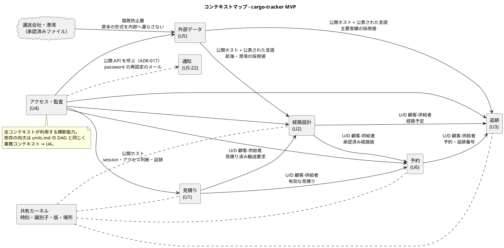
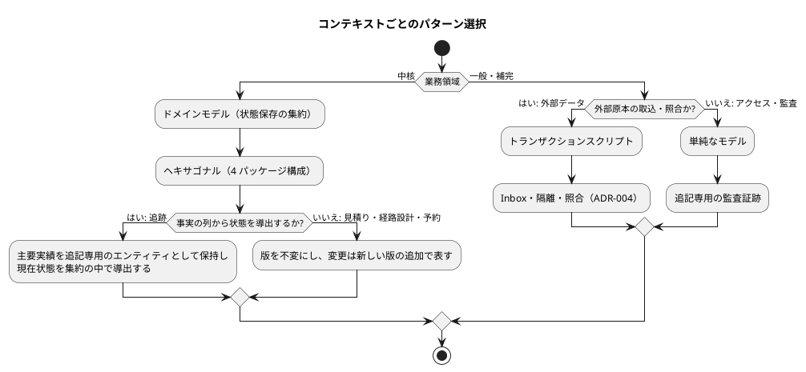
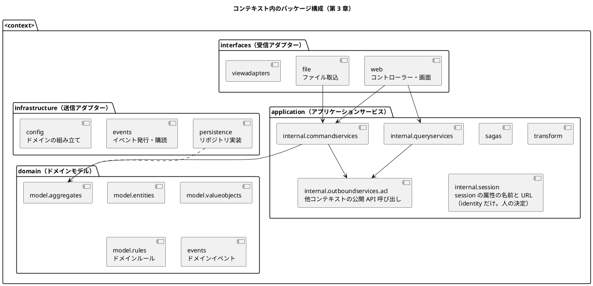
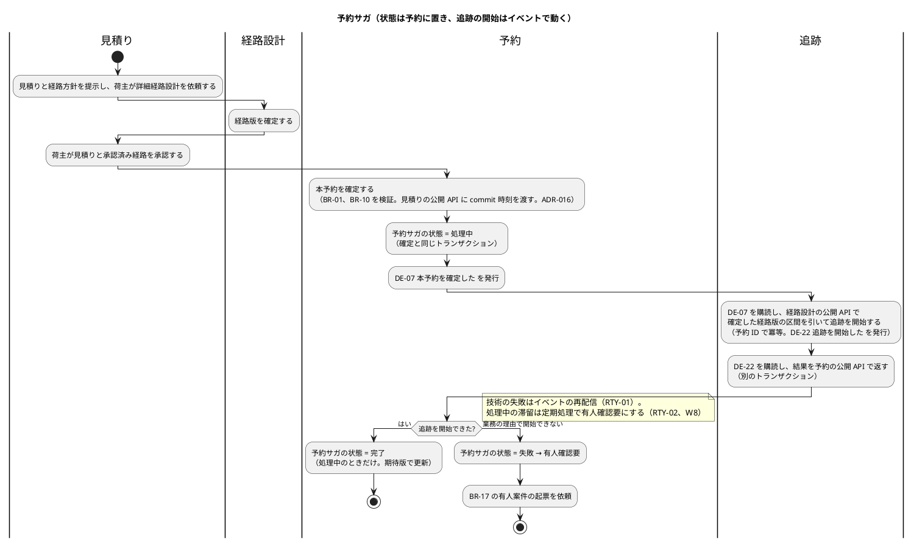

# cargo-tracker バックエンドアーキテクチャ

## 位置づけ

本書は、[Unit 定義](../../requirements/cargo-tracker/units.md) の U1〜U6 と [要件定義](../../requirements/cargo-tracker/requirements_definition.md) の BR・NFR をもとに、バックエンドの構造を決める。設計の語彙と進め方は開発ガイドラインの [第 1 章](../../article/01-ddd-fundamentals.md)・[第 2 章](../../article/02-cargo-domain-model.md)・[第 3 章](../../article/03-spring-modular-monolith.md) に従う。言語・フレームワーク・製品は技術スタック選定（後続工程）で決める。第 3 章が示す Spring Platform の構成は、その第一候補として扱う。

本書の判断は次の ADR に記録する。

| ADR | 決定 |
| :--- | :--- |
| [ADR-001](../../adr/cargo-tracker/001-modular-monolith.md) | モジュラーモノリスで構築し、物理的なサービス分割は行わない |
| [ADR-002](../../adr/cargo-tracker/002-domain-logic-pattern-per-context.md) | ドメインロジックのパターンを境界づけられたコンテキストごとに選ぶ。MVP ではイベントソーシングを使わない |
| [ADR-003](../../adr/cargo-tracker/003-inter-context-integration.md) | コンテキスト間は冪等コマンド、永続化したドメインイベント、オーケストレーション型のサガで連携する |
| [ADR-004](../../adr/cargo-tracker/004-external-data-ingestion.md) | 外部原本は Inbox・隔離・照合の 3 段で取り込む |
| [ADR-005](../../adr/cargo-tracker/005-server-side-rendering.md) | 画面はサーバーサイドレンダリングとハイパーメディアで提供する |

## 開発ガイドラインとの対応

第 2 章の DDD モデリングプロセス（サブドメイン → 境界づけられたコンテキスト → ドメインモデル → ドメインモデルの操作 → サガ → ドメインモデルサービス）のうち、本書は前半の高レベル成果物と、最後のドメインモデルサービスの構造を扱う。集約・操作・サガの詳細はドメインモデル設計（後続工程）で扱う。

| ガイドラインの考え方 | 本書での適用 | ガイドラインとの違いと理由 |
| :--- | :--- | :--- |
| サブドメインごとに境界づけられたコンテキストを 1 つ割り当てる（第 2 章） | Unit = サブドメイン = コンテキストとして 1 対 1 に対応させる | なし |
| Booking・Routing・Handling・Tracking の 4 コンテキスト（第 2 章） | 見積り・経路設計・予約・追跡・アクセス・監査・外部データ・通知の 7 コンテキスト | 要件で見積り（U1）と予約（U6）を分けた。荷役（Handling）は第 2 段階。認証・監査と外部原本の取込は独立した規則を持つため、別のコンテキストにした |
| 予約コンテキストが貨物に経路を割り当てる（第 2 章 Assign Route to Cargo） | 経路設計コンテキストが経路版を作り、専門家の承認を経て確定する。予約は承認済み経路版を参照するだけ | 経路の比較・専門家判断・版管理（US-06〜US-08、BR-11）が要件の中核のため |
| モジュラーモノリス、単一 DB（第 3 章） | 同じ。DB は 1 つで、コンテキストごとにスキーマを分ける | スキーマ分割は境界を DB でも強制するための追加 |
| interfaces / application / domain / infrastructure の 4 パッケージ（第 3 章） | 同じ構成を全コンテキストで使う | なし |
| ドメイン層はフレームワークに依存しない。ArchUnit で固定する（第 3 章） | 同じ | なし |
| モノリスでは状態保存の集約を使う。イベントソーシングは CQRS/ES 編（第 5 章）で扱う（第 3 章） | 全コンテキストで状態保存の集約を使う | なし |
| BC 間通知はアプリケーションイベントを AFTER_COMMIT で購読する（第 3 章） | Spring Modulith の `@ApplicationModuleListener`（コミット後に非同期で、新しいトランザクションで処理する）で購読し、発行したイベントを永続化して未完了の配信をやり直す | PV-01 は重複予約・原本消失を 1 件も許さない。コミット後・購読前にプロセスが止まるとイベントが失われるため |
| サガは第 3 章では未使用（第 5 章で導入） | 予約サガをモノリスの中でオーケストレーション型として実装する | ARCH-HO-02 が部分成功の管理を求めているため |
| 受信サービスは REST API とネイティブ Web API（Thymeleaf + htmx）（第 3 章） | 画面はネイティブ Web（サーバーサイドレンダリング）で提供する。REST API は外部の利用者が現れた時点で追加する | パイロットに外部の API 利用者がいないため（BR-18、OQ-05） |

## 設計の前提

| 前提 | 根拠 | 設計への影響 |
| :--- | :--- | :--- |
| MVP は予約・経路設計・基本追跡の縦の流れを通すウォーキングスケルトン | インセプションデッキ 6 章、units.md | 最初から全コンテキストの骨格を置き、中身は Bolt ごとに厚くする |
| 版と証跡が業務の中心にある | BR-04、BR-05、BR-10、BR-11、BR-16、NFR-AUDIT-01 | 上書きではなく、新しい版・新しい実績の追加でモデル化する |
| パイロットは外部 API を使わず承認済みファイルを手動で取り込む | BR-18、OQ-05 | 外部連携は外部データコンテキストに閉じ、後から API の受信口に差し替えられるようにする |
| 権限外開示・外部原本消失・重複予約が 1 件でも出たらパイロット中止 | PV-01 | 認可・冪等性・原本保存をアーキテクチャで保証し、個々の画面実装の注意に頼らない |
| チームは小規模で、物理分割の運用負荷を負えない | インセプションデッキ 8 章（仮定）、本リポジトリの実体制 | デプロイは 1 単位にし、境界は論理モジュールで守る |

## 境界づけられたコンテキスト

Unit は業務能力の単位であり、デプロイ単位ではない（units.md「AI の仮定と要確認」）。MVP では、第 2 章と同じく 1 つのサブドメインに 1 つのコンテキストを対応させる。通知だけは Unit ではなく一般のサブドメインとして独立させた（U3 のストーリー US-22 を実現する）。KPI の計測（US-21）はアクセス・監査コンテキストに置く。

| コンテキスト | Unit | 業務領域の分類 | 主な集約候補 | 根拠 |
| :--- | :--- | :--- | :--- | :--- |
| 見積り（Quotation） | U1 | 中核 | 輸送要求、見積り | 顧客要件理解・見積り管理はコアのケイパビリティ |
| 経路設計（Routing） | U2 | 中核（差別化の源泉） | 経路設計案件（経路版を含む）、航海（Voyage） | 制約対応型経路設計は A 社の競争優位。航海は第 2 章と同じく経路設計が持つ |
| 予約（Booking） | U6 | 中核 | 貨物予約（予約版を含む） | 予約管理はコアのケイパビリティ。第 2 章の Cargo 集約に当たる |
| 追跡（Tracking） | U3 | 中核 | 追跡記録（主要実績を含む）、有人案件 | 状態管理・例外対応はコアで成熟度が低い。第 2 章の TrackingActivity に当たる |
| アクセス・監査（Identity & Audit） | U4 | 一般 | 企業、利用者、参照許可、監査証跡 | 業務固有性は低く、標準的な手法で足りる |
| 外部データ（External Data） | U5 | 補完 | 取込バッチ、外部原本、隔離案件 | 中核を支える取込・照合 |
| 通知（Notification） | U3（US-22） | 一般 | 通知 | 利用者へのメールの送信と送信の記録。W5（Bolt 33）で最小に新設し、送信の公開 API（`notification.interfaces.api`）で password の再設定のメールを送る（[ADR-017](../../adr/cargo-tracker/017-notification-module-and-mail.md)）。荷主へのメール通知（UC-13 の一部を MVP へ前倒し。US-22、W9）も同じモジュールに足す。業務の判断を持たない。第 2 段階の通知（配信設定、代替チャネル）もここで拡張する |

荷役（Handling）は第 2 段階で加える。MVP の主要実績の登録（US-12）は、追跡管理者が追跡コンテキストで行う。荷役コンテキストを加えるときに、実績の登録をどちらが持つかを見直す。

集約・エンティティ・値オブジェクトの詳細はドメインモデル設計（後続工程）で決める。

### コンテキストマップ

矢印は「上流（U）が下流（D）へ成果を提供する」向きで描いている。units.md の DAG（利用側 → 依存先）とは向きが逆だが、関係は同じである。

| 関係 | 上流 → 下流 | パターン | 結合を抑える条件（units.md より） |
| :--- | :--- | :--- | :--- |
| 見積り → 経路設計 | Q → R | 顧客-供給者 | 見積り計算の内部過程を経路設計に漏らさない |
| 見積り → 予約 | Q → B | 顧客-供給者 | 見積りの内部情報を予約へ複製せず、見積り ID・版・有効期限だけを渡す |
| 経路設計 → 予約 | R → B | 顧客-供給者 | 経路算出方法を予約に漏らさない |
| 予約 → 追跡 | B → T | 顧客-供給者 | 見積りの内部情報を追跡へ公開しない。追跡は DE-07（荷主・荷受人の企業 ID を含む）を購読し、結果を `booking :: api` で返す（ADR-015。Bolt 25） |
| 経路設計 → 追跡 | R → T | 顧客-供給者 | 候補計算の内部過程を追跡へ公開しない。追跡は `routing :: api` で確定した経路版の区間を引く（Bolt 25） |
| 外部データ → 経路設計・追跡 | X → R、T | 公開ホスト + 公表された言語 | 未検証の原本を採用値として渡さない |
| 外部 → 外部データ | EXT → X | 腐敗防止層 | 提供元の形式を経路規則へ直接漏らさない |
| アクセス・監査 → 全体 | IA → 全体 | 公開ホスト | 認証方式・監査方式を業務規則へ埋め込まない |
| 共有カーネル | 全業務コンテキスト | 共有カーネル（第 3 章） | 業務の意味を持たない基本型だけに限る |
| 追跡 → 予約（イベントのみ） | T → B | 公表された言語（ドメインイベント） | 集荷実績の採用と引渡しの確認だけを通知する。予約は追跡の公開 API・内部に依存しない（[ドメインモデル](domain_model.md) DE-09、DE-10。第 2 章で Booking が Cargo Handled を購読するのと同じ）。注: 予約が追跡のイベントを購読すると `booking → tracking :: events` が加わり、ADR-015 の依存の向き（`tracking → booking`・`routing`）と循環する。DE-09・DE-10 は ADR-014 の形（追跡の listener が予約の公開 API を呼ぶ）にそろえ、US-12 の残り（W7）の Bolt で直す |
| 予約 → 見積り（下流から上流への通知） | B → Q | 下流の listener が上流の公開 API を呼ぶ（[ADR-014](../../adr/cargo-tracker/014-downstream-to-upstream-notification.md)） | 本予約の確定（DE-07）を予約の listener が受け、見積りの公開 API で輸送要求を予約確定済みにする（W4） |
| 経路設計 → 見積り（下流から上流への通知） | R → Q | 下流の listener が上流の公開 API を呼ぶ（ADR-014） | 経路の確定（DE-05）を経路設計の listener が受け、見積りの公開 API（経路の割当て）で依頼元の見積りに経路版を割り当てる（Bolt 20）。見積りは経路設計のイベントを購読しない |
| アクセス・監査 → 通知（公開 API の呼び出し） | IA → N（呼ぶ向き） | 公開ホスト（通知の公開 API を、アクセス・監査の ACL が同期で呼ぶ。[ADR-017](../../adr/cargo-tracker/017-notification-module-and-mail.md)） | ADR-014 の「下流の listener が上流の公開 API を呼ぶ」形ではなく、通知は送信の能力を公開 API で提供する。通知は `identity` に依存しない（宛先は呼ぶ側が渡す。US-22 の宛先の渡し方は W9 の開始準備で決める）。password の再設定のメールを、依頼の応答から切り離したイベントのハンドラーが送る（Bolt 33） |

下流のコンテキストは、上流の公開 API を自分の application 層の ACL（腐敗防止層）越しに呼ぶ（第 3 章 `application.internal.outboundservices.acl`）。上流のドメインオブジェクトを自分のドメイン層に持ち込まない。

公開 API の置き場所と形（Bolt 17 で最初の公開 API を作ったときに決めた。[Bolt 17 計画](../../development/cargo-tracker/bolt_17_plan.md) の確認ポイント 2）:

- 上流のコンテキストは、公開 API を `<コンテキスト>.interfaces.api` パッケージに置き、Spring Modulith の名前付きインターフェース（`@NamedInterface("api")`）にする。開発ガイドライン第 3 章のインターフェース層（「プロトコルで分類した全てのインバウンドサービス」）に当たるため（2026-10-09、Bolt 25 の開始準備の人の指示）。中身は照会・操作のインターフェースと、引数・戻り値の record だけ。それを実装するインバウンドアダプター（アプリケーションサービスに委ねるだけ）は `<コンテキスト>.interfaces.api.internal` に置き、名前付きインターフェースには含めない（Bolt 25 の実装で決めた）。見積りの公開 API も、もとの `quotation.api`（実装は `application.internal.queryservices`・`commandservices`）から `quotation.interfaces.api` に移し、実装を `interfaces.api.internal` のアダプターにした（2026-10-09、人の指示）。公開 API を `<コンテキスト>.interfaces.api` 以外に置かないことは `PublicApiArchitectureTest` の「公開 API は interfaces の api にだけ置く」で確かめる
- 戻り値は Java の標準と共有カーネルの型（`Location`、`UtcInstant` など）と文字列だけで表し、上流のドメインの型を持たない（イベントと同じ規則。ArchUnit で確かめる）。
- 業務の処理は上流の `application.internal.queryservices`（照会）・`commandservices`（操作）に置き、`interfaces.api.internal` のアダプターから呼ぶ（interfaces → application の向き）。アダプターは画面のコントローラーと同じく部品探索で拾う（`@Component`。合成ルートの `infrastructure.config` は層の規則で interfaces の実装を参照できないため。Bolt 25）
- 下流は `application.internal.outboundservices.acl` から呼び、自分のドメインの型に変える。下流のモジュールの `allowedDependencies` に `<上流> :: api` を足す。層の規則（`LayerArchitectureTest` の「interfaces はどの層からも参照されない」）の例外として、他のコンテキストの `application.internal.outboundservices.acl` と、公開 API を腐敗防止層に渡す合成ルート（`infrastructure.config`）だけが `<コンテキスト>.interfaces.api` を参照してよい（合成ルートは Bolt 25 の実装で足した）。公開 API の形の検査（`PublicApiArchitectureTest`）は `*.interfaces.api` を対象にする（Bolt 25。2026-10-09 に human:kakimomokuri が決定）
- 下流から上流への通知（ADR-014）では、上流の公開 API に冪等な操作のインターフェースを置き、業務の処理は上流の `application.internal.commandservices` に置く。業務の拒否は戻り値の値で返す。最初の操作は、見積りの「経路の割当て」（`quotation.interfaces.api.RouteAssignment`。案件番号・経路版番号・確定の時刻・区間を受け、依頼元の見積りに割り当てる。Bolt 20）。
- 最初の公開 API は、見積りの「経路条件の照会」（`quotation.interfaces.api.RouteConditionQuery`。輸送要求 ID と版番号から、出発地・目的地・希望到着期限・貨物種別を返す）。経路設計が DE-16 を受けて経路設計案件を作るときに呼ぶ。
- 予約が使う見積りの公開 API（Bolt 23・23b）: 確定に使えるかの照会（`BookableQuotationQuery`。業務番号・見積り番号・commit 時刻から、確定に要る写しか使えない理由を返す。ADR-016）と、予約確定済みの通知（`BookingNotification`。ADR-014）。
- 予約の確定できる貨物の規則（Bolt 35。US-04 AC5、B-INV-04）: `BookableCargoPolicy` は `booking.domain.model.rules`（`@DomainRule`。予約で最初の rules のパッケージ）に置き、見積りの公開 API から写した貨物種別の名前（`BookingTerms.cargoCategory`）だけで判定する。見積りの `MvpAcceptancePolicy` は使わない（予約は見積りのドメインに依存しない。予約の `allowedDependencies` は `shared`・`quotation :: api`・`platform :: web` だけで、`ModularityTest` が検証する。AT-03）。サービスは見積りの照会の後、確定条件の前に規則で判定して特殊貨物の拒否を返し、`Booking.confirm` も同じ規則で判定して拒否の例外を投げる（規則を通さずに確定できない）。S-09 を開いたときの読み取りモデル（`BookingConfirmationPage.Available.specialCargo`）も同じ規則を使い、確定の POST の拒否は結果を画面に渡す。期限の判定を見積りの 1 か所に置いた ADR-016 と違い、特殊貨物は予約が引き受けない業務の範囲なので、見積りの規則が変わっても予約が自分で拒む（二重の守り）。予約が比べる名前 `GENERAL` は見積りの公開 API の `BookableQuotationResult.cargoCategory` の Javadoc に値の集合とともに約束として書いた。予約から見積りのドメインへの型の依存を見る ArchUnit の規則はなく、`ModularityTest` の allowedDependencies の検証だけが守る（Bolt 35 の既知の課題）
- 再見積りできるかの判定（D-85。Bolt 35c。Bolt 35c の開始準備の決定 (6)、human:kakimomokuri）: ドメインの規則 `quotation.domain.model.rules.RequotePolicy`（`rejection(TransportRequest, Quotation, UtcInstant)`）に置く（開始準備では照会のサービスに置くと決めたが、Bolt 35c の開発レビューで、コマンドのサービスが照会のサービスに依存する向きを避け、S-09 の `BookableCargoPolicy` と同じドメインの規則に移した。human:kakimomokuri）。順は輸送要求の状態（予約確定済みは `TRANSPORT_REQUEST_BOOKED`、再見積りできる状態の集合 `REQUOTABLE` にない状態は `TRANSPORT_REQUEST_NOT_QUOTING`）→ 版 → 集約の判定時刻の判定（`Quotation.requoteRejectionAt`）。見つからないかは呼び手（画面のコントローラーと `QuotationCommandService.requote`）が先に見る。2 つの集約を読むだけで、変えない。S-04 の再見積りのボタン（画面のモデルに渡す値）・GET と POST の再見積りのサービスがこの規則を使い、開いたとき・送ったときに同じ理由を示す。S-02 の予約の確定待ちの表のリンク（「… を再見積りする」）はこの規則を通さず、見積りの状態と有効期限だけで出す（読み取りモデルで集約を組み立てない。開いた S-04 の GET が規則で判定する）。画面の判定だった `Quotation.requoteRejection()` は消す
- 荷主の画面（C-02・C-04）は、輸送要求が荷主承認待ち・予約待ちのとき荷主に見える最新の見積りから状態と案内を選ぶ（[ADR-018](../../adr/cargo-tracker/018-requote-returns-transport-request-with-ordering-guard.md) の、輸送要求はどの見積りのための状態かを持たないことの帰結。表示の対応は `TransportRequestLabels`。[UI 設計](ui_design.md)の「見積依頼から本予約まで」の対応表。D-85。Bolt 35d）
- アクセス・監査が使う通知の公開 API（Bolt 33。[ADR-017](../../adr/cargo-tracker/017-notification-module-and-mail.md)）: password の再設定のメールの送信（`notification.interfaces.api.PasswordResetMail`。依頼の ID・トークンの ID・宛先の利用者の ID・アドレス・再設定の URL・期限・言語を受け、送信の記録を残して送る。結果は `Sent`・`AlreadySent`（同じ依頼の ID と宛先で記録済み）・`Failed`）。呼ぶ側は `identity.application.internal.outboundservices.acl.NotificationPasswordResetMails` で、イベントのハンドラー `PasswordResetMailEventHandler`（`@ApplicationModuleListener`）から呼ぶ。アダプターは `notification.interfaces.api.internal` に置き、通知のアプリケーションサービス `PasswordResetMailService`（`notification.application.internal.commandservices`）に委ねる。
- 追跡が使う公開 API（Bolt 25。ADR-015）: 経路設計の経路版の区間の照会（`routing.interfaces.api.RouteVersionLegQuery`。案件番号と経路版番号から、確定した経路版の区間を区間の順に返す。ない経路版は空）と、予約の追跡の開始の通知（`booking.interfaces.api.TrackingStartNotification`。予約 ID・追跡番号・開始時刻を受け、処理中の予約サガを完了にする。結果は `Completed`・`AlreadyCompleted`・`NotCompleted(reason)`）。

### 共有カーネル

第 3 章の共有カーネルを、次の基本型に限って使う。業務規則を持つ型は共有しない。

| 型 | 内容 |
| :--- | :--- |
| UTC 時点 | UTC で保存し、表示時に利用者のタイムゾーンと UTC offset を付ける（BR-10） |
| コマンド ID、集約の版 | ARCH-HO-01 の冪等性と期待版の照合に使う |
| 場所 | UN/LOCODE による場所の識別（インセプションデッキ ガイディングプリンシプル） |
| 出典 | 実績や採用値の根拠（種類・参照・取得時刻）。種類は外部原本・現場記録・社内確認・手動入力の 4 値（航海の出典の種類と同じ）。業務の判断（採否・重複）は各コンテキストが持つ（ドメインモデルの共有カーネルで設計済み。Bolt 26b で追跡の主要実績に使い始めた。DE-13（W7）でイベントの契約に入る） |
| 業務 ID の基底 | 予約 ID、追跡番号などの不透明な識別子の基底型 |

## ドメインロジックパターンの選択

[アーキテクチャ設計ガイド](../../reference/アーキテクチャ設計ガイド.md) の選択フローをコンテキストごとに当てはめ、第 3 章の「モノリスでは状態保存の集約を使う」に合わせて調整した（ADR-002）。

| コンテキスト | ドメインロジック | テストの形 | 選定理由 |
| :--- | :--- | :--- | :--- |
| 見積り | ドメインモデル。版を明示した集約 | ピラミッド | 有効期限の境界（BR-10）、版の置換（BR-16）など規則が多い |
| 経路設計 | ドメインモデル。版を明示した集約 | ピラミッド | 制約適合判定（BR-02、BR-11）が最も複雑で、Golden dataset で検証する。判定はドメインルールとして集約の外に純粋な関数で切り出す |
| 予約 | ドメインモデル。版を明示した集約 | ピラミッド | 状態遷移（予約の状態モデル）と確定条件（BR-01、BR-04）を集約で守る |
| 追跡 | ドメインモデル。追記専用の主要実績を持つ集約 | ピラミッド | 第 2 章の TrackingActivity と同じく、集約が実績（HandlingEvent に当たる）の列を持つ。訂正は新しい実績（BR-05）、順序逆転は保留（BR-06）、完了後の遅延実績は保持のみ（BR-16）を、実績の追加と状態の導出で表す |
| アクセス・監査 | 単純なモデル | ダイヤモンド | 固定役割（BR-15）と参照許可（BR-07）の登録・照会が中心。認証の仕組みは実績のある部品に任せる |
| 外部データ | トランザクションスクリプト | 逆ピラミッド寄り | 処理は「受け取る → 検証する → 分類する → 照合する」の手続き。冪等性と件数照合（BR-12）を統合テストで保証する |

### 監査証跡の扱い

ガイドのフローでは「監査記録が必要」な中核領域はイベント履歴式になる。本設計では MVP でイベントソーシングを使わず、次の方法で NFR-AUDIT-01 を満たす（ADR-002）。

- 集約の版を不変にする。変更は新しい版の追加で表し、旧版は読み取り専用で残す（BR-04、BR-16）。
- 追跡の主要実績は追記専用とし、削除・上書きしない（BR-05）。
- 状態を変える操作はすべて集約がドメインイベントを生成する（第 3 章「ドメインイベントは常に集約から公開する」）。アクセス・監査コンテキストがそれを購読し、追記専用の監査証跡に記録する。
- 監査証跡には、操作者、日時（UTC）、対象 ID と版、変更前後、理由、承認、出典を持たせる（RP-02）。
- 認証の成功・失敗・ロックと権限外のアクセス試行は、ドメインイベントにならないため、Spring Security のイベントと認可の判断の箇所から、同じ request の中で同期に監査記録へ書く（ドメインモデル IA-INV-08）。

将来、追跡を CQRS/ES へ移す場合は、第 5 章（Axon Framework）の進め方に沿って別の ADR で判断する。

## パッケージ構成

全コンテキストで第 3 章の 4 パッケージ構成を使う。ヘキサゴナルアーキテクチャのポートとアダプターをパッケージ名に対応させる。

| パッケージ | 責務 | 置かないもの |
| :--- | :--- | :--- |
| `interfaces` | 画面・ファイルなどの受信、入力の形式検証、ビューへの変換 | 業務規則の判定 |
| `application` | ユースケースの手順、認可の確認（アクセス・監査の判断を使う）、トランザクション境界、コマンドの冪等処理、期待版の照合、サガ、他コンテキストの呼び出し | 業務規則の判定 |
| `domain` | 集約の不変条件、状態遷移、BR の判定、ドメインイベントの生成 | 永続化、HTTP、現在時刻の直接取得、認証方式、フレームワークへの依存 |
| `infrastructure` | 永続化、イベントの永続化と配信、ドメインオブジェクトの組み立て | 業務規則の判定 |

`application.internal.session` は開発ガイドライン第 3 章の置き場所にないパッケージで、identity だけに置く。認証の入口と画面の層が共有する session・request の属性の名前と URL（`SessionKeys`）の置き場所として、2026-10-15 に human:kakimomokuri が決定した（Bolt 33c の開始準備の決定 2。下の「session の属性の名前と期間の置き場所」の箇条、[ADR-012](../../adr/cargo-tracker/012-authentication-principal-and-session.md) の決定 6）。Bolt 33f から、URL 2 つ（A-08・A-03）は同じパッケージの定数だけのクラス `SessionPaths` に分け、`SessionKeys` は session・request の属性の名前だけを持つ（2026-10-16、Bolt 33f の開始準備の決定 1。application 層に置く理由は ADR-012 の決定 3）。

アーキテクチャテスト（ArchUnit 相当）で次を固定する。

- `domain` はフレームワークに依存しない（第 3 章）。
- コンテキストは他コンテキストの `domain`・`infrastructure` を参照しない。参照してよいのは公開 API とドメインイベントだけ。
- 依存は `interfaces` → `application` → `domain` ← `infrastructure` の向きに限る。

Bolt 1 の実装で次を決めた。

- 各コンテキストの `domain.events` は、Spring Modulith の名前付きインターフェース（`@NamedInterface("events")`）として公開する。他のコンテキストはこのパッケージのイベントの型だけを参照できる。イベントは他のコンテキストのドメインの型を持たず、UUID と共有カーネルの型だけで表す
- MyBatis の型ハンドラーなど、コンテキストに属さない技術的な部品は基盤（`platform`）モジュールに置き、設定（`mybatis.type-handlers-package`）を通してだけ使う。コンテキストのコードから `platform` を参照しない。例外は画面の表示の部品（`platform.web`。日時表示・期間表示）で、名前付きインターフェース `platform :: web` として公開し、コンテキストの画面の層（`interfaces.web`）からだけ参照できる。業務の型と規則は置かず、`platform` は `java..` だけに依存する（Bolt 22、#41。共有カーネルを表示の関心で変えない。D-84）。画面の層は日時の書式とタイムゾーンを自分で持たない（入力を解釈するフォームの変換の書式を除く。ArchUnit で確かめる）。業務番号の採番の年の区切り（`TransportRequestNumber`・`RoutingCaseNumber` の `Asia/Tokyo`）は業務の規則で、表示のタイムゾーンとは別に扱い、利用者ごとのタイムゾーンを入れても変えない。貨物種別・荷姿の日本語名と重量・容積の表示の書式は、見積りの application 層（`CargoDisplayNames`）に置く。予約へ渡す貨物の要約が公開 API の値で、画面の層の外で作るため（業務の型の名前なので `platform.web` にも置かない。ドメインの enum は表示の関心で変えない。Bolt 29c）
- アプリケーションサービスは各コンテキストの `infrastructure.config` で Bean として組み立てる。アプリケーション層を Spring の部品探索から切り離し、どのアダプターをつないだかをコンテキストごとに 1 か所で見えるようにするためである。受入シナリオでは、同じサービスをメモリ上のリポジトリと同期の配信で組み直せる
- アプリケーションサービス（`commandservices`・`queryservices` の `*Service`、`eventhandlers` の `*EventHandler`）には `@Service` を付ける。JIG がユースケースとして読むための印で、部品探索には拾わせない（`CargoTrackerApplication` の部品探索から `..application..` を外す）。2026-10-03 に human:kakimomokuri が決定。ArchUnit（`LayerArchitectureTest`）が印を、`ComponentScanTest` が部品探索の除外を固定する。Spring は同じ名前の `@Bean` が部品探索の定義を上書きするため、除外が外れても起動では気づけない。`@Service` と `@Bean` は役割が違う。`@Service` は JIG がユースケースとして読む印で、Bean を作らない。`@Bean`（合成ルート）は、どのアダプターをつないで組み立てたかを 1 か所に見せる。Bean は合成ルートの `@Bean` の 1 つだけなので、二重の定義ではない。今の形を残し、「二重の定義の解消」を課題から外した（Bolt 34c の開始準備の決定 3。2026-10-17、human:kakimomokuri）。あわせて、SpotBugs の `EI_EXPOSE_REP2`（DI で受け取った部品を保持することへの指摘）の除外を、クラスを 1 つずつ列挙する形から `identity.application.internal` の下全体のパッケージの指定にまとめた（DI の部品を保持するだけのサービスの集まりのため。`config/spotbugs/exclude.xml`。パッケージの指定には同じパッケージの結果の record も入るので、record は compact constructor で防御の複製をとる規約で守る。application.internal の外の `TotpReEnrollmentController` と notification の `PasswordResetMailService` はクラスで残す）
- `infrastructure.config` は合成ルートであり、依存の向きの規則（`interfaces` → `application` → `domain` ← `infrastructure`）の例外として `application` に依存してよい。AT-02 では `..infrastructure.config..` だけにこの依存を許し、`config` には `@Configuration` のクラスだけを置く（Bolt 1 レビュー R-15。2026-10-02 に human:kakimomokuri が承認した D-5。ADR-001 のコンプライアンスから参照）。合成ルートの外の例外は 2 つに限る。永続化の実装（`infrastructure.persistence`）から `application.sagas`（サガ。Bolt 23）と、認証の入口のパッケージ（`identity.infrastructure.security`。provider・listener・ハンドラー・フィルターなど。暗号の部品は Bolt 31d から別のパッケージ `identity.infrastructure.crypto` にあり、例外の外）から `identity.application.internal.commandservices` だけ（Bolt 31。Bolt 33c から、ふるまいを持たない名前の置き場所 `identity.application.internal.session` も許す。下の「session の属性の名前と期間の置き場所」の箇条）。Spring Security の provider と listener は認証の入口で、業務の判断（TOTP の照合の結果を写して刻みを使う。Bolt 32 のロックの数え方も同じ形）はアプリケーションのサービスに置き、入口はその結果を認証の成否に直すだけにする。`LayerArchitectureTest` の D-5 にサガの例外と同じ書き方で足し、理由を `because` に書く。例外の外（例: `identity.infrastructure.persistence` から `commandservices`）は落ちる（2026-10-13 に human:kakimomokuri が決定。[ADR-012](../../adr/cargo-tracker/012-authentication-principal-and-session.md)）。また、層の規則の「interfaces はどの層からも参照されない」の例外として、公開 API の合成ルート（上の公開 API の節）に加え、`identity.infrastructure.config` から dev の A-02 の入力済みのコードの関数の型 `identity.interfaces.web.DevTotpCodeSource` だけを参照してよい（dev だけの部品を画面の層につなぐ。Bolt 31。2026-10-13 に human:kakimomokuri が決定。[ADR-011](../../adr/cargo-tracker/011-mfa-totp.md)）。本体のクラスに直接付ける `@Configuration` は `..infrastructure.config..` に置き、例外はルートのパッケージの `ClockConfiguration` の 1 つだけにする（AT-11。Bolt 34c のステップ 3 で `LayerArchitectureTest` の「config には `@Configuration` だけを置く」の隣に足した。直接の注釈だけを見るので、`@SpringBootApplication` とテストの `@TestConfiguration` のメタ注釈は対象にしない）。`ClockConfiguration` を例外にするのは、現在時刻を Clock から得る取り決め（下の「時刻」。BR-10、マイクロ秒の切り捨ては ADR-007）がどのコンテキストにも属さない時刻の横断の取り決めで、置く `config` がないためである。platform（MyBatis・Web の技術の部品の置き場所）でもなく、時刻の取り決めは業務の規則（BR-10）なので技術の部品に置かない。例外の広がりは、1 本目の規則が例外に完全な名前の 1 つしか許さないことで止める。2 本目の規則（ルートのパッケージの直接の `@Configuration` は `ClockConfiguration` だけ）は、例外の名前が実在し続けることの見張りで、`ClockConfiguration` を動かしたり名前を変えたりすると落ちる（Bolt 34c の計画の承認の確認ポイント 5。2026-10-17、human:kakimomokuri が決定）
- 外部の技術のポート（回復コードのハッシュ・TOTP の秘密の発行・メールの送信など）はドメイン（`domain.model.aggregates`）に置き、実装を `infrastructure` に置く。`application.internal.outboundservices` は他のコンテキストを呼ぶ ACL（`outboundservices.acl`）に使う。合成ルートの外の `infrastructure` は `application` に依存しない規則（D-5）に合わせるためで、層の規則に例外を足さない。Bolt 33 のステップ 2 で送信のポートを `application.internal.outboundservices` に置いて層の規則に当たり、人に諮って前例を規則にした（2026-10-15 に human:kakimomokuri が決定。[ADR-017](../../adr/cargo-tracker/017-notification-module-and-mail.md) の決定 1 の補足）
- 暗号の部品（`AesGcmSecretCipher`・`Base32`・`BcryptRecoveryCodeHasher`・`JavaOtpTotpCodeGenerator`・`QrCodeSvg`・`RandomRecoveryCodeGenerator`・`RandomTotpSecretIssuer`）は `identity.infrastructure.crypto` に置き、認証の入口の例外（D-5）は入口 `identity.infrastructure.security` だけにかける（Bolt 31d。2026-10-13 に human:kakimomokuri が決定。[ADR-011](../../adr/cargo-tracker/011-mfa-totp.md) の決定 8）。Bolt 31c までは暗号の部品が入口と同じパッケージにあり、例外がパッケージ全体にかかったので、秘密の発行と回復コードの生成の実装を名指しした規則（application に依存しない）で守りを補っていた。Bolt 31d でこのクラス名の一覧の規則をパッケージの規則に置き換えた。既存の規則（合成ルートと入口の外の infrastructure は application に依存しない）が `crypto` にもかかり、足す規則は「`crypto` は `security` に依存しない」だけである（`crypto` には TOTP と回復コードの 7 つの部品（Bolt 33d で `QrCodeSvg` を足した）に加え、password の部品 `BcryptPasswordHasher`・`BundledCommonPasswordList` と password の再設定の部品 `RandomPasswordResetTokenGenerator`・`Sha256PasswordResetTokenHasher` があり、合わせて 11 である。既存の規則が `crypto` のクラスにかかることを、名前ごとの規則（AT-09。Bolt 34c のステップ 2 で、11 の名前を `.or()` でつないだ 1 本の一覧の規則を名前ごとに分けた。1 つの名前が変わると、その規則の対象が空になって落ちる）で確かめる。あわせて逆向きの規則（`crypto` のトップレベルのクラスは一覧の 11 のどれか）を足し、`crypto` に部品を足して一覧に足し忘れたことを捕まえる。名前ごとの規則は名前の変更を、逆向きの規則は一覧への足し忘れを捕まえる。一覧に再設定の 2 つがなかったのを Bolt 33d の開発レビューで足した）。TOTP のライブラリ・QR を作る ZXing（`com.google.zxing..`）・`AesGcmSecretCipher` の閉じ込めは `crypto` に狭める（`AesGcmSecretCipher` は合成ルートと dev の部品も参照してよい。ZXing の空振りを防ぐ見張りは、Bolt 33d から QR コードの SVG を組み立てる `QrCodeSvg` が ZXing を使うことを確かめる。`AuthenticationArchitectureTest`）。TOTP の部品の置き場所（Bolt 33d）: コードの桁数はドメインの `TotpCredential.DIGITS`（時間の刻みと並べる）、HMAC のアルゴリズムの名前と otpauth の URI のアルゴリズムの名前は `JavaOtpTotpCodeGenerator` の定数（技術の知識なのでドメインに出さない）に置き、秘密の発行 `RandomTotpSecretIssuer` はそれを参照して URI を作り、QR コードの SVG の組み立てを `QrCodeSvg`（秘密を知らず、URI から SVG を作るだけ）に任せる。回復コードの形の知識（形の正規表現、ハイフンのない 8 文字の区切り、乱数のバイトからの発行の形）はドメインの値 `NormalizedRecoveryCode` だけに置き（`RecoveryCode.normalize` は空白・大文字・全角を直してから `NormalizedRecoveryCode.parse` に渡す）、生成器 `RandomRecoveryCodeGenerator` は乱数のバイトを `NormalizedRecoveryCode.fromBytes` に渡す
- identity の合成ルートの規則（Bolt 32d。2026-10-14 に human:kakimomokuri が決定）: identity の送信アダプター（`infrastructure.persistence`・`infrastructure.crypto`）は `@Repository`・`@Component` で部品探索に拾わせる。identity の合成ルート（`infrastructure.config`）の `@Bean` が返してよい型は、`identity.application.internal..`（部品探索から外したアプリケーションのサービス・イベントハンドラー・問い合わせ）、`identity.infrastructure.security..`（Spring Security の入口の部品）、`org.springframework..`（Spring Security の部品・フィルターの連なり・Flyway の設定など）、設定の値から作る部品 `AesGcmSecretCipher`、dev の A-02 の入力済みのコードの関数の型 `identity.interfaces.web.DevTotpCodeSource`（合成ルートから画面の層への唯一の例外。Bolt 31。[ADR-011](../../adr/cargo-tracker/011-mfa-totp.md) の dev のコードの部品。`DevLoginGuardConfiguration`）に限る。合成ルートは送信アダプターのコンストラクターも呼ばない（`@Bean` の本体で作らない）。`IdentityConfiguration` はアプリケーションのサービスと設定から作る部品、`SecurityConfiguration` は Spring Security の部品とフィルターの連なり、`DevLoginGuardConfiguration` は dev の入力済みの部品と起動の守り、`IdentityWebConfiguration` は画面の設定（引数の解決）を組み立てる（クラスは分けない）。`@Bean` のメソッドの戻り値の型と、送信アダプターのコンストラクターを呼ばないことを見張りのテストで守る（AT-07）。暗号の部品は `AesGcmSecretCipher` を除いて部品探索で拾う（`RandomTotpSecretIssuer`・`RandomRecoveryCodeGenerator` は Bolt 31b から合成ルートの `@Bean` だったのを Bolt 32d で移した）。ほかのコンテキストの合成ルート（腐敗防止層・`ApplicationRunner`・採番の部品の `@Bean`）はこの規則の対象外
- 保存した要素を読めないこと（復号の失敗・ハッシュの形の誤り）は、ドメインの例外 `UnreadableCredentialException`（`identity.domain.model.aggregates`。ポートと同じ置き場所。`RuntimeException` を継ぐ。Bolt 31d では `IllegalArgumentException` を継いでいたが、実装の誤りを捕まえる `catch` と取り違えないよう Bolt 32 で改めた）で表す。向きは、`crypto` の部品（`AesGcmSecretCipher`・`JavaOtpTotpCodeGenerator`・`BcryptRecoveryCodeHasher`）が投げ、入口の 2 つの provider と登録のサービス（`TotpEnrollmentService`）がこれだけを捕まえて拒否に倒す。`crypto` と入口はドメインの例外を通して結び付き、互いに依存しない。ほかの `IllegalArgumentException`（実装の誤り）は捕まえずに 500 にする（Bolt 31d。[ADR-011](../../adr/cargo-tracker/011-mfa-totp.md) の決定 8）
- 回復コードによるログイン（Bolt 31c。[ADR-011](../../adr/cargo-tracker/011-mfa-totp.md) の決定 7）の provider（`RecoveryCodeAuthenticationProvider`）・入力のトークン・拒否の例外は `identity.infrastructure.security` に置く。provider は入口で、照合と消費はアプリケーションのサービス `RecoveryCodeVerificationService`（`identity.application.internal.commandservices`）に任せ、結果を認証の成否に直すだけにするので、上の認証の入口の例外（D-5）の範囲に収まる（例外を広げない）
- ログインのロック（Bolt 32。[ADR-011](../../adr/cargo-tracker/011-mfa-totp.md) の決定 9、[ADR-012](../../adr/cargo-tracker/012-authentication-principal-and-session.md) の見直しの 5）: 失敗を数え、0 に戻し、監査記録を回数と 1 つのトランザクションで書くのは、アプリケーションのサービス `LoginAttemptService`（`identity.application.internal.commandservices`）である。それを呼ぶ入口の部品はどれも `identity.infrastructure.security` に置く。監査のリスナー（`AuthenticationAuditListener`。誤りの失敗・ロック中の試行・2 つの要素がそろった成功をイベントの型でサービスのメソッドに写し、数えない拒否と password の段の成功は監査記録に直接書く）、password の照合の後の確認の部品（`LockAwareUserDetailsChecker`。`isLocked` を見て `LockedException`、次に今の利用停止の確認）、TOTP と回復コードの provider（確かめる前に `isLocked` を見る）の 4 つで、どれも `commandservices` だけを呼ぶので、上の認証の入口の例外（D-5）の範囲に収まる（例外を広げない）。ロックの判定 `isLocked` は問い合わせだが、入口から呼ぶので `commandservices` に置く（入口から `queryservices` を呼ぶ例外は作らない。`isEnrolled` を `queryservices` に移した Bolt 31b の前例は、入口から呼ばず画面の層だけが呼ぶ問い合わせだった）。`LoginAttemptService` は `@Service` を付け、合成ルート（`IdentityConfiguration`）で組み立て、トランザクションは `TransactionTemplate` で内側に持つ
- ログインの監査の書き手（Bolt 34c。2026-10-17 の開始準備の決定 2、human:kakimomokuri。[ADR-011](../../adr/cargo-tracker/011-mfa-totp.md) のステータスの Bolt 34c の決定）: 書き手は今のまま（監査のリスナーが直接書く分を残す）にする。リスナーが直接書くのは、Spring Security の認証のイベントを写すだけで数え方に関わらず、1 文の追記で済む記録（`PASSWORD_VERIFIED`・数えない `LOGIN_FAILED`・`LOGOUT`）である。数え方と結び付く記録（成功・数える失敗・ロック）は、回数と同じトランザクションにするため `LoginAttemptService` が書く。ロック中の試行（理由 `LOCKED`）も数えないが、ロック中かどうかを決めるのはサービスの 1 か所（`isLocked` と条件付きの更新）なので、サービスが書く（ロック中の試行は `recordLockedAttempt` が 1 文で、ロック中に誤りの失敗が届いたら `recordFailure` が回数の条件付きの更新と同じトランザクションで書く）。リスナーの `default` 節は、ほかの失敗のイベントも監査記録に直接書く（理由は `BAD_CREDENTIALS`・`INVALID_TOTP` などに倒す）。利用者の管理の監査は、どれも状態の変更と同じトランザクションにするためアプリケーションのサービスが書く（範囲外の記録は単独で、確定の POST だけ。GET では書かない）。回復コードのログインで `LOGIN_SUCCEEDED`（と回数の戻し）の追記が失敗すると、ログインは 500 になり通らない。session は password の段のまま残り（2 つ目の要素の入力に戻れる）、同じ session で別の回復コードを送り直すたびにまた 500 になり、コードが 1 つずつ使用済みになる。使ったコードは戻らず、`RECOVERY_CODE_USED` は残り、`LOGIN_SUCCEEDED` と回数の戻しは書かれず、誤りとしても数えない（IA-INV-08。`AuthenticationErrorHandlingIntegrationTest` の特性テストで固定した。変えるかは後の Bolt の議題）。書き手は次の表のとおり

| 記録 | 書き手 | トランザクション |
| :--- | :--- | :--- |
| `PASSWORD_VERIFIED` | `AuthenticationAuditListener` | 1 文 |
| `LOGIN_FAILED`（数えない: 理由 `SERVICE_ERROR`・`UNKNOWN_USER`・利用停止・無効な企業）、ほかの失敗のイベント（リスナーの `default` 節。理由は `BAD_CREDENTIALS`・`INVALID_TOTP` などに倒す） | `AuthenticationAuditListener` | 1 文 |
| `LOGOUT` | `AuthenticationAuditListener` | 1 文 |
| `LOGIN_SUCCEEDED`・数える `LOGIN_FAILED`・`ACCOUNT_LOCKED` | `LoginAttemptService` | 回数と同じ |
| `LOGIN_FAILED`（理由 `LOCKED`。数えない） | `LoginAttemptService`（ロック中の試行は `recordLockedAttempt`、ロック中に届いた誤りの失敗は `recordFailure`） | ロック中の試行は 1 文、ロック中に届いた誤りの失敗は回数の条件付きの更新と同じ（ロックの判定をサービスの 1 か所にするため） |
| `RECOVERY_CODE_USED` | `RecoveryCodeVerificationService` | コードの使用と同じ（`LOGIN_SUCCEEDED` と回数の戻しは別のトランザクション） |
| `SESSION_REVOKED` | `SessionRevalidationService` | 単独 |
| TOTP の登録・再登録、再設定の完了、役割と利用状態の変更 | それぞれのアプリケーションのサービス | 状態の変更と同じ |
| 再設定の依頼（受付・不受付） | `PasswordResetRequestService` | 単独（不受付は状態を変えない） |
| `ADMIN_SCOPE_DENIED` | `AdministrationScopeDenialService`（controller の確定の POST だけから） | 単独。GET では書かない |

- request ごとの利用者の確かめ（Bolt 32c。[ADR-012](../../adr/cargo-tracker/012-authentication-principal-and-session.md) の見直しの 3、IA-INV-04）: 入口のフィルター `SessionRevalidationFilter`（`identity.infrastructure.security`）を `SessionLifetimeFilter` の直後（`UsernamePasswordAuthenticationFilter`・`TotpAuthenticationFilter` より前）に置き、認証済みの主体を持つ request でアプリケーションのサービス `SessionRevalidationService`（`identity.application.internal.commandservices`）を呼ぶ。サービスはドメインのポート `UserStandingRepository`（`identity.domain.model.aggregates`）で利用者と所属企業の組を 1 回で読み、判定と `SESSION_REVOKED` の書き込みを行う。ポートの実装 `MyBatisUserStandingRepository` は `identity.infrastructure.persistence` に置く（1 つの SQL）。依存の向きは「入口 → `commandservices` → ドメインのポート ← persistence」で、上の認証の入口の例外（D-5）の範囲に収まる（例外を広げない）。フィルターは結果を写すだけにする（拒否なら session を捨てて A-03、拒否でなければ主体と `ROLE_` の権限を差し替えた新しいセキュリティのコンテキスト。session には保存しない）。`SessionRevalidationService` は `@Service` を付け、合成ルート（`IdentityConfiguration`）で組み立て、トランザクションは `TransactionTemplate` で内側に持つ
- session の残り時間と延長（Bolt 32b。[ADR-012](../../adr/cargo-tracker/012-authentication-principal-and-session.md) の決定 3、ACC-06）: 8 時間の上限までの残りの秒数は、入口のフィルター `SessionLifetimeFilter` が上限の判定と同じ起点（`AUTHENTICATED_AT`）と同じ時計で算出し、2 つの要素のそろった session でだけ request の属性 `cargotracker.request.sessionLifetimeRemainingSeconds` に置く（password の段・登録の途中・起点のない session・認証の前では置かない。session の属性の接頭辞 `cargotracker.session.` と分ける）。画面の層の `SessionTimerAdvice`（`identity.interfaces.web` の `@ControllerAdvice`。共通の画面のモデルの属性を足す前例は `CurrentActorAdvice`）がこの属性を名前で読み、属性があるときだけ `request.getSession(false)` で無操作の秒数（`getMaxInactiveInterval()`）を読んで、モデルの属性 `sessionTimer` にする（引数で `HttpSession` を受けると session を作ってしまうので受けない）。画面の層は `infrastructure` に依存できず（`LayerArchitectureTest`）、8 時間の起点と上限は認証の入口にあるので、値は request の属性で渡し、層の規則に例外を足さない。名前は入口と画面の層が application 層の `SessionKeys` の同じ定数を参照する（Bolt 32b から 33b までは 2 つの定数で持ち一致をテストで守っていたのを、Bolt 33c で寄せた。下の「session の属性の名前と期間の置き場所」の箇条）。延長は `SessionController`（`identity.interfaces.web`）の `POST /session/extend` で、公開の URL にせず、今のフィルター（CSRF・`SessionLifetimeFilter`・`SessionRevalidationFilter`・認証）をすべて通す。Spring Session がその request で session の最終アクセスを新しくするので、controller は 204 を返すだけにする。8 時間の上限は延ばさない。監査記録は書かない（延長はログインでも権限の変更でもない）
- 失効の後に開いていた画面へ戻す（Bolt 32e。[ADR-012](../../adr/cargo-tracker/012-authentication-principal-and-session.md) の決定 3、ACC-06）: 無操作の失効の扱いは、`SecurityConfiguration` の `sessionManagement` を `invalidSessionUrl`（A-03）から `invalidSessionStrategy` に替え、入口の部品（`identity.infrastructure.security` の `ExpiredSessionRequestSaver`）を渡す。CSRF のトークンがない拒否（`MissingCsrfTokenException`）も、Spring Security の `InvalidSessionAccessDeniedHandler` を通して同じ部品に来る。部品は失効した request について、覚えるかに関わらず新しい session を作り（古い Cookie のまま A-03 を開いて 302 を繰り返さない）、GET で path が許す一覧（`/customer/**`・`/staff/**`）に当たる request だけを覚えて、A-03 へ移す。許す一覧は認可と同じ path の解釈（`PathPatternRequestMatcher`）で判定し、書類のダウンロード（`/*/transport-requests/*/versions/*/documents/*`）と部分更新（`HX-Request`）を除く。`/customer/**`・`/staff/**` の GET は状態を変えない（ログインの後に覚えた GET を利用者の権限で開き直すため。設計の制約）。覚えるのは Spring Security の `HttpSessionRequestCache` に `RequestMatcher`（GET かつ許す一覧）と属性の名前を明示して渡したもので（属性の名前は Bolt 33c から `SessionKeys.SAVED_REQUEST`。下の「session の属性の名前と期間の置き場所」の箇条）、TOTP の成功の扱い `FirstTotpSuccessHandler`（`SavedRequestAwareAuthenticationSuccessHandler` を継ぐ）と同じ属性の名前と `continue` の引数名を使う。TOTP が通ると、覚えた要求があれば `?continue` を付けてそこへ移し、その GET で `RequestCacheAwareFilter` が覚えた要求を消す。POST（延長・ログアウト・業務の送信）・公開の URL・ログインの手続き・静的な資源・`/`・書類のダウンロード（一覧の外。`/customer/**` の下にあれば除く一覧で外す）は覚えない。GET の parameter は query だけなので、送信の本体は session に入らない。許す一覧の `RequestMatcher` は合成ルート（`SecurityConfiguration`）が渡す（`SessionRevalidationFilter` の `publicRequests()` と同じ形。認証の入口から画面の層を参照しない）。8 時間の上限では、`SessionLifetimeFilter` が 2 つの要素のそろった session を捨てたときに、同じ部品で新しい session に覚える。持ち越し: password の段の 5 分・登録の途中の 15 分の失効（`SessionLifetimeFilter`）と、認証コード・回復コードの誤り（`DiscardPasswordFactorFailureHandler`）で session を捨てるときは、捨てる前の session に覚えた要求があれば新しい session に移す（password の段の `changeSessionId` は同じ session の ID だけを替えるので、もともと残る）。取消し（`SessionRevalidationFilter`。Bolt 32c）は変えず、覚えず持ち越さない。覚えた要求は利用者に結び付けない（ADR-012）。戻り先は、`SessionLifetimeFilter` が合成ルートの許す一覧で判定し、当たれば request の属性 `cargotracker.request.returnPath`（context path を含む path と query）に置く。画面の層の `SessionTimerAdvice` はその属性を名前で読んで `sessionTimer` に足し、警告の部分が `data-return-path` に書く（名前は 32b の残り時間と同じく `SessionKeys` の定数を参照する。Bolt 33c で寄せた（送信の後の画面には渡さない。[フロントエンドのアーキテクチャ](architecture_frontend.md)の「session の警告と延長」）。どの部品も認証の入口と合成ルートと画面の層の中にあり、層の規則に例外を足さない。送信の後の失効と送信していない入力の保持は Bolt 32f（ブラウザの sessionStorage。サーバーは持たない）
- 認証の主体の引数の解決（Bolt 31c。[ADR-012](../../adr/cargo-tracker/012-authentication-principal-and-session.md) の見直しの 4）: `AuthenticatedActorArgumentResolver` は主体が `FACTOR_TOTP` を持つことを確かめ、持たない主体には `AuthenticatedActor` を渡さず例外にする（`Optional<AuthenticatedActor>` は空）。password の段だけで開く画面は identity の中だけの値 `PasswordVerifiedUser`（`identity.domain.model.valueobjects`）を `PasswordVerifiedUserArgumentResolver` から受ける。`PasswordVerifiedUser` を受ける controller は `LoginController`（A-02）・`TotpEnrollmentController`（A-07）だけにする（ArchUnit。空振りを防ぐ見張り（2 つの controller が受けている）を並べる。identity の外からの参照は `ModularityTest` が止める）
- 通知の合成ルートと送信アダプター（Bolt 33。[ADR-017](../../adr/cargo-tracker/017-notification-module-and-mail.md)）: 送信のポート `MailSender`・文面のポート `PasswordResetMailTemplate`・送るメール `OutgoingMail` は、外部の技術のポートはドメインに置く規則（上の層の規則の箇条。2026-10-15 に human:kakimomokuri が決定）により `notification.domain.model.aggregates` に置く（Bolt 33 のステップ 2 で計画の `application.internal.outboundservices` から移した）。送信アダプター（SMTP の `SmtpMailSender`。`spring-boot-starter-mail` の `JavaMailSender`。接続・読み・書きのタイムアウトは各 5 秒（`spring.mail.properties.mail.smtp.connectiontimeout`・`timeout`・`writetimeout`）。dev のログに出す `LoggingMailSender`）と文面のテンプレート（`ThymeleafPasswordResetMailTemplate`）は `notification.infrastructure.mail` に置く。合成ルート（`notification.infrastructure.config`）は、1 つの `MailSender` の Bean の中で守り `NotificationMailGuard` の式で `LoggingMailSender` と `SmtpMailSender` を切り替える。dev と staging・prod の併用と、staging・prod で SMTP の設定（`spring.mail.host`）がないときは起動を止める。それ以外（プロファイルなしのテストなど）は送信の失敗として記録する。application は `org.springframework.mail..`・`jakarta.mail..` に依存しない（`LayerArchitectureTest` の web・jdbc・mybatis・servlet の禁止に足す）。identity の側は、ACL に通知の公開 API を渡す組み立てを `identity.infrastructure.config` に置き、公開の base URL（`cargotracker.public-base-url`）を設定の record で受ける。`@Bean` の戻り値の型は上の AT-07 の範囲に収める
- password の再設定の完了（Bolt 33a。2026-10-15 の開始準備の決定 7）: ポート `PasswordHasher`（password のハッシュ）・`CommonPasswordList`（よく使われる password の一覧）・`UserSessionRevoker`（利用者の session の失効）は、外部の技術のポートはドメインに置く規則（上の層の規則の箇条）により `identity.domain.model.aggregates` に置く。実装は新しいパッケージを作らず、`BcryptPasswordHasher`（Spring Security の `PasswordEncoder` を包む）と `BundledCommonPasswordList`（起動のときに `src/main/resources/security/common-passwords.txt` を読む。SEC-05）を `identity.infrastructure.crypto` に、`SpringSessionUserSessionRevoker` を `identity.infrastructure.security` に置く。失効の実装は Spring Session の部品 `FindByIndexNameSessionRepository` で主体の名前（ログインのメールアドレス）の session を探して消し、マッパーで `platform.spring_session` を直接消さない（AT-04）。Spring Session JDBC は自分のトランザクション（`REQUIRES_NEW`）で動くので、アプリケーションのサービス `PasswordResetCompletionService`（`identity.application.internal.commandservices`）は完了のトランザクションのコミットの後に失効を呼び、失敗は警告のログにとどめる。password の方針 `PasswordPolicy`（`identity.domain.model.rules`）は純粋に保ち、一覧を引くのはサービスにする。方針は合成ルートの `@Bean` が返せない型（AT-07）なので、サービスの `@Bean` の中で `new` する（`LockPolicy` の前例）。画面の層（`PasswordResetController`）はリポジトリに依存しない（`LayerArchitectureTest`）ので、リンクを開く処理と A-06 の GET もサービスを通す。トークンの ID を置く session の属性の名前は `PasswordResetSession`（`identity.interfaces.web`）に置き、画面の層だけが読み書きする。層の規則に例外を足さない
- 認証アプリの再登録（Bolt 33b。2026-10-15 の開始準備の決定 1・2、[ADR-011](../../adr/cargo-tracker/011-mfa-totp.md) の決定 10、[ADR-012](../../adr/cargo-tracker/012-authentication-principal-and-session.md) の決定 3）: A-08 の controller `TotpReEnrollmentController` は `identity.interfaces.web` に、再登録のサービス `TotpReEnrollmentService` は `identity.application.internal.commandservices` に置く（画面の層だけが呼ぶ。認証の入口から呼ばないので D-5 の認証の例外は広げない）。サービスは `PasswordResetCompletionService` と同じく `@Service` を付け、トランザクションは `TransactionTemplate` で内側に持つ（外側のトランザクションの中で呼ぶと失敗させる）。controller は `AuthenticatedActor` を受ける（`PasswordVerifiedUser` を受ける controller は A-02・A-07 の 2 つのまま）。段に中立な値 `EnrollingUser` は `identity.domain.model.valueobjects` に置き（`PasswordVerifiedUser` と同じ置き場所）、`TotpEnrollmentService` もこれで受ける。ほかの session の失効は、ポート `UserSessionRevoker`（`identity.domain.model.aggregates`）に `revokeOthers(メールアドレス, 残す session の ID)` を足し（`@FunctionalInterface` を外す）、実装 `SpringSessionUserSessionRevoker`（`identity.infrastructure.security`）で主体の名前の索引から探して残す session を除いて消す。サービスはコミットの後に呼ぶ。TOTP の資格のリポジトリに `replace(資格, 読んだ秘密)`（再登録の前に読んだ秘密のままのときだけの条件付きの UPDATE。0 件なら false）を足し、`useStep` に照合で読んだ暗号文の引数を足す（実装は `identity.infrastructure.persistence`）。回復コードでログインした印は、利用者の ID とログインした時刻の 2 つの属性（名前は Bolt 33c から `SessionKeys`）で、認証の入口の成功の扱い（`FirstTotpSuccessHandler`）が置き（Bolt 33e から、成功の扱いは回復コードの経路を request の属性でなく認証の結果のトークンの経路 `SecondFactorPath` から読む。経路は `transient` で session に保存しない。下の session の方針の箇条）、password の段の成功（`LoginSuccessHandler`）が 2 つとも消し、A-08 の controller と業務の画面の知らせ（`RecoveryLoginAdvice`。共通の画面のモデルの属性を足す前例は `SessionTimerAdvice`）が読む。印はログインから 15 分だけ有効で、画面の層の `RecoveryLogin.stateOf` が NONE・ACTIVE・EXPIRED に分ける（Bolt 33b の開発レビューで human:kakimomokuri が決定。[ADR-011](../../adr/cargo-tracker/011-mfa-totp.md) の決定 10）。Bolt 33b では、属性の名前を認証の入口（`identity.infrastructure.security` の定数のクラス。Bolt 33c で名前と期間を `SessionKeys`・`SessionPolicy` に移して消した）と画面の層（`RecoveryLogin`）に同じ値の定数で持ち、一致をテストで守っていた（画面の層は `infrastructure` に依存できない。`LayerArchitectureTest`）。属性の名前と期間を 2 つの定数で持つ組（登録を始めた時刻・途中の秘密・8 時間の残り・戻り先・この印、15 分の期間、A-08 の URL）は、Bolt 33c で `SessionKeys` と `SessionPolicy` に寄せた（下の箇条）。A-08 は覚えた要求を「続ける」（`POST /account/authenticator/continue`）と「後で登録する」の時に読んで消す。A-08 の controller と失効の扱い（`ExpiredSessionRequestSaver`）はそれぞれ `HttpSessionRequestCache` を作り、Bolt 33c から属性の名前を `SessionKeys.SAVED_REQUEST` で共有する（1 つの Bean にはしない。下の箇条）。`/account/authenticator`・`/account/authenticator/later`・`/account/authenticator/continue` は公開の URL にせず、全体の注釈で 2 つの要素を求める（password の段の主体は A-02 へ。全 URL の見張りが自動で含む）。層の規則に例外を足さない（実装の途中で `LayerArchitectureTest`・`AuthenticationArchitectureTest` に当たったら止めて諮る。T-125）
- 利用者の役割の管理（Bolt 34。US-16 の一部、2026-10-16 の開始準備の決定）: 役割の組合せの規則 `RoleAssignmentPolicy` は `identity.domain.model.rules`（`@DomainRule`）、拒否の値 `RoleChangeRejection` と読み出しの射影 `UserSummary`・`UserDetail` は `domain.model.valueobjects`、読み出しと役割の変更のポートは `UserRepository`（`domain.model.aggregates`）に置く。役割の変更のサービス `UserRoleChangeService` は `application.internal.commandservices`、読み出し `UserAdministrationQueryService` は `queryservices` に置き、どちらも `@Service` を付けて `IdentityConfiguration` で `@Bean` として組み立てる（`@Service` は JIG の印、`@Bean` は組み立てで、役割が違うので両方を残す。Bolt 34c の決定 3 で「二重の定義の解消」を課題から外した。上の `@Service` の箇条）。S-20 の controller は `identity.interfaces.web` に置き、照会と役割の変更のサービスを呼ぶ（Bolt 34b で範囲外の試行の記録のサービス、Bolt 34d で利用状態の変更のサービスを足し、4 つになった。interfaces はリポジトリに依存しない。`LayerArchitectureTest` が型の依存として見る）。画面で付け外しできる役割と拒否の文言の業務の役割は、表示のためにドメインの規則 `RoleAssignmentPolicy` から読む（interfaces はドメインの型を読んでよい。`interfacesはリポジトリに依存しない` の規則。判定はサービスが正）。認可は `SecurityConfiguration` の `/staff/users/**` を `/staff/**` より先にシステム管理者に限り、サービスも操作者がシステム管理者であることを確かめる。Bolt 34e（2026-10-17 の開始準備の決定、human:kakimomokuri）で、役割と利用状態の変更の承認の値 `RoleChangeApproval`・`StatusChangeApproval`（`@ValueObject`）と判定の結果 `RoleChangeDecision`・`StatusChangeDecision`（sealed。`Approved`・`Refused`）を、`domain.model.valueobjects` に置かず `User`（`domain.model.aggregates`）の入れ子にした。第 3 章の置き場所では値オブジェクトは `valueobjects` だが、承認の値は「判定を通った印」で、作り手を集約の判定に限るため、コンストラクタを private にして入れ子に置く（同じパッケージのクラスからも作れず、判定を通さずに `changeRoles`・`changeStatus` を呼ぶコードはコンパイルできない。ArchUnit の見張りは足さない）。この置き方は第 3 章のガイドラインの `valueobjects` と違う置き方で、計画の確認ポイント 4 で 2026-10-17 に human:kakimomokuri が決めた（作り手を集約に限るため）。開発レビューの後の決定 1（2026-10-17、human:kakimomokuri）で、承認の値は判定した `User` の実体を private のフィールドで持ち（ID と版はその実体から取る）、`changeRoles`・`changeStatus` は同じ実体かを確かめる（不変の集約なので、同じ ID と版で組み立てた別の利用者の承認も、変えた後の利用者に同じ承認をもう一度渡すことも捕まえる。リフレクションは捕まえない）。決定 2 で、確定の後の監査と副作用の値（変更後の役割、監査の種類・トークンの無効化・session の失効の分かれ目、停止の理由）はサービスが承認の値から取り、サービスの引数の変更後の値は判定にだけ使う（再開の承認は停止の理由を持たない）
- システム管理者の管理範囲（Bolt 34b。2026-10-16 の開始準備の決定）: ポート `UserAssignmentRepository` は `domain.model.aggregates`、値 `AdministrationScope` は `domain.model.valueobjects` に置く。照会のサービスと役割の変更のサービスはどちらもポートから管理範囲を作って判定する（照会のサービスはコマンドサービスに依存しない）。範囲外の試行の監査は、書き手を確定の POST の 1 か所にし（Bolt 34f から、確定の POST から呼ばれる詳細の部品 `UserDetailPage`）（記録のサービスに依存してよいのは詳細の部品と組み立てだけ。`LayerArchitectureTest` の `範囲外の試行の記録は詳細の部品からだけ呼ぶ`。Bolt 34f の開発レビューの決定で画面の層のパッケージ全体から部品に絞った）、`AdministrationScopeDenialService`（`commandservices`）が役割の変更のトランザクションの外で単独のトランザクションで書く（外側のトランザクションの中では呼べない）（`REQUIRES_NEW` は使わない。入れ子にせず接続を 2 本持たない。ADR-011 の最初の失敗の作成と同じ考え）
- 利用者の利用停止と再開（Bolt 34d。US-16 AC5、2026-10-17 の開始準備の決定、human:kakimomokuri）: 停止の理由の値 `SuspensionReason`（`@ValueObject`）と拒否の値 `StatusChangeRejection` は `domain.model.valueobjects`、監督の役割の判定 `holdsOversightRole` は規則 `RoleAssignmentPolicy`（`domain.model.rules`。監督の役割の集合は公開しない）、版を条件にした状態の更新のポート `changeStatus` は `UserRepository`（`domain.model.aggregates`）に置く。利用状態の変更のサービス `UserStatusChangeService` と結果の型 `StatusChangeResult` は `application.internal.commandservices` に置き、`@Service` を付けて `IdentityConfiguration` で `@Bean` として組み立てる（役割の変更のサービスと同じ）。S-20 の controller（`identity.interfaces.web`）が確認の GET（`check`）と確定の POST（`change`）から呼ぶ。範囲外の確定の試行の記録は Bolt 34b と同じく `AdministrationScopeDenialService` で書く（Bolt 34f から書き手は詳細の部品 `UserDetailPage`）。停止の確定の後の session の失効は request ごとの確かめ（Bolt 32c の `SessionRevalidationService`）に任せ、停止では `UserSessionRevoker` を呼ばない。開発レビューの後の決定（2026-10-17、human:kakimomokuri）で、サービスは 2 つの既存のポートを使う。停止の確定では、同じトランザクションで `PasswordResetTokenRepository`（`domain.model.aggregates`）の `invalidateUnused` を呼び、相手の未使用の再設定のトークンを無効にする（IA-INV-12）。再開の確定では、トランザクションのコミットの後に `UserSessionRevoker`（`domain.model.aggregates`）の `revokeAll` で相手の session をすべて消す（Spring Session JDBC が自分のトランザクションで動くため。`PasswordResetCompletionService` と同じく、失敗は警告のログにとどめ再開は戻さない。IA-INV-04）。どちらも合成ルートの `IdentityConfiguration` で渡し、層の規則に例外を足さない。認可は既存の `/staff/users/**` の規則で効く。Bolt 34e で、結果の型 `RoleChangeResult`・`StatusChangeResult`（`check` と `change` で共用し、controller が届かない枝を `IllegalStateException` で埋めていた）を、共通の拒否 `UserAdministrationRefusal<R>`（sealed。`NotPermitted`・`NotFound`・`OutOfScope`・`Rejected(R)`・`Stale`）と、確かめる結果 `RoleChangeCheck`・`StatusChangeCheck`（`Acceptable`・`Refused`）・変える結果 `RoleChangeOutcome`・`StatusChangeOutcome`（`Changed(版)`・`Refused`）に分けた（どれも `application.internal.commandservices`。record は compact constructor で `null` を拒む）。S-20 の controller の 2 つの `switch` は record のパターン（`Rejected(RoleChangeRejection rejection)`・`Rejected(StatusChangeRejection rejection)`・`Stale<?> _` など。raw の型を使わない）で網羅し、届かない枝を持たない。利用状態の変更の承認の値 `StatusChangeApproval` と判定の結果 `StatusChangeDecision` も、役割の側と同じく `User` の入れ子に置く（作り手を集約に限るため。第 3 章のガイドラインの `valueobjects` と違う置き方で、計画の確認ポイント 4 で 2026-10-17 に human:kakimomokuri が決めた）。開発レビューの後の決定 1・2（2026-10-17、human:kakimomokuri）で、承認の値は判定した `User` の実体で縛り（`changeStatus` は同じ実体かを確かめる）、`UserStatusChangeService` は確定の後の監査の種類・トークンの無効化・session の失効の分かれ目を承認の `to()` から、停止の理由を承認の `reason()`（`Optional`。再開の承認は理由を持たない）から取る。2 つのサービスの判定の前半（操作者 → 利用者と企業 → 管理範囲）は、package-private の final class `ManagedUserLookup`（`commandservices`）に寄せた。各サービスが今のコンストラクタの引数のリポジトリから作り（`TotpProvisioningStarter` の前例）、`@Service` を付けず Bean にしない（名前が `Service` で終わらないので `LayerArchitectureTest` の `@Service` の規則に当たらない。組み立ての `@Bean` は変えない）。照会のサービス `UserAdministrationQueryService` は管理範囲を先に読む（応答の時間をそろえる守り）ので、この部品を使わない
- S-20 の画面の構造（Bolt 34f。振る舞いの変わらない直し、2026-10-18 の開始準備の決定 1・2、human:kakimomokuri）: S-20 の controller を、一覧と詳細の `UserAdministrationController`、役割の変更の確認と確定の `UserRoleChangeController`、利用状態の変更の確認と確定の `UserStatusChangeController` の 3 つに分けた（どれも `identity.interfaces.web`。URL は変えない）。詳細の読み出し（いなければ 404、範囲外は確定のときだけ記録して 404、システム管理者でなければ 403）・詳細の描画・拒否の共通の枝（古い版は最新の内容で詳細を示し直す、`NotFound`・`OutOfScope`・`NotPermitted`）は、package-private の `@Component` の部品 `UserDetailPage` の 3 つの口に寄せ、各 controller は `Rejected` だけを描く。範囲外の試行の記録の書き手はこの部品の 1 か所で、`範囲外の試行の記録は詳細の部品からだけ呼ぶ` の規則が部品と組み立て（`identity.infrastructure.config`）のほかからの依存を拒む（開発レビューの後の決定、2026-10-19、human:kakimomokuri）。拒否の口 `refuse` は、操作ごとの誤りの領域と規則の拒否のときの示し直しの内容を 1 つの値 `Operation` で受け、領域を二重に渡さない。部品を `@Bean` にしないのは、合成ルートの `@Bean` の戻り値の型の規則（AT-07）に当たるため。送られた値の解釈は `UserAdministrationParameters`、画面の名前（利用状態・停止の理由・企業の種類・役割の並び）は `UserAdministrationLabels` に寄せた（どちらも package-private の final class と static のメソッド。前例 `TransportRequestLabels`。テンプレートの `T(...)` から見えないので controller がモデルに名前を渡す）。W6 の操作（利用者の登録・TOTP の解除）は 4 つ目の controller として、部品を使って足す
- session の属性の名前と期間の置き場所（Bolt 33c。2026-10-15 の開始準備の決定 1・2 と決定 2 の (4)・(5)、human:kakimomokuri が決定。[ADR-012](../../adr/cargo-tracker/012-authentication-principal-and-session.md) の決定 3・決定 6）: 認証の入口と画面の層が同じ値の 2 つの定数で持ち、一致をテストで守っていた名前と期間を、次の 2 つに寄せる。振る舞いは変えない
  - 名前と URL は application 層の `SessionKeys`（`identity.application.internal.session`）に置く。層をまたいで共有する session の属性の名前 6 つ（ログインの時刻、password を確かめた時刻、登録を始めた時刻、登録の途中の秘密、回復コードでログインした印の利用者と時刻）、request の属性の名前 2 つ（8 時間の残り、戻り先）、A-08 の URL、A-03 の URL（`/session-expired`）である。`public static final String` の定数だけを持ち、ふるまいは持たない。値は Bolt 33b までの文字列を変えない（動いている session の属性が読めなくならない。値を固定するテスト `SessionKeysTest` で守る）。画面だけが使う名前（A-08 の途中の 2 つ）は画面の層に残し、テストの URL の写しは仕様として文字列のまま残す。テンプレートの直書き（A-08・A-03 の URL）はやめ、画面の層の `SessionUrlsAdvice`（`identity.interfaces.web`、`@ControllerAdvice`）がモデルの `sessionUrls`（`reEnroll` と `expired`）として `SessionPaths` の URL（Bolt 33f で `SessionKeys` から分けた）を渡し、テンプレートは `@{${sessionUrls.reEnroll}}`・`@{|${sessionUrls.reEnroll}/later|}`・`@{${sessionUrls.expired}}` で参照する（Thymeleaf のリンク式は制限された式の評価で、静的なクラスを `T(...)` で参照できないため）。名前と期間を移して空になった認証の入口の定数のクラス `SessionLifetime`（`identity.infrastructure.security`）は消した。パッケージは第 3 章の置き場所にないので、人の決定として上のパッケージの図に書いた
  - 期間はドメインルール `SessionPolicy`（`identity.domain.model.rules`、`@DomainRule`。`LockPolicy` と並べる）に置く。2 つの要素がそろった session の 8 時間、password の段の 5 分、登録の途中の 15 分、回復コードでログインした印の 15 分、再登録の 15 分の `Duration` の定数を持つ。Bolt 33e から、期限の判定 `isExpired(始めた時刻, 今, 期間)`（ちょうどの時刻は期限切れ。時計を持たない純粋な関数。引数は `LockPolicy` に合わせて `UtcInstant`）も持ち、`SessionLifetimeFilter`（3 つの期間）・`RecoveryLogin`・`TotpReEnrollmentService`・`TotpReEnrollmentController` が使う（Bolt 33f から、期限の時刻 `deadline(始めた時刻, 期間)` も持ち、`isExpired`・画面に示す期限の時刻・8 時間の残りの秒数がそれを使う。共有カーネルの `UtcInstant` は変えず、中で包む。期間の文言（「15 分」「8 時間」）は画面の層が `SessionPolicy` の期間を `DurationDisplay.length` で書いてモデルで渡し、テンプレートに数値を書かない）。`application.internal.session` の例外の根拠（`SessionKeys` はふるまいを持たない）とは別のクラスなので、見張りの規則は変わらない。認証の結果のトークン `TotpAuthenticationToken` は Bolt 33e から 2 つ目の要素の経路（`SecondFactorPath`、`identity.infrastructure.security`）を持ち、2 つの provider が経路を付けて作り、TOTP の入口の成功の扱いがそれを読む（request の属性で伝えるのをやめた）。経路の欄は `transient` で session に保存しない（直列化の形と `serialVersionUID` を変えず、ローリング配備の間に古い版が新しい版の session を読める。経路を読むのは同じ request の中の成功の扱いだけ。`Builder`・`toBuilder()` は経路を写す）。`Duration` は `java..` なのでドメインの規則に当たらない
  - 層の規則の例外: 規則「認証の入口はidentityのコマンドサービスだけに依存してよい」（`LayerArchitectureTest` の D-5 の認証の例外）の許可を `commandservices..` と `session..` にする。`because` に「session の属性の名前を認証の入口と画面で共有するため（Bolt 33c）」を書く。`SessionKeys` はふるまいを持たない名前だけで、業務の判断を入口に持ち込まないので、入口から `queryservices` を呼ぶ例外を作らない方針（Bolt 32）と矛盾しない。ほかの規則に当たったら止めて諮る（T-125）
  - 覚えた要求は、Bean は作らず、覚えた要求の属性の名前（`SessionKeys.SAVED_REQUEST` = `SPRING_SECURITY_SAVED_REQUEST`。Spring Security の `HttpSessionRequestCache` の既定の名前）だけを共有する（2026-10-15、human:kakimomokuri が決定）。失効の部品 `ExpiredSessionRequestSaver` は、戻れる業務の画面の `RequestMatcher` とこの名前を明示した `HttpSessionRequestCache` で覚える。A-08 の `TotpReEnrollmentController` は、この名前を明示した `HttpSessionRequestCache` で読んで消す（読み出しの `getRequest`・`removeRequest` は matcher を使わない）。回復コードと TOTP の成功の扱い `FirstTotpSuccessHandler` と未認証の入口（`ExceptionTranslationFilter`）は、Spring Security の既定（同じ名前）のまま。開始準備では `RequestCache` を identity の合成ルートの 1 つの Bean にして 3 つの部品で共有し、Spring Security の既定には渡さないと決めていたが、実装で、`RequestCache` の Bean を作ると、Spring Security の `RequestCacheConfigurer` が型でその Bean を見つけ、`http.requestCache` に渡さなくても未認証の入口で使うので、未認証の入口が覚える範囲が変わることが分かったので改めた。`ExpiredSessionRequestSaver.SAVED_REQUEST` は `SessionKeys.SAVED_REQUEST` に移した
  - A-01 の「5 回」「15 分」は、`LoginController` がロックの方針 `LockPolicy` の値をモデルに入れ、テンプレートが `[[${lockFailures}]]`・`[[${lockMinutes}]]` で描く（表示は変えない）
- 通知の依存の制約（Bolt 33 の開始準備の決定 6）: 通知は `identity` に依存しない。宛先（利用者の ID とアドレス）は呼ぶ側が渡す。荷主への通知（US-22）の宛先の渡し方は W9 の開始準備で決める
- 各コンテキストの `package-info.java` に、依存してよいモジュールを `allowedDependencies` で宣言する（例: アクセス・監査は `shared`・`quotation :: events`・`platform :: web`・`notification :: api`（Bolt 33）、通知は `shared` だけ）

ドメインイベントは発行記録に JSON で保存され、未完了のものは後で復元されて再配信される。そのため、イベントの形を次の規則で進化させる（Bolt 1 レビュー R-05・R-37）。

| 規則 | 内容 |
| :--- | :--- |
| 部品の追加だけ | 既存のイベントには、null を許す部品の追加だけをする。部品の改名・削除・型の変更は、新しいイベントの型を作って行う |
| 共有カーネルも契約 | イベントが持つ共有カーネルの record（`CompanyId`・`UtcInstant` など）の部品名もイベントの形の一部である。変えるときは同じ規則に従う |
| 固定した見本で守る | イベントの型ごとに、固定した JSON から復元できることを確かめるテストを置く（`DomainEventSerializationContractTest`） |
| payload を小さく保つ | イベントには ID・業務キー・判断に要る最小限の値だけを載せ、詳細は購読側が照会する。H2 の発行記録の列は 4,000 文字が上限である |
| 業務キーを持つ | 受信側の冪等性のキーになる業務キー（DE-01 なら輸送要求 ID と版番号）を必ず持つ |

横断の取り決めは次のとおり。

- **時刻**: 現在時刻は Clock から得て、ドメインには引数で渡す。有効期限の判定はトランザクションの commit 時刻で行う（BR-10）。
- **識別子**: 予約 ID、予約版 ID、経路版 ID などはシステムが発行する不透明な値とする。追跡番号は推測されにくい形式にする（番号の推測で BR-07 の開示制御を破られないため）。
- **認可**: 企業による分離と予約単位の参照許可は、`application` 層とクエリの両方で強制する。画面での非表示に頼らない（PV-01 の権限外開示 0 件）。
- **結果整合の間の判断**: 他のコンテキストのイベントで更新される値（例: 予約の輸送段階）だけで、取り返しのつかない判断をしない。変更・取消しの申請の承認のように誤りが許されない判断は、その時点で上流の公開 API に同期で確かめる（ドメインモデル B-INV-06）。注: B-INV-06 の「予約が追跡の公開 API を確かめる」は、追跡が予約の下流なので ADR-015 の依存の向きと食い違う。US-05（W11）の Bolt で、集荷の事実を予約が受け取る形（ADR-014）とあわせて決め直す
- **トランザクション**: 境界は `application` のアプリケーションサービスに置く。ドメインモデルにトランザクションの概念を持ち込まない（第 3 章）。

## コンテキスト間連携（ARCH-HO-01〜03）

モジュラーモノリスの中でも、コンテキスト間は公開 API（ACL 越しの同期呼び出し）とドメインイベント（非同期通知）だけで連携する（ADR-001、ADR-003）。

### ARCH-HO-01 コマンドの冪等性と期待版

| 要素 | 方式 |
| :--- | :--- |
| コマンドの形 | すべての変更コマンドは `commandId`、対象 ID、`expectedVersion` を持つ |
| 冪等性 | コンテキストごとに処理済みコマンドを記録し、同じ `commandId` には同じ結果を返す。同じ `commandId` で内容が違う場合は衝突として拒否する |
| 処理済みコマンドの置き場所 | 処理済みコマンドは各コンテキストの集約のリポジトリ（domain）の操作にし、集約と同じ保存の呼び出しで記録する。application にポートを置かない（層の規則 D-5。例外は `application.sagas` だけ）。最初の実装は予約（Bolt 24。`ProcessedCommand`、`BookingRepository`）。2 つ目のコンテキストで使うときに、コマンド ID・種類・照合値と照合の判定を `shared.domain` に抽出するかを ADR で決める（Bolt 24 レビュー A-3） |
| 期待版の照合 | 集約の版を楽観ロックに使う。`expectedVersion` が現在版と違えば変更せず、競合として最新版の再読込または再承認を求める |
| 配送保証 | コンテキスト内のコマンドは同期のメソッド呼び出しで処理する。ドメインイベントはコミット後に「少なくとも 1 回」配信し、受信側の冪等性で重複を吸収する |

### ドメインイベントの配信

イベントはアプリケーションイベントとして発行し、Spring Modulith の `@ApplicationModuleListener` で購読する。これは、発行元のコミット後に、非同期で、購読側の新しいトランザクションの中で処理する。第 3 章の同期の `@TransactionalEventListener(AFTER_COMMIT)` は、購読側の書き込みがコミットされないため使わない（ADR-003）。

発行したイベントは業務データと同じトランザクションでイベント発行記録に永続化し、購読の完了を記録する（Transactional Outbox と同じ効果）。アプリケーションの起動時と定期処理で、未完了の配信をやり直す。複数のインスタンスが同時に再配信しないよう、再配信の定期処理は ShedLock で 1 インスタンスに限る。

| 取り決め | 内容 |
| :--- | :--- |
| 再試行の担い手 | イベントの配信の失敗（購読側の例外）はイベント発行記録の再配信が担う（RTY-01）。予約サガの後続（追跡の開始）は、追跡の listener が DE-07 を購読して行い（結果は DE-22 を受けた追跡の別の listener が返す）、その再試行もイベントの再配信が担う。予約サガは追跡を呼ばず、処理中の滞留を見て有人確認要にする（ADR-015。ADR-003 の初版の「サガがコマンドとして直接呼ぶ」を改訂） |
| 受信側の冪等性 | 購読側は、イベントの ID か業務キーの一意制約で重複を吸収する（例: 経路設計案件は輸送要求版ごとに 1 つ） |
| 購読側の楽観ロックの競合 | 複数の listener が同じ集約を並行して更新し得るとき（例: 輸送要求を進める DE-03 と DE-16、DE-21 と DE-04）、保存が楽観ロックの競合で失敗したら、同じトランザクションで読み直して冪等な操作をやり直す（上限 3 回）。配信の失敗の再試行ではなく、読み込みの古さを解消するもので、上限を超えたら例外にして再配信（RTY-01）に任せる（Bolt 22 の割り込み）。輸送要求を荷主承認待ちへ戻す DE-24 は「先へだけ進める」の前提を変えるので、届く順の入れ替わりを次の形で守る（Bolt 35b2。ADR-018）: 輸送要求を進める・戻す listener は輸送要求を読んでから見積りを読み、やり直しのたびに見積りを読み直して判定する。DE-04 と DE-24 の listener は進めなくても輸送要求を書いて版を上げ、先に読んで後から書く側を必ずぶつける。置換済み・失効の見積りの DE-21・DE-04 は進めない。判定の口と書く指定は `TransportRequestProgression` に置く |
| 順序 | イベントは発行元の集約の版を持ち、購読側は記録済みの版より古いイベントを適用しない（ドメインモデル B-INV-12） |
| 型の固定 | Spring Modulith はイベントの型を完全修飾クラス名で保存するため、イベントの型は各コンテキストの `events` パッケージ（公表された言語）に置き、移動しない |
| テスト | 業務ルール層の受入シナリオでは、テスト用の同期の配信を使い、配信をステップとして明示する（テスト戦略） |

これにより、コミット後・購読前にプロセスが止まってもイベントは失われない。第 3 章が `metrics` を公開して「結果整合の取りこぼしを数える」としている点は、未完了の配信件数として監視する（[インフラストラクチャアーキテクチャ](architecture_infrastructure.md) 可観測性）。

### ARCH-HO-02 部分成功とサガ

複数コンテキストにまたがる業務の流れは、第 1 章・第 2 章のサガとしてモデル化する。MVP では、第 2 章の Booking Saga に当たる **予約サガ** を、状態を予約の 1 か所に持つサガとして作る。後続の追跡の開始は、予約が追跡を呼ぶのではなく、追跡が DE-07（本予約を確定した）を購読して行い、追跡を開始したイベント（DE-22）を受けた追跡の別の listener が、結果を予約の公開 API で返す（[ADR-015](../../adr/cargo-tracker/015-booking-saga-starts-tracking-by-event.md)。ADR-003 の決定 3 を改訂した）。2 つのコンテキストの集約を 1 つのトランザクションで更新しない（ADR-014 の形）。依存は `tracking → booking`（`events`・`api`）と `tracking → routing`（`api`。経路版の区間）で、予約と経路設計は追跡に依存しない（ADR-014、Unit の依存 U3 → U6・U3 → U2。Bolt 25）。

| 要素 | 方式 |
| :--- | :--- |
| 状態 | サガごとに「処理中・完了・失敗・有人確認要」を予約の `booking_saga` に永続化する。後続が完了するまで、画面に成功と表示しない |
| 置き場所 | サガを始めるコンテキストに置く。予約サガは予約コンテキストに置く。状態・リポジトリ（送信ポート）と状態を進める操作（完了にする、滞留の検出）は、アプリケーション層の `application.sagas` に置く。後続の結果を公開 API で受け取るアプリケーションサービスは `application.internal.commandservices` に置く（公開 API の実装の置き場所。Bolt 25）（第 1 章の Business Flows → Sagas、第 3 章のパッケージ構成）。層の規則 D-5（合成ルートの外の `infrastructure` は `application` に依存しない）の例外として、永続化の実装（`infrastructure.persistence`）だけが `application.sagas` を参照してよい。`LayerArchitectureTest` の「サガはアプリケーション層の sagas に置く」と D-5 の規則で守る（Bolt 23。初めは D-5 に合わせて状態をドメイン層に置いたが、開発ガイドラインと食い違うと人に指摘され、2026-10-08 に直した） |
| 後続の起動 | 追跡の listener が DE-07 を購読する。予約は追跡に依存しない（ADR-015） |
| 結果の受け取り | 予約の公開 API（`booking.interfaces.api.TrackingStartNotification`）のアダプターが `application.internal.commandservices` のアプリケーションサービスを呼び、予約サガのリポジトリで読んで「完了にする」を呼ぶ。完了は状態と `updated_at`（完了の時刻を兼ねる）の期待版の更新で、完了時刻の列は持たない。`current_step` は `START_TRACKING` のまま（Bolt 25） |
| 再処理 | 追跡の開始は予約 ID で冪等にし、技術の失敗はイベントの再配信（RTY-01）でやり直す。予約サガは処理中の滞留を定期処理で見て、有人確認要にする |
| 見えない失敗 | 予約の DE-07 の listener が見積りに予約確定済みを通知し、業務の理由で受け付けられなかった（`NotBooked`）ときは警告のログだけで、予約サガの状態は変えない（予約サガが待つのは追跡の開始）。監視（OBS）で警告のログの件数を見る（Bolt 23 レビュー） |
| 補償 | MVP では自動補償をしない。進められない場合は BR-17 に従って有人案件へ引き継ぐ |
| 数値 | 処理中の滞留の上限は非機能要件 RTY-02、監視の閾値は OBS-04 |
| 有人確認要の見え方 | 予約サガの状態（予約コンテキストの表）を業務ホームの一覧の正とする。有人案件の起票（追跡コンテキスト）が同じ原因で失敗しても、未処理が見えるようにする |

荷役サガ（第 2 章 Handling Saga）は、荷役コンテキストとともに第 2 段階で扱う。

### ARCH-HO-03 外部データの冪等性・隔離・照合

外部原本は外部データコンテキストの Inbox を必ず通す（ADR-004）。

| 段階 | 方式 | 対応する規則 |
| :--- | :--- | :--- |
| 受信 | 原本を無加工で保存し、冪等性キー（提供元、原本種別、外部 ID、外部版）と payload のハッシュを付ける | BR-12、PV-01 の外部原本消失 0 件 |
| 分類 | 同じキーで同じ payload は「重複」、同じキーで違う payload は「隔離」、新しいキーは検証して「採用」 | BR-12 |
| 採用値の公開 | 採用した値だけを、出典・版・発生時刻・取得時刻付きのドメインイベントとして公開する。経路設計は航海（Voyage）集約を、追跡は主要実績を、それぞれ自分のコマンドで更新する | units.md U5 → U2、U3 の契約 |
| 手動入力 | 停止時の手動入力は出典・入力者・入力時刻・仮状態を必須にし、原本と同じ Inbox に別の種別で記録する | BR-08 |
| 照合 | 停止期間の全原本を「採用・重複・隔離」に分類し、件数照合と手動入力との差異確認が済んだ時点で復旧完了とする | BR-12、US-15 |

パイロットではファイル取込（`interfaces.file`）だけを作る。第 2 段階で API の受信口を足しても、Inbox 以降の処理は変えない。

## データの所有と永続化

| 方針 | 内容 |
| :--- | :--- |
| データベース | MVP は 1 つのリレーショナル DB を使い、コンテキストごとにスキーマを分ける（第 3 章の単一 DB に、スキーマ分割を加えた） |
| 所有 | 各スキーマは所有するコンテキストだけが読み書きする。他コンテキストのデータは公開 API かドメインイベントから得る。守り方はマッパーの SQL の静的検査（ADR-001） |
| 集約の永続化 | 状態保存。エンティティと値オブジェクトは集約の永続化の一部として保存し、単独では保存しない（第 3 章） |
| イベントの永続化 | 発行したドメインイベントと配信の完了状態を、発行元と同じトランザクションで保存する |
| 監査証跡 | アクセス・監査スキーマに追記専用で記録し、更新・削除の権限を与えない |
| スキーマの変更 | マイグレーションツールで版管理する（第 3 章 Database Migration） |

テーブル設計はデータモデル設計（後続工程）で行う。

## 受信サービスの方針

第 3 章は受信サービスとして REST API とネイティブ Web API（サーバーサイドレンダリング）の 2 種類を示している。cargo-tracker の MVP では次のようにする。

| 受信サービス | MVP での扱い | 理由 |
| :--- | :--- | :--- |
| ネイティブ Web（`interfaces.web`） | 顧客 Web と社内業務 Web の全画面をこれで提供する（ADR-005） | 利用者は人だけで、外部の API 利用者はいない |
| ファイル取込（`interfaces.file`） | データ責任者が承認済みファイルを取り込む | BR-18 |
| REST API（`interfaces.rest`） | MVP では作らない。第 2 段階の外部連携や外部の利用者が現れた時点で追加する | 利用者のいない API は、開示制御（BR-07）と認可の検証範囲を広げるだけになる |

変更操作の共通の取り決めは次のとおり。

- 変更系のリクエストは `commandId` と期待版を必須にする。画面ではフォームの隠し項目として持たせる。
- 期待版の不一致は競合として扱い、最新版の内容と差分を画面に示して再確認を求める。
- 顧客向けと社内向けで URL の領域を分け、それぞれ別の認可規則を適用する。顧客向けの画面とクエリでは、料金・契約条件・書類を取得しない（BR-07）。

GraphQL と gRPC は採用しない。

## 後続工程への引継ぎ

| ID | 引継ぎ内容 | 引継ぎ先 |
| :--- | :--- | :--- |
| AB-01 | 言語・フレームワーク、DB 製品、永続化ライブラリ、イベントの永続化の実装方式。第 3 章の Spring Boot・MyBatis・Flyway・Spring Modulith を第一候補として評価する | 技術スタック選定 |
| AB-02 | 各コンテキストの集約・エンティティ・値オブジェクト・ドメインルール、コマンド・クエリ・イベント、予約サガの詳細 | ドメインモデル設計 |
| AB-03 | スキーマ、イベントの永続化、処理済みコマンド、サガの状態、監査証跡の表構造 | データモデル設計 |
| AB-04 | 再試行回数・間隔・timeout、性能、RPO/RTO、監査証跡の保持期間 | 非機能要件 |
| AB-05 | アーキテクチャテスト（パッケージの依存、マッパーの SQL による他スキーマ参照の禁止） | テスト戦略 |
| AB-06 | password 強度・回復、TOTP の登録・再登録手順（BR-14 の残り） | 非機能要件、技術スタック選定 |

## AI の仮定と要確認

- Unit と境界づけられたコンテキストを 1 対 1 にしたのは MVP に限った仮定である。第 2 段階で荷役・例外対応・通知を加えるときに見直す。
- 第 2 章では Booking コンテキストが見積り・予約・経路の割当てをまとめて持つ。本設計は units.md に従って見積りと予約を分けたが、実装して両者の結合が強すぎる場合は統合を検討する。
- 有人案件（US-11、US-20、BR-17）は追跡コンテキストに置いた。予約変更・経路再設計・外部停止からも起票されるため、第 2 段階で例外対応コンテキストへ分ける可能性がある。
