# cargo-tracker ドメインモデル

## 位置づけ

本書は、開発ガイドライン [第 2 章](../../article/02-cargo-domain-model.md) のモデリング手順（サブドメイン → 境界づけられたコンテキスト → ドメインモデル → ドメインモデルの操作 → サガ → ドメインモデルサービス）のうち、低レベルの成果物を扱う。高レベルの成果物（コンテキストとコンテキストマップ）と、ドメインモデルサービスの構造は [バックエンドアーキテクチャ](architecture_backend.md) で決めた。

| 入力 | 使い方 |
| :--- | :--- |
| [要件定義](../../requirements/cargo-tracker/requirements_definition.md) | 情報モデル、状態モデル、BR-01〜BR-18 |
| [ユーザーストーリー](../../requirements/cargo-tracker/user_story.md) | 受入条件を集約の不変条件とコマンドに対応させる |
| [Unit 定義](../../requirements/cargo-tracker/units.md) | コンテキストの責務と Unit 間の契約 |
| ADR-002 | 中核コンテキストは状態保存の集約、MVP ではイベントソーシングを使わない |
| ADR-003 | 冪等コマンド、永続化したドメインイベント、オーケストレーション型の予約サガ（決定 3 は ADR-015 で改訂） |
| ADR-015 | 予約サガは状態を予約に持ち、追跡の開始は追跡が DE-07 を購読して行う |
| ADR-016 | 予約は commit 時刻を渡して見積りの公開 API で確定に使えるかを確かめる |

表と図の名前はユビキタス言語の日本語で書き、括弧内にコードで使う英語名を併記する。コードのクラス名・メソッド名はこの英語名に合わせる。

## 業務領域の分類

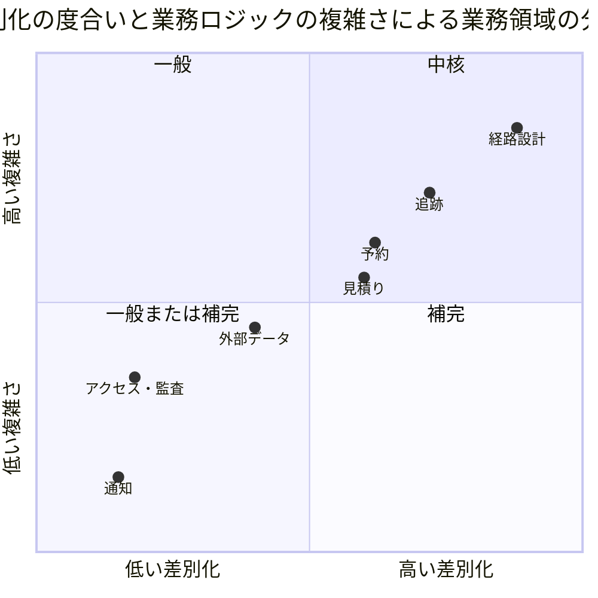

| コンテキスト | 分類 | 根拠 |
| :--- | :--- | :--- |
| 経路設計（Routing） | 中核 | 制約対応型経路設計は A 社の競争優位であり、ケイパビリティの成熟度が低い（経路候補算出）。規則（BR-02、BR-11）と専門判断・再設計が最も複雑 |
| 追跡（Tracking） | 中核 | 顧客から見える透明性の源泉。予定と実績、確認中、訂正の二者確認、鮮度が絡む |
| 予約（Booking） | 中核 | 予約の確定・変更・取消しの段階規則（BR-01、BR-04）を持つ |
| 見積り（Quotation） | 中核 | 根拠付き見積りと有効期限の境界（BR-10）を持つ。差別化は経路設計ほど高くない |
| 外部データ（External Data） | 補完 | 冪等性・隔離・照合（BR-12）は手続き的。A 社固有の採否判断を含むため一般ではない |
| アクセス・監査（Identity & Audit） | 一般 | 認証・役割・監査証跡は業界共通の仕組みで足りる。パイロットの KPI の計測（US-21）もここに置く |
| 通知（Notification） | 一般 | 利用者へのメールの送信と送信結果の記録だけを担う。業務の判断を持たない（US-22 の荷主への業務の通知、US-18 AC8 の password の再設定のメール。Bolt 33 で最小に作る。[ADR-017](../../adr/cargo-tracker/017-notification-module-and-mail.md)） |

## ユビキタス言語

### 呼び分けの決定

要件定義の「貨物予約の状態遷移」は下書きから完了までを 1 つの状態モデルで描いている。一方、Unit 定義は U1（輸送要求・見積り）と U6（予約管理）を分けている。本書では次のように呼び分ける。

| 業務の段階 | 呼び名 | 所属コンテキスト | 要件定義の状態との対応 |
| :--- | :--- | :--- | :--- |
| 本予約より前 | **輸送要求**（TransportRequest）、その版を **輸送要求版** | 見積り | 下書き、審査中、見積提示済み、変更中（本予約前）、失効、取消済み（本予約前の取下げ） |
| 本予約以後 | **貨物予約**（Booking）、その版を **予約版** | 予約 | 確定、変更承認待ち、取消承認待ち、変更中（本予約後）、取消済み、輸送中、完了 |

ユーザーストーリーの US-01・US-02 にある「予約版」は、本書では「輸送要求版」と読み替える。

### 用語集

| 用語 | 英語名 | 定義 | コンテキスト |
| :--- | :--- | :--- | :--- |
| 輸送要求 | TransportRequest | 荷主が見積りを依頼する輸送条件のまとまり。本予約までの版を持つ | 見積り |
| 業務番号 | TransportRequestNumber | 荷主と社内が電話・メールで言い合える輸送要求の番号。`TR-年-年ごとの連番`（例: TR-2026-0142）で、年が変わると 0001 から数え直す。版は「TR-2026-0142 版 2」と表記する。画面には内部の ID（UUID）を出さない（2026-10-02 の D-4）。初回の提出時に 1 回だけ振り、年は提出時刻の日本時間（Asia/Tokyo）の年とする。連番は 4 桁のゼロ埋めで、9999 を超えたら桁を増やす。欠番を出さない（2026-10-02 の D-10） | 見積り |
| 業務番号の採番 | TransportRequestNumberIssuer | 年を受け取り、その年の次の業務番号を返すポート。年の算出は業務番号が持ち、採番は提出と同じトランザクションで行う（D-10） | 見積り |
| 輸送要求版 | TransportRequestVersion | 輸送要求のある時点の条件。提出後は不変で、変更は新しい版になる | 見積り |
| 輸送条件 | ShipmentTerms | 荷受人、出発地、目的地、希望到着期限、貨物、必要書類の組 | 見積り（共有の写しは予約・経路設計） |
| 輸送条件の入力 | ShipmentTermsInput | 荷主が提出しようとする輸送条件の入力。項目が欠けていてよく、検証して違反がなければ輸送条件になる | 見積り |
| 提出の検証結果 | SubmissionViolations | 提出の検証で見つかった不足と誤りの一覧。項目と理由の種類だけを持ち、利用者に示す理由と直し方の文言は画面の層が付ける（Q-INV-01、Q-INV-02） | 見積り |
| 貨物 | Cargo | 貨物種別、荷姿、個数、総重量（kg）、容積（m3）の組 | 見積り |
| 必要書類 | RequiredDocument | 輸送条件に添付した書類 1 件。書類番号（版の中で 1 から）、書類の種類、ファイル名、形式、大きさ、SHA-256、オブジェクトキーを持つ。版に付き、提出後は変えない（2026-10-03 の D-20。Bolt 7） | 見積り |
| 書類の添付 | RequiredDocumentAttachment | 荷主が提出・出し直しで添付しようとする書類（種類、ファイル名、中身）。書類の受付規則を通り、保存してオブジェクトキーを得たら必要書類になる | 見積り |
| 書類の種類 | DocumentType | 商業送り状（COMMERCIAL_INVOICE）、梱包明細（PACKING_LIST）、その他（OTHER） | 見積り |
| 書類の形式 | DocumentMediaType | PDF、PNG、JPEG。拡張子でなく中身の先頭のバイトで判定する | 見積り |
| 書類の受付規則 | RequiredDocumentPolicy | 添付の一覧が Q-INV-16 を満たすかを判定し、違反を提出の検証結果に足す | 見積り |
| 書類の保存 | RequiredDocumentStorage | 書類の中身を保存してオブジェクトキーを返し、キーで中身を読むポート。本番は S3、開発はローカルのファイルシステム（ADR-007・008） | 見積り |
| 貨物種別 | CargoCategory | 一般、危険物、冷凍、その他特殊。MVP は一般だけを受け付ける（BR-03） | 見積り |
| 荷姿 | PackageType | 貨物の梱包の形。パレット、カートン、クレート、その他（2026-10-02 に human:kakimomokuri が承認した仮の値。業務責任者の確認で見直す） | 見積り |
| 審査 | Review | 営業担当者が提出条件と書類の充足を判断すること | 見積り |
| 審査記録 | ReviewRecord | 1 つの版に対する審査の判断の記録。判断者・判断時刻・根拠（確定）または理由と不足事項（差戻し）を持ち、後から変えない | 見積り |
| 審査の判断 | ReviewDecision | 充足（審査を確定し見積り作成へ進める）と差戻し（下書きに戻す）の 2 つ | 見積り |
| 見積り | Quotation | 審査済みの輸送要求版に対する料金根拠・有効期限・経路方針の提示 | 見積り |
| 経路方針 | RoutePolicy | 見積りとともに荷主へ示す、想定する主な経由地と概算の日程。詳細な経路は経路設計者の承認後に確定する | 見積り |
| 荷主の回答 | ShipperResponse | 提示された見積りと経路方針への荷主の回答（詳細経路設計へ進む、辞退する、相談する） | 見積り |
| 荷主承認 | ShipperApproval | 荷主担当者が見積りと承認済み経路を確認して与える承認。承認者と承認時刻を持つ。BR-01 の確定条件の 1 つ（US-24 AC4。Bolt 20） | 見積り |
| 経路の引き継ぎ | （見積りの再見積りの操作の一部） | 経路を持つ見積り（荷主の承認の後に失効した見積りなど）を再見積りするとき、割り当てた経路・荷主の回答者と回答時刻・経路方針を新しい見積りに写すこと。入れた経路方針は使わない。旧版の再見積りの操作が、判定・照合（同じ輸送要求の同じ版の承認待ちの見積りか）・置き換えとあわせて 1 つの操作で行い、値を外に出さない。新しい見積りは提示で荷主承認待ちに直行する（D-85、Bolt 35b。レビューで 1 つの操作にまとめた） | 見積り |
| 割り当てた経路 | AssignedRoute | 経路設計が確定して見積りに割り当てた経路版の写し（または、荷主の承認の後に失効した見積りの再見積りで旧版から写したもの。D-85、Bolt 35b）。案件番号・経路版番号・確定の時刻と区間の写しを持ち、荷主の承認の画面は経路設計に問い合わせずにこれを示す（R-INV-11、ADR-014。Bolt 20）。経路設計がその経路版を再設計要にした時刻（再設計要の印。任意）も持ち、再見積りでは経路とあわせて新しい見積りに写る。同じ経路版かは案件番号と経路版番号だけで比べ、印を見ない（US-07 AC5。Bolt 37e） | 見積り |
| 再設計要の印 | AssignedRoute.redesignRequiredAt | 割り当てた経路の写しが持つ、経路設計がその経路版を再設計要にした時刻。印のある見積りは荷主の承認と予約確定に使えない（Q-INV-10、B-INV-05）。見積りの状態は変えない（US-07 AC5。Bolt 37e） | 見積り |
| 割り当てた区間 | AssignedRouteLeg | 割り当てた経路の区間 1 つの写し。航海番号、積地、揚地、出発予定、到着予定（Bolt 20） | 見積り |
| 出発済み | — | 割り当てた経路の最初の区間の出発予定が判定時刻と同時刻か前であること。見積りの状態ではなく判定時刻で決まる。境界は経路設計の確定の出発済み（`ALREADY_DEPARTED`）と同じ。出発済みの見積りは荷主の承認と本予約に使えない（`ROUTE_ALREADY_DEPARTED`。Q-INV-10、B-INV-05、D-88）。荷主の画面では社内の語を出さず「最初の航海がすでに出発した」と示す（US-07 AC5。Bolt 37e4） | 見積り（経路設計の確定にも同じ境界の判定がある） |
| 再設計要の印の結果 | RouteRedesignMarkResult | 見積りに再設計要の印を付ける操作の結果。付けた・付いていた（最初の時刻のまま）・経路がない（経路を割り当てていない）・別の経路版（別の経路版を割り当てている）の 4 つ。付いていた・経路がない・別の経路版では見積りを変えない（US-07 AC5。Bolt 37e） | 見積り |
| 料金根拠 | PricingBasis | 見積り金額の内訳と参照した契約条件。料金明細の列（1〜10 行）と通貨（USD・EUR・JPY）を持ち、合計は明細の和（2026-10-05 の決定。Bolt 10） | 見積り |
| 料金明細 | PricingLine | 料金根拠の 1 行。内容、金額（0 より大きい、小数点以下 2 桁まで）、参照した契約条件（任意） | 見積り |
| 料金明細の入力 | PricingLineInput | 営業担当者が入れようとする料金明細の 1 行。項目が欠けていてよく、検証して違反がなければ料金明細になる（Bolt 10） | 見積り |
| 見積りの入力 | QuotationInput | 営業担当者が算出しようとする料金明細・通貨・有効期限・経路方針。算出の時刻で検証し（Q-INV-05・17）、違反がなければ料金根拠・有効期限・経路方針になる（Bolt 10） | 見積り |
| 見積りの算出の検証結果 | QuotationViolations | 見積りの算出の検証で見つかった不足と誤りの一覧。項目・理由の種類・料金明細の行の番号だけを持ち、文言は画面の層が付ける（Bolt 10） | 見積り |
| 見積り番号 | — | 輸送要求の中で 1 から振る見積りの番号。画面と URL には内部の ID の代わりに「TR-2026-0001 見積 1」の形で出す（D-4 と同じ考え方。Bolt 10） | 見積り |
| 見積有効期限 | QuotationExpiry | 予約確定の commit 時刻がこれより前のときだけ見積りが有効になる UTC 時点（BR-10） | 見積り |
| 再見積り | — | 承認待ち・提示済み（失効したものを含む）の見積りと、荷主の承認の後に有効期限を過ぎた承認済みの見積りから、次の見積り番号の新しい見積りを作ること。旧版は置換済み（有効期限を過ぎていれば失効）になり、読み取り専用で残る（Q-INV-07・18。Bolt 11）。承認の後に失効した見積りからの再見積りは、承認済みの経路版・荷主の回答・経路方針を引き継ぎ、料金と有効期限だけを出し直す（D-85。Bolt 35b、社内の画面は Bolt 35c、荷主の画面は Bolt 35d） | 見積り |
| 再承認の見積り | — | 荷主の承認の後に失効した見積りを再見積りし、承認済みの経路版・荷主の回答・経路方針を引き継いで提示した見積り。荷主のもう一度の承認（再承認）を待つ。見分けるもとは 1 つの見積りの提示の時刻と荷主の回答の時刻で、荷主の回答の時刻が提示の時刻より前なら再承認の見積り（回答を引き継いだ再見積りだけが提示の前の回答の時刻を持つ。同時刻は通常の流れとして偽）。Bolt 35d の開発レビューで経路の確定の時刻から改めた（human:kakimomokuri の決定 (7)）。見積りの集約の問い合わせ「再承認の見積りか」（`isPresentedForReapproval`）が決め、列もイベントも足さない（D-85。Bolt 35d） | 見積り |
| 経路設計案件 | RoutingCase | 1 つの輸送要求について経路版を作り、確定・再設計する単位 | 経路設計 |
| 経路版 | RouteVersion | 候補の比較、判断根拠、承認を伴って確定した経路のある版 | 経路設計 |
| 経路候補 | RouteCandidate | 区間の列からなる候補と、その制約適合判定 | 経路設計 |
| Golden dataset | — | 経路設計の代表案件と期待結果（判断根拠・承認者・版つき）。制約適合判定の受入の基準にする。v0 は仮の値で業務責任者の承認待ち（TST-02。Bolt 37f）。テストのデータで、型は持たない | 経路設計 |
| 区間 | Leg | 航海、積地、揚地、出発予定、到着予定。Bolt 39f で、確定した寄港の位置（`loadCallNo`・`dischargeCallNo`。`port_call.call_no` の値で 1 始まりの運航の順）を足した。そろって null（Bolt 39f より前に算出した候補）か、そろって値を持ち積地の位置が小さい。位置が使われるのは積地か揚地に 2 度寄る航海の組が 2 つ以上あるときだけ（下の Bolt 39f で決めたこと） | 経路設計（写しは見積り。追跡は予定区間として持つ） |
| 航海 | Voyage | 航海番号で識別される運航予定。外部原本から採用した版を持つ。Bolt 39e で record から class にし、採用した航海の値から作る操作（`adoptedFrom`）と適用する操作（`apply`。順の規則で厳密に新しいときだけ適用し、適用しないなら false を返す）を持つ。Bolt 39e2 で、区間が今の航海と一致するかの判定（`matchesLeg`。航海番号と採用情報版が同じで、積地の寄港の出発予定と、その後ろの揚地の寄港の到着予定が区間の予定と同じ組が 1 つ以上あるときに真。R-INV-03）を足した。Bolt 39f で、`matchesLeg` に一致する組が 2 つ以上のときだけ確定の寄港の位置の組があることを足し（位置がない区間は今のまま）、更新を適用した後の DE-30 を作る操作（`updated`）を足した。出典・公開した時刻・集約の版も持つが、等しさはこれまでと同じ 4 項目（航海番号・寄港・採用情報版・取得時刻）で比べる。取込を経ない仮の航海（開発データ。公開した時刻は null、版 0）も作れる | 経路設計 |
| 経路設計案件 ID | RoutingCaseId | 経路設計案件を識別する、システムが発行する不透明な値。画面には出さず、案件番号を出す（Bolt 17） | 経路設計 |
| 案件番号 | RoutingCaseNumber | 経路設計者と営業が言い合える経路設計案件の番号。`RC-年-年ごとの連番`（例: RC-2026-0088）。年は詳細経路設計の依頼時刻の日本時間の年で、業務番号と同じ規則で振る（D-10。Bolt 17） | 経路設計 |
| 経路条件 | RouteSpecification | 経路設計案件の出発地・目的地・希望到着期限・貨物種別。見積りの公開 API（経路条件の照会）から得た輸送要求版の写し（Bolt 17） | 経路設計 |
| 寄港 | PortCall | 航海が寄る港と、その到着予定・出発予定 | 経路設計（外部データに写しを持つ。Bolt 39b2b。写しを守るテスト） |
| 採用した航海の値 | VoyageAdoption | 外部データが公開した航海の採用値のうち、経路設計の航海に書く値（寄港の並び・情報版・出典・公開した時刻）。DE-12 から listener が作る値オブジェクト（`routing.domain.model.valueobjects`）で、`Voyage` は外部データの型を持たない。内容の欠けたイベントでは組み立てが `VoyageAdoption.InvalidEventValueException` を投げる（Bolt 39e） | 経路設計 |
| 航海の更新のイベントハンドラー | VoyageUpdateEventHandler | `VoyageAdoptedValueUpdated`（DE-12）を取込と採用の判断のコミットの後に別のトランザクションで受けるハンドラー（`routing.application.internal.eventhandlers`、`@ApplicationModuleListener`。Bolt 39e）。航海を読み、なければ作り、あれば順の規則（下の Bolt 39e で決めたこと）で適用して保存する。版の競合と初めての航海の同時は読み直して適用し直す（3 回まで）。内容の欠けた DE-12 は ERROR のログを残して捨てる。Bolt 39f で、更新を適用したら同じトランザクションで DE-30 を発行する | 経路設計 |
| 航海を更新した（DE-30） | VoyageUpdated | 経路設計の航海を DE-12 で更新したことを、経路設計の中の listener に伝えるイベント（`routing.domain.events`。Bolt 39f）。航海番号・情報版・公開した時刻を持つ。下のイベント一覧の DE-30 | 経路設計 |
| 確定した経路の評価のイベントハンドラー | ConfirmedRouteEvaluationEventHandler | DE-30 を航海の更新のコミットの後に別のトランザクションで受けるハンドラー（`routing.application.internal.eventhandlers`、`@ApplicationModuleListener`。Bolt 39f）。航海番号から確定した経路版を持つ案件を引き（`RoutingCaseRepository.findCaseNumbersConfirmedOnVoyage`）、案件ごとに確定した経路版を評価する。競合は読み直して評価し直す（3 回まで） | 経路設計 |
| 航海の同時更新の例外 | ConcurrentVoyageUpdateException | 航海の更新が 0 件だったとき（読んだ `version` と違う）に、航海のリポジトリが上げる例外（`routing.domain.model.aggregates`。`RuntimeException`。Bolt 39e）。MyBatis の実装とメモリの実装が同じ条件で上げる。listener が捕まえて読み直す（名前の前例は `ConcurrentRoutingCaseUpdateException`） | 経路設計 |
| 航海の重複の例外 | DuplicateVoyageException | 同じ航海番号の航海を 2 回足したとき（初めての航海の 2 つの DE-12 の同時）に、航海のリポジトリが上げる例外（`routing.domain.model.aggregates`。Bolt 39e）。`save` を NESTED にして一意制約の違反をセーブポイントに戻すので、同じトランザクションで読み直せる（前例は `DuplicateRoutingCaseException`） | 経路設計 |
| 接続時間規則 | ConnectionRule | 積替えの港ごとの必要最小接続時間と適用期間（BR-11）。業務責任者の値（DM-05）が届くまでは仮の値 | 経路設計 |
| 除外理由 | ExclusionReason | 候補を除外した理由の区分（期限超過・接続不足・接続できない・貨物種別・情報不足）と、不適合となった時刻・閾値・参照情報版（R-INV-02） | 経路設計 |
| 判断根拠 | DecisionRationale | 経路設計者が経路を確定するときに記録する、その候補を選んだ理由。前後の空白を除いて 1〜4,000 文字（R-INV-04。Bolt 19） | 経路設計 |
| 確定の記録 | RouteConfirmation | 経路版を確定したときの、選んだ候補番号・判断根拠・承認者・承認 commit 時刻（US-07 AC1。Bolt 19） | 経路設計 |
| 経路の承認者 | RouteApprover | 経路を確定した利用者と、確定の時点で経路設計者の役割を持つか（R-INV-04。Bolt 19） | 経路設計 |
| 必要最小接続時間 | MinimumConnectionTime | 航路・港ごとの、区間の乗り継ぎに必要な最小時間（BR-11） | 経路設計 |
| 制約適合判定 | ConstraintEvaluation | 期限・接続時間・貨物種別による候補の適合・除外とその理由 | 経路設計 |
| 再設計要 | RedesignRequired | 確定後の外部情報更新で制約を満たさなくなった経路版の状態 | 経路設計 |
| 再設計要の記録 | RedesignRecord | 経路版を再設計要にした時刻と、不適合の理由の区分（1 つ以上、重ねない）。再設計要の経路版は確定の記録とあわせて必ず持ち、旧版は持つことがある（Bolt 37d） | 経路設計 |
| 再設計要の理由の区分 | RedesignReasonCode | 再設計要にした不適合の区分（重ねない）。期限超過・接続不足・接続できない（除外理由の区分と同じ名前）と、航海を引き直せない（`VOYAGE_UNAVAILABLE`。区間の航海がなくなった、区間の積地・揚地に寄らなくなった、寄る順が逆になった、出発予定・到着予定がない、到着が出発より後でない、積地か揚地に 2 度寄って確定した寄港を決められない（Bolt 39f から: 予定の一致する組がなく、確定の寄港の位置でも決められないとき）。画面の語は「航海の予定が使えない」）。DE-06 の理由の語彙（Bolt 37d） | 経路設計 |
| 古くなった候補 | — | 算出の後に、区間が今の航海と合わなくなった候補（航海がないときも。適合・除外とも）と、適合の候補で今の航海の取得時刻から許容時間を過ぎた候補。S-06 を開いた時点の読み取りの結果で、状態ではない（UC-06 4a、【業務の判断】(w)・(y)・(z)。Bolt 39f2）。情報不足（算出のときに許容時間を過ぎた候補の除外の理由）とは別の語で、算出の後に情報不足になった適合の候補を含む。経路版の「旧版」（`SUPERSEDED`。R-INV-05）とも別の語 | 経路設計 |
| 古くなった区間 | StaleLeg | 古くなった候補の区間 1 つを、候補番号・候補の中の区間の 1 始まりの位置・理由の区分で示す値（`RoutingCase.staleLegs` が返す。保存しない。Bolt 39f2） | 経路設計 |
| 古くなった理由の区分 | StaleLegReason | 区間が古くなった理由の区分。航海がない `VOYAGE_MISSING`、情報版が違う `INFO_VERSION_CHANGED`、同じ情報版で予定が違う `SCHEDULE_CHANGED`、取得から許容時間を過ぎた `INFO_INSUFFICIENT`（適合の候補だけ）。1 区間に 1 つ（Bolt 39f2） | 経路設計 |
| 本予約 | — | A 社と荷主の間で輸送の条件（見積り・経路版・貨物）を確定すること。運送会社による船腹の確保（ブッキングの確認）とは別の事実であり、確認書でも区別して示す（要確認: 業務責任者） | 予約 |
| 貨物予約 | Booking | 本予約で確定した輸送の契約。予約版と追跡番号を持つ | 予約 |
| 予約版 | BookingVersion | 貨物予約のある時点の合意内容（見積り、経路版、貨物）。変更は新しい版になる | 予約 |
| 追跡番号 | TrackingNumber | 顧客が追跡を照会するための推測されにくい番号。本予約時に発行する | 予約（発行）、追跡（コンテキスト固有の値オブジェクト。表記の形は同じ。Bolt 25）、外部データに写しを持つ（Bolt 39b2b。写しを守るテスト） |
| 予約 ID | BookingId | 貨物予約を識別する、システムが発行する不透明な値。画面と URL には追跡番号を出す（Bolt 23） | 予約 |
| 本予約の確定用の照会 | BookableQuotationQuery.findForConfirmation | 本予約の確定（POST）のトランザクションの中で予約が呼ぶ、見積りの公開 API の照会。見積りの行をロックしてから、確定に使えるかの照会と同じ判定と写しを返す。印を付ける更新・再見積りと直列にする。S-09 を開いたときの照会はロックしない（ADR-016。Bolt 37e2） | 見積り（予約が呼ぶ） |
| 予約条件 | BookingTerms | 本予約の確定の時点で見積りの公開 API から写した、輸送要求・見積り・経路版・荷受人・貨物・荷主承認の値。予約版はこの写しを持ち、確定の後に見積りへ問い合わせ直さない（ADR-016。Bolt 23） | 予約 |
| 確定条件 | BookingConditions | 本予約の確定に要る 5 条件（有効な見積り、必須貨物情報、荷主担当者 1 名の承認、承認済み経路版、営業担当者による確認）。欠けた条件を不足条件として返す（BR-01） | 予約 |
| 予約サガ | BookingSaga | 本予約の確定から追跡の開始までの状態（処理中・完了・失敗・有人確認要）を持つ。後続の追跡の開始は追跡が DE-07 を購読して行う（ADR-015） | 予約 |
| 処理済みコマンド | ProcessedCommand | 本予約の確定に成功したコマンドの記録。コマンド ID、内容の照合値（業務番号・見積り番号・操作者）、予約 ID と追跡番号、処理時刻を持つ。貨物予約と同じトランザクションで記録し、拒否した要求は記録しない（B-INV-03。Bolt 24） | 予約 |
| 再送 | — | 同じコマンド ID・同じ内容の確定の要求をもう一度受けること。最初の結果（同じ追跡番号）を返す。同じコマンド ID で内容が違う要求は衝突として拒否する（B-INV-03。Bolt 24） | 予約 |
| 輸送段階 | TransportPhase | 集荷前、集荷後、完了。変更・取消しの可否を決める（BR-04）。Bolt 39g2 で、集荷の通知（DE-09）で集荷後に、引渡しの通知（DE-10）で完了に進め、戻さない（下の Bolt 39g2 で決めたこと） | 予約 |
| 輸送段階の通知 | TransportPhaseNotification | 追跡が集荷・引渡しを予約に伝える予約の公開 API（`booking.interfaces.api`。`notifyPickedUp`・`notifyDelivered`。受領は記録した・記録済み・記録しない（理由）。ADR-014。Bolt 39g2） | 予約 |
| 輸送段階の変化 | TransportPhaseChange | 予約の集約の `recordPickup`・`recordDelivery` の結果。進めた（新しい予約）・記録済み（何もしない）・記録しない（理由 `TransportPhaseRefusal`: 取消済み `BOOKING_CANCELLED`、申請中 `BOOKING_UNDER_REQUEST`）のどれか（`booking.domain.model.aggregates`。Bolt 39g2） | 予約 |
| 輸送段階を進めない理由 | TransportPhaseRefusal | 集荷・引渡しの通知で予約の状態と輸送段階を進めない理由。取消済み `BOOKING_CANCELLED`、変更・取消しの申請中 `BOOKING_UNDER_REQUEST`（申請中は US-05・W11 で決め直す。`booking.domain.model.valueobjects`、`@ValueObject`。Bolt 39g2） | 予約 |
| 確定できる貨物の規則 | BookableCargoPolicy | 写した貨物種別が一般貨物のときだけ本予約を確定できるとする予約の規則（B-INV-04。Bolt 35）。見積りの受付の規則（MvpAcceptancePolicy）とは別に予約が持つ | 予約 |
| 追跡記録 | TrackingRecord | 1 つの追跡番号の予定と主要実績、現在状態 | 追跡 |
| 予定 | Schedule | 追跡が採用した確定した経路版（案件番号・経路版番号）と予定区間の列。実績とは混同しない（T-INV-08。Bolt 25） | 追跡 |
| 予定区間 | ScheduledLeg | 予定の 1 区間。航海番号、積地、揚地、出発予定、到着予定。区間番号は列の順に 1 から（T-INV-12。Bolt 25） | 追跡 |
| 追跡状態 | TrackingStatus | 追跡記録の現在状態の値。予約確定 `BOOKED`、集荷予定 `PICKUP_SCHEDULED`、集荷済み `PICKED_UP`、出発地搬入済み `RECEIVED_AT_ORIGIN`、輸送中 `IN_TRANSIT`、積替え中 `TRANSSHIPPING`、目的地到着 `ARRIVED_AT_DESTINATION`、引渡し可能 `READY_FOR_DELIVERY`、引渡し済み `DELIVERED`、確認中 `UNDER_REVIEW`（要件定義の追跡状態モデル。状態名は業務責任者の確認前の候補。Bolt 25 は予定を採用した直後の集荷予定だけを使う。画面の表示名は日本語の名前のまま。Bolt 26 で S-11・S-12 に出し、確認は Bolt 26 の終了報告の議題に置いた） | 追跡 |
| 追跡の予約状態 | TrackedBookingStatus | 追跡記録が持つ予約の状態の写し。確定 `CONFIRMED`、取消済み `CANCELLED`、完了 `COMPLETED`（T-INV-04・T-INV-05 の判定に使う。Bolt 25）。Bolt 39g2 で、DE-10 の後も完了は書かないと決めた（完了後の判定は採用済みの実績から導いた状態で効く。写しの形は DE-08 の W11 で決め直す） | 追跡 |
| 集荷実績を採用した | PickupMilestoneAdopted | DE-09。状態が採用になった集荷の実績ごとに出す追跡のイベント（`tracking.domain.events`、`@DomainEvent`。Bolt 39g2）。追跡の listener が予約の公開 API の集荷の通知を呼ぶ | 追跡 |
| 引渡しを確認した | DeliveryConfirmed | DE-10。状態が採用になった引渡しの実績ごとに出す追跡のイベント（`tracking.domain.events`、`@DomainEvent`。Bolt 39g2）。追跡の listener が予約の公開 API の引渡しの通知を呼ぶ | 追跡 |
| 主要実績 | Milestone | 出典と発生時刻を伴う、集荷・搬入・出発・積替・到着・引渡しの事実。追跡記録の中で実績番号（1 から）で識別する。追跡管理者が登録した実績は採用（Bolt 26b）。Bolt 39g で、外部原本から受けた実績に外部の識別（`ExternalOrigin`）を足した（出典が外部原本の実績だけが持ち、ほかの出典の実績は持たない。そろわない組は作れない）。外部原本から受けた実績は下書きか保持のみで作る（下の Bolt 39g で決めたこと） | 追跡 |
| 実績の種類 | MilestoneKind | 集荷 `PICKUP`、搬入 `RECEIPT_AT_ORIGIN`、出発 `DEPARTURE`（積替港からの出発を含む）、積替 `TRANSSHIPMENT`（積替港到着）、到着 `ARRIVAL`、引渡し `DELIVERY`（Bolt 26b） | 追跡（外部データに写しを持つ。Bolt 39b2b。写しを守るテスト） |
| 実績の状態 | MilestoneState | 下書き `DRAFT`、採用 `ADOPTED`、確認中 `UNDER_REVIEW`、保持のみ `RETAINED_ONLY`。現在状態の導出には採用だけを入れる（T-INV-08。Bolt 26b）。Bolt 39g で、DE-13 を受けた実績に下書き（確定の追跡）と保持のみ（完了後の追跡。T-INV-05）を使い始めた。Bolt 39gb で、追跡管理者が候補を採用すると下書きから採用に移る（採用した人と時刻を持つ。下の Bolt 39gb で決めたこと）。Bolt 39gc で、時系列に反する実績（手入力と候補の採用）を確認中にし（現在状態の導出に入れない。T-INV-03）、完了後の手入力を保持のみにした（下の Bolt 39gc で決めたこと） | 追跡 |
| 採用した主要実績の値 | ExternalMilestone | 外部データが公開した主要実績の採用値のうち、追跡の実績に書く値（種類・場所・発生時刻・出典・操作者と、実績の外部の識別）。DE-13 から listener が作る値オブジェクト（`tracking.domain.model.valueobjects`）で、`TrackingRecord` は外部データの型を持たない。内容の欠けたイベントでは組み立てが `ExternalMilestone.InvalidEventValueException` を投げる（Bolt 39g。前例は `VoyageAdoption`） | 追跡 |
| 実績の外部の識別 | ExternalOrigin | DE-13 から受けた実績の情報源 ID・外部 ID・公開した時刻（`Milestone` の項目。`tracking.domain.model.valueobjects`）。同じ主要実績の組（追跡番号・情報源 ID・外部 ID）と順の規則（公開した時刻 → 取得時刻 → 受信記録 ID）に使う（Bolt 39g。判定は Bolt 39gb の `MilestoneGroup`・`MilestoneCandidateRule`）。外部版と情報版は持たない（順に使わず、受信記録 ID から外部データの原本にたどれる） | 追跡 |
| 組 | MilestoneGroup | 同じ追跡番号・同じ情報源 ID・同じ外部 ID の、外部原本から受けた実績の集まり（下書きと採用と確認中。保持のみと手入力の実績は入らない。確認中は Bolt 39gc で足した）。`candidate()` は組の中で候補の規則が最も新しい実績が下書きならそれを返し、`adopted()` は組の判断済み（採用・確認中）の実績のうち最も新しいものを返す（確認中も判断済みとして採用済みと同じに扱う。Bolt 39gc の【業務の判断】(ai)）。候補でない下書きは「後から公開された原本に置き換えられました」と示す（`tracking.domain.model.valueobjects`。Bolt 39gb。状態を持たず、読むときに実績から作る） | 追跡 |
| 候補の規則 | MilestoneCandidateRule | 組の実績の新しさの順。公開した時刻 → 取得時刻 → 受信記録 ID（文字列の順）で比べる純粋な関数（`tracking.domain.model.rules`、`@DomainRule`。Bolt 39gb。【業務の判断】(aa)）。外部版と実績番号は比べない（届いた順で結果を変えない）。経路設計の `Voyage` の順と同じ並びだが、共有カーネルに上げない。Bolt 39g4b から、比べ方を公開の順（`PublicationOrder`）の値に出して使う（航海の到着予定と同じ値。比べ方の使い方は、主要実績は読むときに組から決め、航海の到着予定は書くときに比べる） | 追跡 |
| 公開の順 | PublicationOrder | 採用値の新しさを公開した時刻 → 取得時刻 → 受信記録 ID（文字列の順）で比べる値（D-105。Bolt 39g4b）。`tracking.domain.model.valueobjects`、`@ValueObject`、`Comparable`。候補の規則（主要実績。読むときに組から決める）と航海の到着予定（書くときに保存した順より厳密に新しいかを比べる）が使う。経路設計の `Voyage` の順と同じ並びの写しで、共有カーネルに上げない（2 か所にあることを技術的負債として記録し、3 つ目のコンテキストが要るときに上げるかを諮る。Bolt 39g4b の決定 (5)） | 追跡 |
| 採用の拒否の理由 | AdoptionRejectionReason | 追跡管理者の下書きの採用を受け付けない理由。候補でない `NOT_CANDIDATE`、採用済みの実績と値が違う `CONFLICTS_WITH_ADOPTED`（T-INV-06 を素通りさせない。値を直す道は US-13。確認中の実績と値が違う候補も同じ理由で拒否し、画面の文だけを「確認中の実績と値が違います」に分ける。Bolt 39gc）、取消済みの予約 `BOOKING_CANCELLED`、完了後 `TRACKING_COMPLETED`（予約状態が完了か、採用済みの実績から導いた状態が引渡し済み。Bolt 39gc の【前の決定の変更】(14)）、未来の発生時刻 `OCCURRED_IN_FUTURE`（採用時刻より後。T-INV-13 の採用の分）。永続化しないので `MilestoneRejectionReason` と分ける（Bolt 39gb） | 追跡 |
| 主要実績の受け取りの結果 | ExternalMilestoneReceipt | `TrackingRecord.receiveExternalMilestone` の結果。下書きか保持のみの実績を足した、同じ出典の実績がある（既存の実績を返す）、取消済みの予約で拒否した、のどれか（`tracking.domain.model.aggregates`。Bolt 39g。前例は `MilestoneRegistration`） | 追跡 |
| 拒否した主要実績 | RejectedMilestone | 追跡が実績にしなかった DE-13 の記録。追跡番号（知らない追跡番号もそのまま写す）・種類・場所・発生時刻・出典・情報源 ID・外部 ID・拒否の理由・記録した時刻を持つ。追記専用で、同じ出典（種類と参照）は 1 件だけ（Bolt 39g。W8 の有人例外案件がこの記録を受ける） | 追跡 |
| 主要実績の拒否の理由 | MilestoneRejectionReason | 主要実績を受け付けない理由。未来の発生時刻 `OCCURRED_IN_FUTURE`（追跡管理者の登録だけ。T-INV-13。Bolt 26b）、取消済みの予約 `BOOKING_CANCELLED`、知らない追跡番号 `UNKNOWN_TRACKING_NUMBER`（DE-13 の受け取りの拒否の記録に使う。Bolt 39g）。Bolt 39gc で、追跡管理者の手入力の取消済みの拒否にも `BOOKING_CANCELLED` を使う（拒否の記録は書かない。【業務の判断】(aj)） | 追跡 |
| 確認中の理由 | UnderReviewReason | 追跡の現在状態が確認中になった理由。時系列に反する実績 `OUT_OF_SEQUENCE` だけ（`tracking.domain.model.valueobjects`、`@ValueObject`。Bolt 39gc）。矛盾は判定を作る Bolt で足す（W7 CP7 の境界）。鮮度超過は確認中の理由にしない（読むときの判定で示す。Bolt 39g4、【業務の判断】(ar)、【前の決定の変更】(20)） | 追跡 |
| 時系列の規則 | MilestoneSequenceRule | 新しい実績が採用済みの実績と時系列に反するかを判定する純粋な関数（`tracking.domain.model.rules`、`@DomainRule`。Bolt 39gc。【業務の判断】(ag)）。実績の種類の段（集荷 1、搬入 2、出発と積替 3、到着 4、引渡し 5）と発生時刻の向きが、採用済みの実績の 1 つと逆なら反する。同じ時刻と同じ段は反しない。出典をまたいで採用済みだけと比べる | 追跡 |
| 採用した主要実績のイベントハンドラー | ExternalMilestoneEventHandler | `MilestoneAdoptedValueAccepted`（DE-13）を取込と採用の判断のコミットの後に別のトランザクションで受けるハンドラー（`tracking.application.internal.eventhandlers`、`@ApplicationModuleListener`。Bolt 39g）。追跡番号を行のロックで押さえて追跡記録を読み直し、判定の順（下の Bolt 39g で決めたこと）で実績か拒否の記録を書く。内容の欠けた DE-13 は ERROR のログを残して捨てる | 追跡 |
| 出典 | Source | 実績や採用値の根拠。種類・参照（1〜200 文字）・取得時刻を持つ。同じ追跡記録で種類と参照が同じなら同じ出典識別子（T-INV-02。Bolt 26b）。S-13 で追跡管理者が選べる種類は現場記録・社内確認・手動入力で、外部原本は外部原本の取込（DE-13。Bolt 39g）だけが作る。S-13 では取得時刻を登録時刻にし、参照の前後の空白を除く（大文字と小文字は区別する。Bolt 26c） | 共有カーネル |
| 出典の種類 | SourceKind | 外部原本 `EXTERNAL_RECORD`、現場記録 `FIELD_RECORD`、社内確認 `INTERNAL_CHECK`、手動入力 `MANUAL_ENTRY`（航海の出典の種類と同じ値。Bolt 26b） | 共有カーネル |
| 荷主向けの追跡の照会結果 | CustomerTrackingView | 追跡記録を荷主の開示範囲に絞った照会結果。現在状態・当初の到着予定・最新の到着見込み・最終取得時刻（Bolt 39g3）・予定区間・採用済みの主要実績だけを持ち、経路版などの社内の識別子を持たない（顧客向けに表示する(開示範囲) の荷主の分。BR-07、T-INV-09。Bolt 27） | 追跡 |
| 荷主向けの主要実績 | CustomerMilestone | 荷主に見せてよい項目（種類・場所・発生時刻・出典）だけを持つ主要実績の写し。実績番号・状態・登録者を持たない（Bolt 27） | 追跡 |
| 確認中 | UnderReview | 順序逆転・矛盾のため、現在状態に反映せず保留している状態（BR-06）。鮮度超過は Bolt 39g4 から確認中に含めず、読むときの判定で示す（【業務の判断】(ar)、【前の決定の変更】(20)） | 追跡 |
| 訂正 | Correction | 原実績を残したまま理由付きで新しい事実を記録すること（BR-05） | 追跡 |
| 鮮度 | Freshness | 次の予定の実績の予定時刻からの経過と、許容範囲を超えたかどうか（Bolt 39g4、【業務の判断】(aq)、【前の決定の変更】(21)。Bolt 37b2 からの定義「最終取得時刻からの経過」を読み替えた）。経路設計の判定は情報鮮度の判定で、追跡の鮮度の判定（FreshnessPolicy）とは許容範囲と決定者が違うので共有しない（Bolt 37b2） | 追跡、経路設計 |
| 鮮度超過 | — | 判定の時刻が次の予定の実績の予定時刻 + 許容範囲（36 時間）以上であること（ちょうど 36 時間は超過。FRS-02）。状態ではなく読むときの判定で、追跡の現在状態を確認中にしない（Bolt 39g4、【業務の判断】(ar)）。S-11 の現在状態のセルの印と S-12 の警告の文で示す（【業務の判断】(as)）。完了後と次の予定の実績がないときは判定しない | 追跡 |
| 予定の時点 | SchedulePoint | 予定区間の出発予定・到着予定に、実績の種類（出発・積替・到着）と場所と区間の位置を添えたもの（`tracking.domain.model.valueobjects`、`@ValueObject`。Bolt 39g4）。予定の順に区間 1 の出発、区間 1 の積替（最後の区間なら到着）、区間 2 の出発…と並ぶ。採用の実績はここに結ぶ（最新の到着見込みの規則と次の予定の実績の規則が同じ結び方を使う） | 追跡 |
| 次の予定の実績 | nextExpectedAt | 予定の時点のうち、採用の実績を結んだ時点の中で予定の順で最も後の時点の次（結んだ時点がなければ区間 1 の出発。最後の区間の到着を結んだら、または完了後はない）。追跡記録はその予定時刻を持つ（`nextExpectedAt`、表の `next_expected_at`。Bolt 39g4、【業務の判断】(aq)） | 追跡 |
| 次の予定の実績の規則 | NextExpectedMilestoneRule | 予定と採用の実績の列から次の予定の時点を返す純粋な関数（`tracking.domain.model.rules`、`@DomainRule`。Bolt 39g4）。時点の列の位置で次を決める（同じ時刻の時点でも積替の次は次の区間の出発） | 追跡 |
| 鮮度の判定 | FreshnessPolicy | 許容範囲（設定 `cargotracker.tracking.freshness-tolerance`、既定 36 時間）を持ち、次の予定の実績の予定時刻と判定の時刻から鮮度超過かを返す規則（`tracking.domain.model.rules`、`@DomainRule`。Bolt 39g4）。時計とリポジトリを持たない。照会サービスが時計から判定の時刻を渡す | 追跡 |
| 情報鮮度の判定 | InfoFreshnessPolicy | 航海の取得時刻と許容時間から、経路候補が情報不足かを判定する規則（R-INV-09、D-89。Bolt 37b2）。算出では情報不足の候補を除外し、確定では情報不足の候補の確定を拒否する（Bolt 37c）。候補の「情報鮮度」（使った航海の取得時刻のうち最も古いもの）とは別の語 | 経路設計 |
| 最新の到着見込み | LatestEstimate | 当初の予定（確定した経路版）とは別に、実績と採用値から見込む最新の到着時刻。Bolt 39g3 は採用の実績から最新の到着見込みの規則（`LatestEstimateRule`）で導き、実績が変わったときに追跡記録が持つ（`latestEta`）。Bolt 39g4b から、最後の区間の航海の到着予定（`VoyageArrival`）でも動く（最後の区間の揚地の到着の採用の実績がなければ、採用の実績の遅れで送った見込みと航海の到着予定の遅い方。当初の到着予定より早めない。【業務の判断】(at)、台帳 D-136）。Bolt 39g4c から、値 `LatestEstimate`（`tracking.domain.model.valueobjects`、`@ValueObject`）が時刻と見込みの根拠（`LatestEstimateBasis`。規則が返す値は必ず持ち、Bolt 39g4c の前の行だけ空）を持ち、追跡記録は見込みと根拠を 1 つの項目（`latestEstimate`）で持つ（取り出し口は `latestEta()` と `latestEstimateBasis()`）。S-12 の定義リストの最新の到着見込みの次に見込みの根拠の 1 行を示す（S-11・C-10 には出さない。【業務の判断】(aw)・(ax)、台帳 D-139・D-140） | 追跡 |
| 最新の到着見込みの規則 | LatestEstimateRule | 予定と採用の実績の列（Bolt 39g4b から航海の到着予定も）から最新の到着見込みを返す純粋な関数（`tracking.domain.model.rules`、`@DomainRule`。Bolt 39g3。【業務の判断】(ao)）。出発・積替・到着を場所と区間の位置で予定区間に結び、予定の順で最も後の実績を使う。到着なら実績の発生時刻、出発・積替なら当初の到着予定に正の遅れだけを足す。Bolt 39g4b から、最後の区間の揚地の到着の採用の実績がなければ、その見込みと航海の到着予定（なければ空）の遅い方を返す（`estimate(Schedule, Collection<Milestone>, Optional<UtcInstant>)`。2 引数の形は航海の到着予定を空にして 3 引数の形に委ねる。【業務の判断】(at)、台帳 D-136）。Bolt 39g4c から、見込みと見込みの根拠を 1 回の評価で返す（`estimateWithBasis(Schedule, Collection<Milestone>, Optional<UtcInstant>)` が `LatestEstimate` を返す。`estimate` の 2 つの形は `estimateWithBasis(...).at()` に委ねる）。根拠は規則の分岐に 1 対 1 で対応する: 到着の実績で返すときはその実績、実績の遅れで送った見込み（遅れが正でなくても）を使うときはその実績、結んだ実績がなく航海の到着予定を使わないときは当初の到着予定、航海の到着予定が厳密に遅いときは航海の到着予定 | 追跡 |
| 見込みの根拠 | LatestEstimateBasis | 最新の到着見込みがどこから来たかを示す値（Bolt 39g4c。`tracking.domain.model.valueobjects`、`@ValueObject`）。種類（入れ子の enum `Kind`: 当初の到着予定 `ORIGINAL_ETA`・実績 `MILESTONE`・航海の到着予定 `VOYAGE_ARRIVAL`）と実績番号（`OptionalInt`。種類が実績のときだけ持つ。1 以上）。出発・積替・到着の別は根拠の実績の種類が持ち、航海の到着予定の航海番号と取得時刻は予定の最後の区間と航海の到着予定から読むので持たない。最新の到着見込みの規則が見込みと一緒に返し、追跡記録が見込みと一緒に保存する（表の `latest_eta_basis`・`latest_eta_basis_milestone_no`）。S-12 の 1 行の文はインターフェース層が作る（【業務の判断】(aw)・(ax)、台帳 D-139・D-140） | 追跡 |
| 最終取得時刻 | lastAcquiredAt | 追跡記録の採用の実績の出典の取得時刻と、受けた最後の区間の航海の知らせの取得時刻のうち最も新しいもの（なければ空。Bolt 39g3。【業務の判断】(ap)。航海の知らせは Bolt 39g4b で足した。【業務の判断】(av)、台帳 D-138、【前の決定の変更】(23)）。航海の知らせは保存した順の鍵の知らせで、結べなかった知らせも含める（順の鍵は厳密に新しいときだけ進むので戻らない）。受けなかった古い知らせ・中間の区間の航海・下書き・確認中・保持のみの取得時刻は使わない。照会の結果（S-12・C-10）と S-11 に示す（FRS-03）。鮮度超過の判定には使わない（Bolt 39g4。判定の時刻を基準にする。【業務の判断】(aq)） | 追跡 |
| 航海の寄港 | VoyagePortCall | DE-12 が運ぶ航海の採用値の寄港の 1 つを追跡の言葉にした写し（港・到着・出発。Bolt 39g4b）。到着と出発はなければ空。listener が DE-12 の寄港の並びから作る値オブジェクト（`tracking.domain.model.valueobjects`、`@ValueObject`）で、`TrackingRecord` は外部データの型を持たない。経路設計の `PortCall`・外部データの `AdoptedPortCall` と同じ単純名にしない | 追跡 |
| 航海の到着予定 | VoyageArrival | 最後の区間の航海の採用値から結んだ、最後の揚地への到着予定と、その知らせの公開の順（Bolt 39g4b）。`tracking.domain.model.valueobjects`、`@ValueObject`。到着予定は結べなければ空（結べない新しい知らせを受けたら空にし、公開の順は進める。古い知らせで戻さない）。取得時刻は公開の順が持つ。追跡記録が持ち（`voyageArrival`、表の `voyage_arrival_*` の 4 列）、最新の到着見込みと最終取得時刻に使う（【業務の判断】(au)・(av)、台帳 D-137・D-138）。中間の区間の航海の採用値は使わない（D-136） | 追跡 |
| 航海の到着予定の規則 | VoyageArrivalRule | 予定と航海の寄港の並びから最後の揚地への到着を結ぶ純粋な関数（`tracking.domain.model.rules`、`@DomainRule`。Bolt 39g4b。【業務の判断】(au)、台帳 D-137）。寄港の並び（運航の順）で、最後の区間の積地の港で出発のある寄港がちょうど 1 つあれば、その後ろで最後の区間の揚地の港で到着のある最初の寄港の到着を返す（到着のない同じ港の寄港は飛ばす）。積地の寄港がない・2 つ以上（周回の航路）、積地の後に揚地がないときは空。積地・揚地の読み方は経路設計の `Voyage.callPairs` と同じ | 追跡 |
| 航海の到着予定のイベントハンドラー | VoyageArrivalEventHandler | `VoyageAdoptedValueUpdated`（DE-12）を取込と採用の判断のコミットの後に別のトランザクションで受けるハンドラー（`tracking.application.internal.eventhandlers`、`@ApplicationModuleListener`。Bolt 39g4b）。その航海を最後の区間に持つ追跡番号を追跡番号の順に引き、1 つのトランザクションで 1 件ずつ行のロックで押さえて追跡記録を読み直し、航海の到着予定を受けさせる（`TrackingRecord.receiveVoyageArrival`）。内容の欠けた DE-12 は ERROR のログを残して捨てる | 追跡 |
| 照会記録 | InquiryRecord | 荷主・荷受人からの照会 1 件の経路（顧客 Web・電話・メール）と、Web で完結したか有人対応へ移ったかの記録。KPI-02 の計測に使う | 追跡 |
| 営業日カレンダー | BusinessCalendar | 有人案件の受領・回答期限を数えるための営業日と営業時間（日本の祝日・年末年始） | 追跡 |
| 有人案件 | ServiceCase | 受付番号を持ち、担当・期限・回答・復旧照合を追跡する顧客照会または業務例外（BR-09、BR-17） | 追跡 |
| 受付番号 | CaseNumber | 有人案件の一意な識別子 | 追跡 |
| 企業 | Company | 荷主・荷受人・A 社などの利用者の所属組織 | アクセス・監査 |
| 利用者 | User | 事前登録され、固定役割を持つ人（BR-14、BR-15）。Bolt 34 から版（`app_user.version`）を持ち、役割の変更を判定して役割を変えた新しい利用者を返す。Bolt 34d から、利用状態の変更も判定して変えた新しい利用者を返す。Bolt 34e から、判定（`decideRoleChange(操作者, 企業, 変更後の役割)`・`decideStatusChange(操作者, 変更後の状態, 理由)`）が承認の値か拒否を返し、変更（`changeRoles(RoleChangeApproval)`・`changeStatus(StatusChangeApproval)`）は承認の値だけを受ける（判定を通さずに変えられない。2026-10-17、human:kakimomokuri）。Bolt 38b から、登録の判定（`decideRegistration(企業, 役割)`。static。役割なし → 監督の役割 → 企業の種類 → 職務分離の順）が承認の値か拒否を返し、生成（`register(UserRegistrationApproval, 利用者 ID, メールアドレス, 表示名, password のハッシュ)`）は承認の値だけを受けて版 0・利用中の利用者を作る。役割 0 件はコンストラクターの 1 か所で拒む（例外の文に利用者 ID。データの不整合もここで捕まえる。2026-10-25、human:kakimomokuri） | アクセス・監査 |
| 利用状態 | UserStatus | 利用者の利用状態（`app_user.status`）。利用中 `ACTIVE`、利用停止 `SUSPENDED`（認証できない。IA-INV-09）。S-20 の詳細で、システム管理者が停止と再開を行う（`identity.domain.model.valueobjects`。Bolt 34d） | アクセス・監査 |
| 停止の理由 | SuspensionReason | 利用停止の理由の種類。利用終了 `USAGE_ENDED`、異動 `TRANSFERRED`、緊急停止 `EMERGENCY`。システム管理者が停止のときに選び、監査記録 `USER_SUSPENDED` の理由に名前を残す。再開は理由を持たない（`identity.domain.model.valueobjects`。Bolt 34d） | アクセス・監査 |
| 停止の記録 | SuspensionRecord | 今の停止の記録（最新の監査記録 `USER_SUSPENDED`）。停止の理由・停止した人の ID と今の表示名（行がなければ空）・停止した時刻。S-20 の詳細で停止中の利用者に示す（`identity.domain.model.valueobjects`。Bolt 38c2） | アクセス・監査 |
| 利用状態の変更の拒否 | StatusChangeRejection | 利用状態の変更を受け付けない理由。自分の変更 `SELF_CHANGE`、監督の役割を持つ利用者 `OVERSIGHT_ROLE`、同じ状態への変更 `NO_CHANGE`、理由のない停止 `REASON_REQUIRED`（判定はこの順）。画面に示す付随の値がないので enum だけにする（`identity.domain.model.valueobjects`。Bolt 34d） | アクセス・監査 |
| 利用状態の変更の承認 | StatusChangeApproval | 利用者の集約の利用状態の変更の判定（`User#decideStatusChange`）を通った印。判定した利用者の実体・変更後の状態・停止の理由を持ち（対象の利用者 ID と判定に使った版はその実体から取る）、`User#changeStatus` はこれだけを受ける。再開の承認は停止の理由を持たない（`reason()` は `Optional` で、再開の判定に渡された理由は捨てる）。確定の後の監査の種類・トークンの無効化・session の失効の分かれ目と停止の理由は、サービスがこの承認から取る（2026-10-17、human:kakimomokuri）。判定を通った印で、値として比べない（equals を持たない）。判定を通った印で、業務の承認の手続き（荷主承認・社内承認）ではない。判定の結果 `StatusChangeDecision`（`Approved(承認)`・`Refused(StatusChangeRejection)`）で返す。作り手を集約に限るため、`valueobjects` に置かず `User` の入れ子にし、コンストラクタを private にする（同じパッケージからも作れない）。判定した実体と違う利用者（別の利用者・判定と違う版・同じ ID と版で組み立てた別の利用者・変えた後の利用者）に渡すと `IllegalArgumentException`（同じ実体かで確かめる取り違えの守りで、同時の更新の判定ではない。2026-10-17、human:kakimomokuri）（Bolt 34e） | アクセス・監査 |
| ログインの資格の変更の拒否 | LoginCredentialRejection | ロックの解除と管理者による TOTP の解除を受け付けない理由（Bolt 38c）。自分 `SELF`、監督の役割を持つ利用者 `OVERSIGHT_ROLE`（利用者の集約の `loginCredentialChangeRejection` が判定）、ロック中でない `NOT_LOCKED`、未登録 `NOT_ENROLLED`、確認の後に登録が変わった `ENROLLMENT_CHANGED`（サービスが更新の件数と読み直しで判定）。`identity.domain.model.valueobjects` | アクセス・監査 |
| 本人確認の手段 | IdentityVerificationMethod | 管理者が TOTP を解除する前に行った別経路の本人確認の手段（Bolt 38c。SEC-10）。登録の電話番号への折り返し `PHONE_CALLBACK`・対面 `IN_PERSON`・所属企業の管理担当者への確認 `COMPANY_ADMINISTRATOR`。名前だけで、表示名は画面の層が持つ。`identity.domain.model.valueobjects`（`@ValueObject`） | アクセス・監査 |
| 本人確認の日時の規則 | IdentityVerificationPolicy | 本人確認の日時の範囲のドメインルール（Bolt 38c。`identity.domain.model.rules`、`@DomainRule`）。今より後と、今から 7 日より前を拒む（ちょうど 7 日前は受け付ける） | アクセス・監査 |
| メールアドレス | EmailAddress | 利用者のログインの識別子。前後の空白を除き小文字にして比べる（Bolt 14） | アクセス・監査 |
| TOTP の資格 | TotpCredential | 利用者が登録した TOTP の暗号化した秘密と、最後に使った時間の刻み（Bolt 30）。入れたコードを前後 1 つの刻みで照合し、照合の結果（`TotpMatch`）を返す（`match`。Bolt 31d で `matchingStep` から改めた）。認証アプリの再登録で、1 人 1 つのまま秘密を置き換える（`reEnroll(newSecret, step, at)`。最後に使った刻みは戻さず、古い値と新しいコードの刻みの大きい方にする。Bolt 33b で作る）。コードの桁数 `DIGITS`（6）は時間の刻み `STEP_DURATION`（30 秒）と並べてこの集約に置き、コードの生成・otpauth の URI・画面のコードの欄の属性が参照する（Bolt 33d。HMAC のアルゴリズムは技術の知識なので `infrastructure.crypto` に置く） | アクセス・監査 |
| TOTP の照合の結果 | TotpMatch | TOTP の資格の照合の結果。使っていない刻みで一致（`Matched(step)`）、使った刻み以下でだけ一致（`Reused`）、どれとも一致しない（`Mismatch`。形の違うコードを含む）のいずれか。窓の刻みのすべてを一定時間で比べ、形の違うコードでは生成器を呼ばない（IA-INV-10、ADR-011 の決定 8、Bolt 31d） | アクセス・監査 |
| 暗号化した秘密 | EncryptedSecret | TOTP の秘密を暗号化した文字列。平文の秘密は表にも記録にも書かない（Bolt 30） | アクセス・監査 |
| 残りの回復コード | RemainingRecoveryCodes | まだ使っていない回復コードの数（Bolt 38d2。SEC-10）。3 個以下を少ない、0 個を残っていないとし、回復コードでログインした後の A-08 と印の知らせが、少ないときだけ数を示す（`identity.domain.model.valueobjects`） | アクセス・監査 |
| 回復コード | RecoveryCode | TOTP の端末を失ったときに一度だけ使えるコード。ハッシュだけを持つ（SEC-09、Bolt 30）。入れたコードを正規化して `NormalizedRecoveryCode` を返す `normalize`、10 個の発行とそろいの確かめを 1 つにした工場メソッド `issueSet` を持つ。コードの形（16 進 8 文字を 4 文字ずつハイフンで区切る）の知識は `NormalizedRecoveryCode` に置く（Bolt 33d。値オブジェクトから集約への依存の前例がないので、形の知識は値の側に置いた（Bolt 33d のステップ 3））。Bolt 33f から `issueSet` は `NormalizedRecoveryCode` の一覧を受ける | アクセス・監査 |
| 正規化した回復コード | NormalizedRecoveryCode | 入れた回復コードを正規化した値（`1a2b-3c4d` の形）。回復コードの形の知識（形の正規表現、ハイフンのない 8 文字を区切って読む `parse`、乱数の 4 バイトから発行の形を作る `fromBytes`）を持ち、生成器（`RandomRecoveryCodeGenerator`）と `RecoveryCode.normalize` が使う。照合（`RecoveryCode.matches`）はこの値だけを受ける。作るときに形を確かめるので、形の合わない値は照合に渡らない（Bolt 33d） | アクセス・監査 |
| ログインの失敗 | LoginFailure | 利用者ごとの password・TOTP・回復コードの連続の失敗の回数と、ロックの期限（IA-INV-03、Bolt 30。回復コードも数えるのは Bolt 32）。Bolt 38c から、システム管理者の解除 `unlock(now)`（ロック中なら 0 回・ロックなしに戻す） | アクセス・監査 |
| ロックの方針 | LockPolicy | 連続の失敗の上限（5 回）とロックの長さ（15 分）（BR-14、Bolt 30）。Bolt 33c から、A-01 の文言の「5 回」「15 分」もこの方針の値から描く | アクセス・監査 |
| session の方針 | SessionPolicy | ログインの session の期間をまとめたドメインルール。2 つの要素がそろった session の上限（8 時間）、password の段の上限（5 分）、登録の途中の上限（15 分）、回復コードでログインした印の有効な時間（15 分）、認証アプリの再登録の上限（15 分）を持つ。Bolt 33e から、期限の判定 `isExpired(始めた時刻, 今, 期間)`（ちょうどの時刻は期限切れ。時計を持たない純粋な関数）も持ち、使う側（認証の入口のフィルター、画面の層、再登録のサービス）はこれで判定する（SEC-03、ADR-012 の決定 3。`identity.domain.model.rules`。Bolt 33c で作る）。Bolt 33f から、期限の時刻 `deadline(始めた時刻, 期間)` も持ち、`isExpired` と、画面に示す期限の時刻・8 時間の残りがそれを使う。A-07・A-08・A-03・印の知らせ・session の警告の期間の文言も、画面の層がこの期間から描く | アクセス・監査 |
| session の ID | SessionId | ほかの session を失効させるときに残す、今の session の ID（Bolt 33e）。`UserSessionRevoker.revokeOthers` が受ける。空を拒み、ログに出さないよう `toString` は値を伏せる | アクセス・監査 |
| 失敗の数えの結果 | FailureCount | ログインの失敗のリポジトリが失敗を数えたときに返す値。数えたか（ロック中なら数えない）と、数えた後のログインの失敗の状態を持つ。ログインの試行のサービスが、ロック中の試行と、この失敗でロックしたこと（`ACCOUNT_LOCKED` を 1 行だけ書く）を見分けるのに使う（IA-INV-03・IA-INV-08、ADR-011 の決定 9、Bolt 32） | アクセス・監査 |
| 利用者の立場 | UserStanding | 利用者とその所属企業の組。request ごとの確かめで、今の役割と利用状態・企業の有効性を 1 回で読んだ結果（IA-INV-04。Bolt 32c） | アクセス・監査 |
| 利用者の立場のリポジトリ | UserStandingRepository | 利用者 ID から `UserStanding` を 1 回の読み出しで返すドメインのポート（`identity.domain.model.aggregates`）。実装は利用者・企業・役割の表を 1 つの SQL で結合する。役割が 0 件の利用者はデータの不整合として例外にする（Bolt 38b から、守りは利用者のコンストラクターの 1 か所で、不変条件の例外 `IllegalArgumentException` になる。#50）（Bolt 32c） | アクセス・監査 |
| session の確かめのサービス | SessionRevalidationService | 認証済みの request ごとに `UserStanding` を読み、今のドメインの規則（`User#authenticationRejection`）で判定するアプリケーションのサービス（`commandservices`）。拒否なら `SESSION_REVOKED` を書いて理由を返し、拒否でなければ今の役割・表示名・企業名の主体を返す。認証の入口のフィルター `SessionRevalidationFilter` から呼ぶ（IA-INV-04、ADR-012 の見直しの 3、Bolt 32c） | アクセス・監査 |
| ログインの試行のサービス | LoginAttemptService | ログインの失敗を数え、2 つの要素がそろったログインの成功で 0 に戻し、その監査記録（`LOGIN_FAILED`・`ACCOUNT_LOCKED`・`LOGIN_SUCCEEDED`）を回数と 1 つのトランザクションで書くアプリケーションのサービス。ロックの判定（`isLocked`）の 1 か所でもある。認証の入口（監査のリスナー、照合の後の確認、TOTP・回復コードの provider）から呼ぶので `commandservices` に置く（IA-INV-03・IA-INV-08、ADR-011 の決定 9、ADR-012 の見直しの 5、Bolt 32） | アクセス・監査 |
| TOTP の生成器 | TotpCodeGenerator | 持ち主の利用者 ID と暗号化した秘密と時間の刻みから TOTP のコードを作るポート（`code(UserId, EncryptedSecret, long)`）。実装は java-otp で、利用者 ID を AAD にした復号から平文の消去までを実装の中で済ませ、平文の秘密をドメインとアプリケーションの層に出さない（ADR-011、Bolt 30。暗号文を受ける形は Bolt 31、利用者 ID を受ける形は Bolt 31b） | アクセス・監査 |
| TOTP の確認 | TotpVerificationService | 利用者の TOTP の資格を引いて資格の照合の結果（`TotpMatch`）を写し、一致した刻みを条件付きの更新で使うアプリケーションのサービス（照合の結果を写す形は Bolt 31d）。結果は受理・不一致・再利用・未登録のいずれか（IA-INV-10、ADR-011、Bolt 31。登録済みかの問い合わせ `isEnrolled` は Bolt 31b で TOTP の登録の照会に移した） | アクセス・監査 |
| 読めない認証の要素 | UnreadableCredentialException | 保存した認証の要素（TOTP の秘密の暗号文、回復コードのハッシュ）を読めないこと（復号の失敗・ハッシュの形の誤り）を表すドメインの例外。暗号の部品（`identity.infrastructure.crypto`）が投げ、認証の入口と TOTP の登録のサービスがこれだけを拒否に倒す。ほかの実装の誤りは拒否にせず 500 にする（ADR-011 の決定 8、Bolt 31d） | アクセス・監査 |
| 回復コードのハッシュ | RecoveryCodeHasher | 回復コードのハッシュを作り、照合するポート。実装は bcrypt（SEC-09、Bolt 30） | アクセス・監査 |
| TOTP の秘密の発行 | TotpSecretIssuer | 160 ビットの TOTP の秘密を乱数で作り、利用者 ID を AAD にして暗号化して返し、暗号文から登録の表示の値を作るポート。実装は `identity.infrastructure` で、平文の秘密と ZXing をインフラ層に閉じる（ADR-011 の決定 6、Bolt 31b） | アクセス・監査 |
| 回復コードの生成器 | RecoveryCodeGenerator | 一度だけ使える回復コード 10 個を乱数で作るポート。形は `1a2b-3c4d`（8 文字の 16 進を 4 文字ずつ区切る）で、10 個のうちに重複がない（SEC-09、Bolt 31b）。Bolt 33f から `NormalizedRecoveryCode` の一覧を返す（画面に平文を渡す登録と再登録の結果は文字列のまま） | アクセス・監査 |
| TOTP の登録の表示 | TotpProvisioning | 認証アプリに登録してもらうための表示の値（`otpauth://` の URI、手入力のキー、QR コードの SVG）。秘密と同じ重さの値で、`toString` で値を隠し、登録の画面に一度だけ渡す（ADR-011 の決定 6、Bolt 31b） | アクセス・監査 |
| TOTP の登録 | TotpEnrollmentService | 初回の TOTP の登録を行うアプリケーションのサービス。秘密を発行して表示の値を返し（登録の途中の暗号文は同じ利用者なら使い続ける）、最初のコードを確かめてから TOTP の資格・回復コード 10 個・監査記録（`TOTP_ENROLLED`）を 1 つのトランザクションで保存し、回復コードの平文を返す。同じトランザクションで DE-28 `TotpEnrolled` を出す（Bolt 38d。本人へ登録のお知らせ）。TOTP の要素は与えない（US-18 AC7、IA-INV-10・11、Bolt 31b）。Bolt 33b から、password の段の主体（`PasswordVerifiedUser`）でなく段に中立な値（`EnrollingUser`）で受ける。認証アプリの再登録と共用するのは、秘密の発行のポート（`TotpSecretIssuer`）と値 `EnrollingUser` で、再登録のサービスはこのサービスを呼ばない（途中の暗号文を使い続ける処理は `TotpProvisioningStarter`、回復コード 10 個の発行は `RecoveryCode.issueSet` を 2 つのサービスが使う。Bolt 33d で寄せた） | アクセス・監査 |
| TOTP の登録の始め | TotpProvisioningStarter | 認証アプリの登録と再登録を始めるとき、登録の途中の暗号文が同じ利用者のものとして読めればそれを使い続け、読めなければ新しい秘密を発行して、暗号文と表示の値を返す部品（`commandservices`。Bean にせず、`TotpEnrollmentService` と `TotpReEnrollmentService` が組み立てて使う。Bolt 33d） | アクセス・監査 |
| 認証アプリの再登録 | TotpReEnrollmentService | 回復コードでログインした利用者が TOTP を登録し直すアプリケーションのサービス（`commandservices`）。利用者の ID で `User` を読んでメールアドレスを得て（利用停止・所属企業の無効は利用できない）、新しい秘密を発行して表示の値を返し（途中の暗号文が読めればそれを使い続ける）、開始から 15 分の上限と新しいコードを確かめてから、再登録の前に読んだ秘密のままのときだけ TOTP の資格の秘密を置き換え（`replace`。資格がなければ利用できない）、回復コード 10 個を発行し直し、監査記録（`TOTP_RE_ENROLLED`）を書き、DE-27 `TotpReEnrolled` を出す（1 つのトランザクション。DE-27 は Bolt 38d。本人へ再登録のお知らせ）。コミットの後にその利用者のほかの session を失効させる（`revokeOthers`。失敗は警告のログ）。結果（`ReEnrollmentResult`）は 6 種類で、完了（`ReEnrolled`。回復コードの平文）・コードの誤り（`CodeRejected`）・期限切れ（`Expired`）・秘密が読めない（`SecretUnusable`）・ほかの画面や二度押しで先に登録し直していた（`Superseded`。置き換えも回復コードの発行し直しもしない）・利用できない（`Unavailable`）（US-18 AC9、SEC-10、IA-INV-10・11。Bolt 33b で作る） | アクセス・監査 |
| 認証アプリを登録する利用者 | EnrollingUser | 認証アプリを登録する、または登録し直す利用者の利用者 ID・企業 ID・メールアドレス。2 段階のログインの段に中立な値で、A-07 の画面は password の段の主体（`PasswordVerifiedUser`）から、認証アプリの再登録のサービスは利用者の ID で読んだ `User` から詰める（`identity.domain.model.valueobjects`。Bolt 33b で作る） | アクセス・監査 |
| 回復コードでログインした印 | — | 回復コードでログインを終えた session に置く印（session の 2 つの属性。利用者の ID とログインした時刻）。認証の入口の成功の扱い（`FirstTotpSuccessHandler`）が回復コードの経路で置き、A-08 の再登録の完了、ログアウト（session と一緒に消える）、password の段の成功（`LoginSuccessHandler`。同じ session での利用者の切り替え。2 つの属性をどちらも消す）で消す。印はログインから 15 分だけ有効にする（session を盗んだ者や離席中の端末に触れた者に、password なしで登録し直させない。2026-10-15 の開発レビューで human:kakimomokuri が決定）。画面の層（`RecoveryLogin.stateOf`）は状態を 3 つに分ける。NONE（印がない、または印の利用者が今の主体でない）、ACTIVE（印の利用者が今の主体で、ログインから 15 分未満。A-08 を開け、業務の画面に A-08 へのリンク付きの知らせを出す）、EXPIRED（15 分を過ぎた。A-08 は役割のホームへ移し、業務の画面にはリンクのない案内を出す）。印は Bolt 33b で作った。属性の名前は application 層の `SessionKeys`（`identity.application.internal.session`）に、15 分は session の方針（`SessionPolicy`）に置き、認証の入口と画面の層が同じ定数を参照する（Bolt 33b では 2 つの定数で持ち一致をテストで守っていたのを、Bolt 33c で寄せる） | アクセス・監査 |
| TOTP の登録の照会 | TotpEnrollmentQueryService | 利用者が TOTP を登録済みかを答える問い合わせのサービス。画面の層だけが呼ぶ（Bolt 31b で TOTP の確認から移した）。Bolt 38d2 から、まだ使っていない回復コードの数（残りの回復コード）も答える（`RecoveryCodeRepository.findUnusedByUserId` の数。口は足さない） | アクセス・監査 |
| 回復コードの確認 | RecoveryCodeVerificationService | 回復コードによるログインで、入れたコードを正規化し、利用者の未使用の回復コードのすべてとハッシュで照合し（トランザクションの外）、一致したコードの条件付きの更新と監査記録（`RECOVERY_CODE_USED`）を 1 つのトランザクションで行うアプリケーションのサービス（US-18 AC9、IA-INV-11、ADR-011 の決定 7、Bolt 31c） | アクセス・監査 |
| 回復コードの確認の結果 | RecoveryCodeVerification | 回復コードの確認の結果。受理（`ACCEPTED`）か拒否（`REJECTED`）で、拒否の種類（形の違い・誤り・使用済み・同時の使用で負けた・回復コードがない）は分けない（使用済みのコードは未使用の一覧に出ないため。Bolt 31c） | アクセス・監査 |
| TOTP の要素の認証 | TotpAuthenticationToken | 2 つ目の要素（TOTP または回復コード）が通った認証の結果。要素の権限 `FACTOR_TOTP` を持ち、`FACTOR_TOTP` は「TOTP または回復コードで与える 2 つ目の要素」を表す。回復コードでも同じ型と権限を与える（ADR-011 の決定 7）。名前に TOTP が残るが、改名すると配備の前の session が復元できない（session の直列化の互換。ADR-012 のネガティブ）ので改名しない（ADR-011 の決定 8、Bolt 31d）。Bolt 33e から、2 つ目の要素の経路（`SecondFactorPath`。TOTP か回復コードか）を持ち、成功の扱いが回復コードの経路を見分ける。経路は `transient` で session に保存しない（直列化の形を変えず、ローリング配備の間に古い版が新しい版の session を読める） | アクセス・監査 |
| password を確かめた利用者 | PasswordVerifiedUser | password の段がそろった主体の利用者 ID・企業 ID・メールアドレス。password の段だけで開く画面（A-02・A-07）が受ける identity の中だけの値で、2 つの要素がそろった主体の `AuthenticatedActor` と分ける（ADR-012 の見直しの 4、Bolt 31c） | アクセス・監査 |
| 監査の操作 | AuditAction | 監査記録の操作。password の段の成功（`PASSWORD_VERIFIED`）、ログインの成功（`LOGIN_SUCCEEDED`。2 つの要素がそろった）、ログインの失敗（`LOGIN_FAILED`）、TOTP の登録（`TOTP_ENROLLED`。Bolt 31b）、回復コードの使用（`RECOVERY_CODE_USED`。Bolt 31c）、ロック（`ACCOUNT_LOCKED`。その失敗でロックしたときだけ。Bolt 32）、session の取消し（`SESSION_REVOKED`。request ごとの確かめで利用停止・無効な企業・利用者なしを見つけて session を捨てた。Bolt 32c）、ログアウト（`LOGOUT`）、password の再設定の依頼（`PASSWORD_RESET_REQUESTED`。Bolt 33）、password の再設定の完了（`PASSWORD_RESET_COMPLETED`。成功だけ。Bolt 33a）、TOTP の再登録（`TOTP_RE_ENROLLED`。成功だけ。Bolt 33b）。Bolt 34 で役割の変更（`ROLES_CHANGED`。対象・版・変更前後を持つ）を、Bolt 34b で管理範囲外の試行（`ADMIN_SCOPE_DENIED`。結果は失敗、理由 `OUT_OF_SCOPE`、対象は利用者）を足した。Bolt 34d で利用停止（`USER_SUSPENDED`。結果は成功、理由は停止の理由の名前、対象・版・変更前後を持つ）と利用再開（`USER_REACTIVATED`。理由なし、対象・版・変更前後を持つ）を足した。Bolt 38b2 で利用者の登録（`USER_REGISTERED`。成功だけ、対象は新しい利用者・版 0・変更後は役割の名前）を足し、`ADMIN_SCOPE_DENIED` の対象に企業（管理範囲外の企業への登録の試行）を足した。招待のリンクで初回の password を設定した（`INITIAL_PASSWORD_SET`。成功だけ。Bolt 38b4）。システム管理者のロックの解除（`ACCOUNT_UNLOCKED`）と TOTP の解除（`TOTP_RESET_BY_ADMIN`。理由 `IDENTITY_VERIFIED`、変更後に本人確認の手段と日時。Bolt 38c）。Bolt 39b3b で外部原本の採否（AUD-01）の採用（`EXTERNAL_RECORD_ADOPTED`。DE-12・DE-13 の取込での自動の採用）と隔離（`EXTERNAL_RECORD_QUARANTINED`。DE-14。理由は隔離の理由の区分）を足した。どちらも成功だけで、対象は受信記録（`RECEIVED_RECORD`）、操作者と時刻はイベントのもの（IA-INV-15）。Bolt 39d2 でデータ責任者の判断（`EXTERNAL_RECORD_DECIDED`。DE-29。成功だけ、対象は受信記録、理由は判断の名前 `REJECTED`、却下の理由の文は変更後の要約の最後）を足した。Bolt 39d3b で採用の判断（理由は判断の名前 `ADOPTED`。理由の文があれば変更後の要約の最後に置き、理由のない採用は要約の `reason` の部品を省く）と、採用の判断の採用（`EXTERNAL_RECORD_ADOPTED`。DE-12。操作者は判断者、時刻は判断の時刻）を足した（Bolt 39d3b の開始準備の決定 (7)）。Bolt 39h で外部原本の差異（`EXTERNAL_RECORD_DISCREPANCY_FOUND`。DE-31。成功だけ、対象は受信記録、理由は差異の理由 `VERSION_REVERSED`・`TARGET_KEY_DIFFERS`。既存の `EXTERNAL_RECORD_ADOPTED`・`EXTERNAL_RECORD_QUARANTINED` と同じく出来事の過去分詞）を足す | アクセス・監査。Bolt 38f で、担当範囲の外の試行（`ASSIGNED_SCOPE_DENIED`）を足した（管理範囲の外の試行 `ADMIN_SCOPE_DENIED` と用語を分ける） |
| 監査記録の対象 | AuditTarget | 監査記録の対象の種類・ID・版と変更前後の要約（Bolt 34。`audit_record.target_type` など）。役割の変更では利用者と更新した後の版、変更前後の役割の名前を持つ。利用状態の変更（Bolt 34d）では利用者と更新した後の版、変更前後の利用状態の名前（`ACTIVE`・`SUSPENDED`）を持つ。外部原本の採否（Bolt 39b3b）では、種類 `RECEIVED_RECORD` と受信記録 ID、変更後の要約（`key=value` を `;` でつなぐ。外部版も要約に入れる）を持ち、版と変更前は持たない。受信記録の判断の監査（Bolt 39d2）も種類 `RECEIVED_RECORD` と受信記録 ID で、変更後の要約は `decision=REJECTED;ingestionId=…;dataSourceId=…;reason=<理由の文>`（理由の文は 100 文字の理由の列に収まらないので要約の最後に置く。理由の文に `;` があっても最後なので読み違えない）。対象のない記録（ログインなど）は持たない | アクセス・監査 |
| 認証の拒否の理由 | AuthenticationRejection | 認証を受け付けなかった理由。session の取消しの理由（`SUSPENDED`・`COMPANY_INACTIVE`・`UNKNOWN_USER`。Bolt 32c）と、password の再設定の依頼を受け付けなかった理由（同じ 3 つ。Bolt 33）にも使う。監査記録にだけ残し、利用者には同じ応答を返す。`BAD_CREDENTIALS`・`UNKNOWN_USER`・`SUSPENDED`・`COMPANY_INACTIVE`（Bolt 14）、`INVALID_TOTP`・`TOTP_REUSED`（Bolt 31）、`INVALID_RECOVERY_CODE`（回復コードの形の違い・誤り・使用済み、または回復コードと認証コードの両方を送った。Bolt 31c）、`TOTP_NOT_ENROLLED`（TOTP を登録していない利用者の TOTP の送信。Bolt 31d で `INVALID_TOTP` から分けた）、`LOCKED`（ロック中の試行。数えない）・`SERVICE_ERROR`（利用者の読み出しの DB の誤り。数えない）（Bolt 32） | アクセス・監査 |
| 再設定のトークン | PasswordResetToken | password の再設定のリンクに入れる 1 回だけ使える値の発行の記録。依頼の ID・利用者・用途（Bolt 38b）・トークンのハッシュ・発行時刻・期限（発行から用途の期限。再設定 30 分、利用者の招待 24 時間）・使った時刻・無効にした時刻を持ち、平文のトークンは持たない。使えるか（`isUsable(now)`）を答え、A-06 の設定で 1 回だけ使う（IA-INV-12、US-18 AC8、Bolt 33。使う側は Bolt 33a） | アクセス・監査 |
| password の再設定を依頼した | PasswordResetRequested | 有効な利用者が password の再設定を依頼したことを表すドメインのイベント（`identity.domain.events`、DE-23）。依頼の ID・利用者の ID・依頼の時刻だけを持ち、トークンも URL も持たない（発行記録に秘密を残さない。ADR-017、Bolt 33） | アクセス・監査 |
| 利用者を登録した | UserRegistered | システム管理者が利用者を登録したことを表すドメインのイベント（`identity.domain.events`、DE-25）。登録の ID・利用者の ID・登録の時刻だけを持ち、メールアドレス・操作者・役割は持たない（発行記録に個人情報を残さない。Bolt 38b2c）。登録の時刻は、遅れて配られた DE-25 で招待を発行しないかの判定に使う（Bolt 38b4） | アクセス・監査 |
| 再設定の依頼のサービス | PasswordResetRequestService | A-05 の依頼を受けるアプリケーションのサービス（`commandservices`）。メールアドレスを正規化して利用者を探し、`User#authenticationRejection(company)` で有効かを判定し、監査記録（`PASSWORD_RESET_REQUESTED`）を同じトランザクションで書き、有効なら依頼の ID を採番して `PasswordResetRequested` を出す。応答はどの場合も同じで、トークンの発行も送信も待たない（Bolt 33） | アクセス・監査 |
| 再設定のメールのイベントハンドラー | PasswordResetMailEventHandler | `PasswordResetRequested` を依頼のコミットの後に別のトランザクションで受けるハンドラー（`eventhandlers`、`@ApplicationModuleListener`）。発行は共有の部品 `PasswordResetTokenIssuance` に任せ（Bolt 38b2c）、発行したら通知の公開 API で送る。送信の失敗でも完了にする（Bolt 33） | アクセス・監査 |
| 管理者が TOTP の登録を解除した | TotpResetByAdmin | システム管理者が TOTP の登録を解除したことを表すドメインのイベント（`identity.domain.events`、DE-26。Bolt 38d）。監査記録の ID・利用者の ID・解除の時刻（監査の時刻）だけを持ち、メールアドレス・操作者・本人確認の手段は持たない | アクセス・監査 |
| TOTP を再登録した | TotpReEnrolled | 回復コードの経路で認証アプリを登録し直したことを表すドメインのイベント（DE-27。Bolt 38d）。監査記録の ID・利用者の ID・再登録の時刻だけを持つ | アクセス・監査 |
| TOTP を登録した | TotpEnrolled | A-07 で認証アプリを登録したことを表すドメインのイベント（DE-28。Bolt 38d）。監査記録の ID・利用者の ID・登録の時刻だけを持つ。招待の後の最初の登録と、管理者の解除の後の登録を見分けない | アクセス・監査 |
| TOTP の解除のお知らせのイベントハンドラー | TotpResetMailEventHandler | `TotpResetByAdmin` を解除のコミットの後に別のトランザクションで受けるハンドラー（`eventhandlers`、`@ApplicationModuleListener`。Bolt 38d）。利用者を読んで登録メールアドレスを得て、ACL `NotificationTotpResetMails` で通知の公開 API `TotpResetMail` に送る。停止中の利用者にも送る。利用者がいなければ送らない。送れなくても例外にしない | アクセス・監査 |
| TOTP の登録のお知らせのイベントハンドラー | TotpEnrollmentMailEventHandler | `TotpEnrolled` と `TotpReEnrolled` を、登録・再登録のコミットの後に別のトランザクションで受けるハンドラー（2 つの listener。Bolt 38d）。ACL `NotificationTotpEnrollmentMails` で通知の公開 API `TotpEnrollmentMail` に送る。扱いは解除のお知らせと同じ | アクセス・監査 |
| 利用者の招待のメールのイベントハンドラー | UserInvitationMailEventHandler | `UserRegistered` を登録のコミットの後に別のトランザクションで受けるハンドラー（`eventhandlers`、`@ApplicationModuleListener`）。共有の部品で招待のトークン（`USER_INVITATION`、24 時間）を発行し、ACL `NotificationUserInvitationMails` で通知の公開 API `UserInvitationMail` に送る。送れなくても完了にする（出口は A-05）。招待の用途を参照するのはこのクラスだけ（ArchUnit の規則。Bolt 38b2c）。登録の時刻を契機の時刻として部品に渡す（Bolt 38b4） | アクセス・監査 |
| 再設定のトークンの発行 | PasswordResetTokenIssuance | 2 つのハンドラーが共有する発行の部品（`eventhandlers`、package-private。Bean にせず各ハンドラーが作る）。利用者の行をロックし、同じ依頼の ID のトークンがあれば何もせず、用途が抑えを数えるなら前の発行から 1 分以内なら発行せず、利用者が有効でなければ発行せず、そうでなければ前の未使用のトークンを無効にしてトークンを発行し、リンク（`IssuedLink`）を返す（Bolt 38b2c）。Bolt 38b4 から、契機の時刻を受け、用途が契機の時刻で発行を拒む（遅れて配られた招待）か、契機の後に譲る用途（再設定）の発行があれば発行しない（同じ時刻は譲らない）。手順の順は、ロック・再配信・契機が古いか・譲るか・抑え・有効か・前の未使用の無効化・発行 | アクセス・監査 |
| 再設定のトークンの生成器 | PasswordResetTokenGenerator | 32 バイトの乱数を URL 安全な Base64 にした再設定のトークンを作るポート。実装は `identity.infrastructure.crypto`（Bolt 33） | アクセス・監査 |
| 再設定のトークンのハッシュ | PasswordResetTokenHasher | 再設定のトークンの SHA-256 のハッシュ（16 進 64 文字）を作るポート。表にはこのハッシュだけを置く。実装は `identity.infrastructure.crypto`（Bolt 33） | アクセス・監査 |
| 役割の割り当ての規則 | RoleAssignmentPolicy | 役割の組合せのドメインルール（Bolt 34。IA-INV-01・IA-INV-13）。職務分離で競合する役割（システム管理者・監査担当者と、業務データを変更できる 6 つの役割）と、企業の種類に付けられない役割（荷主担当者は荷主企業、ほかの 7 役割は A 社、荷受人の企業には付けない）を返す。システム管理者と監査担当者の併用は拒まない。Bolt 34d から、役割の集合が監督の役割（システム管理者・監査担当者）を含むかを答える（`holdsOversightRole`。監督の役割の集合そのものは公開しない）。企業の種類の利用者に画面で付けられる業務の役割を返す（`assignableRoles`。荷受人の企業は空） | アクセス・監査 |
| 表示名の規則 | DisplayNameRule | 利用者の登録の表示名を正規化して確かめるドメインルール（`domain.model.rules`、`@DomainRule`。Bolt 38b3 の規則を Bolt 38b3b で登録のサービスから移した）。前後の Unicode の空白を除き、空・200 コードポイントを超える・制御文字・書式文字・行と段落の区切りを含む名前は受け付けない。登録のサービスの判定と、登録の画面の確認の領域（保存する値）が使う | アクセス・監査 |
| 役割の変更の拒否 | RoleChangeRejection | 役割の変更を受け付けない理由（`RoleChangeRejectionReason`: `SELF_CHANGE`・`NO_ROLES`・`NO_CHANGE`・`OVERSIGHT_ROLE`・`UNFIT_FOR_COMPANY`・`CONFLICTING_ROLES`。判定はこの順）と、示す役割の集合（Bolt 34） | アクセス・監査 |
| 役割の変更の承認 | RoleChangeApproval | 利用者の集約の役割の変更の判定（`User#decideRoleChange`）を通った印。判定した利用者の実体と変更後の役割の集合（`EnumSet.copyOf` で受け、取り出しは `Set.copyOf`）を持ち（対象の利用者 ID と判定に使った版はその実体から取る）、`User#changeRoles` はこれだけを受ける。確定の後の監査の変更後の役割は、サービスがこの承認から取る（2026-10-17、human:kakimomokuri）。判定を通った印で、値として比べない（equals を持たない）。判定を通った印で、業務の承認の手続き（荷主承認・社内承認）ではない。判定の結果 `RoleChangeDecision`（`Approved(承認)`・`Refused(RoleChangeRejection)`）で返す。作り手を集約に限るため、`valueobjects` に置かず `User` の入れ子にし、コンストラクタを private にする（同じパッケージからも作れない）。判定した実体と違う利用者（別の利用者・判定と違う版・同じ ID と版で組み立てた別の利用者・変えた後の利用者）に渡すと `IllegalArgumentException`（同じ実体かで確かめる取り違えの守りで、同時の更新の判定ではない。集約は不変なので、版を変えない `changeRoles` の後に同じ承認をもう一度渡すことも捕まえる。2026-10-17、human:kakimomokuri）（Bolt 34e） | アクセス・監査 |
| 利用者の登録の承認 | UserRegistrationApproval | 利用者の集約の登録の判定（`User#decideRegistration`）を通った印。所属企業（ID）と役割の集合を持ち、`User#register` はこれだけを受ける。コンストラクターは private で、利用者の集約だけが作る（Bolt 34e の承認の値と同じ形）。判定は static なので判定した実体に縛られない。1 回の登録に使い、重複は登録のサービスとメールアドレスの一意制約で守る（Bolt 38b） | アクセス・監査 |
| 利用者の登録の拒否 | UserRegistrationRejection | 利用者の登録を受け付けない理由（`UserRegistrationRejectionReason`: `NO_ROLES`・`OVERSIGHT_ROLE`・`UNFIT_FOR_COMPANY`・`CONFLICTING_ROLES`。判定はこの順）と、示す役割の集合。今の規則では監督の役割を拒んだ後に職務分離に当たる組み合わせは残らないが、規則が広がったときのために判定の最後に残す（Bolt 38b） | アクセス・監査 |
| 再設定のトークンの用途 | PasswordResetTokenPurpose | 再設定のトークンの用途。`RESET`（password の再設定。期限 30 分）と `USER_INVITATION`（利用者の招待。登録したシステム管理者が送る初回の設定のリンク。期限 24 時間）。期限は用途が持つ。繰り返しの依頼の抑えを数えるかも用途が持ち（`throttlesRepeatedIssue()`。`RESET` だけが数える。Bolt 38b2c）、前の未使用のトークンの無効化は用途を問わない。US-19 の荷受人の招待（参照許可）とは別のもの（Bolt 38b）。Bolt 38b4 から、初回の password の設定か（`setsInitialPassword()`。`USER_INVITATION` だけ）、契機の時刻で発行してよいか（`acceptsTriggerAt`。初回の設定は契機から期限の前だけ）、後に発行された用途に譲るか（`yieldsTo()`。初回の設定は `RESET` に譲る）を持つ | アクセス・監査 |
| 利用者の招待 | UserInvitation | システム管理者が登録した利用者に、初回の password を設定するリンクを送ること。リンクは再設定と同じ表と A-06 を使い、用途 `PasswordResetTokenPurpose.USER_INVITATION`（24 時間）で区別する（Bolt 38b。メールの部品は Bolt 38b2b、発行と送信は Bolt 38b2c（登録のイベント DE-25 の招待のハンドラー）、A-06 の出し分けは Bolt 38b4）。US-19 の荷受人の招待（参照許可。通知の種類 `CONSIGNEE_INVITATION`）とは別のもの | アクセス・監査 |
| 利用者の登録のサービス | UserRegistrationService | システム管理者が管理範囲の企業に利用者を登録するアプリケーションのサービス（`commandservices`。Bolt 38b2）。確かめる `check`（何も書かない）と登録する `register`。判定は操作者 → 企業の有無 → 管理範囲 → 企業の有効性 → 表示名（前後の Unicode の空白を除き、空・200 コードポイントを超える・制御文字・書式文字・行と段落の区切りを含むなら拒む。Bolt 38b3。規則は Bolt 38b3b から `DisplayNameRule`）→ 登録の判定（`User#decideRegistration`）→ 重複のメールアドレスの順で、受け付けたら使えないハッシュの利用者・付与した操作者付きの役割・監査 `USER_REGISTERED` を 1 つのトランザクションで書き、同じトランザクションで DE-25 `UserRegistered` を出す（Bolt 38b2c。招待はコミットの後にハンドラーが送る）。確定で管理範囲の外の企業へ登録しようとしたときだけ、その試行（`ADMIN_SCOPE_DENIED`、対象は企業）を別のトランザクションで書く（登録の範囲外の記録の書き手はこの 1 か所） | アクセス・監査 |
| 使えない password のハッシュの発行 | UnusablePasswordHashIssuer | システム管理者が登録した利用者の、本人が初回の password を設定するまでの password のハッシュを作るポート（`domain.model.aggregates`。Bolt 38b2）。乱数の平文をログインの照合と同じ PasswordEncoder（bcrypt）でハッシュにして平文を捨てるので、どの password とも一致せず、照合の時間も普通の利用者と同じ。実装は `infrastructure.crypto` | アクセス・監査 |
| 役割の変更のサービス | UserRoleChangeService | システム管理者が利用者の役割を変えるアプリケーションのサービス（`commandservices`。Bolt 34）。判定の規則を通し、`app_user.version` を条件にした更新・`user_role` の差分・監査記録 `ROLES_CHANGED` を 1 つのトランザクションで書く。判定は 操作者（システム管理者か）→ 利用者と企業 → 管理範囲（Bolt 34b）→ 規則（`User#decideRoleChange`）→ 版の順。Bolt 34e から、確かめる `check` は `RoleChangeCheck`（`Acceptable`・`Refused`）、変える `change` は `RoleChangeOutcome`（`Changed(版)`・`Refused`）を返し、拒否は共通の `UserAdministrationRefusal<RoleChangeRejection>`（`NotPermitted`（操作者がシステム管理者でない）・`NotFound`・`OutOfScope`（管理範囲外）・`Rejected(拒否)`・`Stale`）にする（controller に届かない枝をなくす。2026-10-17、human:kakimomokuri）。判定の前半（操作者 → 利用者と企業 → 管理範囲）は部品 `ManagedUserLookup` に任せる。版の出どころは承認の値（`RoleChangeApproval#version`）の 1 つにし、リポジトリの期待する版と監査の新しい版をそこから取る。拒否と古い版は監査に書かない | アクセス・監査 |
| 担当範囲の変更のサービス | UserAssignmentService | システム管理者が業務担当者の担当企業を割り当て・解除するアプリケーションのサービス（`commandservices`。Bolt 38e）。判定の順は役割の変更と同じ（操作者・利用者と企業・管理範囲 → 担当範囲のある役割か → 選べる企業か → 変更があるか → 版）。1 つのトランザクションで担当企業の差と監査記録 `ASSIGNMENTS_CHANGED` を書く | アクセス・監査 |
| 利用状態の変更のサービス | UserStatusChangeService | システム管理者が利用者を利用停止・再開するアプリケーションのサービス（`commandservices`。Bolt 34d）。確認の `check`（書かない）と確定の `change` を持ち、判定は 操作者（システム管理者か）→ 利用者と企業 → 管理範囲 → 規則（`User#decideStatusChange`）→ 版の順。確定は `app_user.version` を条件にした状態の更新と監査記録 `USER_SUSPENDED`・`USER_REACTIVATED` を 1 つのトランザクションで書く。Bolt 34e から、`check` は `StatusChangeCheck`（`Acceptable`・`Refused`）、`change` は `StatusChangeOutcome`（`Changed(版)`・`Refused`）を返し、拒否は共通の `UserAdministrationRefusal<StatusChangeRejection>`（`NotPermitted`・`NotFound`・`OutOfScope`・`Rejected(拒否)`・`Stale`）にする。判定の前半は役割の変更と同じ部品 `ManagedUserLookup` に任せ、版は承認の値（`StatusChangeApproval#version`）から取る。役割の変更と版を共有し、拒否と古い版は監査に書かない。停止の確定は同じトランザクションで相手の未使用の再設定のトークンを無効にし（`PasswordResetTokenRepository#invalidateUnused`。IA-INV-12）、再開の確定の後に相手の session をすべて消す（`UserSessionRevoker#revokeAll`。消せなくても再開は戻さない。IA-INV-04）（開発レビューの後の決定 (5)(6)） | アクセス・監査 |
| ログインの資格の管理のサービス | UserLoginCredentialService | システム管理者がロックを外し、TOTP の登録を解除するアプリケーションのサービス（`commandservices`。Bolt 38c）。どちらも確認の `check`（書かない）と確定を持ち、判定は操作者 → 利用者と企業 → 管理範囲（`ManagedUserLookup`）→ 規則（`User#loginCredentialChangeRejection`）→ 状態（ロック中か・登録済みか・確認した登録か）の順。ロックの解除は 1 つのトランザクションでロック中を条件にした更新と監査 `ACCOUNT_UNLOCKED` を書く（session は消さない）。TOTP の解除は本人確認の日時を規則で確かめてから、1 つのトランザクションで確認した登録の時刻を条件にした資格の削除・回復コードの削除・監査 `TOTP_RESET_BY_ADMIN` と DE-26 `TotpResetByAdmin` を書き（Bolt 38d）、確定の後にその利用者の session をすべて消す（消せなくても解除は戻さない）。結果は `UnlockCheck`・`UnlockOutcome`・`TotpResetCheck`・`TotpResetOutcome`（拒否は `UserAdministrationRefusal<LoginCredentialRejection>`） | アクセス・監査 |
| 管理する利用者の読み出し | ManagedUserLookup | 役割の変更と利用状態の変更の判定の前半（操作者がシステム管理者か → 利用者と所属企業 → 管理範囲）を、この順に読んで確かめる部品。管理する利用者と所属企業（`Managed(User, Company)`）か、型の引数のない拒否（`Refusal`: `NOT_PERMITTED`・`NOT_FOUND`・`OUT_OF_SCOPE`）を返し、`Refusal#toRefusal` が共通の拒否の型に写す（`commandservices`。Bean にせず、`UserRoleChangeService` と `UserStatusChangeService` がコンストラクタの引数のリポジトリから組み立てて使う。照会のサービスは管理範囲を先に読むので使わない。Bolt 34e） | アクセス・監査 |
| 利用者の管理の照会 | UserAdministrationQueryService | S-20 の一覧と詳細を読むアプリケーションのサービス（`queryservices`。Bolt 34）。Bolt 34b から操作者を受け、一覧は管理範囲の企業の利用者だけ、詳細は `UserLookup`（`Found`・`NotFound`・`OutOfScope`・`NotPermitted`）を返す。射影 `UserSummary`（一覧の行）・`UserDetail`（詳細。企業の種類と版を含む）で受け、`password_hash` を読まない。Bolt 38b3 から、登録できる企業の一覧（`registrableCompanies`）と 1 社の照会（`registrableCompany`。`RegistrableCompanyLookup`）を返す。Bolt 38c2 から、詳細は停止中の利用者のときだけ監査記録のリポジトリから今の停止の記録を読んで載せる（範囲の判定の後。照会のサービスが監査記録を読む最初の例） | アクセス・監査 |
| 利用者の一覧の行 | UserSummary | S-20 の一覧の 1 行の読み出しの射影（Bolt 34）。利用者 ID・企業名・表示名・メールアドレス・利用状態・役割と、担当企業（Bolt 38h。操作者の管理範囲の担当企業の名前の並び・範囲の外の担当企業の数。担当範囲のある役割のときだけ集め、管理範囲は数えない。38e の決定 (9)・(11)）。`password_hash` を持たない | アクセス・監査 |
| 利用者の詳細 | UserDetail | S-20 の詳細の読み出しの射影（Bolt 34）。一覧の行の項目に、所属企業の ID と種類と版を足したもの。`password_hash` を持たない。Bolt 38c からロックの期限と認証アプリの登録の時刻、Bolt 38c2 から停止の記録（`SuspensionRecord`。停止中だけ）を持つ | アクセス・監査 |
| 管理範囲 | AdministrationScope | システム管理者が扱える企業の集合（Bolt 34b。`user_assignment` の `COMPANY` の行）。対象の利用者の所属企業を含むかを判定する（IA-INV-14）。データモデルの「担当範囲」（表の名前）と区別する | アクセス・監査 |
| 担当範囲のリポジトリ | UserAssignmentRepository | システム管理者の管理範囲（割り当てた企業）を `AdministrationScope` で返すドメインのポート（Bolt 34b）。Bolt 38e から、業務担当者の担当企業を `AssignedCompanies` で返し、版を条件に担当企業を置き換える（範囲の中の差だけを書く）。同じ `COMPANY` の行は、管理範囲はシステム管理者のときだけ、担当企業は担当範囲のある役割のときだけ読む。管理範囲は運用の手順だけで書く（W10） | アクセス・監査 |
| 担当企業 | AssignedCompanies | 業務担当者が業務の画面で扱える企業の集合（Bolt 38e。`user_assignment` の `COMPANY` の行。IA-INV-02）。担当範囲のある役割（営業担当者・経路設計者・追跡管理者・カスタマーサポート）の利用者のときだけ読む。担当案件は担当企業で近似する（パイロット）。管理範囲と型を分ける。業務の画面で効くのは Bolt 38f・38g から | アクセス・監査 |
| 利用者の探索の結果 | UserLookup | 利用者の管理の照会の詳細の結果（`queryservices`。Bolt 34b）。`Found`・`NotFound`・`OutOfScope`（管理範囲外）・`NotPermitted`（操作者がシステム管理者でない） | アクセス・監査 |
| 登録できる企業 | RegistrableCompany | 利用者を登録できる企業の射影（`domain.model.valueobjects`。Bolt 38b3）。企業の ID・名前・種類と、その種類の利用者に付けられる業務の役割を持つ。管理範囲の、有効で、付けられる役割がある企業だけ（荷受人の企業は出さない。IA-INV-13） | アクセス・監査 |
| 登録できる企業の照会の結果 | RegistrableCompanyLookup | 1 社の照会の結果（`queryservices`。Bolt 38b3）。`Found`・`NotFound`・`OutOfScope`・`Inactive`・`NoAssignableRoles`・`NotPermitted`。判定の順は登録のサービスと同じで、範囲外の企業は状態によらず `OutOfScope`。登録の拒否の `CompanyNotFound`・`CompanyOutOfScope`・`InactiveCompany` に当たり、`NoAssignableRoles` は `Rejected(UNFIT_FOR_COMPANY)` に当たる | アクセス・監査 |
| 管理範囲の外の試行の記録のサービス | AdministrationScopeDenialService | 管理範囲外の利用者への試行を監査記録 `ADMIN_SCOPE_DENIED` に書くアプリケーションのサービス（`commandservices`。Bolt 34b）。S-20 の画面の層（詳細の部品。Bolt 34f）が確定の POST でだけ呼ぶ。役割の変更のトランザクションの外で単独に書く | アクセス・監査 |
| 担当範囲の外の試行の記録のサービス | AssignedScopeDenialService | 業務担当者の担当企業の外への状態を変える POST の試行を監査記録 `ASSIGNED_SCOPE_DENIED`（`FAILURE`・`OUT_OF_SCOPE`）に書くアプリケーションのサービス（`commandservices`。Bolt 38f）。自分のトランザクションで書き、外側のトランザクションの中では拒む。ポート `OutOfScopeAttemptRecorder` のアダプターだけが呼ぶ | アクセス・監査 |
| 担当範囲の外の試行の記録のポート | OutOfScopeAttemptRecorder | 業務のコンテキストの画面の層が担当範囲の外の試行を記録するポート（共有カーネル `shared.domain`。ADR-019。Bolt 38f）。identity の `interfaces.api.internal` のアダプターが実装する。共有カーネルに置く振る舞いの型はこれだけ | 共有カーネル |
| 担当範囲の外の記録の対象の種類 | ScopedResourceKind | 記録の対象の種類（`TRANSPORT_REQUEST`・`QUOTATION`・`ROUTING_CASE`・`TRACKING_RECORD`。予約の確定の範囲の外も `QUOTATION`。経路設計・追跡の値は Bolt 38g で足した）。監査記録の対象の種類になる | 共有カーネル |
| 予約の照会の範囲の外 | BookableQuotationResult.OutOfScope | 見積りの公開 API の照会で、操作者の担当企業の外の輸送要求に返す結果。正規の業務番号と見積り番号だけを持ち、失効などの理由を示さない（Bolt 38f2。ADR-016） | 見積り（予約が呼ぶ） |
| 予約の腐敗防止層の範囲の外 | QuotationBookability.Result.OutOfScope | 予約の腐敗防止層が公開 API の範囲の外から写す結果。見積りを使えない理由（`QuotationUnavailability`）とは別の結果にする（Bolt 38f2） | 予約 |
| 本予約の確定の範囲の外 | BookingConfirmationOutcome.OutOfScope、BookingConfirmationPage.OutOfScope | 本予約の確定（POST）と S-09 の GET で、操作者の担当企業の外の見積りに返す結果。予約済みの判定より先に判定し、範囲の外では予約済みの追跡番号を示さない（Bolt 38f2） | 予約 |
| 予約の範囲の外の応答 | BookingOutOfScopeResponder | 予約の社内の画面で、状態を変える POST（本予約の確定）の範囲の外を記録して 404 を返す部品（`@Transactional` なし。Bolt 38f2。ADR-019） | 予約 |
| 経路設計の範囲の外の応答 | RoutingOutOfScopeResponder | 経路設計の社内の画面で、状態を変える POST（候補の算出・経路の確定）の範囲の外を記録して 404 を返す部品（`@Transactional` なし。Bolt 38g。ADR-019） | 経路設計 |
| 追跡の範囲の外の応答 | TrackingOutOfScopeResponder | 追跡の社内の画面で、状態を変える POST（マイルストーンの登録）の範囲の外を記録して 404 を返す部品（`@Transactional` なし。Bolt 38g。ADR-019） | 追跡 |
| 担当企業 | AuthenticatedActor.assignedCompanies | 業務担当者が業務の画面で扱える荷主の企業（38e の割り当て）。request ごとの確かめで今の値が載り、判定は `handlesCompany` の 1 か所（空なら何も扱わない。失敗に倒す。Bolt 38f） | 共有カーネル |
| 社内の輸送要求の担当範囲 | StaffTransportRequestScope | 社内の側の照会とコマンドのサービスが最初に呼ぶ担当範囲の判定（見積り。Bolt 38f）。見つかった・ない・範囲の外（`StaffTransportRequestLookup`）を返し、一覧は担当企業で絞る（担当企業がなければ読まない） | 見積り |
| 社内の経路設計案件の担当範囲 | RoutingCaseScope | 経路設計の社内の照会とコマンドのサービスが最初に呼ぶ担当範囲の判定（Bolt 38g）。案件の荷主企業（見積りの公開 API から写した値）で判定し、見つかった・ない・範囲の外（`RoutingCaseLookup`）を返す。一覧は担当企業で絞る（担当企業がなければ読まない） | 経路設計 |
| 社内の追跡記録の担当範囲 | TrackingRecordScope | 追跡の社内の照会とコマンドのサービスが最初に呼ぶ担当範囲の判定（Bolt 38g）。追跡記録の荷主企業で判定し、見つかった・ない・範囲の外（`TrackingRecordLookup`）を返す。一覧は担当企業で絞る（担当企業がなければ読まない） | 追跡 |
| 通知の再設定のメール | NotificationPasswordResetMails | 通知の公開 API `PasswordResetMail` を呼ぶ identity の ACL（`application.internal.outboundservices.acl`。上流の名前 + 名詞）。通知の結果を identity の言葉に写す（Bolt 33） | アクセス・監査 |
| 通知の利用者の招待のメール | NotificationUserInvitationMails | 通知の公開 API `UserInvitationMail` を呼ぶ identity の ACL（`application.internal.outboundservices.acl`）。結果の型を外に出さず、送れなかった理由だけを返す（Bolt 38b2c） | アクセス・監査 |
| password の方針 | PasswordPolicy | 新しい password の規則（SEC-04・SEC-05）。12 文字以上 64 文字以下（code point で数え、空白と全角の文字を許す）、UTF-8 で 72 バイト以下（bcrypt が扱える長さ）、よく使われる password の一覧に載っていない。一覧の照合の結果は引数で受けて純粋に保ち、違反があれば最初の 1 つ（`PasswordPolicyViolation`）を返す（`identity.domain.model.rules`。Bolt 33a） | アクセス・監査 |
| password の方針の違反 | PasswordPolicyViolation | password の方針の違反の種類。短い `TOO_SHORT`（空を含む）、長い `TOO_LONG`、UTF-8 で 72 バイトを超える `TOO_MANY_BYTES`、よく使われる `COMMON`。画面はこの種類で文言を選ぶ（`identity.domain.model.valueobjects`。Bolt 33a） | アクセス・監査 |
| password のハッシュ | PasswordHasher | 新しい password のハッシュを作るポート（`identity.domain.model.aggregates`）。実装は `BcryptPasswordHasher`（`identity.infrastructure.crypto`）で、Spring Security の `PasswordEncoder`（`{bcrypt}` の接頭辞。SEC-07）を包む（Bolt 33a） | アクセス・監査 |
| よく使われる password の一覧 | CommonPasswordList | password がよく使われる password の一覧に載っているかを、大文字小文字を区別せずに答えるポート（`identity.domain.model.aggregates`）。実装の `BundledCommonPasswordList`（`identity.infrastructure.crypto`）は起動のときに同梱の資源を読んで小文字の集合にし、読めない・空なら起動を止める（SEC-05、Bolt 33a） | アクセス・監査 |
| 利用者の session の失効 | UserSessionRevoker | 利用者の session を失効させるポート（`identity.domain.model.aggregates`）。主体の名前（ログインのメールアドレス）で探し、すべてを消す（`revokeAll(メールアドレス)`。password の再設定。SEC-08、Bolt 33a。S-20 の再開の確定の後にも呼ぶ。SEC-12、Bolt 34d）か、今の session を除くほかを消す（`revokeOthers(メールアドレス, 残す session の ID)`。認証アプリの再登録。SEC-10、Bolt 33b で足す。メソッドが 2 つになるので `@FunctionalInterface` を外す）。実装の `SpringSessionUserSessionRevoker`（`identity.infrastructure.security`）は Spring Session の `FindByIndexNameSessionRepository` で探して消す | アクセス・監査 |
| 再設定の完了のサービス | PasswordResetCompletionService | A-06 の設定を受けるアプリケーションのサービス（`commandservices`）。リンクのトークンを確かめてトークンの ID を返し（`open`）、トークンの ID が使えるかを答え（`isUsable`）、方針を確かめてからトークンを条件付きで使い、password を変え、前の未使用のトークンを無効にし、監査記録（`PASSWORD_RESET_COMPLETED`）を書く（1 つのトランザクション）。コミットの後に利用者の session を失効させる（`complete`。Bolt 33a）。Bolt 38b4 から、使えるトークンの設定の形（`setupOf` が返す `PasswordSetup`。初回の設定か）を返し、招待のトークンの設定では監査 `INITIAL_PASSWORD_SET` を書き、結果 `Completed` に初回かを持たせる | アクセス・監査 |
| 再設定の session の属性 | PasswordResetSession | リンクを開いた後のトークンの ID を置く session の属性の名前（`TOKEN_ID`）。`identity.interfaces.web` に置き、読み書きするのは画面の層だけ。平文のトークンは置かない（Bolt 33a） | アクセス・監査 |
| 役割 | Role | 荷主担当者、営業担当者、経路設計者、追跡管理者、データ責任者、カスタマーサポート、システム管理者、監査担当者 | 共有カーネル（Bolt 14） |
| 参照許可 | AccessGrant | 荷主担当者が予約単位で荷受人に与える照会の許可（BR-07） | アクセス・監査 |
| KPI 計測記録 | KpiObservation | KPI-01・KPI-02 の算出に使う時刻・件数と、パイロット開始前の基準値 | アクセス・監査 |
| 通知 | Notification | 利用者へ送るメール 1 通（荷主への業務の通知、password の再設定、利用者の招待）の宛先・種類・対象・送信結果の記録。本文とリンクは持たない | 通知 |
| 通知の種類 | NotificationKind | 通知の契機の区分。password の再設定 `PASSWORD_RESET`（Bolt 33）、利用者の招待 `USER_INVITATION`（Bolt 38b2b）、管理者による TOTP の登録の解除 `TOTP_RESET_BY_ADMIN`・認証アプリの登録 `TOTP_ENROLLED`・再登録 `TOTP_RE_ENROLLED`（Bolt 38d）。荷主への業務の通知の値（`QUOTATION_PRESENTED` など。データモデルの CHECK の値）は使う Bolt（W9）で足す | 通知 |
| 通知の状態 | NotificationStatus | 送信待ち `PENDING`、送信済み `SENT`、失敗 `FAILED`。PENDING からだけ SENT か FAILED に変わる（Bolt 33） | 通知 |
| 再設定のメール | PasswordResetMail | 通知の公開 API（`notification.interfaces.api`）。password の再設定のメール 1 通を送る操作 `send(PasswordResetMailRequest)` を持ち、`PasswordResetMailReceipt` を返す。宛先は呼ぶ側が渡し、通知は identity に依存しない（ADR-017、Bolt 33） | 通知 |
| 再設定のメールの要求 | PasswordResetMailRequest | 再設定のメールの公開 API の要求。依頼の ID（通知の `event_id`）、トークンの ID（`target_ref`）、宛先の利用者の ID、メールアドレス、再設定の URL、期限（`UtcInstant`）、言語を持つ（Bolt 33） | 通知 |
| 再設定のメールの結果 | PasswordResetMailReceipt | 再設定のメールの公開 API の結果。送った `Sent`、同じ依頼の ID と宛先で送り済み `AlreadySent`、送れなかった `Failed`（Bolt 33） | 通知 |
| 再設定のメールの送信のサービス | PasswordResetMailService | 通知のアプリケーションのサービス（`notification.application.internal.commandservices`）。通知を PENDING で記録してからメールの送信のポートを呼び、SENT か FAILED（理由）にする。同じ `event_id` と宛先の通知があれば送らない（N-INV-02、Bolt 33）。Bolt 38b2b から記録と送信と伏せ字は共有の部品が持つ（Bolt 38d で `MailDelivery` に名前を変えた） | 通知 |
| 再設定のメールの文面 | PasswordResetMailTemplate | password の再設定のメールの件名と本文を組み立てるポート（`notification.domain.model.aggregates`）。実装は Thymeleaf のテキストのテンプレートの `ThymeleafPasswordResetMailTemplate`（`notification.infrastructure.mail`。ADR-017、Bolt 33） | 通知 |
| 利用者の招待のメール | UserInvitationMail | 通知の公開 API（`notification.interfaces.api`）。利用者の招待のメール 1 通を送る操作 `send(UserInvitationMailRequest)` を持ち、`UserInvitationMailReceipt`（`Sent`・`AlreadySent`・`Failed`）を返す。要求は登録の ID（通知の `event_id`）、招待のトークンの ID（`target_ref`）、宛先の利用者の ID、メールアドレス、初回の設定の URL、期限、言語を持つ（ADR-017、Bolt 38b2b） | 通知 |
| 利用者の招待のメールの送信のサービス | UserInvitationMailService | 通知のアプリケーションのサービス。種類 `USER_INVITATION`・対象は招待のトークンの ID で、記録と送信と伏せ字は `MailDelivery` に任せる（Bolt 38b2b。Bolt 38d で名前を変えた） | 通知 |
| TOTP の解除のお知らせの送信のサービス | TotpResetMailService | 通知のアプリケーションのサービス。種類 `TOTP_RESET_BY_ADMIN`・契機と対象は監査記録の ID で、記録と送信と伏せ字は `MailDelivery` に任せる（リンクを持たないので、伏せるのはメールアドレスだけ。Bolt 38d） | 通知 |
| TOTP の登録のお知らせの送信のサービス | TotpEnrollmentMailService | 通知のアプリケーションのサービス。登録 `TOTP_ENROLLED` と再登録 `TOTP_RE_ENROLLED` を、要求の種類で選んだ雛形で送る（契機と対象は監査記録の ID。Bolt 38d） | 通知 |
| 利用者の招待のメールの文面 | UserInvitationMailTemplate | 利用者の招待のメールの件名と本文を組み立てるポート（`notification.domain.model.aggregates`）。実装は `ThymeleafUserInvitationMailTemplate`（Bolt 38b2b） | 通知 |
| メールの送り方 | MailDelivery | 通知のメールの送信のサービスが共有する部品（`commandservices`、package-private。Bean にせず各サービスが作る）。通知を PENDING で記録し、文面を組み立てて送り、SENT か FAILED にする。失敗の理由とログから、呼ぶ側が渡した伏せる文字列（リンクとトークン、メールアドレス）とメールアドレスの形の文字列を「[リンク]」「[メールアドレス]」に伏せる。結果は `MailDeliveryOutcome`（Bolt 38b2b で `LinkMailDelivery` として作り、Bolt 38d でリンクのないメールにも使える形に広げて名前を変えた） | 通知 |
| 送るメール | OutgoingMail | 宛先・件名・本文（テキスト）のメール 1 通。本文にリンクが入るので文字列に出さない（`notification.domain.model.aggregates`。Bolt 33） | 通知 |
| メールの送信 | MailSender | 宛先・件名・本文のメール 1 通を送るポート（`notification.domain.model.aggregates`。外部の技術のポートはドメインに置く規則）。実装は SMTP の `SmtpMailSender` と、dev でログに出す `LoggingMailSender`（1 つの Bean の中で守りの式で切り替える）（`notification.infrastructure.mail`。ADR-017、Bolt 33） | 通知 |
| 監査記録 | AuditRecord | 操作者・時刻・対象・変更前後・理由・承認・出典の追記専用の記録。リポジトリ（`AuditRecordRepository`）は追記と照会だけを持ち、更新と削除はしない（IA-INV-07）。Bolt 38c2 から、対象の利用者の最新の停止の記録を引く（`findLatestUserSuspension`。索引 `ix_audit_record_target`）。Bolt 39b3b から、外部原本の採否の記録を作り方 `externalRecordAdopted`・`externalRecordQuarantined` で作り（対象は受信記録 `RECEIVED_RECORD`。必須の値がなければ `IllegalArgumentException`）、イベント経由の監査の冪等のために操作と対象で記録の有無を引く（`existsByActionAndTarget`。同じ索引。IA-INV-15）。Bolt 39d2 で受信記録の判断の監査記録の作り方 `externalRecordDecided` を足し、同じ名前だった private のヘルパーを `receivedRecordAudit` に名前を変える（同じ単純名を避ける。T-246） | アクセス・監査 |
| 外部原本の採否の監査のイベントハンドラー | ExternalRecordAuditEventHandler | DE-12・DE-13・DE-14 を取込のコミットの後（DE-12・DE-13 は採用の判断のコミットの後にも。DE-12 は Bolt 39d3b、DE-13 は Bolt 39d3b2）に別のトランザクションで受け、受信記録ごとに外部原本の採否の監査記録（`EXTERNAL_RECORD_ADOPTED`・`EXTERNAL_RECORD_QUARANTINED`）を 1 つ書くハンドラー（`eventhandlers`、`@ApplicationModuleListener`。組み立ては `IdentityConfiguration`）。操作と対象で引いてあれば書かない。内容の欠けたイベントは ERROR のログを残して捨て、DB の失敗は例外を上げて配り直させる（前例 `KpiObservationEventHandler`）。外部原本の採否の監査記録を作るのはこのクラスだけ（ArchUnit の規則。IA-INV-15、Bolt 39b3b）。Bolt 39d2 で DE-29 を受け、受信記録の判断の監査記録（`EXTERNAL_RECORD_DECIDED`）を 1 つ書く（書き手はこのクラスのまま。規則の行の名前の一覧に `externalRecordDecided` を足す）。Bolt 39d3b で、判断が `ADOPTED` で理由がない DE-29 は要約から `;reason=` の部品を省いて書く（判断が `REJECTED` で理由がないときは今のまま内容の欠けとして捨てる。Bolt 39d3b の開始準備の決定 (7)）。Bolt 39h で DE-31 を受け、外部原本の差異の監査記録（`EXTERNAL_RECORD_DISCREPANCY_FOUND`）を 1 つ書く（コミットの後、別のトランザクション。対象と変更後は DE-14 の監査と同じ形で、理由は差異の理由。[Bolt 39h 計画](../../development/cargo-tracker/bolt_39h_plan.md) の開始準備の決定 (8)） | アクセス・監査 |
| 情報源 | DataSource | データ責任者が選定・承認した運送会社・港湾などの原本の提供元（BR-18）。情報源・取込・外部原本・受信記録は、リポジトリのポートが受け渡す Java の record（`externaldata.domain.model.aggregates`、`@Entity`）で、振る舞いを持たない（トランザクションスクリプト。ADR-002、Bolt 39b） | 外部データ |
| 外部原本 | ExternalRecord | 冪等性キーごとの外部の原本。採用中の payload のハッシュとオブジェクトキー（はじめは最初に受け取った payload。採用の判断で付け替える。Bolt 39d4）を持つ。分類は持たない（分類は受け取るたびの受信記録が持つ。Bolt 39 で「その分類（採用・重複・隔離）」を改めた） | 外部データ |
| 受信記録 | ReceivedRecord | 外部原本を受け取るたびと、形式の誤りを見つけるたびの追記専用の記録。分類（採用・重複・隔離・差異）を持つ（data_model の `received_record.classification`。表は `external_data.received_record`。Bolt 39a3）。形式の誤りの受信記録は外部原本と取得時刻を持たない隔離（キーのない隔離）で、行の原文かファイル全体の原本を指す（Bolt 39b2。はじめの「外部原本を受け取るたびの」を改めた）。行の範囲（`PhysicalLineRange`）を持つ。ファイルの誤り（ファイル全体の原本を指す）と Bolt 39c3 より前の受信記録は範囲を持たない（なし）。表は 2 列（`first_line_number`・`last_line_number`）で持つ（Bolt 39c3）。Bolt 39d3 で record の最後に受信記録の値（`ReceivedValue`。なしを許す）を足す。外部原本を持つ受信記録（採用・重複・内容の違う原本の隔離）に取込で書き、外部原本を持たない受信記録（キーのない隔離）は値を持たない（不変条件。表の CHECK `ck_received_record_value` と同じ規則）。Bolt 39d3 より前の受信記録は値を持たない（なし）。クラス名は通知の公開 API の結果（`PasswordResetMailReceipt` など）と紛れないよう `Receipt` を避けた（Bolt 39a2 の開始準備の決定 (3)） | 外部データ |
| 受信記録の判断 | ReceivedRecordDecision | 隔離・差異の受信記録に対するデータ責任者の判断（採用 `ADOPTED`・却下 `REJECTED`）、判断者、判断の時刻、理由の追記専用の記録。受信記録 1 件につき 1 つで、判断のやり直しは提供元からの再送（新しい受信記録）で扱う（表は `external_data.received_record_decision`。Bolt 39a3。例外: 同じ内容の別の隔離をすでに採用していたときは、残った隔離を却下して同じ原本を送り直すと重複になり、その内容はすでに業務で使われているので判断は要らない。【業務の判断】(p)、台帳 D-103。仮。Bolt 39d4）。Bolt 39d2 で作った（却下）。リポジトリのポートが受け渡す Java の record（`externaldata.domain.model.aggregates`。集約を持たない。ADR-002）で、規則はコンストラクタの不変条件として持つ（前例 `ReceivedRecord`）。却下は static ファクトリー `reject(ReceivedRecord, reason, decidedBy, decidedAt)` で作り、受信記録の分類が隔離でなければ拒む（差異は 39h2 で足す。Bolt 39h の開始準備で 39h から分けた）。差異は Release 1.0 では却下だけにする（採用を出さない。採用できない理由 `DISCREPANCY`。差異は採用値を作らないので、採用すると今使っている新しい値が古い値に戻る。Bolt 39h の決定、作るのは 39h2。【業務の判断】(bb)、台帳 D-144。仮。【前の決定の変更】(27)）。理由は前後の空白を除いて 1〜1000 文字（コードポイント）。Bolt 39d3b で採用の static ファクトリー `adopt(ReceivedRecord, reason, decidedBy, decidedAt)` を足した（隔離でない受信記録を拒む規則は却下と共有。理由は任意で、null と前後の空白だけの理由は null、ほかは前後の空白を除いて 1000 文字（コードポイント）まで。Bolt 39d3b の開始準備の決定 (2)。主要実績の採用は Bolt 39d3b2 で作った）（Bolt 39d の開始準備で 39d を 39d〜39d4 に縦に分けた。39d は判断を待つ隔離の一覧だけで、判断の行を読み書きしない。Bolt 39d2 の開始準備の決定 (2)・(3)） | 外部データ |
| 判断の種類 | DecisionKind | 受信記録の判断の種類（採用 `ADOPTED`・却下 `REJECTED`）の値オブジェクト（enum。`externaldata.domain.model.valueobjects`）。quotation の `ReviewDecision` と読み違えないよう `Decision` だけの名前を避けた（Bolt 39d2 の開始準備の決定 (12)） | 外部データ |
| 却下 | REJECTED | 受信記録の判断の 1 つ。データ責任者が隔離の受信記録を業務に使わないと決めること。理由は必須で 1000 文字まで（【業務の判断】(d)）、取り消さない（誤って却下したときは提供元に同じ原本を送り直してもらう。【業務の判断】(e)）。キーのない隔離（形式の誤り）は採用できず却下だけ（【業務の判断】(a)）。見積りの変更・取消の申請の却下とは別の語（Bolt 39d2） | 外部データ |
| 受信記録の判断のリポジトリ | ReceivedRecordDecisionRepository | 受信記録の判断を追記し（`add`）、受信記録に判断があるかを確かめる（`existsFor(receivedRecordId)`）ドメインのポート（`externaldata.domain.model.aggregates`）。追記専用の表なので更新・削除のメソッドを持たない（前例 `ReceivedRecordRepository`）。同じ受信記録への 2 つ目の判断は一意制約の違反で、判断の重複の例外（`DuplicateReceivedRecordDecisionException`。前例 `DuplicateAdoptedValueException`）を上げる。MyBatis の実装とメモリの実装を持つ。時刻は Clock から取りマイクロ秒に切り捨てる（Bolt 39d2） | 外部データ |
| 判断のサービス | ReceivedRecordDecisionService | S-17 の却下のアプリケーションのサービス（`externaldata.application.internal.commandservices`。`ExternalDataConfiguration` の `@Bean`）。`reject(AuthenticatedActor, RejectReceivedRecordCommand)` が 1 つのトランザクションで、操作者がデータ責任者かを確かめ、受信記録を読み（`findById`）、判断済みかを確かめ（`existsFor`）、判断を作って追記し、DE-29 を出す。情報源 ID は受信記録の取込 ID で `IngestionRepository.findById` を読んで得る。結果は sealed の `DecisionOutcome`（`Rejected`・`NotPermitted`・`NotFound`・`NotDecidable`（隔離でない）・`AlreadyDecided`。一意制約の違反も `AlreadyDecided`）。判断できる受信記録は「取込で書いた受信記録で、分類が隔離で、判断がない」（S-17 の判断の画面の GET と同じ定義）。コマンド `RejectReceivedRecordCommand` は `@Command`（Bolt 39d2 の開始準備の決定 (3)・(4)）。Bolt 39d2b で、1 つの取込の判断を待つキーのない隔離のまとめての却下 `rejectKeyless(AuthenticatedActor, RejectKeylessQuarantinesCommand)` を足す（新しいサービスを作らない。【業務の判断】(g)、台帳 D-96）。1 つのトランザクションで、データ責任者かを確かめ、取込を読み（`IngestionRepository.findById`。なければ `NotFound`。情報源 ID もここから得る）、対象を読み（受信記録のポートの `undecidedKeylessQuarantinesOf`。0 件なら `NothingToReject`）、判断の時刻を Clock から 1 回取り、受信記録ごとに `ReceivedRecordDecision.reject` で判断を作って追記し DE-29 を出す（理由は全件で同じ文）。判断のリポジトリの追記は受信記録ごとにセーブポイント（`NESTED`）の中で、読んだ後に 1 件ずつ却下された受信記録の一意制約の違反（`DuplicateReceivedRecordDecisionException`）はとばして数えない（1 件ずつの却下の `AlreadyDecided` と同じ扱い）。ほかの例外は握りつぶさずトランザクションごと巻き戻す。全部がとばされたら `NothingToReject`。結果は sealed の `KeylessRejectionOutcome`（`RejectedAll(int count)`・`NotPermitted`・`NotFound`・`NothingToReject`。入れ子の名前は `DecisionOutcome.Rejected` と重ならないように `RejectedAll`）。コマンド `RejectKeylessQuarantinesCommand`（取込 ID と理由。`application.internal.commands`）は `@Command`（Bolt 39d2b の開始準備の決定 (4)・(10)）。Bolt 39d3b で、隔離の採用 `adopt(AuthenticatedActor, AdoptReceivedRecordCommand)` と採用できるかの照会 `adoptionRefusalOf(UUID)`（`@Transactional(readOnly = true)`。採用できれば空、できなければ断る結果）を足す。2 つは同じ定めを使い、S-17 の判断の画面の採用の欄の出し分け（GET）と採用の POST で採用できる隔離が食い違わない。1 つのトランザクションで、役割 → 受信記録 → 隔離か → 判断済みか（却下と同じ）→ 採用できるかの順に確かめる。採用できるのは、外部原本を持ち（キーのない隔離は採用できない。【業務の判断】(a)）、受け取った値の列があり（Bolt 39d3 より前の隔離は採用できない）、情報源が承認済みで（取込の情報源を `DataSourceRepository.findById` で引く。停止した情報源の隔離は却下だけ。【業務の判断】(n)、台帳 D-101。仮。判断の時点の承認の状態で決めるので、承認が戻れば同じ隔離を採用できる。【業務の判断】(o)、台帳 D-102。仮）、外部原本の基準と同じハッシュでなく（同じ原本がすでに採用された隔離は却下だけ。【業務の判断】(p)、台帳 D-103。仮。Bolt 39d4）、受け取った値を読める（`RecordValues.ofSummary` が拒まない。【業務の判断】(k)）隔離（Bolt 39d3b は航海だけだった。Bolt 39d3b2 で原本種別の定めを外し、主要実績も採用できるようにした。空でない知らない原本種別は受け取った値を読めない隔離として断る）で、主要実績は受け取った値の追跡番号がこの外部版の採用値の対象のキーと同じか、この外部版の採用値がない隔離（Bolt 39d3b2。`AdoptedValueRepository.currentOf` の対象のキーと文字列の完全一致で比べ、採用値の要約は読まない。【業務の判断】(m)、台帳 D-100。仮）。どれかに当たれば `NotAdoptable(id, reason)` を返し（理由は `NotAdoptableReason`。Bolt 39d3b2）、判断を追記せずイベントも出さない。採用値の要約は読まないので、採用値の側だけを読めない隔離も採用できる（主要実績で追跡番号が違うときを除く。(m) が (l) より先。【業務の判断】(l)、台帳 D-99。仮）。航海はこの外部版の採用値を引かない。採用は、取込・情報源・外部原本を読み → 判断を先にセーブポイントの中で追記し（同時の判断は一意制約の違反で `AlreadyDecided`。負けた側は採用値を書かない）→ 採用値をセーブポイントなしで追記し → 外部原本の基準を採用した受信記録のハッシュとオブジェクトキーに付け替え（`changeAdoptedPayload`。Bolt 39d4）→ DE-29（`ADOPTED`）に続けて DE-12（航海）か DE-13（主要実績。Bolt 39d3b2）を出す。採用値とイベントは取込と同じ組み立て役 `AdoptionFactory.adopt` で作り（操作者は判断者、公開した時刻は判断の時刻）、結果の種類に `AdoptedQuarantine`・`NotAdoptable(id, reason)` を足す（理由は Bolt 39d3b2 で足した）。組み立ての引数が 8 つになるので `java:S107` の注記を付ける（Bolt 39d3b の開始準備の決定 (4)〜(6)、[Bolt 39d3b2 計画](../../development/cargo-tracker/bolt_39d3b2_plan.md) の開始準備の決定 (2)〜(4)）。Bolt 39d4 で、採用の判断と同じトランザクションで外部原本の基準を付け替える。条件のハッシュ（`expectedHash`）は採用の定めで読んだ外部原本のハッシュで、新しい照会を足さない（組み立ての `AdoptionParts` の `key` を `ExternalRecord externalRecord` に置き換えて持ち回る）。付け替えるのは採用だけで、却下・採用できない・判断済みでは呼ばない。取込の採用は外部原本を新しく作るので呼ばない。付け替えの競り合いに負けた `ConcurrentExternalRecordUpdateException` は捕まえずに上げてトランザクションごと巻き戻し（判断・採用値・イベントの発行記録が残らない）、S-17 の controller が判断の画面へ戻す（[Bolt 39d4 計画](../../development/cargo-tracker/bolt_39d4_plan.md) の開始準備の決定 (3)・(4)・(7)） | 外部データ |
| 採用できない理由 | NotAdoptableReason | S-17 で隔離を採用できない理由の enum（`DecisionOutcome` の入れ子の `DecisionOutcome.NotAdoptableReason`。Bolt 39d3b2）。判断のサービスが次の順に確かめ、最初に当たった理由を返す: `KEYLESS`（外部原本がない。【業務の判断】(a)）、`VALUE_NOT_RECORDED`（受け取った値の列がない。Bolt 39d の開始準備の決定 (8)）、`SOURCE_NOT_APPROVED`（情報源の承認の状態が `APPROVED` でない。`SUSPENDED`・`CANDIDATE`。【業務の判断】(n)・(o)）、`PAYLOAD_ALREADY_ADOPTED`（受信記録のハッシュが外部原本の基準と同じ。同じ原本がすでに採用されている。【業務の判断】(p)、台帳 D-103。仮。Bolt 39d4）、`VALUE_UNREADABLE`（受け取った値を読めない、知らない原本種別。【業務の判断】(k)）、`TRACKING_NUMBER_DIFFERS`（主要実績で、受け取った値の追跡番号がこの外部版の採用値の対象のキーと違う。【業務の判断】(m)）。業務の見分けで文を持たない（画面の文は画面の層の定数。[Bolt 39d3b2 計画](../../development/cargo-tracker/bolt_39d3b2_plan.md) の開始準備の決定 (3)・(5)、[Bolt 39d4 計画](../../development/cargo-tracker/bolt_39d4_plan.md) の開始準備の決定 (7)） | 外部データ |
| 取込 | Ingestion | データ責任者が 1 ファイルを取り込む 1 回の単位。ファイル全体の原本と受け取った件数を持ち、照合に使う。受け取った件数（`received_count`）はファイルの物理データ行の数（ヘッダーとレコードの外の空行を除く）で、取込を書くときに入れ、更新しない（追記専用）。分類別の件数は受信記録から数える（Bolt 39b で「分類別の件数を持ち」を改めた）。取り込めなかった行（引用符の閉じ忘れの行からファイルの終わりまで、またはファイルの誤りのときのデータ行のすべて）の始まりと物理行の数も書くときに入れる。取込全体の要確認は、取り込めなかった物理行の数が 0 より大きいか、ファイルの誤りの隔離の受信記録があることをいい、状態として持たない（Bolt 39b2） | 外部データ |
| 情報源のリポジトリ | DataSourceRepository | 情報源を ID で引き（`findById`）、承認済みの情報源を数え（`countApproved`。`SUSPENDED` は数えない）、承認済みの情報源を読む（`findApproved`。`SUSPENDED` と候補は読まない。S-16 の選択肢。Bolt 39c。並びは約束しない。提供元・原本種別の順は取り込める情報源の照会が決める。Bolt 39d4 で、ポートの順の約束を改めた。Bolt 39d の開始準備の決定 (14)）ドメインのポート（`externaldata.domain.model.aggregates`）。読み取りだけを持つ（情報源の選定・承認は W10 の運用タスク。Bolt 39b） | 外部データ |
| 取込のリポジトリ | IngestionRepository | 取込を追記し（`add`）、取込 ID で引く（`findById`。S-16 の結果の画面。Bolt 39c）ドメインのポート。追記専用の表なので更新・削除のメソッドを持たない（H2 は権限で守れないため。前例は `AuditRecordRepository`。Bolt 39b） | 外部データ |
| 外部原本のリポジトリ | ExternalRecordRepository | 外部原本を冪等性キーで引き（`findByKey`）、足す（`add`）ドメインのポート。同じキーの 2 回目の追加（同時の取込）は一意制約の違反で、外部原本の重複の例外（`DuplicateExternalRecordException`）を上げ、取込全体を巻き戻す（Bolt 39b。Bolt 39b3 で Spring の `DuplicateKeyException` の名指しを名前付きの例外に改めた）。Bolt 39d3b で、外部原本 ID で引く `findById` を足した（採用の判断が隔離の受信記録の外部原本 ID から冪等性キーの原本種別・外部 ID・外部版を読む。MyBatis・メモリの実装と契約のテスト。Bolt 39d3b の開始準備の決定 (3)）。Bolt 39d4 で、基準を付け替える `changeAdoptedPayload(externalRecordId, expectedHash, adoptedHash, adoptedObjectKey)` を足した（読んだ基準のハッシュを条件にした更新で、冪等性キーと最初の受信時刻は変えない。ない ID か条件のハッシュが違えば、外部原本の同時更新の例外を上げる。[Bolt 39d4 計画](../../development/cargo-tracker/bolt_39d4_plan.md) の開始準備の決定 (3)） | 外部データ |
| 受信記録のリポジトリ | ReceivedRecordRepository | 受信記録を追記し（`add`）、取込と分類ごとに数える（`countByIngestionAndClassification`）ドメインのポート。追記専用の表なので更新・削除のメソッドを持たない（Bolt 39b）。Bolt 39c3 で読む照会 `quarantinedOf` を足す（その取込の隔離の受信記録を、行の範囲の順（なしを先、同じなら受信記録 ID の順）に最大 `limit` 件。追記と数えることに読み出しが加わる。更新・削除は持たないまま）。Bolt 39d2 で受信記録 ID で引く `findById`（取込で書いた受信記録だけを返す。`ingestion_id` が NULL の受信記録は空）と、判断を待つ隔離を受信記録 ID で 1 件引く `undecidedQuarantine(receivedRecordId)`（`undecidedQuarantines` と同じ照会に受信記録 ID の絞り込みを足す）を足す。Bolt 39d2b で、1 つの取込の判断を待つキーのない隔離（取込 ID がその取込、分類が隔離、外部原本を持たない（`external_record_id` が NULL）、判断がない）を読む 2 つの照会を足す: `undecidedKeylessQuarantinesOf(ingestionId)`（行の範囲の始まりの順（範囲のないファイルの誤りを先、同じなら受信記録 ID の順）に件数の上限なしで `List<ReceivedRecord>`。1 つの取込のキーのない隔離はデータ行の上限 10,000 件と数件に収まる）と `countUndecidedKeylessQuarantines(ingestionId)`（同じ定めの件数）。SQL は判断を待つ隔離の断片に `external_record_id IS NULL` を足し、取込 ID を必須にする。メモリの実装も同じ定めで判断のリポジトリを見る。新しい索引は足さない（Bolt 39d2b の開始準備の決定 (2)） | 外部データ |
| 外部原本の重複の例外 | DuplicateExternalRecordException | 同じ冪等性キーの外部原本を 2 回足したとき（同時の取込）に、外部原本のリポジトリが上げる例外（`externaldata.domain.model.aggregates`。`RuntimeException`、原因に元の例外を持つ）。MyBatis の実装は一意制約の違反（Spring の `DuplicateKeyException`）を写し、メモリの実装も同じ例外を上げる。取込のサービスは捕まえずに上げ、取込全体を巻き戻す（前例は `DuplicateBookingException`。Bolt 39b3） | 外部データ |
| 外部原本の同時更新の例外 | ConcurrentExternalRecordUpdateException | 基準の付け替えが 0 行だったとき（読んだ基準のハッシュと違う、ない ID）に、外部原本のリポジトリが上げる例外（`externaldata.domain.model.aggregates`。`RuntimeException`）。MyBatis の実装とメモリの実装が同じ条件で上げる。判断のサービスは捕まえずに上げ、採用の判断ごと巻き戻す（判断・採用値・イベントの発行記録が残らない）。S-17 の controller が捕まえて判断の画面へ戻し、エラー要約に文を示す（名前の前例は `ConcurrentQuotationUpdateException` など。[Bolt 39d4 計画](../../development/cargo-tracker/bolt_39d4_plan.md) の開始準備の決定 (3)・(4)） | 外部データ |
| 採用値のリポジトリ | AdoptedValueRepository | 採用値を追記し（`add`）、受信記録 ID で引く（`findByReceivedRecordId`）ドメインのポート。追記専用の表なので更新・削除のメソッドを持たない（前例は `IngestionRepository`。Bolt 39b3）。同じ受信記録の 2 つ目の追加は一意制約の違反で、採用値の重複の例外（`DuplicateAdoptedValueException`）を上げる。Bolt 39d3 で、この外部版の採用値を外部原本 ID で 1 件引く `currentOf(externalRecordId)`（`Optional<AdoptedValue>`。同じ外部原本の受信記録に付いた採用値のうち公開した時刻の最も新しいもの、同じ時刻は採用値 ID の順の最後。SQL は採用値を受信記録と結び、索引 `ix_received_record_external_record` を使う。メモリの実装はメモリの受信記録のリポジトリと結び、採用値 ID を文字列の表現の順で並べる。【業務の判断】(j)）を足す（読み出しが加わる。更新・削除は持たないまま）。Bolt 39h で、この外部 ID の採用値の一覧を引く `findByExternalId(provider, recordType, externalId)`（`List<ExternalIdAdoptedValue>`）を足す。同じ提供元・原本種別・外部 ID の外部原本（外部版を問わない）の受信記録に付いた採用値（取込の採用と採用の判断の両方）をすべて返し、並びを決めない（比べる相手は差異の規則が選ぶ。並びを SQL に頼らない）。SQL は外部原本の一意制約 `uk_external_record_idempotency_key` の先頭 3 列で外部原本を引き、索引 `ix_received_record_external_record` で受信記録、`uk_adopted_value_received_record` で採用値をたどる。メモリの実装は外部原本と受信記録のリポジトリを引く。取込の 1 行につき 1 本（【業務の判断】(ay)、台帳 D-141。仮） | 外部データ |
| 採用値の重複の例外 | DuplicateAdoptedValueException | 同じ受信記録に採用値を 2 つ足したときに、採用値のリポジトリが上げる例外（`externaldata.domain.model.aggregates`。`RuntimeException`、原因に元の例外を持つ）。MyBatis の実装は一意制約の違反（Spring の `DuplicateKeyException`）を写し、メモリの実装も同じ例外を上げる。取込のサービスは捕まえずに上げ、取込全体を巻き戻す（前例は `DuplicateExternalRecordException`。Bolt 39b3）。判断のサービスも捕まえずに上げ、採用の判断ごと巻き戻す（判断の一意制約を通った後には起きない経路で、起きたらプログラムか表の誤り。Bolt 39d3b の開始準備の決定 (5)） | 外部データ |
| 取込のサービス | IngestionService | 外部データのアプリケーションのサービス（`externaldata.application.internal.commandservices`。外側のトランザクション）。操作者がデータ責任者か、情報源があり承認済みかを確かめ、ファイル全体の原本を保存し、取込を書き、行の順に行の原本を保存してから冪等性キーで分類した受信記録を書く。時刻は Clock から 1 回取り、取込・外部原本・受信記録に使う（Bolt 39b）。採用の行の採用値とイベント（DE-12・DE-13）は組み立て役 `AdoptionFactory.adopt(received, key, values, dataSourceId, operator, publishedAt)` で作る。取得時刻・取込 ID は受信記録から、外部 ID・外部版は冪等性キーから読み、対象のキーは `values.targetKey()`（値の型の分岐はイベントの組み立てだけに残す。取込での自動の採用の振る舞いは変えない。採用の判断が受け取った値から同じ組み立て役を呼べる形。Bolt 39d3c）。Bolt 39d3b で、採用の判断も同じ組み立て役を `adopt(received, key, values, ingestion.dataSourceId(), actor, decision.decidedAt())` で呼ぶ（`received` は隔離の受信記録、`values` は受け取った値。採用に別の形は要らない。Bolt 39d3b の開始準備の決定 (6)）。Bolt 39h で、行ごとに採用値のポートの `findByExternalId` でこの外部 ID の採用値の一覧を引き、その外部版に採用値があるかを一覧の外部版で見る。外部原本がないか採用値のない外部原本なら、差異の規則 `DiscrepancyRule` で差異の理由と比べた外部版を求めて分類に渡す。差異なら受信記録の注記に理由と比べた外部版を書き、外部原本は作る（基準はその原本）が、採用値も DE-12・DE-13・DE-14 も作らず DE-31 を出す（【業務の判断】(bb)、台帳 D-144。仮） | 外部データ |
| 取込の結果 | IngestionOutcome | 取込のサービスの結果（sealed）。取り込んだ `Ingested`（取込 ID、受け取った件数、分類別の件数、行ごとの結果、取り込めなかった部分（始まり・物理行の数・受信記録 ID）。`reconciles()` は「受け取った件数 ＝ 行の結果の物理行の数の合計 ＋ 取り込めなかった物理行の数」を確かめる。ファイルの誤りと閉じ忘れの受信記録は行の結果に入れず、取り込めなかった部分として返す。Bolt 39b2。`requiresReview()` は取込全体の要確認で、取り込めなかった部分があるか（引用符の閉じ忘れなどで取り込めなかった物理行がある、またはファイルの誤りの隔離がある。データ行がなくても）。行の誤りだけなら要確認にせず、その行の隔離の理由で示す。取り込めなかった部分の値 `Unreadable` は、取込のコマンドの取り込めなかった部分 `IngestFileCommand.UnreadablePart`（形式の誤り・注記の詳細・範囲の原文を持つ取込の入力）と違い、受信記録 ID を持ち、形式の誤りと原文を持たない。要確認の定義は Bolt 39c4 で書き足した）、情報源が承認済みでない `DataSourceNotApproved`、情報源がない `DataSourceNotFound`、操作者がデータ責任者でない `NotPermitted`、ファイルが上限（物理データ行 10,000 件、または 41,943,040 バイト（40 MiB））を超える `FileTooLarge`（Bolt 39b4。拒否の順は役割 → 情報源の有無 → 承認の状態 → 大きさ。件数は `receivedCount`（物理データ行）、バイト数はファイル全体の原本の長さで判定する）。拒否のときは原本も含めて何も保存しない（`commandservices`。Bolt 39b） | 外部データ |
| 取込のファイルの上限 | IngestionFileLimit | 1 つの取込で受けるファイルの上限をまとめたドメインルール。物理データ行 10,000 件と 41,943,040 バイト（40 MiB）を持ち、取込のサービスが承認の状態の確かめの後に判定する。行の原本はファイルの一部なので、行ごとの上限は持たない（2026-11-04、Bolt 39b4 の「人に諮ること」1。human:kakimomokuri。推奨のとおり。Recommend 承認の指示による。`externaldata.domain.model.rules`。前例 `SessionPolicy`・`LockPolicy`。クラスの名前は Bolt 39b4 のステップ 4 で決め、変えたらここを直す） | 外部データ |
| 開始判定の照会 | PilotReadinessQueryService | 承認済みの情報源の件数と、パイロットを開始できるか、開始できない理由を `PilotReadiness` で返すアプリケーションのサービス（`externaldata.application.internal.queryservices`。ED-INV-01、BR-18。Bolt 39b） | 外部データ |
| 取り込める情報源の照会 | IngestibleDataSourceQueryService | S-16 の選ぶ画面のアプリケーションのサービス（`externaldata.application.internal.queryservices`。`ExternalDataConfiguration` の `@Bean`）。承認済みの情報源を提供元・原本種別の順（Java の `String` の順。ポートの順に頼らず、このサービスが並べる。Bolt 39d4）に `IngestibleDataSource` で返し、情報源 ID から原本種別の文字列（`data_source.record_type`）を引く（承認の状態を問わない。承認は取込のサービスが確かめる）。`interfaces.file` に依存しない（原本種別を `CsvFileKind` に変えるのは画面の層。Bolt 39c） | 外部データ |
| 取り込める情報源 | IngestibleDataSource | S-16 の選択肢 1 つ。情報源 ID、提供元、原本種別を持つ照会の値（Bolt 39c） | 外部データ |
| 取込の要約の照会 | IngestionSummaryQueryService | S-16 の結果の画面のアプリケーションのサービス（`externaldata.application.internal.queryservices`。`ExternalDataConfiguration` の `@Bean`）。取込 ID から、情報源の提供元と原本種別、取り込んだ日時、受け取った件数、分類別の件数（採用・重複・隔離）を `IngestionSummaryView` で返す。ない取込 ID は空を返す。取込のサービスの結果「取込の結果」（`IngestionOutcome`）とは別の語で、DB から読み直した値（Bolt 39c）。Bolt 39c3 で隔離の注記（行の範囲の順の最初の 100 件。上限は照会の定数）と残りの件数（隔離の件数 − 示した数）も返す。隔離が 0 件なら受信記録の照会を呼ばない。Bolt 39c4 で取込全体の要確認と取り込めなかった部分も返す。要確認は列で持たず、取込の取り込めなかった物理行の数（`unparsed_line_count`）が 0 より大きいか、読んだ隔離の受信記録にファイル全体の原本を指すもの（受信記録の原本のキーが取込の `file_object_key` と同じ）があるかで復元する（0 バイトのファイルは数が 0 で、受信記録でしか見分けられない）。受信記録のポートは変えない（隔離が 0 件の取込はファイルの誤りも閉じ忘れも持たないので、受信記録の照会を呼ばないまま。Bolt 39c4 の【前の決定の変更】(2)） | 外部データ |
| 取込の要約 | IngestionSummaryView | 取込の要約の照会の値。受け取った件数は物理データ行で、分類別の件数（受信記録の数）と単位が違う（Bolt 39c。隔離の理由（注記）と残りの件数は 39c3、要確認と取り込めなかった部分は 39c4。Bolt 39c2 の開始準備で 39c2 から、Bolt 39c3 の開始準備で 39c3 から縦に分けた）。Bolt 39c4 で取り込めなかった部分 `UnreadableRegion`（入れ子の record。始まり `fromLine`（数が 0 なら NULL）・物理行の数 `lineCount`・ファイル全体の原本を指す隔離があるか `wholeFile`。要確認でなければ値がない）と `requiresReview()`（`UnreadableRegion` がある。取込の結果の `IngestionOutcome.Ingested.requiresReview()` と同じ形）を足す（【前の決定の変更】(2)）。始まりと数は取込の列のまま（ファイルの誤りでデータ行があれば最初のデータ行と受け取った件数、0 バイトなら NULL と 0）。名前は取込の結果の取り込めなかった部分 `IngestionOutcome.Unreadable`（受信記録 ID を持ち、`wholeFile` を持たない）と分け、照会の値は `wholeFile` を持ち受信記録 ID を持たない。取込のコマンドの `IngestFileCommand.UnreadablePart`（形式の誤り・注記の詳細・範囲の原文を持つ取込の入力）とも違い、理由は隔離の理由（注記）で示す | 外部データ |
| 判断を待つ隔離 | UndecidedQuarantine | 分類が隔離で、受信記録の判断（`ReceivedRecordDecision`）の行がない受信記録。S-17 の一覧に出す（Bolt 39d）。差異は 39h2 で同じ一覧に足し（Bolt 39h の開始準備で 39h から分けた。39h の後、39h2 までの間は差異は一覧に出ない）、そのとき用語を「判断を待つ隔離・差異」に広げて名前を見直す（範囲は 39h2 の開始準備で決める）。英語名は受信記録のポートの照会専用の record（`externaldata.domain.model.valueobjects`。受信記録 ID、取込 ID、取込の時刻、情報源 ID、行の範囲、外部 ID・外部版（外部原本のないときは NULL）、注記。前例 `RoutingCaseSummary`・`BookingSummary`）で、受信記録の record `ReceivedRecord` に外部 ID・外部版を足さない。見積りの審査（`ReviewRecord`）と読み違えるので「Review」を使わない（Bolt 39d の開始準備の決定 (4)・(5)） | 外部データ |
| 判断を待つ隔離の照会 | UndecidedRecordQueryService | S-17 の一覧のアプリケーションのサービス（`externaldata.application.internal.queryservices`。`ExternalDataConfiguration` の `@Bean`）。取込 ID（任意）とページから、判断を待つ隔離を取込の新しい順・同じ時刻は取込 ID の順・同じ取込はファイルの誤りを先に行の範囲の始まりの順・受信記録 ID の順に 100 件ずつ `UndecidedRecordPage` で返す。受信記録のポートに 2 つの読み出し（`undecidedQuarantines(ingestionIdOrNull, offset, limit)`・`countUndecidedQuarantines(ingestionIdOrNull)`）を足し、取込の時刻・情報源 ID・外部 ID・外部版はページの照会の結合で読む。情報源はページの中の異なる情報源 ID ごとに 1 回だけ引く。絞った取込の有無は取込のリポジトリで 1 回だけ確かめる。判断を待つ隔離が 0 件ならページの照会も取込・情報源も引かない（Bolt 39d）。Bolt 39d2 で S-17 の判断の画面の中身を受信記録 ID で 1 件引くメソッドを足す（ポートの `undecidedQuarantine`。判断済みなら空）。Bolt 39d2b で、S-17 のまとめての却下の画面の中身を `keylessRejectionTarget(ingestionId)` で返す（取込を `findById`、情報源を引き、`countUndecidedKeylessQuarantines` で数える。取込がなければ空、0 件なら件数 0）。一覧を取込で絞ったときだけ、その取込のキーのない隔離を `countUndecidedKeylessQuarantines` で数える（絞らないときは数えない）。件数と 1 ページの照会の間に件数が減ったとき（読んだページが空で件数が 0 より大きい）は、件数を数え直して最後のページに寄せ、1 回だけ読み直す。数え直して 0 件、または読み直しても空なら 0 件にする。ページが空でなければ数え直さない（Bolt 39d2b の開始準備の決定 (8)）。Bolt 39d3 で、S-17 の判断の画面の値を `quarantineValues(item)` で返す（`Optional<QuarantineValues>`）。値を返すのは、分類が隔離で外部原本を持つ受信記録（内容の違う原本）のうち原本種別が `VOYAGE` のものだけだった（Bolt 39d3）。Bolt 39d3c で、キーのない隔離のほかすべて（航海と主要実績）に値を返すことにした。原本種別は判断の画面の `Item` から渡し、取込と情報源を読み直さない。受け取った値は `Item` の原本種別で、この外部版の採用値は採用値の対象の種類（`TargetType` の名前）で、入口 `RecordValues.ofSummary` を呼ぶ。読めない値は例外で落とさず読めない印にする: try は入口の呼び出しだけを囲み、`IllegalArgumentException` だけを受けて、その側（受け取った値と採用値のそれぞれ）を読めない印にし、WARN のログに受信記録 ID（採用値の側は採用値 ID と採用値の受信記録 ID）・原本種別（制御文字を置き換えた文字列）・例外の型を残す（要約の中身と例外の文は書かない）。受け取った値の列がないときは入口を呼ばず、「読めない」より先に「値の列がない」と判定する。ほかの例外は受けない（Bolt 39d3c の開始準備の決定 (4)）。引くのは受信記録の `findById` を 1 回、採用値のポートの `currentOf` を 1 回、採用値があればその受信記録の `findById`（採用値の取得時刻）を 1 回で（主要実績と読めない値でも同じ）、キーのない隔離は受信記録も採用値も引かずに空にする。一覧の `page` は値も採用値も読まない（Bolt 39d3 の開始準備の決定 (6)） | 外部データ |
| 判断の画面の値 | QuarantineValues | S-17 の判断の画面の値の領域の中身（record。`externaldata.application.internal.queryservices`。前例 `KeylessRejectionTarget`）。受け取った値（`RecordValues`。受信記録の値がなければなし）とその取得時刻（受信記録の取得時刻）、この外部版の採用値（`RecordValues`。なければなし）とその情報版（外部版）・公開した時刻・取得時刻（採用値の受信記録の取得時刻）を持つ照会の値（Bolt 39d3）。Bolt 39d3c で値の型を `VoyageValues` から `RecordValues` に広げ（航海と主要実績）、受け取った値と採用値のそれぞれに読めない印（`receivedIllegible`・`Adopted.illegible`）を足した。読めない印が真なら値はない（`receivedIllegible` が真なら受け取った値は null、`Adopted` は `illegible` が真のときだけ値が null）不変条件をコンストラクタで縛り、食い違えば `IllegalArgumentException`。同じ値かの判定 `sameValues()` は、どちらかが読めなければ偽 | 外部データ |
| この外部版の採用値 | — | 内容の違う原本と比べる相手。同じ外部原本（同じ提供元・原本種別・外部 ID・外部版）の受信記録に付いた採用値のうち、公開した時刻の最も新しいもの（同じ時刻なら採用値 ID の順の最後）。同じ外部 ID の別の外部版の採用値は含めない（版をまたぐ比べは差異で、比べる相手は「この外部 ID の採用値」と「この外部 ID の最後に取得した採用値」。Bolt 39h。隔離の比べる相手は「この外部版の採用値」、差異の比べる相手は「この外部 ID の採用値」と書き分ける。【業務の判断】(bd)、台帳 D-146。仮）。隔離を採用すると（Bolt 39d3b）、後から採用した値（公開した時刻が判断の時刻で、取込の採用値より新しい）がこの外部版の採用値になる（【業務の判断】(j)、台帳 D-97。Bolt 39d3）。Bolt 39d の「採用中の値」（Bolt 39d の開始準備の決定 (9)・(10)）とは別の語で、39d の語はその意味のまま | 外部データ |
| 判断を待つ隔離の一覧の頁 | UndecidedRecordPage | 判断を待つ隔離の照会の値（`externaldata.application.internal.queryservices`）。示す項目（入れ子の record `Item`: 受信記録 ID、取り込んだ日時、提供元・原本種別、行の範囲、キーのない隔離か、外部 ID・外部版、注記）、件数、ページ、ページ数、絞った取込、絞った取込が見つからないか（`ingestionNotFound`）を持つ。判断の項目は 39d2 で足す（Bolt 39d）。Bolt 39d2b で、絞った取込の判断を待つキーのない隔離の件数を足す（取込で絞ったときだけ数える。S-17 の一覧のまとめての却下のリンクの有無と件数） | 外部データ |
| まとめての却下の対象 | KeylessRejectionTarget | S-17 のまとめての却下の画面の中身（record。`externaldata.application.internal.queryservices`）。取込 ID、取り込んだ日時、提供元、原本種別、判断を待つキーのない隔離の件数を持つ照会の値（前例 `UndecidedRecordPage`。Bolt 39d2b） | 外部データ |
| 分類 | Classification | 受信記録の分類（採用 `ADOPTED`・重複 `DUPLICATE`・隔離 `QUARANTINED`・差異 `DISCREPANCY`）の値オブジェクト（enum。`externaldata.domain.model.valueobjects`）。既にある外部原本の採用中の payload のハッシュと今のハッシュから分類を決める（ED-INV-02。比べる相手は Bolt 39d4 で最初に受け取った payload から採用中の payload に改めた。【業務の判断】(b)・(f)）（Bolt 39b）。Bolt 39h で差異 `DISCREPANCY` を足し、分類を外部原本の基準のハッシュ・その外部版に採用値があるか・差異の理由の 3 つの入力と今のハッシュから決めるように広げた: 外部原本がなければ、差異の理由があれば差異、なければ採用。その外部版に採用値があれば ED-INV-02 のまま（同じハッシュは重複、違えば隔離。同じ外部版の中の比べを差異より先にする）。その外部版に採用値のない外部原本（差異で作った外部原本）は、理由があればハッシュによらず差異（再び差異）、なければ ED-INV-02 のまま（Bolt 39b3 より前の、採用値を持たない外部原本）（【業務の判断】(bc)、台帳 D-145。仮）。差異でなくなったら採用する枝は届かないので作らない（Bolt 39h の決定 (6)） | 外部データ |
| 採用 | ADOPTED | 受信記録の分類の 1 つ。新しい冪等性キーで検証を通った原本（ADR-004 決定 2）。別名「採用済み」（BR-12・UC-15 6a・US-15 の初版の語。2026-11-02 に「採用」にそろえた。Bolt 39、W7 の確認ポイント 1） | 外部データ |
| 重複 | DUPLICATE | 受信記録の分類の 1 つ。同じ冪等性キーで、採用中の payload と同じ payload（ハッシュが外部原本の基準と同じ）の原本。採用値に影響しない（ED-INV-02、BR-12。Bolt 39a3。Bolt 39d4 で「採用中の payload と」を足した） | 外部データ |
| 隔離 | QUARANTINED | 受信記録の分類の 1 つ。同じ冪等性キーで採用中の payload と違う payload の原本（Bolt 39d4）と、形式を検証できないファイルと行（UC-15 2a）。データ責任者が判断するまで採用値に影響しない。形式の誤りの隔離は冪等性キーを信用できないので外部原本を引かず作らない（キーのない隔離。外部原本と取得時刻を持たない。Bolt 39b2） | 外部データ |
| 形式の誤り | FormatDefect | 取込のファイルと行を隔離する理由の値オブジェクト（enum。`externaldata.domain.model.valueobjects`）。ファイルの誤り（文字コード `UNDECODABLE`、ヘッダーが読めない `UNREADABLE_HEADER`、必要な列がない `MISSING_COLUMN`、同じ名前の列 `DUPLICATE_COLUMN`）、取込全体の要確認にする引用符の閉じ忘れ `UNCLOSED_QUOTE`、行の誤り（閉じた引用符の後の文字 `TEXT_AFTER_CLOSING_QUOTE`、引用符で囲まない値の中の引用符 `BARE_QUOTE`、列数の違い `COLUMN_COUNT_MISMATCH`、空の値 `EMPTY_VALUE`、時刻の書式 `INVALID_TIME`、長すぎる値 `TOO_LONG`、場所の形 `INVALID_LOCATION`、種類 `INVALID_KIND`、追跡番号の形 `INVALID_TRACKING_NUMBER`、寄港の列の形 `INVALID_PORT_CALLS`）。空の値・時刻の書式・長すぎる値はキーの列に限らず値の列にも使う（空白だけの値も空とみなす）。寄港の列の誤り（区切り・数・到着か出発の有無・到着と出発の順・重複）は `INVALID_PORT_CALLS` 1 つにまとめ（数は 2 つ以上 60 まで。上限を超える行は拒否の理由 `TOO_MANY_PORT_CALLS`、詳細「寄港が多すぎます（60 まで）」。Bolt 39b3）、詳細の言葉（列名と、航海の値・寄港の値が返す拒否の理由 `VoyageValuesRejectionReason` の言葉と寄港の番号）で分ける（Bolt 39b2b）。注記の業務の言葉（「12 行目: 列の数がヘッダーと違います（ヘッダー 4 列、この行 5 列）。」の形）を作る（Bolt 39b2）。理由ごとに、なりうる範囲（ファイル・行・ファイルの終わりまで）を持ち、行の誤り・取り込めなかった部分・ヘッダーのファイルの誤りの組み合わせをこの範囲で確かめる（Bolt 39b2 の開発レビュー）。範囲がファイルの理由はすべて「どうすればよいか」を持つ: 必要な列がないは「選んだ情報源の種別に合ったファイルか確かめてください。合っていれば提供元に確かめてください。」、同じ名前の列は「提供元に確かめてください。」（Bolt 39c3） | 外部データ |
| 物理行の範囲 | PhysicalLineRange | 取込ファイルの 1 行（引用符の中の改行で複数の物理行にまたがる）か誤りが、ファイルの物理行のどこからどこまでかを表す値オブジェクト（`externaldata.domain.model.valueobjects`）。始まりと終わり（1 から、終わりは始まり以上）、物理行の数（受け取った件数との突き合わせ）、注記の範囲の言葉（「12 行目」「12 行目から 13 行目まで」）を持つ（Bolt 39b2 の開発レビュー）。受信記録の行の範囲にも使い、隔離の注記を行の順に並べる（Bolt 39c3） | 外部データ |
| 取込の組み立て | IngestFileCommandAssembler | CSV の解析とヘッダーの検証の結果から取込のコマンド（`IngestFileCommand`）を作る関数（`externaldata.interfaces.file`。Spring の部品にしない）。キーの列（外部 ID・外部版・取得時刻）を検証し、形式の正しい行・行の誤り・取り込めなかった部分に分ける。リポジトリは使わない（Bolt 39b2）。キーの列の次に値の列を必要な列の順に検証し、最初の 1 つの誤りを行の誤りにする。空・長さは型を作る前に確かめ、形の誤りは値の型の拒否を形式の誤りに写す。値は加工しない。正しい行は取込の値を取り込む行に載せる（Bolt 39b2b） | 外部データ |
| 取込の値 | RecordValues | 採用の前に行から読んだ値で、採用値（`AdoptedValue`）とは別。航海の値か主要実績の値（sealed interface。`externaldata.domain.model.valueobjects`）。取り込む行（`IngestedRow`）に載せ、受信記録の列には書かない（値は payload の行の原文に残る）。採用値（Bolt 39b3）の材料になる（Bolt 39b2b）。Bolt 39d3 で対象のキー `targetKey()`（航海は航海番号、主要実績は追跡番号の値）を足し、外部原本を持つ受信記録に受信記録の値（キーと `summary()` の要約）として書くことに改めた（「受信記録の列には書かない」を改めた。外部原本の列には書かないまま）。Bolt 39d3c で型で分ける入口 `RecordValues.ofSummary(recordType, targetKey, summary)` を足した（原本種別が `VOYAGE` なら `VoyageValues.ofSummary`、`MILESTONE` なら `MilestoneValues.ofSummary` を呼ぶ。知らない原本種別は `IllegalArgumentException`。原本種別の名前の集合は取込ファイルの種別 `CsvFileKind`（`interfaces.file`）にあり、値の型からは参照しない。入口がすべての種別を扱うことはテストで `CsvFileKind.values()` から確かめる） | 外部データ |
| 受信記録の値 | ReceivedValue | 受信記録に残す受け取った値（record。`externaldata.domain.model.valueobjects`。Bolt 39d3）。対象のキーと値の要約（どちらも必須。要約は採用値と同じ規則の正規の文字列で 4000 コードポイントまで）。取込の値から `ReceivedValue.of(values)` で作る（キーは `targetKey()`、要約は `summary()`）。キーに独自の上限は置かず、取込の値の型の上限（航海番号は 30 文字、追跡番号は 14 文字）が守る（表の `VARCHAR(100)` はその外側の守り） | 外部データ |
| 航海の値 | VoyageValues | 航海のファイルの行から読んだ値。航海番号（外部 ID の列。1〜30 文字、コードポイントで数える）と寄港の値の並び（2 つ以上。同じ港・同じ到着・同じ出発の寄港を重ねない）。経路設計の航海（`Voyage`）の規則の写し（Bolt 39b2b）。寄港は 60 まで（`MAX_PORT_CALLS`。採用値の要約が 4000 文字に収まるため）。経路設計の `Voyage` は上限を持たないので、経路設計と意図して食い違う外部データの片側だけの規則で、写しを守るテストは守らない（Bolt 39b3。Bolt 39e で、経路設計に上限と寄港の重複の規則を足さないと決めた。意図した食い違いのまま）。Bolt 39d3 で要約から値に戻す `ofSummary(voyageNumber, summary)` を足す（寄港を `\|` で分け、各寄港を `;` で「UN/LOCODE;到着;出発」に分ける。空の時刻はなし。規則に合わない要約は `IllegalArgumentException`）。往復の約束は「`ofSummary(v.targetKey(), v.summary())` が `v` と等しい」（時刻はマイクロ秒に切り捨てた値） | 外部データ |
| 寄港の値 | PortCallValue | 航海の値の寄港の 1 つ。港（UN/LOCODE）、到着、出発（UTC）。到着か出発の少なくとも一方を持ち（両方も可）、出発は到着以後。経路設計の寄港（`PortCall`）の規則の写し（Bolt 39b2b） | 外部データ |
| 主要実績の値 | MilestoneValues | 主要実績のファイルの行から読んだ値。追跡番号の値、実績の種類の値、場所（UN/LOCODE）、発生時刻（UTC）。Bolt 39d3c で要約から値に戻す `ofSummary(trackingNumber, summary)` を足した（要約「種類;場所;発生時刻」を `;` で 3 つに分ける。種類は実績の種類の値の名前、場所は UN/LOCODE、発生時刻は要約の時刻の規則で読む。区切りの数の違い・空の発生時刻も含め、規則に合わない要約は `IllegalArgumentException`（`NullPointerException` にしない））。往復の約束は航海と同じく「`ofSummary(v.targetKey(), v.summary())` が `v` と等しい」 | 外部データ |
| 追跡番号の値 | TrackingNumberValue | 主要実績の値の追跡番号。`CT` と英大文字・数字 12 桁（0・O・1・I・L を除く）。追跡の追跡番号（`TrackingNumber`）の形の写しで、写しを守るテストで一致を確かめる（Bolt 39b2b） | 外部データ |
| 実績の種類の値 | MilestoneKindValue | 主要実績の値の種類（enum。6 値）。追跡の実績の種類（`MilestoneKind`）の写しで、写しを守るテストで値の集合の一致を確かめる（Bolt 39b2b） | 外部データ |
| 差異 | DISCREPANCY | 受信記録の分類の 1 つ。同じ外部レコードの版の逆転と、既存の採用値との矛盾（US-14 AC5）。US-15 の復旧照合で手動情報と突き合わせた差異（`reconciliation_discrepancy`）とは別の語。Bolt 39h で作った。理由は 2 つ（差異の理由）で、比べる相手も 2 つ: 版の逆転は「この外部 ID の最後に取得した採用値」（この外部 ID の採用値のうち取得時刻の最も遅いもの。提供元の時計どうしで比べる）、既存の採用値との矛盾は「この外部 ID の採用値」のうち公開した時刻 → 取得時刻 → 受信記録 ID（文字列の順）で最も新しいもの（D-105 の順。経路設計の航海と追跡の候補が今使っている値）（【業務の判断】(ay)、台帳 D-141。仮）。差異にした原本は外部原本と受信記録を残すが、採用値も DE-12・DE-13・DE-14 も作らず、DE-31 を出して監査に残す。Release 1.0 では判断は却下だけ（39h2。【前の決定の変更】(27)）。正しい値なら、提供元に後の取得時刻の新しい外部版で送り直してもらう（逆転）か、追跡管理者に正しい追跡記録へ手入力してもらう（矛盾）（【業務の判断】(bb)、台帳 D-144。仮） | 外部データ |
| 差異の理由 | DiscrepancyReason | 差異の受信記録の理由の値オブジェクト（enum。`externaldata.domain.model.valueobjects`。Bolt 39h）。版の逆転 `VERSION_REVERSED`（今の外部版の原本の取得時刻が、この外部 ID の最後に取得した採用値の取得時刻より厳密に前。同じ取得時刻は逆転でない。外部版の文字列は比べない。【業務の判断】(az)、台帳 D-142。仮）と既存の採用値との矛盾 `TARGET_KEY_DIFFERS`（主要実績で、受け取った値の追跡番号（対象のキー）がこの外部 ID の採用値の対象のキーと違う。文字列の完全一致で比べる。航海は対象のキーが外部 ID なので起きない。種類・場所・発生時刻の違いは新しい外部版の直しとして採用する。【業務の判断】(ba)、台帳 D-143。仮）。両方に当たるときは逆転を理由にする（理由は 1 つ）。受信記録には区分の列を持たず、注記に業務の言葉で書く（区分は DE-31 と監査に残る） | 外部データ |
| 差異の規則 | DiscrepancyRule | 今受け取った原本の対象のキーと取得時刻、この外部 ID の採用値の一覧から、差異の理由と比べた外部版を返す純粋な関数（`externaldata.domain.model.rules`、`@DomainRule`。`discrepancyOf(targetKey, acquiredAt, List<ExternalIdAdoptedValue>)`。差異でなければ空。Bolt 39h）。比べる相手は規則が一覧から選ぶ（逆転は最後に取得した採用値で、取得時刻が同じなら外部版の文字列の順の最後を比べた外部版にする。矛盾は公開した時刻 → 取得時刻 → 受信記録 ID の順で最も新しい採用値）。逆転を先に見る（【業務の判断】(ay)〜(ba)） | 外部データ |
| この外部 ID の採用値 | ExternalIdAdoptedValue | 同じ提供元・原本種別・外部 ID の外部原本（外部版を問わない）の受信記録に付いた採用値の 1 つ（record。`externaldata.domain.model.valueobjects`。Bolt 39h）。外部版、対象のキー、取得時刻（採用値の受信記録の取得時刻）、公開した時刻、受信記録 ID を持つ。採用値のポートの `findByExternalId` が並びを決めない一覧で返し、差異の規則が比べる相手を選ぶ。その外部版に採用値があるかも同じ一覧から分かる。取得時刻は受信記録の列なので、採用値の record（`AdoptedValue`）には足さない。「この外部版の採用値」（D-97）の外部 ID の版で、隔離の比べる相手（この外部版の採用値）と書き分ける（【業務の判断】(ay)・(bd)、台帳 D-141・D-146。仮） | 外部データ |
| 外部原本の保存 | ExternalPayloadStorage | 原本の payload の保存で、外部原本（ExternalRecord）の永続化ではない。原本（ファイル全体と行の payload）を無加工で保存し読み戻すポート（`externaldata.domain.model.aggregates`。外部の技術のポートはドメインに置く規則）。同じキーを上書きせず、読めないキーは例外。呼び手は保存に成功してから受信記録を書く。補償は消さない。実装は W7 は DB（39a2）、W10 で S3（Bolt 39。ADR-004 の改訂） | 外部データ |
| 原本のオブジェクトキー | PayloadObjectKey | 保存した原本を指すキー（`externaldata/ingestions/{UUID}`・`externaldata/records/{UUID}`。呼び手が作り、前置きでファイル全体と行の payload を区別する）。形を検査し、保存先の外を指すキーを作れない（Bolt 39）。ファイルの誤りの受信記録は、ファイル全体の原本の `externaldata/ingestions/{UUID}` のキーを指す（Bolt 39b2） | 外部データ |
| 原本のハッシュ | PayloadHash | 原本のバイト列の SHA-256 の 16 進 64 文字。保存の前に呼び手が計算し、重複と隔離の判定に使う（data_model の `payload_hash`・`file_hash`。Bolt 39） | 外部データ |
| 冪等性キー | IdempotencyKey | 提供元、原本種別、外部 ID、外部版の組（BR-12）。値オブジェクト（`externaldata.domain.model.valueobjects`。Bolt 39b） | 外部データ |
| 手動情報 | ManualEntry | 連携停止中に出典・入力者・入力時刻・仮状態を伴って入力した情報（BR-08） | 外部データ |
| 復旧照合 | RecoveryReconciliation | 停止期間の全原本の分類・件数照合・手動情報との差異確認（BR-12）。件数はファイルの物理データ行の数で数える（Bolt 39b2） | 外部データ |
| 採用値 | AdoptedValue | 外部原本から採用し、業務に公開した値。分類が採用の受信記録と、採用と判断した隔離の受信記録（Bolt 39d3b）ごとに 1 つ、取込か採用の判断と同じトランザクションで追記する（`externaldata.domain.model.aggregates`、`@Entity`。Bolt 39b3）。対象の種類（`VOYAGE`・`MILESTONE`）、対象のキー（航海なら航海番号、主要実績なら追跡番号。外部 ID とは限らない）、値の要約（取込の値から作る正規の文字列。航海は寄港を `\|` で区切った「UN/LOCODE;到着;出発」、主要実績は「種類;場所;発生時刻」。時刻は UTC の ISO 8601 でマイクロ秒の 6 桁、空は空。4000 コードポイントまで）、情報版（外部版）、公開した時刻（取込での採用は取込の時刻、採用の判断は判断の時刻）を持つ。出典は持たず、受信記録（取得時刻）と情報源（提供元）から導く。重複には作らず、隔離には採用と判断したときだけ作る（ED-INV-02） | 外部データ |
| 航海の採用値を更新した | VoyageAdoptedValueUpdated | 取込で航海の採用値を追記したことを表すドメインのイベント（`externaldata.domain.events`、DE-12。Bolt 39b3）。値の写しを Java の標準と共有カーネルの型で持ち、寄港は入れ子の record `AdoptedPortCall`（港 `Location`、到着・出発 `UtcInstant`、空は null。経路設計の `PortCall` と同じ単純名にしない） | 外部データ |
| 主要実績の採用値を受け付けた | MilestoneAdoptedValueAccepted | 取込または採用の判断（Bolt 39d3b2）で主要実績の採用値を追記したことを表すドメインのイベント（`externaldata.domain.events`、DE-13。Bolt 39b3）。追跡番号と種類は文字列で持つ | 外部データ |
| 外部原本を隔離した | ExternalRecordQuarantined | 受信記録を隔離にしたことを表すドメインのイベント（`externaldata.domain.events`、DE-14。Bolt 39b3）。内容の違う原本の隔離に加え、形式の誤りのキーのない隔離にも同じ名前で出す（外部 ID・外部版は null）。差異には出さない（差異は DE-31。Bolt 39h） | 外部データ |
| 外部原本の差異を見つけた | ExternalRecordDiscrepancyFound | 取込で受信記録を差異にしたことを表すドメインのイベント（`externaldata.domain.events`、DE-31。Bolt 39h）。差異は隔離と別の事実なので、DE-14 の理由の区分に足さず別のイベントにした（差異の監査を隔離として数えない）。項目は DE-14 と同じ形に差異の理由（`VERSION_REVERSED`・`TARGET_KEY_DIFFERS` の文字列）と比べた外部版を足す。購読するのはアクセス・監査だけ（監査の操作 `EXTERNAL_RECORD_DISCREPANCY_FOUND`） | 外部データ |
| 輸送要求 ID | TransportRequestId | 輸送要求を識別する、システムが発行する不透明な値。画面には出さず、業務番号を出す | 見積り |
| 見積り ID | QuotationId | 見積りを識別する、システムが発行する不透明な値。画面には出さず、見積り番号を出す（Bolt 10） | 見積り |
| 場所 | Location | UN/LOCODE（国コード 2 文字 + 地点コード 3 文字）で識別する港・地点 | 共有カーネル |
| UTC 時点 | UtcInstant | 業務上の時刻。UTC の時点として保持し、表示ではタイムゾーンと UTC offset を付ける（BR-10） | 共有カーネル |
| コマンド ID | CommandId | 変更コマンドを識別する値（UUID）。同じコマンド ID の再送を見分ける（ARCH-HO-01）。画面はフォームを開くたびに新しいコマンド ID を発行し、隠し項目で送る（Bolt 24） | 共有カーネル |
| 企業 ID | CompanyId | 荷主・荷受人・A 社などの企業を識別する値 | 共有カーネル |
| 利用者 ID | UserId | 操作した利用者を識別する値 | 共有カーネル |
| 認証された利用者 | AuthenticatedActor | ログインした利用者の利用者 ID・企業 ID・役割・表示名・企業名。ほかのコンテキストが操作者と所属企業を知るための値（Bolt 14）。2 つの要素（password と TOTP または回復コード）がそろった主体だけを表す（Bolt 31c。password の段だけの主体は `PasswordVerifiedUser`） | 共有カーネル |

## 共有カーネル

[バックエンドアーキテクチャ](architecture_backend.md) で決めたとおり、業務規則を持たない基本型だけを共有する。

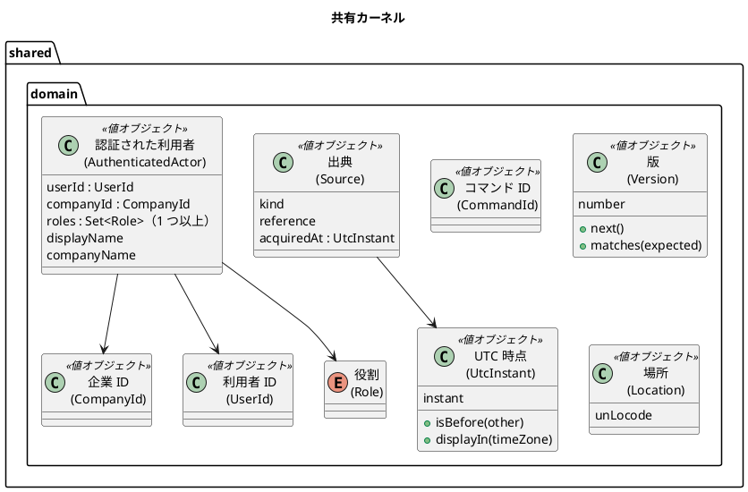

| 型 | 不変条件 |
| :--- | :--- |
| UTC 時点 | UTC の時点として保持する。表示はタイムゾーンと UTC offset を必ず付ける（BR-10） |
| 版 | 1 から始まり、増えるだけ。期待版と一致しない変更は競合とする（ARCH-HO-01） |
| 場所 | UN/LOCODE の形式（国コード 2 文字 + 地点コード 3 文字）だけを受け付ける |
| 出典 | 種類（外部原本・現場記録・社内確認・手動入力）、参照、取得時刻を必須とする |
| コマンド ID | UUID を必須とする（null 不可） |

ドメインイベントは、共有カーネルのインターフェースではなく、注釈 `@DomainEvent` を付けた record として各コンテキストの `domain.events` に置く（2026-10-02 の D-1、[ADR-003](../../adr/cargo-tracker/003-inter-context-integration.md) の補足の決定）。各イベントは受信側の冪等性のキーになる業務キーを持ち、Java の標準と共有カーネルの型だけを持つ。

## コンテキストごとのドメインモデル

各コンテキストについて、集約、エンティティ・値オブジェクト、不変条件、状態遷移、ドメインルールを示す。

### 見積り（Quotation、U1）

#### 見積りの集約

| 集約 | 集約ルート | 識別子 | 含むもの | 責務 |
| :--- | :--- | :--- | :--- | :--- |
| 輸送要求 | 輸送要求（TransportRequest） | 輸送要求 ID | 輸送要求版（エンティティ）、審査記録（エンティティ） | 下書き・提出・審査・差戻し・取下げと、版の管理 |
| 見積り | 見積り（Quotation） | 見積り ID | 料金根拠（値）、有効期限（値）、経路方針（値）、荷主の回答（値）、荷主承認（値） | 見積りの作成・社内承認・提示、荷主の回答、経路版の割当て、荷主承認、失効・置換 |

見積りを輸送要求の中に入れない理由: 見積りは版ごとに複数作られ（置換）、有効期限で単独に失効する。輸送要求の版の更新と見積りの承認が同じトランザクションで競合しないよう、別の集約にする。

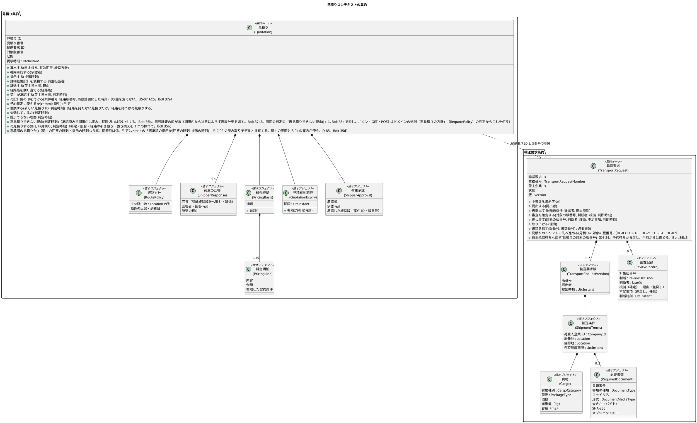

#### 輸送要求と見積りの状態遷移

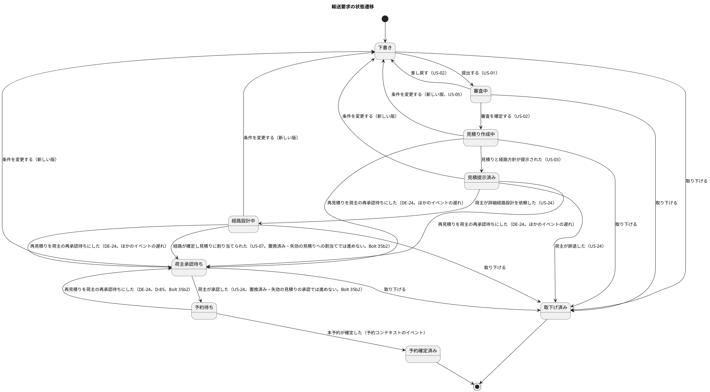

業務の順序は要件定義のエンドツーエンド業務フローに従う: 審査 → 見積りと経路方針の提示 → 荷主の回答 → 詳細経路設計 → 荷主の承認 → 本予約。要件定義の「見積提示済み → 失効」は、見積りの状態（失効）として扱う。見積りが期限で失効しても輸送要求はその状態のまま、新しい見積りを作れる。荷主の承認の後に失効した見積りを再見積りして提示したときだけ、輸送要求を予約待ちから荷主承認待ちへ戻す（DE-24。D-85、Bolt 35b2。ADR-018）。

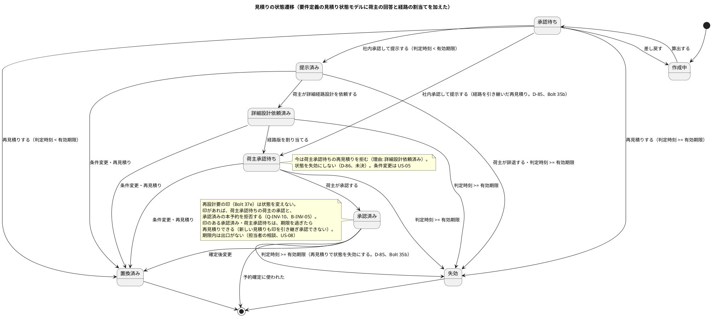

#### 見積りの不変条件とドメインルール

| ID | 不変条件・ルール | 根拠 |
| :--- | :--- | :--- |
| Q-INV-01 | 提出には必須条件（荷受人、出発地、目的地、希望到着期限、貨物）がそろっていること。必要書類は任意で、必須条件に含めない（2026-10-03 の D-20）。出発地と目的地は異なること（2026-10-02 の D-6）。不足や誤りがあれば下書きのまま不足項目と誤りを返す | US-01 |
| Q-INV-02 | 貨物種別が一般以外の輸送要求は提出できない。手動窓口を案内する | BR-03、US-01 |
| Q-INV-03 | 提出された輸送要求版は変更できない。変更は新しい版を作る | BR-04、US-05 |
| Q-INV-04 | 審査の確定は最新版に対してだけ行える。古い版の審査確定は拒否する。審査の対象の版番号を集約の現在の版番号と照合して判定する（ARCH-HO-01 の期待版（集約の `version`）の照合とは別の、業務の規則。Bolt 5）。差戻しも同じ照合を行う | US-02 |
| Q-INV-14 | 審査の確定・差戻しは、状態が審査中のときだけ行える。確定には根拠、差戻しには理由が必要で、不足事項は任意。根拠・理由・不足事項は 4,000 文字まで（2026-10-02 に human:kakimomokuri が承認。Bolt 5） | US-02 |
| Q-INV-15 | 再提出は、状態が下書きのときだけ行える。提出と同じ検証（Q-INV-01・02・12）を通し、版番号を 1 増やした新しい版を作って審査中にする。業務番号は変えない（Q-INV-13） | US-02、US-05 |
| Q-INV-16 | 必要書類は 1 つの版に 5 件まで（商業送り状 1 件、梱包明細 1 件、その他 3 件まで）。形式は PDF・PNG・JPEG で、中身の先頭のバイトで判定する。1 件 1 バイト以上 10 MB（10,485,760 バイト）まで。違反は提出の検証結果として、ほかの不足・誤りとまとめて返す。出し直しでは、添付した種類の前の版の書類を引き継がず（差し替え）、添付しなかった種類の書類を引き継ぐ。引き継ぐ書類と添付を合わせて同じ規則で判定する。新しい版の書類番号は 1 から振り直し、版の中で一意にする。件数の上限と書類番号の一意は輸送条件（ShipmentTerms）も守る（2026-10-03 の D-20。Bolt 7。差し替えは 2026-10-05 の D-25。Bolt 9） | US-01、US-02 |
| Q-INV-05 | 見積りの算出には料金根拠・有効期限・経路方針が必要。提示した時刻を記録する（KPI-01） | US-03、US-21 |
| Q-INV-17 | 算出の検証: 料金明細は 1〜10 行で、内容は 200 文字まで、金額は 0 より大きく整数部 13 桁・小数点以下 2 桁まで（合計も整数部 13 桁まで。表の NUMERIC(15,2)。Bolt 9・10 レビュー R-01）、参照した契約条件は任意で 200 文字まで。通貨は USD・EUR・JPY のどれか。有効期限は算出の時刻より後（同時刻と過去は誤り）。経路方針の主な経由地は 0〜5 件、概算の出発日時と到着日時は必須で、到着は出発より後。不足と誤りはまとめて返す。社内承認して提示できるのは承認待ちの見積りだけ（2026-10-05 の決定。Bolt 10） | US-03 |
| Q-INV-18 | 見積りを作れるのは、輸送要求が見積り作成中で、対象の版が現在の版のときだけ。1 つの輸送要求に、作成中・承認待ち・提示済みの見積りは 1 つだけ。詳細設計依頼済みも数える（2026-10-06 の決定。Bolt 12）。置換済み・失効の見積りは数えない。再見積りは、旧版を置換済み・失効にしてから新しい見積りを作る（荷主の承認の後に失効した見積りも、旧版を失効にして経路を引き継ぐ。D-85、Bolt 35b）。DB でも部分一意インデックスで守る（2026-10-05 の決定。Bolt 10・11） | US-03 |
| Q-INV-06 | 見積りが予約確定に使えるのは、状態が承認済みで、予約確定の commit 時刻が有効期限より前のときだけ。同時刻は失効とする | BR-10、US-03、US-04 |
| Q-INV-07 | 失効・置換済みの見積りは再提示・承認・予約確定に使えない。新しい見積りを作る。失効は判定時刻 >= 有効期限で決め、状態が承認待ち・提示済みのままでも失効として扱う。承認待ちの見積りも失効したら提示できない（2026-10-05 の決定。Bolt 11。承認・予約確定での拒否は US-24・US-04 の Bolt）。承認済みで期限内の見積りは再見積りできず、期限を過ぎた承認済みは再見積りで失効にして経路・荷主の回答・経路方針を引き継ぐ（D-85、Bolt 35b） | BR-16、US-03 |
| Q-INV-08 | 利用者は自社の輸送要求だけを操作できる（アプリケーション層で確認し、集約は荷主企業 ID を保持する） | BR-07、US-01 |
| Q-INV-09 | 詳細経路設計の依頼と辞退は、提示済みの見積りに対してだけ行える。依頼の時刻が有効期限と同時刻または後なら失効として拒否する（Q-INV-07）。辞退には理由が必要で、辞退した見積りは失効する（依頼は 2026-10-06 の決定。Bolt 12） | US-24 |
| Q-INV-10 | 荷主の承認は、見積りに割り当てた経路版が確定済みで、承認の時点で再設計要・旧版・出発済みでなく、見積りが有効期限内のときだけ行える。承認には承認した経路版を記録する。R0.1（Bolt 20）は、荷主承認待ち・有効期限内（承認の時刻 < 有効期限）・自社の輸送要求を確かめる。再設計要の判定は Bolt 37e で足した: 置換済み・失効の記録 → 承認済み → 期限切れ → 荷主承認待ちでない の後に、割り当てた経路に再設計要の印があれば再設計要（`ROUTE_REDESIGN_REQUIRED`）で拒否する。承認済みの見積りに印が付いても、承認の判定は承認済みのまま返す（二重送信の結果を誤らせない）。旧版の判定は再設計（US-08）で足す（旧版は確定から直接移ることがあり、印が付かない）。出発済みの判定は Bolt 37e4 で足した: 再設計要の後に、割り当てた経路の最初の区間の出発予定が承認の時刻と同時刻か前なら出発済み（`ROUTE_ALREADY_DEPARTED`）で拒否する。境界は経路設計の確定の出発済み（`ALREADY_DEPARTED`）と同じ。再設計要と出発済みの両方なら再設計要を返す（D-88）。通常の流れでは回答は提示と同時刻か後（`responseRejectionAt` で集約が守る）。回答の時刻が提示の時刻より前の見積りは、回答を引き継いだ再見積り（`requoteInto`。再承認の見積り）だけである。経路の確定の時刻は経路設計の時計で、経路の割当て（`assignRoute`）はその順を検査しないので、再承認の見積りの見分けには使わない（D-85。Bolt 35d の開発レビューで経路の確定の時刻から改めた。human:kakimomokuri の決定 (7)） | BR-01、BR-10、BR-16、US-24 |
| Q-INV-11 | 輸送要求の複製は、輸送条件を引き継いだ新しい下書きを作る。希望到着期限と必要書類は引き継がない | US-01 |
| Q-INV-12 | 希望到着期限は提出時刻より後でなければならない。同時刻と過去は誤りとする。期限が経路設計に間に合うかは、提出では判定せず経路設計の制約適合（BR-11）で判定する。個数は 1 以上の整数、総重量と容積は 0 より大きい値（小数点以下 3 桁まで）とする（2026-10-02 に human:kakimomokuri が承認） | US-01 |
| Q-INV-13 | 業務番号は初回の提出で振り、差戻し・再提出・新しい版では変えない。同じ番号を 2 つの輸送要求に振らない（D-10） | US-01、D-4 |

| ドメインルール | 英語名 | 内容 |
| :--- | :--- | :--- |
| MVP 受付範囲 | MvpAcceptancePolicy | 貨物種別が一般かを判定する。後続段階で特殊貨物を受け付けるときは、この規則を差し替える。提出の検証（ShipmentTermsInput）が使う |
| 見積有効判定 | — | 判定時刻と有効期限から有効・失効を判定する。判定時刻は呼び出し側が commit 時刻として渡す。見積有効期限（QuotationExpiry）の「有効か(判定時刻)」が担い、別の型にしない（判定を 1 か所に置く。Bolt 11） |
| 拒否の理由 | QuotationRejection | 見積りの集約の判定（荷主の承認 `approvalRejectionAt`、本予約の照会 `bookingRejectionAt`、再見積り `requoteRejectionAt` など）が返す、操作を受け付けない理由。状態と期限による理由（`EXPIRED`・`REPLACED`・`NOT_APPROVED`・`APPROVED_AND_STILL_VALID` など）と、割り当てた経路による理由の再設計要（`ROUTE_REDESIGN_REQUIRED`。Bolt 37e）・出発済み（`ROUTE_ALREADY_DEPARTED`。Bolt 37e4、D-88）を持つ。再設計要と出発済みの両方なら再設計要を返す。文言は画面の層が付ける |
| 本予約の照会の理由 | BookableQuotation.Reason、BookableQuotationResult.NotBookable | 本予約の照会で見積りを使えない理由。入力ポートの理由（`BookableQuotation.Reason`）は照会（`BookableQuotationQueryService.reasonOf`。網羅の switch）が拒否の理由から選び、アダプターが公開 API の定数（`NotBookable`）に写す。見つからない（`QUOTATION_NOT_FOUND`）・失効（`EXPIRED`）・置換済み（`REPLACED`）・承認済みでない（`NOT_APPROVED`）・再設計要（`ROUTE_REDESIGN_REQUIRED`。Bolt 37e）・出発済み（`ROUTE_ALREADY_DEPARTED`。Bolt 37e4）。公開 API の定数は見積りのドメインの値の名前とは独立に決める契約で、足すだけにする（既存の定数と形は変えない） |

提出の検証は、輸送条件の入力（ShipmentTermsInput）が Q-INV-01・Q-INV-02・Q-INV-12 をまとめて判定し、違反をすべて提出の検証結果（SubmissionViolations）として返す（1 件ずつ直させない）。違反がなければ、同じ判定の結果として輸送条件（ShipmentTerms）を返す（検証を通らずに輸送条件を作れないよう、変換を別の操作に分けない。Bolt 4 レビュー R-04）。そのうえで業務番号の採番（TransportRequestNumberIssuer）で番号を得て提出する。採番のポートは `domain.model` に置き、実装は `infrastructure.persistence` に置く。

必要書類（Bolt 7）: 輸送条件の入力は添付の一覧を受け取り、書類の受付規則（RequiredDocumentPolicy）が Q-INV-16 を判定する。違反がなければ、アプリケーション層が書類の保存（RequiredDocumentStorage）に中身を保存してオブジェクトキーを得て、必要書類として輸送条件に入れる。ファイル名は画面に出すだけに使い、オブジェクトキーには使わない（`quotation/{輸送要求 ID}/{UUID}`）。書類の取得は、荷主用（荷主企業で絞った照会を通す）と社内用（営業担当者）に入力ポートを分ける（Bolt 4 R-02、Bolt 5 R-10 と同じ形）。どちらも、版と書類番号で書類を探す操作は輸送要求（集約）が持ち、取得できるのは現在の版の書類だけとする（前の版の書類番号は見つからない扱い。Bolt 6〜8 レビュー R-10・R-19）。書類の受付規則は、判定した形式を判定の結果として返し、アプリケーション層は形式を判定し直さない（R-11）。保存のポートは `domain.model` に置き、実装は `infrastructure` に置く。

見積りの提示（Bolt 10）: 見積りは輸送要求と別の集約で、作る（作成中）→ 算出する（承認待ち。Q-INV-05・17）→ 社内承認して提示する（提示済み。DE-03）の順に進む。輸送要求の状態（見積提示済み）は、DE-03 を受けた別のトランザクションで変え、2 つの集約を 1 つのトランザクションで更新しない（ドメインモデル「見積りを輸送要求の中に入れない理由」）。荷主の画面の見積りの照会は、輸送要求と同じく荷主企業で絞る（Q-INV-08）。社内の照会は `Staff…` の入力ポートに分ける。

見積りの失効と置換（Bolt 11）: 失効は状態を書き換えずに、見積有効期限（QuotationExpiry）の「有効か(判定時刻)」が判定時刻と有効期限から決める（同時刻は失効。Q-INV-06）。判定時刻は呼び出し側が渡す（社内承認して提示する・再見積りは操作の時刻、予約確定は commit 時刻）。社内承認して提示するときに失効していれば「失効している」で拒否し、置換済みなら「置換済み」で拒否する（Q-INV-07）。再見積りは、旧版の状態遷移（置換済みと置換先の見積り ID、または失効）と新しい見積りの作成を 1 つのトランザクションで行う。同じ集約の型の 2 つのインスタンスを 1 つのトランザクションで更新する例外で、理由は Q-INV-18 が見積りのインスタンスをまたぐ規則であり、DB の部分一意インデックスで守るため（旧版の更新を先に書く）。新しい見積りの提示で発行する DE-03 は、輸送要求がすでに見積提示済みなので状態を変えない（荷主の承認の後の再見積りの提示では、DE-03 は輸送要求を変えず、一緒に出す DE-24 が予約待ちから荷主承認待ちへ戻す。KPI の最初の提示時刻は変えない。Bolt 35b・35b2）。提示できるかは集約の「提示できない理由(判定時刻)」に問い合わせ、画面はその結果を写す（Bolt 11 レビュー R-07。再見積りできるかも Bolt 35b までは集約の「再見積りできない理由()」に問い合わせた）。再見積りできるかは、Bolt 35c からドメインの規則「再見積りの方針」（`RequotePolicy`。輸送要求と見積りと判定時刻から、輸送要求の状態 → 版 → 集約の「再見積りできない理由(判定時刻)」の順に判定する。見つからないかは呼び手が先に見る）に問い合わせ、再見積りのボタン・GET・POST（再見積りのサービス）が同じ理由を示す。集約の「再見積りできない理由()」は消す（D-85。Bolt 35c）。古い版に対する見積りは再見積りできない（理由: 古い版。R-06）。輸送要求が予約確定済みの見積りは再見積りできない（理由: 予約確定済み `TRANSPORT_REQUEST_BOOKED`。予約確定済みの見積りも状態は承認済みのまま残り、期限を過ぎると集約の判定を通るため、輸送要求の状態で拒む。ほかの再見積りできない輸送要求の状態は `TRANSPORT_REQUEST_NOT_QUOTING` のまま。D-85。Bolt 35c）。社内の受付一覧（S-02）の見積提示済みの表は、見積提示済みの見積依頼ごとの最新の見積り（見積り番号の最大）を有効期限の近い順に返す読み取りモデル（`QuotedRequestSummary`）で、集約を組み立てない（R-02）。

荷主の回答（Bolt 12）: 荷主が詳細経路設計へ進むと回答すると、見積りは提示済みから詳細設計依頼済みになり、回答者（認証までは仮の荷主の利用者）と回答時刻を記録して DE-16 を生成する。回答できるかは集約の「回答できない理由(判定時刻)」に問い合わせ、置換済み・失効（記録または判定時刻で）を先に見て、そうでなければ状態に応じて詳細設計依頼済み（回答済み）か提示済みでないかを返す。荷主に見えるか（提示した見積りか）も集約に問い合わせ、見えない見積りへの回答は見つからない扱いにする（Bolt 12 レビュー R-19）。時刻で失効し得る状態と Q-INV-18 で数える状態は、見積りの状態（QuotationStatus）の述語が決める（R-05）。画面の操作の出し分けもこれを使う。輸送要求の経路設計中への変更は、DE-16 を受けた別のトランザクションで行い、見積り作成中・見積提示済みで同じ版のときだけ変える（冪等。DE-03 と同じ）。DE-16 が DE-03 より先に届いても経路設計中にし、遅れて届いた DE-03 では戻さない（Bolt 12 レビュー R-04・R-06）。詳細設計依頼済みの見積りも、判定時刻が有効期限と同時刻または後なら失効として扱う（状態は書き換えない）。経路設計案件がまだないため、詳細設計依頼済みの見積りは再見積りできない（理由: 詳細設計依頼済み。荷主の承認の後に失効した見積りは D-85 で再見積りできる。Bolt 35b）。経路設計の途中の再見積り・条件変更は US-05・US-07 で決める。社内の受付一覧（S-02）の経路設計中の表は、経路設計中の見積依頼ごとの詳細設計依頼済みの見積りを依頼時刻の古い順に返す読み取りモデルで、集約を組み立てない。

経路版の割当てと荷主の承認（Bolt 20）: 経路設計が経路を確定すると（DE-05）、経路設計の中の listener が見積りの公開 API（経路の割当て。`quotation.interfaces.api.RouteAssignment`）を呼ぶ（ADR-014）。見積りは詳細設計依頼済みのときだけ経路版を割り当てて荷主承認待ちになり、割り当てた経路（案件番号・経路版番号・確定の時刻・区間の写し）を持ち、DE-21 を生成する。有効期限を過ぎていても割り当てる（期限は承認の時点で判定する。Q-INV-07・10）。同じ経路版の割当ては何もしない（冪等。DE-05 の再配信）。別の経路版の割当てと、置換済み・失効の記録・作成中・承認待ち・提示済み・承認済みへの割当ては、割り当てずに理由を値で返し、listener は警告のログを残す（経路設計の確定は戻さない）。荷主の承認は荷主承認待ちのときだけで、承認の時刻が有効期限と同時刻または後なら失効として拒否する（AC5）。置換済み・失効の記録も拒否し、新しい見積りが必要と示す。荷主担当者 1 名の承認で足り（BR-01）、承認者・承認時刻を記録して DE-04 を生成する（承認した経路版は割り当てた経路）。承認できるかは集約の「承認できない理由(判定時刻)」に問い合わせ、画面の操作の出し分けもこれを使う。荷主企業での絞り込み（Q-INV-08）は、荷主の照会を通したアプリケーション層で行う。輸送要求の荷主承認待ち（DE-21）と予約待ち（DE-04）は、それぞれのイベントを受けた別のトランザクションで変え、同じ版のときだけ変える（冪等。DE-03・DE-16 と同じ）。荷主承認待ち・承認済みの見積りは Q-INV-18 で数え、時刻で失効し得る。再見積りは、経路設計の途中と同じく、再設計（US-08）で決めるまでできない（荷主承認待ち）。荷主の承認の後に有効期限を過ぎた見積りは、D-85 で再見積りできる（Bolt 35b）: 旧版を失効にし、旧版が判定を通ったときだけ作る経路の引き継ぎ（割り当てた経路と荷主の回答）を新しい見積りが受け、社内承認して提示すると荷主承認待ちに直行する（DE-03 を出し、DE-21 は出さない）。荷主が再承認すれば新しい見積りで本予約を確定できる。引き継いだ見積りを提示の前にもう一度再見積りしても引き継ぐ。期限内の承認済みは再見積りできない。新しい見積りの提示で DE-24 を出し、輸送要求を予約待ちから荷主承認待ちへ戻す（Bolt 35b2。ADR-018）。荷主の再承認（DE-04）・旧版のイベントと届く順が入れ替わっても状態がずれないよう、輸送要求を進める・戻す listener は輸送要求を読んでから見積りを読み、DE-04 と DE-24 は進めなくても輸送要求を書いて楽観ロックでぶつける。置換済み・失効の見積りの DE-21・DE-04 は輸送要求を進めない。社内の画面は Bolt 35c、荷主の画面は Bolt 35d。再承認の見積りかは、集約の問い合わせ「再承認の見積りか」（`isPresentedForReapproval`。荷主の回答の時刻が提示の時刻より前なら真。同時刻は偽）が 1 つの集約の 2 つの時刻だけで決める（リポジトリも以前の見積りも読まない。Bolt 35b の開始準備の「同じ輸送要求で同じ案件番号・経路版を持つことから辿る」から改めた。Q-INV-10 の時刻の順。D-85。Bolt 35d）。判定は static の `Quotation.isReapprovalPresentation(respondedAt, presentedAt)` に置き、集約と C-02 の読み取りモデル（`ShipperLatestQuotationSummary`）が共有する。Bolt 35d の開始準備では経路の確定の時刻 < 提示の時刻で見分けたが、経路の確定の時刻は経路設計の時計で集約はその順を守らないため、開発レビューで集約自身が順を守る荷主の回答の時刻に改めた（`AssignedRoute.isConfirmedBeforePresentation` は消した。human:kakimomokuri の決定 (7)）。W6 の再設計（US-08）や荷主の辞退で回答の扱いが変わるときは、この問い合わせを見直す（D-88）。荷主の画面（C-02・C-04）は、輸送要求が予約待ち・荷主承認待ちのとき、状態と案内を荷主に見える最新の見積りから選ぶ（輸送要求の状態は DE-24・DE-04 の受け取りまで見積りに遅れるため）。再承認の見積りには再承認の案内を出し、旧版から引き継いだ回答時刻で詳細経路設計の依頼の文を出さない。C-02 の行の最新の見積りは、自社の輸送要求ごとに荷主に見える最新の見積り（提示済みで見積り番号の最大）の状態・有効期限・荷主の承認の時刻・提示の時刻・荷主の回答の時刻を返す、集約を組み立てない読み取りモデル（`ShipperLatestQuotationSummary`）で得る（R-02。スキーマは変えない。照会は輸送要求の状態で絞らず、どの状態で見積りから選ぶかは画面の層が決める。D-85。Bolt 35d）。社内の受付一覧（S-02）の予約の確定待ちの表は、集約を組み立てない読み取りモデル（`AwaitingBookingSummary`）で、輸送要求が経路設計中・荷主承認待ち・予約待ちのものについて 2 種類の行を返す。荷主が承認した見積り（承認済み。見積りの承認済みを正にし、DE-04 の配信を待たない。Bolt 23b）の行と、経路を引き継いだ承認待ちの見積り（再見積りの後で提示の前。経路を持つ承認待ち）の行である。後者は、旧版が失効すると承認済みの行が消え、提示の前の見積りがどの表にも出なくなるため Bolt 35c で足す。読み取りモデルは見積りの状態を持ち、承認待ちの行は荷主の承認時刻を持たない（D-85。Bolt 35c）。

審査（Bolt 5）: 社内の画面（S-02・S-03）は営業担当者がすべての荷主の輸送要求を扱うため、リポジトリに荷主企業で絞らない照会（業務番号の検索、審査中の一覧）を持つ。荷主の画面の照会は、業務番号が推測しやすいため必ず荷主企業で絞る（Bolt 4 レビュー R-02）。2 つの照会は名前と入力ポートを分け（荷主用の照会サービスと、社内用の `StaffTransportRequestQueryService`）、取り違えを防ぐ。受付一覧は集約を組み立てない読み取りモデル（`TransportRequestSummary`）で、最初の提出時刻（版 1）の古い順に並べる（Bolt 5 レビュー R-05・R-09・R-10）。下書きを保存するまでは（R1.0）、再提出が輸送条件の入力を受け取る。

荷主の再提出（Bolt 6）: 荷主の見積依頼の一覧（C-02）は、リポジトリの `findSummariesByShipper(荷主企業)` で、自社の輸送要求だけを最初の提出時刻の新しい順に返す。一覧の行（`TransportRequestSummary`）は状態を持ち、荷主の画面はそれを「いま誰の対応待ちか」に対応させる（審査中・見積り作成中は A 社、下書きはお客様）。荷主に見せる審査記録は直近の差戻しの理由と不足事項だけで、審査の確定の根拠と判断者は社内の記録として見せない（2026-10-03 の人の決定）。集約の操作は足さず、再提出は Bolt 5 の `再提出する()` を荷主企業で絞った照会の後に呼ぶ。

Q-INV-01 の「下書きのまま」は、R1.0 で下書きを保存するまで、下書きを保存せずに入力を残して同じ画面を表示することで満たす（2026-10-02 の人の決定。Bolt 4）。下書きの操作（`下書きを更新する()`）と `transport_request_draft` は R1.0 の下書き保存で作る。必要書類は、ファイルの保存とあわせて Bolt 4 の次の Bolt で必須条件に入れる。

Bolt 37e（US-07 AC5 の見積りの側）で決めたこと（[Bolt 37e 計画](../../development/cargo-tracker/bolt_37e_plan.md) の確認ポイント 1〜10。2026-10-22 に human:kakimomokuri が承認。経路設計の DE-06 の listener と DE-05・DE-06 の届く順は Bolt 37e2、出発済みの判定（D-88）・予約の追従・画面の文言は Bolt 37e3。Bolt 37e3 の開始準備で、出発済みの判定は Bolt 37e4 に送った）:

- 再設計要の印は、割り当てた経路の写し（`AssignedRoute`）の「再設計要にした時刻」（任意）で持つ。印は経路版の事実の写しで、見積りの状態ではない（状態を変えない）。理由の区分は写さない（経路設計の再設計要の記録と DE-06 にある。見積りの判定は印の有無だけで決まる）。印のない写しを作るコンストラクター（案件番号・経路版番号・確定の時刻・区間）は残す。同じ経路版かの判定（`isSameVersionAs`）は案件番号と経路版番号だけで比べ、印を見ない（record の等価は使わない）。印のある見積りに同じ経路版の DE-05 が再配信されても、割当ては `ALREADY_ASSIGNED` で印は残る。
- 印を付ける操作は `Quotation.markRouteRedesignRequired(案件番号, 経路版番号, 再設計要にした時刻)` で、結果は再設計要の印の結果（`RouteRedesignMarkResult`。付けた・付いていた・経路がない・別の経路版）。付いていれば最初の時刻を残す（冪等）。経路を割り当てていない見積りと、別の経路版を割り当てた見積りは変えない。
- 同じ（案件番号・経路版番号）を割り当てたすべての見積りに付ける。失効・置換済みにも付ける（判定には効かない。置換済み・失効の記録が先に返る。記録の一貫性のためで、再見積りの旧版から写すときに印を失わない）。本予約を確定した見積りにも付け、予約と輸送要求は変えない（R-INV-07。予約を自動で取り消さない）。
- 入力ポートは 1 つのトランザクションで、（案件番号・経路版番号）で見積りの ID を引き（索引 `ix_quotation_assigned_route`）、1 件ずつ読んで印を付けて保存し、もう一度引いて増えた ID があれば同じことを繰り返す（増えなくなるまで）。印を付ける操作と再見積りの届く順（印が先、再見積りが先、照会の後で読む前に再見積り、どちらかの保存が楽観ロックで負ける）のどれでも、印のない新しい見積りを残さない。2 つ以上の見積り（集約）を 1 つのトランザクションで書くのは、同じ経路版の写しをそろえるためで、再見積り（旧版と新しい見積りを 1 つで書く。上の「見積りの失効と置換」）と同じ例外にする。楽観ロックで競合したら例外にし、呼び手（Bolt 37e2 の経路設計の listener）が戻して再配信でやり直す（DE-05 の前例）。イベントは出さない（荷主への通知は US-08）。
- 荷主の承認の判定（`approvalRejectionAt`。Q-INV-10）は、置換済み・失効の記録 → 承認済み → 期限切れ → 荷主承認待ちでない → 再設計要（`ROUTE_REDESIGN_REQUIRED`）の順。承認済みの見積りに印が付いても、承認の判定は承認済みのまま。本予約の判定（`bookingRejectionAt`。B-INV-05）は、置換済み・失効の記録 → 期限切れ → 承認済みでない → 再設計要の順。どちらも期限切れを先に返す。拒否の理由（`QuotationRejection`）を写す網羅の switch は、今の「承認できない」の文言の組に入れる（言い分けは Bolt 37e3）。
- 再見積りの可否は変えない（承認済みで期限切れだけが再見積りできる）。印は経路の引き継ぎで新しい見積りに写り、提示して荷主承認待ちになっても荷主の承認で再設計要として拒否される。可否は Bolt 37e3 でも変えないが、印があり期限内の拒否の理由は再設計要（`ROUTE_REDESIGN_REQUIRED`）に改めた（下の Bolt 37e3 で決めたこと）。
- 既知の制限: 承認済みで期限内の見積りに印が付くと、本予約は再設計要、再見積りは `APPROVED_AND_STILL_VALID` で拒否され、期限まで出口がない。荷主承認待ちで印が付いた見積りも、期限内は荷主の承認が再設計要、再見積りが `ROUTING_REQUESTED` で拒否される（Bolt 37e3 で、どちらも再見積りの拒否の理由を `ROUTE_REDESIGN_REQUIRED` に改めた。期限まで出口がないことは変わらない）。印のある承認済み・荷主承認待ちは、有効期限を過ぎたら再見積りでき（旧版は失効。新しい見積りは経路と印を引き継ぎ、提示しても荷主の承認は再設計要）、料金と期限を出し直せる（D-86 を印のある荷主承認待ちだけ変えた。Bolt 37e の終了報告の承認の場で human:kakimomokuri が決めた）。経路の出口は再設計（US-08）。旧版の経路版の判定も US-08（旧版は確定から直接移ることがあり、印が付かない）。
- 見積りの公開 API に再設計要の伝達（`quotation.interfaces.api.RouteRedesignNotification.notifyRedesignRequired(RouteRedesignNotificationRequest)`。案件番号・経路版番号・再設計要にした時刻）を足す。受け取りは `RouteRedesignNotificationReceipt`（sealed: `Marked(新しく付けた件数)`・`AlreadyMarked`・`NotMarked(理由)`。理由は `QUOTATION_NOT_FOUND`（その経路版を割り当てた見積りがない）・`INVALID_REQUEST`（空の案件番号、1 未満の経路版番号、時刻がない。例外にせず理由で返す））。見積りは経路設計案件 ID を持たないので案件番号で引く（D-4）。アダプターは `quotation.interfaces.api.internal`、入力ポートは `quotation.application.internal.commandservices` に置く（ADR-014 の形。`BookingNotification` の前例）。
- 本予約の照会の公開 API の理由（`BookableQuotation.Reason`・`BookableQuotationResult.NotBookable`）に `ROUTE_REDESIGN_REQUIRED` を足し、見積りの照会の `default` を明示の case にする。予約の側（ACL と `QuotationUnavailability`、S-09・S-02 の文言）の追従は Bolt 37e3。Bolt 37e2 から 37e3 までは予約の画面が「承認済みでない」と示すが、拒否は保たれる。
- 本番で印を付ける入口（DE-06 の listener）は Bolt 37e2 なので、Bolt 37e では利用者に見える振る舞いは変わらない。DE-06 が DE-05 より先に届くと見積りはまだ経路を持たず `NotMarked(QUOTATION_NOT_FOUND)` になり、その後の DE-05 が印のない経路を割り当てる（Q-INV-10 の穴）。この扱いと、DE-06 と本予約の確定の競合の守り（ADR-016）は Bolt 37e2 で決めた（下の Bolt 37e2 で決めたこと）。決着: `RouteAssignmentRequest` にも `BookableQuotationResult.Bookable` にも項目は増えない。DE-06 が先に届く穴は DE-05 の listener が割り当てた後に続けて伝えて塞ぎ、本予約の確定との競合は見積りの公開 API に確定用の照会の操作を足して守る。

Bolt 37e2（US-07 AC5 の経路設計の側）で決めたこと（[Bolt 37e2 計画](../../development/cargo-tracker/bolt_37e2_plan.md) の確認ポイント 1〜9。2026-10-23 に human:kakimomokuri が承認。出発済みの判定（D-88）・予約の追従・画面の文言・マニュアルは Bolt 37e3。Bolt 37e3 の開始準備で、出発済みの判定は Bolt 37e4、マニュアルは Bolt 37e3b に送った）:

- DE-06 の listener は `routing.application.internal.eventhandlers.QuotationRouteRedesignEventHandler`（`@ApplicationModuleListener`。新しいトランザクション）にする。腐敗防止層 `QuotationRouteRedesigns.notifyRedesignRequired(案件番号, 経路版番号, 再設計要にした時刻)` が見積りの公開 API（`RouteRedesignNotification`）を呼び、付けなかった理由（`Optional<String>`）を返す。腐敗防止層は経路設計の型を公開 API の型に変えるだけ（`QuotationRouteAssignments` の前例）。値は DE-06 の項目から取り、案件を読まない。`NotMarked` は警告のログだけで例外にしない。`QUOTATION_NOT_FOUND` の警告には「経路をまだ割り当てていなければ DE-05 の listener が続けて伝える」と書く。`INVALID_REQUEST` は出口がないが、DE-06 の項目は経路設計が作るので起きないはずで、開発者が警告のログで調べる。楽観ロックの競合の例外は握りつぶさずに上げ、発行記録を未完了に残す（DE-05 の前例。ADR-014）。
- DE-05 の listener は、最初に案件の行を `FOR UPDATE` で読んでから集約を組み立てる（リポジトリの操作 `RoutingCaseRepository.findByNumberForRouteAssignment(RoutingCaseNumber)`。目的の名前（Bolt 37e4c）。呼び手のトランザクションの中でだけ意味を持つ）。評価の保存は案件の行を書く（`touchRoutingCase`）ので、DE-05 の listener のコミットまで待ち、評価と直列になる。見積りの公開 API で割り当てた（`Assigned`・`AlreadyAssigned`）後、その経路版が再設計要の記録を持てば、同じトランザクションで DE-06 の listener と同じ腐敗防止層から続けて再設計要を伝える。記録の有無は状態ではなく記録で見る（旧版も記録を持てる）。時刻は再設計要の記録の時刻（DE-06 の再設計要にした時刻と同じ値）で、読み直しはしない。割り当てなかった（`NotAssigned`）ときは警告だけで、続けて伝えない。続けての伝達の `NotMarked` は警告だけ（同じトランザクションの割当ては見えるので通常は起きない）。続けての伝達が楽観ロックで競合したら例外を上げて割当てごと戻す（戻った状態は未割当てで荷主は承認できない。安全側）。
- DE-05 と DE-06 の届く順: DE-05 の割当てのコミットの後の DE-06 は、DE-06 の listener が印を付ける。DE-06 が先に届くと（見積りはまだ詳細設計依頼済み）DE-06 の listener は `QUOTATION_NOT_FOUND` の警告で終え、後の DE-05 の listener が割り当てた後に続けて伝えて印を付ける。DE-05 が再配信されると `AlreadyAssigned` の後に続けて伝えて `AlreadyMarked` になり、DE-06 の再配信は `AlreadyMarked` になる。確定のまま（記録なし）の DE-05 は続けて伝えない。DE-05 の listener が案件の行を押さえている間に評価が保存しようとすると、評価はそのコミットまで待ってから保存して DE-06 を出す。DE-05 の listener は案件の行を押さえてから読むので、「DE-05 が確定を読んだ後に評価がコミットされ、DE-06 が割当てのコミットの前に走る」順はない。公開 API の契約（`RouteAssignmentRequest`・`RouteRedesignNotificationRequest`）は変えない。Bolt 37e の行 20 の特性テスト（DE-06 が先に届くと `QUOTATION_NOT_FOUND`）は、入力ポートの振る舞いとして残す。
- 本予約の確定用の照会: 見積りの公開 API に `BookableQuotationQuery.findForConfirmation(BookableQuotationRequest)` を足す。見積りの行を（輸送要求 ID・見積り番号）で単表から最初に `SELECT ... FOR UPDATE` で読み、そのあと今の照会（`find`）と同じ判定と写しを返す（照会の結果の形は変えない）。入力ポートの操作は `@Transactional(propagation = MANDATORY)` で、呼び手のトランザクションの外では落とす。ロックは呼び手（本予約の確定）のトランザクションが終わるまで持つ。リポジトリの操作は目的の名前 `lockForBooking` にする（`PasswordResetTokenRepository.lockForIssue` の前例）。予約の腐敗防止層 `QuotationBookability` は、本予約の確定（POST）で確定用の照会を使い、S-09 の GET（`@Transactional(readOnly = true)`）は今の照会のまま（read-only では `FOR UPDATE` を使えない。確定の可否は POST で決める。ADR-016）。
- 本予約の確定と印を付ける更新: 確定用の照会が見積りの行を押さえた後の印を付ける更新は、確定のコミットまで待ってから付く。予約は残る（R-INV-07）。印を付ける更新が行を押さえた後の確定用の照会は、印のコミットまで待ち、キャッシュを使わずに印を読んで再設計要で拒否する（同じトランザクションでその前に見積りを読んでいても）。予約の層は Bolt 37e3 まで `QuotationUnavailable(NOT_APPROVED)` と示すが、拒否は保たれる。再見積り（置換）との競合も同じロックで待つ（ADR-016）。
- ロックの規則: ロックの照会は単表で、その表で最初の読み込みにし（本予約の確定は、その前に予約と輸送要求を読む）、`flushCache="true"` と待ちの上限（`timeout`。JDBC の問い合わせの時間切れで、H2 と PostgreSQL の両方で効く）を付ける。組み立ての読み込みはその後にする（同じトランザクションの同じ照会を MyBatis のセッションのキャッシュが返すため。Bolt 37e の学び）。時間切れは例外のまま上げる（listener は発行記録を未完了に残し、本予約の確定は既存の例外の画面）。値は 10 秒（ADR-016。Bolt 37e2 のステップ 5 で決めた）。確定用の照会は見積りの 1 行だけを押さえ、複数の見積りを書く側（印を付ける入力ポート）は照会の順（`ORDER BY transport_request_id, quotation_no`）で書く。案件の行のロックは経路設計の中の自分の集約に閉じる。見積りの行のロックは予約のトランザクションが見積りの行を押さえるので、コンテキストの境界をまたぐ（ADR-016 のネガティブ）。
- 見える変化: listener をつなぐので、評価が経路版を再設計要にすると印が付き、C-04 の承認の操作が消え、C-17 は既定の文言で拒否し、S-09 は「荷主の承認がまだ」と誤って示し、S-02 に印のある見積りが残る（Bolt 37e3 で直す）。本番とデモには評価の入口が W7（US-14）までなく（Bolt 39f でつないだ）、開発データにも再設計要の見本がないので、見える変化は起きない。W7 の評価の入口をつなぐ Bolt は Bolt 37e3 を終えてから始める（リリース計画のリスク台帳。Bolt 37e3 の開始準備で「Bolt 37e3b を終えてから」に改めた）。画面の文言とマニュアルは Bolt 37e3 のまま（Bolt 37e3 の開始準備で、画面の文言は 37e3、マニュアルは 37e3b に分けた）。

Bolt 37e3（US-07 AC5 の予約と画面の側）で決めたこと（[Bolt 37e3 計画](../../development/cargo-tracker/bolt_37e3_plan.md) の確認ポイント 1〜10。2026-10-23 に human:kakimomokuri が承認。出発済みの判定（D-88）は Bolt 37e4、開発データの見本・マニュアル・デモは Bolt 37e3b）:

- 再見積りの判定（`Quotation.requoteRejectionAt`）は、割り当てた経路に再設計要の印があり有効期限内なら、状態（承認済み・荷主承認待ち）によらず再設計要（`ROUTE_REDESIGN_REQUIRED`）を返す。これまでは承認済みが `APPROVED_AND_STILL_VALID`、荷主承認待ちが `ROUTING_REQUESTED` になり、S-04 が「本予約の確定へ進んでください」「詳細経路設計を依頼済み」と誤って案内した。期限の後は今のまま再見積りできる（D-86 の変更。新しい見積りは経路と印を引き継ぐ）。再見積りの可否は変えず、理由だけを変える（開始準備の決定 (5)。Bolt 37e の行 14b・14c の期待値が変わる）。
- 予約の腐敗防止層の理由（`QuotationUnavailability`）に再設計要（`ROUTE_REDESIGN_REQUIRED`）を足し、腐敗防止層 `QuotationBookability` が見積りの公開 API の理由（`BookableQuotationResult.NotBookable` の `ROUTE_REDESIGN_REQUIRED`）から写す。知らない理由を写す `default` の腕は残し、今のまま承認済みでない（`NOT_APPROVED`）に寄せる（見積りが理由を足したときに S-09 が 500 にならないように。確認ポイント 2）。公開 API の契約（理由の定数）は変えない。下の予約の B-INV-05。Bolt 37e4 で、公開 API に出発済みの定数（`NotBookable.ROUTE_ALREADY_DEPARTED`）を足した（定数を足すだけで、既存の定数と形は変えない。下の Bolt 37e4 で決めたこと）。
- 営業の文言は、再見積りの拒否の理由を写す今の腕（`approvalStageRejection`）の中で言い分け、`StaffQuotationController.rejection` の腕は増やさない（循環的複雑度の上限 10。Bolt 37e の決定）。文言は ui_design の S-02・S-04・S-09・C-04・C-17。荷主の画面には社内の語（再設計要、印、DE-06、経路版の番号）を出さない。
- S-02 の予約の確定待ちの照会の行に再設計要の有無（`route_redesign_required_at` の有無）を足す。スキーマは変えない。印のある行は表から除かない（除くと、期限の後の再見積りの入口が消え、D-86 の変更と食い違う。開始準備の決定 (4)）。
- 見積りと案件の状態、状態遷移は変えない。

Bolt 37e4（US-07 AC5 の出発済みの経路。D-88）で決めたこと（[Bolt 37e4 計画](../../development/cargo-tracker/bolt_37e4_plan.md) の確認ポイント 1〜10。2026-10-23 に human:kakimomokuri が承認。開発データの見本とデモは Bolt 37e4b、Bolt 37e2 の既知の課題と #16 のクローズは Bolt 37e4c）:

- 荷主の承認の判定（`approvalRejectionAt`）と本予約の判定（`bookingRejectionAt`）の最後（再設計要の後）に、割り当てた経路の最初の区間の出発予定が判定時刻と同時刻か前なら出発済み（`ROUTE_ALREADY_DEPARTED`）を返す。境界は経路設計の確定の出発済み（`ALREADY_DEPARTED`）と同じ。判定時刻は、荷主の承認は承認の時刻、本予約は commit 時刻。再設計要と出発済みの両方なら再設計要を返す（再設計要のほうが根本の理由で、Bolt 37e3 の文言と見本を変えない。確認ポイント 2）。
- 区間の写しは見積りが持つ（`AssignedRoute.legs()`。ADR-014）ので、経路設計に問い合わせずに見積りの中で判定する。出発済みは状態ではなく判定時刻で決まるので、見積りの状態と状態遷移は変えない。スキーマも変えない。
- 再見積りの判定（`requoteRejectionAt`）は、受け付けるかどうかを変えない（D-88。出発済みでも期限の後は再見積りでき、新しい見積りも荷主の承認で出発済みとして拒否される）。承認済みで有効期限内の拒否の理由だけ、出発済みなら `ROUTE_ALREADY_DEPARTED` にする（これまでは `APPROVED_AND_STILL_VALID` で、S-04 が「本予約の確定へ進んでください」と誤って案内した）。再設計要が先（開始準備の決定 (4)）。
- 理由は Bolt 37e3 の再設計要と同じ道で流す: 拒否の理由 `QuotationRejection.ROUTE_ALREADY_DEPARTED` → 入力ポートの理由 `BookableQuotation.Reason.ROUTE_ALREADY_DEPARTED` → 公開 API `BookableQuotationResult.NotBookable.ROUTE_ALREADY_DEPARTED` → 予約の腐敗防止層 `QuotationUnavailability.ROUTE_ALREADY_DEPARTED`。公開 API は定数を足すだけにする（確認ポイント 4）。腐敗防止層は知らない理由を今のまま `NOT_APPROVED` に寄せる。既定の腕のない網羅の switch（荷主の回答の画面と営業の見積りの画面）は、今の組に名前を入れ、腕を増やさない。
- 文言は ui_design の C-04・C-17・S-02・S-04・S-09。荷主の画面は社内の語（区間、出発済み）を出さず「割り当てた経路の最初の航海がすでに出発した」と示し、社内の画面は「最初の区間が出発済み」と示す。`isPresentedForReapproval` は変えない（US-08・D-86 で見直す）。

### 経路設計（Routing、U2）

#### 経路設計の集約

| 集約 | 集約ルート | 識別子 | 含むもの | 責務 |
| :--- | :--- | :--- | :--- | :--- |
| 経路設計案件 | 経路設計案件（RoutingCase） | 経路設計案件 ID | 経路版（エンティティ）、経路候補（エンティティ）、判断根拠（値）、荷主企業（値。Bolt 38g。見積りの公開 API から写し、担当範囲の判定に使う） | 候補の算出・比較、専門判断、確定、再設計要、再設計 |
| 航海 | 航海（Voyage） | 航海番号 | 運航予定（値）、寄港（値）、採用情報版（値）、出典（値）、公開した時刻（値。Bolt 39e） | 外部原本から採用した運航予定の保持と更新（DE-12 を受けて経路設計の listener が書く。Bolt 39e） |
| 接続時間規則 | 接続時間規則（ConnectionRule） | 規則 ID | 対象の航路・港、必要最小接続時間 | 航路別の必要最小接続時間の管理（BR-11） |

経路版を経路設計案件の中に入れる理由: 再設計では旧版と新版の関係（新旧関係、変更根拠、引き継ぐ不適合理由）を一貫して保つ必要がある（US-08）。経路版を独立した集約にすると、「確定済みの経路版は案件に 1 つだけ」という不変条件を集約をまたいで守ることになる。

航海を経路設計案件の外に置く理由: 航海は多くの案件から参照され、外部原本の採用で独立に更新される（第 2 章の Voyage 集約と同じ）。

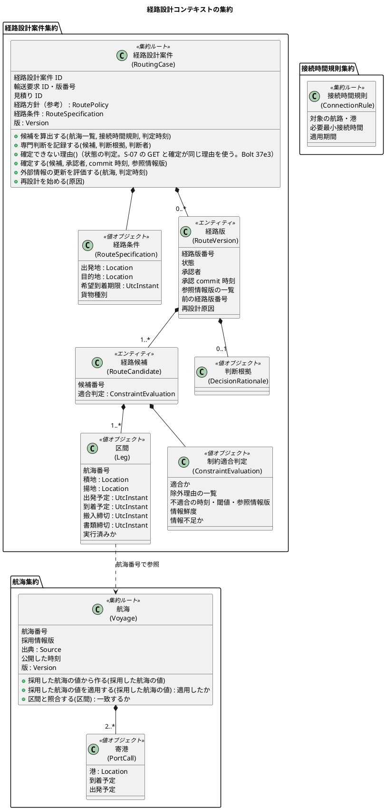

#### 経路版の状態遷移

要件定義の経路版の状態モデルに、本書の呼び名を合わせた。

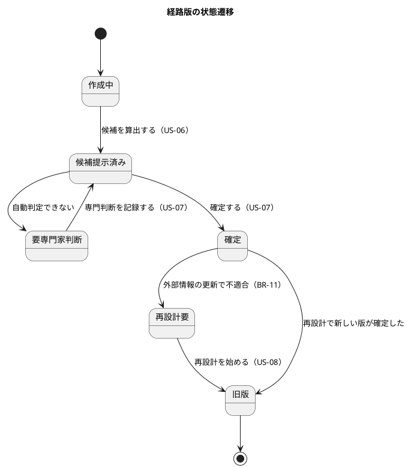

確定から再設計要へは、確定した経路版の評価（US-07 AC4。Bolt 37d2）で、区間の外部情報が更新されて期限・接続を満たさなくなったか、区間の航海を引き直せなくなったときに移る。候補・区間・確定の記録（旧情報版）は変えない。再設計要の経路版をもう一度評価しても何もしない（DE-06 は 1 度だけ）。原因が解消しても確定に戻さない（UC-08 1a）。

#### 経路設計の不変条件とドメインルール

| ID | 不変条件・ルール | 根拠 |
| :--- | :--- | :--- |
| R-INV-01 | 候補は、到着予定が希望到着期限以前で、すべての接続時間が必要最小接続時間以上のときだけ適合とする。同時刻・同値は適合 | BR-11、US-06 |
| R-INV-02 | 期限に間に合わない候補、貨物種別に対応しない候補、接続できない候補、情報不足の候補（R-INV-09。Bolt 37b2）は除外し、不適合となった時刻・閾値・参照情報版を残す | BR-02、US-06 |
| R-INV-03 | 確定は承認の commit 時点で再検証し、参照した情報版が承認中に更新されていれば確定を拒否する（Bolt 37c: 確定のときに航海を読み直して照合する。確定の時刻に情報不足でも拒否する。Bolt 39e2: 照合は情報版と区間の予定の組で、区間ごとに `Voyage.matchesLeg` で今の航海と比べる。同じ情報版のままでも、区間の出発予定・到着予定の組が今の航海の寄港になければ拒否し、情報版が同じで予定が変わらなければ拒否しない。【業務の判断】(s)、台帳 D-106） | BR-11、US-07 |
| R-INV-04 | 確定には判断根拠と、経路設計者の役割が必要 | US-07、BR-15 |
| R-INV-05 | 1 つの経路設計案件で「確定」の経路版は同時に 1 つだけ | US-07、US-08 |
| R-INV-06 | 旧版・再設計要の経路版は再確定・新規予約への割当てに使えない | BR-16、US-07 |
| R-INV-07 | 確定後に外部情報の更新で不適合になっても、経路版を再設計要にするだけで予約を取り消さない。参照した旧情報版を保持する | BR-11、US-07 |
| R-INV-08 | 再設計は実行済みの区間を変えず、未実行の区間だけを対象にする。新版は旧版の番号と変更根拠を持つ | US-08 |
| R-INV-09 | 外部情報が停止中のときは、最終採用値と取得時刻を示し、情報不足として識別する（Bolt 37b2: 航海の取得時刻から許容時間（D-89）を過ぎてから算出したら、情報不足として除外する） | US-06 |
| R-INV-10 | 経路設計案件は、荷主の詳細経路設計の依頼（DE-16）を受けて作る。案件は輸送要求版ごとに 1 つだけで、依頼のイベントが再配信されても重複して作らない | 業務フロー、US-24、ARCH-HO-01 |
| R-INV-11 | 経路が確定したら、依頼元の見積りに経路版を割り当てる（DE-05）。荷主の承認は割り当てた後に行う。荷主の承認の後に失効した見積りの再見積りでは、新しい見積りが旧版の割り当てた経路を写す（経路設計の割当てを経ない。D-85、Bolt 35b）。置換済み・失効の見積りへの割当て（旧版の DE-21）では輸送要求を進めない（Bolt 35b2） | 業務フロー、BR-01 |

| ドメインルール・サービス | 英語名 | 内容 |
| :--- | :--- | :--- |
| 制約適合判定 | ConstraintEvaluator | 経路条件、区間の列、接続時間規則から適合・除外と理由を返す純粋な関数。接続時間規則は接続ごとに次の区間の出発予定で選ぶ（D-90、Bolt 37）。Golden dataset で検証する |
| 情報鮮度の判定 | InfoFreshnessPolicy | 候補の区間の航海ごとに、判定時刻が取得時刻と許容時間（設定。D-89）の和より後なら情報不足の理由を返す（同時刻は足りる）。許容時間を持ち、時計とリポジトリを持たない。算出の集約が制約適合判定の理由の後ろに足す（Bolt 37b2） |
| 経路候補探索 | RouteCandidateFinder | 航海の一覧から出発地から目的地までの区間の列を列挙する。MVP は確定的な列挙とし、最適化はしない（スコープ外） |

経路候補探索と制約適合判定は複数の航海と規則を扱うため、ドメインサービスにする。どちらも状態を持たず、リポジトリを呼ばない。必要な航海と規則はアプリケーションサービスが読み込んで渡す。

Bolt 17（US-06 AC1〜AC3）で決めたこと（[Bolt 17 計画](../../development/cargo-tracker/bolt_17_plan.md) の確認ポイント 2・3・8・9・10）:

- 経路設計案件は DE-16 を受けて作り、経路条件は見積りの公開 API（`quotation.interfaces.api` の経路条件の照会）から ACL 越しに得て、経路条件（`RouteSpecification`）に変える。案件には案件番号を振り、経路版 1 を作成中で持つ。
- 候補探索は、判定時刻より後に出発する区間で、出発地から目的地への直行と 1 回の積替え（Bolt 17 では区間 1〜2。Bolt 37 で積替え 2 回の区間 1〜3 に広げた。下の Bolt 37 で決めたこと）を列挙する。同じ航海を 2 回使う列は列挙しない。候補は到着予定の早い順に 20 件まで。
- 接続時間は、前の区間の到着予定から、同じ港での次の区間の出発予定まで。積替えの港に、次の区間の出発予定の時刻で有効な接続時間規則がなければ、その候補を「接続できない」で除外する（失敗に倒す）。（Bolt 17 では判定時刻で選んだ。Bolt 37 で D-90 により変えた。Bolt 17 の確認ポイント 9 の変更）
- 制約適合判定は、期限超過（不適合の時刻は到着予定、閾値は希望到着期限、参照情報版は最終区間の航海の採用情報版）と、接続不足（時刻は次の区間の出発予定、閾値は必要最小接続時間と規則の港、参照情報版は次の区間の航海の採用情報版）を返す。両方に当たれば理由を 2 つ持つ。貨物種別は R0.1 では判定しない。
- 候補の接続余裕は、接続時間から必要最小接続時間を引いた値のうち最も小さいもの（直行は持たない）。情報鮮度は、候補に使った航海の取得時刻のうち最も古いもの。
- 候補を算出すると経路版は作成中から候補提示済みになる。候補提示済みで再算出すると、候補を置き換え、判定時刻を更新する。
- 依頼の後に輸送要求が再提出されて経路条件が得られないときは、案件を作らず警告のログを残す（確認ポイント 3。補償の扱いは Bolt 17 レビュー D-64 で後の Bolt に回した）。案件の作成と候補の算出は監査記録に書かない（確認ポイント 16。監査の対象は確定から）。
- 候補探索は、目的地に寄った後の港へ運んでから積み替えて目的地へ戻る列を列挙しない（Bolt 17 レビュー D-60）。

Bolt 19（US-07 AC1・AC2）で決めたこと（[Bolt 19 計画](../../development/cargo-tracker/bolt_19_plan.md) の確認ポイント 2〜10）:

- 経路設計案件は経路版の一覧を持つ（Bolt 17 レビュー D-64）。R0.1 は案件に経路版 1 つで運用し、新しい経路版を作るのは再設計（US-08）。候補の算出は最新の経路版だけを書き換え、確定した経路版は書き換えない。
- 確定は、候補提示済みの経路版の適合の候補に、判断根拠（前後の空白を除いて 1〜4,000 文字）と承認者を付けて行う。承認者が経路設計者の役割を持つかを集約でも確かめる（URL の認可と二重に守る）。
- 確定の再検証（R-INV-03 の R0.1 の範囲）: 選んだ候補の保存済みの区間を、確定のときに読み直した接続時間規則（接続の時刻に有効なもの。Bolt 19 では確定の時刻に有効なもの）と希望到着期限で制約適合判定にかけ直し、不適合なら拒否する。最初の区間の出発予定が確定の時刻と同時刻または前なら出発済みとして拒否する。航海を読み直して参照情報版の更新を拒否するのは AC3（W6、#16）。R0.1 の制約適合判定は期限の判定に判定時刻を使わず、希望到着期限も案件の中で変わらないため、期限の再判定は算出のときと同じ結果になる（変わり得るのは、算出の後に登録・変更された接続時間規則だけ）。規則を選ぶ時刻は Bolt 37 で接続の時刻（次の区間の出発予定）に変えた（D-90。Bolt 19 の確認ポイント 3 の変更）。
- 確定の拒否の理由は、経路設計者でない（`NOT_ROUTE_DESIGNER`）、確定できない状態（`NOT_CONFIRMABLE_STATE`。作成中、確定済み）、再設計要（`ROUTE_REDESIGN_REQUIRED`。最新の経路版が再設計要。Bolt 37e3）、ない候補（`CANDIDATE_NOT_FOUND`）、除外の候補（`CANDIDATE_EXCLUDED`）、根拠の不足（`RATIONALE_MISSING`）、根拠が 4,000 文字を超える（`RATIONALE_TOO_LONG`。文字はコードポイントで数える。判定は `DecisionRationale.rejectionOf` の 1 か所）、出発済み（`ALREADY_DEPARTED`）、確定のときに判定し直すと不適合（`NO_LONGER_CONFORMING`）。この順に確かめる（Bolt 37c で、除外の候補の後に情報版の更新（`INFO_VERSION_CHANGED`）を、出発済みの後に情報不足（`INFO_INSUFFICIENT`）を足した。下の Bolt 37c で決めたこと）。状態の判定（確定できない状態・再設計要）は、理由を返す集約の操作（`RoutingCase.confirmationRejection()`）の 1 か所に置き、S-07 を開く GET と確定（POST）の両方が使う（Bolt 37e3 で `confirmable()` の真偽から改めた。下の Bolt 37e3 で決めたこと）。確定の後の候補の再算出は、Bolt 17 のとおり算出できない状態として例外で拒否する（R-INV-06）。
- 確定すると経路版は確定になり、選んだ候補番号・判断根拠・承認者・承認 commit 時刻を持つ。案件で確定の経路版は 1 つだけ（R-INV-05。Bolt 37d から、案件のヘッダの番号ではなく経路版の状態で表し、集約と PostgreSQL の部分一意インデックスで守る）。参照情報版は候補の区間の採用情報版で、経路版に写しを持たない。承認 commit 時刻は、確定のトランザクションの中で時計から得た確定の判定の時刻（コミットの時刻の近似。画面では承認時刻と示す）。
- 確定すると DE-05（経路を確定した）を発行する。見積りの有効期限で確定を拒否しない（失効した見積りへの割当てと荷主の承認の拒否は見積り側。US-24 AC4・AC5）。DE-05 は経路設計の中の listener が受け、見積りの公開 API（経路の割当て）を呼んで依頼元の見積りに経路版を割り当てる（R-INV-11、ADR-014。Bolt 20）。見積りは DE-05 を購読しない（依存が循環する。Bolt 19 レビュー D-71）。確定は監査証跡（US-17）にまだ書かず、経路版の列で残す。

Bolt 37（US-06 の境界の網羅）で決めたこと（[Bolt 37 計画](../../development/cargo-tracker/bolt_37_plan.md) の確認ポイント 1〜3。D-90 は 2026-10-21 に human:kakimomokuri が決めた）:

- 候補探索は積替え 2 回（区間 1〜3）まで列挙する。列の中で同じ航海（続けて使う列と間を空けて使う列）と同じ港（出発地を含む）を 2 回使わない。途中の区間も目的地を通り過ぎない（D-60）。区間 4 以上は列挙しない。20 件の上限と並びは変えない。
- 接続時間規則は、接続ごとに、次の区間の出発予定の時刻に有効な規則（適用開始を含み終わりを含まない）のうち厳しい方を使う。その時刻に有効な規則がなければ「接続できない」。前の区間の到着の時刻では選ばない（接続の理由の不適合の時刻とそろえる）。算出と確定の判定し直しで同じ選び方になる。
- 出発済みは候補探索（判定時刻より後に出発する区間）と確定（確定の時刻）が判定する。制約適合判定は判定時刻を受け取らない。

Bolt 37b2（US-06 AC4）で決めたこと（[Bolt 37b2 計画](../../development/cargo-tracker/bolt_37b2_plan.md) の確認ポイント 1〜4。2026-10-22 に human:kakimomokuri が承認）:

- 情報鮮度の判定（`InfoFreshnessPolicy`）は、候補の区間の航海ごとに、判定時刻が「取得時刻 + 許容時間」より後なら情報不足の理由を返す。同時刻は足りる。理由の不適合の時刻は「取得時刻 + 許容時間」（情報が古くなった時刻）、閾値は航海番号と許容時間、参照情報版はその航海の採用情報版（AC4 の最終採用値）。
- 算出の集約が、候補ごとに制約適合判定の後で情報鮮度の判定をかけ、理由を制約適合判定の理由（接続 → 期限超過）の後ろに足す。制約適合判定は判定時刻を受け取らないまま（Bolt 37）。並び・20 件の上限・接続余裕は変えない。制約適合判定の値は、理由に情報不足があるかを返す（保存の `info_insufficient`）。
- 許容時間は業務の閾値を設定にする初めての前例。D-89 は仮で、追跡・データ責任者が値を差し替えるため、コードの定数にせず設定 `cargotracker.routing.info-freshness-tolerance`（既定 `PT24H`）にする。値は組み立て（`RoutingConfiguration` の `@Bean` の引数の `@Value`）が受けて規則を作り、入力ポートに渡す。設定のクラスは作らない（`infrastructure.config` には `@Configuration` のクラスしか置けない。層の規則）。設定がなければ起動で落ち、0 以下は規則が拒む。
- 確定のときの鮮度は Bolt 37c で扱う（算出で情報不足の候補は除外なので確定できない）。

Bolt 37c（US-07 AC3）で決めたこと（[Bolt 37c 計画](../../development/cargo-tracker/bolt_37c_plan.md) の確認ポイント 1〜6。2026-10-22 に human:kakimomokuri が承認）:

- 確定のときに航海を読み直す（入力ポートが確定と同じトランザクションで読む。行はロックしない。W7 の確認ポイント 11 で決めた）。選んだ候補の区間のうち、今の航海と照合して変わった区間が 1 つでもあれば、情報版の更新（`INFO_VERSION_CHANGED`）で拒否する。照合は区間の写しの情報版（`candidate_leg.info_version`）と区間の予定（`departure_at`・`arrival_at`）の組で行う（区間ごとに航海番号で今の航海を引き、`Voyage.matchesLeg` で比べる。航海がない区間は変わったとみなす）。Bolt 37d の確定した経路版の評価でも同じ照合を使う。【前の決定の変更】(1)（Bolt 39e2）: Bolt 37c の決定は情報版だけの照合で、判定は候補（`RouteCandidate`）が返していたが、同じ情報版で値の違う DE-12 を見落とすので組の照合に改め、判定を `Voyage` に移した（下の Bolt 39e2 で決めたこと）。
- 確定の時刻に、区間ごとに読み直した航海の取得時刻（区間の写しではない。同じ版で取り込み直されて新しくなった取得時刻を拾う）を情報鮮度の判定にかけ、情報不足なら `INFO_INSUFFICIENT` で拒否する。算出では除外、確定では拒否として、同じ判定を使う。確定のときの鮮度は確定の操作だけで見る（Bolt 37d の評価は鮮度を見ない）。
- 確かめる順は、経路設計者 → 状態 → 候補 → 除外 → 情報版の更新 → 判断根拠 → 出発済み → 情報不足 → 規則の判定し直し。候補の比較（S-06）に戻す理由（状態・候補・除外・情報版の更新）を判断根拠より前に、確定の画面（S-07）にとどまる理由を後に確かめる。情報版を先に確かめるので、区間に写した出発予定で出発済みを判定できる。
- 除外理由の閾値を区分ごとの型にすること、`threshold` の列を分けること（データベースの承認ゲート）、制約適合判定の値の改名は、37c では除外理由の判定を足さないので行わない。`CARGO_NOT_SUPPORTED`（区分はあるが判定していない）の判定を入れる Bolt（D-65 の残り、W7）の開始準備で決める。
- 判定の部品（規則・航海・制約適合判定・情報鮮度の判定）を 1 つの値にまとめるかは、3 つ目の使い手ができる Bolt 37d の開始準備で決める（確定の引数は 8 つ）。

Bolt 37d（US-07 AC4 の準備）で決めたこと（[Bolt 37d 計画](../../development/cargo-tracker/bolt_37d_plan.md) の確認ポイント 1〜5。2026-10-22 に human:kakimomokuri が承認。評価の操作と DE-06 は Bolt 37d2）:

- 経路版は再設計要の記録（`RedesignRecord`: 再設計要にした時刻と、理由の区分 `RedesignReasonCode` の 1 つ以上）を持てる。再設計要は必ず持ち、旧版は持つことがあり、作成中・候補提示済み・要専門家判断・確定は持たない。理由の詳細（不適合の時刻・閾値・参照情報版）は保存しない。旧情報版は確定の記録の候補の区間に残る（`referenced_info_version` の表は作らない）。
- 理由の区分は除外理由の区分（`ExclusionReasonCode`）とは別の列挙型にし、期限超過・接続不足・接続できないは同じ名前にして制約適合判定の理由から写せるようにする。航海を引き直せない（`VOYAGE_UNAVAILABLE`）を足す。
- 確定は案件に 1 つ（R-INV-05）を、案件のヘッダの `confirmed_route_version_no` ではなく、集約の経路版の検査と PostgreSQL の部分一意インデックスで守る。
- 確定の記録の候補（`confirmedCandidateOf`）は、状態ではなく確定の記録で引くので、再設計要・旧版の経路版でも確定のときの区間を返す（見積りへの割当てと追跡の予定が使う。旧情報版の保持）。

Bolt 37d2（US-07 AC4 の経路設計の側）で決めたこと（[Bolt 37d2 計画](../../development/cargo-tracker/bolt_37d2_plan.md) の確認ポイント 1〜6。2026-10-22 に human:kakimomokuri が承認。見積り・予約への伝え方は Bolt 37e・37e2・37e3 に分けた。見積りの側の印と判定は 37e、DE-06 の listener は 37e2、予約と画面は 37e3）:

- 評価の入口は、入力ポートの「案件番号で確定した経路版を今の外部情報で評価する」操作（`RoutingCaseCommandService.evaluateConfirmedRoute`）にする。外部情報の更新を受けたシステムの操作で、期待版は取らず、読み込んだ案件の版で競合を検知する。画面の操作は作らない。DE-12 の受け取りと、航海番号から評価する案件を引く照会は W7（US-14。DE-12 を受けて航海を書くのは Bolt 39e、DE-30 の後に評価を起こすのは Bolt 39f。下の Bolt 39f で決めたこと）。結果は「見つからない・変わらない・再設計要・競合」。競合を受けたら入口の listener が読み直して評価し直す（3 回まで。W7 の確認ポイント 11、Bolt 39f の決定 (5)）。先の評価が再設計要にしていれば読み直しの結果は「変わらない」で、DE-06 は重ならない。
- 評価は最新の経路版が確定のときだけ行う。確定の記録の候補の区間がどれも今の航海と一致するなら評価しない（接続時間規則だけが変わったときも評価のきっかけにしない）。照合は確定と同じ情報版と区間の予定の組（`Voyage.matchesLeg`。読むのは Bolt 39e から区間の航海番号の航海だけで、全件を読まない。航海がない区間は変わったとみなす）で、同じ情報版で区間の予定が変わると評価し、不適合なら再設計要にする（入口は Bolt 39f の DE-30 の listener。Bolt 39e2 の【前の決定の変更】(1)。Bolt 37d2 の決定は情報版だけの照合だった）。保存した判定は使わず、区間ごとに今の航海で引き直し、引き直した区間の列を制約適合判定（期限・接続。規則は接続の時刻で選ぶ。D-90）にかけ直す。鮮度と貨物種別は見ない（Bolt 37c の決定）。出発済みの区間も評価に含める（実行済みの区間を変えない再設計は US-08）。
- 引き直しは経路候補探索（`RouteCandidateFinder`）が行う。同じ航海番号の航海で、区間の積地の寄港（出発予定がある）と、その後で区間の揚地に寄る寄港（到着予定がある）の組を探す。候補探索は積地から後のどの寄港も揚地にできるので、確定した寄港を 1 つに決められない組は選ばない。組が 1 つなら今のまま引き直す（位置は見ない）。組が 2 つ以上ある（積地に 2 度寄る。積地の後で揚地（到着予定がある寄港）に 2 度寄る場合も組が 2 つになる）ときは、出発と到着が区間と一致する組が 1 つあればそれを選び、なければ確定の区間の寄港の位置の組を選ぶ（Bolt 39f の【業務の判断】(u)、【前の決定の変更】(5)。Bolt 37d2 の決定は「組が 2 つ以上あるなら引き直せない」だった）。航海がない、組がない（寄る順が逆、出発予定か到着予定がない）、組が 2 つ以上で一致する組も使える位置の組もない（位置がない、位置が範囲外、位置の寄港が組に入らない）、到着が出発より後でないなら、選ばずに引き直せないとして `VOYAGE_UNAVAILABLE` にする。揚地が積地より前にも寄る（B→A→B）場合は積地の後ろだけを見るので引き直せる。区間の作り方（出発予定・到着予定・採用情報版・取得時刻）は算出と共通にする。位置がない区間（Bolt 39f より前の区間）は、組が 2 つ以上なら予定の照合より先に引き直せないとする。
- 既知の制限（Bolt 39f で解消した）: Bolt 39f までは、積地か揚地に 2 度寄る航海の確定経路は、時刻が変わらなくても情報版が上がると再設計要になった（理由は `VOYAGE_UNAVAILABLE`）。確定の区間に寄港の位置を持たないため、評価で確定した寄港を決められなかった。Bolt 39f で確定の区間に寄港の位置を持たせた（W7 の確認ポイント 13。下の Bolt 39f で決めたこと）。残るのは Bolt 39f より前に算出した候補（位置が NULL）で、ステージング・本番に案件の行はない。
- 画面の語: `VOYAGE_UNAVAILABLE` の画面の語は「航海の予定が使えない」にする（Bolt 37d2 レビューで「航海を引き直せない」から変えた。区分の意味は変えない。「引き直す」は利用者の語にしない）。
- 理由の写し: 制約適合判定の理由の区分のうち、期限超過・接続不足・接続できないを同じ名前の再設計要の理由の区分に写し、同じ区分は 1 つにまとめて最初に出た順に並べる。貨物種別・情報不足が出たら評価の前提が崩れているので例外にする。
- 不適合なら最新の経路版を再設計要にし（再設計要の記録は評価の時刻と理由）、候補・区間・確定の記録はそのまま残す（旧情報版の保持。R-INV-07）。予約は取り消さない。DE-06（`RouteRedesignRequired`）を返し、入力ポートが保存と同じトランザクションで発行する。業務キーと冪等のキーは（経路設計案件 ID・経路版番号）。すでに再設計要なら評価せず DE-06 も出さない（1 度だけ）。原因が解消しても確定に戻さない（UC-08 1a）。
- 評価の保存は利用者の操作ではないので、保存のポートに操作者を渡さず、`updated_by`（最後に候補を算出・確定した経路設計者）を変えない。案件の版は上げる。Bolt 39f で、保存のポートをシステムの更新の操作（`RoutingCaseRepository.updateBySystem`）に分け、`update` は操作者を必須にした（W7 の確認ポイント 13、Bolt 39f の決定 (7)）。
- 判定の部品（航海・規則・評価の時刻・候補探索・制約適合判定）は 1 つの値にまとめない。算出・確定・評価の 3 つの使い手で受け取るものが違い、まとめても呼び出しの直しが増えるだけのため（Bolt 37c の宿題の決着）。
- DE-05 が再設計要の後に再配信されると、見積りへの割当ては再設計要の経路版を割り当てる（確定の記録で引くため）。37d2 では DE-06 の購読者も評価を起こす本番の入口もないので害は出ない。DE-05 と DE-06 の届く順の扱いは Bolt 37e2 で決める（Bolt 37e を 3 つに分けた。見積りの印と判定は Bolt 37e、DE-06 の listener と届く順は Bolt 37e2。上の見積りの Bolt 37e で決めたこと）。決着（Bolt 37e2）: DE-05 の listener が案件の行をロックして読み、割り当てた経路版が再設計要の記録を持てば続けて再設計要を伝える。`RouteAssignmentRequest` に項目は増えない（上の見積りの Bolt 37e2 で決めたこと）。再設計要から旧版への移行と記録の引き継ぎは US-08。

Bolt 37e3（US-07 AC5 の予約と画面の側）で決めたこと（[Bolt 37e3 計画](../../development/cargo-tracker/bolt_37e3_plan.md) の確認ポイント 4。2026-10-23 に human:kakimomokuri が承認）:

- 確定の拒否の理由に再設計要（`ROUTE_REDESIGN_REQUIRED`）を足す。これまで再設計要の案件は、S-07 を開いても送っても確定できない状態（`NOT_CONFIRMABLE_STATE`）になり、「すでに確定しているか、候補をまだ算出していません」と誤って示していた（Bolt 37d2 の報告の指摘 16）。Bolt 37d2 の画面は、再設計要の経路版では S-06 に確定の操作を出さない。
- 確定できるかの状態の判定は、理由を返す集約の操作（`RoutingCase.confirmationRejection()`）の 1 か所に置く。S-07 を開く GET は集約の確定に届く前にこの操作を使い、確定（`RoutingCase.confirm`）も同じ操作から理由を返す。GET と POST が同じ理由を返す。確かめる順（経路設計者 → 状態 → 候補 → 除外 → …。Bolt 37c）は変えない。
- 再設計要は S-06 に戻す理由の組に入れる（状態の理由と同じ）。文言は ui_design の S-07 の行。R-INV-06 の「再設計要の経路版は再確定に使えない」の拒否の理由を名前で示すもので、守る規則は変えない。

Bolt 39e（US-14 AC1 の経路設計の側。採用した航海の値で候補を算出する）で決めたこと（[Bolt 39e 計画](../../development/cargo-tracker/bolt_39e_plan.md) の開始準備の決定 (2)〜(6)・(8)〜(10)・(13)、【業務の判断】(r)・(t)、【前の決定の変更】(2)・(3)。2026-11-09、推奨のとおり。Recommend 承認の指示による。human:kakimomokuri。R-INV-03 の照合を区間の予定まで広げることと見本の航海は下の Bolt 39e2、評価の入口は下の Bolt 39f）:

- 書き手: 経路設計の中の listener `VoyageUpdateEventHandler`（`routing.application.internal.eventhandlers`）が DE-12 を受け、航海を読んで適用し、保存する。外部データは経路設計の表を書かない（確認ポイント 11、ADR-004）。`routing` の `allowedDependencies` に `externaldata :: events` を足す。航海がないときは初めての DE-12 で行を作る。更新の順は `voyage` の条件付きの UPDATE が先で、0 件なら例外にして `port_call` を触らない。寄港は行を消して入れ直す。
- 値の対応: 情報版は DE-12 の外部版（`infoVersion`）、出典・取得時刻は `source()`（参照は受信記録 ID）、公開した時刻は `publishedAt`。
- 順の規則（【業務の判断】(r)、台帳 D-105。仮）: 同じ航海の DE-12 は、公開した時刻の新しい方を効かせる。同じ時刻（1 つの取込の行）は取得時刻の新しい方、それも同じなら受信記録 ID（`source_ref`）の大きい方。受信記録 ID は UUID で業務の順を持たず、決定的に 1 つに決めるためだけの順。適用するのは今の航海より厳密に新しい DE-12 だけなので、再配信（少なくとも 1 回）は適用せず冪等になる。公開した時刻が null の航海（開発データの仮の航海）はどの DE-12 より古い。比べるのは `Voyage` の振る舞いで、listener は読むだけ。情報版は順序の分からない文字列なので比べない。
- 最後に公開した採用値（【前の決定の変更】(2)）: 外部版をまたいだ採用の判断も、最後に公開した値が経路設計の航海になる（経路設計は外部版の順を持たない。V2 の取込の後に V1 の隔離を採用すると V1 の値が航海になる）。Bolt 39d の決定 (13) の「新しい外部版」を経路設計の航海の分について改める（追跡の主要実績の分は Bolt 39g で決めた。下の追跡の節の Bolt 39g で決めたこと。Bolt 39g の【前の決定の変更】(12)）。外部版の順序の逆転は 39h の分類で受ける（差異にすると DE-12 は出ない。US-14 AC5）。Bolt 39h で決めた: 前に取得した外部版が後から届く版の逆転は取込で差異にし、DE-12 は出ない（台帳 D-142。仮）。V2 の取込の後に V1 の隔離を採用した組は差異にしない（分類は受け取った時に一度だけ決め、書き換えない。採用で航海が古い値に戻ることは 39h3 で判断の画面に警告する）。
- 公開した時刻の列: `routing.voyage.published_at`（NULL を許す）を足す。`updated_at` に重ねない（監査用の列の規約）。
- 楽観ロックと読み直し: 更新は `version` を条件にした UPDATE で、0 件なら `ConcurrentVoyageUpdateException`。listener は読み直して同じ DE-12 を適用し直す（3 回まで）。3 回とも競合したら例外を上げ、イベントの発行記録に残して再起動の再配信に任せる。読み直した結果 DE-12 の方が古ければ適用しない。初めての航海の 2 つの DE-12 の同時は、`save` を NESTED にして一意制約の違反をセーブポイントに戻し（`DuplicateVoyageException`）、同じ読み直しの経路に入る（上限の 3 回を共有する）。確定は今のとおり同じトランザクションで航海を読み直して比べ、行のロックは足さない。
- 内容の欠けた DE-12（毒入りのメッセージ）: 欠けの範囲は `voyageNumber`・`portCalls`（null と 2 未満）・寄港の値（`PortCall` の規則）・`infoVersion`・`source`（null、参照、取得時刻）・`publishedAt`。`VoyageAdoption` の組み立てが確かめて `VoyageAdoption.InvalidEventValueException` を投げ、listener はこの例外だけを捕まえて ERROR のログを残して捨てる。それ以外のプログラムの誤りと DB の失敗は例外を上げて配り直させる（`IllegalArgumentException` は広く捕まえない）。
- 誤って採用したときの道（【業務の判断】(t)、台帳 D-107。仮）: 新しい外部版で正しい原本を送ってもらうのを基本の道にし、元の原本を同じ外部版のまま送り直して採用するのは新しい外部版を出してもらえないときの道にする。どちらも最後に採用した値が経路設計の航海になる。
- class 化: `Voyage` を `public final class` にし、振る舞いを持たせる（`adoptedFrom`・`apply`。上の用語集）。既存の 4 引数のコンストラクタは取込を経ない仮の航海の入口として残す。`ConnectionRule` の class 化は W10 に送り、record のままにする（【前の決定の変更】(3)）。
- 航海の照会: `VoyageRepository.findAll()` を消し、算出は時間の窓で絞る（`findCandidateVoyages(departingAfter)`。判定時刻より後に出発する寄港を持つ航海。絞りは航海の単位の `EXISTS` で、判定時刻より前の寄港の行も落とさない。窓の上の端は置かない。期限に間に合わない候補とその理由を画面から消さないため。R-INV-02）。確定と評価は区間の航海番号だけを読む（`findByVoyageNumbers`。候補の航海番号は `RoutingCase` の `voyageNumbersOf(candidateNo)`・`confirmedVoyageNumbers()` が返す）。listener の読み直しは `findByVoyageNumber`。読みはどれも航海と寄港の JOIN の 1 文にする（READ COMMITTED で間に初めての航海がコミットされても、寄港が空の航海を読まない）。港で絞る照会と港ごとの出発の索引は W10 の性能テストと一緒に見る（【前の決定の変更】(3)、確認ポイント 17）。
- 写しの規則（ADR-004 の Bolt 39b3 の項が 39e に預けたもの）: 経路設計の `Voyage` に寄港の重複の規則と寄港数の上限 60 を足さない（外部データから届く値は検証済みで、経路設計の不変条件を増やすと開発データと既存のテストにも当たる）。
- 寄港の時刻の順: 寄港をまたいだ時刻の順は取込も `Voyage` も確かめないので、後の寄港の到着が前の寄港の出発より後でない航海が保存されうる。候補探索はその組を区間にしない（評価の引き直しと同じ失敗に倒す）。その航海のほかの組とほかの航海の候補は残る。
- 既知の間（Bolt 39e2 で解消した）: 39e から 39e2 までの間、同じ情報版で区間の予定が変わる組は確定で拒否されなかった。

Bolt 39e2（US-07 AC3・AC4。確定の照合と見本の航海）で決めたこと（[Bolt 39e2 計画](../../development/cargo-tracker/bolt_39e2_plan.md) の開始準備の決定 (2)〜(5)・(7)、【業務の判断】(s)、【前の決定の変更】(1)・(4)。2026-11-10、推奨のとおり。Recommend 承認の指示による。human:kakimomokuri）:

- 照合（【業務の判断】(s)、台帳 D-106。仮。【前の決定の変更】(1)）: 候補を算出した後に区間の予定が変わったら、情報版が同じでも確定を拒否する。情報版が同じで予定が変わらなければ拒否しない。情報版が違えば予定が同じでも今のとおり拒否する。元の値に採用し直すと、元の値で算出した候補は情報鮮度の内なら確定できる。US-07 AC3 の「情報版」を、同じ版で値が変わる採用の判断があるので区間の予定まで含めて読む。
- 判定の置き場所: `Voyage.matchesLeg(Leg)`。`entities` の `RouteCandidate` が `aggregates` の `Voyage` を参照しないように航海の側に置く。真になるのは、航海番号が同じで、情報版が同じで、積地の港の寄港の出発予定が区間の出発予定と同じで、その後ろに揚地の港の寄港があり、その到着予定が区間の到着予定と同じ組が 1 つ以上あるとき。寄港の時刻は欠けることがあるので、出発のない寄港を積地に、到着のない寄港を揚地にしない。時刻は文字ではなく時点（`UtcInstant` の等しさ）で比べる。`RouteCandidate.legsWithChangedInfo` と `RoutingCase.infoVersionsOf` は消した。Bolt 39f で、一致する組が 2 つ以上のときだけ確定の寄港の位置の組があることを足した（下の Bolt 39f で決めたこと）。
- 確定と評価: `RoutingCase` の確定と確定した経路版の評価は、同じ private の判定（`anyLegChanged`）を使う。航海がない区間は変わったとみなす（今のまま）。同じ情報版で区間の予定が変わると評価し、不適合なら再設計要にする（入口は Bolt 39f の DE-30 の listener）。
- 2 度寄る航海: 組は 1 つ以上あればよい。評価の引き直しの「1 つに決める」とは別で、積地や揚地に 2 度寄っても区間の予定の組が残っていれば変わっていない。Bolt 39f の【前の決定の変更】(5) で、一致する組が 2 つ以上のときだけ位置の組があることを足した。一致する組が 2 つ以上になるのは同じ港に同じ時刻で 2 度寄る航海だけなので、照合の狭まりは実際にはほぼ効かず、効くのは評価の引き直し（W7 の確認ポイント 13）。
- 変えないもの: 拒否の理由（`INFO_VERSION_CHANGED`）と文（「候補を算出した後に航海の情報が更新されたため確定できません。…」）、確定の順、情報鮮度の判定（確定のときは読み直した航海の取得時刻）、DE-12 の型と順の規則（【業務の判断】(r)）、スキーマ。比べた案のうち、版の列を足す案はスキーマが増えて同じ値の組でも拒否し、適用のたびに情報版を作り直す案は画面の版と提供元の版が食い違い、同じ情報版の 2 つ目を適用しない案は ADR-004 に反するので採らない。
- S-07 の注（【前の決定の変更】(4)）: 確定のときに見るものの列挙を「最新の航海の情報（情報版、区間の予定、取得から経った時間）」に直す。列挙が情報版のままだと「情報版が同じなら通る」と読めるため。配置と URL は変えない。
- 見本の航海: dev だけのマイグレーションで見本専用の航海 `DEMO-901` を足し、`RC-2026-0908`・`0909` の候補の区間と割り当てた区間の写し（TR-2026-0911・0912）の航海番号を直す（W7 の確認ポイント 14。Bolt 37e4b の決定 (2) を変える）。情報版・出典・取得時刻は `DEMO-101` の行から、寄港の時刻は `RC-2026-0908` の区間から写すので、見本の写しと必ず一致する。判定時刻より後に出発する寄港を持たないので、候補の算出には入らない。

Bolt 39f（US-07 AC4、US-14 AC1。航海の更新から確定した経路を評価する入口と、2 度寄る航海の寄港の位置）で決めたこと（[Bolt 39f 計画](../../development/cargo-tracker/bolt_39f_plan.md) の開始準備の決定 (2)〜(7)・(11)〜(13)、【業務の判断】(u)・(v)・(x)、【前の決定の変更】(5)〜(7)。2026-11-10、推奨のとおり。Recommend 承認の指示による。human:kakimomokuri。UC-06 4a と S-06 の古くなった候補は Bolt 39f2 に分けた。【前の決定の変更】(7)）:

- 評価の入口は 2 段（【前の決定の変更】(6)）: `VoyageUpdateEventHandler` が DE-12 を受けて更新を適用したら、航海の更新と同じトランザクションで DE-30（`VoyageUpdated`）を発行する。`ConfirmedRouteEvaluationEventHandler` が DE-30 をコミットの後に受け、案件ごとに `evaluateConfirmedRoute` を呼ぶ。W7 の確認ポイント 12 の「DE-12 の listener が航海を更新した後に呼ぶ」を改める。DE-12 の listener のトランザクションで評価すると、同じファイルの 2 行で別々の航海が同時に更新されたときに互いの古い値を読み、片方ずつなら適合で両方なら不適合の組を見落とす。2 段にすると、後にコミットした側の評価が両方の値を見る。比べた案のうち、同じ DE-12 を受ける 2 つ目の listener は航海の書き込みとの順が保証されず、1 段のまま案件の行をロックする案は評価の失敗で航海の更新も戻り、複数案件の順で deadlock の余地があるので採らない。
- DE-30: `Voyage` が作り（ドメインイベントは集約から公開する。ガイドライン第 3 章）、listener が `update` の成功の後に発行する。予定が同じでも `apply` が真なら発行するので名前は「航海を更新した」。初めての航海（`save`。確定の区間はまだない）、古い DE-12、完全に同じ DE-12 の再配信、内容の欠けた DE-12 では発行しない。`routing` の中だけで受け、新しいコンテキスト間の依存はない。
- 照会: `RoutingCaseRepository.findCaseNumbersConfirmedOnVoyage` は、最新の経路版が確定で、確定の候補の区間にその航海がある案件番号を重複なしで返す。確定でない候補の区間だけにある、候補提示済み、再設計要、旧版の案件は返さない。索引は `ix_candidate_leg_voyage`。
- トランザクションと競合: 案件は 1 つのトランザクションで評価する（`evaluateConfirmedRoute` は listener のトランザクションに参加する）。`Conflict` は同じトランザクションで読み直して評価し直す（3 回まで。`VoyageUpdateEventHandler` と同じ）。3 回とも競合したら例外を上げて全体を戻し、DE-30 の発行記録に残して再起動の再配信に任せる（1 件目の再設計要と DE-06 も戻り、再配信で両方とも評価し直す。案件ごとの切り離しは要れば W10）。照会の後に案件がない（`NotFound`）は WARN のログを残して次の案件へ進む。
- 寄港の位置（【業務の判断】(u)、台帳 D-108。仮。【前の決定の変更】(5)）: 候補探索が区間に `port_call.call_no` の値を書く。引き直しは、組が 1 つなら今のまま、2 つ以上なら、出発と到着が区間と一致する組が 1 つあればそれを選び（位置は見ない。ほかの港の寄港の増減で位置がずれていても、予定が同じなら引き直せる）、なければ位置の組を選ぶ。位置が範囲外か、位置の寄港が組に入らないか、到着が出発より後でないときは、例外にせず引き直せないとする（1 件の失敗で全体を戻さない）。位置がない（Bolt 39f より前に算出した候補）組が 2 つ以上の航海は今のまま引き直せない。受け入れること: ほかの港の寄港の増減で位置がずれ、区間の予定も変わると再設計要になり、戻らない（UC-08 1a）。位置の港が偶然同じなら、別の寄港を選んで判定する。運ぶ寄港を決められない経路を確定のまま残さない方に倒す（Bolt 37d2 の「選ばずに失敗に倒す」のまま）。比べた案のうち、「その港への n 度目」は同じ港の増減で壊れる点が同じで数える手間が増え、寄港 ID は `port_call` を更新のたびに入れ直すので保てない。
- 情報版だけが上がったとき: 2 度寄る航海でも、予定の一致する組があれば再設計要にしない（Bolt 37d2 の既知の制限を解消した）。
- 確定と同時の DE-12（【業務の判断】(v)、台帳 D-109。仮）: 確定のトランザクションが航海を読んだ後、コミットの前に DE-30 の照会が走ると、その案件はまだ確定でないので評価されない。窓は確定の 1 トランザクションの間（ミリ秒）で、残るのはその航海の次の DE-12 で評価されるまで。受け入れて W10 の OBS の項目に送る（行のロックは足さない。W7 の確認ポイント 11 のまま）。
- 誤った採用（【業務の判断】(x)、台帳 D-111。仮）: 誤った採用を新しい外部版で直しても、再設計要になった確定の経路は戻らない（UC-08 1a のまま。【業務の判断】(e)・(t)）。業務責任者に確かめる（Release 1.0 のパイロットの前）。
- システムの更新の操作: 上の Bolt 37d2 の「評価の保存」の項。`update(routingCase, null)` は作らない（Bolt 37d2 の確認ポイント 5 を W7 の確認ポイント 13 で改めた）。
- 変えないもの: `evaluateConfirmedRoute` の判定の中身（鮮度と貨物種別は見ない）、確定の照合の順と拒否の文、DE-06 と見積りの印、`Voyage.apply` の順の規則（【業務の判断】(r)）、接続時間規則だけの変更は評価のきっかけにしない、再設計要は原因が解消しても戻さない（UC-08 1a）、S-05・S-06・S-07 の配置と URL。
- Bolt 39f2 に送ったもの（【前の決定の変更】(7)、【業務の判断】(w)、台帳 D-110。仮）: UC-06 4a の「候補を旧版として保持し、再算出を要求する」は、候補の行を残したまま、S-06 を開いた時刻の航海と比べて「古くなった候補」と示し、再算出を促す文を添え、「この候補で確定へ」を出さないことと読む。状態は持たない（下の Bolt 39f2 で決めたこと）。

Bolt 39f2（UC-06 4a、US-07 AC3。算出の後に古くなった候補の読み取りの判定）で決めたこと（[Bolt 39f2 計画](../../development/cargo-tracker/bolt_39f2_plan.md) の開始準備の決定 (2)〜(7)・(12)、【業務の判断】(w)・(y)・(z)。2026-11-10、推奨のとおり。Recommend 承認の指示による。human:kakimomokuri）:

- 読み取りの判定（【業務の判断】(w)、台帳 D-110。仮）: `RoutingCase.staleLegs(List<Voyage> voyages, InfoFreshnessPolicy freshness, UtcInstant judgedAt)` が `List<StaleLeg>` を返す。`confirmable` が偽なら空を返す（候補提示済みで確定した経路版がないときだけ判定する）。状態・列・候補の並びは変えず、保存しない。同じ情報版で元の値に戻れば空に戻る（【業務の判断】(s) と同じ）。新しい外部版で元の予定に戻したときは情報版が違うので古いまま（【業務の判断】(t) の基本の道）。比べた案のうち、`RoutingCaseViews` の中で比べる案は画面の部品に R-INV-03 の知識が写って確定と食い違う余地ができ、経路版に「旧版」の状態を持たせる案は R-INV-05 の旧版と語が重なり元の値に戻したときに戻せないので採らない。
- 確定と同じ部品: 集約の private に `Optional<StaleLegReason> changeOf(Leg leg, Map<String, Voyage> current)`（航海がない・情報版が違う・予定が違う）を置き、`anyLegChanged` をその `isPresent` にする（確定と評価の振る舞いは変えない。照合を 2 つにしない）。判定は `Voyage.matchesLeg` の 1 か所に残し、情報版の比較（`Leg.infoVersion` と `Voyage.adoptedInfoVersion`）は `matchesLeg` が偽のときの説明の分け方に使うだけにする。`RouteCandidate` は `Voyage` を参照しないので、航海を受ける集約に置く。
- 区間 1 つに理由は 1 つ。順は、航海がない → 今の航海と合わない（情報版が違えば `INFO_VERSION_CHANGED`、同じなら `SCHEDULE_CHANGED`）→ 適合の候補だけ取得から許容時間を過ぎた（`INFO_INSUFFICIENT`）。取得時刻は区間の写しではなく今の航海の値で比べる（Bolt 37c の確定と同じ。同じ情報版を取り込み直して取得時刻が新しくなれば古くない）。
- `INFO_VERSION_CHANGED` の範囲の違い（注）: 確定の拒否の理由の `INFO_VERSION_CHANGED` は予定の変更を含み（Bolt 39e2 の【前の決定の変更】(1)）、`StaleLegReason` の `INFO_VERSION_CHANGED` は含まない（予定の変更は `SCHEDULE_CHANGED`）。同じ名前で範囲が違う。W10 の改名（Bolt 39e2 の終了報告の既知の課題）に含める。
- 「古くなった候補」の範囲（【業務の判断】(y)、台帳 D-112。仮）: 候補の区間が今の航海と一致しない（航海がないときも）候補と、適合の候補の航海の情報が取得から許容時間を過ぎた候補だけとする。接続時間規則の変更と最初の区間の出発済みは入れず、確定のときの拒否（`NO_LONGER_CONFORMING`・`ALREADY_DEPARTED`）のままにする。受け入れること: 算出の後に規則が変わった候補や出発済みの候補は S-06 で適合と示される。
- 除外の候補（【業務の判断】(z)、台帳 D-113。仮）: 区間が今の航海と合わないときは区間の理由を返し、取得から許容時間を過ぎただけのときは返さない（情報不足で除外した直後の候補に再算出を促す文を出さない）。受け入れること: 書き方違いの採用で取得時刻だけ新しくなると、情報不足で除外した候補に何も出ない。
- 読みの組み立てと性能: `RoutingCaseQueryService.staleLegsOf(RoutingCase routingCase, Instant now)` が `RoutingCase.candidateVoyageNumbers()`（候補の区間の航海番号を重複なしで集める）で集めた番号で `VoyageRepository.findByVoyageNumbers` を 1 回呼ぶ（S-06 の GET に SQL 1 文。N+1 にしない。索引とスキーマは変えない。non_functional の PERF-01）。確定できないときと航海番号が空のときは航海を読まない。controller は `clock.instant()` を 1 回だけ読み、判定と表示に同じ時刻を渡す。S-07 の `RoutingCaseViews.confirmation` には古い区間を渡さない。
- 変えないもの: `Voyage.matchesLeg`、確定と評価の照合、確定の拒否の理由と文（S-06 の表示は確定の前の案内で、確定のときの照合 R-INV-03 が最後の守りのまま残る）、S-07 の画面と GET、候補の並びと「適合する候補がありません」の文、経路版の状態、スキーマ、DE-12・DE-30、接続時間規則と出発済みの扱い。

### 予約（Booking、U6）

#### 予約の集約

| 集約 | 集約ルート | 識別子 | 含むもの | 責務 |
| :--- | :--- | :--- | :--- | :--- |
| 貨物予約 | 貨物予約（Booking） | 予約 ID | 予約版（エンティティ）、変更・取消申請（エンティティ）、追跡番号（値）、輸送段階（値） | 本予約の確定、変更・取消しの申請と承認、版の管理 |

第 2 章の Cargo 集約に当たる。第 2 章では Cargo が経路（Itinerary）と配送状況（Delivery）を持つが、本設計では経路は経路設計の経路版を番号で参照し、配送状況は追跡コンテキストが持つ。

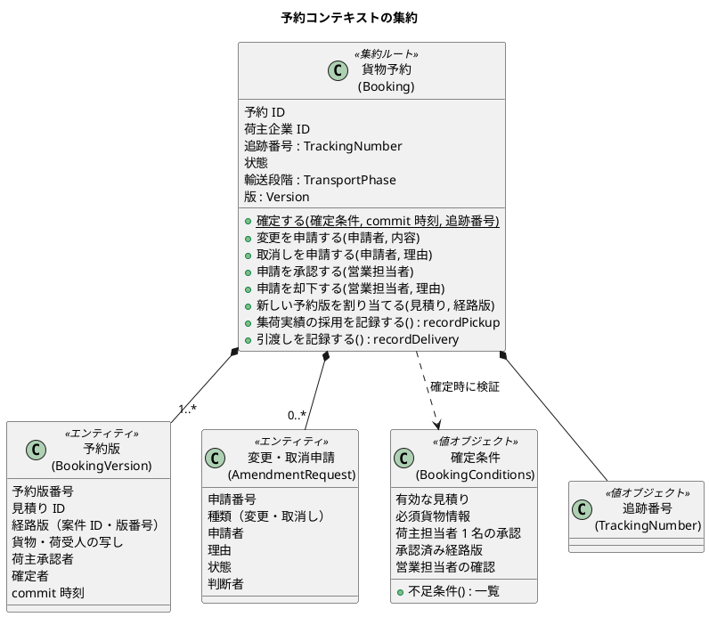

#### 予約の状態遷移

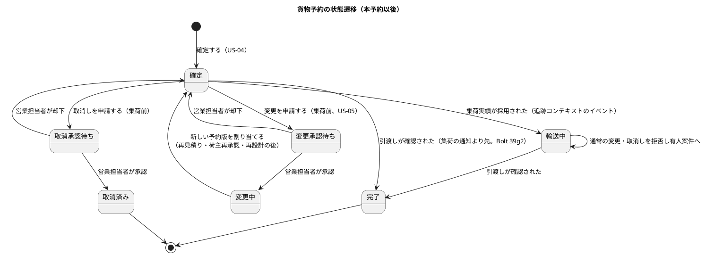

#### 予約の不変条件とドメインルール

| ID | 不変条件・ルール | 根拠 |
| :--- | :--- | :--- |
| B-INV-01 | 本予約は、有効な見積り、必須貨物情報、荷主担当者 1 名の承認、承認済み経路版、営業担当者による条件確認がそろったときだけ確定する。不足条件を返す | BR-01、US-04 |
| B-INV-02 | 見積りの有効性は予約確定の commit 時刻で判定する。同時刻以後は失効。判定は見積りの Q-INV-06 の 1 か所に置き、予約は commit 時刻を渡して見積りの公開 API で照会する（ADR-016） | BR-10、US-04 |
| B-INV-03 | 同じコマンド ID の確定要求は予約を重複生成せず、既存の追跡番号を返す。同じコマンド ID で内容（業務番号・見積り番号・操作者）が違えば衝突として拒否する。確定に成功した要求だけを処理済みコマンドに記録する。処理済みコマンドは 90 日で削除する（RET-06）ので、その後の同じコマンド ID の再送は同じ見積りの予約として既存の追跡番号を示す（Bolt 24） | US-04、PV-01 |
| B-INV-04 | 特殊貨物を含む輸送要求は確定しない（Bolt 35。見積りの提出の拒否に加えて、予約の集約が写した貨物種別を規則 `BookableCargoPolicy` で判定する二重の守り。一般貨物のほかと知らない値は確定しない） | BR-03、US-04 |
| B-INV-05 | 再設計要・旧版・出発済みの経路版、失効・置換済みの見積りは確定・新しい予約版に使えない。再設計要は Bolt 37e から、見積りの本予約の判定（`bookingRejectionAt`）が 置換済み・失効の記録 → 期限切れ → 承認済みでない の後に、割り当てた経路の再設計要の印で `ROUTE_REDESIGN_REQUIRED` を返し、見積りの公開 API（`BookableQuotationResult.NotBookable`）で予約に伝える（ADR-016）。予約の側の理由（`QuotationUnavailability`）と画面の文言は Bolt 37e3。Bolt 37e3 で、予約の腐敗防止層が `ROUTE_REDESIGN_REQUIRED` を `QuotationUnavailability` の再設計要（`ROUTE_REDESIGN_REQUIRED`）に写し、S-09 は再設計要の理由を示す（知らない理由は今のまま `NOT_APPROVED` に寄せる）。Bolt 37e4 で、本予約の判定が再設計要の後に、割り当てた経路の最初の区間の出発予定が commit 時刻と同時刻か前なら `ROUTE_ALREADY_DEPARTED` を返し、公開 API（`NotBookable.ROUTE_ALREADY_DEPARTED`）と予約の腐敗防止層（`QuotationUnavailability` の出発済み）を通して S-09 が出発済みの理由を示す（D-88）。旧版の判定は US-08 | BR-16 |
| B-INV-06 | 変更・取消しの申請は集荷前（輸送段階が集荷前）のときだけ受け付け、予約の状態は承認まで変えない。輸送段階は DE-09 で結果整合的に更新されるため、申請の承認時には追跡の公開 API で集荷実績の有無を同期で確かめ、採用済みなら承認せず有人案件へ引き継ぐ。注: 「追跡の公開 API へ同期で確かめる」は、追跡が予約の下流なので ADR-015 の依存の向きと食い違う。US-05（W11）の Bolt で決め直す。注（Bolt 39g2）: DE-09 ができ、予約の輸送段階は集荷の採用で集荷後に進む。確認中になった集荷では進まないので、承認のときの確かめは W11 で決める | BR-04、US-05 |
| B-INV-07 | 集荷後の通常の変更・取消しは拒否し、要求と理由を記録して有人案件へ引き継ぐ | BR-04、BR-17、US-05 |
| B-INV-08 | 予約版は不変。変更の承認で料金・経路に影響する場合は、旧版を保持して新しい予約版を作る | BR-04、US-05 |
| B-INV-09 | 期待版が現在版と違う変更は競合として拒否する | ARCH-HO-01、US-05 |
| B-INV-10 | カスタマーサポートは予約を確定・変更できない（アプリケーション層の認可） | US-11、BR-15 |
| B-INV-11 | 1 つの見積りから確定できる貨物予約は 1 件だけ。別のコマンド ID・別の利用者による同時の確定でも 2 件目は拒否し、既存の追跡番号を示す（貨物予約の見積り ID の一意制約。予約版ではなく貨物予約に置く。Bolt 23 レビュー） | PV-01（重複予約 0 件）、US-04 |
| B-INV-12 | 他のコンテキストからのイベントは、イベントが持つ発行元の集約の版が、記録済みの版より新しいときだけ適用する。古い版のイベントは無視して記録だけ残す。注（Bolt 39g2）: DE-09・DE-10 の通知は版を比べず、輸送段階を戻さないことで代える（完了の後に届いた集荷の通知は記録済み。予約は追跡の版を写さない。前例 ADR-018 の順の守り） | ARCH-HO-01、イベントの順序 |

| ドメインルール・サービス | 英語名 | 内容 |
| :--- | :--- | :--- |
| 確定条件の検証 | BookingConditions | 見積り・経路版・貨物・承認の状態を受け取り、不足条件を返す。見積りと経路版の状態は、アプリケーションサービスが ACL 越しに取得して値として渡す |
| 追跡番号の発行 | TrackingNumberIssuer | 推測されにくい一意な追跡番号を発行する（ファクトリ） |
| 確定できる貨物の規則 | BookableCargoPolicy | 写した貨物種別の名前が一般貨物（`GENERAL`）のときだけ確定できるとする（B-INV-04。Bolt 35）。知らない値・空の値は確定しない。見積りの `MvpAcceptancePolicy` は使わない（BC の独立。予約は見積りの公開 API から写した値だけで判定する）。サービスの判定、`Booking.confirm`、S-09 を開いたときの読み取りモデル（`BookingConfirmationPage.Available.specialCargo`）の 3 か所が同じ規則を使う |
| 見積りを使えない理由 | QuotationUnavailability | 見積りの公開 API の照会の結果から予約の腐敗防止層（`QuotationBookability`）が写す、本予約の確定に見積りを使えない理由。見つからない（`NOT_FOUND`）・失効（`EXPIRED`）・置換済み（`REPLACED`）・承認済みでない（`NOT_APPROVED`）・再設計要（`ROUTE_REDESIGN_REQUIRED`。Bolt 37e3）・出発済み（`ROUTE_ALREADY_DEPARTED`。Bolt 37e4）。知らない理由は承認済みでないに寄せる（腐敗防止層の写しは理由ごとの明示の case にする。Bolt 38f2）。担当企業の外は理由ではなく範囲の外の結果（`QuotationBookability.Result.OutOfScope`）にする。理由で分岐するのは S-09 の文言（`BookingController`）と確定の判定（`BookingCommandService`）の 2 か所（T-175。B-INV-05） |
| 確定の判定の順序 | BookingCommandService | 役割（B-INV-10）→ 処理済みコマンド（B-INV-03。内容が同じなら最初の結果、違えば衝突）→ 業務番号と見積り番号で引いた同じ見積りの貨物予約（B-INV-11。既存の追跡番号）→ 見積りの公開 API の照会（commit 時刻。B-INV-02・05）→ 特殊貨物（B-INV-04。Bolt 35）→ 確定条件（B-INV-01）の順に判定する。特殊貨物は直せないので確定条件より先に返し、追跡番号を発行しない。確定の後に見積りが失効・置換されても、再送と同じ見積りの確定は失効にしない。同時の確定で一意制約に負けた側は、保存をセーブポイントに戻し、同じトランザクションで読み直して同じ結果を返す（Bolt 24） |

### 追跡（Tracking、U3）

#### 追跡の集約

| 集約 | 集約ルート | 識別子 | 含むもの | 責務 |
| :--- | :--- | :--- | :--- | :--- |
| 追跡記録 | 追跡記録（TrackingRecord） | 追跡番号 | 予定（値）、主要実績（エンティティ）、訂正（エンティティ）、現在状態（値） | 予定と実績の保持、現在状態の導出、確認中の保留、訂正の二者確認 |
| 拒否した主要実績 | 拒否した主要実績（RejectedMilestone） | 拒否の記録 ID | 追跡番号（値。外部キーなし）、実績の内容、出典、外部の識別、拒否の理由 | 追跡が実績にしなかった DE-13 を、同じ出典で 1 件だけ追記して残す（Bolt 39g。W8 の有人例外案件の起票の元） |
| 有人案件 | 有人案件（ServiceCase） | 受付番号 | 進捗（エンティティ）、回答（エンティティ）、復旧照合の要否と結果（値） | 顧客照会・業務例外の受付から終結・再開まで。荷主は自社の問い合わせを照会・再開できる（US-23） |
| 照会記録 | 照会記録（InquiryRecord） | 照会記録 ID | 経路（顧客 Web・電話・メール・Web の問い合わせ）、対象、受付時刻、有人対応へ移ったか | KPI-02 の分母と分子の記録（US-21） |
| 営業日カレンダー | 営業日カレンダー（BusinessCalendar） | 年 | 営業日・休業日、営業時間 | 受領・回答期限の計算（BR-09、US-20） |

第 2 章の TrackingActivity が HandlingEvent の列を持つのと同じく、追跡記録が主要実績の列を持ち、現在状態を集約の中で導出する（ADR-002）。

荷主の追跡の照会（US-09 AC1。Bolt 27）は次のとおり。

- 追跡記録の操作「顧客向けに表示する」のうち、Bolt 27 は荷主の分だけを `customerView()` として作る。照会結果 `CustomerTrackingView` は現在状態・当初の到着予定・最新の到着見込み・予定区間と、採用済みの主要実績（`CustomerMilestone`: 種類・場所・発生時刻・出典。発生時刻の順、同じ時刻は実績番号の順）だけを持つ。経路版・実績番号・実績の状態・登録者は持たない（T-INV-09 の荷主の範囲）
- 照会者の立場で項目を切り替える開示範囲（`DisclosureScope`）は、立場が 2 つになる荷受人の照会（US-10・R1.1）で作る。いまは荷主しかいないので、引数を持たない操作にした
- 自社の追跡記録だけを照会することは、荷主用の照会のサービス（`CustomerTrackingQueryService`）がリポジトリの荷主企業で絞る口を使って守る（BR-07）。他社の追跡番号は存在しない番号と同じに扱う
- 照会記録（IR-INV-01）は W9 で作るので、それまでの荷主の照会は照会記録に残らず、KPI-02 の分母に入らない。顧客への表示の可否（`shown_to_customer`）は確認中（US-11）と訂正（US-13）で足す。いまは採用済みの実績をすべて示す

主要実績の登録（US-12 AC1・AC2。Bolt 26b）は次のとおり。

- 追跡管理者が登録した実績は採用（`ADOPTED`）にし、現在状態の導出に入れる（Bolt 39gc で改めた: 採用済みの実績と時系列に反すれば確認中、完了後は保持のみ。W7 CP8。下の Bolt 39gc で決めたこと）。下書き（`DRAFT`）は外部原本の取込（DE-13。Bolt 39g。下の Bolt 39g で決めたこと）で作る実績に使う。BR-05 の二者確認は訂正（T-INV-06）にかかり、登録にはかからない
- 同じ出典識別子（出典の種類と参照。取得時刻は含めない）の実績があれば、新しい実績を作らず既存の実績を返す（T-INV-02）。この判定は追跡管理者の登録の未来の発生時刻の拒否（T-INV-13。DE-13 の下書きには掛けない。Bolt 39g の【前の決定の変更】(13)）より先で、コマンドサービスでも画面を開いたときの版の照合より先に置く（二重送信にも既存の実績を返す）
- 追跡記録は不変で、登録は新しい追跡記録を返す。版はリポジトリが保存のときに増やす（楽観ロック）。コマンドサービス `TrackingRecordCommandService.registerMilestone` の結果は `Registered`（実績番号と現在状態）、`AlreadyRegistered`（既存の実績番号）、`Rejected`（理由）、`NotFound`、`Conflict`（版の不一致、保存のときの楽観ロックの競合、同じ出典・同じ実績番号の同時の登録による一意制約の違反）
- 実績の種類と追跡状態の対応: 集荷 → 集荷済み、搬入 → 出発地搬入済み、出発 → 輸送中、積替 → 積替え中、到着 → 目的地到着、引渡し → 引渡し済み。積替港での到着は積替、積替港からの出発は出発として登録する（場所では判定しない）。R0.1 では目的地到着から引渡しの実績で引渡し済みへ直接進め、引渡し可能（荷降ろし・通関等完了）はその実績の種類と手続き中の段階を作る Bolt で足す
- ドメインイベント: DE-18 は Bolt 39gc で、確認中に入る登録・採用のときに発行する（下の Bolt 39gc で決めたこと）。DE-09・DE-10 は Bolt 39g2 で、状態が採用になった集荷・引渡しの登録・採用のときに発行する（下の Bolt 39g2 で決めたこと）

Bolt 39g（US-12 AC1・AC2・AC4・AC5 の取り込みの分、US-14 AC1。DE-13 を受けて下書きにする）で決めたこと（[Bolt 39g 計画](../../development/cargo-tracker/bolt_39g_plan.md) の開始準備の決定 (2)〜(8)、【業務の判断】(aa)〜(af)、【前の決定の変更】(11)〜(13)。2026-11-10、推奨のとおり。Recommend 承認の指示による。human:kakimomokuri。候補の判定と表示・下書きの採用は Bolt 39gb、確認中と DE-18・手入力の規則は Bolt 39gc に分けた。【前の決定の変更】(11)）:

- 受け方: `ExternalMilestoneEventHandler` が DE-13 をコミットの後に受け、`TrackingRecord.receiveExternalMilestone` で実績を 1 件足す。確定の追跡には状態「下書き」で、完了後の追跡には状態「保持のみ」で足す。どちらも現在状態と根拠の実績番号を変えない（T-INV-05・T-INV-08）。登録者は DE-13 の操作者、登録時刻は Clock。監査は今の `ExternalRecordAuditEventHandler` が DE-13 で書くので足さない。
- 組と順（【業務の判断】(aa)、台帳 D-114。仮。【前の決定の変更】(12)）: DE-13 ごとに実績を 1 行残し、順は書くときに比べず、読むときに実績の組から決める。組は追跡番号・情報源 ID・外部 ID（外部 ID は提供元の中でだけ一意なので、情報源を外すと別の提供元の同じ外部 ID が混ざる）。候補は組の下書きのうち、公開した時刻 → 取得時刻 → 受信記録 ID（文字列の順）で最も新しいもの。外部版は比べない（順の定めのない文字列。D-105 と同じ）。古い下書きは消さない（T-INV-01）。Bolt 39g は 3 列を書くまでで、候補の判定と表示は 39gb で作る。listener は最大 8 本が並行して順は保証されないので、書くときに比べると届いた順で結果が変わる。読むときに決めれば、届いた順によらず同じ結果になる。受け入れること: V2 の後に V1 の隔離を採用すると V1 の値が候補になる（Bolt 39h で決めた: この組は差異にせず、39h3 で判断の画面に警告する。取込で前に取得した外部版が後から届く版の逆転は差異にし、DE-13 は出ない。台帳 D-142・D-144。仮）。人の採用が間に入るので、誤った候補がそのまま現在状態に効くことはない。
- 判定の順: 拒否の記録あり → （追跡記録がなければ知らない追跡番号）→ 同じ出典 → 取消済み → 完了後 → 通常の 1 つにする。拒否の記録と同じ出典を先に見るので、受けた後に状態が変わってから再配信されても結果が変わらない。
- 取消済みと知らない追跡番号（【業務の判断】(ac)、台帳 D-116。仮）: 実績を作らず、拒否の記録（`RejectedMilestone`。理由 `BOOKING_CANCELLED`・`UNKNOWN_TRACKING_NUMBER`）に残して WARN のログを出す。例外にしない（直らないイベントを発行記録に残さない）。版は上がらない。後から追跡記録ができても実績にしない。新しい外部版で送り直してもらうと下書きになる。受け入れること: データ責任者には S-16・S-17 で「採用」と示され、追跡に届かなかったことは拒否の記録とログにしか残らない（W8 の有人案件・W10 の OBS でつなぐ）。DE-07 の非同期の配信の間に届いた DE-13 は拒否になり、後から実績にならない（W10 の OBS の項目）。
- 完了後（【業務の判断】(ad)、台帳 D-117。仮）: 予約状態が完了か現在状態が引渡し済みのとき（T-INV-05 の「完了済み（引渡し済み）」を両方と読む）。取消済みの判定はそれより先。HEAD で予約状態を書く経路は確定だけで、取消済み・完了の予約状態は DE-08（W11）と DE-10 の作り直し（39g2）の前はテストデータだけで起きる。引渡し済みは今も画面の登録で起きる。注（Bolt 39g2 の【前の決定の変更】(17)）: DE-10 の作り直しの後も予約状態の写しの完了は書かない（完了後の判定は採用済みの実績から導いた状態で効く）。写しの完了は DE-08 の写し（W11）を作るときに決め直す。
- 追跡番号が違う組（【業務の判断】(ab)、台帳 D-115。仮）: 外部版をまたいで追跡番号が変わった DE-13 は別の主要実績として受け、元の追跡番号の下書きと実績は変えない。別の追跡記録を同じトランザクションで書かない（集約の境界）。元の追跡番号の下書きは元の追跡番号の S-12 で採用できる（Bolt 39gb）。採用済みの訂正は US-13（W12）。
- 未来の発生時刻（【業務の判断】(ae)、台帳 D-118。仮。【前の決定の変更】(13)）: 発生時刻が受けた時刻より後の DE-13 も下書きで受ける。T-INV-13 は追跡管理者の登録の規則で、提供元の事実は保持する。採用のときは採用時刻より後なら採用できない（Bolt 39gb）。
- 情報源の停止（【業務の判断】(af)、台帳 D-119。仮）: 情報源が停止された後に届いた DE-13 も下書きで受ける。発行されたイベントは判断の時点で採用済みの値で、追跡は情報源の状態を持たず参照もしない。
- 同じ追跡番号の同時（リスク台帳の PERF-06 の行）: listener は追跡番号を `SELECT … FOR UPDATE` で押さえてから集約を読み直す 2 段にする（`TrackingRecordRepository.findByTrackingNumberForUpdate`。Bolt 39g4b で `findByTrackingNumberForExternalMilestone` から名前を変えた（DE-13・下書きの採用・DE-12 の 3 つに使う。振る舞いは変えない）。`Propagation.MANDATORY`、待ちの上限 10 秒）。実績番号は実績の数 + 1 で振るので、楽観ロックの読み直しでは 8 本のうち 4 本以上が重なると 3 回で勝てないイベントが残りうる。ロックの後は競合しないので読み直しの繰り返しは作らない。ロックは画面の登録にはかけず、画面は楽観ロックのままで DE-13 に負けたら `Conflict` にする。追跡記録がない番号は押さえる行がないので、拒否の記録の一意制約と `NESTED` で 1 件にする。
- DB の失敗（ロックの待ちの上限を含む）は例外を上げて発行記録に残し、再起動の再配信に任せる。内容の欠けた DE-13 は ERROR のログを残して捨てる（再配信しても直らない）。
- 依存: 新しいコンテキスト間の依存は `tracking` → `externaldata :: events` だけ。公開 API と ACL は足さない（値はイベントの共有カーネルの型）。
- 変えないもの: `CurrentStatusDeriver`（採用だけを見る）、手入力の `registerMilestone` と S-13、外部データの採用と DE-13 の形、`TrackingRecordRepository.update`（まだ表にない実績だけ INSERT する。Bolt 39g2 の P-3 で、表にある実績の中身が集約と違えば例外にした）、C-10、追跡の開始（DE-07）。

Bolt 39gb（US-12 AC1・AC2 の外部の分。候補の判定と表示、追跡管理者の下書きの採用）で決めたこと（[Bolt 39gb 計画](../../development/cargo-tracker/bolt_39gb_plan.md) の開始準備の決定 (2)〜(6)、確認ポイント 1〜8。2026-11-11、推奨のとおり。Recommend 承認の指示による。human:kakimomokuri）:

- 組と候補: `TrackingRecord.groupsOf()` が外部原本から受けた下書きと採用の実績を組（`MilestoneGroup`。追跡番号の中で情報源 ID・外部 ID）に分ける。保持のみと手入力の実績は組に入らない。組の中で候補の規則（`MilestoneCandidateRule`）が最も新しい実績が下書きなら、それが候補。最も新しい実績が採用済みなら候補はない。候補でない下書きは置き換えられた下書きで、S-12 に「後から公開された原本に置き換えられました」と示す。状態は持たず読むたびに決めるので、元の値の原本が後から公開されると表示が変わる。共有カーネルは変えない（確認ポイント 2）。
- 採用の操作: `TrackingRecord.adoptCandidate(実績番号, 採用者, 採用時刻)` が候補を採用に移し、現在状態と根拠の実績番号を導出し直す（T-INV-08）。実績は消えず増えない。採用した人と時刻を実績に残す（`adopted_by`・`adopted_at`）。BR-05 の二者確認は訂正（T-INV-06）にかかり、初めての採用にはかからない。判定の順は、候補でない → 取消済み → 完了後 → 採用済みと同じ値（何もしない） → 採用済みと値が違う → 未来の発生時刻。結果は `MilestoneAdoption`（採用した・採用済みと同じ値・拒否）。画面は同じ操作を試して採用のボタンと理由を出し分けるので、ボタンと POST の判定はずれない。
- 採用済みの実績と値が違う候補（確認ポイント 1）: 採用を出さず「採用済みの実績と値が違います」と示し、POST は `CONFLICTS_WITH_ADOPTED` で拒否する（採用すると T-INV-06 を素通りする）。値を直す道は US-13（W12）。候補と同じ値（種類・場所・発生時刻）を採用済みなら採用は要らず、「採用済みの実績と同じ値です」と示し、POST は何もしない。
- 取消済み・完了後（確認ポイント 4）: 採用を出さず、POST は `BOOKING_CANCELLED`・`TRACKING_COMPLETED` で拒否する。完了後は予約状態が完了か現在状態が引渡し済み（T-INV-05、【業務の判断】(ad)）。保持のみは組に入らないので採用の対象外。
- 未来の発生時刻（確認ポイント 5、【業務の判断】(ae)）: 採用時刻より後の発生時刻の下書きは採用できない（`OCCURRED_IN_FUTURE`）。同時刻は採用できる。下書きとしては受けたまま（T-INV-13 は採用のときだけ掛ける）。
- 元の追跡番号の下書き（確認ポイント 6、【業務の判断】(ab)）: 組は追跡番号の中で作るので、元の追跡番号 P の S-12 では P の組として候補を決め、採用できる。新しい追跡番号 Q の組とは混ざらない。
- 同時（行 57）: コマンドサービスは追跡番号の行を押さえて読み直してから（`findByTrackingNumberForUpdate`。Bolt 39g4b で名前を変えた）、画面を開いたときの版と比べる。DE-13 の受け取りも版を上げるので、採用の前に新しい DE-13 が届いていれば版の不一致で `Conflict` になり、画面は読み直しを促す。保存は `state = 'DRAFT'` の行だけを採用に書き換える。
- 認可（確認ポイント 7）: 追跡管理者だけが採用できる（`/staff/tracking-records/**` の既存の規則）。荷主と他の役割は 403。C-10 に下書きは出ない（T-INV-09）。監査は主要実績の登録の前例に合わせて足さない（登録も監査を書かない）。
- P-5・P-6（#50）: 保存の最後に根拠の実績番号の実績が表にあることを確かめ、なければ競合にする（遅延の外部キーの違反がコミットのときに 500 になるのを防ぐ）。一意制約の違反は制約の名前で分け、出典の重複（`uk_milestone_source`）だけを競合として扱い、ほかは例外のまま上げる。

Bolt 39gc（US-12 AC3・AC4・AC5 の手入力の分と採用の分。確認中と DE-18）で決めたこと（[Bolt 39gc 計画](../../development/cargo-tracker/bolt_39gc_plan.md) の開始準備の決定 (2)〜(12)、確認ポイント CP-1〜CP-9、【業務の判断】(ag)〜(ak)、【前の決定の変更】(14)。2026-11-11、推奨のとおり。human:kakimomokuri）:

- 時系列に反するの定義（CP-1、【業務の判断】(ag)、台帳 D-123。仮）: 時系列の規則（`MilestoneSequenceRule`）は実績の種類に進みの段（集荷 1、搬入 2、出発と積替 3、到着 4、引渡し 5）を置き、新しい実績と採用済みの実績の 1 つでも、段の向きと発生時刻の向きが逆（段が後なのに発生が前、または段が前なのに発生が後）なら時系列に反するとする。同じ時刻と同じ段は反しない（出発と積替は積替港で繰り返すので同じ段）。比べるのは採用済みの実績だけで、出典をまたぐ（手入力と外部原本。W7 CP7）。下書き・保持のみ・確認中とは比べない。場所の矛盾と予定との比べは判定しない。
- 確認中の導出（CP-2、【業務の判断】(ah)、台帳 D-124。仮）: 確認中の実績が 1 件でもあれば、現在状態は確認中、根拠の実績番号は最初に確認中になった実績（実績番号の最も小さい確認中）、確認中の理由は `OUT_OF_SEQUENCE`（`UnderReviewReason`）。確認中の実績がなければ今の導出（採用済みの実績のうち発生時刻の最も新しいもの）のまま。確認中の後に時系列どおりの実績を登録・採用しても、現在状態は確認中のまま。確認中から出る道（補正の承認）は US-13（W12）で作る。Release 1.0 のパイロットの前に出る道が要るかは W7 の締めで諮る。
- 手入力の判定の順（W7 CP8、【前の決定の変更】）: 同じ出典 → 取消済み（拒否。`BOOKING_CANCELLED`。拒否の記録は書かない。CP-4、【業務の判断】(aj)） → 未来の発生時刻（拒否） → 完了後（保持のみ。現在状態と根拠を変えない。CP-5、【業務の判断】(ak)） → 時系列に反する（確認中） → 採用。
- 採用の判定の順: 候補でない → 取消済み → 完了後 → 判断済みと同じ値 → 判断済みと値が違う → 未来の発生時刻 → 時系列に反する（確認中に移し、採用者・採用時刻を残す） → 採用。
- 完了後の判定（CP-9、【前の決定の変更】(14)、台帳 D-117 の注）: 予約状態が完了か、**採用済みの実績から導いた状態**が引渡し済み（現在状態ではない。確認中の間に引渡しを採用した追跡が完了後にならず T-INV-05 が効かなくなるのを防ぐ）。DE-13 の受け取り・採用・手入力の 3 つの経路が同じ判定を使う。
- 組に確認中を入れる（CP-6、【業務の判断】(ai)、台帳 D-125。仮）: 確認中の外部原本の実績も組に入れ、判断済みとして採用済みと同じに扱う。確認中の実績と値が違う新しい下書きは採用を出さず「確認中の実績と値が違います」と示し、POST は `CONFLICTS_WITH_ADOPTED` で拒否する。同じ値なら採用は要らない（「確認中の実績と同じ値です」）。
- DE-18（CP-8）: `TrackingPlacedUnderReview`（`tracking.domain.events`）。確認中に入るときだけ、集約が結果に載せ、コマンドサービスが保存の後に同じトランザクションで発行する（すでに確認中なら出さない。同じ出典の二重送信・同じ値・拒否・保存の競合でも出さない）。受け手（通知）は W9。
- 境界（W7 CP7）: 追跡の確認中は、追跡記録の中の実績の時系列（出典をまたぐ）だけを判定する。外部データの差異（同じ外部レコードの版の逆転・採用値との矛盾。ED-INV-03）は外部データが受信記録で判定し（Bolt 39h）、追跡の確認中にはつながない。差異にした原本は採用値にならないので DE-13 は届かない。
- 認可は変えない（`/staff/tracking-records/**` の追跡管理者）。監査は足さない（DE-18 の監査は US-17。W11）。荷主の C-10 は現在状態「確認中」を示し、確認中の実績は示さない（T-INV-09。説明は US-09 AC2・W9）。

Bolt 39g2（DE-09・DE-10 を予約の公開 API で予約に返す形、P-3）で決めたこと（[Bolt 39g2 計画](../../development/cargo-tracker/bolt_39g2_plan.md) の開始準備の決定 (1)〜(12)、確認ポイント 1〜11、【業務の判断】(al)・(am)、【前の決定の変更】(15)〜(17)。2026-11-11、推奨のとおり。human:kakimomokuri）:

- いつ出すか（CP-4、【業務の判断】(al)、台帳 D-128。仮）: 登録・採用で状態が採用になった集荷の実績ごとに DE-09（`PickupMilestoneAdopted`）、引渡しの実績ごとに DE-10（`DeliveryConfirmed`）を出す。確認中・保持のみ・下書きの実績と、同じ出典の二重送信では出さない。追跡が確認中でも、採用になった集荷・引渡しなら出す。2 つ目の採用の集荷でも出し、予約が「記録済み」で何もしない（冪等は予約が持つ）。DE-13 の受け取りでは出さない。1 つの操作で出るイベントは DE-09・DE-10・DE-18 のどれか 1 つまで。
- 形（CP-3）: 追跡番号・予約 ID・実績番号・発生時刻・操作者（登録者か採用者）・発行元の集約の版（保存した後の版。DE-18 と同じ読み方）。集約が結果に載せ、コマンドサービスが保存の後に同じトランザクションで発行する。保存が競合なら出ない。
- 予約の遷移（CP-5、【業務の判断】(am)、台帳 D-129。仮。【前の決定の変更】(16)）: 予約の集約の `recordPickup` は確定・集荷前を輸送中・集荷後に、`recordDelivery` は確定または輸送中を完了・完了に進める（確定から完了へ直接進める。集荷の通知より先に届いたとき、または集荷を採用しないまま引渡しを採用したとき）。段は戻さないので、後から届いた通知は記録済み。取消済みは記録しない（`BOOKING_CANCELLED`）、変更承認待ち・取消承認待ち・変更中は記録しない（`BOOKING_UNDER_REQUEST`。US-05・W11 で決め直す）。B-INV-12 の版の比べは段を戻さないことで代える。
- 予約の公開 API（CP-2）: `booking.interfaces.api.TransportPhaseNotification` の `notifyPickedUp`・`notifyDelivered`。受領は記録した・記録済み・記録しない（理由 `BOOKING_NOT_FOUND`・`BOOKING_CANCELLED`・`BOOKING_UNDER_REQUEST`）。アダプターは入力ポート `TransportPhaseCommandService` に委ねる。予約は追跡のイベントを購読しない（依存は追跡 → 予約のまま）。
- 追跡の listener（`BookingTransportPhaseNotificationEventHandler`）と腐敗防止層（`BookingTransportPhases`）: DE-09 は集荷の通知、DE-10 は引渡しの通知。記録しないは WARN のログで終え、追跡は戻さない（結果整合）。公開 API の例外はそのまま上げ、発行の記録の再配信に任せる（ADR-014）。
- 同時（CP-6）: 予約のコマンドサービスは予約の行を `SELECT … FOR UPDATE` で押さえてから読み直す（`BookingRepository.findByIdForUpdate`。`Propagation.MANDATORY`）。進めたときだけ保存し、記録済み・記録しないは書かない。
- 予約の更新者（CP-8）: 通知の操作者（集荷・引渡しを登録・採用した追跡管理者）を `updated_by` に書く。監査は足さない（US-17・W11）。
- 予約状態の写し（CP-7、【前の決定の変更】(17)）: 追跡記録の予約状態の写しの完了は書かない。完了後の判定は採用済みの実績から導いた状態で効く（Bolt 39gc の決定 (6)）。
- 既存のデータ（CP-9）: 39g2 の前に採用した集荷・引渡しの予約は確定・集荷前のまま残し、補正しない（配備の前に件数を確かめる）。
- P-3（CP-10）: 主要実績の保存は、表にある実績の中身（種類・場所・発生時刻・出典・登録者・登録時刻・外部の出どころ）が集約と違うか、表にあって集約にない実績があれば `IllegalStateException` でトランザクションを戻す（版を通さずに実績を書いた経路の誤り）。
- 認可は変えない。到着見込みと鮮度は Bolt 39g3 に分けた（CP-1、【前の決定の変更】(15)）。39g3 で鮮度超過の判定と航海の採用値で動く見込みを Bolt 39g4 に分けた（Bolt 39g3 の CP-1、【前の決定の変更】(18)）。39g4 で航海の採用値で動く見込みと見込みの根拠の表示を Bolt 39g4b に分けた（Bolt 39g4 の CP-1、【前の決定の変更】(19)）（Bolt 39g4b の開始準備で見込みの根拠の表示を 39g4c に分けた）。

Bolt 39g3（採用した実績で最新の到着見込みを動かし、最終取得時刻を示す）で決めたこと（[Bolt 39g3 計画](../../development/cargo-tracker/bolt_39g3_plan.md) の開始準備の決定 (1)〜(8)、確認ポイント 1〜7、【業務の判断】(an)〜(ap)、【前の決定の変更】(18)。2026-11-11、推奨のとおり。human:kakimomokuri）:

- 範囲（CP-1、【前の決定の変更】(18)）: 39g3 は採用の実績で動く最新の到着見込みと最終取得時刻。鮮度超過の判定（FRS-02、`FreshnessPolicy`）と航海の採用値（DE-12）で動く見込みは Bolt 39g4（39g3 の直後、39h の前）（Bolt 39g4 の開始準備で、航海の採用値で動く見込みを 39g4b に分けた）。
- 何で動かすか（CP-2、【業務の判断】(an)、台帳 D-130。仮）: 採用の実績で動かす。確認中・下書き・保持のみの実績は使わない（T-INV-08 と同じく現在状態に効く実績だけ）。航海の採用値で動かす分と、2 つがそろったときの優先は 39g4 で諮る（Bolt 39g4 の開始準備で優先を【業務の判断】(at) で仮に決め、実装を 39g4b に分けた）。
- 遅れの伝え方（CP-3、【業務の判断】(ao)、台帳 D-131。仮）: 最新の到着見込みの規則（`LatestEstimateRule`）が予定と実績の列から見込みを返す純粋な関数。出発は積地が実績の場所の区間の出発予定、積替は揚地が実績の場所の区間（最後の区間でない）の到着予定、到着は最後の区間の揚地が実績の場所なら最後の区間の到着予定に結ぶ。集荷・搬入・引渡し、区間にない場所、種類と区間の位置が合わない実績、同じ場所が 2 つ以上の区間に当たる実績は結ばない。結んだ採用の実績のうち予定の順で最も後のもの（同じ予定時刻なら発生時刻の遅いもの）を使い、到着ならその発生時刻（早着も実績にする）、出発・積替なら当初の到着予定に遅れ（発生時刻 − 予定時刻）を足す。遅れが 0 以下なら当初の到着予定（早い出発で見込みを早めない）。結んだ採用の実績がなければ当初の到着予定。
- 最終取得時刻（CP-4、【業務の判断】(ap)、台帳 D-132。仮）: 採用の実績の出典の取得時刻のうち最も新しいもの（発生時刻の順と独立）。採用の実績がなければ空。下書き・確認中・保持のみの取得時刻は使わない（荷主の C-10 に示していない実績の時刻を出さない。T-INV-09）。
- 導出と保存（CP-6）: 集約は保存した値を読み、採用の実績が変わったときだけ（現在状態を導出し直す `derivedWith`。39g3 の終了報告の議題 1）見込みと最終取得時刻を導出し直す（現在状態と同じ形）。当初の到着予定・予定は変えない（T-INV-10）。保存の UPDATE は `latest_eta`・`last_acquired_at` も書く。39g3 の前に採用した実績を持つ追跡記録は次に実績が変わるまで当初のままで、補正しない（配備の前に件数を確かめる）。
- 画面（CP-5）: S-11 に最新の到着見込み・最終取得時刻の列（なければ「なし」）、S-12・C-10 の照会の結果に最終取得時刻（なければ「まだありません」）。C-10 の一覧の列は変えない（US-09 AC3・W9）。見込みの根拠は示さない（39g4）（Bolt 39g4 の開始準備で 39g4b に分けた）（Bolt 39g4b の開始準備で 39g4c に分けた）。
- 認可・外部連携・イベントは変えない。見込みが変わったことの通知は作らない（US-22・W9）。

Bolt 39g4（次の予定の実績が届かない追跡を鮮度超過として示す）で決めたこと（[Bolt 39g4 計画](../../development/cargo-tracker/bolt_39g4_plan.md) の開始準備の決定 (1)〜(10)、確認ポイント 1〜8、【業務の判断】(aq)〜(at)、【前の決定の変更】(19)〜(21)。2026-11-12、推奨のとおり。human:kakimomokuri）:

- 範囲（CP-1、【前の決定の変更】(19)）: 39g4 は鮮度超過の判定と示し方。航海の採用値（DE-12）で動く見込みと見込みの根拠の表示は Bolt 39g4b（39g4 の直後、39h の前）（Bolt 39g4b の開始準備で見込みの根拠の表示を 39g4c に分けた）。
- FRS-02 の読み（CP-2、【業務の判断】(aq)、台帳 D-133。仮。【前の決定の変更】(21)）: 次の予定の実績は、予定の時点のうち採用の実績を結んだ時点の中で予定の順で最も後の時点の次（結んだ時点がなければ区間 1 の出発。最後の区間の到着を結んだら次はない）。結び方は最新の到着見込みの規則と同じ（予定 `Schedule` の時点の列に出した）。予定時刻は予定区間のまま（遅れで送らない）。判定の時刻（画面を開いた時刻）が予定時刻 + 36 時間以上なら鮮度超過（ちょうどは超過）。最後に取り込んだファイルの取得時刻は使わない。完了後は導出のときに次の予定の実績を空にし、照会は保存した値だけを見る。
- 状態にしない（CP-3、【業務の判断】(ar)、台帳 D-134。仮。【前の決定の変更】(20)）: 鮮度超過は読むときの判定で示し、現在状態を確認中にしない（確認中の理由に足さない）。状態の履歴とイベントに残らない。
- 画面（CP-4、【業務の判断】(as)、台帳 D-135。仮）: S-11 の現在状態のセルに「鮮度超過」の印（確認中なら 2 つ並ぶ）。S-12 の定義リストの最終取得時刻の次に「次の予定の実績の予定時刻」（なければ「なし」）、鮮度超過なら警告の文。C-10 は変えない。
- 優先（CP-5、【業務の判断】(at)、台帳 D-136。仮。実装は 39g4b）: 最後の区間の揚地の到着の採用の実績があればその時刻。なければ遅れで送った見込みと最後の区間の航海の到着予定の遅い方（当初より早めない）。
- 保存（CP-6）: `tracking_record.next_expected_at`（NULL 可）。集約は保存した値を読み、追跡の開始と採用の実績が変わったとき（`derivedWith`）だけ導出し直す。DE-13 の下書きと保持のみは保存した値のまま。既存の行は補正しない（配備の前に件数を確かめる）。
- 許容範囲（CP-7）: 設定 `cargotracker.tracking.freshness-tolerance=PT36H`。0 以下は組み立てで拒む。判定の時刻は照会サービスが時計から得る。
- 認可・外部連携・イベント・ナビゲーションは変えない。

Bolt 39g4b（最後の区間の航海の到着予定で最新の到着見込みを動かす）で決めたこと（[Bolt 39g4b 計画](../../development/cargo-tracker/bolt_39g4b_plan.md) の開始準備の決定 (1)〜(10)、確認ポイント 1〜9、【業務の判断】(au)〜(aw)、【前の決定の変更】(22)・(23)。2026-11-12、推奨のとおり。human:kakimomokuri）:

- 範囲（CP-1、【前の決定の変更】(22)）: 39g4b は航海の採用値（DE-12）で動く最新の到着見込み（【業務の判断】(at)、台帳 D-136 の実装）。見込みの根拠の表示は Bolt 39g4c（39g4b の直後、39h の前）に分けた。何を示すかは【業務の判断】(aw)（台帳 D-139。仮）で仮に決め、39g4c は根拠の保存の判断から入る。
- listener と依存（CP-2）: 追跡は DE-12（`VoyageAdoptedValueUpdated`）を `VoyageArrivalEventHandler`（`tracking.application.internal.eventhandlers`、`@ApplicationModuleListener`）で直接受ける。`externaldata :: events` は許してあるので依存は増えない。イベントの型を追跡のドメインに持ち込まず、listener が追跡の値（`VoyagePortCall` の列、`PublicationOrder`）に写す。経路設計の DE-30 と公開 API は使わない（新しい依存と DE-30 の契約の変更が要り、初めての航海を取りこぼす）。
- 結び方（CP-3、【業務の判断】(au)、台帳 D-137。仮）: 最後の区間の航海番号と同じ航海の DE-12 だけを使う（中間の区間の航海は使わない。D-136）。航海の到着予定の規則（`VoyageArrivalRule`）が、寄港の並び（運航の順）の中で、積地を最後の区間の積地の港で出発のある寄港、揚地を最後の区間の揚地の港で到着のある寄港として読み、積地の寄港がちょうど 1 つならその後ろで最初の揚地の寄港の到着を返す。積地の寄港がない・2 つ以上（周回の航路）、積地の後に揚地がないときは結べない。積地・揚地の読み方は経路設計の `Voyage.callPairs` と同じで、積地 1 つの後の揚地が 2 つなら最初を使う（貨物は最初の揚地で降りる予定。経路設計の組と違う点）。結ぶのは集約（自分の予定で規則を呼ぶ）。受け入れること: 航海の寄港の並びから揚地が消えると見込みは採用の実績だけで決まる。周回の航路の最後の区間では航海の知らせで見込みが動かない。
- 見込みの規則（CP-4、【業務の判断】(at)、台帳 D-136）: `LatestEstimateRule.estimate(Schedule, Collection<Milestone>, Optional<UtcInstant>)` を足す。最後の区間の揚地の到着の採用の実績があればその時刻（39g3 のまま）。なければ採用の実績の遅れで送った見込み（当初以上）と航海の到着予定の遅い方（当初より早めない）。確認中・下書き・保持のみは使わない。2 引数の形は航海の到着予定を空にして 3 引数の形に委ねる。
- 順と冪等（CP-5）: 公開の順（公開した時刻 → 取得時刻 → 受信記録 ID（文字列の順）。D-105）を追跡の値 `PublicationOrder` に出し、候補の規則と航海の到着予定が使う（Red の前のリファクタリング）。集約は保存した順より **厳密に新しい** DE-12 だけを受ける（同じ順は再配信、古い順は遅れて届いた配信。どちらも保存しない。前例は経路設計の `Voyage.apply`）。共有カーネルには上げない（共有カーネルの変更は 3 つのコンテキストの構造の変更で、この Bolt の目安に収まらない）。経路設計の `Voyage` の写しと 2 か所になることを技術的負債として記録し、3 つ目のコンテキストが要るときに上げるかを諮る。
- 集約（CP-5・CP-8）: `TrackingRecord.receiveVoyageArrival(voyageNumber, portCalls, order)` が `Optional<TrackingRecord>`（受けた追跡記録か、変えない）を返す。最後の区間の航海でない知らせ・完了後（予約状態が完了か、採用済みの実績から導いた状態が引渡し済み）・取消済み・新しくない順は変えない。確認中の追跡でも受ける（現在状態は確認中のまま）。受けたときは航海の到着予定（`VoyageArrival`）と順の鍵を書き、見込みと最終取得時刻だけを導き直す（現在状態・次の予定の実績は保存した値のまま。`derivedWith` は通らない）。結べない新しい知らせなら航海の到着予定を空にし順の鍵は書く。`derivedWith` は保存した航海の到着予定を見込みの規則に渡し、受けた知らせの取得時刻を最終取得時刻に含める。
- 保存とスキーマ（CP-6）: `tracking_record` に `voyage_arrival_at`・`voyage_arrival_published_at`・`voyage_arrival_acquired_at`・`voyage_arrival_source_ref`（NULL 可）と CHECK `ck_tracking_record_voyage_arrival`、`scheduled_leg` に索引 `ix_scheduled_leg_voyage` を足す。照会 `TrackingRecordRepository.findTrackingNumbersByFinalLegVoyage`（その航海が最後の区間（最大の区間番号）の追跡番号を追跡番号の順に引く。完了後・取消済みは除かず集約が決める）。既存の行は NULL のままで補正しない（次の DE-12 まで見込みは採用の実績だけで決まる。追跡の開始より前に採用された航海の値は、次の DE-12 まで見込みに効かない）。
- 直列と失敗（CP-7）: listener は 1 つのトランザクションで、対象の追跡番号を追跡番号の順に 1 件ずつ行のロックで押さえてから読み直し、受け、更新する（`findByTrackingNumberForUpdate`。Bolt 39g4b で `findByTrackingNumberForExternalMilestone` から名前を変えた。待ちの上限 10 秒）。同じ航海の DE-12 どうしは同じ順で押さえるのでデッドロックしない。画面の登録と下書きの採用は楽観ロックのままで、DE-12 の受け取りに負けたら `Conflict`（受け入れる。開き直せば通る）。内容の欠けた DE-12（航海番号が空、寄港の並びが null か 2 つ未満、寄港の港が null、出典が null・参照が空・取得時刻が null、公開した時刻が null）は ERROR のログを残して捨てる。DB の失敗とロックの待ちの上限は例外を上げ、発行記録を未完了に残す（再配信は順の鍵で冪等。1 つの追跡記録の失敗で同じ DE-12 のほかの追跡記録も戻る）。
- 最終取得時刻（CP-8、【業務の判断】(av)、台帳 D-138。仮。【前の決定の変更】(23)）: 採用の実績の出典の取得時刻と、受けた（保存した順の鍵の）最後の区間の航海の知らせの取得時刻のうち最も新しいもの。結べなかった知らせも受けたなら含める。D-132 と Bolt 39g3 の決定 (4) を変える。C-10 はすでに予定区間と航海で動いた見込みを示すので、開示（T-INV-09）は広がらない（他社の貨物の情報も出典の参照も示さない）。
- 見込みの根拠（CP-8、【業務の判断】(aw)、台帳 D-139。仮。実装は 39g4c）: S-12 の定義リストの最新の到着見込みの次に「見込みの根拠」の 1 行（当初の到着予定・区間 n の出発（または積替）の実績・到着の実績・航海 V の到着予定のどれか）。S-11・C-10 には出さない。根拠の保存（根拠の種類と根拠の実績番号を保存するか、読むたびに導くか）は 39g4c の開始準備で諮る（Bolt 39g4c で作った。根拠は保存する）。
- 画面・認可・外部連携・イベント・ナビゲーションは変えない（S-11・S-12・C-10 は保存した見込みの値が変わるだけ）。見込みが変わったことのイベント・通知は作らない（US-22・W9）。DE-12 の型と発行元は変えない。

Bolt 39g4c（最新の到着見込みの根拠を S-12 に 1 行で示す）で決めたこと（[Bolt 39g4c 計画](../../development/cargo-tracker/bolt_39g4c_plan.md) の開始準備の決定 (1)〜(8)、確認ポイント 1〜8、【業務の判断】(ax)、【前の決定の変更】(24)。2026-11-12、推奨のとおり。human:kakimomokuri）:

- 範囲（CP-1）: 39g4c は S-12 の見込みの根拠の 1 行（【業務の判断】(aw)、台帳 D-139 の実装）と、根拠の保存。Bolt 39g4b の終了報告の議題 3 の返済を最初に行う。分けない（分けると、根拠を保存するが画面に出ない Bolt ができる）。
- 議題 3 の返済（CP-2、【前の決定の変更】(24)）: `VoyageArrival.orderOf` の出典の参照が空・取得時刻が null の 2 つの分岐は、共有カーネルの `Source` の作り方が拒むのでどの入力でも通らない。本体を変えずにテストを足すのをやめ、2 つの分岐を消すリファクタリングを Red の前に行う（`Source` の拒否は `SourceTest` が縛る）。残る 2 つの分岐（公開した時刻が null・出典が null）は `VoyageArrivalTest` で縛る。
- 値と規則（CP-4）: 見込みの根拠 `LatestEstimateBasis`（種類 `ORIGINAL_ETA`・`MILESTONE`・`VOYAGE_ARRIVAL` と、実績のときだけの実績番号）と最新の到着見込み `LatestEstimate`（時刻と根拠）を足す。最新の到着見込みの規則は `estimateWithBasis` で見込みと根拠を 1 回の評価で返し、今の `estimate` の 2 つの形はそれに委ねる。根拠は規則の分岐に 1 対 1 で対応する（到着の実績・実績の遅れで送った見込み（遅れが正でなくても）はその実績、結んだ実績がなく航海の到着予定を使わないときは当初の到着予定、航海の到着予定が厳密に遅いときは航海の到着予定。同じ時刻は実績）。遅れのない実績も根拠にする（積替港で遅れを取り戻して見込みが当初に戻ったことを示す）。
- 集約（CP-4）: 追跡記録は見込みと根拠を 1 つの項目 `latestEstimate` で持ち、private のコンストラクターと `withMilestones` の引数も `LatestEstimate` 1 つにする（片方だけ差し替える誤りを型で防ぐ。前例は現在状態と根拠の実績番号と理由を `DerivedStatus` 1 つで受け渡す形）。取り出し口は `latestEta()`（今のまま）と `latestEstimateBasis()`（39g4c の前の行は空）。書き手は開始・`derivedWith`・`receiveVoyageArrival` で、導出し直さない経路（DE-13 の下書き・保持のみ）は保存した値のまま持つ。表示の材料として `latestEstimateBasisPoint()`（根拠の実績を結んだ予定の時点。規則と同じ `Schedule.pointOf`）と `latestEstimateDelay()`（最新の到着見込み − 当初の到着予定。0 以上）を出す。`reconstitute` は 39g4c の前の形を前例どおり足す（形が 5 つになる。減らすのは技術的負債として W7 の締めで諮る）。
- 不変条件（CP-4。private のコンストラクターで確かめ、組み立て・開始・導出のどの経路にも効く）: 根拠が実績なら、その実績番号の採用の実績があり、予定の時点に結び、到着なら見込みがその発生時刻、出発・積替なら見込みが当初の到着予定以上。根拠が当初の到着予定なら見込みが当初の到着予定。根拠が航海の到着予定なら航海の到着予定があり、見込みがそれと等しい。根拠が空の行（39g4c の前の行）は組み立てられる。
- 保存とスキーマ（CP-3・CP-6）: 根拠は保存する（読むたびに導くと、保存した見込みと導いた根拠で正が 2 つになる。Bolt 39g4 の決定 (4) と同じ理由）。`tracking_record` に `latest_eta_basis`・`latest_eta_basis_milestone_no`（NULL 可）と CHECK `ck_tracking_record_latest_eta_basis`、PostgreSQL だけに外部キー `fk_tracking_record_latest_eta_basis` を足す（データモデル）。主要実績の UPDATE は根拠の実績番号の実績が表にあることを先に確かめ、なければ競合にする（根拠の実績番号（P-5）と同じ）。既存の行は補正しない（次に見込みを導き直すまで根拠は空で、S-12 は「記録がありません」）。
- 文の形（CP-5、【業務の判断】(ax)、台帳 D-140。仮）: 「当初の到着予定」「区間 n の出発の実績（実績 m、場所、当初より … 遅れ）」「区間 n の積替の実績（…）」「到着の実績（実績 m、場所）」「航海 V の到着予定（取得 日時）」。括弧の中の時間は見込みの遅れ（`latestEstimateDelay()`）を時間と分で（分未満は切り捨て、0 分は「当初の到着予定どおり」）。根拠のない行は「記録がありません」。文はインターフェース層（`TrackingRecordViews`）が作り、ドメインは種類と実績番号だけを持つ。
- 開示と画面（CP-7）: S-12 の 1 行だけ。S-11 の列と C-10 には出さない（C-10 の根拠は W9 の FRS-03 と一緒に決める）。`CustomerTrackingView`・`TrackingRecordSummary` に根拠を持たせない（T-INV-09）。画面・URL・認可・外部連携・イベント・ナビゲーションは変えない。根拠が変わったことのイベント・通知は作らない。

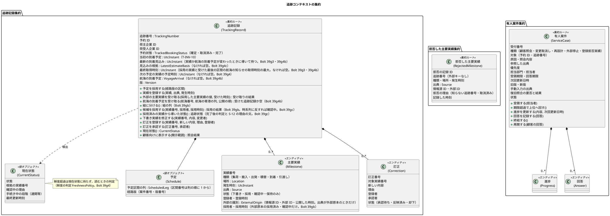

#### 追跡の状態遷移

追跡状態は要件定義の追跡状態モデルを使う。状態名は業務責任者の確認前の候補である（要件定義の注記）。

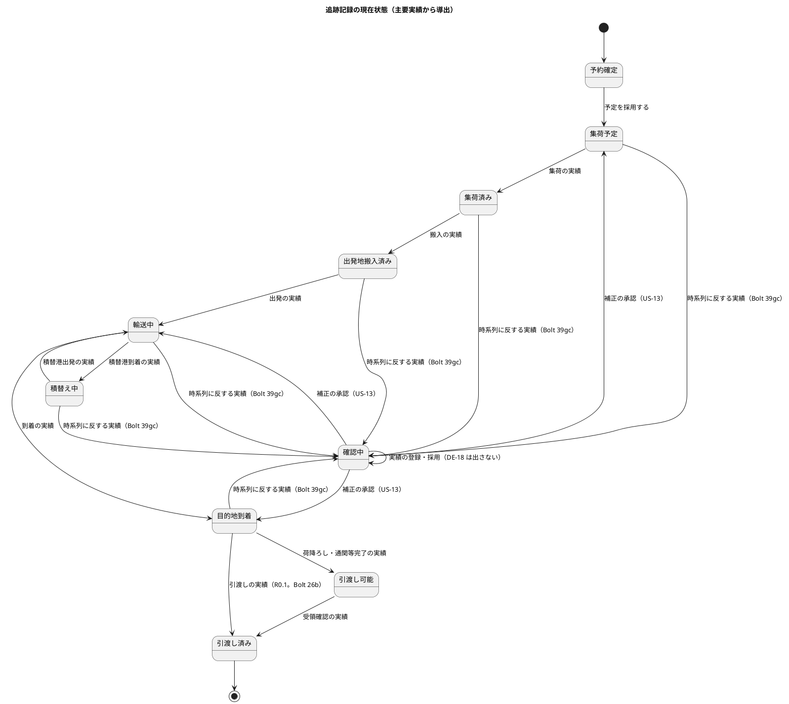

Bolt 39gc で、確認中に入るのは引渡し済みを除くすべての状態からにした（引渡し済みの後の実績は保持のみ。T-INV-05）。確認中に入る理由は時系列に反する実績だけで、矛盾は判定を作る Bolt で足す。鮮度超過は確認中にせず、読むときの判定で示す（Bolt 39g4、【前の決定の変更】(20)）。確認中から出るのは補正の承認（US-13・W12）だけで、それまで確認中のまま残る。

有人案件の状態遷移は、要件定義の例外案件の状態モデルを US-20 の受入条件に合わせて具体化した。

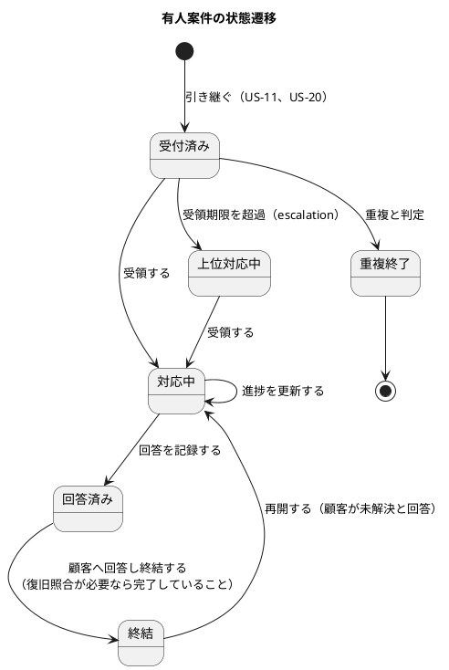

要件定義の例外案件の状態（評価中、顧客確認待ち、解決確認中）は第 2 段階の例外対応で使う。MVP の有人案件は US-20 の受入条件に必要な状態だけを持つ。

#### 追跡の不変条件とドメインルール

| ID | 不変条件・ルール | 根拠 |
| :--- | :--- | :--- |
| T-INV-01 | 主要実績は削除・上書きしない。訂正は原実績に関連付けた訂正記録で行う | BR-05、US-13 |
| T-INV-02 | 同じ出典識別子の実績は重複登録せず、既存の記録を返す | US-12 |
| T-INV-03 | 時系列に反する・矛盾する実績は保持するが現在状態に直ちに反映せず、確認中にする。Bolt 39gc で時系列に反する分を作った: 実績の種類の段と発生時刻の向きが採用済みの実績の 1 つと逆なら、その実績を確認中にし、現在状態を確認中にする（`MilestoneSequenceRule`。【業務の判断】(ag)・(ah)、台帳 D-123・D-124。仮）。矛盾は判定しない | BR-06、US-12 |
| T-INV-04 | 取消済み予約への実績登録は拒否し、発生事実を有人案件として起票する | BR-16、US-12 |
| T-INV-05 | 完了済み（引渡し済み）の追跡への遅延実績は保持のみとし、現在状態を自動で後退・再開しない。完了済みは、予約状態が完了か現在状態が引渡し済みのとき（Bolt 39g の【業務の判断】(ad)、台帳 D-117。仮）。Bolt 39gc で「現在状態」を「採用済みの実績から導いた状態」に読み替えた（確認中に隠れて完了後にならないのを防ぐ。【前の決定の変更】(14)）。追跡管理者の手入力も完了後は保持のみ（Bolt 39gc） | BR-16、US-12 |
| T-INV-06 | 訂正には理由が必要。採用済みまたは顧客表示済みの実績の訂正は、登録者と異なる追跡管理者の承認まで採用値を変えない。採用済みの実績と値が違う下書きを採用して値を変えることも訂正に当たるので、下書きの採用では拒否する（Bolt 39gb。値を直す道は US-13） | BR-05、US-13 |
| T-INV-07 | 採用前の下書き実績は二者確認なしで修正でき、変更者と変更時刻を記録する | BR-05、US-13 |
| T-INV-08 | 予定と実績を混同しない。現在状態は採用済みの実績だけから導出し、予定は予定として示す。例外は予定の採用による「予約確定 → 集荷予定」だけ（要件定義の追跡状態モデルの遷移。Bolt 25） | 要件定義 追跡状態モデル、US-09 |
| T-INV-09 | 顧客向けの表示は開示範囲（荷主・荷受人）に絞る。荷受人には到着予定、現在状態、主要実績、最終更新時刻だけを示す | BR-07、US-10 |
| SC-INV-01 | 有人案件は受付番号を持ち、種類に応じた必須項目（原因、担当、期限、旧版・新版、手動入力の出典、顧客連絡、復旧照合）をそろえて起票する | BR-09、BR-17、US-20 |
| SC-INV-02 | 復旧照合が必要な案件は、照合が完了するまで終結できない | US-20 |
| SC-INV-03 | 再開しても受付番号と過去の回答履歴を保持する | US-20、US-23 |
| SC-INV-04 | 受領・回答期限は営業日カレンダーで数える。営業時間外の起票は翌営業日の開始から数え、優先度高は起票時に受付番号と次回更新日時を依頼元へ返す | BR-09、US-20 |
| SC-INV-05 | 荷主は自社の問い合わせだけを照会・再開できる | BR-07、US-23 |
| T-INV-10 | 当初の到着予定（確定した経路版）と最新の到着見込みを分けて持ち、どちらかで他方を上書きしない。Bolt 39g3 から最新の到着見込みは採用の実績で動き（`LatestEstimateRule`）、当初の到着予定は動かない。Bolt 39g4b から最後の区間の航海の到着予定（`VoyageArrival`）でも動く（遅れで送った見込みとの遅い方。当初の到着予定より早めない）が、航海の到着予定で当初の到着予定は動かない。Bolt 39g4c から最新の到着見込みは見込みの根拠と一緒に持つ（同じ規則の 1 回の評価で書き、根拠が当初の到着予定なら見込みは当初の到着予定、航海の到着予定なら見込みは航海の到着予定。集約のコンストラクターと表の CHECK が守る） | US-09、要件定義 RQ-03 |
| T-INV-11 | 追跡記録は予約 1 件に 1 件。同じ予約の DE-07 の再配信は追跡記録を作らず、DE-22 も発行しない（追跡記録の予約 ID の一意制約。ADR-015 の冪等。Bolt 25） | ADR-015、PV-01 |
| T-INV-12 | 予定は区間 1 件以上で、列の順に区間番号を 1 から振る。各区間の到着予定は出発予定より後、前の区間の揚地は次の区間の積地と同じ。経路版が見つからない・区間が不正・DE-07 の企業 ID がないときは、警告のログを残して追跡を開始しない（再配信で直らない欠け。予約サガは処理中のまま、W8 の滞留の有人確認要が拾う。Bolt 25） | ADR-015、要件定義 追跡状態モデル |
| T-INV-13 | 追跡管理者の登録では、発生時刻が登録時刻より後（未来）の実績は登録しない。同時刻は受け付ける（Bolt 26b）。DE-13 の下書きには掛けない（提供元の事実は保持する。Bolt 39g の【業務の判断】(ae)、【前の決定の変更】(13)、台帳 D-118。仮）。下書きの採用のときは掛け、発生時刻が採用時刻より後の下書きは採用しない（同時刻は採用できる。Bolt 39gb） | US-12 |
| IR-INV-01 | 顧客 Web の追跡照会は自動で照会記録にする。同じ利用者・同じ追跡番号の 30 分以内の再表示は 1 件にまとめる。照会の後 24 時間以内に同じ追跡番号の問い合わせが起票されたら、有人対応へ移ったと記録する | KPI-02、US-21 |
| IR-INV-02 | 電話・メールの照会は、引継ぎが不要でもカスタマーサポートが記録する | KPI-02、US-21 |

| ドメインルール・サービス | 英語名 | 内容 |
| :--- | :--- | :--- |
| 現在状態の導出 | CurrentStatusDeriver | 採用済みの実績の列と予定から現在状態と確認中の理由を導く。追跡記録の中で使う。Bolt 26b は、採用済みの実績のうち発生時刻が最も新しいもの（同じ時刻なら実績番号の大きい後の登録）の種類に対応する状態と、その実績番号（根拠の実績番号）を返す。採用済みの実績がなければ集荷予定のまま。DE-13 で受けた下書き・保持のみは導出に入らない（T-INV-08。Bolt 39g）。Bolt 39gc で確認中を足した: 確認中の実績が 1 件でもあれば現在状態は確認中、根拠は実績番号の最も小さい確認中、理由は `OUT_OF_SEQUENCE`。採用済みの実績だけから導いた状態も返す（完了後の判定と S-12 の理由の文） |
| 時系列の規則 | MilestoneSequenceRule | 新しい実績が採用済みの実績と時系列に反するか（種類の段と発生時刻の向きが逆か）を判定する。追跡記録の登録と採用で使う（Bolt 39gc） |
| 最新の到着見込みの規則 | LatestEstimateRule | 予定と採用の実績の列と航海の到着予定（なければ空）から最新の到着見込みを返す（到着の実績があればその時刻、なければ遅れで送った見込みと航海の到着予定の遅い方）。追跡記録が実績か航海の到着予定を変えたときに使う（Bolt 39g3。【業務の判断】(ao)。航海の到着予定は Bolt 39g4b、【業務の判断】(at)）。Bolt 39g4c から見込みと見込みの根拠を 1 回の評価で返す（`estimateWithBasis`。根拠は到着の実績・遅れで送った見込みの実績・当初の到着予定・航海の到着予定のどれか。【業務の判断】(aw)） |
| 航海の到着予定の規則 | VoyageArrivalRule | 予定と航海の寄港の並びから、最後の区間の積地（出発のある寄港がちょうど 1 つ）の後ろで最後の区間の揚地の到着のある最初の寄港の到着を結ぶ（結べなければ空）。追跡記録が最後の区間の航海の知らせを受けたときに使う（Bolt 39g4b。【業務の判断】(au)） |
| 次の予定の実績の規則 | NextExpectedMilestoneRule | 予定と採用の実績の列から次の予定の時点を返す。追跡記録が追跡を始めたときと採用の実績を変えたときに使う（Bolt 39g4。【業務の判断】(aq)） |
| 鮮度の判定 | FreshnessPolicy | 次の予定の実績の予定時刻と判定の時刻と許容範囲から鮮度超過を判定する（判定の時刻 >= 予定時刻 + 許容範囲。ちょうどは超過）。許容範囲の値は非機能要件（NFR-FRESH-01）の 36 時間で、設定で持つ。照会サービス（S-11・S-12）が使う（Bolt 39g4。Bolt 37b2 からの「最終取得時刻と許容範囲から」を【前の決定の変更】(21) で読み替えた） |
| 開示範囲 | DisclosureScope | 照会者の立場（荷主・荷受人・社内）から表示してよい項目を決める |

### アクセス・監査（Identity & Audit、U4）

ADR-002 により単純なモデルとする。認証の流れ（2 段階のログイン、session）は Spring Security に任せ、ドメインモデルは業務上の規則（TOTP の再利用の拒否、一度だけの回復コード、ロック）だけを持つ。TOTP のコードの生成は `TotpCodeGenerator` のポートの裏の java-otp に、回復コードのハッシュは `RecoveryCodeHasher` のポートの裏の bcrypt に任せる（[ADR-011](../../adr/cargo-tracker/011-mfa-totp.md)、Bolt 30）。生成器は持ち主の利用者 ID と暗号化した秘密（`EncryptedSecret`）と時間の刻みを受け（`code(UserId, EncryptedSecret, long)`）、復号はインフラ層の実装の中で済ませる（Bolt 31。利用者 ID は Bolt 31b）。暗号文は `totp-secret:` と利用者 ID を AAD にして暗号化し、別の利用者の暗号文では復号できない（Bolt 31b）。照合と刻みの使用は、アプリケーションのサービス `TotpVerificationService`（`identity.application.internal.commandservices`）が行う。TOTP の資格の集約が前後 1 つの刻みの照合（`match`。結果は値 `TotpMatch` の一致した刻み・再利用・不一致。Bolt 31d で `matchingStep` から改めた）を、リポジトリが刻みの使用（条件付きの更新。件数が 0 なら同時の確かめで後になったので再利用）を受け持ち、サービスは時刻を `Clock` から刻みに直し、照合の結果を写して両者をつなぐ（資格を作り直して再利用を見分ける回り道はない。Bolt 31d）。Spring Security の provider はサービスの結果を認証の成否に直すだけにする（層の規則 D-5 の認証の例外。ADR-012 の決定 6、Bolt 31）。保存した要素（暗号文・回復コードのハッシュ）を読めないことはドメインの例外 `UnreadableCredentialException`（`identity.domain.model.aggregates`）で表し、暗号の部品（`identity.infrastructure.crypto`）が投げ、provider と登録のサービスがこれだけを拒否に倒す。ほかの実装の誤りは 500 にする（ADR-011 の決定 8、Bolt 31d）。`UnreadableCredentialException` は `RuntimeException` を継ぐ（Bolt 32 で `IllegalArgumentException` から改めた。実装の誤りを捕まえる `catch` と取り違えないため）。

ログインのロック（Bolt 32。ADR-011 の決定 9）では、規則（5 回・15 分、ロック中は数えない・延ばさない）はログインの失敗の集約と方針のまま、数える・0 に戻す・監査記録を書くのはアプリケーションのサービス `LoginAttemptService`（`commandservices`）が 1 つのトランザクションで行う（IA-INV-08）。リポジトリの `recordFailure` は条件付きの更新の件数から、数えたかと数えた後の状態を値 `FailureCount` で返し、サービスはそれでロック中の試行（理由 `LOCKED`）と、この失敗でロックしたこと（`ACCOUNT_LOCKED`）を見分ける。最初の失敗の行は、主たるトランザクションの前にトランザクションの外の 1 文で作る（`prepare`。一意制約の違反はトランザクションの外で受ける）。ロックの判定は `isLocked` の 1 か所で、password の段は照合の後の確認（入口の部品 `LockAwareUserDetailsChecker`）が、TOTP・回復コードの段は provider が確かめる前に呼ぶ。`CargoUserDetails` にロックの項目は足さない（session の直列化の互換）。認証の監査のリスナーは誤りの失敗・ロック中の試行・2 つの要素がそろった成功をサービスに写し、数えない拒否と password の段の成功は監査記録に直接書く。この書き手の分け方は Bolt 34c の決定で今のままにした（2026-10-17、human:kakimomokuri）。リスナーが直接書くのは、認証のイベントを写すだけで数え方に関わらず、1 文の追記で済む記録（`PASSWORD_VERIFIED`・数えない `LOGIN_FAILED`・`LOGOUT`）で、数え方と結び付く記録（成功・数える失敗・ロック）は回数と同じトランザクションにするためサービスが書く。ロック中の試行（理由 `LOCKED`）も数えないが、ロック中かどうかを決めるのはサービスの 1 か所なので、サービスが 1 文で書く（書き手の表は ADR-011 のステータスの Bolt 34c の決定と、バックエンドのアーキテクチャのパッケージ構成）。回復コードのログインでは、コードの使用と `RECOVERY_CODE_USED` を `RecoveryCodeVerificationService` が 1 つのトランザクションで書き、`LOGIN_SUCCEEDED` と回数の戻しは成功のイベントを受けたリスナーが `LoginAttemptService` で別のトランザクションに書く（IA-INV-08）。後者の追記が失敗すると、ログインは 500 になり通らず、session は password の段のまま残る（2 つ目の要素の入力に戻れる）。同じ session で別の回復コードを送り直すたびにまた 500 になり、コードが 1 つずつ使用済みになる。使ったコードは戻らず、`RECOVERY_CODE_USED` は残り、`LOGIN_SUCCEEDED` と回数の戻しは書かれず、誤りとしても数えない（Bolt 34c で特性テストで固定した。変えるかは後の Bolt の議題）。

request ごとの確かめ（Bolt 32c。IA-INV-04、ADR-012 の見直しの 3）では、ドメインのポート `UserStandingRepository`（`identity.domain.model.aggregates`。認証の要素のポートと同じ置き場所）が利用者とその所属企業の組 `UserStanding` を 1 回の読み出しで返す。アプリケーションのサービス `SessionRevalidationService`（`commandservices`）は利用者の集約の `authenticationRejection(company)` で判定し（ログインと同じ規則）、利用者がなければ `UNKNOWN_USER` にする。拒否なら監査記録 `SESSION_REVOKED`（結果は失敗、理由、session の主体の利用者 ID と企業 ID）を 1 つのトランザクションで書き、拒否でなければ今の役割・表示名・企業名の `AuthenticatedActor` を返す。役割が変わっただけのときは記録しない。認証の入口のフィルター `SessionRevalidationFilter` が結果を session と主体に写す（ADR-012 の決定 6 の認証の例外の範囲）。集約と規則は変えない。

初回の TOTP の登録（Bolt 31b。ADR-011 の決定 6）では、秘密の発行は `TotpSecretIssuer`、回復コードの生成は `RecoveryCodeGenerator` のポートの裏に置き、実装は `identity.infrastructure` に置く。認証の要素のポート（生成・発行・ハッシュ・回復コードの生成）は、前例にそろえて `identity.domain.model.aggregates` に置く。ZXing をインフラ層に閉じるため、表示の値はポートが値 `TotpProvisioning`（`identity.domain.model.valueobjects`）にして返す。登録はアプリケーションのサービス `TotpEnrollmentService`（`commandservices`）が行う。`begin` は登録済みなら拒み、登録の途中の暗号文を同じ利用者の AAD で復号できる限り使い続け、なければ新しく発行する。`complete` は暗号文と入れたコードを前後 1 つの刻みで照合し、1 つのトランザクションで TOTP の資格を追加し（最後に使った刻みは 0。登録のコードは A-02 でもう一度使える）、回復コード 10 個をハッシュで置き換え、監査記録を書き、回復コードの平文を返す。同時の登録は TOTP の資格の主キーで 1 つに絞り、主キーの違反はリポジトリの実装で `DuplicateTotpEnrollmentException` に写す。登録は TOTP の要素を与えず、ログインは A-02 で終える。登録済みかの問い合わせは `TotpEnrollmentQueryService`（`queryservices`）に置き、画面の層だけが呼ぶ（`TotpVerificationService` から移した）。利用者の登録の状態は TOTP の資格の有無で決まり（未登録 → 登録済み）、状態の列は持たない。登録の途中は session の属性（暗号文の文字列と登録を始めた時刻）で、ドメインモデルには置かない。

認証された利用者を表す値 `AuthenticatedActor`（利用者 ID・企業 ID・役割（1 つ以上）・表示名・企業名）と役割 `Role`（BR-15 の 8 役割）は、共有カーネル（`shared`）に置く。ほかのコンテキストはこの型だけを受け取り、Spring Security の型にも `identity` にも依存しない。`AuthenticatedActor` は 2 つの要素（password と TOTP または回復コード）がそろった主体だけを表し、引数の解決は `FACTOR_TOTP` がない主体に渡さない。password の段だけで開く画面（A-02・A-07）は、identity の中だけの値 `PasswordVerifiedUser`（`identity.domain.model.valueobjects`。利用者 ID・企業 ID・メールアドレス）を受ける（ADR-012 の見直しの 4、Bolt 31c）。`identity` に置くと、`quotation → identity → quotation::events` の依存が循環するため（ADR-011 の決定 4、[ADR-012](../../adr/cargo-tracker/012-authentication-principal-and-session.md)、Bolt 14 の確認ポイント 2）。利用者の集約は「認証できない理由」（利用停止・企業が無効）を返し、Spring Security の利用者の読み出しがその理由を認証の失敗に変える（IA-INV-09）。監査記録の操作には、ログインの成功（`LOGIN_SUCCEEDED`）・失敗（`LOGIN_FAILED`）・ログアウト（`LOGOUT`）を Bolt 14 で足す。Bolt 31 で password の段の成功（`PASSWORD_VERIFIED`）を足し、`LOGIN_SUCCEEDED` は 2 つの要素（password と TOTP）がそろったときにする。TOTP の失敗は利用者と理由（`INVALID_TOTP`・`TOTP_REUSED`）で `LOGIN_FAILED` に記録する（ADR-012 の見直しの 1）。Bolt 31b で初回の TOTP の登録（`TOTP_ENROLLED`。主体の利用者 ID と企業 ID）を足す（先取りの登録を見つける手がかり。ADR-011 の決定 6）。Bolt 31c で回復コードの使用（`RECOVERY_CODE_USED`。主体の利用者 ID と企業 ID）を足し、回復コードでログインを終えたときは `RECOVERY_CODE_USED` と `LOGIN_SUCCEEDED` の 2 行を書く。回復コードの拒否は理由 `INVALID_RECOVERY_CODE` で `LOGIN_FAILED` に記録する（ADR-011 の決定 7）。Bolt 31d で、TOTP を登録していない利用者の TOTP の送信の理由を `INVALID_TOTP` から `TOTP_NOT_ENROLLED` に分ける（利用者への応答は変えない。ADR-011 の決定 8）。Bolt 32 で、ロック（`ACCOUNT_LOCKED`。結果は成功、理由なし、主体の利用者 ID と企業 ID）と、ロック中の試行の理由 `LOCKED`、利用者の読み出しの DB の誤りの理由 `SERVICE_ERROR` を足す（どちらも数えない。ADR-011 の決定 9）。Bolt 32c で、request ごとの確かめで session を捨てたこと（`SESSION_REVOKED`。結果は失敗、理由 `SUSPENDED`・`COMPANY_INACTIVE`・`UNKNOWN_USER`、session の主体の利用者 ID と企業 ID）を足す（ADR-012 の見直しの 3）。2 つ目の要素の権限 `FACTOR_TOTP` とその認証の結果 `TotpAuthenticationToken` は「TOTP または回復コードで与える 2 つ目の要素」を表し、session の直列化の互換のため名前を変えない（用語集）。Bolt 33 で、password の再設定の依頼（`PASSWORD_RESET_REQUESTED`）を足す。有効な利用者は `SUCCESS`（理由なし）、止められた利用者は `FAILURE`・`SUSPENDED`、所属企業の無効は `FAILURE`・`COMPANY_INACTIVE`、登録なしは `FAILURE`・`UNKNOWN_USER`（操作者を空にし、メールアドレスを残さない）。Bolt 33a で、password の再設定の完了（`PASSWORD_RESET_COMPLETED`。`SUCCESS`、理由なし、操作者に利用者と企業を入れる。`AuditRecord.passwordResetCompleted(user, company, at)`）を足す。成功だけを記録し、方針の誤り・無効なリンク・利用停止と企業の無効での拒否は記録しない（依頼は Bolt 33 で記録済み）。Bolt 33b で、TOTP の再登録（`TOTP_RE_ENROLLED`。`SUCCESS`、理由なし、操作者に利用者と企業を入れる。`AuditRecord.totpReEnrolled(user, company, at)`）を足す。成功だけを記録し、コードの誤り・期限切れ・秘密が読めない・利用できないときは記録しない（失敗の試行の監査は #49 と同じ扱い）。

password の再設定（US-18 AC8。Bolt 33 は依頼から送信まで、新しい password の設定は Bolt 33a。[ADR-017](../../adr/cargo-tracker/017-notification-module-and-mail.md)）では、再設定のトークン `PasswordResetToken`（`identity.domain.model.aggregates`）を利用者とは別の集約にする。トークンの生成は `PasswordResetTokenGenerator`（32 バイトの乱数を URL 安全な Base64）、ハッシュは `PasswordResetTokenHasher`（SHA-256）のポートの裏に置き、実装は `identity.infrastructure.crypto` に置く（回復コードの生成とハッシュと同じ分け方）。依頼のサービス `PasswordResetRequestService`（`commandservices`）は、入力を `EmailAddress` で正規化して利用者を探し、`User#authenticationRejection(company)` と `UserStandingRepository` で有効かを判定し、監査記録を同じトランザクションで書く（IA-INV-08）。有効なら依頼の ID を採番してドメインのイベント `PasswordResetRequested`（`identity.domain.events`。依頼の ID・利用者の ID・依頼の時刻だけ）を出す。応答は登録の有無にかかわらず同じで、トークンの発行も送信も待たない。トークンの発行と送信は、イベントのハンドラー `PasswordResetMailEventHandler`（`eventhandlers`、`@ApplicationModuleListener`。依頼のコミットの後に別のスレッドと別のトランザクションで動く。ADR-003）が行う。発行の手順は、利用者の招待のハンドラーと共有する部品 `PasswordResetTokenIssuance` が持つ（Bolt 38b2c）。部品は利用者の行をロックして同時の発行を直列にし、同じ依頼の ID のトークンがあれば何もしない（再配信で 2 通送らない）。前の発行から 1 分以内なら発行も送信もしない（繰り返し）。そうでなければ前の未使用のトークンを無効にし、トークンを発行してハッシュを保存し、設定の公開の base URL（`cargotracker.public-base-url`。Host ヘッダーから組み立てない）からリンクを組み立て、ACL `NotificationPasswordResetMails` で通知の公開 API に送る。送信が `Failed` でも例外にせず完了にする（再配信で新しいトークンを作らない。利用者が依頼し直す）。平文のトークンと URL はハンドラーのメソッドの中の変数と送信の要求だけにあり、イベントの発行記録・ログ・表に残らない。繰り返しで送らなかったことは監査に書かず、送信の記録がないことで分かる。

利用者の登録（US-16 AC1・AC3、UC-16 の主シナリオ 1。Bolt 38b）では、利用者の集約の static の判定 `decideRegistration(企業, 役割)` が、役割なし → 監督の役割（監督の役割は登録でも付けない。IA-INV-01）→ 企業の種類（IA-INV-13）→ 職務分離の順に確かめ、承認の値 `UserRegistrationApproval`（`User` の入れ子。コンストラクターは private）か拒否 `UserRegistrationRejection`（`valueobjects`）を返す。`register(承認, …)` が版 0・利用中の利用者を作る。管理範囲・企業の有効性・重複のメールアドレス・使えないハッシュ・監査は登録のサービス（Bolt 38b2）が受け持つ。登録のサービスは同じトランザクションで DE-25 `UserRegistered`（登録の ID・利用者の ID・時刻だけ）を出し、コミットの後に招待のハンドラー `UserInvitationMailEventHandler` が共有の部品で招待のトークン（`USER_INVITATION`、24 時間。`request_id` は登録の ID）を発行して、ACL `NotificationUserInvitationMails` で招待のメールを送る。発行の前に利用者が止められていれば発行しない（Bolt 38b2c）。登録の画面（Bolt 38b3b）が選択肢に出す企業は、照会 `registrableCompanies`（管理範囲の、有効で、付けられる役割がある企業。名前・ID の順）から読む（Bolt 38b3）。

利用者の役割の管理（US-16 の一部。Bolt 34）では、役割の組合せの規則を `identity.domain.model.rules` の `RoleAssignmentPolicy` に置き、利用者の集約が判定（自分の変更 → 役割なし → 変更なし → 監督の役割 → 企業の種類 → 職務分離の順）を返す。変更履歴は別の表を作らず、監査記録 `ROLES_CHANGED` の対象（`USER`・利用者 ID・更新した後の版）と変更前後（役割の名前を `Role` の宣言の順にカンマでつないだ文字列）で代える（`user_role` は今の値だけを持つ。2026-10-16、human:kakimomokuri）。同時の更新は `app_user.version` を条件にした更新の件数で判定し、ドメインでは判定しない。Bolt 34e から、利用者の集約の判定 `decideRoleChange` が承認の値 `RoleChangeApproval`（判定に使った版を持つ）を返し、`changeRoles` はそれだけを受ける。承認の利用者と版が変える利用者と違えば例外にするが、これは承認の取り違えの守りで、同時の更新の判定ではない（古い版は今までどおり更新の件数で決める）。管理範囲（`user_assignment` の `COMPANY`）は Bolt 34b で、利用停止と再開は Bolt 34d で足した（下の段落）。

システム管理者の管理範囲（US-16 AC2。Bolt 34b）では、ドメインのポート `UserAssignmentRepository`（`identity.domain.model.aggregates`）がシステム管理者に割り当てた企業（`user_assignment` の `COMPANY`）を返し、値 `AdministrationScope`（管理範囲）が対象の利用者の所属企業を含むかを判定する（IA-INV-14）。照会のサービスは一覧を管理範囲の企業に SQL で絞り、詳細は範囲外を `UserLookup.OutOfScope` として返す。登録できる企業の照会（Bolt 38b3）も、一覧は管理範囲の企業に SQL で絞り（`findAllIn`）、1 社の照会は範囲外の企業を状態によらず `RegistrableCompanyLookup.OutOfScope` として返す。役割の変更のサービスも、利用者と企業があるかの次（規則より先）に範囲を判定する（Bolt 34b の `RoleChangeResult.OutOfScope`。Bolt 34e から共通の拒否 `UserAdministrationRefusal.OutOfScope` にし、判定の前半を部品 `ManagedUserLookup` にまとめた）。範囲外の利用者は存在しない利用者と同じ 404 にし（照会は管理範囲を先に読み、いない利用者と読み出しの量をそろえる）、役割の変更の試行は確定の POST でだけ S-20 の画面の層（詳細の部品。Bolt 34f）が `AdministrationScopeDenialService` で監査記録 `ADMIN_SCOPE_DENIED` に書く（GET は CSRF の守りがなく他サイトから記録を書かせられるので記録しない。Bolt 34b の開発レビューの決定。役割の変更のトランザクションの外で単独に書き、外側のトランザクションの中では呼べない。追記が失敗したら 500。記録のサービスに依存してよいのは画面の層の詳細の部品だけ（`LayerArchitectureTest`）。利用者の登録の範囲外の試行（対象は企業）は、登録のサービスの確定の口が別のトランザクションで書く（Bolt 38b2））。管理範囲の割り当ては運用の手順で行い、画面は W6（2026-10-16、human:kakimomokuri）としたが、W6 の開始準備で画面を作らず W10 の運用タスク（最初のシステム管理者を作る作業とあわせる）にした（2026-10-20、human:kakimomokuri）。Bolt 38e から、同じ `COMPANY` の行を業務担当者の担当企業（IA-INV-02）にも使う。行の意味は役割で決まり、管理範囲はシステム管理者のときだけ、担当企業は担当範囲のある役割のときだけ読む（画面では職務分離で両方を持てない。監督の役割と業務の役割を付け替える運用の手順では、先に `COMPANY` の行を消す。W10 の宿題。Bolt 38e の決定 (9)）。担当企業は S-20 で書き、管理範囲はアプリで書かない（確認ポイント 12）。

業務担当者の担当範囲（US-16 AC4。Bolt 38f）では、確かめのサービス `SessionRevalidationService` が利用者・役割・企業と同じ 1 回の SQL で担当企業を読み（対象の役割を持つ利用者だけ。38e の決定 (9)）、`AuthenticatedActor` に載せる。`CargoUserDetails` は担当企業を `transient` の項目で持ち、直列化の形を変えない（ADR-012 の改訂）。見積りの社内の照会とコマンドのサービスは `StaffTransportRequestScope` で判定し、範囲の外を結果で返す。画面の層の `StaffOutOfScopeResponder` が状態を変える POST（受付の判断、見積りの作成・再見積り・提示。Bolt 38g で「確定の POST」から改めた）の範囲の外だけをポート `OutOfScopeAttemptRecorder`（[ADR-019](../../adr/cargo-tracker/019-out-of-scope-attempt-recorder.md)）で記録し、404 を返す。Bolt 38g で経路設計（`RoutingCaseScope`。案件の荷主企業は DE-16 の処理で見積りの公開 API から写す）と追跡（`TrackingRecordScope`。追跡記録の荷主企業）に同じ形を写し、記録の対象を状態を変える POST（候補の算出・確定・マイルストーンの登録）に広げた。

利用者の利用停止と再開（US-16 AC5、UC-16 の 5a、BR-14。Bolt 34d。2026-10-17 の開始準備の決定、human:kakimomokuri）では、S-20 の詳細から、システム管理者が管理範囲の企業の利用者を停止し、停止中の利用者を再開する。(1) 停止の理由は選ぶ形（利用終了・異動・緊急停止。値 `SuspensionReason`）にし、監査記録 `USER_SUSPENDED` の理由に名前を残す（最長 11 文字で `audit_record.reason` の `VARCHAR(100)` に収まる）。理由の自由な文と `app_user` の列は足さず、スキーマは変えない。再開は理由を持たない。(2) 停止の反映は request ごとの確かめ（Bolt 32c。IA-INV-04）に任せ、停止の確定の後に相手の session をすぐには消さない（停止では `UserSessionRevoker` を呼ばない。再開は下の (6)）。相手の次の request で `SessionRevalidationService` が session を捨てて A-03 にし、`SESSION_REVOKED`（理由 `SUSPENDED`）を書く。(3) 停止中の利用者の役割の変更は許す（役割の変更の判定を増やさない）。(4) 自分と監督の役割（システム管理者・監査担当者）を持つ利用者は、停止も再開も画面で扱わない（運用の手順で扱う。Bolt 34b の開始準備の決定 (4) を再開にも広げた）。判定は利用者の集約が返し（Bolt 34d は `statusChangeRejection(操作者, 変更後の状態, 理由)`、Bolt 34e から `decideStatusChange(操作者, 変更後の状態, 理由)` が承認の値 `StatusChangeApproval` か拒否を返す）、順は 自分の変更 → 監督の役割（`RoleAssignmentPolicy#holdsOversightRole`）→ 同じ状態への変更 → 理由のない停止（`StatusChangeRejection`）。監督の役割を状態より先に見るのは、決定 (4) で監督の役割の利用者は状態にかかわらず画面で扱わないため（役割の変更は変更なしを先に見るが、状態の変更では監督の役割の利用者の状態を拒否の種類で区別しない）。企業の最後の利用中の利用者も止められる（企業の無効化は別の操作）。アプリケーションのサービス `UserStatusChangeService`（`commandservices`）は役割の変更のサービスの形を写し、確認の GET の `check`（書かない）と確定の POST の `change` を持ち、操作者 → 利用者と企業 → 管理範囲 → 規則 → 版の順に判定する。結果は新しい型 `StatusChangeResult` にし、`RoleChangeResult` を広げない。確定は、利用者の集約の `changeStatus` が返す新しい利用者（Bolt 34d は変更後の状態を受け、Bolt 34e から承認の値だけを受ける）を、リポジトリの `changeStatus(利用者, 期待する版, 時刻)` で `app_user.version` を条件にして状態・版・`updated_at` を更新し（件数が 0 なら古い版）、監査記録 `USER_SUSPENDED`・`USER_REACTIVATED`（対象 `USER`・利用者 ID・更新した後の版、変更前後 `ACTIVE`／`SUSPENDED`、結果は成功）を同じトランザクションで書く（IA-INV-08）。状態の変更と役割の変更は同じ版を共有し、片方の確認の間にもう片方が確定したら古い版として拒む（文言は役割の変更と同じ）。拒否と古い版は監査に書かない。範囲外の確定の試行は、役割の変更と同じく S-20 の画面の層（詳細の部品。Bolt 34f）が `ADMIN_SCOPE_DENIED` を書く（確認の GET は書かない）。`changeRoles`・`changeStatus` が判定を通さずに呼べる形と `RoleChangeResult` の共用は、2 つまとめて Bolt 34e で直した（Bolt 34d の計画の確認ポイント 8。2026-10-17 の Bolt 34e の開始準備の決定、human:kakimomokuri）。`changeRoles`・`changeStatus` は判定が通ったときに `User` だけが作る承認の値（`RoleChangeApproval`・`StatusChangeApproval`）だけを受け、結果の型は確かめる呼び出し（`RoleChangeCheck`・`StatusChangeCheck`）と変える呼び出し（`RoleChangeOutcome`・`StatusChangeOutcome`）に分け、拒否を共通の `UserAdministrationRefusal<R>` にした（`RoleChangeResult`・`StatusChangeResult` は消した）。2 つのサービスの判定の前半は部品 `ManagedUserLookup` にまとめ、判定の順は変えていない。開発レビューの後に 2 つを足した（2026-10-17、human:kakimomokuri）。(5) 停止の確定では、同じトランザクションで相手の未使用の password の再設定のトークンを無効にする（`PasswordResetTokenRepository#invalidateUnused`。停止の前に発行したリンクで、再開の後に設定し直させない。IA-INV-12。計画の確認ポイント 13 の決定を改めた）。(6) 再開の確定の後に、相手の session をすべて消す（`UserSessionRevoker#revokeAll`。相手が 1 度も操作しないうちに停止して再開したとき、前の session を使い続けさせない。再開の後の session はログインし直したものだけにする。Spring Session が自分のトランザクションで消すので確定の後に呼び、消せなくても再開は戻さない。IA-INV-04）。停止の確定では今までどおりすぐには消さない（決定 (2) は変えない）。監査の変更前の状態は、判定に使った利用者の状態から渡す（変わっていない変更は記録しない守り）。

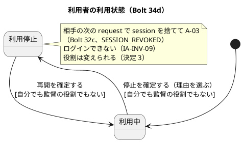

新しい password の設定（Bolt 33a。2026-10-15 の開始準備の決定 1・2）は、アプリケーションのサービス `PasswordResetCompletionService`（`commandservices`）が受ける。画面の層はリポジトリに依存しないので、リンクを開く処理（`open`。トークンをハッシュにして探し、使えればトークンの ID を返す）と A-06 の GET（`isUsable(tokenId)`）もこのサービスを通す。設定（`complete(tokenId, newPassword)`）の結果は、完了・方針の誤り（種類）・無効のいずれかで、1 つのトランザクションで次の順に行う。

1. password の方針 `PasswordPolicy`（`identity.domain.model.rules`）で確かめる。よく使われる password の一覧（ポート `CommonPasswordList`）を引くのはサービスで、照合の結果を方針に渡す（方針は純粋に保つ）。誤りならトークンを使わずに誤りの種類（`PasswordPolicyViolation`）を返す
2. トークンを条件付きで使う（使っておらず、無効にしておらず、期限の前の行だけ。更新の件数が 0 なら無効）
3. 利用者を読み、利用停止・所属企業の無効なら無効を返す（理由を示さない。監査を書かず、トランザクションを戻す）
4. ポート `PasswordHasher` でハッシュを作り、利用者の集約の `changePassword(newHash)` で password を変えて保存する
5. 同じ利用者の未使用のトークンを無効にする
6. 監査記録 `PASSWORD_RESET_COMPLETED` を書く（招待のトークンなら `INITIAL_PASSWORD_SET`。Bolt 38b4）

コミットの後に、ポート `UserSessionRevoker` の `revokeAll(メールアドレス)` でその利用者の session をすべて失効させる（Spring Session は自分のトランザクションで動くので、完了のトランザクションに入れない）。失効が失敗しても警告のログにとどめ、完了にする（password は変わっている）。ロックと失敗の数（ログインの失敗の集約）は変えない（SEC-02）。password の要素は与えず、利用者は A-01 から新しい password と TOTP でログインし直す（ADR-011）。

password の方針は、12 文字以上 64 文字以下（code point で数える。空白と全角の文字を許す）、UTF-8 で 72 バイト以下（bcrypt は 72 バイトを超える password で例外を投げる）、よく使われる password の一覧に載っていない（大文字小文字を区別しない）の 3 つで、短い・長い・72 バイト・よく使われる、の順に確かめて最初の違反だけを返す（SEC-04・SEC-05）。Unicode の正規化はしない（ログインの照合と同時に直す必要があるので、扱うなら別の Bolt）。方針は合成ルートの `@Bean` で返せない（AT-07）ので、サービスの `@Bean` の中で `new` する（`LockPolicy` の前例）。利用者の集約は版を写さず、password の更新は版を上げるが条件にしない（同じ利用者の同時の設定は、トークンの条件付きの使用で 1 つに絞られる。[データモデル](data_model.md)）。

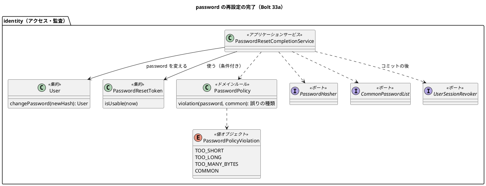

回復コードによる TOTP の再登録（Bolt 33b。US-18 AC9、SEC-10、[ADR-011](../../adr/cargo-tracker/011-mfa-totp.md) の決定 10。2026-10-15 の開始準備の決定 1・2）は、アプリケーションのサービス `TotpReEnrollmentService`（`commandservices`）が受ける。入口は回復コードでログインした印（ログインから 15 分だけ有効）だけで、画面（A-08）は 2 つの要素がそろった主体の利用者 ID を渡す。サービスは利用者の ID で `User` を読んでメールアドレスと企業 ID を得て、段に中立な値 `EnrollingUser`（`identity.domain.model.valueobjects`。利用者 ID・企業 ID・メールアドレス）にする（主体の型は変えない。ADR-012）。初回の登録の `TotpEnrollmentService` も `PasswordVerifiedUser` でなく `EnrollingUser` で受ける。2 つのサービスが共用するのは、秘密の発行のポート（`TotpSecretIssuer`。表示の値 `TotpProvisioning` を返す）と値 `EnrollingUser` で、A-08 は `TotpEnrollmentService` を呼ばない。途中の暗号文を使い続ける処理は部品 `TotpProvisioningStarter`（`commandservices`。Bean にせず、2 つのサービスが組み立てる）に、回復コード 10 個の発行（平文の一覧 → ハッシュ → そろいの確かめ）は工場メソッド `RecoveryCode.issueSet` に寄せ、2 つのサービスが使う（Bolt 33d。2026-10-16 の開始準備の決定 2。`instanceof` の分岐は `switch` にする）。

- `begin(利用者, 途中の暗号文)`: 利用者を読み（利用停止・所属企業の無効は利用できない）、途中の暗号文が同じ利用者の AAD で読めればそれを使い、なければ新しい秘密を発行して、暗号文と表示の値を返す（資格の有無は問わない。A-07 と同じく再読み込みで鍵を変えない）
- `complete(利用者, 暗号文, コード, 始めた時刻, 今の session の ID)`（Bolt 33e から session の ID は値 `SessionId`）: 15 分の上限をサービスで判定する（2 つの要素がそろった session では `SessionLifetimeFilter` の上限が効かないため）。暗号文で新しいコードを前後 1 つの刻みで照合する（誤りは置き換えない）。今の秘密が送られた暗号文と同じなら（二度押し・別のタブ）置き換えない。1 つのトランザクションで、TOTP の資格を再登録の前に読んだ秘密のままのときだけ置き換える条件付きの更新（`replace(資格, 読んだ秘密)`）で置き換え（`TotpCredential.reEnroll`。0 件なら、ほかの画面で先に登録し直していたとしてトランザクションを戻す）、回復コード 10 個を置き換え（`RecoveryCodeRepository.replaceAll`）、監査記録 `TOTP_RE_ENROLLED` を書く。コミットの後に `UserSessionRevoker.revokeOthers(メールアドレス, 今の session の ID)` を呼び、失敗は警告のログにとどめて完了にする。外側のトランザクションの中では呼べない（Bolt 33a と同じガード）。監査を書けなければ全体を戻し、失効させない
- 結果（`ReEnrollmentResult`）は 6 種類で、完了（`ReEnrolled`。回復コードの平文 10 個）・コードの誤り（`CodeRejected`）・期限切れ（`Expired`）・秘密が読めない（`SecretUnusable`。`UnreadableCredentialException`）・ほかの画面や二度押しで先に登録し直していた（`Superseded`）・利用できない（`Unavailable`。利用停止・所属企業の無効・資格がない）のいずれか。印の期限（ログインから 15 分）が A-08 の期限（開いてから 15 分）より先に来るので、期限切れは画面からはほぼ届かない守りである。始めた結果（`ReEnrollmentStart`）は、始めた・利用できない

置き換えと照合の競合（開始準備の決定 2 の (5)）: A-02 の照合は資格を読んでから刻みを使うまでトランザクションの外で間があるので、その間に置き換えが確定すると、古い秘密で照合したコードの刻みが新しい資格で使われうる。刻みの使用 `useStep(利用者, 読んだ暗号文, 刻み)` は、照合で読んだ秘密の暗号文が今の行と同じで、刻みが最後に使った刻みより大きいときだけ更新する（引数が変わる）。置き換えの後は 0 件になり、再利用と同じく拒む。置き換えは最後に使った刻みを古い値と新しいコードの刻みの大きい方にし（IA-INV-10 の単調性を保つ）、再登録で確かめたコードは A-02 でもう一度使えない（初回の登録は 0 にして使える。A-07 との違い）。

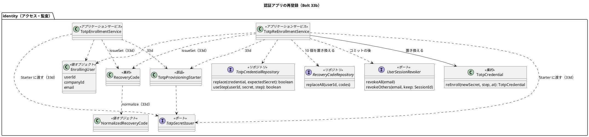

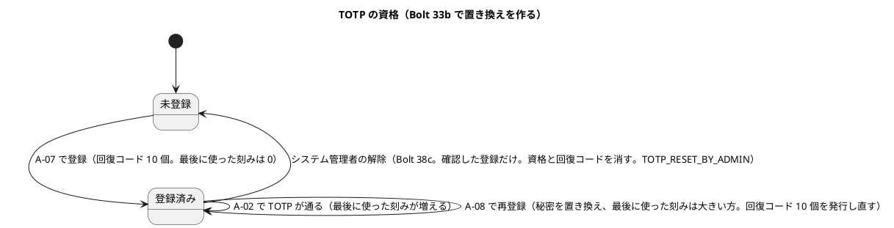

session の期間（Bolt 33c。2026-10-15 の開始準備の決定 2、human:kakimomokuri が決定。ADR-012 の決定 3）は、ドメインルール session の方針 `SessionPolicy`（`identity.domain.model.rules`、`@DomainRule`。ロックの方針 `LockPolicy` と並べる）にまとめる。2 つの要素がそろった session の 8 時間、password の段の 5 分、登録の途中の 15 分、回復コードでログインした印の 15 分、再登録の 15 分を `Duration` の定数で持つ。Bolt 33e から、期限の判定（ちょうどの時刻は期限切れ）も `SessionPolicy.isExpired` に寄せ、認証の入口・画面の層・再登録のサービスの 4 か所が使う（2026-10-16、Bolt 33e の開始準備の決定 2）。Bolt 33b までは同じ値を認証の入口（`identity.infrastructure.security` の定数のクラス。Bolt 33c で名前と期間を `SessionKeys`・`SessionPolicy` に移して消した）・A-07 の画面・印の判定（`RecoveryLogin`）・再登録のサービスが別々に持っていた。方針は期間だけを持ち、ふるまいは持たない（期限の判定は今の置き場所のまま。`LockPolicy` は判定のふるまいを持つが、ここでは期間だけを寄せる）。`Duration` は `java..` なのでドメインの規則に当たらない。session と request の属性の名前は HTTP の関心で業務の知識ではないので、ドメインに置かず application 層の `SessionKeys` に置く（[バックエンドのアーキテクチャ](architecture_backend.md)）。Bolt 33f から、期限の時刻 `deadline` も `SessionPolicy` に置き（共有カーネルの `UtcInstant` は変えず、中で包む）、画面に示す期間の文言（「15 分」「8 時間」）もこの期間から描く（2026-10-16、Bolt 33f の開始準備の決定 3・5）。

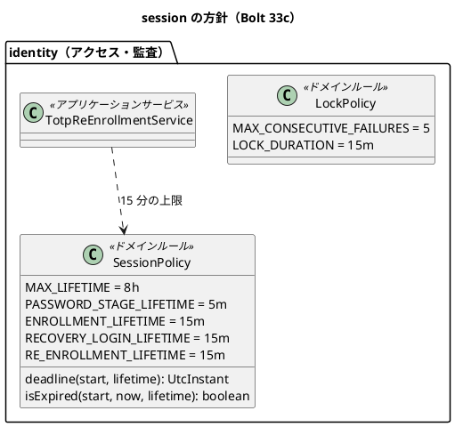

| 集約 | 集約ルート | 識別子 | 含むもの | 責務 |
| :--- | :--- | :--- | :--- | :--- |
| 企業 | 企業（Company） | 企業 ID | 種類（荷主・荷受人・A 社）、有効・無効 | 企業の有効性 |
| 利用者 | 利用者（User） | 利用者 ID | メールアドレス、password のハッシュ、役割（値）、担当企業・担当案件（値。担当企業は集約の外のリポジトリ `UserAssignmentRepository` で持つ。Bolt 38e）、利用状態 | 役割の付与・職務分離、利用停止と再開（Bolt 34d）、password の変更（`changePassword(newHash)`。Bolt 33a） |
| TOTP の資格 | TOTP の資格（TotpCredential） | 利用者 ID | 暗号化した秘密、最後に使った時間の刻み、登録時刻 | 再利用の拒否（IA-INV-10）、前後 1 つの時間の窓の照合（Bolt 30。結果は `TotpMatch`。Bolt 31d）、秘密の置き換え（`reEnroll(newSecret, step, at)`。Bolt 33b）、システム管理者の解除（確認した登録の時刻を条件にした削除。Bolt 38c） |
| 回復コード | 回復コード（RecoveryCode） | 回復コード ID | 利用者 ID、ハッシュ、使った時刻、発行時刻 | 一度だけの使用（IA-INV-11。Bolt 30）、認証アプリの再登録での発行し直し（Bolt 33b）、システム管理者の TOTP の解除での削除（Bolt 38c） |
| ログインの失敗 | ログインの失敗（LoginFailure） | 利用者 ID | 連続の失敗の回数（ログインの password・TOTP・回復コードの誤りを合わせて数え、ロック中の試行は数えない。2 つの要素がそろったログインの成功で 0 に戻し、ロック中は戻さない）、ロックの期限（ロックの方針 `LockPolicy` は引数で受け取る） | ロック（IA-INV-03。Bolt 30。数え方と監査記録は `LoginAttemptService`。Bolt 32）、システム管理者の解除（Bolt 38c） |
| 再設定のトークン | 再設定のトークン（PasswordResetToken） | トークン ID | 依頼の ID、利用者 ID、用途、トークンのハッシュ、発行時刻、期限、使った時刻、無効にした時刻 | 1 回だけの使用、用途の期限（再設定 30 分、利用者の招待 24 時間。Bolt 38b）、新しい発行と設定の完了による前のトークンの無効化（用途を問わない。IA-INV-12。Bolt 33。使うのは Bolt 33a） |
| 参照許可 | 参照許可（AccessGrant） | 参照許可 ID | 予約 ID、荷受人企業、開示項目、有効期間、状態 | 荷受人の招待・受諾・取消し |
| 監査記録 | 監査記録（AuditRecord） | 監査記録 ID | 操作者、時刻、対象と版、変更前後、理由、承認、出典、結果 | 追記専用の証跡。外部原本の採否（受信記録が対象）はイベント経由で書き、操作と対象で冪等にする（IA-INV-15。Bolt 39b3b） |
| KPI 計測 | KPI 計測記録（KpiObservation） | 輸送要求 ID・週 | 提出時刻、最初の提示時刻、照会の件数、基準値 | KPI-01・KPI-02 の週次の算出（US-21） |

TOTP の資格・回復コード・ログインの失敗は、利用者とは別の集約にする。どれも利用者の行と版に触れず、1 文の条件付きの更新（更新の件数で判定する）で原子的に変える。失敗のたびに利用者の版が上がると、利用者の管理の更新とぶつかるため（Bolt 30 の計画の承認。ADR-011・ADR-012 を改めた）。回復コードは自分のリポジトリを持ち、消費が原子的な更新の単位なので、エンティティでなく小さな集約とする。再設定のトークンも同じ理由で利用者とは別の小さな集約にし、版を持たず、無効化と使用を条件付きの更新（使っておらず無効にしていない行だけ）で行う（Bolt 33）。ログインの失敗の行がない利用者は「0 回・ロックなし」として扱い、存在しないメールアドレスの失敗では行を作らない（T-42）。

| ID | 不変条件・ルール | 根拠 |
| :--- | :--- | :--- |
| IA-INV-01 | 役割は BR-15 の 8 つに固定する。システム管理者・監査担当者に業務データを変更できる役割を併せて付与できない（Bolt 34 で `RoleAssignmentPolicy` として実現。システム管理者と監査担当者の併用は BR-15 の文言どおり拒まない。システム管理者は自分の役割を変えられない。監督の役割（システム管理者・監査担当者）は画面で付け外ししない（2 人目の承認の仕組みができるまでは運用の手順で行う。システム管理者どうしが互いに監査担当者を付け合うこととシステム管理者が 0 人になることを防ぐ。Bolt 34 の開発レビュー、2026-10-16、human:kakimomokuri）。監督の役割を持つ利用者と自分は、画面で利用停止も再開もしない（運用の手順で行う。Bolt 34d、2026-10-17、human:kakimomokuri））。Bolt 38c から、自分と監督の役割を持つ利用者のロックの解除と TOTP の解除も画面で扱わない（運用の手順で行う。W10） | BR-15、US-16 |
| IA-INV-02 | 業務担当者は担当企業・担当案件だけを操作できる。担当企業はシステム管理者が S-20 で、自分の管理範囲の中の有効な荷主の企業から割り当てる（Bolt 38e）。担当案件は担当企業で近似する（パイロット。対象の役割は営業担当者・経路設計者・追跡管理者・カスタマーサポート、データ責任者は W7）。業務の画面で効くのは Bolt 38f（見積り）・38f2（予約）・38g（経路設計・追跡）から。同じ `COMPANY` の行は担当範囲のある役割のときだけ担当企業として読む | BR-15、US-16 |
| IA-INV-03 | 5 回連続で認証に失敗したら 15 分ロックする。password・TOTP・回復コードの失敗を合わせて数え（回復コードは Bolt 32）、ロック中の試行は数えず期限も延ばさず、ロック中でなければ成功で 0 に戻す（ロック中の成功ではロックを消さない）。ロックは 5 回目の失敗の時刻から 15 分の経過で解け（14 分 59 秒では解けない）、解けた後の失敗は 1 回目から数え直す（Bolt 30）。0 に戻す成功は 2 つの要素（TOTP または回復コード）がそろったログインだけで、password の段の成功では戻さない。数えないのは、ロック中の試行、存在しない利用者、password が正しく利用停止・無効な企業で拒んだとき、利用者の読み出しの DB の誤り、TOTP の登録（A-07）のコードの誤り。ロック中の試行は、正しい認証情報でも誤りと同じ応答で拒む（AC2。Bolt 32）。session は無操作 30 分または TOTP が初めて通った時刻から 8 時間で失効する（password の段だけの session は password を確かめた時刻から 5 分。Bolt 31）。ロックは session を捨てる理由に含まれない（ロックはログインの試行だけを抑え、既存の session を取り消さない。session を捨てる・消すのは、request ごとの確かめ（利用停止・無効な企業・利用者なし。IA-INV-04）、S-20 の再開の確定の後の消去（Bolt 34d）、password の再設定の完了（`PasswordResetCompletionService` の `revokeAll`。Bolt 33a）、認証アプリの再登録（`TotpReEnrollmentService` の `revokeOthers`。ほかの session。Bolt 33b）の 4 つで、ロックはどれにも含まれない。Bolt 34c で明文化した）。システム管理者はロック中の利用者のロックを外せる（ロック中であることを条件にした更新。外したら 0 回。`ACCOUNT_UNLOCKED`。Bolt 38c） | BR-14、US-18 AC3 |
| IA-INV-04 | 利用停止・権限取消しは次の request から反映する。認証済みの request ごとに `SessionRevalidationService` が利用者・役割・企業を 1 回で読んで判定し、止められた利用者の session は捨てて A-03 に、取り消した役割の URL は A-04 にする（Bolt 32c。それまではログインの時点の役割）。S-20 の利用停止（Bolt 34d）は利用状態を版の条件付きで変えるだけで、相手の次の request からこの確かめで反映する。確定の後に相手の session をすぐには消さない（2026-10-17、human:kakimomokuri）。再開（Bolt 34d）は確定の後に相手の session をすべて消す（`UserSessionRevoker#revokeAll`。相手が 1 度も操作しないうちに停止して再開したとき、停止の前の session を使い続けさせない。再開の後の session はログインし直したものだけにする。Spring Session が自分のトランザクションで消すので確定のトランザクションの後に呼び、消せなくても再開は戻さない。開発レビューの後の決定 (6)、2026-10-17、human:kakimomokuri）。ロックは session を捨てる理由に含まれない（ロックはログインの試行だけを抑え、既存の session を取り消さない。`SessionRevalidationService` はロックを見ない。session を捨てる・消すのは、request ごとの確かめ（利用停止・無効な企業・利用者なし）、S-20 の再開の確定の後の消去（Bolt 34d）、password の再設定の完了（`PasswordResetCompletionService` の `revokeAll`。Bolt 33a）、認証アプリの再登録（`TotpReEnrollmentService` の `revokeOthers`。ほかの session。Bolt 33b）の 4 つで、ロックはどれにも含まれない。IA-INV-03。Bolt 34c で明文化した）。システム管理者が TOTP の登録を解除したら、確定の後にその利用者の session をすべて消す（Bolt 38c） | BR-14、US-16、US-18 |
| IA-INV-05 | 参照許可は予約の荷受人と一致する相手にだけ発行し、同じ予約・荷受人への有効な許可を重複発行しない | BR-07、US-19 |
| IA-INV-06 | 取り消された参照許可は、既存の session でも直ちに無効になる | BR-07、US-10、US-19 |
| IA-INV-07 | 監査記録は追記だけを許し、更新・削除しない。関連する記録の欠落は異常として示す | NFR-AUDIT-01、US-17 |
| IA-INV-08 | 認証の成功・失敗・ロック、権限外のアクセス試行は、ドメインイベントを経ずに同じ request の中で同期に監査記録へ書く。ログインの失敗の回数とその監査記録（`LOGIN_FAILED`・`ACCOUNT_LOCKED`）、成功で 0 に戻すことと `LOGIN_SUCCEEDED` は 1 つのトランザクションにし、監査記録の追記が失敗したら回数も戻す。ロックの監査はその失敗でロックしたときだけ 1 行書く（Bolt 32）。回復コードのログインでは、コードの使用と `RECOVERY_CODE_USED` が 1 つのトランザクション、`LOGIN_SUCCEEDED` と回数の戻しが別のトランザクションになる。後者の追記が失敗すると、例外が伝わってログインは 500 になり通らない。session は password の段のまま残り（2 つ目の要素の入力に戻れる。業務の画面は A-02 の `/login/totp?factor.type=totp` へ導く）、同じ session で別の回復コードを送り直せるが、送るたびにまた 500 になり、コードが 1 つずつ使用済みになる。コードの使用と `RECOVERY_CODE_USED` は先にコミットしているので、使ったコードは戻らない（`RECOVERY_CODE_USED` は残り、`LOGIN_SUCCEEDED` と回数の戻しは書かれず、誤りとしても数えない。Bolt 34c で `AuthenticationErrorHandlingIntegrationTest` の特性テストで固定した。変えるかは後の Bolt の議題）。request ごとの確かめで session を捨てたときの `SESSION_REVOKED` も、その request の中で 1 つのトランザクションで書き、追記が失敗したら session を捨てて 500 にする（Bolt 32c）。管理範囲外の試行（`ADMIN_SCOPE_DENIED`。Bolt 34b）は、役割の変更のトランザクションの外で単独のトランザクションで書き、追記が失敗したら 500 にする。利用者の登録の監査記録（`USER_REGISTERED`。Bolt 38b2）は利用者と役割と同じトランザクションで書き、追記が失敗したら利用者も残さない。利用停止と再開の監査記録（`USER_SUSPENDED`・`USER_REACTIVATED`。Bolt 34d）は利用状態の変更と同じトランザクションで書き、追記が失敗したら利用状態も戻す（停止で無効にした再設定のトークンも戻る。IA-INV-12）。変更前の状態は判定に使った利用者の状態から渡し、変わっていない変更は記録しない。再開の後の session の消去は確定のトランザクションの外で行い、消せなくても記録と再開は戻さない（IA-INV-04）。招待のリンクの初回の設定の `INITIAL_PASSWORD_SET` も、トークンの使用と password の更新と同じトランザクションで書く（Bolt 38b4）。ロックの解除と TOTP の解除の監査は、解除と同じトランザクションで書く（Bolt 38c）。注（Bolt 39b3b）: この規則は request の中で同期に書く監査のもので、ドメインイベントを経て非同期に書く監査（外部原本の採否）は IA-INV-15 | AUD-01、US-16〜US-19。管理範囲の外の試行（`ADMIN_SCOPE_DENIED`）と担当範囲の外の試行（`ASSIGNED_SCOPE_DENIED`。Bolt 38f）は、どちらも確定の POST だけを記録し、GET の範囲の外は 404 だけにする（SEC-12） |
| IA-INV-09 | 利用停止の利用者と、無効な企業に所属する利用者は認証できない。理由は監査記録にだけ残し、利用者には誤った認証情報と同じ応答を返す（Bolt 14 で追加） | US-18 AC2・AC4、SEC-11 |
| IA-INV-10 | TOTP の資格は 1 人に 1 つ。最後に使った時間の刻みは単調に増え、それ以下の刻みのコードは受け付けない（同じコードの再利用の拒否）。資格のない利用者の TOTP は拒否する（Bolt 30 で追加）。認証アプリの再登録（Bolt 33b）では、1 人 1 つのまま秘密を置き換える（行を足さない。資格がなければ置き換えない）。最後に使った時間の刻みは置き換えでも戻さず、古い値と再登録で確かめた新しいコードの刻みの大きい方にする。刻みの使用は、照合で読んだ秘密の暗号文が今の行と同じときだけ行う（置き換えの前に古い秘密で照合を終えた要求は、置き換えの後は通らない）。システム管理者の解除は、確認の画面で読んだ登録の時刻のときだけ資格を消す（確認の後に本人が登録し直した資格は消さない。Bolt 38c） | US-18 AC1・AC9、ADR-011 |
| IA-INV-11 | 回復コードは 1 人に 10 個で、発行のたびに置き換える。ハッシュだけを持ち、一度使ったら使えない（使った時刻を入れて残す）。未使用のコードがなければ拒否する（Bolt 30 で追加）。初回の発行は TOTP の登録と同じトランザクションで行い、10 個を乱数で作り（形は `1a2b-3c4d`、重複なし）、平文は登録を保存した応答で一度だけ示してどこにも保存しない。未使用のコードの並び順は約束しない（Bolt 31b）。ログインでの消費（Bolt 31c）では、入れたコードを正規化し（前後と中の空白を除き小文字にし、ハイフンのない 8 文字は 4 文字目の後にハイフンを入れる。`^[0-9a-f]{4}-[0-9a-f]{4}$` に合わなければ照合せずに拒む。`RecoveryCode.normalize` が値 `NormalizedRecoveryCode` を返し、照合はこの値だけを受ける。Bolt 33d）、その利用者の未使用のコードとだけ照合する。一致したコードは未使用であることを条件にした更新で使い、同じコードを同時に使っても 1 つだけが通る（更新の件数が 0 なら拒む）。認証アプリの再登録の完了（Bolt 33b）で 10 個を発行し直す。TOTP の秘密の置き換えと同じトランザクションで、秘密の置き換えの後に置き換え、前のコードは使っていないものも使えなくなる。新しい平文は完了の応答で一度だけ示す。発行し直しと回復コードによるログインが重なっても、置き換えの後に古いコードは通らない（消費の更新が 0 件になる）。システム管理者が TOTP の登録を解除するときは、同じトランザクションで回復コードもすべて消す（古い回復コードでログインさせない。Bolt 38c） | US-18 AC7・AC9、SEC-09 |
| IA-INV-12 | 再設定のトークンは 1 回だけ使え、発行から用途の期限で使えなくなる（再設定は 30 分。29 分 59 秒では使える。利用者の招待は 24 時間。Bolt 38b）。期限は発行から数える（遅れて配られても、登録から最大で約 48 時間。遅れた配り直しは再起動の後にだけ起きる。受け入れた。2026-10-27、human:kakimomokuri）。前の発行から 1 分以内なら発行しない抑えは再設定（`RESET`）の発行だけで数え（用途の値 `throttlesRepeatedIssue()`。Bolt 38b2c）、招待の直後の本人の再設定の依頼を止めない。新しい発行による前の未使用のトークンの無効化は用途を問わない（Bolt 38b）。同じ利用者に新しく発行すると、前の未使用のトークンは使えなくなる（無効にした時刻を入れて残す）。表にはトークンのハッシュ（SHA-256）だけを置き、平文のトークンとリンクは表・イベントの発行記録・ログに残さない。発行は登録された有効な利用者にだけ行い、同じ依頼の ID（利用者の招待では登録の ID）では 1 つだけ、同じ利用者の前の発行から 1 分以内なら発行しない。依頼の応答は登録の有無にかかわらず同じにする（Bolt 33）。使うのは A-06 の設定で、使っておらず無効にしておらず期限の前（`used_at IS NULL AND invalidated_at IS NULL AND expires_at > now`）の行だけを条件付きの更新で使い、件数が 0 なら使えない。ドメインの `isUsable(now)` と SQL の条件が同じであることを契約テストで確かめる（`LockPolicy` の前例）。方針の誤りではトークンを使わない。設定を終えると、同じ利用者のほかの未使用のトークンも無効にする。期限切れ・使用済み・無効・存在しないトークンは、どれも同じ応答にする（Bolt 33a）。S-20 の利用停止の確定（Bolt 34d）では、同じトランザクションで相手の未使用のトークンを無効にする（`PasswordResetTokenRepository#invalidateUnused`。停止の前に発行したリンクで、再開の後に password を設定し直させない。開発レビューの後の決定 (5)、2026-10-17、human:kakimomokuri）。遅れて配られた招待の契機（登録から 24 時間を過ぎた、登録の後に本人の再設定の発行がある）では招待を発行しない（Bolt 38b4） | US-18 AC8、SEC-08 |
| IA-INV-13 | 役割は利用者の所属企業の種類に合うものだけを付ける。荷主担当者は荷主企業、ほかの 7 役割は A 社。荷受人の企業の利用者には BR-15 の役割を付けない（荷受人は参照許可。US-19）（Bolt 34。UC-16 の主シナリオ 4 の企業間分離）。利用者の登録の企業の選択肢にも荷受人の企業を出さない（Bolt 38b3） | BR-15、UC-16、US-16 |
| IA-INV-14 | システム管理者は、管理範囲（`user_assignment` の `COMPANY` で割り当てた企業）の利用者だけを一覧し、詳細を開き、役割を変えられ、利用停止と再開ができる（利用停止と再開は Bolt 34d）。範囲外の利用者は存在しない利用者と同じに扱い（404）、役割の変更と利用状態の変更の試行（確定の POST）を監査記録に同じ request の中で書く。利用者の登録（Bolt 38b2）も管理範囲の企業にだけ行い、範囲の外の企業は存在しない企業と同じ応答にして、確定の試行を監査記録（対象は企業）に書く。登録できる企業の照会（Bolt 38b3）も管理範囲の企業だけを返し、範囲外の企業は状態によらず範囲外として返す。範囲の判定は対象の所属企業だけで見る（自分の詳細にも例外を作らない）。IA-INV-02 の管理者版（Bolt 34b）。ロックの解除と TOTP の解除も管理範囲の利用者だけ（Bolt 38c）。担当範囲（担当企業）の割り当ても管理範囲の利用者に、管理範囲の中の有効な荷主の企業だけ（Bolt 38e） | BR-15、UC-16 の 2a、US-16 AC2 |
| IA-INV-15 | ドメインイベントを経る監査（外部原本の採否。DE-12・DE-13・DE-14）は、発行元のコミット（取込か採用の判断のコミット）の後に非同期に別のトランザクションで書く。巻き戻った取込・採用の判断には監査記録がない。操作者と発生時刻はイベントの操作者と時刻で、listener の時刻を使わない（再配信でも変わらない）。操作と対象（`RECEIVED_RECORD`、受信記録 ID）で引いて記録があれば書かない（冪等。前提は「（操作、受信記録）ごとにイベントは 1 つ」で、Bolt 39d3b の隔離した行の採用もこれを守った。Bolt 39d の開始準備の決定 (12) で、39d2 の判断は DE-29 を受けて新しい操作 `EXTERNAL_RECORD_DECIDED` で人の判断として書き、採用の判断はほかに DE-12・DE-13 を受けて既存の `EXTERNAL_RECORD_ADOPTED` を書くと決め、Bolt 39d3b で航海（DE-12）の採用の判断の監査を作った（操作者は判断者、時刻は公開した時刻＝判断の時刻。主要実績の DE-13 の採用の判断の監査は Bolt 39d3b2 で作った）。同じ受信記録に隔離・判断・採用の監査が 1 つずつで、同じ受信記録を 2 回判断しないことは判断の表の一意制約で守る）。Bolt 39d2 で判断の監査（DE-29、`EXTERNAL_RECORD_DECIDED`）を足した。発行元のコミットは却下のコミットで、巻き戻った却下には監査記録がない。1 つの取込のキーのない隔離のまとめての却下（39d2b）も受信記録ごとに判断・DE-29・監査を 1 つずつにし、（操作、受信記録）ごとに 1 つを守る。内容の欠けたイベント（受信記録 ID・操作者・要約の必須の部品がないなど。`AuditRecord.MissingEventValueException`）は照会も追記もせずに ERROR のログを残して捨て、DB の失敗とほかの例外は上げて発行記録を未完了に残し、起動のときに配り直す（定期の再配信はない）。照会してから追記するので、同じイベントの同時の配信は二重になりうる。今は単一インスタンス（デモは Heroku の 1 台・H2 のインメモリ）なので同時の配信は起きない。ShedLock は未実装（ADR-003 の決定とコードの食い違い。release_plan のリスク台帳）で、複数インスタンスにする前（W10）に監査の表の一意制約（`event_id` か（操作、対象））か ShedLock を入れる。外部原本の採否の監査記録を作るのは `ExternalRecordAuditEventHandler` だけ（Bolt 39b3b。2026-11-03、human:kakimomokuri が決めた） | AUD-01・AUD-02・AUD-04、ADR-003、ADR-004 |
| KPI-INV-01 | KPI-01 は、版 1 を最初に提出した時刻（提出時刻）と、最初に提示した見積り（経路方針を含む）の提示時刻（最初の提示時刻）から求める。最初の提示時刻は、荷主の条件変更・再見積りで出し直しても変えない。DE-03 は届く順が入れ替わることがあるため、いちばん早い提示時刻を持つ。誤りで取り消した見積りを数えない規則は、見積りの取消しの操作を作るときに足す。見積りごとの提示時刻は `quotation.quotation.presented_at` に残るため、そのときに終点を出し直せる（D-11。2026-10-08 に human:kakimomokuri が Bolt 21 終了報告の承認で決めた）。リードタイムは暦の経過時間で、営業時間に換算しない。差戻し・再提出・新しい版で開始時刻を戻さない（2026-10-02 の D-3）。KPI-02 は照会記録から求める。PV-01 の除外（訓練データ、顧客都合の取消し）を適用し、除外の対象・理由・判断者を記録する | US-21、PV-01 |
| KPI-INV-02 | パイロット開始前の基準値は、算出方法と登録者とともに記録し、登録後は変更せず訂正は新しい記録で行う | US-21、PV-01 |
| KPI-INV-03 | 最初の提示時刻は提出時刻より前にならない。提出の記録がないまま届いた DE-03 は記録せず、イベントの発行を未完了のまま残して再配信で記録する。提示時刻が提出時刻より前の DE-03 は、再配信しても直らないため、ERROR のログを残して捨てる（Bolt 21。開発レビュー D-79） | US-21 |

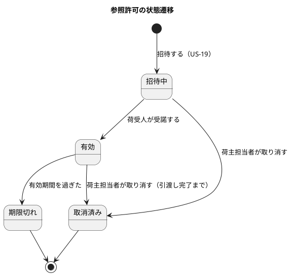

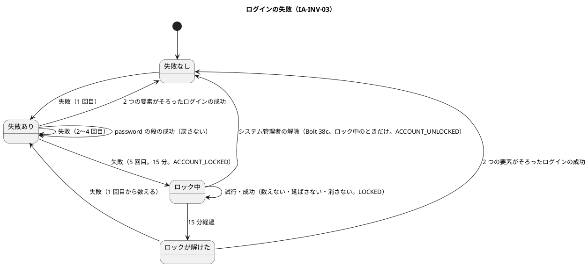

ロックは画面の遷移でなく、ログインの失敗の集約の内部の状態である（Bolt 32 で UI 設計の画面遷移図から移した）。ロック中も画面は誤りと同じ経路と文言にする（ADR-011 の決定 9）。

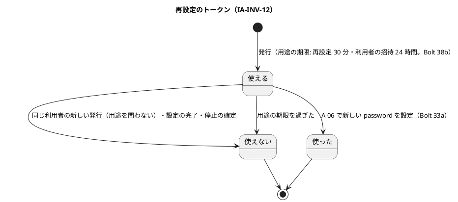

「使えない」のうち、新しい発行と設定の完了（同じ利用者のほかの未使用のトークン）によるものは無効にした時刻を入れ、期限によるものは列を変えずに期限と今の時刻で判定する。「使った」は使った時刻を入れる（Bolt 33a）。

### 外部データ（External Data、U5）

ADR-002 によりトランザクションスクリプトとする。ここでは処理が扱うデータの構造と規則を示す。

| データ | 英語名 | 主な項目 | 規則（ID） |
| :--- | :--- | :--- | :--- |
| 情報源 | DataSource | 提供元、原本種別、選定・承認状態、承認者 | ED-INV-01: 承認済みの情報源が 0 件ならパイロットを開始しない（BR-18、US-14） |
| 取込 | Ingestion | 取込 ID、情報源、ファイル、取込者、取込時刻、受け取った件数、取り込めなかった行の始まりと物理行の数 | 受け取った件数はファイルの物理データ行の数（ヘッダーとレコードの外の空行を除く）で、取込を書くときに入れ、更新しない。分類別の件数は受信記録から数え、照合に使う。取込は受信記録より先に書く。追記専用（Bolt 39b）。取り込めなかった行も書くときに入れる（数が 0 なら始まりは NULL）。取り込めなかった物理行の数が 0 より大きいか、ファイルの誤りの隔離の受信記録があれば、取込全体を要確認とする（Bolt 39b2） |
| 外部原本 | ExternalRecord | 冪等性キー（提供元、原本種別、外部 ID、外部版）、採用中の payload とそのハッシュ（はじめは最初に受け取った payload）、最初の受信時刻 | 冪等性キーごとに 1 つ（BR-12）。Bolt 39d4 で、隔離した payload の採用の判断のときに、同じトランザクションで基準のハッシュと原本のキーを採用した payload に付け替え、採用した payload の再送は重複、元の payload の再送は隔離にした（Bolt 39d の開始準備の決定 (9)、【前の決定の変更】(3)、【業務の判断】(b)。付け替えるまでは最初に受け取った payload のまま）。付け替えは読んだ基準のハッシュを条件にした更新で（`changeAdoptedPayload`。`version` の列は足さない）、0 行なら外部原本の同時更新の例外でトランザクションごと巻き戻す。冪等性キーと最初の受信時刻は変えない。基準は最新の採用に従い、元の payload の隔離を採用すれば元の payload に戻る（[Bolt 39d4 計画](../../development/cargo-tracker/bolt_39d4_plan.md) の開始準備の決定 (3)・(4)）。Bolt 39h で、差異にした原本も外部原本を作る（AC1 の原本・外部 ID・外部版の関連付けを残す）ので、基準の意味が広がる: 差異で作った外部原本の基準は、採用されていない最初に差異にした payload（採用値がないことで見分ける。[Bolt 39h 計画](../../development/cargo-tracker/bolt_39h_plan.md) の開始準備の決定 (5)） |
| 受信記録 | ReceivedRecord | 外部原本、取込、payload とそのハッシュ、取得時刻、分類（採用・重複・隔離・差異）、分類の注記、分類の時刻、受け取った値（Bolt 39d3） | ED-INV-02: 同じキーで採用中の payload と同じハッシュは重複、同じキーで採用中の payload と違うハッシュは隔離する（Bolt 39d4 で比べる相手を最初に受け取った payload から採用中の payload に改めた。【業務の判断】(b)・(f)）。Bolt 39h で、ED-INV-02 はその外部版に採用値がある外部原本の規則になった（採用値のない外部原本は、差異の理由があればハッシュによらず差異。分類の 3 つの入力。【業務の判断】(bc)、台帳 D-145。仮。US-14 AC4 の例外）。ED-INV-03: 順序逆転・既存値との矛盾は差異として自動で上書きしない（BR-12、US-14）。Bolt 39h で、差異の理由を 2 つに決めた: 版の逆転（今の外部版の取得時刻が「この外部 ID の最後に取得した採用値」の取得時刻より厳密に前）と既存の採用値との矛盾（主要実績の追跡番号が「この外部 ID の採用値」（公開した時刻 → 取得時刻 → 受信記録 ID の順で最も新しいもの）と違う）。両方なら逆転。外部版の文字列は比べない（【業務の判断】(ay)〜(ba)、台帳 D-141〜D-143。仮）。差異にした受信記録は外部原本を持ち、採用値を持たない。同じファイルの中に同じキーが 2 行あれば行の順に処理し、先の行を採用、後の行は同じハッシュなら重複・違えば隔離にする（Bolt 39b）。形式の誤りの受信記録は外部原本と取得時刻を持たない隔離にし、外部原本を引かず作らない（外部原本と取得時刻はそろって NULL で、NULL は隔離だけ。表の CHECK と同じ規則。Bolt 39b2）。外部原本を持つ受信記録は受け取った値（対象のキーと値の要約。`ReceivedValue`）を持ち、外部原本を持たない受信記録は値を持たない（Bolt 39d3。表の CHECK と同じ規則。39d3 より前の受信記録は値なし）。追記専用 |
| 受信記録の判断 | ReceivedRecordDecision | 受信記録、判断（採用・却下）、判断者、判断の時刻、理由 | 受信記録 1 件につき 1 つ。判断するのは隔離・差異の受信記録だけ（Bolt 39d2 で守る。US-14）。Bolt 39d2 で作った（却下）。record（集約を持たない。ADR-002）。規則はコンストラクタの不変条件（前例 `ReceivedRecord`）。却下・採用のファクトリーが分類が隔離でない受信記録を拒む（差異は 39h2 で却下のファクトリーに足す。表の制約は足さない）。差異は Release 1.0 では却下だけ（採用は拒む。Bolt 39h の決定、39h2 で作る。【前の決定の変更】(27)、台帳 D-144。仮）。採用は Bolt 39d3b で作った（航海。主要実績の採用は Bolt 39d3b2 で作った）。キーのない隔離は採用できず却下だけ（【業務の判断】(a)）、却下の理由は必須で採用の理由は任意（【業務の判断】(d)）、誤った判断を取り消す操作は Release 1.0 では作らず送り直しで扱う（【業務の判断】(e)）（Bolt 39d の開始準備の決定 (7)・(11)・(13)）。追記専用 |
| 取込の値 | RecordValues | 航海の値（航海番号、寄港の値の並び）か主要実績の値（追跡番号の値、実績の種類の値、場所、発生時刻） | 採用の前に行から読んだ値で、採用値とは別。取り込む行に載せ、外部原本の列には書かない（値は payload の行の原文に残る）。外部原本を持つ受信記録には対象のキー（`targetKey()`）と要約を受け取った値として書く（Bolt 39d3。はじめの「受信記録・外部原本の列には書かない」を改めた）。寄港は 2 つ以上、各寄港に到着か出発の少なくとも一方、出発は到着以後。寄港は 60 まで（経路設計と意図して食い違う外部データの片側だけの規則。Bolt 39b3）。追跡番号の形・実績の種類・寄港の規則は追跡・経路設計の写しで、写しを守るテストで一致を確かめる（Bolt 39b2b） |
| 採用値 | AdoptedValue | 対象（航海・主要実績）、値、出典、版（Bolt 39b3 の型では、受信記録、対象の種類、対象のキー（航海番号か追跡番号）、値の要約、情報版（外部版）、公開した時刻（取込での採用は取込の時刻、採用の判断は判断の時刻）。出典は受信記録（取得時刻）と情報源（提供元）から導き、版は情報版で表す） | 採用値だけを経路設計・追跡へ公開する（ADR-004）。分類が採用の受信記録ごとに 1 つ、取込と同じトランザクションで追記し、DE-12・DE-13 を発行する。採用と判断した隔離の受信記録にも 1 つ、採用の判断と同じトランザクションで判断の後に追記する（Bolt 39d3b）。重複には作らず、判断を待つ隔離・却下した隔離には作らない。追記専用（Bolt 39b3） |
| 手動情報 | ManualEntry | 出典、入力者、入力時刻、仮状態、内容 | ED-INV-04: 出典・入力者・入力時刻・仮状態を必須とする（BR-08、US-15） |
| 取得失敗 | FetchFailure | 失敗時刻、理由、再実行可能時刻 | 第 2 段階の API 連携で使う。パイロットでは記録の形だけ持つ（US-15） |
| 復旧照合 | RecoveryReconciliation | 停止期間、分類別件数、受信件数、手動情報との差異一覧、確認者、完了時刻 | ED-INV-05: 全原本が分類済みで、受信件数が一致し、差異確認が済んだときだけ完了する（BR-12、US-15）。受信件数はファイルの物理データ行の数で、分類別件数（受信記録の数）とは単位が違う。突き合わせは物理行で行う（Bolt 39b2） |

外部データの差異と追跡の確認中の境界（W7 CP7。Bolt 39gc）: 外部データの差異（ED-INV-03。同じ外部レコードの版の逆転・採用値との矛盾）は、外部データが受信記録の分類として判定する（Bolt 39h で作った。比べる相手と理由は下の受信記録の判断の節の「Bolt 39h で決めたこと」）。追跡の確認中（T-INV-03）は、追跡記録の中の採用済みの実績の時系列（手入力と外部原本の出典をまたぐ）だけを判定する。差異にした原本は採用値にならず DE-13 が出ないので、2 つの判定は同じ原本を二重に扱わない。外部データは追跡の実績を読まず、追跡は受信記録を読まない（追跡の節の Bolt 39gc で決めたこと）。

#### 受信記録の判断

判断を待つ隔離（分類が隔離で、判断の行がない受信記録）を、データ責任者が却下（Bolt 39d2）か採用（航海は Bolt 39d3b、主要実績は Bolt 39d3b2）で判断する。判断は受信記録 1 件につき 1 つで、取り消さない（【業務の判断】(e)）。キーのない隔離は却下だけ（【業務の判断】(a)）。判断ごとに DE-29 を出し、監査記録 `EXTERNAL_RECORD_DECIDED` を 1 つ書く（IA-INV-15）（[Bolt 39d2 計画](../../development/cargo-tracker/bolt_39d2_plan.md) の開始準備で決めたこと (3)・(6)・(9)・(11)）。

採用できる隔離は、外部原本を持ち（【業務の判断】(a)）、受け取った値の列があり、情報源が承認済みで（停止した情報源の隔離は却下だけ。【業務の判断】(n)、台帳 D-101。仮）、受け取った値を読める（【業務の判断】(k)）隔離（Bolt 39d3b は航海だけだった。主要実績の隔離は Bolt 39d3b2 で採用できるようにした）。情報源の承認の状態は判断の時点のものを読む。停止の間は却下だけで、情報源の承認が戻れば同じ隔離を採用できる（【業務の判断】(o)、台帳 D-102。仮）。この外部版の採用値の側だけを読めない隔離も、受け取った値を読めれば採用できる（主要実績で追跡番号が違うときを除く。採用値と DE-12・DE-13 は受け取った値と冪等性キーと受信記録だけから作る。【業務の判断】(l)、台帳 D-99。仮）。追跡番号がこの外部版の採用値の対象のキーと違う主要実績の隔離は採用できない（対象のキーの列と文字列の完全一致で比べ、採用値の要約は読まない。この外部版の採用値がなければ比べずに採用できる。キーが変わる原本の扱いは、追跡の側は Bolt 39g で決めた（外部版をまたいで追跡番号が変わった DE-13 は別の主要実績として受け、元の追跡番号の実績は変えない。【業務の判断】(ab)、台帳 D-115。仮）。外部版をまたいで追跡番号が変わる新しい外部版は Bolt 39h で差異にした（既存の採用値との矛盾。台帳 D-143。仮）。そこで採用できない隔離の案内は「追跡番号を直した実績は、追跡管理者に正しい追跡記録へ手入力してもらってください（新しい外部版で送り直しても差異になります）。」に改める（採用できないことは変えない。【前の決定の変更】(25)、台帳 D-146）。【業務の判断】(m)、台帳 D-100。仮。Bolt 39d3b2 で作った）。採用できない隔離には理由（`NotAdoptableReason`）があり、断る順は `KEYLESS`・`VALUE_NOT_RECORDED`・`SOURCE_NOT_APPROVED`・`PAYLOAD_ALREADY_ADOPTED`・`VALUE_UNREADABLE`・`TRACKING_NUMBER_DIFFERS`（Bolt 39d3b2。`PAYLOAD_ALREADY_ADOPTED` は Bolt 39d4 で足した。下の段落）。採用できるかは判断のサービスの 1 つの定め（`adoptionRefusalOf`）で決め、判断の画面の採用の欄と採用の POST で同じにする。採用は、判断を先にセーブポイントの中で追記し（同時の判断は判断の一意制約で 1 つに決まり、負けた側は判断済み）、その後に採用値をセーブポイントなしで追記して、DE-29（`ADOPTED`）に続けて DE-12（航海）か DE-13（主要実績）を出す（公開した時刻は判断の時刻。[Bolt 39d3b 計画](../../development/cargo-tracker/bolt_39d3b_plan.md) の開始準備の決定 (4)〜(6)、[Bolt 39d3b2 計画](../../development/cargo-tracker/bolt_39d3b2_plan.md) の開始準備の決定 (2)〜(4)・(6)）。

値を読めない隔離（受け取った値が読めない、原本種別を読めない）は、判断の画面で取得した日時（この外部版の採用値は情報版・公開した日時・取得した日時）を示したうえで「値を読めませんでした。」と示し、却下だけにする。採用できないことは Bolt 39d3b で作った（採用の欄を出さず、POST も採用しない。採用できない理由の文は Bolt 39d3b2 で足した。【業務の判断】(k)、台帳 D-98。仮。[Bolt 39d3c 計画](../../development/cargo-tracker/bolt_39d3c_plan.md) の開始準備の決定 (4)・(5)）。

Bolt 39d2b で、1 つの取込の判断を待つキーのない隔離をまとめて却下できるようにした（【業務の判断】(g)・(h)、台帳 D-96。[Bolt 39d2b 計画](../../development/cargo-tracker/bolt_39d2b_plan.md) の開始準備で決めたこと (2)・(4)・(5)・(9)。推奨のとおり。Recommend 承認の指示による。human:kakimomokuri）。対象はその取込の、外部原本を持たない（形式の誤り・ファイルの誤り・取り込めなかった部分）判断を待つ隔離だけで、内容の違う原本は 1 件ずつ判断する。まとめての却下も受信記録ごとに同じ遷移（判断を待つ隔離 → 却下済み）で、理由は 1 つを全件に、判断者と判断の時刻も全件で同じにし、判断・DE-29・監査記録を受信記録ごとに 1 つずつ作る。まとめたことを示す印は DE-29 にも監査記録にも足さない（DE-29 の v1 の直列化の契約を変えない。まとめたかどうかは同じ判断の時刻・判断者・理由で読める）。その時点で残っている分だけを却下し、ほかの人が先に却下した受信記録はとばす（ほかの人の判断を上書きしない）。1 件ずつの判断の規則（理由の必須と 1000 文字、隔離だけ、取り消さない）は変えない。

Bolt 39d3 で、判断の画面で受け取った値とこの外部版の採用値を、それぞれの取得時刻とともに示す（航海は Bolt 39d3、主要実績は Bolt 39d3c。値を読めないときは 500 にせず示し、却下を残す）。採用は Bolt 39d3b で作った（主要実績は Bolt 39d3b2 で作った。【業務の判断】(i)・(j)、台帳 D-97。[Bolt 39d3 計画](../../development/cargo-tracker/bolt_39d3_plan.md) の開始準備の決定 (5)〜(7)。推奨のとおり。Recommend 承認の指示による。human:kakimomokuri）。受け取った値は受信記録の値（`ReceivedValue`。取込で書く）を、この外部版の採用値は同じ外部原本（同じ外部 ID と外部版）の採用値のうち公開した時刻の最も新しいもの（採用値のポートの `currentOf`）を読む。値を示すだけで、判断の遷移・判断できる受信記録の定め・DE-29・監査は変えない。キーのない隔離（形式の誤り）には値を示さない（値を読めていない。【業務の判断】(a)）。

Bolt 39d4 で、採用の判断のときに外部原本の基準を採用した payload に付け替え、判断の後に送り直された原本を業務の決まりどおりに分類するようにした（【業務の判断】(b)・(c)・(e)・(f)・(p)・(q)、台帳 D-103・D-104。仮。[Bolt 39d4 計画](../../development/cargo-tracker/bolt_39d4_plan.md) の開始準備の決定 (2)〜(7)。推奨のとおり。Recommend 承認の指示による。human:kakimomokuri）。採用した payload の再送は重複、元の payload の再送は隔離、却下した payload の再送は再び隔離で判断を待つ一覧に戻る（却下は基準を変えない）。直した行は、その外部 ID・外部版を初めて受け取るときは採用で、すでに受け取っていれば基準と同じなら重複、違えば隔離になる。新しい外部版は採用、同じ外部版のまま内容を直すと再び隔離（外部版をまたいで採用中の値と矛盾するときの差異は 39h。Bolt 39h で、前に取得した外部版と追跡番号の違う外部版は差異にした。直した行も、その間に同じ外部 ID の後の取得の外部版を採用していれば差異になる）。同じ原本を判断の前に 2 度受け取り、1 つを採用すると、もう 1 つは基準と同じハッシュの隔離になる。基準と同じハッシュの隔離は一覧に残すが、採用は出さず却下だけにする（`PAYLOAD_ALREADY_ADOPTED`。2 つ目を採用すると同じ内容の採用値と DE-12・DE-13 がもう 1 つできるため。US-14 AC3。【業務の判断】(p)、台帳 D-103。仮）。自動で判断しない（データ責任者の判断でない判断を記録と監査に残さない）。比べるのはハッシュだけで、書き方だけが違う原本（ハッシュが違い値が同じ）は今のまま採用できる。同じ内容の別の隔離を採用した後に、残った隔離を却下して同じ原本を送り直すと重複になり、判断を待つ一覧に戻らない（すでに業務で使われている内容で、判断は要らない）。判断の画面を開いた後に別の採用がコミットしても、採用の定めが読むのは POST の時点の基準なので採用は成功し、後の判断が効く。基準とこの外部版の採用値は後の側になり、両方の判断と監査は残る（画面の読みは守らない。【業務の判断】(q)、台帳 D-104。仮）。同じ POST の定めで読んでから付け替えるまでの間に別の採用がコミットしたときだけ、後の側は外部原本の同時更新の例外でトランザクションごと巻き戻り、判断の画面へ戻る。受信記録の判断の遷移は変えない（基準の付け替えは新しい監査のイベントを持たない。DE-29・DE-12・DE-13 に操作者と判断があり、基準は取り直せる派生の値）。

Bolt 39h で決めたこと（[Bolt 39h 計画](../../development/cargo-tracker/bolt_39h_plan.md) の開始準備の決定 (2)〜(9)、【業務の判断】(ay)〜(bd)、台帳 D-141〜D-146。仮。推奨のとおり。human:kakimomokuri）: 取込で、版の逆転と既存の採用値との矛盾を差異（`DISCREPANCY`）に分類する（US-14 AC5、ED-INV-03）。取込は行ごとに採用値のポートの `findByExternalId(provider, recordType, externalId)` でこの外部 ID の採用値の一覧（`ExternalIdAdoptedValue`。外部版・対象のキー・取得時刻・公開した時刻・受信記録 ID）を 1 本だけ引き、その外部版に採用値があるかも同じ一覧で見る。比べる相手は差異の規則（`DiscrepancyRule`）が選ぶ: 版の逆転は「この外部 ID の最後に取得した採用値」（取得時刻の最も遅いもの。提供元の時計どうしで比べるので、人が古い外部版の隔離を採用して公開した時刻の順が戻っても、提供元がすでに後の取得を出していたことは変わらない）、矛盾は「この外部 ID の採用値」（公開した時刻 → 取得時刻 → 受信記録 ID（文字列の順）で最も新しいもの。D-105 と同じ順）。版の逆転は今の取得時刻が比べる相手より厳密に前（同じ時刻は逆転でない。外部版の文字列は比べない）、矛盾は主要実績の追跡番号の違いだけ（種類・場所・発生時刻の違いは直しとして採用する）、両方なら逆転を理由にする。分類は外部原本の基準のハッシュ・その外部版に採用値があるか・差異の理由から決め（上の用語集の「分類」）、採用値のない外部原本は差異の規則を先に見る（差異の再送は再び差異。US-14 AC4 の例外）。差異にした原本は外部原本を作り（基準はその原本）、受信記録の注記に理由と比べた外部版を書くが、採用値も DE-12・DE-13・DE-14 も作らず、DE-31（外部原本の差異を見つけた）を出し、アクセス・監査が監査記録 `EXTERNAL_RECORD_DISCREPANCY_FOUND` を書く（IA-INV-15）。経路設計の航海と追跡の主要実績は変わらない（W7 CP7 の境界のとおり追跡の確認中にもつながない）。注記の文は逆転「n 行目: 同じ外部 ID で後に取得した外部版 "V" を採用しているので、前に取得したこの外部版は採用していません（版の逆転）。」、矛盾「n 行目: 同じ外部 ID の採用中の外部版 "V" と追跡番号が違うので採用していません（既存の採用値との矛盾）。」（V は比べた相手の外部版）。差異の判断は Release 1.0 では却下だけで、S-17 に差異を出して却下するのは 39h2（【前の決定の変更】(27)）。V2 の取込の後に V1 の隔離を採用した組は差異にしない（分類は受け取った時に一度だけ決める。39h3 で警告する）。スキーマは変えない（分類の CHECK は Bolt 39a3 から `DISCREPANCY` を受ける。差異の理由の区分の列は足さず、理由別に数えるには監査を見る）。同時の取込はロックを足さず、同じ外部 ID の別の外部版を 2 つの取込が並行して扱うと互いの採用値を見ないことを受け入れる（台帳 D-141）。受け入れること（後退。【前の決定の変更】(26)）: 矛盾を差異にするので、D-115・D-120 が前提にした「新しい外部版で送り直せば正しい追跡記録へ別の主要実績として自動で届く」道が閉じ、正しい追跡記録へは追跡管理者の手入力で届ける（台帳 D-143）。

```plantuml
@startuml
title 隔離の受信記録の判断（Bolt 39d2）
[*] --> 判断を待つ隔離 : 取込で隔離（39b2）
判断を待つ隔離 --> 却下済み : データ責任者が却下（理由は必須。39d2）
判断を待つ隔離 --> 採用済み : データ責任者が採用（理由は任意。Bolt 39d3b）
却下済み --> [*]
採用済み --> [*]
note right of 却下済み
  取り消さない（【業務の判断】(e)）。
  やり直しは提供元の送り直し
  （新しい受信記録が再び隔離。Bolt 39d4 で確かめた）
end note
@enduml
```

### 通知（Notification）

利用者へのメール（荷主担当者への業務の通知（US-22）と password の再設定（US-18 AC8））を担う一般のコンテキストとする。業務の判断を持たず、メールを送り、その結果を記録する。Bolt 33 で password の再設定のメールの分だけを最小に作る（[ADR-017](../../adr/cargo-tracker/017-notification-module-and-mail.md)）。

通知は `identity` に依存しない（`allowedDependencies = {"shared"}`）。宛先（利用者 ID とメールアドレス）は呼ぶ側が渡す。アクセス・監査が通知の公開 API を呼ぶ（Bolt 33）ので、通知がアクセス・監査の公開 API で宛先を解決すると依存が循環するため（開始準備の決定 6）。W9 の業務の通知（US-22）で宛先をどう渡すか（イベントに載せる、購読する側で解決するなど）は W9 の開始準備で決める。

入口は 2 つになる。1 つは他のコンテキストのイベントの購読（業務の通知。W9）、もう 1 つは公開 API（`notification.interfaces.api`）の同期の呼び出し（password の再設定。Bolt 33。利用者の招待。Bolt 38b2b。TOTP の解除・登録・再登録のお知らせ。Bolt 38d）である。公開 API `PasswordResetMail` のアダプター（`interfaces.api.internal`）は、アプリケーションのサービス `PasswordResetMailService` を呼び、`UserInvitationMail` のアダプターは `UserInvitationMailService` を呼ぶ。`TotpResetMail` と `TotpEnrollmentMail` のアダプターは `TotpResetMailService`・`TotpEnrollmentMailService` を呼ぶ（Bolt 38d）。どのサービスも、記録・送信・失敗の理由の伏せ字を共有の部品 `MailDelivery` に任せる（Bolt 38b2b。Bolt 38d で `LinkMailDelivery` から名前を変えた）。部品は通知を PENDING で記録してから送信のポート `MailSender` を呼び、SENT か FAILED（理由）にする。同じ `event_id` と宛先の通知が既にあれば送らず `AlreadySent` を返す（N-INV-02）。件名と本文は通知のテンプレート（Thymeleaf のテキストのテンプレート）で組み立て、保存しない。`MailSender` の実装は SMTP（`SmtpMailSender`）と、dev だけのログに出す送信（`LoggingMailSender`）で、`notification.infrastructure.mail` に置く。

| 集約 | 集約ルート | 識別子 | 含むもの | 責務 |
| :--- | :--- | :--- | :--- | :--- |
| 通知 | 通知（Notification） | 通知 ID | イベント ID（契機の業務キー。password の再設定では依頼の ID、利用者の招待では登録の ID、TOTP のお知らせでは監査記録の ID）、宛先（利用者 ID・メールアドレス）、種類（`NotificationKind`）、対象（password の再設定と利用者の招待ではトークンの ID、TOTP のお知らせでは監査記録の ID）、言語、状態（`NotificationStatus`。送信待ち・送信済み・失敗）、送信時刻、失敗の理由 | メールの送信と結果の記録（本文とリンクは持たない） |

| ID | 不変条件・ルール | 根拠 |
| :--- | :--- | :--- |
| N-INV-01 | 通知の本文は件名と画面への導線だけとし、料金・契約条件・書類・他の予約の情報を含めない | BR-07、US-22 |
| N-INV-02 | 同じイベントからの通知は宛先ごとに 1 通だけ送る（イベントの再配信で重複しない） | ARCH-HO-01 |
| N-INV-03 | 送信に失敗したら失敗と宛先を記録し、画面の通知一覧でも確認できるようにする | US-22 |

| 種類 | 契機 | 宛先 |
| :--- | :--- | :--- |
| 見積りの提示 | DE-03 | 輸送要求の荷主担当者 |
| 経路の承認（荷主の承認が必要） | DE-05（見積りへの割当て後） | 同上 |
| 見積りの期限間近 | DE-19 | 同上 |
| 本予約の確定 | DE-07 | 同上 |
| 確認中への遷移 | DE-18 | 予約の荷主担当者 |
| 荷受人への招待 | 参照許可の発行 | 荷受人（日本語と英語） |
| password の再設定（`PASSWORD_RESET`。Bolt 33） | アクセス・監査から公開 API で同期に呼ばれる（2 つ目の入口。DE-23 のハンドラーが呼ぶ） | 依頼した利用者（宛先は呼ぶ側が渡す） |
| 利用者の招待（`USER_INVITATION`。Bolt 38b2b。呼ぶのは Bolt 38b2c の `UserInvitationMailEventHandler`） | アクセス・監査から公開 API で同期に呼ばれる（DE-25 のハンドラーが ACL で呼ぶ） | 登録された利用者（宛先は呼ぶ側が渡す） |
| 管理者による TOTP の登録の解除のお知らせ（`TOTP_RESET_BY_ADMIN`。Bolt 38d） | アクセス・監査から公開 API で同期に呼ばれる（DE-26 のハンドラーが ACL で呼ぶ） | 解除された利用者（停止中も。宛先は呼ぶ側が渡す） |
| 認証アプリの登録・再登録のお知らせ（`TOTP_ENROLLED`・`TOTP_RE_ENROLLED`。Bolt 38d） | アクセス・監査から公開 API で同期に呼ばれる（DE-28・DE-27 のハンドラーが ACL で呼ぶ） | 登録・再登録した利用者（停止中も） |

password の再設定のメールは、本文にリンクとその期限・使い方だけを書き、料金などの業務の情報を書かない（N-INV-01）。リンクを含むため本文を保存せず、テンプレートと `target_ref` からも再現しない（リンクのある種類の例外。利用者の招待のメールも同じ。データモデルの通知の表）。TOTP の解除・登録・再登録のお知らせ（Bolt 38d）はリンクを持たないので例外に入れず、本文は保存しないが、テンプレートと `target_ref`（監査記録の ID。日時は監査の時刻）から再現できる。

```plantuml
@startuml
title 通知
[*] --> PENDING : 記録する
PENDING --> SENT : 送信に成功
PENDING --> FAILED : 送信に失敗（理由）
@enduml
```

### 外部データの開始判定

| 照会 | 内容 | 根拠 |
| :--- | :--- | :--- |
| パイロット開始可否を判定する（PilotReadiness） | 承認済みの情報源の件数を返し、0 件なら開始不可とその理由を示す。理由の文言は「承認済みの情報源がありません。情報源を選定し、承認してください」。停止中（`SUSPENDED`）の情報源は数えない。運用の開始前チェックで使う（照会は `PilotReadinessQueryService`。Bolt 39b） | BR-18、US-14 |

## ドメインモデルの操作

第 2 章にならい、コンテキストごとのコマンド・クエリ・イベントを示す。コマンドはすべて `commandId` と期待版を持つ（ARCH-HO-01）。例外は主要実績の登録（`RegisterMilestoneCommand`。Bolt 26b・26c）で、期待版だけを持つ。同じ出典識別子（出典の種類と参照）の実績があれば既存の実績を返す（T-INV-02）ので、出典識別子が再送の冪等の鍵の役を果たす。

```plantuml
@startuml
title コンテキスト内のドメインモデルの操作とイベント
left to right direction
skinparam component {
  BackgroundColor<<Command>> #D6EAF8
  BackgroundColor<<Query>> #D5F5E3
  BackgroundColor<<Event>> #FADBD8
}
package "見積り" {
  [輸送要求を提出する] <<Command>>
  [輸送要求を複製する] <<Command>>
  [審査を確定する] <<Command>>
  [見積りを提示する] <<Command>>
  [詳細経路設計を依頼する] <<Command>>
  [見積りを辞退する] <<Command>>
  [見積りを承認する] <<Command>>
  [輸送要求を照会する] <<Query>>
}
package "経路設計" {
  [候補を算出する] <<Command>>
  [経路を確定する] <<Command>>
  [経路を再設計する] <<Command>>
  [経路版を照会する] <<Query>>
}
package "予約" {
  [本予約を確定する] <<Command>>
  [変更・取消しを申請する] <<Command>>
  [申請を判断する] <<Command>>
  [予約を照会する] <<Query>>
}
package "追跡" {
  [追跡を開始する] <<Command>>
  [主要実績を登録する] <<Command>>
  [主要実績を訂正する] <<Command>>
  [有人案件を起票する] <<Command>>
  [照会を記録する] <<Command>>
  [輸送状態を照会する] <<Query>>
  [自社の問い合わせを照会する] <<Query>>
}
package "外部データ" {
  [外部原本を取り込む] <<Command>>
  [復旧照合する] <<Command>>
  [パイロット開始可否を判定する] <<Query>>
}
package "アクセス・監査" {
  [KPI を照会する] <<Query>>
  [基準値を登録する] <<Command>>
  [password の再設定を依頼する] <<Command>>
  [新しい password を設定する] <<Command>>
}
[見積りを提示した] <<Event>>
[荷主が詳細経路設計を依頼した] <<Event>>
[経路を確定した] <<Event>>
[見積りを荷主が承認した] <<Event>>
[本予約を確定した] <<Event>>
[集荷実績を採用した] <<Event>>
[追跡が確認中になった] <<Event>>
[航海の採用値を更新した] <<Event>>
[主要実績の採用値を受け付けた] <<Event>>
[外部原本を隔離した] <<Event>>
[password の再設定を依頼した] <<Event>>

[見積りを提示する] --> [見積りを提示した]
[詳細経路設計を依頼する] --> [荷主が詳細経路設計を依頼した]
[経路を確定する] --> [経路を確定した]
[見積りを承認する] --> [見積りを荷主が承認した]
[本予約を確定する] --> [本予約を確定した]
[主要実績を登録する] --> [集荷実績を採用した]
[主要実績を登録する] --> [追跡が確認中になった]
[外部原本を取り込む] --> [航海の採用値を更新した]
[外部原本を取り込む] --> [主要実績の採用値を受け付けた]
[外部原本を取り込む] --> [外部原本を隔離した]
[password の再設定を依頼する] --> [password の再設定を依頼した]
@enduml
```

### イベント一覧

イベントは集約が生成し（第 3 章）、永続化して配信する（ADR-003）。すべてのイベントはアクセス・監査コンテキストが購読して監査記録を残す。イベントは発行元の集約の版を持ち、購読側は古い版を適用しない（B-INV-12）。注（Bolt 39b3）: 外部データの採用値は追記だけで版を持たないので、DE-12・DE-13 は発行元の集約の版を持たない。DE-12 は公開した時刻の順で代える（Bolt 39e で決めた。公開した時刻の新しい方、同じなら取得時刻の新しい方、それも同じなら受信記録 ID の大きい方。【業務の判断】(r)、台帳 D-105。外部版の順序の逆転は Bolt 39h で取込の差異にした（DE-12 は出ない。台帳 D-142）。DE-13 も公開した時刻の順で代える（Bolt 39g で決めた。公開した時刻の新しい方、同じなら取得時刻の新しい方、それも同じなら受信記録 ID の大きい方。DE-12 と違い DE-13 ごとに実績を残し、読むときに同じ主要実績の組から候補を決める。判定は Bolt 39gb。【業務の判断】(aa)、台帳 D-114。仮。【前の決定の変更】(12)。外部版の順序の逆転と外部版をまたぐ追跡番号の違いは Bolt 39h で取込の差異にした（DE-13 は出ない。台帳 D-142・D-143）。注（Bolt 39d3b）: 採用の判断の DE-12・DE-13 は、取込で採用した値と同じ情報版（外部版）で値が違いうる（採用値と DE-12・DE-13 の情報版は冪等性キーの外部版。AdoptionFactory.java :79・:100・:120）。購読側が情報版だけで新旧を比べると、同じ情報版の 2 つ目を適用しないか、確定の照合（R-INV-03 の区間の採用情報版）が値の変更を見落とす。DE-12 は Bolt 39e の開始準備で決めた: 公開した時刻の新しい方を効かせ（上の注）、R-INV-03 の照合は情報版と区間の予定の組に直す（【業務の判断】(s)、台帳 D-106。Bolt 39e2 で作った。`Voyage.matchesLeg`）。DE-13 は Bolt 39g で決めた（同じ情報版で値の違う DE-13 も実績を 1 行ずつ残し、順は上の公開した時刻の順で決める。【業務の判断】(aa)。[Bolt 39d3b 計画](../../development/cargo-tracker/bolt_39d3b_plan.md) の申し送り）。イベントの型は、コンテキストの公表された言語として、移動しないパッケージに置く（ADR-003）。

| ID | イベント | 発行元 | 主な属性 | 購読先と反応 | 要件定義との対応 |
| :--- | :--- | :--- | :--- | :--- | :--- |
| DE-01 | 輸送要求を提出した | 見積り | 輸送要求 ID、版番号、荷主企業、提出時刻、業務番号（表示用の文字列。業務キーではない。D-10） | 監査、KPI 計測（KPI-01 の開始時刻。KPI 計測記録の提出時刻） | EV-01 |
| DE-02 | 輸送要求を審査した | 見積り | 輸送要求 ID、版番号、判断（文字列 `APPROVED`・`SENT_BACK`。イベントはドメインの型を持たない）、判断者、判断時刻（2026-10-02 に承認。Bolt 5） | 監査（US-17 で購読する。それまでは発行だけ） | — |
| DE-03 | 見積りを提示した | 見積り | 見積り ID、輸送要求 ID・版番号、有効期限、経路方針、提示時刻 | 見積り: 輸送要求を見積提示済みにする（別のトランザクション。冪等で、見積り作成中でなければ何もしない。2026-10-05 の決定、Bolt 10）。通知（見積りの提示）、KPI 計測（KPI-01 の終了時刻。KPI 計測記録の最初の提示時刻。Bolt 21）。経路を引き継いだ再見積りの提示でも発行し、見積りの行き先は荷主承認待ち（属性は足さない。W9 の通知は見積りの状態を問い合わせて行き先を決める。Bolt 35b） | EV-02 |
| DE-16 | 荷主が詳細経路設計を依頼した | 見積り | 見積り ID・見積り番号、輸送要求 ID・版番号、経路方針、有効期限、依頼者、依頼時刻（経路条件は経路設計が見積りの公開 API（`quotation.interfaces.api` の経路条件の照会。輸送要求 ID と版番号で、出発地・目的地・希望到着期限・貨物種別を返す）から問い合わせる。Bolt 12・17） | 見積り: 輸送要求を経路設計中にする（別のトランザクション。冪等で、見積り作成中・見積提示済みかつ同じ版のときだけ変える。Bolt 12）。経路設計: 経路設計案件を作る（R-INV-10。冪等で、同じ輸送要求の版の案件があれば何もしない。US-06。Bolt 17） | — |
| DE-17 | 荷主が見積りを辞退した | 見積り | 見積り ID、理由、回答者 | 監査、営業の業務ホーム | — |
| DE-05 | 経路を確定した | 経路設計 | 経路設計案件 ID・案件番号、経路版番号、見積り ID、輸送要求 ID・版番号、承認者、承認 commit 時刻、参照情報版の一覧（`routing.domain.events`。イベントはドメインの型を持たない。Bolt 19） | 経路設計: 経路設計の中の listener が見積りの公開 API（経路の割当て）を呼び、依頼元の見積りに経路版を割り当てる（荷主承認待ち。冪等。ADR-014。Bolt 20）。listener は案件の行をロックして読み（評価の保存と直列にする）、割り当てた経路版が再設計要の記録を持てば、同じトランザクションで見積りの公開 API（再設計要の伝達）に続けて伝える（DE-06 が先に届いたときの穴を塞ぐ。Bolt 37e2）。通知（荷主の承認が必要）。予約（再設計後の割当て）、追跡（予定の更新） | EV-04 |
| DE-21 | 経路版を見積りに割り当てた | 見積り | 見積り ID・見積り番号、輸送要求 ID・版番号、案件番号、経路版番号、割当て時刻（Bolt 20） | 見積り: 輸送要求を荷主承認待ちにする（別のトランザクション。冪等で、荷主承認待ちより手前の状態かつ同じ版のときだけ変える。見積りに置換済み・失効の記録があれば進めず警告のログ。Bolt 35b2）。監査（US-17）。経路を引き継いだ再見積りでは発行しない（Bolt 35b） | — |
| DE-04 | 見積りを荷主が承認した | 見積り | 見積り ID・見積り番号、輸送要求 ID・版番号、承認した経路版（案件番号・経路版番号）、承認者、承認時刻（Bolt 20） | 見積り: 輸送要求を予約待ちにする（別のトランザクション。冪等で、予約待ちより手前の状態かつ同じ版のときだけ変える。Bolt 20）。予約待ちに届いていても輸送要求を書いて版を上げ、DE-24 の戻しと楽観ロックでぶつける。見積りに置換済み・失効の記録があれば進めず警告のログ（Bolt 35b2。ADR-018）。監査（US-17）、営業の業務ホーム（予約の確定待ち。US-04）。再見積りした見積りの再承認でも発行する | — |
| DE-24 | 再見積りを荷主の再承認待ちにした（`QuotationPresentedForReapproval`） | 見積り | 見積り ID・見積り番号、輸送要求 ID・版番号、提示時刻（経路を持つ見積りの提示で DE-03 の後に出す。Bolt 35b2） | 見積り: 輸送要求を予約待ちから荷主承認待ちへ戻す。荷主承認待ちより手前なら荷主承認待ちへ進める（ほかのイベントの遅れ）。予約確定済みは変えず警告のログ（D-87）（別のトランザクション。listener は `quotation.application.internal.eventhandlers` に置く）。輸送要求を読んでから見積りを読み、見積りがまだ荷主承認待ちのときだけ戻し、荷主承認待ちに届いていても書いて版を上げる。承認済みなら変えない。置換済み・失効・見つからない・荷主承認待ちでないなら変えず警告のログ（ADR-018） | — |
| DE-19 | 見積りの期限が近づいた | 見積り（定期処理） | 見積り ID、有効期限 | 通知（期限間近） | — |
| DE-06 | 経路が再設計要になった（`RouteRedesignRequired`） | 経路設計 | 経路設計案件 ID・案件番号、経路版番号、見積り ID（依頼元）、輸送要求 ID・版番号、再設計要にした時刻、理由の区分の名前の一覧、旧情報版（参照情報版の一覧。確定の区間の採用情報版）（`routing.domain.events`。イベントはドメインの型を持たない。業務キーと冪等のキーは（経路設計案件 ID・経路版番号）。理由の詳細は載せない。Bolt 37d2） | 経路設計: 経路設計の中の listener が見積りの公開 API（再設計要の伝達。`quotation.interfaces.api.RouteRedesignNotification`）を呼び、見積りは（案件番号・経路版番号）でその経路版を割り当てた見積り（再見積りでできた新しい見積りを含む）を引き、再設計要の印を付ける（荷主の承認・本予約の拒否。US-07 AC5。冪等。ADR-014。見積りは経路設計案件 ID を持たない。D-4。公開 API と印は Bolt 37e、listener は Bolt 37e2）。listener（`QuotationRouteRedesignEventHandler`）は値を DE-06 の項目から取り、業務の理由で付けなかったら警告のログだけ、楽観ロックの競合は例外を上げる。見積りがまだ経路を持たなければ（`QUOTATION_NOT_FOUND`）、DE-05 の listener が割り当てた後に続けて伝える（Bolt 37e2）。予約: 再設計中を表示（US-08）。追跡: 有人案件を起票（W8）。予約は取り消さない（R-INV-07） | — |
| DE-07 | 本予約を確定した | 予約 | 予約 ID、予約版番号、追跡番号、見積り ID、輸送要求 ID・版、経路版、commit 時刻、発行元の集約の版、荷主・荷受人の企業 ID（Bolt 25 で足した。null 可。予約条件の写しから。区間は載せず、追跡が経路設計の公開 API で引く。null 可にしたのは Bolt 23・24 に発行した形を読むためで、発行の記録の未完了と保存期間（RET-05 の 30 日）にその形が残らなくなったら null 不可にする。Bolt 25 レビュー A-8） | 追跡: 経路設計の公開 API で区間を引いて追跡を開始し、DE-22 を発行する（ADR-015。Bolt 25）。予約の listener: 見積りの公開 API で輸送要求を予約確定済みにする（ADR-014。Bolt 23）。通知（本予約の確定） | EV-03 |
| DE-08 | 予約を変更・取消しした | 予約 | 予約 ID、新旧の予約版、種類、承認者 | 追跡: 予定の更新または取消済みへ | — |
| DE-22 | 追跡を開始した | 追跡 | 追跡番号、予約 ID、開始時刻、発行元の集約の版（`tracking.domain.events`。Bolt 25） | 追跡: 追跡の中の listener が予約の公開 API（`booking :: api` の追跡の開始の通知）を呼び、予約サガを完了にする（ADR-014 の形。別のトランザクション。冪等）。監査（US-17） | — |
| DE-09 | 集荷実績を採用した（`PickupMilestoneAdopted`。Bolt 39g2） | 追跡 | 追跡番号、予約 ID、実績番号、発生時刻、操作者（登録者か採用者）、発行元の集約の版（保存した後の版）（`tracking.domain.events`。状態が採用になった集荷の実績ごとに、追跡記録の保存と同じトランザクションで発行する。追跡が確認中でも出す。Bolt 39g2） | 追跡: 追跡の中の listener が予約の公開 API（`booking :: api` の輸送段階の通知 `notifyPickedUp`）を呼び、予約を確定・集荷前から輸送中・集荷後にする（BR-04。ADR-014 の形。別のトランザクション。冪等。段を戻さない） | — |
| DE-10 | 引渡しを確認した（`DeliveryConfirmed`。Bolt 39g2） | 追跡 | 追跡番号、予約 ID、実績番号、発生時刻、操作者（登録者か採用者）、発行元の集約の版（保存した後の版）（`tracking.domain.events`。状態が採用になった引渡しの実績ごとに発行する。Bolt 39g2） | 追跡: 追跡の中の listener が予約の公開 API（`notifyDelivered`）を呼び、予約を確定または輸送中から完了・完了にする（ADR-014 の形。冪等。追跡の予約状態の写しは完了にしない） | — |
| DE-18 | 追跡が確認中になった（`TrackingPlacedUnderReview`。Bolt 39gc） | 追跡 | 追跡番号、予約 ID、確認中の理由（文字列）、確認中にした実績番号、確認中にした時刻（登録時刻か採用時刻）、発行元の集約の版（`tracking.domain.events`。確認中に入るときだけ、追跡記録の保存と同じトランザクションで発行する。Bolt 39gc） | 通知（確認中への遷移。受け手は W9。それまでは発行だけ） | — |
| DE-11 | 主要実績を訂正した | 追跡 | 追跡番号、原実績、訂正内容、理由、承認者 | 監査 | EV-10 の社内版 |
| DE-20 | 照会を記録した | 追跡 | 照会記録 ID、経路、対象、有人対応へ移ったか | KPI 計測（KPI-02） | — |
| DE-12 | 航海の採用値を更新した | 外部データ | 航海番号、採用値、出典、情報版（航海番号と採用値は取り込む行の取込の値（航海の値）から作り、情報版・取得時刻・出典は受信記録の取得時刻と冪等性キーの外部 ID・外部版と情報源から作る。作るのは Bolt 39b3。Bolt 39b2b）。`VoyageAdoptedValueUpdated`（`externaldata.domain.events`。Bolt 39b3）: 採用値 ID、取込 ID、情報源 ID、出典 `Source`（種類 `EXTERNAL_RECORD`、参照は受信記録 ID、取得時刻はファイルの値）、航海番号、寄港の並び（入れ子の record `AdoptedPortCall`: 港 `Location`、到着・出発 `UtcInstant`。空は null）、情報版（外部版）、操作者（`UserId`・`CompanyId`。取込の操作者か判断者）、公開した時刻（取込での採用は取込の時刻、採用の判断は判断の時刻。Bolt 39d3b）。Java の標準と共有カーネルの型だけで持つ。発行元の集約の版は持たず、公開した時刻の順で代える（Bolt 39e。この節の最初の注）。Bolt 39d3b で、データ責任者の採用の判断も同じ組み立て役で DE-12 を出す（出典の参照は隔離の受信記録 ID、取得時刻はその受信記録の取得時刻） | 経路設計: 航海を更新する（Bolt 39e。`VoyageUpdateEventHandler`）。更新を適用したら同じトランザクションで DE-30 を発行する（Bolt 39f。確定済みの経路版の再評価は DE-30 の listener がコミットの後に行う）。監査（Bolt 39b3b。取込での自動の採用と、採用の判断（Bolt 39d3b）を監査する。`ExternalRecordAuditEventHandler` が `EXTERNAL_RECORD_ADOPTED` を書く。IA-INV-15）。追跡: 最後の区間の航海の到着予定を受け、最新の到着見込みと最終取得時刻を導き直す（Bolt 39g4b。`VoyageArrivalEventHandler`。その航海を最後の区間に持つ追跡記録を追跡番号の順に行のロックで押さえる） | EV-05 |
| DE-30 | 航海を更新した（`VoyageUpdated`。Bolt 39f） | 経路設計 | 航海番号、情報版、公開した時刻（`routing.domain.events`。`Voyage.updated()` が作り、`VoyageUpdateEventHandler` が航海の更新の成功の後に同じトランザクションで発行する。更新を適用した DE-12 ごとに 1 件で、予定が同じでも発行する。初めての航海と適用しない DE-12 では発行しない）。注: 経路設計の中の知らせで、監査しない（監査は DE-12 で足りる）。発行元の集約の版を持たない（評価は今の航海を読み直すので順を見ない） | 経路設計: `ConfirmedRouteEvaluationEventHandler` がコミットの後に別のトランザクションで受け、航海番号から確定した経路版を持つ案件を引き、案件ごとに確定した経路版を評価する（不適合なら再設計要にし、DE-06 を発行する。競合は読み直す。3 回で例外を上げて再配信に任せる）。再配信は再設計要を重ねない（Bolt 39f） | — |
| DE-13 | 主要実績の採用値を受け付けた | 外部データ | 追跡番号、実績、出典（追跡番号と実績は取り込む行の取込の値（主要実績の値）から作り、取得時刻・出典は受信記録の取得時刻と冪等性キーの外部 ID・外部版と情報源から作る。作るのは Bolt 39b3。Bolt 39b2b）。`MilestoneAdoptedValueAccepted`（`externaldata.domain.events`。Bolt 39b3）: 採用値 ID、取込 ID、情報源 ID、出典 `Source`（DE-12 と同じ）、追跡番号（文字列）、種類（文字列）、場所 `Location`、発生時刻 `UtcInstant`、外部 ID、情報版、操作者（取込の操作者か判断者）、公開した時刻（取込での採用は取込の時刻、採用の判断は判断の時刻。Bolt 39d3b2）。発行元の集約の版は持たず、公開した時刻の順で代える（Bolt 39g の【前の決定の変更】(12)）。Bolt 39d3b2 で、データ責任者の採用の判断も同じ組み立て役で DE-13 を出す（出典の参照は隔離の受信記録 ID、取得時刻はその受信記録の取得時刻） | 追跡: `ExternalMilestoneEventHandler` がコミットの後に別のトランザクションで受け、確定の追跡には下書き、完了後の追跡には保持のみの実績を足す。取消済みの予約と知らない追跡番号は実績を作らず拒否の記録に残す。出典を `source_kind`・`source_ref` に写し、再配信で重ねない。情報源 ID・外部 ID・公開した時刻を実績に写す（Bolt 39g。追跡の節の Bolt 39g で決めたこと）。監査（Bolt 39b3b。取込での自動の採用と、採用の判断（Bolt 39d3b2）を監査する。`ExternalRecordAuditEventHandler` が `EXTERNAL_RECORD_ADOPTED` を書く。IA-INV-15） | EV-06 |
| DE-14 | 外部原本を隔離した | 外部データ | 冪等性キー（キーのない隔離は空）、理由の区分、物理行の範囲。`ExternalRecordQuarantined`（`externaldata.domain.events`。Bolt 39b3）: 受信記録 ID、取込 ID、情報源 ID、提供元、原本種別、外部 ID・外部版（キーのない隔離は null）、理由の区分（文字列。内容の違う原本は `CONTENT_MISMATCH`、形式の誤りは形式の誤り `FormatDefect` の名前）、物理行の範囲の始まりと終わり（ファイルの誤りは null）、操作者、隔離した時刻（取込の時刻）。内容の違う原本の隔離に加え、行の誤り・ファイルの誤り・取り込めなかった部分のキーのない隔離にも同じ「外部原本を隔離した」を出す。重複は出さない（採用値に影響しない）。差異は出さない（DE-31。Bolt 39h） | 監査（Bolt 39b3b。`ExternalRecordAuditEventHandler` が `EXTERNAL_RECORD_QUARANTINED` を書く。IA-INV-15）、データ責任者への表示（Bolt 39c・39d） | EV-05 |
| DE-31 | 外部原本の差異を見つけた（`ExternalRecordDiscrepancyFound`。Bolt 39h） | 外部データ | 受信記録 ID、取込 ID、情報源 ID、提供元、原本種別、外部 ID、外部版、差異の理由（文字列。`VERSION_REVERSED`・`TARGET_KEY_DIFFERS`。`DiscrepancyReason` の名前）、比べた外部版（比べた相手の採用値の外部版）、物理行の範囲の始まりと終わり、操作者、差異にした時刻（取込の時刻）（`externaldata.domain.events`。Java 標準の型と文字列。DE-14・DE-29 と同じ）。取込で受信記録を差異にした行ごとに、取込と同じトランザクションで発行する。差異は隔離と別の事実なので DE-14 の理由の区分に足さない。差異にした原本は採用値を作らないので、DE-12・DE-13・DE-14 は出さない | 監査（`ExternalRecordAuditEventHandler` が `EXTERNAL_RECORD_DISCREPANCY_FOUND` を書く。コミットの後、別のトランザクション。対象と変更後は DE-14 の監査と同じ形で、理由は差異の理由。IA-INV-15）。経路設計と追跡は購読しない | — |
| DE-15 | 参照許可を取り消した | アクセス・監査 | 参照許可 ID、予約 ID、荷受人 | 追跡: 照会の開示判断に反映（次の request から） | — |
| DE-23 | password の再設定を依頼した（`PasswordResetRequested`） | アクセス・監査 | 依頼の ID、利用者の ID、依頼の時刻だけ（`identity.domain.events`。トークンも URL も載せない。発行記録に秘密を残さないため。Bolt 33） | アクセス・監査: 同じコンテキストのハンドラー `PasswordResetMailEventHandler` がトークンを発行し、通知の公開 API で送る（コミットの後、別のトランザクション。依頼の ID で冪等。IA-INV-12）。監査記録は依頼のサービスが同期に書くので、このイベントからは書かない | — |
| DE-25 | 利用者を登録した（`UserRegistered`） | アクセス・監査 | 登録の ID、利用者の ID、登録の時刻だけ（`identity.domain.events`。メールアドレス・操作者・役割は載せない。発行記録に個人情報を残さないため。登録のトランザクションで出し、拒否と重複のロールバックでは残らない。Bolt 38b2c） | アクセス・監査: 同じコンテキストのハンドラー `UserInvitationMailEventHandler` が招待のトークンを発行し、通知の公開 API で招待のメールを送る（コミットの後、別のトランザクション。登録の ID で冪等。IA-INV-12）。監査記録 `USER_REGISTERED` は登録のサービスが同期に書くので、このイベントからは書かない。登録から 24 時間を過ぎて配られた DE-25 と、登録の後に本人の再設定の発行がある DE-25 では発行しない（Bolt 38b4） | — |
| DE-26 | 管理者が TOTP の登録を解除した（`TotpResetByAdmin`） | アクセス・監査 | 監査記録の ID、利用者の ID、解除の時刻だけ（`identity.domain.events`。メールアドレス・操作者・本人確認の手段は載せない。解除のトランザクションで出し、拒否・0 件・日時の誤り・監査の失敗のロールバックでは残らない。Bolt 38d） | アクセス・監査: 同じコンテキストのハンドラー `TotpResetMailEventHandler` が、通知の公開 API で本人へ解除のお知らせを送る（コミットの後、別のトランザクション。監査記録の ID で冪等。SEC-10） | — |
| DE-27 | TOTP を再登録した（`TotpReEnrolled`） | アクセス・監査 | 監査記録の ID、利用者の ID、再登録の時刻だけ（回復コードの経路の再登録のトランザクションで出す。Bolt 38d） | アクセス・監査: `TotpEnrollmentMailEventHandler` が本人へ再登録のお知らせを送る | — |
| DE-28 | TOTP を登録した（`TotpEnrolled`） | アクセス・監査 | 監査記録の ID、利用者の ID、登録の時刻だけ（A-07 の登録のトランザクションで出す。Bolt 38d） | アクセス・監査: `TotpEnrollmentMailEventHandler` が本人へ登録のお知らせを送る | — |
| DE-29 | 受信記録を判断した（`ReceivedRecordDecided`。Bolt 39d2 で作った） | 外部データ | 受信記録 ID、取込 ID、情報源 ID（取込から読む）、判断（`String` で `REJECTED` か `ADOPTED`。採用は Bolt 39d3b。ドメインイベントは Java 標準と共有カーネルの型だけを持つ規則（`DomainEventArchitectureTest`）があるので `DecisionKind` を持たせず名前の文字列にする）、理由（却下は必須、採用は任意で null を許す）、判断者、判断者の企業（監査記録が操作者の企業を必須にするため。DE-14 の `operatorCompanyId` にそろえる。Bolt 39d2 の【前の決定の変更】(3)）、判断の時刻（`externaldata.domain.events`。判断ごとに 1 つ。Bolt 39d の開始準備の決定 (12)、Bolt 39d2 の開始準備の決定 (6)） | 監査（`ExternalRecordAuditEventHandler` が新しい操作 `EXTERNAL_RECORD_DECIDED` で人の判断として書く。IA-INV-15。39d2。理由のない採用は要約の `reason` の部品を省く。Bolt 39d3b）。採用の判断はほかに DE-12（Bolt 39d3b）・DE-13（Bolt 39d3b2）を出す（DE-29 を先に出す） | US-14 AC4 |

表は業務の順序に並べた。ID は追加した順のため連番になっていない。

DE-09・DE-10 は追跡から予約への通知、DE-05 の見積りへの割当てと DE-07 の輸送要求の更新は下流から上流への通知で、units.md の DAG と逆向きになる。Spring Modulith ではイベントの型の参照も依存で、上流が下流のイベントを購読すると依存が循環する（Bolt 19 レビュー D-71）。そこで、下流のコンテキストの listener が自分のイベントを受け、上流の公開 API の冪等な操作を呼ぶ（[ADR-014](../../adr/cargo-tracker/014-downstream-to-upstream-notification.md)）。依存の向きは下流 → 上流のままで、上流は下流のイベントを購読しない。DE-05（Bolt 20）・DE-06（W6）・DE-07（W4）をこの形で作る。DE-09・DE-10 は予約（上流）が追跡（下流）のイベントを購読する形だったので、Bolt 39g2 で同じ形にそろえた（追跡の listener `BookingTransportPhaseNotificationEventHandler` が予約の公開 API `TransportPhaseNotification` を呼ぶ。B-INV-12 の版の比べは段を戻さないことで代える）。

### 業務の流れと予約サガ

輸送要求から追跡開始までの業務の流れを、要件定義のエンドツーエンド業務フローに合わせて示す。予約サガ（第 2 章の Booking Saga に当たる。状態を予約の 1 か所に持ち、後続の追跡の開始は追跡が DE-07 を購読して行う。[ADR-015](../../adr/cargo-tracker/015-booking-saga-starts-tracking-by-event.md)、[バックエンドアーキテクチャ](architecture_backend.md)）が状態を管理するのは最後の「本予約の確定 → 追跡の開始」の区間である。

```plantuml
@startuml
title 輸送要求から追跡開始まで（要件定義の業務フローに対応）
|見積り|
start
:輸送要求を提出する（US-01）;
:審査を確定する（US-02）;
:見積りと経路方針を提示する（US-03）;
:DE-03 → 荷主へ通知;
:荷主が回答する（US-24）;
if (回答) then (詳細経路設計へ進む)
  :DE-16 荷主が詳細経路設計を依頼した;
else (辞退・条件の変更・相談)
  :辞退なら見積りを失効、変更なら新しい版、\n相談なら有人案件;
  stop
endif
|経路設計|
:経路設計案件を作る（R-INV-10）;
:候補を算出し、経路を確定する（US-06、US-07）;
:DE-05 経路を確定した;
|見積り|
:見積りに経路版を割り当てる（荷主承認待ち）;
:荷主が見積りと承認済み経路を承認する（US-24）;
|予約|
:本予約を確定する（US-04）\n見積りの公開 API に commit 時刻を渡して確認（ADR-016）;
|予約サガ|
:状態 = 処理中（確定と同じトランザクション）;
|予約|
:DE-07 本予約を確定した;
|追跡|
:DE-07 を購読し、追跡を開始する\n（経路設計の公開 API で区間を引き、追跡記録を作り予定を採用する。\n予約 ID で冪等。DE-22 追跡を開始した を発行）;
:DE-22 を購読し、結果を予約の公開 API で返す\n（別のトランザクション）;
if (開始できた?) then (はい)
  |予約サガ|
  :状態 = 完了;
else (業務の理由で開始できない)
  |予約サガ|
  :状態 = 有人確認要\n（予約サガの状態として業務ホームに表示）;
  :有人案件の起票を依頼する（BR-17）;
endif
note right
  技術の失敗はイベントの再配信（RTY-01）。
  処理中の滞留が RTY-02 の上限を超えたら有人確認要
end note
stop
@enduml
```

| 段階 | 状態の持ち主 | 失敗時の扱い |
| :--- | :--- | :--- |
| 提出〜見積りの提示 | 輸送要求・見積りの各集約 | 利用者に不足条件を示す（同期） |
| 荷主の回答〜経路の確定 | 見積り・経路設計案件の各集約（DE-16、DE-05 で連携） | イベントの再配信で回復する。受信側は冪等（R-INV-10、B-INV-12） |
| 荷主の承認 | 見積り | 不足条件を示して承認しない（同期） |
| 本予約の確定 | 貨物予約 | 不足条件を示して確定しない（同期） |
| 追跡の開始 | 予約サガ（状態）、追跡（開始の処理） | 技術の失敗はイベントの再配信で回復する。業務の理由で開始できないとき、または処理中の滞留が上限を超えたときは有人確認要（ADR-015） |

予約サガが有人確認要になったときは、予約サガの状態そのもの（予約コンテキストの表）を業務ホームの一覧の正とし、有人案件の起票はそれに追加して行う。追跡の開始と同じ原因で有人案件の起票（追跡コンテキスト）も失敗する場合があるため、起票の成否に依存せず未処理が見えるようにする。

## リポジトリ

集約ごとにリポジトリのインターフェースを domain 層に置き、実装を infrastructure 層に置く。

| コンテキスト | リポジトリ | 主な操作 |
| :--- | :--- | :--- |
| 見積り | 輸送要求リポジトリ、見積りリポジトリ | ID で取得、期待版で保存、輸送要求の有効な見積りを取得 |
| 経路設計 | 経路設計案件リポジトリ、航海リポジトリ、接続時間規則リポジトリ | ID で取得、期待版で保存、航海番号を参照する確定済み経路版の案件を取得 |
| 予約 | 貨物予約リポジトリ | ID・追跡番号で取得、コマンド ID で確定結果（処理済みコマンド）を取得、業務番号と見積り番号で追跡番号を取得、処理済みコマンドを貨物予約と同じトランザクションで記録、期待版で保存（Bolt 24。確定した予約の要約（`BookingSummary`）を確定時刻の新しい順に上限まで取得（S-10。集約を組み立てない。予約サガの状態は予約サガのリポジトリから予約 ID の集合でまとめて取得。Bolt 25b）。荷主企業の予約の要約を同じ並びで上限まで取得（C-06。他社の予約は返さない。BR-07。荷主用の照会のサービス `CustomerBookingQueryService` が使い、画面は企業を比べない。追跡の荷主の照会と同じ形。Bolt 27b）） |
| 追跡 | 追跡記録・有人案件・照会記録・営業日カレンダーのリポジトリ | 追跡番号で取得（S-12。Bolt 26）、予約 ID で追跡記録を取得（T-INV-11。Bolt 25）、追跡記録の要約（`TrackingRecordSummary`。最新の到着見込みを含む）を追跡の開始時刻の新しい順に上限まで取得（S-11。集約を組み立てない。Bolt 26）、荷主企業の追跡記録の要約を同じ順に上限まで取得・追跡番号と荷主企業で追跡記録を取得（C-10。他社の追跡記録は存在しないのと同じく空。BR-07。Bolt 27）、期待版で保存（追跡記録の `update`。まだ表にない主要実績を追加し、現在状態と根拠の実績番号を書き直して版を増やす。Bolt 26b。最新の到着見込みと最終取得時刻も書く。Bolt 39g3。次の予定の実績の予定時刻も書き、要約にも含める。Bolt 39g4。航海の到着予定と順の鍵も書く（要約には含めない）。Bolt 39g4b。見込みの根拠の種類と実績番号も書き、根拠の実績番号の実績が表になければ先に確かめて競合にする（要約には含めない）。Bolt 39g4c。表にある実績の中身が集約と違えば例外。Bolt 39g2 の P-3）、追跡番号の行を押さえて追跡記録を取得（`findByTrackingNumberForUpdate`。DE-13・下書きの採用・DE-12 の受け取り。Bolt 39g で作り、Bolt 39g4b で名前を変えた）、航海番号でその航海を最後の区間に持つ追跡番号を追跡番号の順に取得（`findTrackingNumbersByFinalLegVoyage`。DE-12 の受け取り。完了後・取消済みは除かない。Bolt 39g4b）、期限を過ぎた未受領案件を取得、荷主企業の問い合わせを取得 |
| 通知 | 通知リポジトリ | イベント ID と宛先で既存の通知を取得（N-INV-02）、PENDING で追加、`status = 'PENDING'` を条件に SENT・FAILED へ更新（版を持たない。Bolt 33） |
| アクセス・監査 | 企業・利用者・参照許可リポジトリ、監査記録リポジトリ（追記のみ）、KPI 計測記録リポジトリ、再設定のトークンリポジトリ | ID・メールアドレスで取得、予約と荷受人で有効な許可を取得。再設定のトークン（Bolt 33）: 同じ依頼の ID のトークンの有無、利用者の最後の発行時刻（繰り返しの判定）、利用者の未使用のトークンの無効化（`used_at IS NULL AND invalidated_at IS NULL` を条件にした更新）、追加、ハッシュでの取得。Bolt 33a で、ID での取得（`findById`）と使用（`markUsed(id, at)`。使っておらず無効にしておらず期限の前の行だけの条件付きの更新で、件数で判定する）を足す。利用者（Bolt 33a）: password の更新（`version = version + 1`。版を条件にしない）。企業（Bolt 38b3）: ID の集合での取得（`findAllIn`。空の集合は SQL を流さず空、名前・ID の順） |

## 後続工程への引継ぎ

| ID | 引継ぎ内容 | 引継ぎ先 |
| :--- | :--- | :--- |
| DM-01 | 集約ごとの表、版と追記専用の表現、イベント発行記録・処理済みコマンド・サガ状態の表 | データモデル設計 |
| DM-02 | 画面ごとに使うコマンド・クエリと、開示範囲ごとの表示項目 | UI 設計 |
| DM-03 | 不変条件（Q-INV、R-INV、B-INV、T-INV、SC-INV、IA-INV）を Cucumber のシナリオと単体テストに対応させる | テスト戦略 |
| DM-04 | 鮮度の許容範囲、有人案件の受領期限の既定値、監査記録の保持期間 | 非機能要件 |
| DM-05 | 追跡状態の状態名、必要最小接続時間の値と管理責任者 | 業務責任者への確認 |

## AI の仮定と要確認

- **呼び分け**: 本予約前を「輸送要求」、本予約以後を「貨物予約」と呼び分けた。要件定義とユーザーストーリーの「予約版」（本予約前）の表記は、次の要件の改訂で揃えることを提案する。
- **業務の順序**: 初版は「審査 → 経路確定 → 見積り」の順で設計していたが、要件定義のエンドツーエンド業務フローと Unit 定義（U2 の入力は見積り済み輸送要求）に反していたため、分析成果物レビュー（2026-10-01、R-01）で「審査 → 見積りと経路方針の提示 → 荷主の回答 → 詳細経路設計 → 荷主の承認 → 本予約」に改めた。
- **有人案件の置き場所**: 追跡コンテキストに置いた（バックエンドアーキテクチャの仮定と同じ）。予約・経路設計・外部データの各コンテキストからの起票が追跡に集まるため、第 2 段階の例外対応で分ける。
- **本予約と船腹確保**: 本予約は A 社と荷主の輸送条件の確定とし、運送会社の船腹確保とは区別した。業務責任者の確認が必要である（R-28）。
- **照会記録のまとめ方**: 顧客 Web の照会を 30 分単位でまとめ、24 時間以内の問い合わせを有人対応へ移ったとみなす規則（IR-INV-01）は KPI-02 の算式の解釈であり、プロダクト責任者の確認が必要である。
- **荷主の見積り承認**: BR-01 の「荷主担当者 1 名の承認」を、承認済み経路を割り当てた後の見積りへの荷主承認として表した（US-24）。
- **経路候補探索**: MVP は航海の一覧から確定的に列挙するだけとし、最適化はしない（インセプションデッキのスコープ外）。候補が多すぎる場合の絞り込みは UI 設計とあわせて検討する。
