# cargo-tracker ドメインモデル

## 位置づけ

本書は、開発ガイドライン [第 2 章](../../article/02-cargo-domain-model.md) のモデリング手順（サブドメイン → 境界づけられたコンテキスト → ドメインモデル → ドメインモデルの操作 → サガ → ドメインモデルサービス）のうち、低レベルの成果物を扱う。高レベルの成果物（コンテキストとコンテキストマップ）と、ドメインモデルサービスの構造は [バックエンドアーキテクチャ](architecture_backend.md) で決めた。

| 入力 | 使い方 |
| :--- | :--- |
| [要件定義](../../requirements/cargo-tracker/requirements_definition.md) | 情報モデル、状態モデル、BR-01〜BR-18 |
| [ユーザーストーリー](../../requirements/cargo-tracker/user_story.md) | 受入条件を集約の不変条件とコマンドに対応させる |
| [Unit 定義](../../requirements/cargo-tracker/units.md) | コンテキストの責務と Unit 間の契約 |
| ADR-002 | 中核コンテキストは状態保存の集約、MVP ではイベントソーシングを使わない |
| ADR-003 | 冪等コマンド、永続化したドメインイベント、オーケストレーション型の予約サガ（決定 3 は ADR-015 で改訂） |
| ADR-015 | 予約サガは状態を予約に持ち、追跡の開始は追跡が DE-07 を購読して行う |
| ADR-016 | 予約は commit 時刻を渡して見積りの公開 API で確定に使えるかを確かめる |

表と図の名前はユビキタス言語の日本語で書き、括弧内にコードで使う英語名を併記する。コードのクラス名・メソッド名はこの英語名に合わせる。

## 業務領域の分類

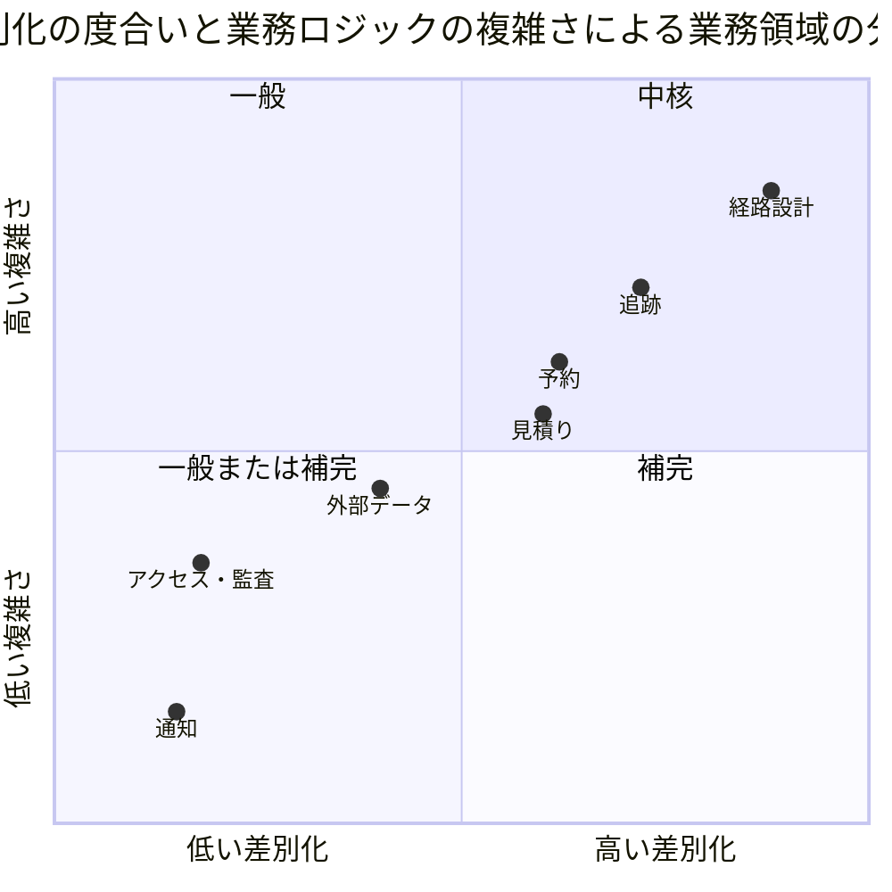

| コンテキスト | 分類 | 根拠 |
| :--- | :--- | :--- |
| 経路設計（Routing） | 中核 | 制約対応型経路設計は A 社の競争優位であり、ケイパビリティの成熟度が低い（経路候補算出）。規則（BR-02、BR-11）と専門判断・再設計が最も複雑 |
| 追跡（Tracking） | 中核 | 顧客から見える透明性の源泉。予定と実績、確認中、訂正の二者確認、鮮度が絡む |
| 予約（Booking） | 中核 | 予約の確定・変更・取消しの段階規則（BR-01、BR-04）を持つ |
| 見積り（Quotation） | 中核 | 根拠付き見積りと有効期限の境界（BR-10）を持つ。差別化は経路設計ほど高くない |
| 外部データ（External Data） | 補完 | 冪等性・隔離・照合（BR-12）は手続き的。A 社固有の採否判断を含むため一般ではない |
| アクセス・監査（Identity & Audit） | 一般 | 認証・役割・監査証跡は業界共通の仕組みで足りる。パイロットの KPI の計測（US-21）もここに置く |
| 通知（Notification） | 一般 | 利用者へのメールの送信と送信結果の記録だけを担う。業務の判断を持たない（US-22 の荷主への業務の通知、US-18 AC8 の password の再設定のメール。Bolt 33 で最小に作る。[ADR-017](../../adr/cargo-tracker/017-notification-module-and-mail.md)） |

## ユビキタス言語

### 呼び分けの決定

要件定義の「貨物予約の状態遷移」は下書きから完了までを 1 つの状態モデルで描いている。一方、Unit 定義は U1（輸送要求・見積り）と U6（予約管理）を分けている。本書では次のように呼び分ける。

| 業務の段階 | 呼び名 | 所属コンテキスト | 要件定義の状態との対応 |
| :--- | :--- | :--- | :--- |
| 本予約より前 | **輸送要求**（TransportRequest）、その版を **輸送要求版** | 見積り | 下書き、審査中、見積提示済み、変更中（本予約前）、失効、取消済み（本予約前の取下げ） |
| 本予約以後 | **貨物予約**（Booking）、その版を **予約版** | 予約 | 確定、変更承認待ち、取消承認待ち、変更中（本予約後）、取消済み、輸送中、完了 |

ユーザーストーリーの US-01・US-02 にある「予約版」は、本書では「輸送要求版」と読み替える。

### 用語集

| 用語 | 英語名 | 定義 | コンテキスト |
| :--- | :--- | :--- | :--- |
| 輸送要求 | TransportRequest | 荷主が見積りを依頼する輸送条件のまとまり。本予約までの版を持つ | 見積り |
| 業務番号 | TransportRequestNumber | 荷主と社内が電話・メールで言い合える輸送要求の番号。`TR-年-年ごとの連番`（例: TR-2026-0142）で、年が変わると 0001 から数え直す。版は「TR-2026-0142 版 2」と表記する。画面には内部の ID（UUID）を出さない（2026-10-02 の D-4）。初回の提出時に 1 回だけ振り、年は提出時刻の日本時間（Asia/Tokyo）の年とする。連番は 4 桁のゼロ埋めで、9999 を超えたら桁を増やす。欠番を出さない（2026-10-02 の D-10） | 見積り |
| 業務番号の採番 | TransportRequestNumberIssuer | 年を受け取り、その年の次の業務番号を返すポート。年の算出は業務番号が持ち、採番は提出と同じトランザクションで行う（D-10） | 見積り |
| 輸送要求版 | TransportRequestVersion | 輸送要求のある時点の条件。提出後は不変で、変更は新しい版になる | 見積り |
| 輸送条件 | ShipmentTerms | 荷受人、出発地、目的地、希望到着期限、貨物、必要書類の組 | 見積り（共有の写しは予約・経路設計） |
| 輸送条件の入力 | ShipmentTermsInput | 荷主が提出しようとする輸送条件の入力。項目が欠けていてよく、検証して違反がなければ輸送条件になる | 見積り |
| 提出の検証結果 | SubmissionViolations | 提出の検証で見つかった不足と誤りの一覧。項目と理由の種類だけを持ち、利用者に示す理由と直し方の文言は画面の層が付ける（Q-INV-01、Q-INV-02） | 見積り |
| 貨物 | Cargo | 貨物種別、荷姿、個数、総重量（kg）、容積（m3）の組 | 見積り |
| 必要書類 | RequiredDocument | 輸送条件に添付した書類 1 件。書類番号（版の中で 1 から）、書類の種類、ファイル名、形式、大きさ、SHA-256、オブジェクトキーを持つ。版に付き、提出後は変えない（2026-10-03 の D-20。Bolt 7） | 見積り |
| 書類の添付 | RequiredDocumentAttachment | 荷主が提出・出し直しで添付しようとする書類（種類、ファイル名、中身）。書類の受付規則を通り、保存してオブジェクトキーを得たら必要書類になる | 見積り |
| 書類の種類 | DocumentType | 商業送り状（COMMERCIAL_INVOICE）、梱包明細（PACKING_LIST）、その他（OTHER） | 見積り |
| 書類の形式 | DocumentMediaType | PDF、PNG、JPEG。拡張子でなく中身の先頭のバイトで判定する | 見積り |
| 書類の受付規則 | RequiredDocumentPolicy | 添付の一覧が Q-INV-16 を満たすかを判定し、違反を提出の検証結果に足す | 見積り |
| 書類の保存 | RequiredDocumentStorage | 書類の中身を保存してオブジェクトキーを返し、キーで中身を読むポート。本番は S3、開発はローカルのファイルシステム（ADR-007・008） | 見積り |
| 貨物種別 | CargoCategory | 一般、危険物、冷凍、その他特殊。MVP は一般だけを受け付ける（BR-03） | 見積り |
| 荷姿 | PackageType | 貨物の梱包の形。パレット、カートン、クレート、その他（2026-10-02 に human:kakimomokuri が承認した仮の値。業務責任者の確認で見直す） | 見積り |
| 審査 | Review | 営業担当者が提出条件と書類の充足を判断すること | 見積り |
| 審査記録 | ReviewRecord | 1 つの版に対する審査の判断の記録。判断者・判断時刻・根拠（確定）または理由と不足事項（差戻し）を持ち、後から変えない | 見積り |
| 審査の判断 | ReviewDecision | 充足（審査を確定し見積り作成へ進める）と差戻し（下書きに戻す）の 2 つ | 見積り |
| 見積り | Quotation | 審査済みの輸送要求版に対する料金根拠・有効期限・経路方針の提示 | 見積り |
| 経路方針 | RoutePolicy | 見積りとともに荷主へ示す、想定する主な経由地と概算の日程。詳細な経路は経路設計者の承認後に確定する | 見積り |
| 荷主の回答 | ShipperResponse | 提示された見積りと経路方針への荷主の回答（詳細経路設計へ進む、辞退する、相談する） | 見積り |
| 荷主承認 | ShipperApproval | 荷主担当者が見積りと承認済み経路を確認して与える承認。承認者と承認時刻を持つ。BR-01 の確定条件の 1 つ（US-24 AC4。Bolt 20） | 見積り |
| 割り当てた経路 | AssignedRoute | 経路設計が確定して見積りに割り当てた経路版の写し。案件番号・経路版番号・確定の時刻と区間の写しを持ち、荷主の承認の画面は経路設計に問い合わせずにこれを示す（R-INV-11、ADR-014。Bolt 20） | 見積り |
| 割り当てた区間 | AssignedRouteLeg | 割り当てた経路の区間 1 つの写し。航海番号、積地、揚地、出発予定、到着予定（Bolt 20） | 見積り |
| 料金根拠 | PricingBasis | 見積り金額の内訳と参照した契約条件。料金明細の列（1〜10 行）と通貨（USD・EUR・JPY）を持ち、合計は明細の和（2026-10-05 の決定。Bolt 10） | 見積り |
| 料金明細 | PricingLine | 料金根拠の 1 行。内容、金額（0 より大きい、小数点以下 2 桁まで）、参照した契約条件（任意） | 見積り |
| 料金明細の入力 | PricingLineInput | 営業担当者が入れようとする料金明細の 1 行。項目が欠けていてよく、検証して違反がなければ料金明細になる（Bolt 10） | 見積り |
| 見積りの入力 | QuotationInput | 営業担当者が算出しようとする料金明細・通貨・有効期限・経路方針。算出の時刻で検証し（Q-INV-05・17）、違反がなければ料金根拠・有効期限・経路方針になる（Bolt 10） | 見積り |
| 見積りの算出の検証結果 | QuotationViolations | 見積りの算出の検証で見つかった不足と誤りの一覧。項目・理由の種類・料金明細の行の番号だけを持ち、文言は画面の層が付ける（Bolt 10） | 見積り |
| 見積り番号 | — | 輸送要求の中で 1 から振る見積りの番号。画面と URL には内部の ID の代わりに「TR-2026-0001 見積 1」の形で出す（D-4 と同じ考え方。Bolt 10） | 見積り |
| 見積有効期限 | QuotationExpiry | 予約確定の commit 時刻がこれより前のときだけ見積りが有効になる UTC 時点（BR-10） | 見積り |
| 再見積り | — | 承認待ち・提示済み（失効したものを含む）の見積りから、次の見積り番号の新しい見積りを作ること。旧版は置換済み（有効期限を過ぎていれば失効）になり、読み取り専用で残る（Q-INV-07・18。Bolt 11） | 見積り |
| 経路設計案件 | RoutingCase | 1 つの輸送要求について経路版を作り、確定・再設計する単位 | 経路設計 |
| 経路版 | RouteVersion | 候補の比較、判断根拠、承認を伴って確定した経路のある版 | 経路設計 |
| 経路候補 | RouteCandidate | 区間の列からなる候補と、その制約適合判定 | 経路設計 |
| 区間 | Leg | 航海、積地、揚地、出発予定、到着予定 | 経路設計（写しは見積り。追跡は予定区間として持つ） |
| 航海 | Voyage | 航海番号で識別される運航予定。外部原本から採用した版を持つ | 経路設計 |
| 経路設計案件 ID | RoutingCaseId | 経路設計案件を識別する、システムが発行する不透明な値。画面には出さず、案件番号を出す（Bolt 17） | 経路設計 |
| 案件番号 | RoutingCaseNumber | 経路設計者と営業が言い合える経路設計案件の番号。`RC-年-年ごとの連番`（例: RC-2026-0088）。年は詳細経路設計の依頼時刻の日本時間の年で、業務番号と同じ規則で振る（D-10。Bolt 17） | 経路設計 |
| 経路条件 | RouteSpecification | 経路設計案件の出発地・目的地・希望到着期限・貨物種別。見積りの公開 API（経路条件の照会）から得た輸送要求版の写し（Bolt 17） | 経路設計 |
| 寄港 | PortCall | 航海が寄る港と、その到着予定・出発予定 | 経路設計 |
| 接続時間規則 | ConnectionRule | 積替えの港ごとの必要最小接続時間と適用期間（BR-11）。業務責任者の値（DM-05）が届くまでは仮の値 | 経路設計 |
| 除外理由 | ExclusionReason | 候補を除外した理由の区分（期限超過・接続不足・接続できない・貨物種別・情報不足）と、不適合となった時刻・閾値・参照情報版（R-INV-02） | 経路設計 |
| 判断根拠 | DecisionRationale | 経路設計者が経路を確定するときに記録する、その候補を選んだ理由。前後の空白を除いて 1〜4,000 文字（R-INV-04。Bolt 19） | 経路設計 |
| 確定の記録 | RouteConfirmation | 経路版を確定したときの、選んだ候補番号・判断根拠・承認者・承認 commit 時刻（US-07 AC1。Bolt 19） | 経路設計 |
| 経路の承認者 | RouteApprover | 経路を確定した利用者と、確定の時点で経路設計者の役割を持つか（R-INV-04。Bolt 19） | 経路設計 |
| 必要最小接続時間 | MinimumConnectionTime | 航路・港ごとの、区間の乗り継ぎに必要な最小時間（BR-11） | 経路設計 |
| 制約適合判定 | ConstraintEvaluation | 期限・接続時間・貨物種別による候補の適合・除外とその理由 | 経路設計 |
| 再設計要 | RedesignRequired | 確定後の外部情報更新で制約を満たさなくなった経路版の状態 | 経路設計 |
| 本予約 | — | A 社と荷主の間で輸送の条件（見積り・経路版・貨物）を確定すること。運送会社による船腹の確保（ブッキングの確認）とは別の事実であり、確認書でも区別して示す（要確認: 業務責任者） | 予約 |
| 貨物予約 | Booking | 本予約で確定した輸送の契約。予約版と追跡番号を持つ | 予約 |
| 予約版 | BookingVersion | 貨物予約のある時点の合意内容（見積り、経路版、貨物）。変更は新しい版になる | 予約 |
| 追跡番号 | TrackingNumber | 顧客が追跡を照会するための推測されにくい番号。本予約時に発行する | 予約（発行）、追跡（コンテキスト固有の値オブジェクト。表記の形は同じ。Bolt 25） |
| 予約 ID | BookingId | 貨物予約を識別する、システムが発行する不透明な値。画面と URL には追跡番号を出す（Bolt 23） | 予約 |
| 予約条件 | BookingTerms | 本予約の確定の時点で見積りの公開 API から写した、輸送要求・見積り・経路版・荷受人・貨物・荷主承認の値。予約版はこの写しを持ち、確定の後に見積りへ問い合わせ直さない（ADR-016。Bolt 23） | 予約 |
| 確定条件 | BookingConditions | 本予約の確定に要る 5 条件（有効な見積り、必須貨物情報、荷主担当者 1 名の承認、承認済み経路版、営業担当者による確認）。欠けた条件を不足条件として返す（BR-01） | 予約 |
| 予約サガ | BookingSaga | 本予約の確定から追跡の開始までの状態（処理中・完了・失敗・有人確認要）を持つ。後続の追跡の開始は追跡が DE-07 を購読して行う（ADR-015） | 予約 |
| 処理済みコマンド | ProcessedCommand | 本予約の確定に成功したコマンドの記録。コマンド ID、内容の照合値（業務番号・見積り番号・操作者）、予約 ID と追跡番号、処理時刻を持つ。貨物予約と同じトランザクションで記録し、拒否した要求は記録しない（B-INV-03。Bolt 24） | 予約 |
| 再送 | — | 同じコマンド ID・同じ内容の確定の要求をもう一度受けること。最初の結果（同じ追跡番号）を返す。同じコマンド ID で内容が違う要求は衝突として拒否する（B-INV-03。Bolt 24） | 予約 |
| 輸送段階 | TransportPhase | 集荷前、集荷後、完了。変更・取消しの可否を決める（BR-04） | 予約 |
| 追跡記録 | TrackingRecord | 1 つの追跡番号の予定と主要実績、現在状態 | 追跡 |
| 予定 | Schedule | 追跡が採用した確定した経路版（案件番号・経路版番号）と予定区間の列。実績とは混同しない（T-INV-08。Bolt 25） | 追跡 |
| 予定区間 | ScheduledLeg | 予定の 1 区間。航海番号、積地、揚地、出発予定、到着予定。区間番号は列の順に 1 から（T-INV-12。Bolt 25） | 追跡 |
| 追跡状態 | TrackingStatus | 追跡記録の現在状態の値。予約確定 `BOOKED`、集荷予定 `PICKUP_SCHEDULED`、集荷済み `PICKED_UP`、出発地搬入済み `RECEIVED_AT_ORIGIN`、輸送中 `IN_TRANSIT`、積替え中 `TRANSSHIPPING`、目的地到着 `ARRIVED_AT_DESTINATION`、引渡し可能 `READY_FOR_DELIVERY`、引渡し済み `DELIVERED`、確認中 `UNDER_REVIEW`（要件定義の追跡状態モデル。状態名は業務責任者の確認前の候補。Bolt 25 は予定を採用した直後の集荷予定だけを使う。画面の表示名は日本語の名前のまま。Bolt 26 で S-11・S-12 に出し、確認は Bolt 26 の終了報告の議題に置いた） | 追跡 |
| 追跡の予約状態 | TrackedBookingStatus | 追跡記録が持つ予約の状態の写し。確定 `CONFIRMED`、取消済み `CANCELLED`、完了 `COMPLETED`（T-INV-04・T-INV-05 の判定に使う。Bolt 25） | 追跡 |
| 主要実績 | Milestone | 出典と発生時刻を伴う、集荷・搬入・出発・積替・到着・引渡しの事実。追跡記録の中で実績番号（1 から）で識別する。追跡管理者が登録した実績は採用（Bolt 26b） | 追跡 |
| 実績の種類 | MilestoneKind | 集荷 `PICKUP`、搬入 `RECEIPT_AT_ORIGIN`、出発 `DEPARTURE`（積替港からの出発を含む）、積替 `TRANSSHIPMENT`（積替港到着）、到着 `ARRIVAL`、引渡し `DELIVERY`（Bolt 26b） | 追跡 |
| 実績の状態 | MilestoneState | 下書き `DRAFT`、採用 `ADOPTED`、確認中 `UNDER_REVIEW`、保持のみ `RETAINED_ONLY`。現在状態の導出には採用だけを入れる（T-INV-08。Bolt 26b） | 追跡 |
| 出典 | Source | 実績や採用値の根拠。種類・参照（1〜200 文字）・取得時刻を持つ。同じ追跡記録で種類と参照が同じなら同じ出典識別子（T-INV-02。Bolt 26b）。S-13 で追跡管理者が選べる種類は現場記録・社内確認・手動入力で、外部原本は外部原本の取込（W7）だけが作る。S-13 では取得時刻を登録時刻にし、参照の前後の空白を除く（大文字と小文字は区別する。Bolt 26c） | 共有カーネル |
| 出典の種類 | SourceKind | 外部原本 `EXTERNAL_RECORD`、現場記録 `FIELD_RECORD`、社内確認 `INTERNAL_CHECK`、手動入力 `MANUAL_ENTRY`（航海の出典の種類と同じ値。Bolt 26b） | 共有カーネル |
| 荷主向けの追跡の照会結果 | CustomerTrackingView | 追跡記録を荷主の開示範囲に絞った照会結果。現在状態・当初の到着予定・最新の到着見込み・予定区間・採用済みの主要実績だけを持ち、経路版などの社内の識別子を持たない（顧客向けに表示する(開示範囲) の荷主の分。BR-07、T-INV-09。Bolt 27） | 追跡 |
| 荷主向けの主要実績 | CustomerMilestone | 荷主に見せてよい項目（種類・場所・発生時刻・出典）だけを持つ主要実績の写し。実績番号・状態・登録者を持たない（Bolt 27） | 追跡 |
| 確認中 | UnderReview | 順序逆転・矛盾・鮮度超過のため、現在状態に反映せず保留している状態（BR-06） | 追跡 |
| 訂正 | Correction | 原実績を残したまま理由付きで新しい事実を記録すること（BR-05） | 追跡 |
| 鮮度 | Freshness | 最終取得時刻からの経過と、許容範囲を超えたかどうか | 追跡、経路設計 |
| 最新の到着見込み | LatestEstimate | 当初の予定（確定した経路版）とは別に、実績と採用値から見込む最新の到着時刻 | 追跡 |
| 照会記録 | InquiryRecord | 荷主・荷受人からの照会 1 件の経路（顧客 Web・電話・メール）と、Web で完結したか有人対応へ移ったかの記録。KPI-02 の計測に使う | 追跡 |
| 営業日カレンダー | BusinessCalendar | 有人案件の受領・回答期限を数えるための営業日と営業時間（日本の祝日・年末年始） | 追跡 |
| 有人案件 | ServiceCase | 受付番号を持ち、担当・期限・回答・復旧照合を追跡する顧客照会または業務例外（BR-09、BR-17） | 追跡 |
| 受付番号 | CaseNumber | 有人案件の一意な識別子 | 追跡 |
| 企業 | Company | 荷主・荷受人・A 社などの利用者の所属組織 | アクセス・監査 |
| 利用者 | User | 事前登録され、固定役割を持つ人（BR-14、BR-15）。Bolt 34 から版（`app_user.version`）を持ち、役割の変更の判定（`roleChangeRejection`）と役割を変えた新しい利用者（`changeRoles`）を返す | アクセス・監査 |
| メールアドレス | EmailAddress | 利用者のログインの識別子。前後の空白を除き小文字にして比べる（Bolt 14） | アクセス・監査 |
| TOTP の資格 | TotpCredential | 利用者が登録した TOTP の暗号化した秘密と、最後に使った時間の刻み（Bolt 30）。入れたコードを前後 1 つの刻みで照合し、照合の結果（`TotpMatch`）を返す（`match`。Bolt 31d で `matchingStep` から改めた）。認証アプリの再登録で、1 人 1 つのまま秘密を置き換える（`reEnroll(newSecret, step, at)`。最後に使った刻みは戻さず、古い値と新しいコードの刻みの大きい方にする。Bolt 33b で作る）。コードの桁数 `DIGITS`（6）は時間の刻み `STEP_DURATION`（30 秒）と並べてこの集約に置き、コードの生成・otpauth の URI・画面のコードの欄の属性が参照する（Bolt 33d。HMAC のアルゴリズムは技術の知識なので `infrastructure.crypto` に置く） | アクセス・監査 |
| TOTP の照合の結果 | TotpMatch | TOTP の資格の照合の結果。使っていない刻みで一致（`Matched(step)`）、使った刻み以下でだけ一致（`Reused`）、どれとも一致しない（`Mismatch`。形の違うコードを含む）のいずれか。窓の刻みのすべてを一定時間で比べ、形の違うコードでは生成器を呼ばない（IA-INV-10、ADR-011 の決定 8、Bolt 31d） | アクセス・監査 |
| 暗号化した秘密 | EncryptedSecret | TOTP の秘密を暗号化した文字列。平文の秘密は表にも記録にも書かない（Bolt 30） | アクセス・監査 |
| 回復コード | RecoveryCode | TOTP の端末を失ったときに一度だけ使えるコード。ハッシュだけを持つ（SEC-09、Bolt 30）。入れたコードを正規化して `NormalizedRecoveryCode` を返す `normalize`、10 個の発行とそろいの確かめを 1 つにした工場メソッド `issueSet` を持つ。コードの形（16 進 8 文字を 4 文字ずつハイフンで区切る）の知識は `NormalizedRecoveryCode` に置く（Bolt 33d。値オブジェクトから集約への依存の前例がないので、形の知識は値の側に置いた（Bolt 33d のステップ 3））。Bolt 33f から `issueSet` は `NormalizedRecoveryCode` の一覧を受ける | アクセス・監査 |
| 正規化した回復コード | NormalizedRecoveryCode | 入れた回復コードを正規化した値（`1a2b-3c4d` の形）。回復コードの形の知識（形の正規表現、ハイフンのない 8 文字を区切って読む `parse`、乱数の 4 バイトから発行の形を作る `fromBytes`）を持ち、生成器（`RandomRecoveryCodeGenerator`）と `RecoveryCode.normalize` が使う。照合（`RecoveryCode.matches`）はこの値だけを受ける。作るときに形を確かめるので、形の合わない値は照合に渡らない（Bolt 33d） | アクセス・監査 |
| ログインの失敗 | LoginFailure | 利用者ごとの password・TOTP・回復コードの連続の失敗の回数と、ロックの期限（IA-INV-03、Bolt 30。回復コードも数えるのは Bolt 32） | アクセス・監査 |
| ロックの方針 | LockPolicy | 連続の失敗の上限（5 回）とロックの長さ（15 分）（BR-14、Bolt 30）。Bolt 33c から、A-01 の文言の「5 回」「15 分」もこの方針の値から描く | アクセス・監査 |
| session の方針 | SessionPolicy | ログインの session の期間をまとめたドメインルール。2 つの要素がそろった session の上限（8 時間）、password の段の上限（5 分）、登録の途中の上限（15 分）、回復コードでログインした印の有効な時間（15 分）、認証アプリの再登録の上限（15 分）を持つ。Bolt 33e から、期限の判定 `isExpired(始めた時刻, 今, 期間)`（ちょうどの時刻は期限切れ。時計を持たない純粋な関数）も持ち、使う側（認証の入口のフィルター、画面の層、再登録のサービス）はこれで判定する（SEC-03、ADR-012 の決定 3。`identity.domain.model.rules`。Bolt 33c で作る）。Bolt 33f から、期限の時刻 `deadline(始めた時刻, 期間)` も持ち、`isExpired` と、画面に示す期限の時刻・8 時間の残りがそれを使う。A-07・A-08・A-03・印の知らせ・session の警告の期間の文言も、画面の層がこの期間から描く | アクセス・監査 |
| session の ID | SessionId | ほかの session を失効させるときに残す、今の session の ID（Bolt 33e）。`UserSessionRevoker.revokeOthers` が受ける。空を拒み、ログに出さないよう `toString` は値を伏せる | アクセス・監査 |
| 失敗の数えの結果 | FailureCount | ログインの失敗のリポジトリが失敗を数えたときに返す値。数えたか（ロック中なら数えない）と、数えた後のログインの失敗の状態を持つ。ログインの試行のサービスが、ロック中の試行と、この失敗でロックしたこと（`ACCOUNT_LOCKED` を 1 行だけ書く）を見分けるのに使う（IA-INV-03・IA-INV-08、ADR-011 の決定 9、Bolt 32） | アクセス・監査 |
| 利用者の立場 | UserStanding | 利用者とその所属企業の組。request ごとの確かめで、今の役割と利用状態・企業の有効性を 1 回で読んだ結果（IA-INV-04。Bolt 32c） | アクセス・監査 |
| 利用者の立場のリポジトリ | UserStandingRepository | 利用者 ID から `UserStanding` を 1 回の読み出しで返すドメインのポート（`identity.domain.model.aggregates`）。実装は利用者・企業・役割の表を 1 つの SQL で結合する。役割が 0 件の利用者はデータの不整合として例外にする（Bolt 32c） | アクセス・監査 |
| session の確かめのサービス | SessionRevalidationService | 認証済みの request ごとに `UserStanding` を読み、今のドメインの規則（`User#authenticationRejection`）で判定するアプリケーションのサービス（`commandservices`）。拒否なら `SESSION_REVOKED` を書いて理由を返し、拒否でなければ今の役割・表示名・企業名の主体を返す。認証の入口のフィルター `SessionRevalidationFilter` から呼ぶ（IA-INV-04、ADR-012 の見直しの 3、Bolt 32c） | アクセス・監査 |
| ログインの試行のサービス | LoginAttemptService | ログインの失敗を数え、2 つの要素がそろったログインの成功で 0 に戻し、その監査記録（`LOGIN_FAILED`・`ACCOUNT_LOCKED`・`LOGIN_SUCCEEDED`）を回数と 1 つのトランザクションで書くアプリケーションのサービス。ロックの判定（`isLocked`）の 1 か所でもある。認証の入口（監査のリスナー、照合の後の確認、TOTP・回復コードの provider）から呼ぶので `commandservices` に置く（IA-INV-03・IA-INV-08、ADR-011 の決定 9、ADR-012 の見直しの 5、Bolt 32） | アクセス・監査 |
| TOTP の生成器 | TotpCodeGenerator | 持ち主の利用者 ID と暗号化した秘密と時間の刻みから TOTP のコードを作るポート（`code(UserId, EncryptedSecret, long)`）。実装は java-otp で、利用者 ID を AAD にした復号から平文の消去までを実装の中で済ませ、平文の秘密をドメインとアプリケーションの層に出さない（ADR-011、Bolt 30。暗号文を受ける形は Bolt 31、利用者 ID を受ける形は Bolt 31b） | アクセス・監査 |
| TOTP の確認 | TotpVerificationService | 利用者の TOTP の資格を引いて資格の照合の結果（`TotpMatch`）を写し、一致した刻みを条件付きの更新で使うアプリケーションのサービス（照合の結果を写す形は Bolt 31d）。結果は受理・不一致・再利用・未登録のいずれか（IA-INV-10、ADR-011、Bolt 31。登録済みかの問い合わせ `isEnrolled` は Bolt 31b で TOTP の登録の照会に移した） | アクセス・監査 |
| 読めない認証の要素 | UnreadableCredentialException | 保存した認証の要素（TOTP の秘密の暗号文、回復コードのハッシュ）を読めないこと（復号の失敗・ハッシュの形の誤り）を表すドメインの例外。暗号の部品（`identity.infrastructure.crypto`）が投げ、認証の入口と TOTP の登録のサービスがこれだけを拒否に倒す。ほかの実装の誤りは拒否にせず 500 にする（ADR-011 の決定 8、Bolt 31d） | アクセス・監査 |
| 回復コードのハッシュ | RecoveryCodeHasher | 回復コードのハッシュを作り、照合するポート。実装は bcrypt（SEC-09、Bolt 30） | アクセス・監査 |
| TOTP の秘密の発行 | TotpSecretIssuer | 160 ビットの TOTP の秘密を乱数で作り、利用者 ID を AAD にして暗号化して返し、暗号文から登録の表示の値を作るポート。実装は `identity.infrastructure` で、平文の秘密と ZXing をインフラ層に閉じる（ADR-011 の決定 6、Bolt 31b） | アクセス・監査 |
| 回復コードの生成器 | RecoveryCodeGenerator | 一度だけ使える回復コード 10 個を乱数で作るポート。形は `1a2b-3c4d`（8 文字の 16 進を 4 文字ずつ区切る）で、10 個のうちに重複がない（SEC-09、Bolt 31b）。Bolt 33f から `NormalizedRecoveryCode` の一覧を返す（画面に平文を渡す登録と再登録の結果は文字列のまま） | アクセス・監査 |
| TOTP の登録の表示 | TotpProvisioning | 認証アプリに登録してもらうための表示の値（`otpauth://` の URI、手入力のキー、QR コードの SVG）。秘密と同じ重さの値で、`toString` で値を隠し、登録の画面に一度だけ渡す（ADR-011 の決定 6、Bolt 31b） | アクセス・監査 |
| TOTP の登録 | TotpEnrollmentService | 初回の TOTP の登録を行うアプリケーションのサービス。秘密を発行して表示の値を返し（登録の途中の暗号文は同じ利用者なら使い続ける）、最初のコードを確かめてから TOTP の資格・回復コード 10 個・監査記録（`TOTP_ENROLLED`）を 1 つのトランザクションで保存し、回復コードの平文を返す。TOTP の要素は与えない（US-18 AC7、IA-INV-10・11、Bolt 31b）。Bolt 33b から、password の段の主体（`PasswordVerifiedUser`）でなく段に中立な値（`EnrollingUser`）で受ける。認証アプリの再登録と共用するのは、秘密の発行のポート（`TotpSecretIssuer`）と値 `EnrollingUser` で、再登録のサービスはこのサービスを呼ばない（途中の暗号文を使い続ける処理は `TotpProvisioningStarter`、回復コード 10 個の発行は `RecoveryCode.issueSet` を 2 つのサービスが使う。Bolt 33d で寄せた） | アクセス・監査 |
| TOTP の登録の始め | TotpProvisioningStarter | 認証アプリの登録と再登録を始めるとき、登録の途中の暗号文が同じ利用者のものとして読めればそれを使い続け、読めなければ新しい秘密を発行して、暗号文と表示の値を返す部品（`commandservices`。Bean にせず、`TotpEnrollmentService` と `TotpReEnrollmentService` が組み立てて使う。Bolt 33d） | アクセス・監査 |
| 認証アプリの再登録 | TotpReEnrollmentService | 回復コードでログインした利用者が TOTP を登録し直すアプリケーションのサービス（`commandservices`）。利用者の ID で `User` を読んでメールアドレスを得て（利用停止・所属企業の無効は利用できない）、新しい秘密を発行して表示の値を返し（途中の暗号文が読めればそれを使い続ける）、開始から 15 分の上限と新しいコードを確かめてから、再登録の前に読んだ秘密のままのときだけ TOTP の資格の秘密を置き換え（`replace`。資格がなければ利用できない）、回復コード 10 個を発行し直し、監査記録（`TOTP_RE_ENROLLED`）を書く（1 つのトランザクション）。コミットの後にその利用者のほかの session を失効させる（`revokeOthers`。失敗は警告のログ）。結果（`ReEnrollmentResult`）は 6 種類で、完了（`ReEnrolled`。回復コードの平文）・コードの誤り（`CodeRejected`）・期限切れ（`Expired`）・秘密が読めない（`SecretUnusable`）・ほかの画面や二度押しで先に登録し直していた（`Superseded`。置き換えも回復コードの発行し直しもしない）・利用できない（`Unavailable`）（US-18 AC9、SEC-10、IA-INV-10・11。Bolt 33b で作る） | アクセス・監査 |
| 認証アプリを登録する利用者 | EnrollingUser | 認証アプリを登録する、または登録し直す利用者の利用者 ID・企業 ID・メールアドレス。2 段階のログインの段に中立な値で、A-07 の画面は password の段の主体（`PasswordVerifiedUser`）から、認証アプリの再登録のサービスは利用者の ID で読んだ `User` から詰める（`identity.domain.model.valueobjects`。Bolt 33b で作る） | アクセス・監査 |
| 回復コードでログインした印 | — | 回復コードでログインを終えた session に置く印（session の 2 つの属性。利用者の ID とログインした時刻）。認証の入口の成功の扱い（`FirstTotpSuccessHandler`）が回復コードの経路で置き、A-08 の再登録の完了、ログアウト（session と一緒に消える）、password の段の成功（`LoginSuccessHandler`。同じ session での利用者の切り替え。2 つの属性をどちらも消す）で消す。印はログインから 15 分だけ有効にする（session を盗んだ者や離席中の端末に触れた者に、password なしで登録し直させない。2026-10-15 の開発レビューで human:kakimomokuri が決定）。画面の層（`RecoveryLogin.stateOf`）は状態を 3 つに分ける。NONE（印がない、または印の利用者が今の主体でない）、ACTIVE（印の利用者が今の主体で、ログインから 15 分未満。A-08 を開け、業務の画面に A-08 へのリンク付きの知らせを出す）、EXPIRED（15 分を過ぎた。A-08 は役割のホームへ移し、業務の画面にはリンクのない案内を出す）。印は Bolt 33b で作った。属性の名前は application 層の `SessionKeys`（`identity.application.internal.session`）に、15 分は session の方針（`SessionPolicy`）に置き、認証の入口と画面の層が同じ定数を参照する（Bolt 33b では 2 つの定数で持ち一致をテストで守っていたのを、Bolt 33c で寄せる） | アクセス・監査 |
| TOTP の登録の照会 | TotpEnrollmentQueryService | 利用者が TOTP を登録済みかを答える問い合わせのサービス。画面の層だけが呼ぶ（Bolt 31b で TOTP の確認から移した） | アクセス・監査 |
| 回復コードの確認 | RecoveryCodeVerificationService | 回復コードによるログインで、入れたコードを正規化し、利用者の未使用の回復コードのすべてとハッシュで照合し（トランザクションの外）、一致したコードの条件付きの更新と監査記録（`RECOVERY_CODE_USED`）を 1 つのトランザクションで行うアプリケーションのサービス（US-18 AC9、IA-INV-11、ADR-011 の決定 7、Bolt 31c） | アクセス・監査 |
| 回復コードの確認の結果 | RecoveryCodeVerification | 回復コードの確認の結果。受理（`ACCEPTED`）か拒否（`REJECTED`）で、拒否の種類（形の違い・誤り・使用済み・同時の使用で負けた・回復コードがない）は分けない（使用済みのコードは未使用の一覧に出ないため。Bolt 31c） | アクセス・監査 |
| TOTP の要素の認証 | TotpAuthenticationToken | 2 つ目の要素（TOTP または回復コード）が通った認証の結果。要素の権限 `FACTOR_TOTP` を持ち、`FACTOR_TOTP` は「TOTP または回復コードで与える 2 つ目の要素」を表す。回復コードでも同じ型と権限を与える（ADR-011 の決定 7）。名前に TOTP が残るが、改名すると配備の前の session が復元できない（session の直列化の互換。ADR-012 のネガティブ）ので改名しない（ADR-011 の決定 8、Bolt 31d）。Bolt 33e から、2 つ目の要素の経路（`SecondFactorPath`。TOTP か回復コードか）を持ち、成功の扱いが回復コードの経路を見分ける。経路は `transient` で session に保存しない（直列化の形を変えず、ローリング配備の間に古い版が新しい版の session を読める） | アクセス・監査 |
| password を確かめた利用者 | PasswordVerifiedUser | password の段がそろった主体の利用者 ID・企業 ID・メールアドレス。password の段だけで開く画面（A-02・A-07）が受ける identity の中だけの値で、2 つの要素がそろった主体の `AuthenticatedActor` と分ける（ADR-012 の見直しの 4、Bolt 31c） | アクセス・監査 |
| 監査の操作 | AuditAction | 監査記録の操作。password の段の成功（`PASSWORD_VERIFIED`）、ログインの成功（`LOGIN_SUCCEEDED`。2 つの要素がそろった）、ログインの失敗（`LOGIN_FAILED`）、TOTP の登録（`TOTP_ENROLLED`。Bolt 31b）、回復コードの使用（`RECOVERY_CODE_USED`。Bolt 31c）、ロック（`ACCOUNT_LOCKED`。その失敗でロックしたときだけ。Bolt 32）、session の取消し（`SESSION_REVOKED`。request ごとの確かめで利用停止・無効な企業・利用者なしを見つけて session を捨てた。Bolt 32c）、ログアウト（`LOGOUT`）、password の再設定の依頼（`PASSWORD_RESET_REQUESTED`。Bolt 33）、password の再設定の完了（`PASSWORD_RESET_COMPLETED`。成功だけ。Bolt 33a）、TOTP の再登録（`TOTP_RE_ENROLLED`。成功だけ。Bolt 33b）。Bolt 34 で役割の変更（`ROLES_CHANGED`。対象・版・変更前後を持つ）を足した | アクセス・監査 |
| 認証の拒否の理由 | AuthenticationRejection | 認証を受け付けなかった理由。session の取消しの理由（`SUSPENDED`・`COMPANY_INACTIVE`・`UNKNOWN_USER`。Bolt 32c）と、password の再設定の依頼を受け付けなかった理由（同じ 3 つ。Bolt 33）にも使う。監査記録にだけ残し、利用者には同じ応答を返す。`BAD_CREDENTIALS`・`UNKNOWN_USER`・`SUSPENDED`・`COMPANY_INACTIVE`（Bolt 14）、`INVALID_TOTP`・`TOTP_REUSED`（Bolt 31）、`INVALID_RECOVERY_CODE`（回復コードの形の違い・誤り・使用済み、または回復コードと認証コードの両方を送った。Bolt 31c）、`TOTP_NOT_ENROLLED`（TOTP を登録していない利用者の TOTP の送信。Bolt 31d で `INVALID_TOTP` から分けた）、`LOCKED`（ロック中の試行。数えない）・`SERVICE_ERROR`（利用者の読み出しの DB の誤り。数えない）（Bolt 32） | アクセス・監査 |
| 再設定のトークン | PasswordResetToken | password の再設定のリンクに入れる 1 回だけ使える値の発行の記録。依頼の ID・利用者・トークンのハッシュ・発行時刻・期限（発行から 30 分）・使った時刻・無効にした時刻を持ち、平文のトークンは持たない。使えるか（`isUsable(now)`）を答え、A-06 の設定で 1 回だけ使う（IA-INV-12、US-18 AC8、Bolt 33。使う側は Bolt 33a） | アクセス・監査 |
| password の再設定を依頼した | PasswordResetRequested | 有効な利用者が password の再設定を依頼したことを表すドメインのイベント（`identity.domain.events`、DE-23）。依頼の ID・利用者の ID・依頼の時刻だけを持ち、トークンも URL も持たない（発行記録に秘密を残さない。ADR-017、Bolt 33） | アクセス・監査 |
| 再設定の依頼のサービス | PasswordResetRequestService | A-05 の依頼を受けるアプリケーションのサービス（`commandservices`）。メールアドレスを正規化して利用者を探し、`User#authenticationRejection(company)` で有効かを判定し、監査記録（`PASSWORD_RESET_REQUESTED`）を同じトランザクションで書き、有効なら依頼の ID を採番して `PasswordResetRequested` を出す。応答はどの場合も同じで、トークンの発行も送信も待たない（Bolt 33） | アクセス・監査 |
| 再設定のメールのイベントハンドラー | PasswordResetMailEventHandler | `PasswordResetRequested` を依頼のコミットの後に別のトランザクションで受けるハンドラー（`eventhandlers`、`@ApplicationModuleListener`）。利用者の行をロックし、同じ依頼の ID のトークンがあれば何もせず、前の発行から 1 分以内なら発行も送信もせず、そうでなければ前の未使用のトークンを無効にしてトークンを発行し、通知の公開 API で送る。送信の失敗でも完了にする（Bolt 33） | アクセス・監査 |
| 再設定のトークンの生成器 | PasswordResetTokenGenerator | 32 バイトの乱数を URL 安全な Base64 にした再設定のトークンを作るポート。実装は `identity.infrastructure.crypto`（Bolt 33） | アクセス・監査 |
| 再設定のトークンのハッシュ | PasswordResetTokenHasher | 再設定のトークンの SHA-256 のハッシュ（16 進 64 文字）を作るポート。表にはこのハッシュだけを置く。実装は `identity.infrastructure.crypto`（Bolt 33） | アクセス・監査 |
| 役割の割り当ての規則 | RoleAssignmentPolicy | 役割の組合せのドメインルール（Bolt 34。IA-INV-01・IA-INV-13）。職務分離で競合する役割（システム管理者・監査担当者と、業務データを変更できる 6 つの役割）と、企業の種類に付けられない役割（荷主担当者は荷主企業、ほかの 7 役割は A 社、荷受人の企業には付けない）を返す。システム管理者と監査担当者の併用は拒まない | アクセス・監査 |
| 役割の変更の拒否 | RoleChangeRejection | 役割の変更を受け付けない理由（`RoleChangeRejectionReason`: `SELF_CHANGE`・`NO_ROLES`・`NO_CHANGE`・`UNFIT_FOR_COMPANY`・`CONFLICTING_ROLES`。判定はこの順）と、示す役割の集合（Bolt 34） | アクセス・監査 |
| 役割の変更のサービス | UserRoleChangeService | システム管理者が利用者の役割を変えるアプリケーションのサービス（`commandservices`。Bolt 34）。判定の規則を通し、`app_user.version` を条件にした更新・`user_role` の差分・監査記録 `ROLES_CHANGED` を 1 つのトランザクションで書く。結果は `RoleChangeResult`（`Changed`・`Rejected`・`Stale`・`NotFound`）。拒否と古い版は監査に書かない | アクセス・監査 |
| 利用者の管理の照会 | UserAdministrationQueryService | S-20 の一覧と詳細を読むアプリケーションのサービス（`queryservices`。Bolt 34）。射影 `UserSummary`（一覧の行）・`UserDetail`（詳細。企業の種類と版を含む）で受け、`password_hash` を読まない | アクセス・監査 |
| 通知の再設定のメール | NotificationPasswordResetMails | 通知の公開 API `PasswordResetMail` を呼ぶ identity の ACL（`application.internal.outboundservices.acl`。上流の名前 + 名詞）。通知の結果を identity の言葉に写す（Bolt 33） | アクセス・監査 |
| password の方針 | PasswordPolicy | 新しい password の規則（SEC-04・SEC-05）。12 文字以上 64 文字以下（code point で数え、空白と全角の文字を許す）、UTF-8 で 72 バイト以下（bcrypt が扱える長さ）、よく使われる password の一覧に載っていない。一覧の照合の結果は引数で受けて純粋に保ち、違反があれば最初の 1 つ（`PasswordPolicyViolation`）を返す（`identity.domain.model.rules`。Bolt 33a） | アクセス・監査 |
| password の方針の違反 | PasswordPolicyViolation | password の方針の違反の種類。短い `TOO_SHORT`（空を含む）、長い `TOO_LONG`、UTF-8 で 72 バイトを超える `TOO_MANY_BYTES`、よく使われる `COMMON`。画面はこの種類で文言を選ぶ（`identity.domain.model.valueobjects`。Bolt 33a） | アクセス・監査 |
| password のハッシュ | PasswordHasher | 新しい password のハッシュを作るポート（`identity.domain.model.aggregates`）。実装は `BcryptPasswordHasher`（`identity.infrastructure.crypto`）で、Spring Security の `PasswordEncoder`（`{bcrypt}` の接頭辞。SEC-07）を包む（Bolt 33a） | アクセス・監査 |
| よく使われる password の一覧 | CommonPasswordList | password がよく使われる password の一覧に載っているかを、大文字小文字を区別せずに答えるポート（`identity.domain.model.aggregates`）。実装の `BundledCommonPasswordList`（`identity.infrastructure.crypto`）は起動のときに同梱の資源を読んで小文字の集合にし、読めない・空なら起動を止める（SEC-05、Bolt 33a） | アクセス・監査 |
| 利用者の session の失効 | UserSessionRevoker | 利用者の session を失効させるポート（`identity.domain.model.aggregates`）。主体の名前（ログインのメールアドレス）で探し、すべてを消す（`revokeAll(メールアドレス)`。password の再設定。SEC-08、Bolt 33a）か、今の session を除くほかを消す（`revokeOthers(メールアドレス, 残す session の ID)`。認証アプリの再登録。SEC-10、Bolt 33b で足す。メソッドが 2 つになるので `@FunctionalInterface` を外す）。実装の `SpringSessionUserSessionRevoker`（`identity.infrastructure.security`）は Spring Session の `FindByIndexNameSessionRepository` で探して消す | アクセス・監査 |
| 再設定の完了のサービス | PasswordResetCompletionService | A-06 の設定を受けるアプリケーションのサービス（`commandservices`）。リンクのトークンを確かめてトークンの ID を返し（`open`）、トークンの ID が使えるかを答え（`isUsable`）、方針を確かめてからトークンを条件付きで使い、password を変え、前の未使用のトークンを無効にし、監査記録（`PASSWORD_RESET_COMPLETED`）を書く（1 つのトランザクション）。コミットの後に利用者の session を失効させる（`complete`。Bolt 33a） | アクセス・監査 |
| 再設定の session の属性 | PasswordResetSession | リンクを開いた後のトークンの ID を置く session の属性の名前（`TOKEN_ID`）。`identity.interfaces.web` に置き、読み書きするのは画面の層だけ。平文のトークンは置かない（Bolt 33a） | アクセス・監査 |
| 役割 | Role | 荷主担当者、営業担当者、経路設計者、追跡管理者、データ責任者、カスタマーサポート、システム管理者、監査担当者 | 共有カーネル（Bolt 14） |
| 参照許可 | AccessGrant | 荷主担当者が予約単位で荷受人に与える照会の許可（BR-07） | アクセス・監査 |
| KPI 計測記録 | KpiObservation | KPI-01・KPI-02 の算出に使う時刻・件数と、パイロット開始前の基準値 | アクセス・監査 |
| 通知 | Notification | 利用者へ送るメール 1 通（荷主への業務の通知と password の再設定）の宛先・種類・対象・送信結果の記録。本文とリンクは持たない | 通知 |
| 通知の種類 | NotificationKind | 通知の契機の区分。password の再設定 `PASSWORD_RESET`（Bolt 33）。荷主への業務の通知の値（`QUOTATION_PRESENTED` など。データモデルの CHECK の値）は使う Bolt（W9）で足す | 通知 |
| 通知の状態 | NotificationStatus | 送信待ち `PENDING`、送信済み `SENT`、失敗 `FAILED`。PENDING からだけ SENT か FAILED に変わる（Bolt 33） | 通知 |
| 再設定のメール | PasswordResetMail | 通知の公開 API（`notification.interfaces.api`）。password の再設定のメール 1 通を送る操作 `send(PasswordResetMailRequest)` を持ち、`PasswordResetMailReceipt` を返す。宛先は呼ぶ側が渡し、通知は identity に依存しない（ADR-017、Bolt 33） | 通知 |
| 再設定のメールの要求 | PasswordResetMailRequest | 再設定のメールの公開 API の要求。依頼の ID（通知の `event_id`）、トークンの ID（`target_ref`）、宛先の利用者の ID、メールアドレス、再設定の URL、期限（`UtcInstant`）、言語を持つ（Bolt 33） | 通知 |
| 再設定のメールの結果 | PasswordResetMailReceipt | 再設定のメールの公開 API の結果。送った `Sent`、同じ依頼の ID と宛先で送り済み `AlreadySent`、送れなかった `Failed`（Bolt 33） | 通知 |
| 再設定のメールの送信のサービス | PasswordResetMailService | 通知のアプリケーションのサービス（`notification.application.internal.commandservices`）。通知を PENDING で記録してからメールの送信のポートを呼び、SENT か FAILED（理由）にする。同じ `event_id` と宛先の通知があれば送らない（N-INV-02、Bolt 33） | 通知 |
| 再設定のメールの文面 | PasswordResetMailTemplate | password の再設定のメールの件名と本文を組み立てるポート（`notification.domain.model.aggregates`）。実装は Thymeleaf のテキストのテンプレートの `ThymeleafPasswordResetMailTemplate`（`notification.infrastructure.mail`。ADR-017、Bolt 33） | 通知 |
| 送るメール | OutgoingMail | 宛先・件名・本文（テキスト）のメール 1 通。本文にリンクが入るので文字列に出さない（`notification.domain.model.aggregates`。Bolt 33） | 通知 |
| メールの送信 | MailSender | 宛先・件名・本文のメール 1 通を送るポート（`notification.domain.model.aggregates`。外部の技術のポートはドメインに置く規則）。実装は SMTP の `SmtpMailSender` と、dev でログに出す `LoggingMailSender`（1 つの Bean の中で守りの式で切り替える）（`notification.infrastructure.mail`。ADR-017、Bolt 33） | 通知 |
| 監査記録 | AuditRecord | 操作者・時刻・対象・変更前後・理由・承認・出典の追記専用の記録 | アクセス・監査 |
| 情報源 | DataSource | データ責任者が選定・承認した運送会社・港湾などの原本の提供元（BR-18） | 外部データ |
| 外部原本 | ExternalRecord | 外部から受け取った無加工の原本と、その分類（採用・重複・隔離） | 外部データ |
| 冪等性キー | IdempotencyKey | 提供元、原本種別、外部 ID、外部版の組（BR-12） | 外部データ |
| 手動情報 | ManualEntry | 連携停止中に出典・入力者・入力時刻・仮状態を伴って入力した情報（BR-08） | 外部データ |
| 復旧照合 | RecoveryReconciliation | 停止期間の全原本の分類・件数照合・手動情報との差異確認（BR-12） | 外部データ |
| 採用値 | AdoptedValue | 外部原本から採用し、業務に公開した値 | 外部データ |
| 輸送要求 ID | TransportRequestId | 輸送要求を識別する、システムが発行する不透明な値。画面には出さず、業務番号を出す | 見積り |
| 見積り ID | QuotationId | 見積りを識別する、システムが発行する不透明な値。画面には出さず、見積り番号を出す（Bolt 10） | 見積り |
| 場所 | Location | UN/LOCODE（国コード 2 文字 + 地点コード 3 文字）で識別する港・地点 | 共有カーネル |
| UTC 時点 | UtcInstant | 業務上の時刻。UTC の時点として保持し、表示ではタイムゾーンと UTC offset を付ける（BR-10） | 共有カーネル |
| コマンド ID | CommandId | 変更コマンドを識別する値（UUID）。同じコマンド ID の再送を見分ける（ARCH-HO-01）。画面はフォームを開くたびに新しいコマンド ID を発行し、隠し項目で送る（Bolt 24） | 共有カーネル |
| 企業 ID | CompanyId | 荷主・荷受人・A 社などの企業を識別する値 | 共有カーネル |
| 利用者 ID | UserId | 操作した利用者を識別する値 | 共有カーネル |
| 認証された利用者 | AuthenticatedActor | ログインした利用者の利用者 ID・企業 ID・役割・表示名・企業名。ほかのコンテキストが操作者と所属企業を知るための値（Bolt 14）。2 つの要素（password と TOTP または回復コード）がそろった主体だけを表す（Bolt 31c。password の段だけの主体は `PasswordVerifiedUser`） | 共有カーネル |

## 共有カーネル

[バックエンドアーキテクチャ](architecture_backend.md) で決めたとおり、業務規則を持たない基本型だけを共有する。

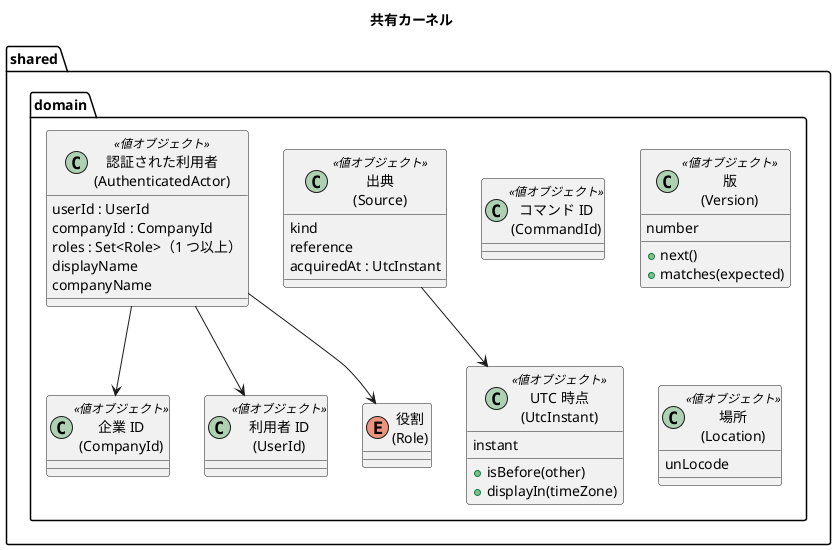

| 型 | 不変条件 |
| :--- | :--- |
| UTC 時点 | UTC の時点として保持する。表示はタイムゾーンと UTC offset を必ず付ける（BR-10） |
| 版 | 1 から始まり、増えるだけ。期待版と一致しない変更は競合とする（ARCH-HO-01） |
| 場所 | UN/LOCODE の形式（国コード 2 文字 + 地点コード 3 文字）だけを受け付ける |
| 出典 | 種類（外部原本・現場記録・社内確認・手動入力）、参照、取得時刻を必須とする |
| コマンド ID | UUID を必須とする（null 不可） |

ドメインイベントは、共有カーネルのインターフェースではなく、注釈 `@DomainEvent` を付けた record として各コンテキストの `domain.events` に置く（2026-10-02 の D-1、[ADR-003](../../adr/cargo-tracker/003-inter-context-integration.md) の補足の決定）。各イベントは受信側の冪等性のキーになる業務キーを持ち、Java の標準と共有カーネルの型だけを持つ。

## コンテキストごとのドメインモデル

各コンテキストについて、集約、エンティティ・値オブジェクト、不変条件、状態遷移、ドメインルールを示す。

### 見積り（Quotation、U1）

#### 見積りの集約

| 集約 | 集約ルート | 識別子 | 含むもの | 責務 |
| :--- | :--- | :--- | :--- | :--- |
| 輸送要求 | 輸送要求（TransportRequest） | 輸送要求 ID | 輸送要求版（エンティティ）、審査記録（エンティティ） | 下書き・提出・審査・差戻し・取下げと、版の管理 |
| 見積り | 見積り（Quotation） | 見積り ID | 料金根拠（値）、有効期限（値）、経路方針（値）、荷主の回答（値）、荷主承認（値） | 見積りの作成・社内承認・提示、荷主の回答、経路版の割当て、荷主承認、失効・置換 |

見積りを輸送要求の中に入れない理由: 見積りは版ごとに複数作られ（置換）、有効期限で単独に失効する。輸送要求の版の更新と見積りの承認が同じトランザクションで競合しないよう、別の集約にする。

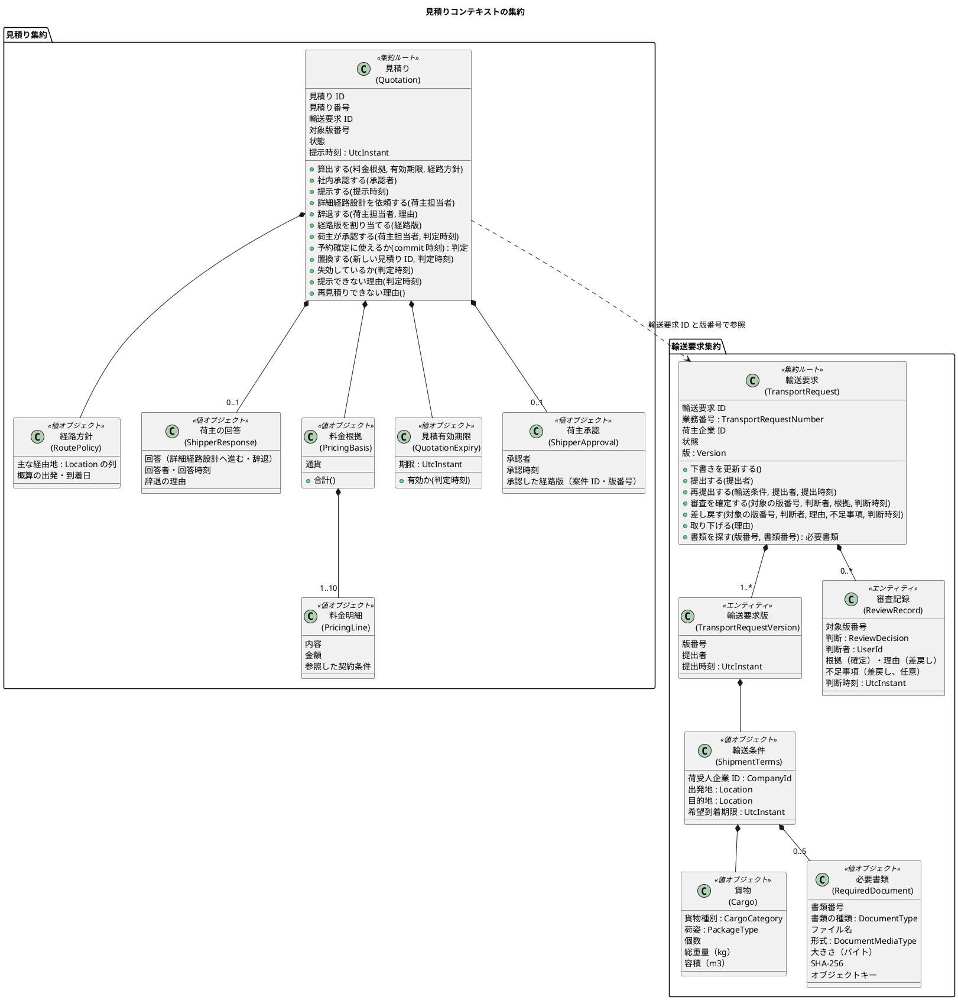

#### 見積りの状態遷移

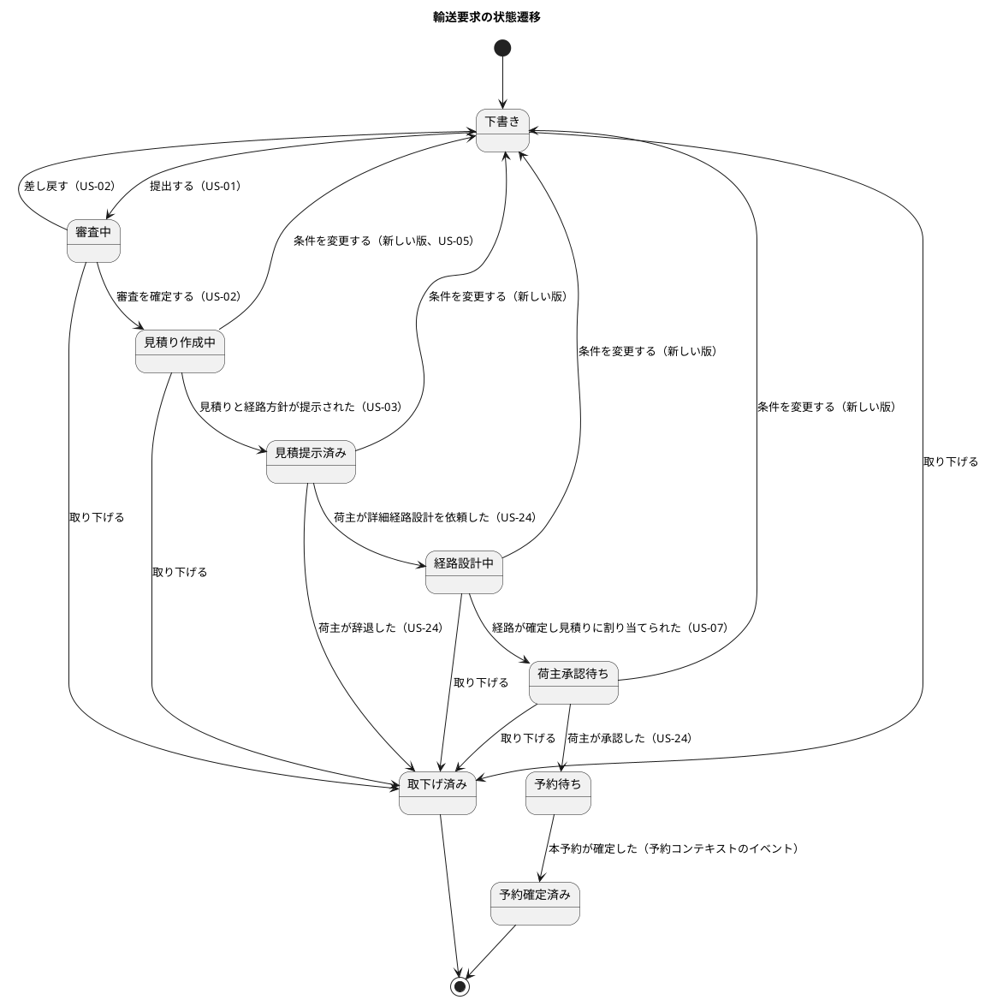

業務の順序は要件定義のエンドツーエンド業務フローに従う: 審査 → 見積りと経路方針の提示 → 荷主の回答 → 詳細経路設計 → 荷主の承認 → 本予約。要件定義の「見積提示済み → 失効」は、見積りの状態（失効）として扱う。見積りが期限で失効しても輸送要求はその状態のまま、新しい見積りを作れる。

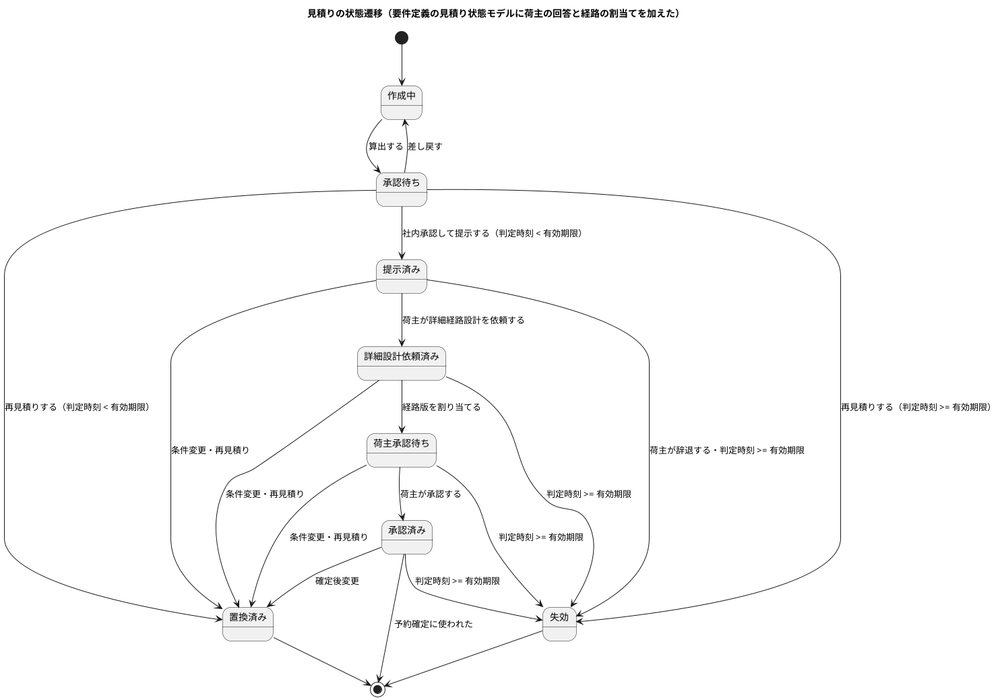

#### 見積りの不変条件とドメインルール

| ID | 不変条件・ルール | 根拠 |
| :--- | :--- | :--- |
| Q-INV-01 | 提出には必須条件（荷受人、出発地、目的地、希望到着期限、貨物）がそろっていること。必要書類は任意で、必須条件に含めない（2026-10-03 の D-20）。出発地と目的地は異なること（2026-10-02 の D-6）。不足や誤りがあれば下書きのまま不足項目と誤りを返す | US-01 |
| Q-INV-02 | 貨物種別が一般以外の輸送要求は提出できない。手動窓口を案内する | BR-03、US-01 |
| Q-INV-03 | 提出された輸送要求版は変更できない。変更は新しい版を作る | BR-04、US-05 |
| Q-INV-04 | 審査の確定は最新版に対してだけ行える。古い版の審査確定は拒否する。審査の対象の版番号を集約の現在の版番号と照合して判定する（ARCH-HO-01 の期待版（集約の `version`）の照合とは別の、業務の規則。Bolt 5）。差戻しも同じ照合を行う | US-02 |
| Q-INV-14 | 審査の確定・差戻しは、状態が審査中のときだけ行える。確定には根拠、差戻しには理由が必要で、不足事項は任意。根拠・理由・不足事項は 4,000 文字まで（2026-10-02 に human:kakimomokuri が承認。Bolt 5） | US-02 |
| Q-INV-15 | 再提出は、状態が下書きのときだけ行える。提出と同じ検証（Q-INV-01・02・12）を通し、版番号を 1 増やした新しい版を作って審査中にする。業務番号は変えない（Q-INV-13） | US-02、US-05 |
| Q-INV-16 | 必要書類は 1 つの版に 5 件まで（商業送り状 1 件、梱包明細 1 件、その他 3 件まで）。形式は PDF・PNG・JPEG で、中身の先頭のバイトで判定する。1 件 1 バイト以上 10 MB（10,485,760 バイト）まで。違反は提出の検証結果として、ほかの不足・誤りとまとめて返す。出し直しでは、添付した種類の前の版の書類を引き継がず（差し替え）、添付しなかった種類の書類を引き継ぐ。引き継ぐ書類と添付を合わせて同じ規則で判定する。新しい版の書類番号は 1 から振り直し、版の中で一意にする。件数の上限と書類番号の一意は輸送条件（ShipmentTerms）も守る（2026-10-03 の D-20。Bolt 7。差し替えは 2026-10-05 の D-25。Bolt 9） | US-01、US-02 |
| Q-INV-05 | 見積りの算出には料金根拠・有効期限・経路方針が必要。提示した時刻を記録する（KPI-01） | US-03、US-21 |
| Q-INV-17 | 算出の検証: 料金明細は 1〜10 行で、内容は 200 文字まで、金額は 0 より大きく整数部 13 桁・小数点以下 2 桁まで（合計も整数部 13 桁まで。表の NUMERIC(15,2)。Bolt 9・10 レビュー R-01）、参照した契約条件は任意で 200 文字まで。通貨は USD・EUR・JPY のどれか。有効期限は算出の時刻より後（同時刻と過去は誤り）。経路方針の主な経由地は 0〜5 件、概算の出発日時と到着日時は必須で、到着は出発より後。不足と誤りはまとめて返す。社内承認して提示できるのは承認待ちの見積りだけ（2026-10-05 の決定。Bolt 10） | US-03 |
| Q-INV-18 | 見積りを作れるのは、輸送要求が見積り作成中で、対象の版が現在の版のときだけ。1 つの輸送要求に、作成中・承認待ち・提示済みの見積りは 1 つだけ。詳細設計依頼済みも数える（2026-10-06 の決定。Bolt 12）。置換済み・失効の見積りは数えない。再見積りは、旧版を置換済み・失効にしてから新しい見積りを作る。DB でも部分一意インデックスで守る（2026-10-05 の決定。Bolt 10・11） | US-03 |
| Q-INV-06 | 見積りが予約確定に使えるのは、状態が承認済みで、予約確定の commit 時刻が有効期限より前のときだけ。同時刻は失効とする | BR-10、US-03、US-04 |
| Q-INV-07 | 失効・置換済みの見積りは再提示・承認・予約確定に使えない。新しい見積りを作る。失効は判定時刻 >= 有効期限で決め、状態が承認待ち・提示済みのままでも失効として扱う。承認待ちの見積りも失効したら提示できない（2026-10-05 の決定。Bolt 11。承認・予約確定での拒否は US-24・US-04 の Bolt） | BR-16、US-03 |
| Q-INV-08 | 利用者は自社の輸送要求だけを操作できる（アプリケーション層で確認し、集約は荷主企業 ID を保持する） | BR-07、US-01 |
| Q-INV-09 | 詳細経路設計の依頼と辞退は、提示済みの見積りに対してだけ行える。依頼の時刻が有効期限と同時刻または後なら失効として拒否する（Q-INV-07）。辞退には理由が必要で、辞退した見積りは失効する（依頼は 2026-10-06 の決定。Bolt 12） | US-24 |
| Q-INV-10 | 荷主の承認は、見積りに割り当てた経路版が確定済みで、承認の時点で再設計要・旧版でなく、見積りが有効期限内のときだけ行える。承認には承認した経路版を記録する。R0.1（Bolt 20）は、荷主承認待ち・有効期限内（承認の時刻 < 有効期限）・自社の輸送要求を確かめる。再設計要・旧版の判定は、再設計（US-08）と DE-06 を作る W6 で足す（R0.1 では確定した経路版が変わらないため起きない） | BR-01、BR-10、BR-16、US-24 |
| Q-INV-11 | 輸送要求の複製は、輸送条件を引き継いだ新しい下書きを作る。希望到着期限と必要書類は引き継がない | US-01 |
| Q-INV-12 | 希望到着期限は提出時刻より後でなければならない。同時刻と過去は誤りとする。期限が経路設計に間に合うかは、提出では判定せず経路設計の制約適合（BR-11）で判定する。個数は 1 以上の整数、総重量と容積は 0 より大きい値（小数点以下 3 桁まで）とする（2026-10-02 に human:kakimomokuri が承認） | US-01 |
| Q-INV-13 | 業務番号は初回の提出で振り、差戻し・再提出・新しい版では変えない。同じ番号を 2 つの輸送要求に振らない（D-10） | US-01、D-4 |

| ドメインルール | 英語名 | 内容 |
| :--- | :--- | :--- |
| MVP 受付範囲 | MvpAcceptancePolicy | 貨物種別が一般かを判定する。後続段階で特殊貨物を受け付けるときは、この規則を差し替える。提出の検証（ShipmentTermsInput）が使う |
| 見積有効判定 | — | 判定時刻と有効期限から有効・失効を判定する。判定時刻は呼び出し側が commit 時刻として渡す。見積有効期限（QuotationExpiry）の「有効か(判定時刻)」が担い、別の型にしない（判定を 1 か所に置く。Bolt 11） |

提出の検証は、輸送条件の入力（ShipmentTermsInput）が Q-INV-01・Q-INV-02・Q-INV-12 をまとめて判定し、違反をすべて提出の検証結果（SubmissionViolations）として返す（1 件ずつ直させない）。違反がなければ、同じ判定の結果として輸送条件（ShipmentTerms）を返す（検証を通らずに輸送条件を作れないよう、変換を別の操作に分けない。Bolt 4 レビュー R-04）。そのうえで業務番号の採番（TransportRequestNumberIssuer）で番号を得て提出する。採番のポートは `domain.model` に置き、実装は `infrastructure.persistence` に置く。

必要書類（Bolt 7）: 輸送条件の入力は添付の一覧を受け取り、書類の受付規則（RequiredDocumentPolicy）が Q-INV-16 を判定する。違反がなければ、アプリケーション層が書類の保存（RequiredDocumentStorage）に中身を保存してオブジェクトキーを得て、必要書類として輸送条件に入れる。ファイル名は画面に出すだけに使い、オブジェクトキーには使わない（`quotation/{輸送要求 ID}/{UUID}`）。書類の取得は、荷主用（荷主企業で絞った照会を通す）と社内用（営業担当者）に入力ポートを分ける（Bolt 4 R-02、Bolt 5 R-10 と同じ形）。どちらも、版と書類番号で書類を探す操作は輸送要求（集約）が持ち、取得できるのは現在の版の書類だけとする（前の版の書類番号は見つからない扱い。Bolt 6〜8 レビュー R-10・R-19）。書類の受付規則は、判定した形式を判定の結果として返し、アプリケーション層は形式を判定し直さない（R-11）。保存のポートは `domain.model` に置き、実装は `infrastructure` に置く。

見積りの提示（Bolt 10）: 見積りは輸送要求と別の集約で、作る（作成中）→ 算出する（承認待ち。Q-INV-05・17）→ 社内承認して提示する（提示済み。DE-03）の順に進む。輸送要求の状態（見積提示済み）は、DE-03 を受けた別のトランザクションで変え、2 つの集約を 1 つのトランザクションで更新しない（ドメインモデル「見積りを輸送要求の中に入れない理由」）。荷主の画面の見積りの照会は、輸送要求と同じく荷主企業で絞る（Q-INV-08）。社内の照会は `Staff…` の入力ポートに分ける。

見積りの失効と置換（Bolt 11）: 失効は状態を書き換えずに、見積有効期限（QuotationExpiry）の「有効か(判定時刻)」が判定時刻と有効期限から決める（同時刻は失効。Q-INV-06）。判定時刻は呼び出し側が渡す（社内承認して提示する・再見積りは操作の時刻、予約確定は commit 時刻）。社内承認して提示するときに失効していれば「失効している」で拒否し、置換済みなら「置換済み」で拒否する（Q-INV-07）。再見積りは、旧版の状態遷移（置換済みと置換先の見積り ID、または失効）と新しい見積りの作成を 1 つのトランザクションで行う。同じ集約の型の 2 つのインスタンスを 1 つのトランザクションで更新する例外で、理由は Q-INV-18 が見積りのインスタンスをまたぐ規則であり、DB の部分一意インデックスで守るため（旧版の更新を先に書く）。新しい見積りの提示で発行する DE-03 は、輸送要求がすでに見積提示済みなので状態を変えない。提示できるか・再見積りできるかは、集約の「提示できない理由(判定時刻)」「再見積りできない理由()」に問い合わせ、画面はその結果を写す（Bolt 11 レビュー R-07）。古い版に対する見積りは再見積りできない（理由: 古い版。R-06）。社内の受付一覧（S-02）の見積提示済みの表は、見積提示済みの見積依頼ごとの最新の見積り（見積り番号の最大）を有効期限の近い順に返す読み取りモデル（`QuotedRequestSummary`）で、集約を組み立てない（R-02）。

荷主の回答（Bolt 12）: 荷主が詳細経路設計へ進むと回答すると、見積りは提示済みから詳細設計依頼済みになり、回答者（認証までは仮の荷主の利用者）と回答時刻を記録して DE-16 を生成する。回答できるかは集約の「回答できない理由(判定時刻)」に問い合わせ、置換済み・失効（記録または判定時刻で）を先に見て、そうでなければ状態に応じて詳細設計依頼済み（回答済み）か提示済みでないかを返す。荷主に見えるか（提示した見積りか）も集約に問い合わせ、見えない見積りへの回答は見つからない扱いにする（Bolt 12 レビュー R-19）。時刻で失効し得る状態と Q-INV-18 で数える状態は、見積りの状態（QuotationStatus）の述語が決める（R-05）。画面の操作の出し分けもこれを使う。輸送要求の経路設計中への変更は、DE-16 を受けた別のトランザクションで行い、見積り作成中・見積提示済みで同じ版のときだけ変える（冪等。DE-03 と同じ）。DE-16 が DE-03 より先に届いても経路設計中にし、遅れて届いた DE-03 では戻さない（Bolt 12 レビュー R-04・R-06）。詳細設計依頼済みの見積りも、判定時刻が有効期限と同時刻または後なら失効として扱う（状態は書き換えない）。経路設計案件がまだないため、詳細設計依頼済みの見積りは再見積りできない（理由: 詳細設計依頼済み）。経路設計の途中の再見積り・条件変更は US-05・US-07 で決める。社内の受付一覧（S-02）の経路設計中の表は、経路設計中の見積依頼ごとの詳細設計依頼済みの見積りを依頼時刻の古い順に返す読み取りモデルで、集約を組み立てない。

経路版の割当てと荷主の承認（Bolt 20）: 経路設計が経路を確定すると（DE-05）、経路設計の中の listener が見積りの公開 API（経路の割当て。`quotation.interfaces.api.RouteAssignment`）を呼ぶ（ADR-014）。見積りは詳細設計依頼済みのときだけ経路版を割り当てて荷主承認待ちになり、割り当てた経路（案件番号・経路版番号・確定の時刻・区間の写し）を持ち、DE-21 を生成する。有効期限を過ぎていても割り当てる（期限は承認の時点で判定する。Q-INV-07・10）。同じ経路版の割当ては何もしない（冪等。DE-05 の再配信）。別の経路版の割当てと、置換済み・失効の記録・作成中・承認待ち・提示済み・承認済みへの割当ては、割り当てずに理由を値で返し、listener は警告のログを残す（経路設計の確定は戻さない）。荷主の承認は荷主承認待ちのときだけで、承認の時刻が有効期限と同時刻または後なら失効として拒否する（AC5）。置換済み・失効の記録も拒否し、新しい見積りが必要と示す。荷主担当者 1 名の承認で足り（BR-01）、承認者・承認時刻を記録して DE-04 を生成する（承認した経路版は割り当てた経路）。承認できるかは集約の「承認できない理由(判定時刻)」に問い合わせ、画面の操作の出し分けもこれを使う。荷主企業での絞り込み（Q-INV-08）は、荷主の照会を通したアプリケーション層で行う。輸送要求の荷主承認待ち（DE-21）と予約待ち（DE-04）は、それぞれのイベントを受けた別のトランザクションで変え、同じ版のときだけ変える（冪等。DE-03・DE-16 と同じ）。荷主承認待ち・承認済みの見積りは Q-INV-18 で数え、時刻で失効し得る。再見積りは、経路設計の途中と同じく、再設計（US-08）で決めるまでできない。

審査（Bolt 5）: 社内の画面（S-02・S-03）は営業担当者がすべての荷主の輸送要求を扱うため、リポジトリに荷主企業で絞らない照会（業務番号の検索、審査中の一覧）を持つ。荷主の画面の照会は、業務番号が推測しやすいため必ず荷主企業で絞る（Bolt 4 レビュー R-02）。2 つの照会は名前と入力ポートを分け（荷主用の照会サービスと、社内用の `StaffTransportRequestQueryService`）、取り違えを防ぐ。受付一覧は集約を組み立てない読み取りモデル（`TransportRequestSummary`）で、最初の提出時刻（版 1）の古い順に並べる（Bolt 5 レビュー R-05・R-09・R-10）。下書きを保存するまでは（R1.0）、再提出が輸送条件の入力を受け取る。

荷主の再提出（Bolt 6）: 荷主の見積依頼の一覧（C-02）は、リポジトリの `findSummariesByShipper(荷主企業)` で、自社の輸送要求だけを最初の提出時刻の新しい順に返す。一覧の行（`TransportRequestSummary`）は状態を持ち、荷主の画面はそれを「いま誰の対応待ちか」に対応させる（審査中・見積り作成中は A 社、下書きはお客様）。荷主に見せる審査記録は直近の差戻しの理由と不足事項だけで、審査の確定の根拠と判断者は社内の記録として見せない（2026-10-03 の人の決定）。集約の操作は足さず、再提出は Bolt 5 の `再提出する()` を荷主企業で絞った照会の後に呼ぶ。

Q-INV-01 の「下書きのまま」は、R1.0 で下書きを保存するまで、下書きを保存せずに入力を残して同じ画面を表示することで満たす（2026-10-02 の人の決定。Bolt 4）。下書きの操作（`下書きを更新する()`）と `transport_request_draft` は R1.0 の下書き保存で作る。必要書類は、ファイルの保存とあわせて Bolt 4 の次の Bolt で必須条件に入れる。

### 経路設計（Routing、U2）

#### 経路設計の集約

| 集約 | 集約ルート | 識別子 | 含むもの | 責務 |
| :--- | :--- | :--- | :--- | :--- |
| 経路設計案件 | 経路設計案件（RoutingCase） | 経路設計案件 ID | 経路版（エンティティ）、経路候補（エンティティ）、判断根拠（値） | 候補の算出・比較、専門判断、確定、再設計要、再設計 |
| 航海 | 航海（Voyage） | 航海番号 | 運航予定（値）、寄港（値）、採用情報版（値） | 外部原本から採用した運航予定の保持と更新 |
| 接続時間規則 | 接続時間規則（ConnectionRule） | 規則 ID | 対象の航路・港、必要最小接続時間 | 航路別の必要最小接続時間の管理（BR-11） |

経路版を経路設計案件の中に入れる理由: 再設計では旧版と新版の関係（新旧関係、変更根拠、引き継ぐ不適合理由）を一貫して保つ必要がある（US-08）。経路版を独立した集約にすると、「確定済みの経路版は案件に 1 つだけ」という不変条件を集約をまたいで守ることになる。

航海を経路設計案件の外に置く理由: 航海は多くの案件から参照され、外部原本の採用で独立に更新される（第 2 章の Voyage 集約と同じ）。

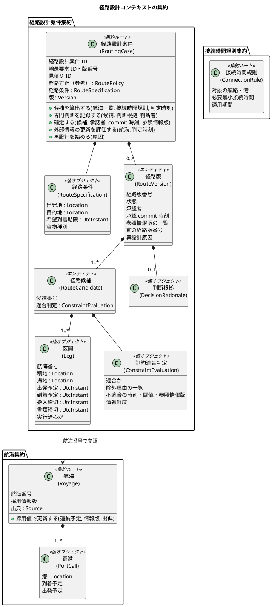

#### 経路版の状態遷移

要件定義の経路版の状態モデルに、本書の呼び名を合わせた。

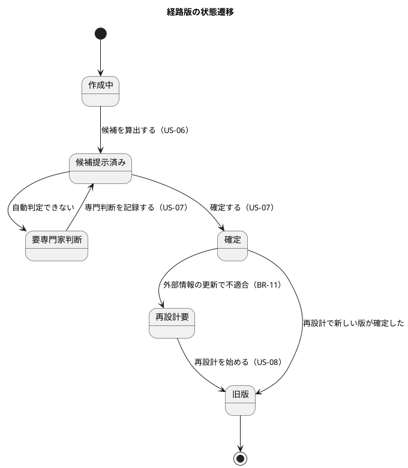

#### 経路設計の不変条件とドメインルール

| ID | 不変条件・ルール | 根拠 |
| :--- | :--- | :--- |
| R-INV-01 | 候補は、到着予定が希望到着期限以前で、すべての接続時間が必要最小接続時間以上のときだけ適合とする。同時刻・同値は適合 | BR-11、US-06 |
| R-INV-02 | 期限に間に合わない候補、貨物種別に対応しない候補、接続できない候補は除外し、不適合となった時刻・閾値・参照情報版を残す | BR-02、US-06 |
| R-INV-03 | 確定は承認の commit 時点で再検証し、参照した情報版が承認中に更新されていれば確定を拒否する | BR-11、US-07 |
| R-INV-04 | 確定には判断根拠と、経路設計者の役割が必要 | US-07、BR-15 |
| R-INV-05 | 1 つの経路設計案件で「確定」の経路版は同時に 1 つだけ | US-07、US-08 |
| R-INV-06 | 旧版・再設計要の経路版は再確定・新規予約への割当てに使えない | BR-16、US-07 |
| R-INV-07 | 確定後に外部情報の更新で不適合になっても、経路版を再設計要にするだけで予約を取り消さない。参照した旧情報版を保持する | BR-11、US-07 |
| R-INV-08 | 再設計は実行済みの区間を変えず、未実行の区間だけを対象にする。新版は旧版の番号と変更根拠を持つ | US-08 |
| R-INV-09 | 外部情報が停止中のときは、最終採用値と取得時刻を示し、情報不足として識別する | US-06 |
| R-INV-10 | 経路設計案件は、荷主の詳細経路設計の依頼（DE-16）を受けて作る。案件は輸送要求版ごとに 1 つだけで、依頼のイベントが再配信されても重複して作らない | 業務フロー、US-24、ARCH-HO-01 |
| R-INV-11 | 経路が確定したら、依頼元の見積りに経路版を割り当てる（DE-05）。荷主の承認は割り当てた後に行う | 業務フロー、BR-01 |

| ドメインルール・サービス | 英語名 | 内容 |
| :--- | :--- | :--- |
| 制約適合判定 | ConstraintEvaluator | 経路条件、区間の列、接続時間規則、判定時刻から適合・除外と理由を返す純粋な関数。Golden dataset で検証する |
| 経路候補探索 | RouteCandidateFinder | 航海の一覧から出発地から目的地までの区間の列を列挙する。MVP は確定的な列挙とし、最適化はしない（スコープ外） |

経路候補探索と制約適合判定は複数の航海と規則を扱うため、ドメインサービスにする。どちらも状態を持たず、リポジトリを呼ばない。必要な航海と規則はアプリケーションサービスが読み込んで渡す。

Bolt 17（US-06 AC1〜AC3）で決めたこと（[Bolt 17 計画](../../development/cargo-tracker/bolt_17_plan.md) の確認ポイント 2・3・8・9・10）:

- 経路設計案件は DE-16 を受けて作り、経路条件は見積りの公開 API（`quotation.interfaces.api` の経路条件の照会）から ACL 越しに得て、経路条件（`RouteSpecification`）に変える。案件には案件番号を振り、経路版 1 を作成中で持つ。
- 候補探索は、判定時刻より後に出発する区間で、出発地から目的地への直行と 1 回の積替え（区間 1〜2）を列挙する。同じ航海を 2 回使う列は列挙しない。3 区間以上は R1.0（W6）。候補は到着予定の早い順に 20 件まで。
- 接続時間は、前の区間の到着予定から、同じ港での次の区間の出発予定まで。積替えの港に判定時刻で有効な接続時間規則がなければ、その候補を「接続できない」で除外する（失敗に倒す）。
- 制約適合判定は、期限超過（不適合の時刻は到着予定、閾値は希望到着期限、参照情報版は最終区間の航海の採用情報版）と、接続不足（時刻は次の区間の出発予定、閾値は必要最小接続時間と規則の港、参照情報版は次の区間の航海の採用情報版）を返す。両方に当たれば理由を 2 つ持つ。貨物種別は R0.1 では判定しない。
- 候補の接続余裕は、接続時間から必要最小接続時間を引いた値のうち最も小さいもの（直行は持たない）。情報鮮度は、候補に使った航海の取得時刻のうち最も古いもの。
- 候補を算出すると経路版は作成中から候補提示済みになる。候補提示済みで再算出すると、候補を置き換え、判定時刻を更新する。
- 依頼の後に輸送要求が再提出されて経路条件が得られないときは、案件を作らず警告のログを残す（確認ポイント 3。補償の扱いは Bolt 17 レビュー D-64 で後の Bolt に回した）。案件の作成と候補の算出は監査記録に書かない（確認ポイント 16。監査の対象は確定から）。
- 候補探索は、目的地に寄った後の港へ運んでから積み替えて目的地へ戻る列を列挙しない（Bolt 17 レビュー D-60）。

Bolt 19（US-07 AC1・AC2）で決めたこと（[Bolt 19 計画](../../development/cargo-tracker/bolt_19_plan.md) の確認ポイント 2〜10）:

- 経路設計案件は経路版の一覧を持つ（Bolt 17 レビュー D-64）。R0.1 は案件に経路版 1 つで運用し、新しい経路版を作るのは再設計（US-08）。候補の算出は最新の経路版だけを書き換え、確定した経路版は書き換えない。
- 確定は、候補提示済みの経路版の適合の候補に、判断根拠（前後の空白を除いて 1〜4,000 文字）と承認者を付けて行う。承認者が経路設計者の役割を持つかを集約でも確かめる（URL の認可と二重に守る）。
- 確定の再検証（R-INV-03 の R0.1 の範囲）: 選んだ候補の保存済みの区間を、確定の時刻（承認 commit 時刻）で有効な接続時間規則と希望到着期限で制約適合判定にかけ直し、不適合なら拒否する。最初の区間の出発予定が確定の時刻と同時刻または前なら出発済みとして拒否する。航海を読み直して参照情報版の更新を拒否するのは AC3（W6、#16）。R0.1 の制約適合判定は期限の判定に判定時刻を使わず、希望到着期限も案件の中で変わらないため、期限の再判定は算出のときと同じ結果になる（変わり得るのは接続時間規則の選び直しだけ）。
- 確定の拒否の理由は、経路設計者でない（`NOT_ROUTE_DESIGNER`）、確定できない状態（`NOT_CONFIRMABLE_STATE`。作成中、確定済み。判定は `RoutingCase.confirmable()` の 1 か所）、ない候補（`CANDIDATE_NOT_FOUND`）、除外の候補（`CANDIDATE_EXCLUDED`）、根拠の不足（`RATIONALE_MISSING`）、根拠が 4,000 文字を超える（`RATIONALE_TOO_LONG`。文字はコードポイントで数える。判定は `DecisionRationale.rejectionOf` の 1 か所）、出発済み（`ALREADY_DEPARTED`）、確定の時刻で不適合（`NO_LONGER_CONFORMING`）。この順に確かめる。確定の後の候補の再算出は、Bolt 17 のとおり算出できない状態として例外で拒否する（R-INV-06）。
- 確定すると経路版は確定になり、選んだ候補番号・判断根拠・承認者・承認 commit 時刻を持つ。案件は確定した経路版の番号を 1 つだけ持つ（R-INV-05）。参照情報版は候補の区間の採用情報版で、経路版に写しを持たない。承認 commit 時刻は、確定のトランザクションの中で時計から得た確定の判定の時刻（コミットの時刻の近似。画面では承認時刻と示す）。
- 確定すると DE-05（経路を確定した）を発行する。見積りの有効期限で確定を拒否しない（失効した見積りへの割当てと荷主の承認の拒否は見積り側。US-24 AC4・AC5）。DE-05 は経路設計の中の listener が受け、見積りの公開 API（経路の割当て）を呼んで依頼元の見積りに経路版を割り当てる（R-INV-11、ADR-014。Bolt 20）。見積りは DE-05 を購読しない（依存が循環する。Bolt 19 レビュー D-71）。確定は監査証跡（US-17）にまだ書かず、経路版の列で残す。

### 予約（Booking、U6）

#### 予約の集約

| 集約 | 集約ルート | 識別子 | 含むもの | 責務 |
| :--- | :--- | :--- | :--- | :--- |
| 貨物予約 | 貨物予約（Booking） | 予約 ID | 予約版（エンティティ）、変更・取消申請（エンティティ）、追跡番号（値）、輸送段階（値） | 本予約の確定、変更・取消しの申請と承認、版の管理 |

第 2 章の Cargo 集約に当たる。第 2 章では Cargo が経路（Itinerary）と配送状況（Delivery）を持つが、本設計では経路は経路設計の経路版を番号で参照し、配送状況は追跡コンテキストが持つ。

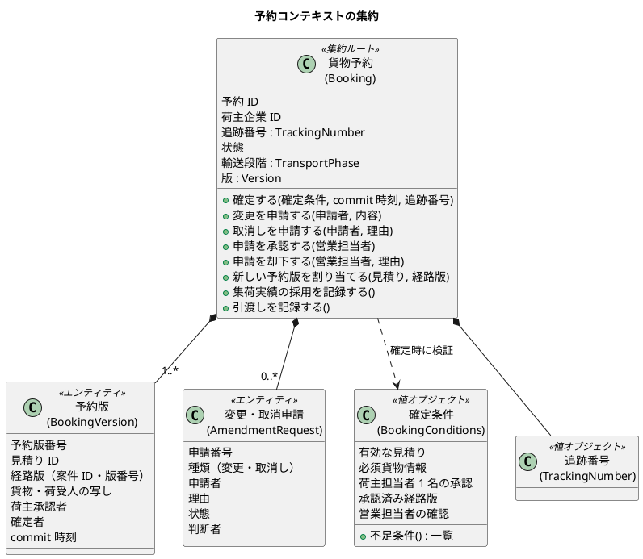

#### 予約の状態遷移

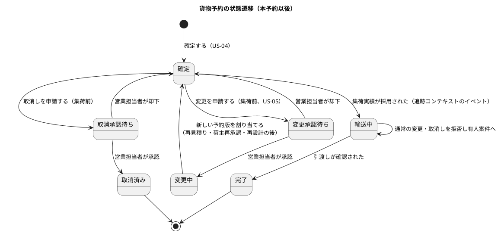

#### 予約の不変条件とドメインルール

| ID | 不変条件・ルール | 根拠 |
| :--- | :--- | :--- |
| B-INV-01 | 本予約は、有効な見積り、必須貨物情報、荷主担当者 1 名の承認、承認済み経路版、営業担当者による条件確認がそろったときだけ確定する。不足条件を返す | BR-01、US-04 |
| B-INV-02 | 見積りの有効性は予約確定の commit 時刻で判定する。同時刻以後は失効。判定は見積りの Q-INV-06 の 1 か所に置き、予約は commit 時刻を渡して見積りの公開 API で照会する（ADR-016） | BR-10、US-04 |
| B-INV-03 | 同じコマンド ID の確定要求は予約を重複生成せず、既存の追跡番号を返す。同じコマンド ID で内容（業務番号・見積り番号・操作者）が違えば衝突として拒否する。確定に成功した要求だけを処理済みコマンドに記録する。処理済みコマンドは 90 日で削除する（RET-06）ので、その後の同じコマンド ID の再送は同じ見積りの予約として既存の追跡番号を示す（Bolt 24） | US-04、PV-01 |
| B-INV-04 | 特殊貨物を含む輸送要求は確定しない | BR-03、US-04 |
| B-INV-05 | 再設計要・旧版の経路版、失効・置換済みの見積りは確定・新しい予約版に使えない | BR-16 |
| B-INV-06 | 変更・取消しの申請は集荷前（輸送段階が集荷前）のときだけ受け付け、予約の状態は承認まで変えない。輸送段階は DE-09 で結果整合的に更新されるため、申請の承認時には追跡の公開 API で集荷実績の有無を同期で確かめ、採用済みなら承認せず有人案件へ引き継ぐ。注: 「追跡の公開 API へ同期で確かめる」は、追跡が予約の下流なので ADR-015 の依存の向きと食い違う。US-05（W11）の Bolt で決め直す | BR-04、US-05 |
| B-INV-07 | 集荷後の通常の変更・取消しは拒否し、要求と理由を記録して有人案件へ引き継ぐ | BR-04、BR-17、US-05 |
| B-INV-08 | 予約版は不変。変更の承認で料金・経路に影響する場合は、旧版を保持して新しい予約版を作る | BR-04、US-05 |
| B-INV-09 | 期待版が現在版と違う変更は競合として拒否する | ARCH-HO-01、US-05 |
| B-INV-10 | カスタマーサポートは予約を確定・変更できない（アプリケーション層の認可） | US-11、BR-15 |
| B-INV-11 | 1 つの見積りから確定できる貨物予約は 1 件だけ。別のコマンド ID・別の利用者による同時の確定でも 2 件目は拒否し、既存の追跡番号を示す（貨物予約の見積り ID の一意制約。予約版ではなく貨物予約に置く。Bolt 23 レビュー） | PV-01（重複予約 0 件）、US-04 |
| B-INV-12 | 他のコンテキストからのイベントは、イベントが持つ発行元の集約の版が、記録済みの版より新しいときだけ適用する。古い版のイベントは無視して記録だけ残す | ARCH-HO-01、イベントの順序 |

| ドメインルール・サービス | 英語名 | 内容 |
| :--- | :--- | :--- |
| 確定条件の検証 | BookingConditions | 見積り・経路版・貨物・承認の状態を受け取り、不足条件を返す。見積りと経路版の状態は、アプリケーションサービスが ACL 越しに取得して値として渡す |
| 追跡番号の発行 | TrackingNumberIssuer | 推測されにくい一意な追跡番号を発行する（ファクトリ） |
| 確定の判定の順序 | BookingCommandService | 役割（B-INV-10）→ 処理済みコマンド（B-INV-03。内容が同じなら最初の結果、違えば衝突）→ 業務番号と見積り番号で引いた同じ見積りの貨物予約（B-INV-11。既存の追跡番号）→ 見積りの公開 API の照会（commit 時刻。B-INV-02・05）→ 確定条件（B-INV-01）の順に判定する。確定の後に見積りが失効・置換されても、再送と同じ見積りの確定は失効にしない。同時の確定で一意制約に負けた側は、保存をセーブポイントに戻し、同じトランザクションで読み直して同じ結果を返す（Bolt 24） |

### 追跡（Tracking、U3）

#### 追跡の集約

| 集約 | 集約ルート | 識別子 | 含むもの | 責務 |
| :--- | :--- | :--- | :--- | :--- |
| 追跡記録 | 追跡記録（TrackingRecord） | 追跡番号 | 予定（値）、主要実績（エンティティ）、訂正（エンティティ）、現在状態（値） | 予定と実績の保持、現在状態の導出、確認中の保留、訂正の二者確認 |
| 有人案件 | 有人案件（ServiceCase） | 受付番号 | 進捗（エンティティ）、回答（エンティティ）、復旧照合の要否と結果（値） | 顧客照会・業務例外の受付から終結・再開まで。荷主は自社の問い合わせを照会・再開できる（US-23） |
| 照会記録 | 照会記録（InquiryRecord） | 照会記録 ID | 経路（顧客 Web・電話・メール・Web の問い合わせ）、対象、受付時刻、有人対応へ移ったか | KPI-02 の分母と分子の記録（US-21） |
| 営業日カレンダー | 営業日カレンダー（BusinessCalendar） | 年 | 営業日・休業日、営業時間 | 受領・回答期限の計算（BR-09、US-20） |

第 2 章の TrackingActivity が HandlingEvent の列を持つのと同じく、追跡記録が主要実績の列を持ち、現在状態を集約の中で導出する（ADR-002）。

荷主の追跡の照会（US-09 AC1。Bolt 27）は次のとおり。

- 追跡記録の操作「顧客向けに表示する」のうち、Bolt 27 は荷主の分だけを `customerView()` として作る。照会結果 `CustomerTrackingView` は現在状態・当初の到着予定・最新の到着見込み・予定区間と、採用済みの主要実績（`CustomerMilestone`: 種類・場所・発生時刻・出典。発生時刻の順、同じ時刻は実績番号の順）だけを持つ。経路版・実績番号・実績の状態・登録者は持たない（T-INV-09 の荷主の範囲）
- 照会者の立場で項目を切り替える開示範囲（`DisclosureScope`）は、立場が 2 つになる荷受人の照会（US-10・R1.1）で作る。いまは荷主しかいないので、引数を持たない操作にした
- 自社の追跡記録だけを照会することは、荷主用の照会のサービス（`CustomerTrackingQueryService`）がリポジトリの荷主企業で絞る口を使って守る（BR-07）。他社の追跡番号は存在しない番号と同じに扱う
- 照会記録（IR-INV-01）は W9 で作るので、それまでの荷主の照会は照会記録に残らず、KPI-02 の分母に入らない。顧客への表示の可否（`shown_to_customer`）は確認中（US-11）と訂正（US-13）で足す。いまは採用済みの実績をすべて示す

主要実績の登録（US-12 AC1・AC2。Bolt 26b）は次のとおり。

- 追跡管理者が登録した実績は採用（`ADOPTED`）にし、現在状態の導出に入れる。下書き（`DRAFT`）は外部原本の取込（DE-13、W7）で作る実績に使う。BR-05 の二者確認は訂正（T-INV-06）にかかり、登録にはかからない
- 同じ出典識別子（出典の種類と参照。取得時刻は含めない）の実績があれば、新しい実績を作らず既存の実績を返す（T-INV-02）。この判定は未来の発生時刻の拒否（T-INV-13）より先で、コマンドサービスでも画面を開いたときの版の照合より先に置く（二重送信にも既存の実績を返す）
- 追跡記録は不変で、登録は新しい追跡記録を返す。版はリポジトリが保存のときに増やす（楽観ロック）。コマンドサービス `TrackingRecordCommandService.registerMilestone` の結果は `Registered`（実績番号と現在状態）、`AlreadyRegistered`（既存の実績番号）、`Rejected`（理由）、`NotFound`、`Conflict`（版の不一致、保存のときの楽観ロックの競合、同じ出典・同じ実績番号の同時の登録による一意制約の違反）
- 実績の種類と追跡状態の対応: 集荷 → 集荷済み、搬入 → 出発地搬入済み、出発 → 輸送中、積替 → 積替え中、到着 → 目的地到着、引渡し → 引渡し済み。積替港での到着は積替、積替港からの出発は出発として登録する（場所では判定しない）。R0.1 では目的地到着から引渡しの実績で引渡し済みへ直接進め、引渡し可能（荷降ろし・通関等完了）はその実績の種類と手続き中の段階を作る Bolt で足す
- ドメインイベントは発行しない（DE-09 は ADR-014 の形に直す W7、DE-18 は確認中が起きる W7）

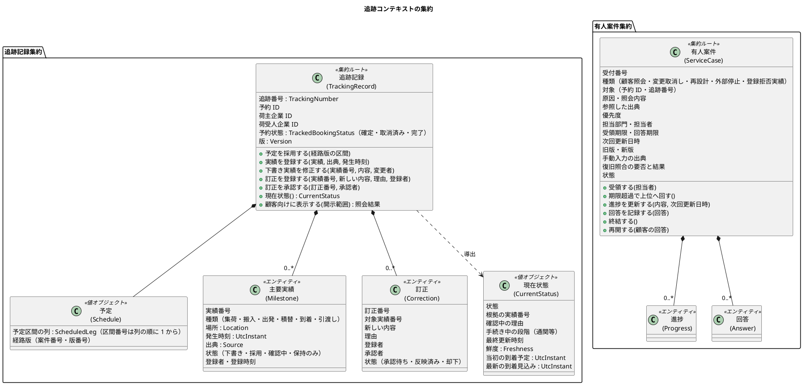

#### 追跡の状態遷移

追跡状態は要件定義の追跡状態モデルを使う。状態名は業務責任者の確認前の候補である（要件定義の注記）。

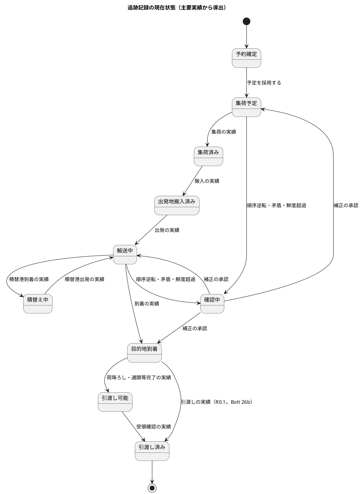

有人案件の状態遷移は、要件定義の例外案件の状態モデルを US-20 の受入条件に合わせて具体化した。

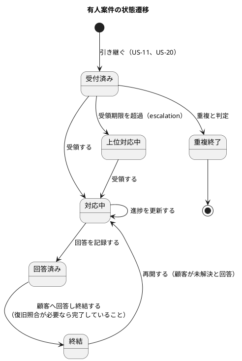

要件定義の例外案件の状態（評価中、顧客確認待ち、解決確認中）は第 2 段階の例外対応で使う。MVP の有人案件は US-20 の受入条件に必要な状態だけを持つ。

#### 追跡の不変条件とドメインルール

| ID | 不変条件・ルール | 根拠 |
| :--- | :--- | :--- |
| T-INV-01 | 主要実績は削除・上書きしない。訂正は原実績に関連付けた訂正記録で行う | BR-05、US-13 |
| T-INV-02 | 同じ出典識別子の実績は重複登録せず、既存の記録を返す | US-12 |
| T-INV-03 | 時系列に反する・矛盾する実績は保持するが現在状態に直ちに反映せず、確認中にする | BR-06、US-12 |
| T-INV-04 | 取消済み予約への実績登録は拒否し、発生事実を有人案件として起票する | BR-16、US-12 |
| T-INV-05 | 完了済み（引渡し済み）の追跡への遅延実績は保持のみとし、現在状態を自動で後退・再開しない | BR-16、US-12 |
| T-INV-06 | 訂正には理由が必要。採用済みまたは顧客表示済みの実績の訂正は、登録者と異なる追跡管理者の承認まで採用値を変えない | BR-05、US-13 |
| T-INV-07 | 採用前の下書き実績は二者確認なしで修正でき、変更者と変更時刻を記録する | BR-05、US-13 |
| T-INV-08 | 予定と実績を混同しない。現在状態は採用済みの実績だけから導出し、予定は予定として示す。例外は予定の採用による「予約確定 → 集荷予定」だけ（要件定義の追跡状態モデルの遷移。Bolt 25） | 要件定義 追跡状態モデル、US-09 |
| T-INV-09 | 顧客向けの表示は開示範囲（荷主・荷受人）に絞る。荷受人には到着予定、現在状態、主要実績、最終更新時刻だけを示す | BR-07、US-10 |
| SC-INV-01 | 有人案件は受付番号を持ち、種類に応じた必須項目（原因、担当、期限、旧版・新版、手動入力の出典、顧客連絡、復旧照合）をそろえて起票する | BR-09、BR-17、US-20 |
| SC-INV-02 | 復旧照合が必要な案件は、照合が完了するまで終結できない | US-20 |
| SC-INV-03 | 再開しても受付番号と過去の回答履歴を保持する | US-20、US-23 |
| SC-INV-04 | 受領・回答期限は営業日カレンダーで数える。営業時間外の起票は翌営業日の開始から数え、優先度高は起票時に受付番号と次回更新日時を依頼元へ返す | BR-09、US-20 |
| SC-INV-05 | 荷主は自社の問い合わせだけを照会・再開できる | BR-07、US-23 |
| T-INV-10 | 当初の到着予定（確定した経路版）と最新の到着見込みを分けて持ち、どちらかで他方を上書きしない | US-09、要件定義 RQ-03 |
| T-INV-11 | 追跡記録は予約 1 件に 1 件。同じ予約の DE-07 の再配信は追跡記録を作らず、DE-22 も発行しない（追跡記録の予約 ID の一意制約。ADR-015 の冪等。Bolt 25） | ADR-015、PV-01 |
| T-INV-12 | 予定は区間 1 件以上で、列の順に区間番号を 1 から振る。各区間の到着予定は出発予定より後、前の区間の揚地は次の区間の積地と同じ。経路版が見つからない・区間が不正・DE-07 の企業 ID がないときは、警告のログを残して追跡を開始しない（再配信で直らない欠け。予約サガは処理中のまま、W8 の滞留の有人確認要が拾う。Bolt 25） | ADR-015、要件定義 追跡状態モデル |
| T-INV-13 | 発生時刻が登録時刻より後（未来）の実績は登録しない。同時刻は受け付ける（Bolt 26b） | US-12 |
| IR-INV-01 | 顧客 Web の追跡照会は自動で照会記録にする。同じ利用者・同じ追跡番号の 30 分以内の再表示は 1 件にまとめる。照会の後 24 時間以内に同じ追跡番号の問い合わせが起票されたら、有人対応へ移ったと記録する | KPI-02、US-21 |
| IR-INV-02 | 電話・メールの照会は、引継ぎが不要でもカスタマーサポートが記録する | KPI-02、US-21 |

| ドメインルール・サービス | 英語名 | 内容 |
| :--- | :--- | :--- |
| 現在状態の導出 | CurrentStatusDeriver | 採用済みの実績の列と予定から現在状態と確認中の理由を導く。追跡記録の中で使う。Bolt 26b は、採用済みの実績のうち発生時刻が最も新しいもの（同じ時刻なら実績番号の大きい後の登録）の種類に対応する状態と、その実績番号（根拠の実績番号）を返す。採用済みの実績がなければ集荷予定のまま。確認中の理由（AC3）は W7 |
| 鮮度の判定 | FreshnessPolicy | 最終取得時刻と許容範囲から鮮度超過を判定する。許容範囲の値は非機能要件（NFR-FRESH-01）で決める |
| 開示範囲 | DisclosureScope | 照会者の立場（荷主・荷受人・社内）から表示してよい項目を決める |

### アクセス・監査（Identity & Audit、U4）

ADR-002 により単純なモデルとする。認証の流れ（2 段階のログイン、session）は Spring Security に任せ、ドメインモデルは業務上の規則（TOTP の再利用の拒否、一度だけの回復コード、ロック）だけを持つ。TOTP のコードの生成は `TotpCodeGenerator` のポートの裏の java-otp に、回復コードのハッシュは `RecoveryCodeHasher` のポートの裏の bcrypt に任せる（[ADR-011](../../adr/cargo-tracker/011-mfa-totp.md)、Bolt 30）。生成器は持ち主の利用者 ID と暗号化した秘密（`EncryptedSecret`）と時間の刻みを受け（`code(UserId, EncryptedSecret, long)`）、復号はインフラ層の実装の中で済ませる（Bolt 31。利用者 ID は Bolt 31b）。暗号文は `totp-secret:` と利用者 ID を AAD にして暗号化し、別の利用者の暗号文では復号できない（Bolt 31b）。照合と刻みの使用は、アプリケーションのサービス `TotpVerificationService`（`identity.application.internal.commandservices`）が行う。TOTP の資格の集約が前後 1 つの刻みの照合（`match`。結果は値 `TotpMatch` の一致した刻み・再利用・不一致。Bolt 31d で `matchingStep` から改めた）を、リポジトリが刻みの使用（条件付きの更新。件数が 0 なら同時の確かめで後になったので再利用）を受け持ち、サービスは時刻を `Clock` から刻みに直し、照合の結果を写して両者をつなぐ（資格を作り直して再利用を見分ける回り道はない。Bolt 31d）。Spring Security の provider はサービスの結果を認証の成否に直すだけにする（層の規則 D-5 の認証の例外。ADR-012 の決定 6、Bolt 31）。保存した要素（暗号文・回復コードのハッシュ）を読めないことはドメインの例外 `UnreadableCredentialException`（`identity.domain.model.aggregates`）で表し、暗号の部品（`identity.infrastructure.crypto`）が投げ、provider と登録のサービスがこれだけを拒否に倒す。ほかの実装の誤りは 500 にする（ADR-011 の決定 8、Bolt 31d）。`UnreadableCredentialException` は `RuntimeException` を継ぐ（Bolt 32 で `IllegalArgumentException` から改めた。実装の誤りを捕まえる `catch` と取り違えないため）。

ログインのロック（Bolt 32。ADR-011 の決定 9）では、規則（5 回・15 分、ロック中は数えない・延ばさない）はログインの失敗の集約と方針のまま、数える・0 に戻す・監査記録を書くのはアプリケーションのサービス `LoginAttemptService`（`commandservices`）が 1 つのトランザクションで行う（IA-INV-08）。リポジトリの `recordFailure` は条件付きの更新の件数から、数えたかと数えた後の状態を値 `FailureCount` で返し、サービスはそれでロック中の試行（理由 `LOCKED`）と、この失敗でロックしたこと（`ACCOUNT_LOCKED`）を見分ける。最初の失敗の行は、主たるトランザクションの前にトランザクションの外の 1 文で作る（`prepare`。一意制約の違反はトランザクションの外で受ける）。ロックの判定は `isLocked` の 1 か所で、password の段は照合の後の確認（入口の部品 `LockAwareUserDetailsChecker`）が、TOTP・回復コードの段は provider が確かめる前に呼ぶ。`CargoUserDetails` にロックの項目は足さない（session の直列化の互換）。認証の監査のリスナーは誤りの失敗・ロック中の試行・2 つの要素がそろった成功をサービスに写し、数えない拒否と password の段の成功は監査記録に直接書く。

request ごとの確かめ（Bolt 32c。IA-INV-04、ADR-012 の見直しの 3）では、ドメインのポート `UserStandingRepository`（`identity.domain.model.aggregates`。認証の要素のポートと同じ置き場所）が利用者とその所属企業の組 `UserStanding` を 1 回の読み出しで返す。アプリケーションのサービス `SessionRevalidationService`（`commandservices`）は利用者の集約の `authenticationRejection(company)` で判定し（ログインと同じ規則）、利用者がなければ `UNKNOWN_USER` にする。拒否なら監査記録 `SESSION_REVOKED`（結果は失敗、理由、session の主体の利用者 ID と企業 ID）を 1 つのトランザクションで書き、拒否でなければ今の役割・表示名・企業名の `AuthenticatedActor` を返す。役割が変わっただけのときは記録しない。認証の入口のフィルター `SessionRevalidationFilter` が結果を session と主体に写す（ADR-012 の決定 6 の認証の例外の範囲）。集約と規則は変えない。

初回の TOTP の登録（Bolt 31b。ADR-011 の決定 6）では、秘密の発行は `TotpSecretIssuer`、回復コードの生成は `RecoveryCodeGenerator` のポートの裏に置き、実装は `identity.infrastructure` に置く。認証の要素のポート（生成・発行・ハッシュ・回復コードの生成）は、前例にそろえて `identity.domain.model.aggregates` に置く。ZXing をインフラ層に閉じるため、表示の値はポートが値 `TotpProvisioning`（`identity.domain.model.valueobjects`）にして返す。登録はアプリケーションのサービス `TotpEnrollmentService`（`commandservices`）が行う。`begin` は登録済みなら拒み、登録の途中の暗号文を同じ利用者の AAD で復号できる限り使い続け、なければ新しく発行する。`complete` は暗号文と入れたコードを前後 1 つの刻みで照合し、1 つのトランザクションで TOTP の資格を追加し（最後に使った刻みは 0。登録のコードは A-02 でもう一度使える）、回復コード 10 個をハッシュで置き換え、監査記録を書き、回復コードの平文を返す。同時の登録は TOTP の資格の主キーで 1 つに絞り、主キーの違反はリポジトリの実装で `DuplicateTotpEnrollmentException` に写す。登録は TOTP の要素を与えず、ログインは A-02 で終える。登録済みかの問い合わせは `TotpEnrollmentQueryService`（`queryservices`）に置き、画面の層だけが呼ぶ（`TotpVerificationService` から移した）。利用者の登録の状態は TOTP の資格の有無で決まり（未登録 → 登録済み）、状態の列は持たない。登録の途中は session の属性（暗号文の文字列と登録を始めた時刻）で、ドメインモデルには置かない。

認証された利用者を表す値 `AuthenticatedActor`（利用者 ID・企業 ID・役割（1 つ以上）・表示名・企業名）と役割 `Role`（BR-15 の 8 役割）は、共有カーネル（`shared`）に置く。ほかのコンテキストはこの型だけを受け取り、Spring Security の型にも `identity` にも依存しない。`AuthenticatedActor` は 2 つの要素（password と TOTP または回復コード）がそろった主体だけを表し、引数の解決は `FACTOR_TOTP` がない主体に渡さない。password の段だけで開く画面（A-02・A-07）は、identity の中だけの値 `PasswordVerifiedUser`（`identity.domain.model.valueobjects`。利用者 ID・企業 ID・メールアドレス）を受ける（ADR-012 の見直しの 4、Bolt 31c）。`identity` に置くと、`quotation → identity → quotation::events` の依存が循環するため（ADR-011 の決定 4、[ADR-012](../../adr/cargo-tracker/012-authentication-principal-and-session.md)、Bolt 14 の確認ポイント 2）。利用者の集約は「認証できない理由」（利用停止・企業が無効）を返し、Spring Security の利用者の読み出しがその理由を認証の失敗に変える（IA-INV-09）。監査記録の操作には、ログインの成功（`LOGIN_SUCCEEDED`）・失敗（`LOGIN_FAILED`）・ログアウト（`LOGOUT`）を Bolt 14 で足す。Bolt 31 で password の段の成功（`PASSWORD_VERIFIED`）を足し、`LOGIN_SUCCEEDED` は 2 つの要素（password と TOTP）がそろったときにする。TOTP の失敗は利用者と理由（`INVALID_TOTP`・`TOTP_REUSED`）で `LOGIN_FAILED` に記録する（ADR-012 の見直しの 1）。Bolt 31b で初回の TOTP の登録（`TOTP_ENROLLED`。主体の利用者 ID と企業 ID）を足す（先取りの登録を見つける手がかり。ADR-011 の決定 6）。Bolt 31c で回復コードの使用（`RECOVERY_CODE_USED`。主体の利用者 ID と企業 ID）を足し、回復コードでログインを終えたときは `RECOVERY_CODE_USED` と `LOGIN_SUCCEEDED` の 2 行を書く。回復コードの拒否は理由 `INVALID_RECOVERY_CODE` で `LOGIN_FAILED` に記録する（ADR-011 の決定 7）。Bolt 31d で、TOTP を登録していない利用者の TOTP の送信の理由を `INVALID_TOTP` から `TOTP_NOT_ENROLLED` に分ける（利用者への応答は変えない。ADR-011 の決定 8）。Bolt 32 で、ロック（`ACCOUNT_LOCKED`。結果は成功、理由なし、主体の利用者 ID と企業 ID）と、ロック中の試行の理由 `LOCKED`、利用者の読み出しの DB の誤りの理由 `SERVICE_ERROR` を足す（どちらも数えない。ADR-011 の決定 9）。Bolt 32c で、request ごとの確かめで session を捨てたこと（`SESSION_REVOKED`。結果は失敗、理由 `SUSPENDED`・`COMPANY_INACTIVE`・`UNKNOWN_USER`、session の主体の利用者 ID と企業 ID）を足す（ADR-012 の見直しの 3）。2 つ目の要素の権限 `FACTOR_TOTP` とその認証の結果 `TotpAuthenticationToken` は「TOTP または回復コードで与える 2 つ目の要素」を表し、session の直列化の互換のため名前を変えない（用語集）。Bolt 33 で、password の再設定の依頼（`PASSWORD_RESET_REQUESTED`）を足す。有効な利用者は `SUCCESS`（理由なし）、止められた利用者は `FAILURE`・`SUSPENDED`、所属企業の無効は `FAILURE`・`COMPANY_INACTIVE`、登録なしは `FAILURE`・`UNKNOWN_USER`（操作者を空にし、メールアドレスを残さない）。Bolt 33a で、password の再設定の完了（`PASSWORD_RESET_COMPLETED`。`SUCCESS`、理由なし、操作者に利用者と企業を入れる。`AuditRecord.passwordResetCompleted(user, company, at)`）を足す。成功だけを記録し、方針の誤り・無効なリンク・利用停止と企業の無効での拒否は記録しない（依頼は Bolt 33 で記録済み）。Bolt 33b で、TOTP の再登録（`TOTP_RE_ENROLLED`。`SUCCESS`、理由なし、操作者に利用者と企業を入れる。`AuditRecord.totpReEnrolled(user, company, at)`）を足す。成功だけを記録し、コードの誤り・期限切れ・秘密が読めない・利用できないときは記録しない（失敗の試行の監査は #49 と同じ扱い）。

password の再設定（US-18 AC8。Bolt 33 は依頼から送信まで、新しい password の設定は Bolt 33a。[ADR-017](../../adr/cargo-tracker/017-notification-module-and-mail.md)）では、再設定のトークン `PasswordResetToken`（`identity.domain.model.aggregates`）を利用者とは別の集約にする。トークンの生成は `PasswordResetTokenGenerator`（32 バイトの乱数を URL 安全な Base64）、ハッシュは `PasswordResetTokenHasher`（SHA-256）のポートの裏に置き、実装は `identity.infrastructure.crypto` に置く（回復コードの生成とハッシュと同じ分け方）。依頼のサービス `PasswordResetRequestService`（`commandservices`）は、入力を `EmailAddress` で正規化して利用者を探し、`User#authenticationRejection(company)` と `UserStandingRepository` で有効かを判定し、監査記録を同じトランザクションで書く（IA-INV-08）。有効なら依頼の ID を採番してドメインのイベント `PasswordResetRequested`（`identity.domain.events`。依頼の ID・利用者の ID・依頼の時刻だけ）を出す。応答は登録の有無にかかわらず同じで、トークンの発行も送信も待たない。トークンの発行と送信は、イベントのハンドラー `PasswordResetMailEventHandler`（`eventhandlers`、`@ApplicationModuleListener`。依頼のコミットの後に別のスレッドと別のトランザクションで動く。ADR-003）が行う。ハンドラーは利用者の行をロックして同時の発行を直列にし、同じ依頼の ID のトークンがあれば何もしない（再配信で 2 通送らない）。前の発行から 1 分以内なら発行も送信もしない（繰り返し）。そうでなければ前の未使用のトークンを無効にし、トークンを発行してハッシュを保存し、設定の公開の base URL（`cargotracker.public-base-url`。Host ヘッダーから組み立てない）からリンクを組み立て、ACL `NotificationPasswordResetMails` で通知の公開 API に送る。送信が `Failed` でも例外にせず完了にする（再配信で新しいトークンを作らない。利用者が依頼し直す）。平文のトークンと URL はハンドラーのメソッドの中の変数と送信の要求だけにあり、イベントの発行記録・ログ・表に残らない。繰り返しで送らなかったことは監査に書かず、送信の記録がないことで分かる。

利用者の役割の管理（US-16 の一部。Bolt 34）では、役割の組合せの規則を `identity.domain.model.rules` の `RoleAssignmentPolicy` に置き、利用者の集約が判定（自分の変更 → 役割なし → 変更なし → 企業の種類 → 職務分離の順）を返す。変更履歴は別の表を作らず、監査記録 `ROLES_CHANGED` の対象（`USER`・利用者 ID・更新した後の版）と変更前後（役割の名前を `Role` の宣言の順にカンマでつないだ文字列）で代える（`user_role` は今の値だけを持つ。2026-10-16、human:kakimomokuri）。同時の更新は `app_user.version` を条件にした更新の件数で判定し、ドメインでは判定しない。管理範囲（`user_assignment` の `COMPANY`）と利用停止は Bolt 34b で足す。

新しい password の設定（Bolt 33a。2026-10-15 の開始準備の決定 1・2）は、アプリケーションのサービス `PasswordResetCompletionService`（`commandservices`）が受ける。画面の層はリポジトリに依存しないので、リンクを開く処理（`open`。トークンをハッシュにして探し、使えればトークンの ID を返す）と A-06 の GET（`isUsable(tokenId)`）もこのサービスを通す。設定（`complete(tokenId, newPassword)`）の結果は、完了・方針の誤り（種類）・無効のいずれかで、1 つのトランザクションで次の順に行う。

1. password の方針 `PasswordPolicy`（`identity.domain.model.rules`）で確かめる。よく使われる password の一覧（ポート `CommonPasswordList`）を引くのはサービスで、照合の結果を方針に渡す（方針は純粋に保つ）。誤りならトークンを使わずに誤りの種類（`PasswordPolicyViolation`）を返す
2. トークンを条件付きで使う（使っておらず、無効にしておらず、期限の前の行だけ。更新の件数が 0 なら無効）
3. 利用者を読み、利用停止・所属企業の無効なら無効を返す（理由を示さない。監査を書かず、トランザクションを戻す）
4. ポート `PasswordHasher` でハッシュを作り、利用者の集約の `changePassword(newHash)` で password を変えて保存する
5. 同じ利用者の未使用のトークンを無効にする
6. 監査記録 `PASSWORD_RESET_COMPLETED` を書く

コミットの後に、ポート `UserSessionRevoker` の `revokeAll(メールアドレス)` でその利用者の session をすべて失効させる（Spring Session は自分のトランザクションで動くので、完了のトランザクションに入れない）。失効が失敗しても警告のログにとどめ、完了にする（password は変わっている）。ロックと失敗の数（ログインの失敗の集約）は変えない（SEC-02）。password の要素は与えず、利用者は A-01 から新しい password と TOTP でログインし直す（ADR-011）。

password の方針は、12 文字以上 64 文字以下（code point で数える。空白と全角の文字を許す）、UTF-8 で 72 バイト以下（bcrypt は 72 バイトを超える password で例外を投げる）、よく使われる password の一覧に載っていない（大文字小文字を区別しない）の 3 つで、短い・長い・72 バイト・よく使われる、の順に確かめて最初の違反だけを返す（SEC-04・SEC-05）。Unicode の正規化はしない（ログインの照合と同時に直す必要があるので、扱うなら別の Bolt）。方針は合成ルートの `@Bean` で返せない（AT-07）ので、サービスの `@Bean` の中で `new` する（`LockPolicy` の前例）。利用者の集約は版を写さず、password の更新は版を上げるが条件にしない（同じ利用者の同時の設定は、トークンの条件付きの使用で 1 つに絞られる。[データモデル](data_model.md)）。

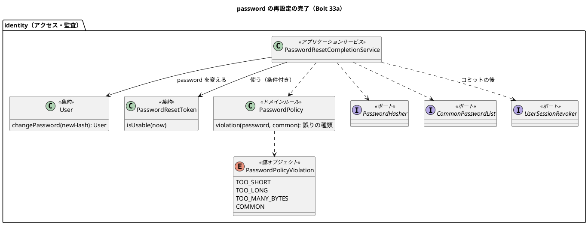

回復コードによる TOTP の再登録（Bolt 33b。US-18 AC9、SEC-10、[ADR-011](../../adr/cargo-tracker/011-mfa-totp.md) の決定 10。2026-10-15 の開始準備の決定 1・2）は、アプリケーションのサービス `TotpReEnrollmentService`（`commandservices`）が受ける。入口は回復コードでログインした印（ログインから 15 分だけ有効）だけで、画面（A-08）は 2 つの要素がそろった主体の利用者 ID を渡す。サービスは利用者の ID で `User` を読んでメールアドレスと企業 ID を得て、段に中立な値 `EnrollingUser`（`identity.domain.model.valueobjects`。利用者 ID・企業 ID・メールアドレス）にする（主体の型は変えない。ADR-012）。初回の登録の `TotpEnrollmentService` も `PasswordVerifiedUser` でなく `EnrollingUser` で受ける。2 つのサービスが共用するのは、秘密の発行のポート（`TotpSecretIssuer`。表示の値 `TotpProvisioning` を返す）と値 `EnrollingUser` で、A-08 は `TotpEnrollmentService` を呼ばない。途中の暗号文を使い続ける処理は部品 `TotpProvisioningStarter`（`commandservices`。Bean にせず、2 つのサービスが組み立てる）に、回復コード 10 個の発行（平文の一覧 → ハッシュ → そろいの確かめ）は工場メソッド `RecoveryCode.issueSet` に寄せ、2 つのサービスが使う（Bolt 33d。2026-10-16 の開始準備の決定 2。`instanceof` の分岐は `switch` にする）。

- `begin(利用者, 途中の暗号文)`: 利用者を読み（利用停止・所属企業の無効は利用できない）、途中の暗号文が同じ利用者の AAD で読めればそれを使い、なければ新しい秘密を発行して、暗号文と表示の値を返す（資格の有無は問わない。A-07 と同じく再読み込みで鍵を変えない）
- `complete(利用者, 暗号文, コード, 始めた時刻, 今の session の ID)`（Bolt 33e から session の ID は値 `SessionId`）: 15 分の上限をサービスで判定する（2 つの要素がそろった session では `SessionLifetimeFilter` の上限が効かないため）。暗号文で新しいコードを前後 1 つの刻みで照合する（誤りは置き換えない）。今の秘密が送られた暗号文と同じなら（二度押し・別のタブ）置き換えない。1 つのトランザクションで、TOTP の資格を再登録の前に読んだ秘密のままのときだけ置き換える条件付きの更新（`replace(資格, 読んだ秘密)`）で置き換え（`TotpCredential.reEnroll`。0 件なら、ほかの画面で先に登録し直していたとしてトランザクションを戻す）、回復コード 10 個を置き換え（`RecoveryCodeRepository.replaceAll`）、監査記録 `TOTP_RE_ENROLLED` を書く。コミットの後に `UserSessionRevoker.revokeOthers(メールアドレス, 今の session の ID)` を呼び、失敗は警告のログにとどめて完了にする。外側のトランザクションの中では呼べない（Bolt 33a と同じガード）。監査を書けなければ全体を戻し、失効させない
- 結果（`ReEnrollmentResult`）は 6 種類で、完了（`ReEnrolled`。回復コードの平文 10 個）・コードの誤り（`CodeRejected`）・期限切れ（`Expired`）・秘密が読めない（`SecretUnusable`。`UnreadableCredentialException`）・ほかの画面や二度押しで先に登録し直していた（`Superseded`）・利用できない（`Unavailable`。利用停止・所属企業の無効・資格がない）のいずれか。印の期限（ログインから 15 分）が A-08 の期限（開いてから 15 分）より先に来るので、期限切れは画面からはほぼ届かない守りである。始めた結果（`ReEnrollmentStart`）は、始めた・利用できない

置き換えと照合の競合（開始準備の決定 2 の (5)）: A-02 の照合は資格を読んでから刻みを使うまでトランザクションの外で間があるので、その間に置き換えが確定すると、古い秘密で照合したコードの刻みが新しい資格で使われうる。刻みの使用 `useStep(利用者, 読んだ暗号文, 刻み)` は、照合で読んだ秘密の暗号文が今の行と同じで、刻みが最後に使った刻みより大きいときだけ更新する（引数が変わる）。置き換えの後は 0 件になり、再利用と同じく拒む。置き換えは最後に使った刻みを古い値と新しいコードの刻みの大きい方にし（IA-INV-10 の単調性を保つ）、再登録で確かめたコードは A-02 でもう一度使えない（初回の登録は 0 にして使える。A-07 との違い）。

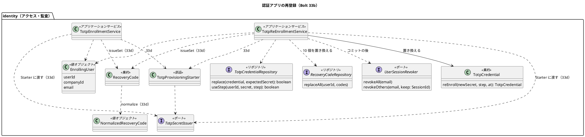

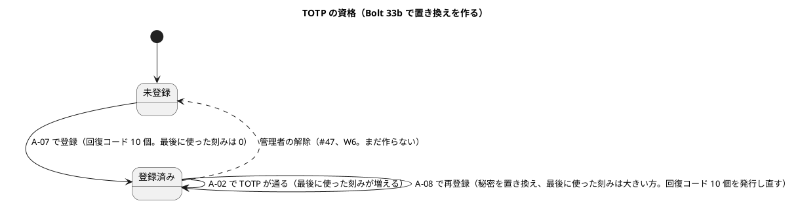

session の期間（Bolt 33c。2026-10-15 の開始準備の決定 2、human:kakimomokuri が決定。ADR-012 の決定 3）は、ドメインルール session の方針 `SessionPolicy`（`identity.domain.model.rules`、`@DomainRule`。ロックの方針 `LockPolicy` と並べる）にまとめる。2 つの要素がそろった session の 8 時間、password の段の 5 分、登録の途中の 15 分、回復コードでログインした印の 15 分、再登録の 15 分を `Duration` の定数で持つ。Bolt 33e から、期限の判定（ちょうどの時刻は期限切れ）も `SessionPolicy.isExpired` に寄せ、認証の入口・画面の層・再登録のサービスの 4 か所が使う（2026-10-16、Bolt 33e の開始準備の決定 2）。Bolt 33b までは同じ値を認証の入口（`identity.infrastructure.security` の定数のクラス。Bolt 33c で名前と期間を `SessionKeys`・`SessionPolicy` に移して消した）・A-07 の画面・印の判定（`RecoveryLogin`）・再登録のサービスが別々に持っていた。方針は期間だけを持ち、ふるまいは持たない（期限の判定は今の置き場所のまま。`LockPolicy` は判定のふるまいを持つが、ここでは期間だけを寄せる）。`Duration` は `java..` なのでドメインの規則に当たらない。session と request の属性の名前は HTTP の関心で業務の知識ではないので、ドメインに置かず application 層の `SessionKeys` に置く（[バックエンドのアーキテクチャ](architecture_backend.md)）。Bolt 33f から、期限の時刻 `deadline` も `SessionPolicy` に置き（共有カーネルの `UtcInstant` は変えず、中で包む）、画面に示す期間の文言（「15 分」「8 時間」）もこの期間から描く（2026-10-16、Bolt 33f の開始準備の決定 3・5）。

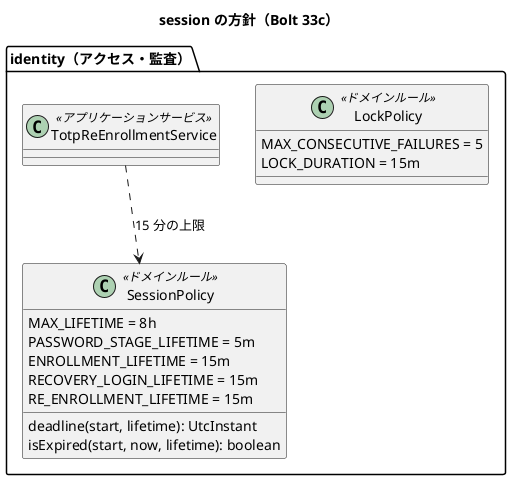

| 集約 | 集約ルート | 識別子 | 含むもの | 責務 |
| :--- | :--- | :--- | :--- | :--- |
| 企業 | 企業（Company） | 企業 ID | 種類（荷主・荷受人・A 社）、有効・無効 | 企業の有効性 |
| 利用者 | 利用者（User） | 利用者 ID | メールアドレス、password のハッシュ、役割（値）、担当企業・担当案件（値）、利用状態 | 役割の付与・職務分離、利用停止、password の変更（`changePassword(newHash)`。Bolt 33a） |
| TOTP の資格 | TOTP の資格（TotpCredential） | 利用者 ID | 暗号化した秘密、最後に使った時間の刻み、登録時刻 | 再利用の拒否（IA-INV-10）、前後 1 つの時間の窓の照合（Bolt 30。結果は `TotpMatch`。Bolt 31d）、秘密の置き換え（`reEnroll(newSecret, step, at)`。Bolt 33b） |
| 回復コード | 回復コード（RecoveryCode） | 回復コード ID | 利用者 ID、ハッシュ、使った時刻、発行時刻 | 一度だけの使用（IA-INV-11。Bolt 30）、認証アプリの再登録での発行し直し（Bolt 33b） |
| ログインの失敗 | ログインの失敗（LoginFailure） | 利用者 ID | 連続の失敗の回数、ロックの期限（ロックの方針 `LockPolicy` は引数で受け取る） | ロック（IA-INV-03。Bolt 30。数え方と監査記録は `LoginAttemptService`。Bolt 32） |
| 再設定のトークン | 再設定のトークン（PasswordResetToken） | トークン ID | 依頼の ID、利用者 ID、トークンのハッシュ、発行時刻、期限、使った時刻、無効にした時刻 | 1 回だけの使用、30 分の期限、新しい発行と設定の完了による前のトークンの無効化（IA-INV-12。Bolt 33。使うのは Bolt 33a） |
| 参照許可 | 参照許可（AccessGrant） | 参照許可 ID | 予約 ID、荷受人企業、開示項目、有効期間、状態 | 荷受人の招待・受諾・取消し |
| 監査記録 | 監査記録（AuditRecord） | 監査記録 ID | 操作者、時刻、対象と版、変更前後、理由、承認、出典、結果 | 追記専用の証跡 |
| KPI 計測 | KPI 計測記録（KpiObservation） | 輸送要求 ID・週 | 提出時刻、最初の提示時刻、照会の件数、基準値 | KPI-01・KPI-02 の週次の算出（US-21） |

TOTP の資格・回復コード・ログインの失敗は、利用者とは別の集約にする。どれも利用者の行と版に触れず、1 文の条件付きの更新（更新の件数で判定する）で原子的に変える。失敗のたびに利用者の版が上がると、利用者の管理の更新とぶつかるため（Bolt 30 の計画の承認。ADR-011・ADR-012 を改めた）。回復コードは自分のリポジトリを持ち、消費が原子的な更新の単位なので、エンティティでなく小さな集約とする。再設定のトークンも同じ理由で利用者とは別の小さな集約にし、版を持たず、無効化と使用を条件付きの更新（使っておらず無効にしていない行だけ）で行う（Bolt 33）。ログインの失敗の行がない利用者は「0 回・ロックなし」として扱い、存在しないメールアドレスの失敗では行を作らない（T-42）。

| ID | 不変条件・ルール | 根拠 |
| :--- | :--- | :--- |
| IA-INV-01 | 役割は BR-15 の 8 つに固定する。システム管理者・監査担当者に業務データを変更できる役割を併せて付与できない（Bolt 34 で `RoleAssignmentPolicy` として実現。システム管理者と監査担当者の併用は BR-15 の文言どおり拒まない。システム管理者は自分の役割を変えられない） | BR-15、US-16 |
| IA-INV-02 | 業務担当者は担当企業・担当案件だけを操作できる | BR-15、US-16 |
| IA-INV-03 | 5 回連続で認証に失敗したら 15 分ロックする。password・TOTP・回復コードの失敗を合わせて数え（回復コードは Bolt 32）、ロック中の試行は数えず期限も延ばさず、ロック中でなければ成功で 0 に戻す（ロック中の成功ではロックを消さない）。ロックは 5 回目の失敗の時刻から 15 分の経過で解け（14 分 59 秒では解けない）、解けた後の失敗は 1 回目から数え直す（Bolt 30）。0 に戻す成功は 2 つの要素（TOTP または回復コード）がそろったログインだけで、password の段の成功では戻さない。数えないのは、ロック中の試行、存在しない利用者、password が正しく利用停止・無効な企業で拒んだとき、利用者の読み出しの DB の誤り、TOTP の登録（A-07）のコードの誤り。ロック中の試行は、正しい認証情報でも誤りと同じ応答で拒む（AC2。Bolt 32）。session は無操作 30 分または TOTP が初めて通った時刻から 8 時間で失効する（password の段だけの session は password を確かめた時刻から 5 分。Bolt 31） | BR-14、US-18 AC3 |
| IA-INV-04 | 利用停止・権限取消しは次の request から反映する。認証済みの request ごとに `SessionRevalidationService` が利用者・役割・企業を 1 回で読んで判定し、止められた利用者の session は捨てて A-03 に、取り消した役割の URL は A-04 にする（Bolt 32c。それまではログインの時点の役割） | BR-14、US-16、US-18 |
| IA-INV-05 | 参照許可は予約の荷受人と一致する相手にだけ発行し、同じ予約・荷受人への有効な許可を重複発行しない | BR-07、US-19 |
| IA-INV-06 | 取り消された参照許可は、既存の session でも直ちに無効になる | BR-07、US-10、US-19 |
| IA-INV-07 | 監査記録は追記だけを許し、更新・削除しない。関連する記録の欠落は異常として示す | NFR-AUDIT-01、US-17 |
| IA-INV-08 | 認証の成功・失敗・ロック、権限外のアクセス試行は、ドメインイベントを経ずに同じ request の中で同期に監査記録へ書く。ログインの失敗の回数とその監査記録（`LOGIN_FAILED`・`ACCOUNT_LOCKED`）、成功で 0 に戻すことと `LOGIN_SUCCEEDED` は 1 つのトランザクションにし、監査記録の追記が失敗したら回数も戻す。ロックの監査はその失敗でロックしたときだけ 1 行書く（Bolt 32）。request ごとの確かめで session を捨てたときの `SESSION_REVOKED` も、その request の中で 1 つのトランザクションで書き、追記が失敗したら session を捨てて 500 にする（Bolt 32c） | AUD-01、US-16〜US-19 |
| IA-INV-09 | 利用停止の利用者と、無効な企業に所属する利用者は認証できない。理由は監査記録にだけ残し、利用者には誤った認証情報と同じ応答を返す（Bolt 14 で追加） | US-18 AC2・AC4、SEC-11 |
| IA-INV-10 | TOTP の資格は 1 人に 1 つ。最後に使った時間の刻みは単調に増え、それ以下の刻みのコードは受け付けない（同じコードの再利用の拒否）。資格のない利用者の TOTP は拒否する（Bolt 30 で追加）。認証アプリの再登録（Bolt 33b）では、1 人 1 つのまま秘密を置き換える（行を足さない。資格がなければ置き換えない）。最後に使った時間の刻みは置き換えでも戻さず、古い値と再登録で確かめた新しいコードの刻みの大きい方にする。刻みの使用は、照合で読んだ秘密の暗号文が今の行と同じときだけ行う（置き換えの前に古い秘密で照合を終えた要求は、置き換えの後は通らない） | US-18 AC1・AC9、ADR-011 |
| IA-INV-11 | 回復コードは 1 人に 10 個で、発行のたびに置き換える。ハッシュだけを持ち、一度使ったら使えない（使った時刻を入れて残す）。未使用のコードがなければ拒否する（Bolt 30 で追加）。初回の発行は TOTP の登録と同じトランザクションで行い、10 個を乱数で作り（形は `1a2b-3c4d`、重複なし）、平文は登録を保存した応答で一度だけ示してどこにも保存しない。未使用のコードの並び順は約束しない（Bolt 31b）。ログインでの消費（Bolt 31c）では、入れたコードを正規化し（前後と中の空白を除き小文字にし、ハイフンのない 8 文字は 4 文字目の後にハイフンを入れる。`^[0-9a-f]{4}-[0-9a-f]{4}$` に合わなければ照合せずに拒む。`RecoveryCode.normalize` が値 `NormalizedRecoveryCode` を返し、照合はこの値だけを受ける。Bolt 33d）、その利用者の未使用のコードとだけ照合する。一致したコードは未使用であることを条件にした更新で使い、同じコードを同時に使っても 1 つだけが通る（更新の件数が 0 なら拒む）。認証アプリの再登録の完了（Bolt 33b）で 10 個を発行し直す。TOTP の秘密の置き換えと同じトランザクションで、秘密の置き換えの後に置き換え、前のコードは使っていないものも使えなくなる。新しい平文は完了の応答で一度だけ示す。発行し直しと回復コードによるログインが重なっても、置き換えの後に古いコードは通らない（消費の更新が 0 件になる） | US-18 AC7・AC9、SEC-09 |
| IA-INV-12 | 再設定のトークンは 1 回だけ使え、発行から 30 分で使えなくなる（29 分 59 秒では使える）。同じ利用者に新しく発行すると、前の未使用のトークンは使えなくなる（無効にした時刻を入れて残す）。表にはトークンのハッシュ（SHA-256）だけを置き、平文のトークンとリンクは表・イベントの発行記録・ログに残さない。発行は登録された有効な利用者にだけ行い、同じ依頼の ID では 1 つだけ、同じ利用者の前の発行から 1 分以内なら発行しない。依頼の応答は登録の有無にかかわらず同じにする（Bolt 33）。使うのは A-06 の設定で、使っておらず無効にしておらず期限の前（`used_at IS NULL AND invalidated_at IS NULL AND expires_at > now`）の行だけを条件付きの更新で使い、件数が 0 なら使えない。ドメインの `isUsable(now)` と SQL の条件が同じであることを契約テストで確かめる（`LockPolicy` の前例）。方針の誤りではトークンを使わない。設定を終えると、同じ利用者のほかの未使用のトークンも無効にする。期限切れ・使用済み・無効・存在しないトークンは、どれも同じ応答にする（Bolt 33a） | US-18 AC8、SEC-08 |
| IA-INV-13 | 役割は利用者の所属企業の種類に合うものだけを付ける。荷主担当者は荷主企業、ほかの 7 役割は A 社。荷受人の企業の利用者には BR-15 の役割を付けない（荷受人は参照許可。US-19）（Bolt 34。UC-16 の主シナリオ 4 の企業間分離） | BR-15、UC-16、US-16 |
| KPI-INV-01 | KPI-01 は、版 1 を最初に提出した時刻（提出時刻）と、最初に提示した見積り（経路方針を含む）の提示時刻（最初の提示時刻）から求める。最初の提示時刻は、荷主の条件変更・再見積りで出し直しても変えない。DE-03 は届く順が入れ替わることがあるため、いちばん早い提示時刻を持つ。誤りで取り消した見積りを数えない規則は、見積りの取消しの操作を作るときに足す。見積りごとの提示時刻は `quotation.quotation.presented_at` に残るため、そのときに終点を出し直せる（D-11。2026-10-08 に human:kakimomokuri が Bolt 21 終了報告の承認で決めた）。リードタイムは暦の経過時間で、営業時間に換算しない。差戻し・再提出・新しい版で開始時刻を戻さない（2026-10-02 の D-3）。KPI-02 は照会記録から求める。PV-01 の除外（訓練データ、顧客都合の取消し）を適用し、除外の対象・理由・判断者を記録する | US-21、PV-01 |
| KPI-INV-02 | パイロット開始前の基準値は、算出方法と登録者とともに記録し、登録後は変更せず訂正は新しい記録で行う | US-21、PV-01 |
| KPI-INV-03 | 最初の提示時刻は提出時刻より前にならない。提出の記録がないまま届いた DE-03 は記録せず、イベントの発行を未完了のまま残して再配信で記録する。提示時刻が提出時刻より前の DE-03 は、再配信しても直らないため、ERROR のログを残して捨てる（Bolt 21。開発レビュー D-79） | US-21 |

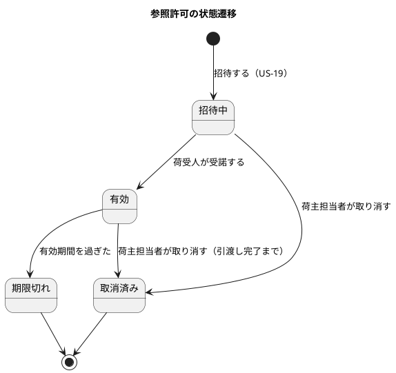

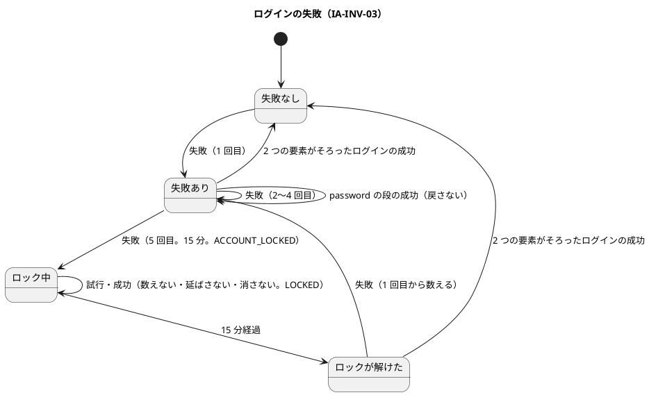

ロックは画面の遷移でなく、ログインの失敗の集約の内部の状態である（Bolt 32 で UI 設計の画面遷移図から移した）。ロック中も画面は誤りと同じ経路と文言にする（ADR-011 の決定 9）。

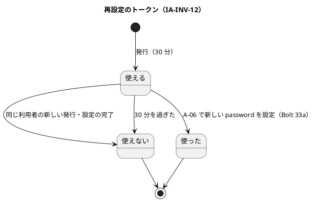

「使えない」のうち、新しい発行と設定の完了（同じ利用者のほかの未使用のトークン）によるものは無効にした時刻を入れ、期限によるものは列を変えずに期限と今の時刻で判定する。「使った」は使った時刻を入れる（Bolt 33a）。

### 外部データ（External Data、U5）

ADR-002 によりトランザクションスクリプトとする。ここでは処理が扱うデータの構造と規則を示す。

| データ | 英語名 | 主な項目 | 規則（ID） |
| :--- | :--- | :--- | :--- |
| 情報源 | DataSource | 提供元、原本種別、選定・承認状態、承認者 | ED-INV-01: 承認済みの情報源が 0 件ならパイロットを開始しない（BR-18、US-14） |
| 取込 | Ingestion | 取込 ID、情報源、ファイル、取込者、取込時刻、件数 | 取込単位で件数を数え、照合に使う |
| 外部原本 | ExternalRecord | 冪等性キー（提供元、原本種別、外部 ID、外部版）、payload、payload のハッシュ、取得時刻、分類（採用・重複・隔離・差異） | ED-INV-02: 同じキー・同じハッシュは重複、同じキー・違うハッシュは隔離する。ED-INV-03: 順序逆転・既存値との矛盾は差異として自動で上書きしない（BR-12、US-14） |
| 採用値 | AdoptedValue | 対象（航海・主要実績）、値、出典、版 | 採用値だけを経路設計・追跡へ公開する（ADR-004） |
| 手動情報 | ManualEntry | 出典、入力者、入力時刻、仮状態、内容 | ED-INV-04: 出典・入力者・入力時刻・仮状態を必須とする（BR-08、US-15） |
| 取得失敗 | FetchFailure | 失敗時刻、理由、再実行可能時刻 | 第 2 段階の API 連携で使う。パイロットでは記録の形だけ持つ（US-15） |
| 復旧照合 | RecoveryReconciliation | 停止期間、分類別件数、受信件数、手動情報との差異一覧、確認者、完了時刻 | ED-INV-05: 全原本が分類済みで、受信件数が一致し、差異確認が済んだときだけ完了する（BR-12、US-15） |

### 通知（Notification）

利用者へのメール（荷主担当者への業務の通知（US-22）と password の再設定（US-18 AC8））を担う一般のコンテキストとする。業務の判断を持たず、メールを送り、その結果を記録する。Bolt 33 で password の再設定のメールの分だけを最小に作る（[ADR-017](../../adr/cargo-tracker/017-notification-module-and-mail.md)）。

通知は `identity` に依存しない（`allowedDependencies = {"shared"}`）。宛先（利用者 ID とメールアドレス）は呼ぶ側が渡す。アクセス・監査が通知の公開 API を呼ぶ（Bolt 33）ので、通知がアクセス・監査の公開 API で宛先を解決すると依存が循環するため（開始準備の決定 6）。W9 の業務の通知（US-22）で宛先をどう渡すか（イベントに載せる、購読する側で解決するなど）は W9 の開始準備で決める。

入口は 2 つになる。1 つは他のコンテキストのイベントの購読（業務の通知。W9）、もう 1 つは公開 API（`notification.interfaces.api`）の同期の呼び出し（password の再設定。Bolt 33）である。公開 API `PasswordResetMail` のアダプター（`interfaces.api.internal`）は、アプリケーションのサービス `PasswordResetMailService` を呼ぶ。サービスは通知を PENDING で記録してから送信のポート `MailSender` を呼び、SENT か FAILED（理由）にする。同じ `event_id` と宛先の通知が既にあれば送らず `AlreadySent` を返す（N-INV-02）。件名と本文は通知のテンプレート（Thymeleaf のテキストのテンプレート）で組み立て、保存しない。`MailSender` の実装は SMTP（`SmtpMailSender`）と、dev だけのログに出す送信（`LoggingMailSender`）で、`notification.infrastructure.mail` に置く。

| 集約 | 集約ルート | 識別子 | 含むもの | 責務 |
| :--- | :--- | :--- | :--- | :--- |
| 通知 | 通知（Notification） | 通知 ID | イベント ID（契機の業務キー。password の再設定では依頼の ID）、宛先（利用者 ID・メールアドレス）、種類（`NotificationKind`）、対象（password の再設定ではトークンの ID）、言語、状態（`NotificationStatus`。送信待ち・送信済み・失敗）、送信時刻、失敗の理由 | メールの送信と結果の記録（本文とリンクは持たない） |

| ID | 不変条件・ルール | 根拠 |
| :--- | :--- | :--- |
| N-INV-01 | 通知の本文は件名と画面への導線だけとし、料金・契約条件・書類・他の予約の情報を含めない | BR-07、US-22 |
| N-INV-02 | 同じイベントからの通知は宛先ごとに 1 通だけ送る（イベントの再配信で重複しない） | ARCH-HO-01 |
| N-INV-03 | 送信に失敗したら失敗と宛先を記録し、画面の通知一覧でも確認できるようにする | US-22 |

| 種類 | 契機 | 宛先 |
| :--- | :--- | :--- |
| 見積りの提示 | DE-03 | 輸送要求の荷主担当者 |
| 経路の承認（荷主の承認が必要） | DE-05（見積りへの割当て後） | 同上 |
| 見積りの期限間近 | DE-19 | 同上 |
| 本予約の確定 | DE-07 | 同上 |
| 確認中への遷移 | DE-18 | 予約の荷主担当者 |
| 荷受人への招待 | 参照許可の発行 | 荷受人（日本語と英語） |
| password の再設定（`PASSWORD_RESET`。Bolt 33） | アクセス・監査から公開 API で同期に呼ばれる（2 つ目の入口。DE-23 のハンドラーが呼ぶ） | 依頼した利用者（宛先は呼ぶ側が渡す） |

password の再設定のメールは、本文にリンクとその期限・使い方だけを書き、料金などの業務の情報を書かない（N-INV-01）。リンクを含むため本文を保存せず、テンプレートと `target_ref` からも再現しない（この種類だけの例外。データモデルの通知の表）。

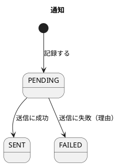

### 外部データの開始判定

| 照会 | 内容 | 根拠 |
| :--- | :--- | :--- |
| パイロット開始可否を判定する（PilotReadiness） | 承認済みの情報源の件数を返し、0 件なら開始不可とその理由を示す。運用の開始前チェックで使う | BR-18、US-14 |

## ドメインモデルの操作

第 2 章にならい、コンテキストごとのコマンド・クエリ・イベントを示す。コマンドはすべて `commandId` と期待版を持つ（ARCH-HO-01）。例外は主要実績の登録（`RegisterMilestoneCommand`。Bolt 26b・26c）で、期待版だけを持つ。同じ出典識別子（出典の種類と参照）の実績があれば既存の実績を返す（T-INV-02）ので、出典識別子が再送の冪等の鍵の役を果たす。

```plantuml
@startuml
title コンテキスト内のドメインモデルの操作とイベント
left to right direction
skinparam component {
  BackgroundColor<<Command>> #D6EAF8
  BackgroundColor<<Query>> #D5F5E3
  BackgroundColor<<Event>> #FADBD8
}
package "見積り" {
  [輸送要求を提出する] <<Command>>
  [輸送要求を複製する] <<Command>>
  [審査を確定する] <<Command>>
  [見積りを提示する] <<Command>>
  [詳細経路設計を依頼する] <<Command>>
  [見積りを辞退する] <<Command>>
  [見積りを承認する] <<Command>>
  [輸送要求を照会する] <<Query>>
}
package "経路設計" {
  [候補を算出する] <<Command>>
  [経路を確定する] <<Command>>
  [経路を再設計する] <<Command>>
  [経路版を照会する] <<Query>>
}
package "予約" {
  [本予約を確定する] <<Command>>
  [変更・取消しを申請する] <<Command>>
  [申請を判断する] <<Command>>
  [予約を照会する] <<Query>>
}
package "追跡" {
  [追跡を開始する] <<Command>>
  [主要実績を登録する] <<Command>>
  [主要実績を訂正する] <<Command>>
  [有人案件を起票する] <<Command>>
  [照会を記録する] <<Command>>
  [輸送状態を照会する] <<Query>>
  [自社の問い合わせを照会する] <<Query>>
}
package "外部データ" {
  [外部原本を取り込む] <<Command>>
  [復旧照合する] <<Command>>
  [パイロット開始可否を判定する] <<Query>>
}
package "アクセス・監査" {
  [KPI を照会する] <<Query>>
  [基準値を登録する] <<Command>>
  [password の再設定を依頼する] <<Command>>
  [新しい password を設定する] <<Command>>
}
[見積りを提示した] <<Event>>
[荷主が詳細経路設計を依頼した] <<Event>>
[経路を確定した] <<Event>>
[見積りを荷主が承認した] <<Event>>
[本予約を確定した] <<Event>>
[集荷実績を採用した] <<Event>>
[追跡が確認中になった] <<Event>>
[航海の採用値を更新した] <<Event>>
[主要実績の採用値を受け付けた] <<Event>>
[password の再設定を依頼した] <<Event>>

[見積りを提示する] --> [見積りを提示した]
[詳細経路設計を依頼する] --> [荷主が詳細経路設計を依頼した]
[経路を確定する] --> [経路を確定した]
[見積りを承認する] --> [見積りを荷主が承認した]
[本予約を確定する] --> [本予約を確定した]
[主要実績を登録する] --> [集荷実績を採用した]
[主要実績を登録する] --> [追跡が確認中になった]
[外部原本を取り込む] --> [航海の採用値を更新した]
[外部原本を取り込む] --> [主要実績の採用値を受け付けた]
[password の再設定を依頼する] --> [password の再設定を依頼した]
@enduml
```

### イベント一覧

イベントは集約が生成し（第 3 章）、永続化して配信する（ADR-003）。すべてのイベントはアクセス・監査コンテキストが購読して監査記録を残す。イベントは発行元の集約の版を持ち、購読側は古い版を適用しない（B-INV-12）。イベントの型は、コンテキストの公表された言語として、移動しないパッケージに置く（ADR-003）。

| ID | イベント | 発行元 | 主な属性 | 購読先と反応 | 要件定義との対応 |
| :--- | :--- | :--- | :--- | :--- | :--- |
| DE-01 | 輸送要求を提出した | 見積り | 輸送要求 ID、版番号、荷主企業、提出時刻、業務番号（表示用の文字列。業務キーではない。D-10） | 監査、KPI 計測（KPI-01 の開始時刻。KPI 計測記録の提出時刻） | EV-01 |
| DE-02 | 輸送要求を審査した | 見積り | 輸送要求 ID、版番号、判断（文字列 `APPROVED`・`SENT_BACK`。イベントはドメインの型を持たない）、判断者、判断時刻（2026-10-02 に承認。Bolt 5） | 監査（US-17 で購読する。それまでは発行だけ） | — |
| DE-03 | 見積りを提示した | 見積り | 見積り ID、輸送要求 ID・版番号、有効期限、経路方針、提示時刻 | 見積り: 輸送要求を見積提示済みにする（別のトランザクション。冪等で、見積り作成中でなければ何もしない。2026-10-05 の決定、Bolt 10）。通知（見積りの提示）、KPI 計測（KPI-01 の終了時刻。KPI 計測記録の最初の提示時刻。Bolt 21） | EV-02 |
| DE-16 | 荷主が詳細経路設計を依頼した | 見積り | 見積り ID・見積り番号、輸送要求 ID・版番号、経路方針、有効期限、依頼者、依頼時刻（経路条件は経路設計が見積りの公開 API（`quotation.interfaces.api` の経路条件の照会。輸送要求 ID と版番号で、出発地・目的地・希望到着期限・貨物種別を返す）から問い合わせる。Bolt 12・17） | 見積り: 輸送要求を経路設計中にする（別のトランザクション。冪等で、見積り作成中・見積提示済みかつ同じ版のときだけ変える。Bolt 12）。経路設計: 経路設計案件を作る（R-INV-10。冪等で、同じ輸送要求の版の案件があれば何もしない。US-06。Bolt 17） | — |
| DE-17 | 荷主が見積りを辞退した | 見積り | 見積り ID、理由、回答者 | 監査、営業の業務ホーム | — |
| DE-05 | 経路を確定した | 経路設計 | 経路設計案件 ID・案件番号、経路版番号、見積り ID、輸送要求 ID・版番号、承認者、承認 commit 時刻、参照情報版の一覧（`routing.domain.events`。イベントはドメインの型を持たない。Bolt 19） | 経路設計: 経路設計の中の listener が見積りの公開 API（経路の割当て）を呼び、依頼元の見積りに経路版を割り当てる（荷主承認待ち。冪等。ADR-014。Bolt 20）。通知（荷主の承認が必要）。予約（再設計後の割当て）、追跡（予定の更新） | EV-04 |
| DE-21 | 経路版を見積りに割り当てた | 見積り | 見積り ID・見積り番号、輸送要求 ID・版番号、案件番号、経路版番号、割当て時刻（Bolt 20） | 見積り: 輸送要求を荷主承認待ちにする（別のトランザクション。冪等で、経路設計中かつ同じ版のときだけ変える）。監査（US-17） | — |
| DE-04 | 見積りを荷主が承認した | 見積り | 見積り ID・見積り番号、輸送要求 ID・版番号、承認した経路版（案件番号・経路版番号）、承認者、承認時刻（Bolt 20） | 見積り: 輸送要求を予約待ちにする（別のトランザクション。冪等で、荷主承認待ちかつ同じ版のときだけ変える。Bolt 20）。監査（US-17）、営業の業務ホーム（予約の確定待ち。US-04） | — |
| DE-19 | 見積りの期限が近づいた | 見積り（定期処理） | 見積り ID、有効期限 | 通知（期限間近） | — |
| DE-06 | 経路が再設計要になった | 経路設計 | 経路設計案件 ID、経路版番号、不適合理由、旧情報版 | 追跡: 有人案件を起票、予約: 再設計中を表示 | — |
| DE-07 | 本予約を確定した | 予約 | 予約 ID、予約版番号、追跡番号、見積り ID、輸送要求 ID・版、経路版、commit 時刻、発行元の集約の版、荷主・荷受人の企業 ID（Bolt 25 で足した。null 可。予約条件の写しから。区間は載せず、追跡が経路設計の公開 API で引く。null 可にしたのは Bolt 23・24 に発行した形を読むためで、発行の記録の未完了と保存期間（RET-05 の 30 日）にその形が残らなくなったら null 不可にする。Bolt 25 レビュー A-8） | 追跡: 経路設計の公開 API で区間を引いて追跡を開始し、DE-22 を発行する（ADR-015。Bolt 25）。予約の listener: 見積りの公開 API で輸送要求を予約確定済みにする（ADR-014。Bolt 23）。通知（本予約の確定） | EV-03 |
| DE-08 | 予約を変更・取消しした | 予約 | 予約 ID、新旧の予約版、種類、承認者 | 追跡: 予定の更新または取消済みへ | — |
| DE-22 | 追跡を開始した | 追跡 | 追跡番号、予約 ID、開始時刻、発行元の集約の版（`tracking.domain.events`。Bolt 25） | 追跡: 追跡の中の listener が予約の公開 API（`booking :: api` の追跡の開始の通知）を呼び、予約サガを完了にする（ADR-014 の形。別のトランザクション。冪等）。監査（US-17） | — |
| DE-09 | 集荷実績を採用した | 追跡 | 追跡番号、予約 ID、発生時刻 | 予約: 輸送段階を集荷後にする（BR-04） | — |
| DE-10 | 引渡しを確認した | 追跡 | 追跡番号、予約 ID、発生時刻 | 予約: 完了にする | — |
| DE-18 | 追跡が確認中になった | 追跡 | 追跡番号、予約 ID、確認中の理由 | 通知（確認中への遷移） | — |
| DE-11 | 主要実績を訂正した | 追跡 | 追跡番号、原実績、訂正内容、理由、承認者 | 監査 | EV-10 の社内版 |
| DE-20 | 照会を記録した | 追跡 | 照会記録 ID、経路、対象、有人対応へ移ったか | KPI 計測（KPI-02） | — |
| DE-12 | 航海の採用値を更新した | 外部データ | 航海番号、採用値、出典、情報版 | 経路設計: 航海を更新し、確定済みの経路版を再評価する | EV-05 |
| DE-13 | 主要実績の採用値を受け付けた | 外部データ | 追跡番号、実績、出典 | 追跡: 主要実績を登録する（下書き） | EV-06 |
| DE-14 | 外部原本を隔離した | 外部データ | 冪等性キー、理由 | 監査、データ責任者への表示 | EV-05 |
| DE-15 | 参照許可を取り消した | アクセス・監査 | 参照許可 ID、予約 ID、荷受人 | 追跡: 照会の開示判断に反映（次の request から） | — |
| DE-23 | password の再設定を依頼した（`PasswordResetRequested`） | アクセス・監査 | 依頼の ID、利用者の ID、依頼の時刻だけ（`identity.domain.events`。トークンも URL も載せない。発行記録に秘密を残さないため。Bolt 33） | アクセス・監査: 同じコンテキストのハンドラー `PasswordResetMailEventHandler` がトークンを発行し、通知の公開 API で送る（コミットの後、別のトランザクション。依頼の ID で冪等。IA-INV-12）。監査記録は依頼のサービスが同期に書くので、このイベントからは書かない | — |

表は業務の順序に並べた。ID は追加した順のため連番になっていない。

DE-09・DE-10 は追跡から予約への通知、DE-05 の見積りへの割当てと DE-07 の輸送要求の更新は下流から上流への通知で、units.md の DAG と逆向きになる。Spring Modulith ではイベントの型の参照も依存で、上流が下流のイベントを購読すると依存が循環する（Bolt 19 レビュー D-71）。そこで、下流のコンテキストの listener が自分のイベントを受け、上流の公開 API の冪等な操作を呼ぶ（[ADR-014](../../adr/cargo-tracker/014-downstream-to-upstream-notification.md)）。依存の向きは下流 → 上流のままで、上流は下流のイベントを購読しない。DE-05（Bolt 20）・DE-06（W6）・DE-07（W4）をこの形で作る。DE-09・DE-10 は予約（上流）が追跡（下流）のイベントを購読する形のため、追跡の Bolt で同じ形にそろえる。

### 業務の流れと予約サガ

輸送要求から追跡開始までの業務の流れを、要件定義のエンドツーエンド業務フローに合わせて示す。予約サガ（第 2 章の Booking Saga に当たる。状態を予約の 1 か所に持ち、後続の追跡の開始は追跡が DE-07 を購読して行う。[ADR-015](../../adr/cargo-tracker/015-booking-saga-starts-tracking-by-event.md)、[バックエンドアーキテクチャ](architecture_backend.md)）が状態を管理するのは最後の「本予約の確定 → 追跡の開始」の区間である。

```plantuml
@startuml
title 輸送要求から追跡開始まで（要件定義の業務フローに対応）
|見積り|
start
:輸送要求を提出する（US-01）;
:審査を確定する（US-02）;
:見積りと経路方針を提示する（US-03）;
:DE-03 → 荷主へ通知;
:荷主が回答する（US-24）;
if (回答) then (詳細経路設計へ進む)
  :DE-16 荷主が詳細経路設計を依頼した;
else (辞退・条件の変更・相談)
  :辞退なら見積りを失効、変更なら新しい版、\n相談なら有人案件;
  stop
endif
|経路設計|
:経路設計案件を作る（R-INV-10）;
:候補を算出し、経路を確定する（US-06、US-07）;
:DE-05 経路を確定した;
|見積り|
:見積りに経路版を割り当てる（荷主承認待ち）;
:荷主が見積りと承認済み経路を承認する（US-24）;
|予約|
:本予約を確定する（US-04）\n見積りの公開 API に commit 時刻を渡して確認（ADR-016）;
|予約サガ|
:状態 = 処理中（確定と同じトランザクション）;
|予約|
:DE-07 本予約を確定した;
|追跡|
:DE-07 を購読し、追跡を開始する\n（経路設計の公開 API で区間を引き、追跡記録を作り予定を採用する。\n予約 ID で冪等。DE-22 追跡を開始した を発行）;
:DE-22 を購読し、結果を予約の公開 API で返す\n（別のトランザクション）;
if (開始できた?) then (はい)
  |予約サガ|
  :状態 = 完了;
else (業務の理由で開始できない)
  |予約サガ|
  :状態 = 有人確認要\n（予約サガの状態として業務ホームに表示）;
  :有人案件の起票を依頼する（BR-17）;
endif
note right
  技術の失敗はイベントの再配信（RTY-01）。
  処理中の滞留が RTY-02 の上限を超えたら有人確認要
end note
stop
@enduml
```

| 段階 | 状態の持ち主 | 失敗時の扱い |
| :--- | :--- | :--- |
| 提出〜見積りの提示 | 輸送要求・見積りの各集約 | 利用者に不足条件を示す（同期） |
| 荷主の回答〜経路の確定 | 見積り・経路設計案件の各集約（DE-16、DE-05 で連携） | イベントの再配信で回復する。受信側は冪等（R-INV-10、B-INV-12） |
| 荷主の承認 | 見積り | 不足条件を示して承認しない（同期） |
| 本予約の確定 | 貨物予約 | 不足条件を示して確定しない（同期） |
| 追跡の開始 | 予約サガ（状態）、追跡（開始の処理） | 技術の失敗はイベントの再配信で回復する。業務の理由で開始できないとき、または処理中の滞留が上限を超えたときは有人確認要（ADR-015） |

予約サガが有人確認要になったときは、予約サガの状態そのもの（予約コンテキストの表）を業務ホームの一覧の正とし、有人案件の起票はそれに追加して行う。追跡の開始と同じ原因で有人案件の起票（追跡コンテキスト）も失敗する場合があるため、起票の成否に依存せず未処理が見えるようにする。

## リポジトリ

集約ごとにリポジトリのインターフェースを domain 層に置き、実装を infrastructure 層に置く。

| コンテキスト | リポジトリ | 主な操作 |
| :--- | :--- | :--- |
| 見積り | 輸送要求リポジトリ、見積りリポジトリ | ID で取得、期待版で保存、輸送要求の有効な見積りを取得 |
| 経路設計 | 経路設計案件リポジトリ、航海リポジトリ、接続時間規則リポジトリ | ID で取得、期待版で保存、航海番号を参照する確定済み経路版の案件を取得 |
| 予約 | 貨物予約リポジトリ | ID・追跡番号で取得、コマンド ID で確定結果（処理済みコマンド）を取得、業務番号と見積り番号で追跡番号を取得、処理済みコマンドを貨物予約と同じトランザクションで記録、期待版で保存（Bolt 24。確定した予約の要約（`BookingSummary`）を確定時刻の新しい順に上限まで取得（S-10。集約を組み立てない。予約サガの状態は予約サガのリポジトリから予約 ID の集合でまとめて取得。Bolt 25b）。荷主企業の予約の要約を同じ並びで上限まで取得（C-06。他社の予約は返さない。BR-07。荷主用の照会のサービス `CustomerBookingQueryService` が使い、画面は企業を比べない。追跡の荷主の照会と同じ形。Bolt 27b）） |
| 追跡 | 追跡記録・有人案件・照会記録・営業日カレンダーのリポジトリ | 追跡番号で取得（S-12。Bolt 26）、予約 ID で追跡記録を取得（T-INV-11。Bolt 25）、追跡記録の要約（`TrackingRecordSummary`。最新の到着見込みを含む）を追跡の開始時刻の新しい順に上限まで取得（S-11。集約を組み立てない。Bolt 26）、荷主企業の追跡記録の要約を同じ順に上限まで取得・追跡番号と荷主企業で追跡記録を取得（C-10。他社の追跡記録は存在しないのと同じく空。BR-07。Bolt 27）、期待版で保存（追跡記録の `update`。まだ表にない主要実績を追加し、現在状態と根拠の実績番号を書き直して版を増やす。Bolt 26b）、期限を過ぎた未受領案件を取得、荷主企業の問い合わせを取得 |
| 通知 | 通知リポジトリ | イベント ID と宛先で既存の通知を取得（N-INV-02）、PENDING で追加、`status = 'PENDING'` を条件に SENT・FAILED へ更新（版を持たない。Bolt 33） |
| アクセス・監査 | 企業・利用者・参照許可リポジトリ、監査記録リポジトリ（追記のみ）、KPI 計測記録リポジトリ、再設定のトークンリポジトリ | ID・メールアドレスで取得、予約と荷受人で有効な許可を取得。再設定のトークン（Bolt 33）: 同じ依頼の ID のトークンの有無、利用者の最後の発行時刻（繰り返しの判定）、利用者の未使用のトークンの無効化（`used_at IS NULL AND invalidated_at IS NULL` を条件にした更新）、追加、ハッシュでの取得。Bolt 33a で、ID での取得（`findById`）と使用（`markUsed(id, at)`。使っておらず無効にしておらず期限の前の行だけの条件付きの更新で、件数で判定する）を足す。利用者（Bolt 33a）: password の更新（`version = version + 1`。版を条件にしない） |

## 後続工程への引継ぎ

| ID | 引継ぎ内容 | 引継ぎ先 |
| :--- | :--- | :--- |
| DM-01 | 集約ごとの表、版と追記専用の表現、イベント発行記録・処理済みコマンド・サガ状態の表 | データモデル設計 |
| DM-02 | 画面ごとに使うコマンド・クエリと、開示範囲ごとの表示項目 | UI 設計 |
| DM-03 | 不変条件（Q-INV、R-INV、B-INV、T-INV、SC-INV、IA-INV）を Cucumber のシナリオと単体テストに対応させる | テスト戦略 |
| DM-04 | 鮮度の許容範囲、有人案件の受領期限の既定値、監査記録の保持期間 | 非機能要件 |
| DM-05 | 追跡状態の状態名、必要最小接続時間の値と管理責任者 | 業務責任者への確認 |

## AI の仮定と要確認

- **呼び分け**: 本予約前を「輸送要求」、本予約以後を「貨物予約」と呼び分けた。要件定義とユーザーストーリーの「予約版」（本予約前）の表記は、次の要件の改訂で揃えることを提案する。
- **業務の順序**: 初版は「審査 → 経路確定 → 見積り」の順で設計していたが、要件定義のエンドツーエンド業務フローと Unit 定義（U2 の入力は見積り済み輸送要求）に反していたため、分析成果物レビュー（2026-10-01、R-01）で「審査 → 見積りと経路方針の提示 → 荷主の回答 → 詳細経路設計 → 荷主の承認 → 本予約」に改めた。
- **有人案件の置き場所**: 追跡コンテキストに置いた（バックエンドアーキテクチャの仮定と同じ）。予約・経路設計・外部データの各コンテキストからの起票が追跡に集まるため、第 2 段階の例外対応で分ける。
- **本予約と船腹確保**: 本予約は A 社と荷主の輸送条件の確定とし、運送会社の船腹確保とは区別した。業務責任者の確認が必要である（R-28）。
- **照会記録のまとめ方**: 顧客 Web の照会を 30 分単位でまとめ、24 時間以内の問い合わせを有人対応へ移ったとみなす規則（IR-INV-01）は KPI-02 の算式の解釈であり、プロダクト責任者の確認が必要である。
- **荷主の見積り承認**: BR-01 の「荷主担当者 1 名の承認」を、承認済み経路を割り当てた後の見積りへの荷主承認として表した（US-24）。
- **経路候補探索**: MVP は航海の一覧から確定的に列挙するだけとし、最適化はしない（インセプションデッキのスコープ外）。候補が多すぎる場合の絞り込みは UI 設計とあわせて検討する。
