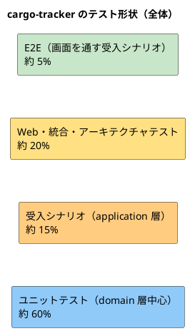
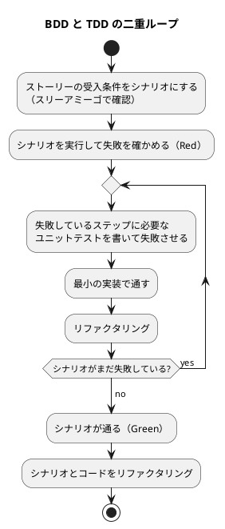
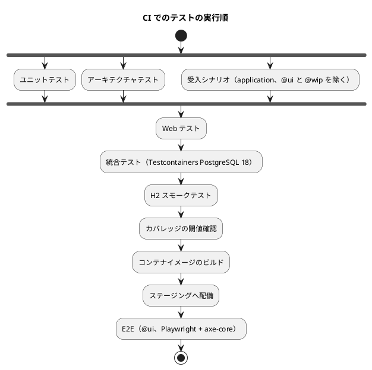

# cargo-tracker テスト戦略

## 位置づけ

本書は、各設計書から引き継いだテストの項目に答え、TDD と BDD（ADR-009）を一体にした開発の進め方を決める。

| 引継ぎ | 出典 | 本書の節 |
| :--- | :--- | :--- |
| AB-05 アーキテクチャテスト（パッケージ依存、マッパーの SQL による他スキーマ参照の禁止） | バックエンドアーキテクチャ | アーキテクチャテスト |
| AF-03 アクセシビリティ検証の配分と手動確認の手順 | フロントエンドアーキテクチャ | アクセシビリティテスト |
| TS-03 テストの配分、カバレッジ、ArchUnit と Modulith、Cucumber の階層とタグ | 技術スタック | テスト形状、BDD、カバレッジ |
| DM-03 不変条件と Cucumber シナリオ・単体テストの対応 | ドメインモデル | 不変条件とテストの対応 |
| DA-03 H2 と PostgreSQL へのマイグレーション適用、追記専用・CHECK・一意制約のテスト | データモデル | 統合テスト |
| UI-HO-01、UI-HO-03 主要フローの E2E、顧客向け HTML の開示テスト | UI 設計 | E2E、Web テスト |
| 非機能要件の検証方法（PERF、RCV、RTY、FRS、SVC、AUD、OBS） | 非機能要件 | 非機能要件のテスト |

2026-10-01 の [分析成果物レビュー](../../review/cargo-tracker/analysis_review_20261001.md) を受けて、業務の順序（R-01）、重複確定・session・イベント配信の検証（R-03、R-07、R-08）、非機能要件との接続（R-21）、対応表の漏れ（R-22）を反映した。

## テスト形状

全体は **ピラミッド型** とする。ドメインモデル（ADR-002）とヘキサゴナルの 4 パッケージ構成をとり、業務規則の大半がドメイン層にあるためである（テスト戦略ガイド）。ただし、ADR-002 でパターンを変えたコンテキストは形を変える。

| コンテキスト | パターン（ADR-002） | 形 | 重点 |
| :--- | :--- | :--- | :--- |
| 見積り、経路設計、予約、追跡 | ドメインモデル | ピラミッド | 集約・ドメインルールのユニットテスト。境界値（BR-10、BR-11）を網羅する |
| アクセス・監査 | 単純なモデル | ダイヤモンド | 認証・認可・参照許可の Web テストと統合テスト |
| 外部データ | トランザクションスクリプト | 統合テスト中心 | 冪等性・隔離・照合を実 DB で確かめる統合テスト |



割合はテストの件数の目安であり、目標値ではない。実行時間の配分（CI の節）と合わせて、Bolt ごとの実績で見直す。

### テストの深さ

AI-DLC のテスト戦略の水準（リリース・イテレーション計画ガイド AI-DLC 版）は、本番機能を Standard 以上とする。パイロット中止の条件（PV-01: 権限外開示・外部原本消失・重複予約）に直結する箇所は Comprehensive にする。

| 水準 | 対象 |
| :--- | :--- |
| Comprehensive | 予約確定の条件と冪等性（BR-01、BR-10、B-INV-01〜03）、制約適合判定（BR-11、Golden dataset）、開示制御（BR-07）、外部原本の冪等性・隔離・照合（BR-12）、認証・ロック・session 失効（BR-14）、訂正の二者確認（BR-05） |
| Standard | 上記以外の本番機能 |

## テストレベル

各レベルの責務を分け、同じことを複数のレベルで重ねて確かめない。

| レベル | 対象 | 外部依存 | 確かめること | 確かめないこと | ツール |
| :--- | :--- | :--- | :--- | :--- | :--- |
| ユニット | domain の集約・値オブジェクト・ドメインルール | なし（純粋なオブジェクト） | 不変条件、状態遷移、境界値 | 永続化、画面 | JUnit 6、AssertJ |
| 受入シナリオ（application） | application の入力ポート | リポジトリはメモリ上の実装、Clock は固定 | ユーザーストーリーの受入条件、認可の判断、冪等コマンド、期待版 | SQL、HTML | Cucumber（日本語 Gherkin） |
| Web | interfaces.web の画面 | application はモックまたはメモリ実装 | 画面の描画、URL ごとの認可、開示範囲、エラー要約、確認画面の項目 | 業務規則の詳細 | Spring MockMvc |
| 統合 | infrastructure（マッパー、マイグレーション、イベント配信、取込、S3 アダプター） | Testcontainers の PostgreSQL 18 | SQL の正しさ、制約、権限、イベントの永続化と再配信、ファイル取込 | 業務規則の詳細 | Testcontainers、Spring Modulith Test |
| アーキテクチャ | コード全体の構造 | なし | 依存の向き、モジュール境界、ドメインのフレームワーク非依存、他スキーマ参照の禁止 | 振る舞い | ArchUnit、Spring Modulith |
| E2E（画面を通す受入シナリオ） | アプリケーション全体 | PostgreSQL、実ブラウザ | 主要フローが画面から最後まで通ること、部分更新、アクセシビリティの自動検査 | 規則の網羅（下のレベルで済ませる） | Cucumber + Playwright、axe-core |
| スモーク（H2） | アプリケーションの起動 | H2 | H2 でアプリが起動し、マイグレーションが通ること（ADR-007） | SQL の正しさ | Spring Boot Test |

## BDD（ADR-009）

### 開発の流れ

ストーリーごとに、外側の受入シナリオと内側の TDD を二重のループで回す。



### シナリオの階層

| 階層 | タグ | ステップ定義の呼び先 | 使う場面 |
| :--- | :--- | :--- | :--- |
| 業務ルール | （既定） | application の入力ポート。リポジトリはメモリ上の実装、Clock は固定。他のコンテキストへのイベントはテスト用の同期の配信で届け、シナリオの中で「イベントが配信される」ステップとして明示する | 受入条件の大半。速く、規則を網羅する |
| 画面 | `@ui` | Playwright で実ブラウザを操作し、PostgreSQL を使う | 主要フローの最後までの通し、確認画面、部分更新、アクセシビリティの自動検査 |

同じ受入条件を両方の階層で書かない。画面の階層は、ストーリーごとに主成功シナリオ 1 本と、画面に固有の条件（確認の領域、エラー要約、開示範囲の見え方）に限る。

業務ルールの階層では本番の非同期の購読（`@ApplicationModuleListener`）が動かないため、イベント配信そのもの（コミット後の配信、再配信、受信側の冪等性）は統合テストで確かめる（ADR-003）。session の失効や認可の即時反映のように、フレームワークと DB に依存する受入条件も、業務ルールの階層ではなくセキュリティの統合テストで確かめる。

### タグの規約

| タグ | 意味 | 例 |
| :--- | :--- | :--- |
| `@US-nn` | ユーザーストーリー（必須。Feature に付ける） | `@US-04` |
| `@US-nn-ACm` | 受入条件の番号（必須。シナリオに付ける。番号は user_story.md の受入条件の順） | `@US-04-AC2` |
| `@NFR-<ID>` | 非機能要件の ID（該当する統合テスト・性能テストに付ける） | `@NFR-RTY-02` |
| `@BR-nn` | 業務ルール（該当するシナリオに付ける） | `@BR-10` |
| `@<不変条件 ID>` | ドメインモデルの不変条件 | `@B-INV-03` |
| `@must`・`@should`・`@could` | ストーリーの優先度（Feature に付ける） | `@must` |
| `@ui` | 画面を通す階層 | — |
| `@main-flow` | 主成功の流れ（Bolt 28）。`@US-nn` を付けない例外（前例は `layout_ui.feature`。理由は「Release 0.1 の受入条件」の注） | — |
| `@wip` | 作業中。CI の必須の実行から外す | — |
| `@golden` | Golden dataset による経路の検証 | — |

`@wip` のシナリオを残したまま Bolt を完了しない。受入条件ごとに `@US-nn-ACm` のシナリオがあることを、CI で受入条件の数と照合して確かめる（ADR-009 のコンプライアンス）。

### 置き場所とステップ定義

```text
src/test/resources/features/
├── quotation/        US-01〜03
├── routing/          US-06〜08、golden/（Golden dataset）
├── booking/          US-04、US-05
├── tracking/         US-09〜13、US-20
├── identity/         US-16〜19
└── external_data/    US-14、US-15

src/test/java/.../<context>/acceptance/   コンテキストごとのステップ定義
src/test/java/.../shared/acceptance/      共通ステップ（ログイン、時刻の固定、企業・利用者の準備）
src/test/java/.../ui/                     画面の層のステップ定義（@ui）。ブラウザの文脈とキー操作の部品は BrowserSession に 1 つ
```

画面の層のステップ定義は、Tab でフォーカスを進める部品（`tabUntilFocused`・`tabUntilGroup`）を `BrowserSession` から使い、クラスごとに写しを作らない（Bolt 29、#45。待ち方と上限を直す場所を 1 つにする）。1 回だけ Tab を押してフォーカスの順序を確かめる部品（`tabTo`）は、確かめる順序が画面ごとに違うので各クラスに置く。

時間の経過を画面の層の受入シナリオで確かめるとき（session の警告。Bolt 32b）は、Playwright の `BrowserContext.clock()` でブラウザの時計を進める。時計は `signInAs` の前に入れる（`install`）。同じコンテキストのページは同じ時計を使うので、タブの間の同期も確かめられる。画面の層のテストのアプリは本物の時計（`Clock.systemUTC()`）で動き、`MutableClock` も共通の時計のステップも使わないので、サーバーの時計は進められない。Spring Session の無操作の期限はサーバーの実時間で数えるので、画面の層のシナリオではサーバーの session を実際に失効させない（サーバーの失効と延長による最終アクセスの更新は、セキュリティの統合テストで確かめる）。8 時間の警告は、テストの部品（`BrowserSession`）が session の属性 `cargotracker.session.authenticatedAt` を上限の近い時刻（7 時間 56 分前）に書き換えてから画面を開いて確かめる。

ステップ定義は自分のコンテキストの入力ポートだけを呼ぶ。前提の準備で他のコンテキストのデータが必要なときは、そのコンテキストの公開 API を使う（ADR-001 の境界をテストでも守る）。

### シナリオの例

US-04 の受入条件と BR-10 の境界を、日本語 Gherkin で書いた例を示す。

```gherkin
# language: ja
@US-04 @must
機能: 予約を確定する
  荷主として、合意した見積りと承認済み経路で本予約を確定したい。
  追跡可能な輸送を開始するためだ。

  背景:
    前提 荷主企業 "荷主株式会社" の荷主担当者 "山田" が見積りを承認している
    かつ 経路設計案件の経路版 1 が確定している
    かつ 見積りの有効期限は "2026-10-08T09:00:00Z" である

  @US-04-AC1 @BR-01 @BR-10 @B-INV-01
  シナリオ: 有効期限の 1 分前の確定は成功する
    前提 現在時刻は "2026-10-08T08:59:00Z" である
    もし 営業担当者 "佐藤" が本予約を確定する
    ならば 予約版 1 と一意な追跡番号が記録される

  @US-04-AC2 @BR-10 @B-INV-02
  シナリオアウトライン: 有効期限と同時刻以後の確定は失効として拒否される
    前提 現在時刻は "<現在時刻>" である
    もし 営業担当者 "佐藤" が本予約を確定する
    ならば 予約は確定されない
    かつ 見積りの失効と再見積りの必要性が示される

    例:
      | 現在時刻             |
      | 2026-10-08T09:00:00Z |
      | 2026-10-08T09:01:00Z |

  @US-04-AC4 @B-INV-03
  シナリオ: 同じ確定要求の再送は予約を重複生成しない
    前提 コマンド "cmd-001" で本予約を確定済みである
    もし コマンド "cmd-001" で本予約を再び確定する
    ならば 予約は 1 件のままで、既存の追跡番号が返される
```

### Golden dataset（経路設計）

要件定義の Golden dataset（代表案件を複数の経路設計者とコンプライアンス担当者が承認したもの）は、`@golden` のシナリオアウトラインとして例の表で表す。期待候補・除外候補・除外理由を例の列にし、データの版を Feature の説明に書く。データそのものは業務責任者が決める（要件定義 H-9 の残作業）。

```gherkin
# language: ja
@US-06 @golden @BR-11
機能: 経路候補の制約適合判定（Golden dataset v0）

  シナリオアウトライン: 代表案件の候補と除外理由が承認済みの結果と一致する
    前提 Golden dataset の案件 "<案件>" を読み込む
    もし 候補を算出する
    ならば 適合候補は "<適合候補>" である
    かつ 除外候補と理由は "<除外>" である

    例:
      | 案件 | 適合候補 | 除外 |
      | G-01 標準・直行と積替え | 1,2 | なし |
      | G-02 接続時間の境界 | 1,2 | 3:CONNECTION_TOO_SHORT |
      | G-03 期限超過を含む | 1 | 2:DEADLINE_EXCEEDED |
      | G-04 特殊貨物（MVP 対象外） | なし | 全候補:CARGO_NOT_SUPPORTED |
      | G-05 欠航・港湾閉鎖による再設計 | 1 | 2:NOT_CONNECTABLE |
      | G-06 外部データの欠落・古さ・矛盾 | なし | 全候補:INFO_INSUFFICIENT |
```

例の 6 区分は要件定義の Golden dataset の代表案件の区分に対応する。表の値は区分を示すための仮の値で、実際の案件と期待結果は業務責任者が決める。

## 不変条件とテストの対応

ドメインモデルの不変条件を、主に確かめるレベルに対応させる（DM-03）。シナリオには不変条件 ID のタグを付け、どのテストで守られているかをたどれるようにする。

| 不変条件 | ユニット | 受入シナリオ | 統合 | Web・E2E |
| :--- | :--- | :--- | :--- | :--- |
| Q-INV-01〜03（提出の条件、特殊貨物、版の不変） | ○ | ○ | 版の表の INSERT のみ（UPDATE の権限なし） | 特殊貨物の案内（`@ui`） |
| Q-INV-04（最新版の審査） | ○ | ○ | — | — |
| Q-INV-05〜07（見積りの条件と提示時刻、有効期限、失効・置換） | ○（境界値） | ○ | — | — |
| Q-INV-08（自社の輸送要求だけ） | — | ○ | — | ○（他社の URL の拒否） |
| Q-INV-09〜10（荷主の回答、荷主の承認） | ○（境界値: 承認時の有効期限、経路版の状態） | ○ | — | 回答・承認の画面（`@ui`） |
| Q-INV-11（複製） | ○ | ○ | — | — |
| R-INV-01〜02（制約適合、除外理由） | ○（境界値、複数の接続のうち 1 つだけ不足、規則の有効期間の境界、Golden dataset） | ○（`@golden`） | — | — |
| R-INV-03（commit 時の再検証） | ○ | ○ | 期待版の競合 | — |
| R-INV-04〜08（権限、確定は 1 つ、旧版、再設計） | ○ | ○ | `confirmed_route_version_no` の更新、確定した経路版の内容が変わらないこと | — |
| R-INV-09（停止中の情報不足） | ○（鮮度の境界: 24 時間の直前・同時刻・直後） | ○ | — | — |
| R-INV-10〜11（案件は輸送要求版ごとに 1 つ、経路版の割当て） | — | ○ | ○（DE-16 を 2 回配信しても案件が 1 つ） | — |
| B-INV-01〜02（確定条件、有効期限） | ○（境界値） | ○ | — | 確定条件の表示（`@ui`） |
| B-INV-03（同じコマンド ID の冪等性） | ○（判定の順序、内容の照合、拒否は記録しない） | ○（確定の後に失効しても最初の結果） | ○（同時送信で 1 件、同じ ID で内容が違えば衝突） | 二重送信（`@ui`。戻る → 再送で同じ追跡番号） |
| B-INV-04〜05（特殊貨物、旧版） | ○ | ○ | — | — |
| B-INV-06〜07（集荷前だけの変更・取消し） | ○ | ○ | ○（DE-09 の反映前に承認しても、追跡への同期の確認で拒否される） | — |
| B-INV-08〜09（予約版の不変、競合） | ○ | ○ | 期待版の競合、版の表の INSERT のみ | 競合表示 |
| B-INV-10（カスタマーサポートは予約を操作できない） | — | ○ | — | ○ |
| B-INV-11（1 つの見積りから予約は 1 件） | — | ○（既存の追跡番号を返す。確定の後に失効しても同じ） | ○（別のコマンド ID・別の利用者で同時に確定しても 1 件。負けた側も既存の追跡番号） | 同じ見積りの予約があるお知らせと S-24 への導線（`@ui`。Bolt 24） |
| B-INV-12（古い版のイベントを適用しない） | ○ | — | ○（順序を入れ替えて配信） | — |
| T-INV-01〜05（追記、重複、確認中、取消済み、完了後） | ○（Bolt 26b: 同じ出典の既存の実績を返す、未来の発生時刻の拒否（T-INV-13）、実績番号の連番） | ○（Bolt 26b: `@US-12-AC1`・`@US-12-AC2 @T-INV-02`。Bolt 26c: 画面の層の `@ui @US-12-AC1`・`@US-12-AC2`。確認中・取消済み・完了後は W7） | 一意制約、DELETE の権限なし（Bolt 26b: `uk_milestone_source` の違反と版の不一致はセーブポイントに戻して競合、`[no-delete]`） | — |
| T-INV-06〜07（訂正の二者確認、下書きの修正） | ○ | ○ | `CHECK`（承認者 ≠ 登録者） | 確認の領域（`@ui`） |
| T-INV-08〜10（予定と実績の区別、開示範囲、当初の予定と最新の見込み） | ○（Bolt 26b: 現在状態の導出の規則。種類ごと、発生時刻の順、同じ時刻、採用済みだけ。Bolt 27: 荷主向けの照会結果は採用済みの実績だけで社内の識別子を持たない、荷主の照会のサービスは他社の追跡記録を返さない） | ○（Bolt 27: `@US-09-AC1`、他社の照会 `@BR-07 @T-INV-09`、自社だけの一覧 `@BR-07`。画面の層の `@ui @US-09-AC1`。荷受人の立場は R1.1） | ○（Bolt 27: 荷主企業で絞る照会と索引） | ○（顧客向け HTML の開示テスト。Bolt 27: 他社・存在しない・形式の誤りの追跡番号は同じ 404 で本文も同じ、経路版の案件番号・実績番号・UTC の併記が出ない。Bolt 27b: C-06 予約一覧は自社の予約だけ（照会のサービスの単体テストと PostgreSQL の統合テスト）、予約サガの状態の英語の値と UTC の併記が出ない、一覧の行の項目の見張り。荷受人の開示範囲は R1.1） |
| T-INV-11（追跡記録は予約 1 件に 1 件） | — | ○（DE-07 を 2 回配信しても追跡記録は 1 件。`@ADR-015 @T-INV-11`。Bolt 25） | ○（予約 ID の一意制約。DE-07・DE-22 の再配信で追跡記録・予定区間・予約サガの版が変わらない） | — |
| T-INV-12（予定の妥当性） | ○（区間 1 件以上、区間番号の順、到着は出発の後、揚地と積地のつながり、経路版がない・企業 ID がないときは開始しない） | — | `CHECK`（`leg_no >= 1`、到着は出発の後） | — |
| SC-INV-01〜03（有人案件） | ○ | ○ | — | — |
| SC-INV-04（営業日カレンダーと受領期限） | ○（デシジョンテーブル: 営業時間内・外、休業日、優先度、年末年始） | ○ | — | — |
| SC-INV-05（荷主は自社の問い合わせだけ） | — | ○ | — | ○ |
| IR-INV-01〜02（照会記録） | ○（30 分のまとめ、24 時間の有人対応への移行の境界） | ○ | — | — |
| KPI-INV-01〜02（KPI の算出、基準値） | ○（中央値・90 パーセンタイル、除外の適用） | ○ | 基準値の表の INSERT のみ | — |
| N-INV-01〜03（通知の本文、重複なし、失敗の記録） | ○（Bolt 33: 通知の状態の遷移、失敗の理由の長さ、同じ `event_id` と宛先は `AlreadySent`） | ○ | ○（イベントの再配信で 1 通。Bolt 33: `status = 'PENDING'` を条件にした更新、UK（`event_id`、`recipient_user_id`）、Mailpit で件名・本文・宛先） | メールの本文の開示テスト |
| IA-INV-01〜02（固定役割、担当範囲） | ○ | ○ | — | ○（URL ごとの認可） |
| IA-INV-03（ロック） | ○（4・5・6 回目、ロックの 14:59・15:00。Bolt 33a: password の再設定でロックと失敗の数が変わらない） | — | — | ○ |
| IA-INV-04（session と即時反映） | — | — | ○（セキュリティの統合テスト: 無操作 30 分・8 時間の失効、利用停止・権限取消しの次の request からの反映） | ○ |
| IA-INV-05〜06（参照許可） | ○ | ○ | ○（取消し後の既存 session、セキュリティの統合テスト） | — |
| IA-INV-07（監査記録の追記専用と欠落の検知） | — | — | ○（UPDATE・DELETE の権限なし、`event_id` の一意、欠落の照合の定期処理） | — |
| IA-INV-08（認証・権限外の試行の同期記録） | — | — | ○（セキュリティの統合テスト） | — |
| IA-INV-10〜11（TOTP の資格と回復コード。Bolt 33b の置き換えと発行し直し） | ○（`TotpCredential.reEnroll` の最後に使った刻みは大きい方（古い値が大きい・新しいコードが大きい）。再登録のサービスの完了・コードの誤り（置き換えない）・15 分を過ぎた・秘密が読めない・資格がない・利用停止と企業の無効、監査 `TOTP_RE_ENROLLED`（利用者で絞る。T-113）、コミットの後の失効（ロールバックしたら失効しない）、失効が失敗しても完了、監査を書けなければ失効しない、外側のトランザクションの中では呼べない） | ○（`@US-18-AC9`。回復コードでログイン → A-08 → 再登録 → 新しい回復コード） | ○（`replace` の置き換え・0 件・`last_used_step` が大きい方、古い秘密を読んでから置き換えると `useStep` が 0 件（秘密の条件を外すと落ちる。T-112）、`revokeOthers` で今の session が残り同じ利用者のほかの session が消えほかの利用者の session は残る、再登録の完了 2 つの同時で 1 つだけ（後の再登録が先の行ロックを待つことを `pg_stat_activity` の待ちで確かめてから先を確定させ、後は `Superseded`。置き換えの秘密の条件を外すと落ちる）、発行し直しと回復コードによるログインの同時で古い回復コードは置き換えの後に通らない（T-100）、監査を書けなければ資格も回復コードも元のまま（`TotpReEnrollmentRollbackIntegrationTest`。全体が戻る）） | ○（A-08 の axe の違反 0） |
| IA-INV-12（再設定のトークン） | ○（Bolt 33: 期限の 29 分 59 秒と 30 分、無効化、ハッシュだけを持つ。依頼のサービスの監査の結果と理由（有効・登録なし・止められた利用者・所属企業の無効）。Bolt 33a: 完了のサービスの完了・無効（期限切れ・使用済み・無効化・存在しない）・方針の誤り（トークンを使わない）・利用停止と企業の無効（無効、監査なし）、前の未使用のトークンの無効化、監査（利用者で絞る。T-113）、コミットの後の失効（ロールバックしたら失効しない）、失効が失敗しても完了） | ○（Bolt 33: `@US-18-AC8`。登録ありならリンクが届くことを先に確かめてから、登録なしで届かないこと。Bolt 33a: 依頼から設定まで、期限切れのリンクの案内、よく使われる password の誤り） | ○（Bolt 33: ハッシュで探す、新しい発行で前を無効、`request_id` の一意。ハンドラーの繰り返しの 59 秒と 1 分、同じ依頼の ID の再配信で 2 通送らない、送信の `Failed` で完了、依頼がロールバックしたら呼ばれない、同時の 2 つの発行の直列（T-100）。発行記録・トークンの表・ログに平文のトークンと URL がない。Bolt 33a: `findById`・`markUsed` と `isUsable` との契約テスト（使える・期限ちょうど・使用済み・無効）、同じトークンの同時の 2 つの送信で 1 回だけ（T-100。条件を外すと落ちることを確かめる。T-112）） | ○（Bolt 33: 登録の有無で応答（リダイレクト先・本文）が同じ、応答が送信を待たない。Bolt 33a: 期限切れ・使用済み・無効のリンクが同じ案内） |
| password の方針（SEC-04・SEC-05。Bolt 33a） | ○（11・12・64・65 文字、72・73 バイト、空白と全角、一覧の照合の結果。一覧は 1 語・大文字小文字の違い・1 文字違い、読めない・空で起動を止める） | ○（よく使われる password で誤りが出る） | ○（利用者の password の更新（`version` が上がる）、bcrypt のハッシュで新しい password でログインでき、古い password でログインできない） | ○（誤りの文言、axe の違反 0） |
| ED-INV-01（情報源 0 件で開始不可） | — | ○ | — | — |
| ED-INV-02〜03（重複・隔離・差異） | — | ○ | ○（同じファイルの再取込、内容の違う原本、順序逆転・矛盾） | 取込画面（`@ui`） |
| ED-INV-04〜05（手動情報、復旧照合） | — | ○ | ○（件数の照合） | — |

### 時刻と境界値

BR-10・BR-11 は「同時刻」「同値」が判定を分ける。境界値は次の規則で網羅する。

- Clock を固定し、境界の直前・同時刻・直後の 3 点を必ず書く。
- 時刻は UTC で与え、表示のテストではタイムゾーンと UTC offset を確かめる。
- 「commit 時刻で判定する」規則（BR-10、R-INV-03）は、アプリケーションサービスが commit 時刻として渡す時刻を固定して確かめる。
- Clock はマイクロ秒に切り捨てる（ADR-007）。境界値を保存して読み直しても、判定が変わらないことを統合テストでも確かめる。
- BR-11 は、接続が複数ある経路で 1 つの接続だけが不足する場合と、接続時間規則の有効期間（適用開始・終了）の境界も網羅する。

## アーキテクチャテスト

CI で毎回実行する。

| ID | ルール | ツール | 根拠 |
| :--- | :--- | :--- | :--- |
| AT-01 | `domain` パッケージは Spring などのフレームワークに依存しない | ArchUnit | 第 3 章、ADR-001 |
| AT-02 | 依存は `interfaces` → `application` → `domain` ← `infrastructure` の向きに限る | ArchUnit | バックエンドアーキテクチャ |
| AT-03 | モジュール（コンテキスト）間の依存は公開 API とドメインイベントだけ | Spring Modulith `ApplicationModules.verify()` | ADR-001 |
| AT-04 | 各コンテキストのマッパーの SQL は自分のスキーマ（と `platform` の許可された表）以外を参照しない | マッパー XML を読む独自のテスト（`MapperSchemaArchitectureTest`。Bolt 25 で実装。既知の限界: `FROM`・`JOIN`・`INTO`・`UPDATE` の直後の `スキーマ.表` だけを見るので、カンマ結合の 2 つ目の表、`USING`、修飾のない表名、引用符付きの識別子、Java の注釈の SQL（今は使っていない）は拾わない。検査するスキーマの一覧は手で保つ。Bolt 25 レビュー A-5） | ADR-001（改訂）、データモデル |
| AT-05 | 業務のルールの層のステップ定義（`<コンテキスト>.acceptance`）は、自分のコンテキストのアプリケーション層・ドメイン層と共有カーネル、他のコンテキストの公開 API にだけ依存し、自分のインフラストラクチャ層・画面・公開 API の実装（`interfaces.api.internal`）と他のコンテキストの内部（ドメインイベントを含む）に依存しない（入力ポートのほか、コマンドの組み立てと結果の確かめにドメインの値オブジェクト・集約を使うことは認める。画面の層のステップ定義と、受入テストの組み立て（`acceptance`・`shared.acceptance`。メモリのリポジトリや公開 API の実装をつなぐのが役目）は対象外） | ArchUnit（`AcceptanceStepArchitectureTest`。Bolt 28 で、Bolt 2 から後に回していたものを実態に合わせて作った） | 本書 BDD |
| AT-06 | 本番の実行クラスパスに H2・Hibernate ORM・JPA が含まれない | Gradle のビルド検査 | ADR-007 |
| AT-07 | identity の合成ルート（`identity.infrastructure.config`）の `@Bean` のメソッドが返す型は、`identity.application.internal..`・`identity.infrastructure.security..`・`org.springframework..` （そのパッケージとその下）の型か `AesGcmSecretCipher`・dev の `DevTotpCodeSource` に限り、送信アダプター（persistence・crypto）のコンストラクターを呼ばない（送信アダプターは部品探索で拾う） | 見張りのテスト（Bolt 32d） | バックエンドアーキテクチャの identity の合成ルートの規則 |
| AT-08 | 画面の層のテスト（`com.example.cargotracker.ui`）は `java.util.regex.Pattern.quote` を呼ばず、Playwright の正規表現に渡す文字列は共通の補助（`PlaywrightText.literal`）でエスケープする（エスケープの漏れと書き方のばらつきを防ぐ。Bolt 33a の Try T-128。`documentation` の正しい使い方は対象外）。対象が空でないことを見張り、違反を控えのファイルに入れて落ちることを確かめる（T-107・T-112・T-131） | ArchUnit（テストのクラスを読む。前例 `AcceptanceStepArchitectureTest`。Bolt 33c） | Bolt 33a の議題 7 |

## 統合テスト

| 対象 | 確かめること |
| :--- | :--- |
| マイグレーション | すべての DDL が PostgreSQL 18 と H2 の両方に適用できる（ADR-007）。CHECK 制約・一意制約が効く |
| マッパー | 集約の保存と復元が一致する。期待版が違う更新は 0 件になる |
| 追記専用の保護 | アプリケーションの DB 利用者で、監査記録・受信記録・版の表を UPDATE・DELETE できない（PostgreSQL のみ） |
| 冪等性 | 同じ `commandId` を同時に 2 回送っても 1 件になる（本予約の確定では、同じ見積りなので貨物予約の一意制約が先に当たる）。同じ `commandId` で内容（payload のハッシュ）が違えば衝突として拒否する（同時に送られて処理済みコマンドの主キーで負けた側も衝突にする）。一意制約の違反は保存をセーブポイントに戻し、同じトランザクションで勝った側の結果を読み直す（Bolt 24。`BookingConfirmationConcurrentIntegrationTest`） |
| 重複確定の防止 | 同じ見積りから、別のコマンド ID・別の利用者で同時に本予約を確定しても、貨物予約の見積り ID の一意制約で 1 件になる（B-INV-11） |
| 受信側の冪等性 | DE-16・DE-07・DE-13 などを 2 回配信しても、購読側の処理は 1 回分になる（R-INV-10、N-INV-02） |
| イベントの順序 | 同じ集約のイベントを逆の順序で配信しても、古い版のものは適用されない（B-INV-12） |
| イベント配信 | 発行と業務データが同じトランザクションで記録される。購読前にアプリケーションを止めて再起動しても、イベントが失われず二重処理されない（ADR-003） |
| 予約サガ | 本予約の確定から追跡の開始（DE-07 → 追跡記録 → DE-22 → 予約の公開 API）を経て予約サガが完了になる（PostgreSQL の統合テストでイベントの発行の記録の完了を待つ。完了は処理中のときだけ・期待版で更新。Bolt 25、ADR-015）。処理中のまま RTY-02 の時間を超えたものが有人確認要へ移る（境界の前後）。追跡の開始の技術の失敗はイベントの再配信が担い、予約サガは再試行を記録しない（ADR-015）。有人確認要の間、画面は処理中を成功と表示しない |
| 外部原本の取込 | 同じファイルの再取込で件数と採用値が変わらない。同じキーで内容の違う原本は隔離される。照合の件数が一致する（ADR-004） |
| ファイルの保存 | S3 アダプター（統合テストは S3 互換のコンテナ）で原本を保存・取得できる |
| 外部原本の差異 | 順序逆転・既存値との矛盾は自動で上書きされず差異になる（US-14 の 5 件目、ED-INV-03） |
| 権限のコールバック | Testcontainers で Flyway の `afterMigrate` コールバックを含めて適用し、所有者ではないアプリケーションの DB 利用者で全マッパーのテストを動かす（ADR-007） |
| セキュリティ | SpringBootTest と PostgreSQL で、session の無操作 30 分・発行後 8 時間の失効、利用停止・権限取消し・参照許可の取消しの次の request からの反映、認証の失敗と権限外のアクセス試行の監査記録への同期の記録を確かめる（IA-INV-03〜08） |
| 監査記録の欠落の照合 | 業務の状態変更と監査記録の件数の照合が、欠落を異常として検出する（AUD-04） |
| 時刻に依存する定期処理 | Clock を固定して、鮮度超過（FRS-01・02）、受領期限の超過と escalation（SVC-01〜05）、見積りの期限間近（DE-19）、再配信（RTY-01）の判定の境界を確かめる |
| 通知 | メールを受けるだけのコンテナ（Testcontainers の Mailpit。Bolt 33、ADR-017）で、通知の宛先・件名・本文（料金などを含まない）と、送信失敗の記録を確かめる。Bolt 33 は password の再設定のメールの分: SMTP の送信アダプターで件名・本文・宛先が届く、送信のサービスが PENDING から SENT・FAILED にする、同じ `event_id` と宛先で 2 通送らない。dev のログに出す送信（`LoggingMailSender`）はログの取り込みを送信の間だけにして確かめ（T-111）、dev と staging・prod の併用と、staging・prod で SMTP の設定がないときに起動を止めることを確かめる |
| password の再設定の依頼 | Bolt 33（US-18 AC8 の前半）。`/password-reset` が未認証で開ける、`/password-reset/{トークン}` は 33a まで仮の A-06（準備中）を返し、トークンを読まず session に覚えず `Referrer-Policy: no-referrer` を付ける（`/password-reset/x/y` は公開しない）、CSRF のトークンがない送信は 403、送信の後は `/login?reset-requested` に戻り、登録の有無・止められた利用者・所属企業の無効で応答（リダイレクト先・本文）が同じ、応答がハンドラーを待たない（送信アダプターを遅くする）、ログイン済み・password の段の session で開いた場合（T-102）。発行と送信を依頼のトランザクションの中に戻す違反で、応答が送信を待つテストが落ちることを確かめる（T-112） |
| password の再設定の完了 | Bolt 33a（US-18 AC8 の後半）。リンクを開くと `/password-reset/new` に移り、移った先の URL と session の表にトークンがない（session があることを先に確かめる。T-107）、`Referrer-Policy: no-referrer`、無効なトークンは同じ案内、session にトークンの ID がなければ A-06 は案内、CSRF。完了の後に、ほかの端末の session で業務の画面を開くと A-03 になり、新しい password と TOTP でログインでき、古い password ではログインできない。消えるのはその利用者の session だけで、ほかの利用者と主体のない session は残る。ログイン中・password の段・別の利用者のブラウザでリンクを開いて設定しても完了の知らせが出る（T-102）。失効した Cookie でリンクを開いた場合も session の表にトークンがない。全 URL の見張り（`AUTHENTICATION_SCREENS`）に `/password-reset/new` と `/password-reset/{token}` を足す。`/password-reset/x/y` は公開しない |
| 認証アプリの再登録 | Bolt 33b（US-18 AC9 の回復コードの経路）。回復コードでログインすると A-08 に移り（session の ID が変わることは既存の `RecoveryCodeLoginSecurityIntegrationTest` のまま）、認証コードでログインすると今のまま。印のない session・password の段・同じ session で別の利用者に切り替えた後に A-08 を開くと、役割のホーム・A-02・役割のホーム（T-102）。CSRF のトークンがない送信は 403。再登録の後に新しいコードでログインでき、古いコードと古い回復コードは通らない。ほかの端末の session は A-03 になり、今の session は残る。後で登録すると業務の画面に知らせが出る。完了の後の再送は置き換えずに役割のホームへ移る。回復コードでログインしてから 15 分を過ぎると A-08 を開けず、知らせはログインし直す案内になる（印の期限。Bolt 33b の開発レビュー）。ログインの前に開いた query の付いた画面に、「後で登録する」でも「続ける」（`POST /account/authenticator/continue`）でも query を保って戻る。A-08 の URL は全 URL の見張り（`AuthenticationSecurityIntegrationTest` の `checked`）が自動で含む（password の段の主体は A-02 へ。除外の一覧 `AUTHENTICATION_SCREENS` には足さない）。印の 2 つの属性の名前（利用者の ID と時刻）の 2 つの定数が同じ値であることを単体テストで守る（`SessionLifetimeFilterTest`。Bolt 33c で名前を `SessionKeys` に寄せ、このテストは消す）。印の状態（ログインから 15 分の間だけ ACTIVE、別の利用者の印と印のない session は NONE、時刻のない印は EXPIRED、消すと印も時刻もなくなる）は単体テスト `RecoveryLoginTest` で確かめる。監査を書けなければ資格も回復コードも元のままになることは統合テスト `TotpReEnrollmentRollbackIntegrationTest`、同時の再登録で後が先の確定を待つことは `pg_stat_activity` の待ちで確かめる |
| session の属性の名前と期間の置き場所 | Bolt 33c（振る舞いの変わらない直し）。値を固定する単体テスト `SessionKeysTest` で、`SessionKeys` のすべての session・request の属性の名前と A-08・A-03 の URL が Bolt 33b までの文字列と同じことを守る（動いている session の属性が読めなくならない。`SessionLifetimeFilterTest` の値の固定のテストを移して広げる）。2 つの定数の一致を守るテスト（`SessionLifetimeFilterTest` の 4 本）は、同じ定数を参照するので消す。認証の入口から `application.internal.session` への参照は層の規則の例外として `LayerArchitectureTest` が許し、`queryservices` への参照は落ちる（ADR-012 の決定 6）。振る舞いは全 URL の見張りと既存のシナリオで守る（`check`・`uiTest` が緑のまま）。覚えた要求の属性の名前を `SessionKeys.SAVED_REQUEST` で共有しても（`RequestCache` の Bean は作らない。Bean にすると Spring Security が型で見つけて未認証の入口でも使い、覚える範囲が変わるため）、覚えた要求に戻るテスト（`ReturnAfterExpirySecurityIntegrationTest`、A-08 の「後で登録する」「続ける」、未認証で開いた画面に戻るテスト）が緑のまま。A-01 の「5 回」「15 分」を `LockPolicy` から描く前に、:27 の再設定の完了の知らせの文言を確かめるテスト（`AuthenticationSecurityIntegrationTest`）を足し、既存の `LoginLockSecurityIntegrationTest` と `login_ui.feature` も緑のまま（表示は変えない）。空の復号の境界は、テスト用の鍵と AAD で空の平文を JDK の暗号で暗号化した暗号文（IV とタグちょうどの長さ）が `UnreadableCredentialException`（短すぎる）になることを `AesGcmSecretCipherTest` で確かめる（乱数のバイト列ではタグの不一致でも同じ例外になり、境界を確かめられない）。`SchemaCommentIntegrationTest.BUSINESS_SCHEMAS` に `tracking` を足す |
| TOTP と回復コードの部品の整理 | Bolt 33d（振る舞いの変わらない直し）。移す前に、A-02・A-07・A-08 のコードの欄の `pattern="[0-9]{6}"`・`maxlength="6"` と見出し・前文の「6 桁」を確かめるテストをセキュリティの統合テストに足し（今は `autocomplete` だけ）、属性を消す変異で落ちることを確かめる。生成した回復コードが `RecoveryCode.normalize` を通ることを確かめ、`RandomRecoveryCodeGeneratorTest` の正規表現の写しを置き換え、`NormalizedRecoveryCode.fromBytes` の区切りを変える変異で落ちることを確かめる。QR コードの SVG のテストは `QrCodeSvgTest` に移し、秘密の発行の側に URI を読み戻すテストを 1 本残す。`NormalizedRecoveryCode` の形・区切り・境界は `NormalizedRecoveryCodeTest` で確かめる。画面のコードの欄はテンプレートに静的な値を残さず `th:pattern`・`th:maxlength` だけで描き、見張りは属性ごとに確かめる（静的な値が残ると定数から描いたことを見分けられない。Bolt 33d の開発レビュー）。`RecoveryCode.issueSet` と `TotpProvisioningStarter` は単体テストを足し、登録・再登録の既存の単体・統合テスト（同時の登録・再登録、二度押し、途中の暗号文の使い続け）を緑のまま付け替える。テストの中の 6 桁の写し（偽の生成器の `%06d` など）は仕様を固定する値として文字列のまま残す |
| 認証の入口と session の型と期限の整理 | Bolt 33e（振る舞いの変わらない直し）。`SessionPolicyTest` で期限の判定のちょうど・1 ナノ秒前・後を確かめ、判定していた 4 か所の既存のちょうどの時刻のテスト（`SessionLifetimeFilterTest` の 3 つの期間、`RecoveryLoginTest`、`TotpReEnrollmentServiceTest`）を緑のまま付け替える。テストのなかった A-08 の画面の期限の分岐は、session の行で A-08 を開いた時刻だけを前にずらす統合テストを `RecoveryCodeLoginSecurityIntegrationTest` に先に足す。`SessionIdTest` を足し、`SpringSessionUserSessionRevokerIntegrationTest` の今の session を残すテストが、実装の比較の取り違え（文字列と値を比べる）の変異で落ちることを確かめる。`RecoveryCodeAuthenticationProviderTest` に経路の確かめを足し、成功の扱いで経路を読まない変異と `Builder` が経路を写さない変異で落ちることを確かめる。画面だけが使う属性の名前 2 つの値を文字列で固定する |
| 期間の表示と回復コードの型と session の URL の整理 | Bolt 33f（振る舞いの変わらない直し）。`SessionPolicyTest` に `deadline` を足し、`DurationDisplay` の汎用の書式のテストを足す。テンプレートの期間を描く前に、A-07・A-08・A-03 の期間の文言の統合テストと、session の警告の `data-lifetime-message` の値の統合テスト（`SessionTimerSecurityIntegrationTest`。今は uiTest だけが守る）を足し、式を外す変異で落ちることを確かめる（テンプレートに静的な値を残さない。T-136）。URL の値を固定するテストは `SessionPathsTest` に移す。回復コードの生成のポートの型を変えても、画面に平文が出ることは統合テストの正規表現が守る（uiTest は個数だけ） |
| 役割の付与と取消しと職務分離 | Bolt 34（US-16 の一部）。`RoleAssignmentPolicyTest`（8 役割の組合せの職務分離と、企業の種類 3 つ × 役割）と `User` の判定の単体テスト、`UserRoleChangeService` の単体テストと PostgreSQL の統合テスト（版の条件、`user_role` の差分と `granted_by`、監査記録の対象と変更前後、監査の追記の失敗で全体が戻る、同時の 2 つの変更で 1 つだけ通る）、セキュリティの統合テスト（`/staff/users/**` はシステム管理者だけ、ホームの行き先、確定の POST を画面を経ずに送っても同じ判定で拒む、変えた役割が相手の次の request から効く）、画面の層の受入シナリオ（`@US-16`。付与・取消し・職務分離・企業の種類・自分の役割・古い版・「戻る」） |

統合テストは Testcontainers の PostgreSQL を使い、H2 で書かない（ADR-007）。H2 で確かめるのはスモークテストだけとする。

identity の統合テストは、時計を差し替えるなら合成注釈 `@IdentityIntegrationTest`（`@SpringBootTest`・`@AutoConfigureMockMvc`・PostgreSQL と共通の時計 `IdentityTestClock` の `@Import`）を付け、spy（`@MockitoSpyBean`）を使うクラスは同じ spy のフィールドの組を持つ共通の基底のクラス `IdentitySpyIntegrationTestBase` を継ぐ。Spring のコンテキストは `@Import` の組と bean の差し替えの組（spy はフィールド名と置き場所を含む）で区別されるので、組をそろえてコンテキストを共有する（Bolt 32d）。同じ組のクラスはコンテキストと PostgreSQL のコンテナ（DB）も共有するので、共有の表の件数は利用者で絞るかテストの前後の差で確かめる（T-113）。JUnit の並列実行を入れるときは、この共有を見直す。基底の spy の組を増やすのは、spy を使うクラスが要るときだけにする（増やすと spy を使う全クラスの組が変わる）。同時の操作のテスト（`OverlappingTransactions`）は、後の操作が先の行ロックを待っていることを PostgreSQL の `pg_blocking_pids` で確かめてから先をコミットする（「一定時間の間に終わらない」だけでは待ちの証拠にならない。Bolt 32d）。

モジュールのイベントの非同期のハンドラー（`@ApplicationModuleListener`）を確かめるテストは、時計を進める前と DB を読む前に、発行記録（`platform.event_publication`）の完了を待つ（ハンドラーは別のスレッドで動くので、待たずに読むと前のハンドラーの書き込みと競う。Bolt 33 の開発レビュー）。

メールを受ける Mailpit は、PostgreSQL の `TestcontainersConfiguration` とは別の `MailpitConfiguration` に分け、メールを確かめるテスト・identity の統合テスト・画面の層のテストだけで `@Import` して起動する（ほかのテストのコンテキストでコンテナを起動しない。Bolt 33 の開発レビュー）。

## Web テストと開示制御

| 対象 | 確かめること | 根拠 |
| :--- | :--- | :--- |
| URL ごとの認可 | 役割ごとに、許可された URL だけが表示でき、それ以外は A-04 になる | BR-15、IA-INV-01〜02 |
| 他社のデータ | 他社の輸送要求・予約・追跡番号・問い合わせの URL は拒否される。存在しない番号と他社の番号で、応答の状態と本文が同じであることを比べて確かめる | BR-07、Q-INV-08、SC-INV-05 |
| 顧客向け HTML の開示 | 荷主・荷受人の各画面の HTML、部分更新の断片、エラー応答、隠し項目、通知メールの本文に、料金・契約条件・書類・他の予約が含まれない | BR-07、UI-HO-03、N-INV-01 |
| 参照許可の取消し | 取り消した直後の request から、既存 session でも対象の予約が表示されない | IA-INV-06 |
| エラー要約・値の保持 | 入力エラーで要約が出て、入力値が保持される | BR-13 |
| 確認の領域 | 重要操作の確認の領域に 6 項目（対象、現在状態、変更内容、影響、実行者、回復手段）がそろう | BR-13 |
| 多言語 | 荷受人向けの画面と招待メールが、英語を選ぶと英語で表示される | US-10、US-19 |

開示制御は Comprehensive の対象のため、荷主・荷受人・社内の各立場で、表示してよい項目と表示してはならない項目の両方を確かめる。

## E2E テスト（画面を通す受入シナリオ）

`@ui` のシナリオとして、次の主要フローを持つ（UI-HO-01）。

| フロー | 範囲 | 対応 |
| :--- | :--- | :--- |
| 見積依頼から本予約まで | 荷主の提出 → 審査 → 見積りと経路方針の提示 → 荷主が詳細経路設計へ進む → 経路確定 → 荷主の承認 → 本予約確定 → 追跡開始の表示。各段階のメール通知（受けるだけのコンテナで確認）。Release 0.1 の主成功の流れ（`main_flow_ui.feature`、`@main-flow`。Bolt 28）は、メール通知（US-22、Release 1.0）を含まず、追跡管理者の実績の登録・荷主の予約一覧と追跡の照会・KPI 計測記録の KPI-01 の 2 時刻まで進む | US-01〜04、US-06〜07、US-22、US-24。Release 0.1 の主成功の流れは US-09・US-12・US-21 も通る |
| 見積りの辞退・相談 | 荷主が辞退（理由）と相談（有人案件の起票）を選ぶ | US-24 |
| 追跡の照会 | 荷主の照会（確認中の表示を含む）、荷受人の照会（開示範囲）。Bolt 27 は荷主の一覧から結果を開いて戻るまで（`@demo-bolt-27/query-tracking`）。確認中の表示は R1.0、照会記録（IR-INV-01）は W9 | US-09、US-10 |
| 実績の訂正 | 追跡管理者 2 名による訂正の登録と承認 | US-13 |
| 外部データの取込 | ファイル取込と分類結果の表示 | US-14 |
| 問い合わせ | 荷主の問い合わせの起票 → 社内の受領・回答 → 荷主の確認と再開の依頼 | US-20、US-23 |
| 認証 | ログイン、初回の TOTP の登録、password の再設定（Bolt 33 は依頼まで。`login_ui.feature` の `@US-18-AC8`: A-01 から A-05 を開いて送ると A-01 に知らせが出て、登録された利用者にはリンクを含むメールが届く（Mailpit の API で確かめる）。登録のないアドレスでも同じ知らせが出てメールは届かない（先に登録ありで届くことを確かめる）。知らせの印 `reset-requested` がなければ出ない（T-124）。axe の違反 0。Bolt 33a は、依頼 → メール → リンクを開く → A-06 で設定 → A-01 の完了の知らせ → 新しい password と TOTP でログイン（`@demo @demo-bolt-33a/reset`。メールの到着の後に発行記録の完了を待ってからリンクを開く。T-127）、期限切れのリンクで案内が出る（表の `expires_at` を書き換えるテストの補助）、よく使われる password で誤りが出る、axe の違反 0。Bolt 33b は、回復コードでログイン → A-08 → QR の秘密から作ったコードで再登録 → 新しい回復コード → 続ける → 業務の画面（`@US-18-AC9`、`@demo @demo-bolt-33b/re-enroll`）、後で登録する → 業務の画面の知らせ → リンクから A-08、axe の違反 0。正規表現は `BookingUiSteps.literal` と同じエスケープ）、ロック、session の失効の警告と延長（Bolt 32b。無操作の警告と延長、8 時間の警告、タブの間の同期、期限の到来の案内。`session_timeout_ui.feature`）、失効後の再認証の案内と開いていた画面への復帰（Bolt 32e。無操作と 8 時間の失効の後に画面を開き直す・期限の到来の案内のリンクを押すと、ログインし直した後に同じ画面に戻る。サーバーの session の失効はセキュリティの統合テスト `ReturnAfterExpirySecurityIntegrationTest` で、画面は `session_timeout_ui.feature` で、session の行を古くして確かめる）、送信していない入力の保持と送信の後の失効（Bolt 32f。警告の期限の到来・「画面を開き直す」・送信の前にブラウザの sessionStorage の入力の控えに写し、同じ利用者が同じ画面に戻ると戻って知らせが出る。送信が拒まれた画面（A-03・CSRF の 403）で拒まれたら、ログインし直した後の画面に案内が出る（認可の 403 では出ない）。捨てる条件（別の利用者、8 時間と 7 時間 59 分の対、送信が届いた、送信が届いて同じ画面に戻った、案内と知らせの消す、ログアウト、期限の到来の取り消し）と、CSRF のトークン（値を変えてから。hidden の欄は値を変えると初期の値も変わるので、変えた欄だけを写す仕組みでも写らず、許す一覧の退行はこのシナリオでは見分けられない）・ファイルを写さないことは、同じ流れで先に控えが写っていることを確かめてから見る。戻した欄に画面の表示が追随し、消すと初めの状態に戻ることは貨物種別で見る。password を写さないことは、写す画面（ログインした画面の業務のフォーム）に password の欄がないので画面の層では確かめない（写す欄を許す一覧で決めている）。画面は `session_timeout_ui.feature` で sessionStorage を読んで確かめ、`data-user` と知らせの領域と公開の画面のスクリプト、A-03 の印、CSRF と認可の 403 の印は `SessionTimerSecurityIntegrationTest`、利用者の鍵は `SessionTimerAdviceTest` で確かめる） | US-18、US 横断受入条件 |

## アクセシビリティテスト（BR-13、NFR-ACCESS-01）

| 方法 | 範囲 | 頻度 |
| :--- | :--- | :--- |
| 自動検査（axe-core） | `@ui` のシナリオで表示したすべての画面 | CI で毎回 |
| 部品のテスト | 共通部品（エラー要約、状態バッジ、確認画面、日時表示、通知領域、session の警告）の HTML 構造と属性。session の警告は、警告の部分の `data-` 属性がログインした画面にだけ出ること（統合テスト）と、ダイアログのフォーカス・axe の違反がないこと（`@ui`）で確かめる（Bolt 32b） | CI で毎回（Web テスト） |
| キーボード操作の確認 | 主要フローをキーボードだけで操作できる（Playwright でキー操作だけを使う） | CI で毎回（`@ui` の一部） |
| WCAG 2.2 の新しい基準 | フォーカスが固定ヘッダーに隠れない（2.4.11）、操作の大きさ 24px 以上（2.5.8）、ファイル選択をボタンで行える（2.5.7）、認証の欄で貼り付けができる（3.3.8）、窓口の案内が同じ位置にある（3.2.6）を `@ui` のシナリオで確かめる | CI で毎回 |
| 画面幅 | 顧客向けの画面を 320 CSS px で表示し、横スクロールが出ないことを確かめる（1.4.10） | CI で毎回 |
| 問い合わせの間隔と通知 | Playwright の時計を進めて、非同期処理の状態の問い合わせ間隔と停止、状態が変わったときだけの通知を確かめる | CI で毎回 |
| 支援技術による手動確認 | 主要フローをスクリーンリーダー（NVDA または VoiceOver）で操作する | Bolt の完了時、画面を変えたとき |

同じ画面を繰り返し表示するシナリオ（ロックまでの誤りの送信など）では、自動検査は 1 回目と状態の変わった後の画面だけにする（同じ画面の検査を重ねない。Bolt 32d）。

自動検査で WCAG 2.2 AA の全体を判定することはできない。手動確認の結果は Bolt の完了報告に記録する。

## 非機能要件のテスト

非機能要件の検証方法（[非機能要件](non_functional.md)）を、テストのレベルと時期に対応させる（H-13、R-21）。テストには `@NFR-<ID>` のタグを付ける。

| 非機能要件 | テストの種類 | 時期 |
| :--- | :--- | :--- |
| PERF-01〜09（応答時間、候補算出、取込、通知） | 負荷テスト（ツールはリリース計画の最初の性能テストの Bolt で選ぶ、TS-05）。ステージングで本番相当のデータ量（SCL-04）に対して実行する。PERF-06 は同じ追跡番号への実績の集中による版の競合を必ず含める | パイロット開始前、大きな変更のたび |
| RTY-01〜03（再配信、予約サガの滞留の判定） | 統合テスト（Clock を固定した境界） | CI で毎回 |
| FRS-01〜04（鮮度） | 統合テスト（Clock を固定した境界） | CI で毎回 |
| SVC-01〜07（受領・回答期限、営業日カレンダー） | ユニットテスト（デシジョンテーブル）と統合テスト | CI で毎回 |
| SEC-01〜11（認証） | セキュリティの統合テスト、E2E | CI で毎回 |
| SEC-15〜20（通信・保存・脆弱性） | CI の脆弱性スキャン、IaC の検査、外部の侵入テスト | CI で毎回、パイロット開始前 |
| AUD-01〜04（監査） | 統合テスト | CI で毎回 |
| RCV-01〜08（復旧） | 時点復旧の訓練で RTO と RPO を実測し、`recovery:reconcile` の照合まで行う。照合のタスクは、構造化ログと DB の差を作った状態で自動テストする | パイロット開始前、半年に 1 回（訓練）、CI で毎回（照合のタスク） |
| OBS-01〜11（監視） | 閾値を超える状態を意図的に作り、通知を確かめる | パイロット開始前 |
| ACC-01〜06（アクセシビリティ） | アクセシビリティテストの節 | CI で毎回、Bolt の完了時 |

## カバレッジ目標

JaCoCo でレイヤーごとに測る。目標値と CI の閾値を分け、閾値は実績に合わせて段階的に目標へ上げる（目標値をそのまま閾値にすると、閾値を満たすためのテストを書くことになる）。下の表の「最初の閾値」は出発点の記録であり、CI が使う現在の閾値の正は `apps/cargo-tracker/build.gradle` の `coverageThresholds` とする（閾値を上げるときは `build.gradle` だけを直す）。対象のクラスが 0 件の層は検証を失敗させる。分岐が 0 件の層の分岐の閾値は検証にならないため、報告では「対象なし」と書く。

| レイヤー | 行（目標） | 分岐（目標） | 最初の閾値 |
| :--- | :--- | :--- | :--- |
| domain | 90% | 85% | 85% / 75% |
| application | 85% | 75% | 80% / 65% |
| interfaces | 70% | — | 65% / — |
| infrastructure | 75% | — | 70% / — |
| 全体 | 80% | 70% | 75% / 65% |

カバレッジは足りないテストを見つける手段であり、品質の目標そのものではない。Comprehensive の対象は、カバレッジではなく前の節の境界値と不変条件の対応で完了を判断する。

## CI での実行



| 段階 | 実行時間の目標 | 失敗時 |
| :--- | :--- | :--- |
| ユニット・アーキテクチャ・受入シナリオ | 合計 2 分以内 | マージしない |
| Web・統合・スモーク | 合計 6 分以内 | マージしない |
| E2E | 10 分以内 | 本番へ配備しない |

Pull Request ではステージングへの配備の前までを実行する。E2E は main へのマージ後にステージングで実行する。実行時間が目標を超えたら、テストを減らす前に、下のレベルへ移せないかを見直す。

Bolt 2 の時点の実装（`.github/workflows/cargo-tracker-ci.yml`）は、配備の前までを 1 つのジョブの `./gradlew check` で動かす。段階を分けていないのは、全体で約 2 分と目標（合計 8 分）に収まっているためで、目標を超えたら段階に分ける。コンテナイメージのビルド・配備は運用準備、E2E は Bolt 3 で足す。書式（Spotless）・静的解析（Checkstyle・SpotBugs）・AT-06 も同じジョブで検証する。

Bolt 3 から、画面の層の受入シナリオ（`@ui`）を同じワークフローの `ui` ジョブ（`./gradlew uiTest`）で動かす。ステージングがまだないため、アプリケーションを CI の中で起動し（PostgreSQL は Testcontainers）、Playwright の Chromium をヘッドレスで操作する。表示したすべての画面を axe-core で検査する。ステージングができたら、E2E を main へのマージ後にステージングで実行する形に移す（2026-10-02 に human:kakimomokuri が承認）。画面の層のアプリは、本番と同じくアプリケーション利用者（最小の権限）で PostgreSQL に接続し、Flyway だけを所有者で動かす。最小の権限で主要な流れが通ることを、この層で確かめる（Bolt 3 レビュー R-01）。`ui.base-url` を与えると、起動したアプリの代わりにその URL を操作する（ステージングへ移す継ぎ目）。

Cucumber の実行結果（HTML・JSON）を CI の成果物として保存し、受入条件の達成状況を示す生きたドキュメントにする（ADR-009）。

## テストデータ

| 方針 | 内容 |
| :--- | :--- |
| ユニット | コンテキストごとに Object Mother とテストデータビルダーを用意する（例: 輸送要求のビルダー、承認済みの見積り） |
| 受入シナリオ | 背景（Background）でデータを準備し、シナリオの中で業務の言葉で表す。ID や内部の値をシナリオに書かない |
| 統合・E2E | テストごとにデータを作り、テストの順序に依存しない。共有のマスタ（企業・利用者・接続時間規則）は準備用のステップで作る |
| 本番データ | テストに使わない（インフラ設計: ステージングも匿名化・合成データ） |

## 完了の定義（Definition of Done）

ストーリーは次をすべて満たしたときに完了とする。

- [ ] 受入条件ごとに、タグ付きのシナリオがあり、すべて通る（`@wip` なし）
- [ ] 関係する不変条件のユニットテストが通り、境界値（直前・同時刻・直後）がある
- [ ] Comprehensive の対象なら、本書の該当する統合・Web テストが通る
- [ ] アーキテクチャテストとカバレッジの閾値を満たす
- [ ] 画面を変えたなら、`@ui` のシナリオと axe-core の検査が通り、支援技術による手動確認を記録した
- [ ] Cucumber の実行結果を CI の成果物で確認できる

## ユーザーストーリーとシナリオの対応

受入条件の数だけ業務ルールの階層のシナリオ（または、セキュリティの統合テストへ移したもの）を書き、主要フローに `@ui` のシナリオを足す。

| ストーリー | 優先度 | 受入条件の数 | Feature の置き場所 | `@ui` |
| :--- | :--- | :---: | :--- | :---: |
| US-01 輸送条件を提出する | Must | 5 | quotation/ | ○ |
| US-02 輸送条件を審査する | Must | 3 | quotation/ | ○ |
| US-03 根拠付き見積りを提示する | Must | 5 | quotation/ | ○ |
| US-24 見積りと経路に回答・承認する | Must | 5 | quotation/ | ○ |
| US-04 予約を確定する | Must | 5 | booking/ | ○ |
| US-05 予約を変更・取消しする | Should | 7 | booking/ | — |
| US-06 経路候補を比較する | Must | 4 + Golden | routing/ | ○ |
| US-07 専門判断を伴う経路を確定する | Must | 5 | routing/ | ○ |
| US-08 経路を再設計する | Should | 4 | routing/ | — |
| US-09 荷主が輸送状態を照会する | Must | 3 | tracking/ | ○ |
| US-10 荷受人が許可範囲を照会する | Could | 6 | tracking/ | ○ |
| US-11 顧客照会を引き継ぐ | Must | 3 | tracking/ | — |
| US-20 照会・業務例外を回答・終結まで追跡する | Must | 8 | tracking/ | ○ |
| US-22 重要な変化を荷主へ通知する | Must | 4 | notification/ | ○ |
| US-23 自分の問い合わせを追跡する | Must | 4 | tracking/ | ○ |
| US-12 主要実績を登録する | Must | 5 | tracking/ | ○ |
| US-13 主要実績を訂正する | Should | 6 | tracking/ | ○ |
| US-14 外部原本を安全に取り込む | Must | 5 | external_data/ | ○ |
| US-15 外部連携停止から復旧する | Should | 4 | external_data/ | — |
| US-18 本人として認証される | Must | 9 | identity/ | ○ |
| US-19 荷受人の参照許可を管理する | Could | 7 | identity/ | — |
| US-16 利用者と権限を管理する | Must | 5 | identity/ | — |
| US-17 監査証跡を照会する | Should | 3 | identity/ | — |
| US-21 パイロットの KPI を計測する | Must | 5 | identity/ | ○（`kpi_observations_ui.feature`。S-22 の前身の KPI 計測記録） |
| 横断受入条件（BR-13、WCAG 2.2.1） | — | 7 | 各 `@ui` とアクセシビリティテスト | ○ |

合計で受入条件は 120 件（横断の 7 件と Golden dataset を除く）、`@ui` が 15 フロー前後になる見込みである。

### Release 0.1 の受入条件

Release 0.1 の範囲（Release 0.1 のマイルストーンの Issue の題名の範囲）の受入条件と、それを確かめるシナリオのタグ。`AcceptanceCriteriaCoverageTest`（`documentationTest`）が、各行のタグに `@wip` でないシナリオがあることを照合する（Bolt 28。Bolt 2 レビュー R-17）。Release 1.0 では、Must の全受入条件の表を足して照合を広げる。

| ストーリー | 受入条件 | 確かめるもの |
| :--- | :--- | :--- |
| US-01 | AC1 | `@US-01-AC1` |
| US-01 | AC2 | `@US-01-AC2` |
| US-01 | AC4 | `@US-01-AC4` |
| US-02 | AC1 | `@US-02-AC1` |
| US-02 | AC2 | `@US-02-AC2` |
| US-02 | AC3 | `@US-02-AC3` |
| US-03 | AC1 | `@US-03-AC1` |
| US-03 | AC2 | `@US-03-AC2` |
| US-03 | AC3 | `@US-03-AC3` |
| US-03 | AC4 | `@US-03-AC4` |
| US-03 | AC5 | `@US-03-AC5` |
| US-24 | AC1 | `@US-24-AC1` |
| US-24 | AC4 | `@US-24-AC4` |
| US-24 | AC5 | `@US-24-AC5` |
| US-06 | AC1 | `@US-06-AC1` |
| US-06 | AC2 | `@US-06-AC2` |
| US-06 | AC3 | `@US-06-AC3` |
| US-07 | AC1 | `@US-07-AC1` |
| US-07 | AC2 | `@US-07-AC2` |
| US-21 | AC1 | `@US-21-AC1` |
| US-04 | AC1 | `@US-04-AC1` |
| US-04 | AC2 | `@US-04-AC2` |
| US-04 | AC4 | `@US-04-AC4` |
| US-04 | 重複確定の防止 | `@B-INV-11` |
| US-12 | AC1 | `@US-12-AC1` |
| US-12 | AC2 | `@US-12-AC2` |
| US-09 | AC1 | `@US-09-AC1` |
| US-18 | AC2 | `@US-18-AC2` |

注: US-18 は Release 0.1 の #6 の AC2 だけを照合に入れる。Bolt 14 で Release 1.0 の #13 から前倒しした AC1 の password と session の部分・AC4・AC5 は、セキュリティの統合テストなどに移した（`AuthenticationSecurityIntegrationTest`・`SessionLifetimeFilterTest`・`UserTest`・`AuditRecordTest`）。Release 1.0 の表で扱う。主成功の流れ（`main_flow_ui.feature`、`@main-flow`）は流れの通しを確かめるシナリオで、受入条件のタグを付けない（照合の数に入れない）。照合は Cucumber の解析器で Feature を Pickle にし、機能・ルール・シナリオ・例のタグを継承した結果で数え、`@wip` の Pickle を除く。画面の層のシナリオは逐次に実行する（並行実行を有効にしない。「一覧の先頭」を確かめるシナリオがあるため）。

### Release 1.0 の受入条件（照合の表の前の対応）

Release 1.0 の受入条件の照合の表はまだ作っていない（上の注）。分けて作る受入条件は、どの Bolt のどのテストで確かめるかを先にここに書き、照合の表を作るときに移す。`AcceptanceCriteriaCoverageTest` はこの表を読まない。

| ストーリー | 受入条件 | Bolt | 確かめるもの |
| :--- | :--- | :--- | :--- |
| US-18 | AC8 の前半（A-05 で依頼し、登録された有効な利用者にだけ 30 分・1 回だけのリンクが届く。登録の有無を示さない） | 33 | `@US-18-AC8`（`login_ui.feature`）、password の再設定の依頼のセキュリティの統合テスト、IA-INV-12 の単体・統合テスト |
| US-18 | AC8 の後半（A-06 でリンクを開いて新しい password を設定し、A-01 でログインし直す。期限切れ・使用済みのリンク） | 33a | `@US-18-AC8`（`login_ui.feature`。依頼から設定とログインし直しまで、期限切れのリンク、よく使われる password）、password の再設定の完了のセキュリティの統合テスト、IA-INV-12 と password の方針の単体・統合テスト |
| US-18 | AC9 の回復コードの経路（回復コードでログインすると A-08 に導かれ、TOTP を登録し直して新しい回復コードを受け取る。後で登録できる。古いコードと回復コードは使えなくなり、ほかの session は失効する。管理者の経路と本人への通知は #47） | 33b | `@US-18-AC9`（`login_ui.feature`。回復コードでログインして再登録し、新しい回復コードで続ける、後で登録すると知らせが出てリンクから A-08 を開ける）、認証アプリの再登録のセキュリティの統合テスト、IA-INV-10・11 の単体・統合テスト |

## 後続工程への引継ぎ

| ID | 引継ぎ内容 | 引継ぎ先 |
| :--- | :--- | :--- |
| TST-01 | 性能・負荷テストの目標値と方法 | 非機能要件 |
| TST-02 | Golden dataset の案件・期待結果の決定と承認 | 業務責任者（要件定義 H-9） |
| TST-03 | CI のワークフロー（段階、並列、成果物の保存） | `operating-cicd` |
| TST-04 | 変異テスト（PIT）の導入可否。導入するなら技術スタックに追加する | 最初の数 Bolt の実績を見て判断 |

## AI の仮定と要確認

- **テストの割合**: ピラミッドの割合は目安として置いた。Bolt の実績（実行時間、変更依頼数）で見直す。
- **カバレッジの目標値**: 目標値はテスト戦略ガイドの値を基にし、最初の閾値を目標より低く置いた。閾値を上げる時期はイテレーションのふりかえりで決める。
- **E2E の実行場所**: ステージングで実行するとした。ステージングが用意できるまでは、CI 上でアプリケーションと PostgreSQL をコンテナで起動して実行する。
- **ローカルの `@ui`**: 開発のアプリ起動は H2 だが、`@ui` のシナリオはローカルでも Testcontainers の PostgreSQL で実行する。Docker が必要なのは `@ui` と統合テストだけで、ADR-007 の範囲と矛盾しない（レビューの矛盾事項 2）。
- **変異テスト**: テスト戦略ガイドは PIT による変異テストを示しているが、技術スタックに含めていない。導入は TST-04 で判断する。
