# cargo-tracker UI 設計

## 位置づけ

本書は、[フロントエンドアーキテクチャ](architecture_frontend.md) の引継ぎ AF-02（画面ごとの遷移、レイアウト、文言、帳票）と、[ドメインモデル](domain_model.md) の引継ぎ DM-02（画面ごとのコマンド・クエリ、開示範囲ごとの表示項目）に答える。2026-10-01 の [分析成果物レビュー](../../review/cargo-tracker/analysis_review_20261001.md) を受けて、業務の順序（R-01）と利用者の業務上の穴（R-09〜R-16、R-27、R-28、R-30、R-33）を反映した。

| 前提 | 出典 | UI への影響 |
| :--- | :--- | :--- |
| 画面はサーバーサイドレンダリングとハイパーメディアで提供する | ADR-005 | 1 画面 = 1 URL。部分更新は一覧の絞り込み、状態の更新、確認の領域、session の警告に限る。session の警告はサーバーに部分を求めず、ブラウザの時計で開き、延長だけを `fetch` で送る（Bolt 32b。下の「部分更新を使う箇所」）。失効の時の入力の控えはブラウザのそのタブだけで扱う（Bolt 32f。ADR-005 の例外。下の「入力の控え（Bolt 32f）」） |
| 顧客向けと社内向けで URL の領域を分ける | ADR-005 | `/customer/**` と `/staff/**` で別のレイアウト・ナビゲーションにする |
| 業務の順序 | 要件定義 エンドツーエンド業務フロー | 審査 → 見積りと経路方針の提示 → 荷主の回答 → 詳細経路設計 → 荷主の承認 → 本予約 |
| 横断受入条件（BR-13、WCAG 2.2 AA） | user_story.md | 共通部品（エラー要約、確認の領域、状態バッジ、日時表示、通知領域、session の警告）で担保する。session の警告のうち、失効の前の警告と延長は Bolt 32b、再認証の後に開いていた画面（GET で開いた業務の画面）への復帰は Bolt 32e、送信していない入力の保持（入力の控え）と送信の後の失効は Bolt 32f で作る |
| 荷受人の開示範囲 | BR-07 | 荷受人向けの画面は到着予定・現在状態・主要実績・最終更新時刻だけを表示する |
| 言語 | US-10、US-19 | 荷受人向けの画面（C-11、C-12）と荷受人への招待メールは日本語と英語。その他は日本語（利用者の招待のメールも日本語だけ。Bolt 38b2b） |
| Bootstrap 5.3、htmx 2.0、Thymeleaf | ADR-006 | 部品は Bootstrap を基に作り、色だけで状態を示す部品は使わない |

現場入力 UI（UI-06）は第 2 段階のため本書の対象外とする。

## システムメタファー

輸送の情報を **旅程表** にたとえ、顧客 Web と社内業務 Web で同じ語彙を使う。ただし「区間」は社内の語とし、荷主の画面（顧客 Web）とマニュアルの荷主の章では「航海」と示す（Bolt 37f の開始準備の決定 (4)。Bolt 37f3）。経路の表の読み上げの名前は共通の部品なので、社内の S-04 も「確定した経路の航海（…）」とする。

| 旅程表のたとえ | 画面の語 | ドメインの概念 |
| :--- | :--- | :--- |
| 時刻表 | 予定 | 確定した経路版の区間（当初の予定） |
| 通過記録 | 実績 | 採用した主要実績 |
| 時刻表の改訂 | 最新の見込み | 実績と採用値から見込む最新の到着時刻 |
| 照合中の札 | 確認中 | 予定と実績の矛盾、順序の逆転、鮮度超過 |
| 旅程表の版 | 経路版 | 経路の確定・再設計で増える版 |
| 参照した時刻表の号（○月号） | 参照した航海情報の版 | 参照情報版（R-INV-02。経路の判定のときに参照した航海の情報の版。データでは航海の採用情報版と呼ぶが、主要実績の「採用」とは別の語。値はそのまま示す。Bolt 29c） |

画面では「予定」と「実績」を常に並べて区別し、「確認中」のときは何が分かっていて何が分かっていないかを分けて示す（UI 設計の原則）。

## 画面のオブジェクト

ガイドのオブジェクト指向 UI に従い、利用者が操作する「モノ」をドメインモデルの集約から選ぶ。各オブジェクトに一覧（コレクションビュー）と詳細（シングルビュー）を持たせ、操作は詳細の画面に置く。

| オブジェクト | 集約（ドメインモデル） | 一覧 | 詳細 | 主なアクション | 利用者 |
| :--- | :--- | :--- | :--- | :--- | :--- |
| 見積依頼（輸送要求） | 輸送要求 | ○ | ○ | 下書き作成・更新、複製、提出、取下げ、審査確定、差戻し | 荷主担当者、営業担当者 |
| 見積り | 見積り | 輸送要求の詳細に含める | ○ | 算出、社内承認、提示、荷主の回答（詳細経路設計へ進む・辞退・相談）、荷主の承認 | 営業担当者、荷主担当者 |
| 経路設計案件 | 経路設計案件 | ○ | ○ | 候補算出、専門判断、確定、再設計 | 経路設計者 |
| 貨物予約 | 貨物予約 | ○ | ○ | 本予約確定、変更・取消申請、申請の承認・却下 | 営業担当者、荷主担当者 |
| 追跡 | 追跡記録 | ○（社内） | ○ | 照会、実績登録、訂正、訂正承認 | 荷主担当者、荷受人、追跡管理者、カスタマーサポート |
| 問い合わせ（有人案件） | 有人案件 | ○ | ○ | 起票、受領、進捗更新、回答、終結、再開 | 荷主担当者、カスタマーサポート、業務担当者 |
| 参照許可 | 参照許可 | 予約の詳細に含める | — | 招待、受諾、取消し | 荷主担当者、荷受人 |
| 通知 | 通知 | ○ | — | 照会 | 荷主担当者 |
| 外部データの取込 | 外部データ（取込・受信記録） | ○ | ○ | ファイル取込、隔離の判断、手動情報登録、復旧照合 | データ責任者 |
| 利用者 | 利用者・企業 | ○ | ○ | 登録、役割付与、利用停止、TOTP の解除 | システム管理者 |
| 監査記録 | 監査記録 | ○ | ○（照会のみ） | 条件で照会 | 監査担当者 |
| KPI | KPI 計測記録 | ○（週次） | — | 照会、基準値の登録 | 監査担当者 |

荷主向けの画面では「輸送要求」を「見積依頼（輸送要求）」と併記し、荷主の言葉で読めるようにする。

## 画面一覧

画面 ID は顧客向けを `C-`、社内向けを `S-`、共通を `A-` で始める。

### 共通

| ID | 画面 | 目的 | 主な操作 | 対応 |
| :--- | :--- | :--- | :--- | :--- |
| A-01 | ログイン | 本人確認（メールアドレス・password） | ログイン、password を忘れた場合へ | UC-18、US-18 |
| A-02 | 認証コードの入力 | 多要素認証（TOTP または回復コード） | 確認 | US-18、BR-14 |
| A-03 | 再認証の案内 | session 失効・利用停止（S-20 の停止の確定の後の次の request。Bolt 34d）・所属企業の無効化・password の再設定（ほかの端末。Bolt 33a）・認証アプリの再登録（ほかの端末。Bolt 33b）の後の案内（役割の取消しの後の URL は A-04。Bolt 32c）。無操作・8 時間の失効の後にログインし直すと、開いていた画面（GET で開いた業務の画面）に戻る（Bolt 32e）。送信の後・利用停止・所属企業の無効化の後は役割のホームに着く。そのタブに入力の控えがあれば、ログインし直すと入力を戻すことを示す（Bolt 32f） | ログインへ | US-18、IA-INV-04、US 横断受入条件 |
| A-04 | エラー・権限なし | 操作できない理由と次の行動 | 戻る、問い合わせ | US-16、BR-07 |
| A-05 | password の再設定の依頼 | 登録メールアドレスへ再設定リンクを送る | 送信 | US-18、SEC-08 |
| A-06 | password の再設定・設定 | 再設定のリンクから新しい password を、招待のリンクから初回の password を設定する（初回の設定は Bolt 38b4） | 設定 | US-18、SEC-04〜08 |
| A-07 | 認証アプリの登録 | 初回ログイン時に TOTP を登録し、回復コードを受け取る | 登録、回復コードの保存の確認 | US-18、SEC-09 |
| A-08 | 認証アプリの再登録 | 回復コードでログインした後に TOTP を登録し直し、新しい回復コードを受け取る（Bolt 33b。ナビゲーションの対象外で、入口は回復コードでログインした印だけ） | 登録する、後で登録する、新しい回復コードの保存の確認 | US-18 AC9、SEC-09、SEC-10 |

### 顧客 Web（`/customer/**`）

| ID | 画面 | 目的 | 主な操作 | 主なコマンド・クエリ | 対応 |
| :--- | :--- | :--- | :--- | :--- | :--- |
| C-01 | ホーム | 要対応（回答待ちの見積り、承認待ちの見積り、期限間近、差戻し）を先頭に、自社の状況を一覧する | 各画面へ、新規作成 | 輸送要求・予約・問い合わせの照会 | — |
| C-02 | 見積依頼の一覧 | 自社の輸送要求を状態で絞り込む | 絞り込み、詳細へ、新規作成、複製 | 輸送要求を照会する | UC-01、US-01 |
| C-03 | 見積依頼の作成・編集 | 輸送条件を段階的に入力し、下書き保存・提出する | 下書き保存、提出、取下げ | 下書きを更新する、提出する、取り下げる | UC-01、US-01、US-05 |
| C-04 | 見積依頼の詳細 | 版、進み具合（いま誰の対応待ちか）、担当営業、審査結果、差戻し理由、見積りを確認する。予約があれば予約へのリンク | 編集（新しい版）、複製、取下げ、見積りへの回答・承認へ | 輸送要求・見積りを照会する | UC-01〜03、US-03、US-05 |
| C-05 | 見積りへの回答 | 料金根拠・有効期限・経路方針を確認し、詳細経路設計へ進む・辞退・相談のいずれかを選ぶ | 進む、辞退（理由）、相談 | 詳細経路設計を依頼する、辞退する、有人案件を起票する | US-03、US-24 |
| C-17 | 見積りと経路の承認 | 承認済み経路と見積りを確認して承認する | 承認（確認の領域を経る） | 荷主が承認する | US-24、BR-01 |
| C-06 | 予約一覧 | 自社の本予約を一覧する（Bolt 27b は追跡番号・見積依頼・確定時刻・追跡の最小の一覧と、C-10・C-04 への導線） | 絞り込み、詳細へ | 予約を照会する | UC-04、UC-05、US-04（Bolt 27b） |
| C-07 | 予約の詳細 | 予約版、追跡番号、搬入・書類の締切、変更・取消申請の状態を確認する。見積依頼へのリンク | 変更申請、取消申請、荷受人の招待・取消し、確認書の表示 | 予約・参照許可を照会する | US-05、US-19 |
| C-08 | 変更・取消しの申請 | 集荷前の変更・取消しを申請する（現在の値を初期値にする） | 申請（確認の領域を経る） | 変更・取消しを申請する | US-05 |
| C-09 | 荷受人の招待 | 予約単位で荷受人を招待する | 招待（確認の領域を経る）、取消し | 招待する、取り消す | US-19 |
| C-10 | 追跡の照会 | 自社の追跡記録の一覧から選ぶか追跡番号で、現在状態・当初の予定・最新の見込み・実績・出典・鮮度を見る（Bolt 27 は一覧・追跡番号の入力・結果の現在状態・予定・主要実績と出典） | 照会、問い合わせ | 輸送状態を照会する（荷主の開示範囲）、照会を記録する | UC-09、US-09 |
| C-11 | 荷受人の追跡照会（日本語・英語） | 許可された予約の到着予定・現在状態・主要実績・最終更新時刻だけを見る | 照会、言語の切替 | 輸送状態を照会する（荷受人の開示範囲）、照会を記録する | US-10 |
| C-12 | 招待の受諾（日本語・英語） | 荷受人が招待を受諾する | 受諾、言語の切替 | 受諾する | US-19 |
| C-13 | 予約・経路確認書 | 合意内容を印刷・保存できる形で見る。本予約と船腹の確保の違いを明記する | 印刷 | 予約を照会する | RP-01 |
| C-14 | 問い合わせ一覧 | 自社の問い合わせの受付番号・状態・次回更新・最新の回答を見る | 詳細へ | 自社の問い合わせを照会する | US-23 |
| C-15 | 問い合わせの詳細 | 進捗と回答の履歴を見る。未解決なら再開を依頼する | 再開の依頼 | 有人案件を再開する | US-20、US-23 |
| C-16 | 通知一覧 | 送られた通知（メールと同じ内容）と送信の結果を見る | 対象の画面へ | 通知を照会する | US-22 |

### 社内業務 Web（`/staff/**`）

| ID | 画面 | 目的 | 主な操作 | 主な役割 | 対応 |
| :--- | :--- | :--- | :--- | :--- | :--- |
| S-01 | 業務ホーム | 役割ごとの未処理を一覧する。営業担当者には「荷主承認済み・見積り期限間近」を最上位に出す。予約サガの有人確認要を表示する | 各画面へ | 全役割 | — |
| S-02 | 見積依頼の受付一覧 | 審査中・見積り作成中・荷主の回答待ち・予約の確定待ちを一覧する（Bolt 10 までは審査中と見積り作成中を、それぞれ最初の提出時刻の古い順に） | 絞り込み、詳細へ | 営業担当者 | UC-02 |
| S-03 | 見積依頼の審査 | 条件と書類を確認し、審査を確定または差し戻す | 審査確定、差戻し | 営業担当者 | UC-02、US-02 |
| S-04 | 見積りの作成 | 料金根拠・有効期限・経路方針を入力し、算出・承認・提示する | 算出、社内承認、提示 | 営業担当者 | UC-03、US-03 |
| S-05 | 経路設計案件一覧 | 詳細経路設計の依頼済み・専門判断待ち・再設計要の案件を一覧する | 絞り込み、詳細へ | 経路設計者 | UC-06〜08 |
| S-06 | 経路候補の比較 | 採用候補・除外候補・理由・鮮度を比較する。経路方針（参考）を示す | 候補算出、専門判断の記録、確定へ | 経路設計者 | UC-06、US-06 |
| S-07 | 経路の確定 | 判断根拠を記録して確定する | 確定（確認の領域を経る） | 経路設計者 | UC-07、US-07 |
| S-08 | 経路の再設計 | 再設計要の経路について未実行区間の新候補を作る | 再設計開始、候補算出、確定 | 経路設計者 | UC-08、US-08 |
| S-09 | 予約の確定 | 確定条件を確認して本予約を確定する | 確定（確認の領域を経る） | 営業担当者 | UC-04、US-04 |
| S-10 | 予約一覧 | 予約と変更・取消申請の状況を一覧する | 絞り込み、詳細へ | 営業担当者 | UC-05、US-04（確定の後に予約の詳細を開き直す。Bolt 25b） |
| S-24 | 予約の詳細（社内） | 予約版、変更・取消申請、予約サガの状態を確認する（Bolt 23b は最小の表示: 追跡番号・予約版・確定時刻・追跡の開始） | 申請の承認・却下 | 営業担当者 | UC-04、UC-05、US-04、US-05 |
| S-11 | 追跡一覧 | 確認中・鮮度超過・訂正承認待ちの追跡を一覧する | 絞り込み、詳細へ | 追跡管理者 | UC-10、US-12（追跡管理者のホーム。Bolt 26 の最小の表示） |
| S-12 | 追跡の詳細（社内） | 予定・実績・原本・訂正履歴・顧客への表示内容を区別して見る | 実績登録、下書き修正、訂正、訂正承認 | 追跡管理者、カスタマーサポート（照会のみ） | UC-09、UC-10、US-11〜13（Bolt 26 は予定と現在状態の最小の表示。Bolt 26c で主要実績の一覧と登録の結果を足した） |
| S-13 | 主要実績の登録・訂正 | 出典と発生時刻を指定して実績を登録・訂正する | 登録、訂正（確認の領域を経る。確認の領域は訂正にかかり、登録は経ない。BR-13 が実行前の確認を求めるのは実績の訂正。Bolt 26c） | 追跡管理者 | US-12、US-13（Bolt 26c は登録） |
| S-14 | 有人案件一覧 | 未受領・期限超過・対応中の案件を一覧する | 絞り込み、詳細へ | カスタマーサポート、業務担当者 | UC-20、US-20 |
| S-15 | 有人案件の詳細 | 受付から回答・終結・再開までを追跡する | 受領、進捗更新、回答、終結、再開 | カスタマーサポート、業務担当者 | UC-20、US-11、US-20 |
| S-23 | 照会の記録 | 電話・メールで受けた照会を記録する | 記録、有人案件へ引き継ぐ | カスタマーサポート | US-21、IR-INV-02 |
| S-16 | 外部データの取込 | 承認済みファイルを取り込み、分類結果を見る | ファイル取込 | データ責任者 | UC-15、US-14 |
| S-17 | 隔離・差異の確認 | 隔離された原本と差異を確認し判断する | 採用・却下の判断 | データ責任者 | US-14 |
| S-18 | 手動情報と復旧照合 | 停止中の手動情報を登録し、復旧後に照合する | 手動情報登録、照合、完了 | データ責任者 | US-15 |
| S-19 | 情報源の管理 | 情報源を選定・承認する。パイロット開始可否（承認済みの件数）を示す | 承認 | データ責任者 | BR-18、US-14 |
| S-20 | 利用者一覧・詳細 | 企業と利用者、役割、担当範囲を管理する | 登録、役割付与（確認の領域を経る）、利用停止と再開（確認の領域を経る）、TOTP の解除（Bolt 34 は一覧・詳細と役割の付与・取消し。管理範囲（担当範囲のうちシステム管理者の企業の割り当て）の読み出しは 34b、利用停止と再開は 34d（自分と監督の役割を持つ利用者は画面で扱わない）、利用者の登録は 38b3b（企業を選ぶ・入力・確認の 3 つの画面）、担当範囲の登録の画面・TOTP の解除は W6） | システム管理者 | UC-16、US-16、US-18 |
| S-21 | 監査証跡の照会 | 対象と期間で操作・承認・変更・訂正を時系列で見る | 照会 | 監査担当者 | UC-17、US-17 |
| S-22 | KPI の照会 | KPI-01・KPI-02 の週次の値と基準値を見る | 照会、基準値の登録 | 監査担当者 | US-21 |

画面は共通 7、顧客 Web 17、社内業務 Web 24 の計 48 である。

### URL の決まり

画面ごとの URL は、領域（`/customer/**`・`/staff/**`）の下に、扱う資源を英語の複数形で置く。作成は `/new`、提出後の画面は資源の ID の下に置く（PRG のリダイレクト先）。実装した画面から順に、次の表に足す。

| 画面 | URL | 備考 |
| :--- | :--- | :--- |
| C-03 見積依頼の作成・編集 | `GET /customer/transport-requests/new`、`POST /customer/transport-requests` | 必須条件（荷受人・出発地・目的地・希望到着期限・貨物）とエラー要約、特殊貨物の案内を持つ。共通レイアウト（顧客 Web）の中で、輸送条件・貨物・書類・確認の 4 段階の段階入力にする（Bolt 8。下の「段階入力」）。荷受人は企業マスターができるまで設定の仮の一覧から選ぶ（US-16 で置き換える）。必要書類の入力は種類ごとの欄（`multipart/form-data`）で、1 つの版に 5 件まで（商業送り状 1 件、梱包明細 1 件、その他 3 件まで。Q-INV-16）。書類は任意（D-20）。形式・容量・件数の誤りはエラー要約で示し、ブラウザはファイルの選択を残せないため、エラー要約と書類の段階で選び直しを求める（Bolt 6〜8 レビュー R-02・R-20）。失効の後に入力の控えを戻すと段階 1 から開き、ファイルは段階 3 で選び直す（Bolt 32f。下の「段階入力」の表の「失効の後の入力の戻し」） |
| C-02 見積依頼の一覧 | `GET /customer/transport-requests` | Bolt 6 は自社の輸送要求を、最初の提出時刻の新しい順に一覧する（ページ分けと状態の絞り込みは後の Bolt）。業務番号、版、状態（いま誰の対応待ちか）、出発地 → 目的地、提出時刻を示す。Bolt 35d（D-85）で、輸送要求が予約待ち・荷主承認待ちの行は、状態を荷主に見える最新の見積り（提示済みで見積り番号の最大）から選び、C-04 と同じ表示にする（「輸送要求の状態と荷主の画面の表示の対応」の節。輸送要求の状態の更新（DE-24・DE-04 の受け取り）を待たない）。最新の見積りは、自社の輸送要求ごとに状態・有効期限・荷主の承認の時刻・提示の時刻・荷主の回答の時刻を返す集約を組み立てない読み取りモデル（`ShipperLatestQuotationSummary`）で得て、業務番号で行に合わせる。照会は輸送要求の状態で絞らない（どの状態で見積りから選ぶかは画面の `TransportRequestLabels.customerStage` だけが決める。Bolt 35d の開発レビュー）。社内の一覧と共用の輸送要求の読み取りモデル（`TransportRequestSummary`）は変えない（D-85。Bolt 35d） |
| C-04 見積依頼の詳細 | `GET /customer/transport-requests/{業務番号}` | Bolt 6 は版、状態、いま誰の対応待ちか、輸送条件、直近の差戻しの理由と不足事項、下書きのときの編集への入口を示す（担当営業・複製・取下げは後の Bolt）。Bolt 10 で、提示済みの見積りがあれば見積りの節（料金明細と合計、有効期限（利用者のタイムゾーンと UTC offset）、経路方針、詳細な経路は経路設計者の承認後に確定する旨）を足す。見積りの節は見積りの状態から出し、輸送要求の状態の更新（DE-03 の受け取り）を待たない（2026-10-05 に承認）。Bolt 11 で、最新の見積り（提示済み・置換済み・失効）を出す。置換済みなら「この見積りは読み取り専用です。担当営業が新しい見積りを準備しています。提示されるまでお待ちください。」、失効（表示する時刻で有効期限を過ぎたものを含む）なら有効期限と「新しい見積りは担当営業にご依頼ください。」を出し、回答の案内は出さない。荷主には状態の「置換済み」を「新しい見積りに置き換え」と示す（Bolt 11 レビュー R-01・R-03・R-33、D-37）。旧版は最新の見積りの下に、見積り番号の降順で読み取り専用で並べる。作成中・承認待ちの見積りは荷主に見せない（2026-10-05 に承認）。審査の確定の根拠と判断者は見せない。提出と出し直しの後の PRG のリダイレクト先で、結果（例: TR-2026-0001 版 1 を提出しました）を上部に示す。旧 C-03 の提出の完了（`/{業務番号}/submitted`）を統合してなくした（2026-10-03 に承認）。Bolt 12 で、提示済みで有効な見積りに「見積りに回答する」（C-05 へのリンク）を出し、Bolt 10 の仮の案内を置き換える。詳細設計依頼済みの見積りは荷主に「詳細経路設計を依頼済み」と回答の日時を示す（2026-10-06 に承認）。経路設計中に失効したら、依頼の日時を残し「有効期限（…）を過ぎました。詳細経路設計は依頼済みのまま進めています。料金の扱いは担当営業からご連絡します。」と示し、新しい見積りの依頼は求めない（Bolt 12 レビュー R-01、D-42）。Bolt 20 で、荷主承認待ちの見積りに「確定した経路（RC-… 経路版 n）が届きました」と「見積りと経路を確かめて承認へ」（C-17 へのリンク）を、承認済みの見積りに承認の日時と「担当営業が本予約を確定します。確定したらご連絡します。」を示す。承認の後に有効期限を過ぎたら「承認の後に有効期限（…）を過ぎました。本予約の扱いは担当営業からご連絡します。」を示す（Bolt 20 レビュー）。荷主承認待ちで失効したら、承認の入口を出さず「有効期限（…）を過ぎたため承認できません。新しい見積りは担当営業にご依頼ください。」を示す。Bolt 35d（D-85）で、輸送要求が予約待ち・荷主承認待ちのとき、状態と案内を荷主に見える最新の見積りから選ぶ（C-02 と同じ。「輸送要求の状態と荷主の画面の表示の対応」の節）。再見積りした見積り（再承認の見積り。荷主の回答の時刻が提示の時刻より前）で荷主承認待ち・有効なら、状態の下の案内に「料金と有効期限を出し直した見積りが届きました。もう一度承認してください。」、見積りの節に「承認いただいた経路のまま、料金と有効期限を出し直した見積りです。」を示し、承認の入口は今のまま出す（状態の下の案内は「すること」、見積りの節は「事実」。同じ文を 2 回出さない。Bolt 35d の開発レビュー。human:kakimomokuri の決定 (8)）。荷主承認済みで失効した見積り（承認済みのまま時刻で失効、または再見積りで失効を記録）で、予約確定済みでなければ、状態の下に「承認の後に見積りの有効期限を過ぎました。担当営業が新しい見積りを用意しています。」、見積りの節に「承認の後に有効期限（…）を過ぎました。用意できたら、もう一度承認をお願いします。」の 1 文だけを示す（この判定は controller の 1 か所（`expiredAfterApproval`）で決め、テンプレートはその値だけを見る）（Bolt 20 の「承認の後に有効期限（…）を過ぎました。本予約の扱いは担当営業からご連絡します。」と、失効の「新しい見積りは担当営業にご依頼ください。」は出さない）。予約確定済みで承認済みの見積りは、期限を過ぎていても承認の記録「…にこの見積りと経路を承認しました。」だけを示す（承認の後の失効の文を出さない）。「詳細経路設計を依頼済み」と回答の日時（依頼の文）は、詳細設計依頼済み・荷主承認待ち・承認済みで、再承認の見積りでなく、承認の後に失効して予約確定済みでないとき以外示す（再承認の見積りの回答の日時は旧版から引き継いだもので、その見積りで依頼した事実はない）。以前の見積り（読み取り専用の一覧）は今のまま（D-85。Bolt 35d）。Bolt 37e3（US-07 AC5）で、割り当てた経路に再設計要の印のある見積りは、承認の入口（「見積りと経路を確かめて承認へ」）を出さず、状態の下の案内を理由に替える。荷主承認待ちなら「割り当てた経路の見直しが必要になったため、この見積りと経路は承認できません。担当営業にご相談ください。」、承認済みなら「割り当てた経路の見直しが必要になりました。本予約の扱いは担当営業からご連絡します。」を示し、「承認してください」「担当営業が本予約を確定します。確定したらご連絡します。」を出さない。状態の表示名は今のまま。荷主の画面なので社内の語（再設計要、印、DE-06、経路版の番号）を出さない。案内は輸送要求の状態だけで組み立てていたので、見積りの印を渡す。失効の案内（承認の後の失効を含む）は今のまま先に示す（見積りの判定は期限切れを先に返す）。印のない見積りは今のまま（Bolt 37e3 計画の状態の組み合わせの行 1〜3。下の「C-04 見積依頼の詳細（進み具合）」の節）。Bolt 37e4（US-07 AC5、D-88）で、割り当てた経路の最初の区間の出発予定が表示する時刻と同時刻か前の見積り（出発済み）も、承認の入口を出さず、状態の下の案内を理由に替える。荷主承認待ち（再承認の見積りを含む）なら「割り当てた経路の最初の航海がすでに出発したため、この見積りと経路は承認できません。担当営業にご相談ください。」、承認済みなら「割り当てた経路の最初の航海がすでに出発しました。本予約の扱いは担当営業からご連絡します。」を示し、「もう一度承認してください」「担当営業が本予約を確定します。確定したらご連絡します。」（見積りの節の段落を含む）を出さない。荷主の画面なので社内の語（区間、出発済み、再設計要）を出さず、経路の表の列の語「航海」で示す。再設計要の印と出発済みの両方なら再設計要の案内だけを示す（見積りの判定は再設計要を先に返す）。失効の案内は今のまま先に示す（Bolt 37e4 計画の状態の組み合わせの行 8〜10） |
| C-17 見積りと経路の承認 | `GET /customer/transport-requests/{業務番号}/quotations/{見積り番号}/approval`、`POST …/approval` | Bolt 20（US-24 AC4・AC5）。画面そのものが確認の領域（C-05・S-07 と同じ。別のダイアログは挟まない。BR-13）。料金明細と合計、有効期限（利用者のタイムゾーンと UTC offset）、確定した経路（案件番号と経路版、確定の日時、航海ごとに 1 行の航海番号・積地 → 揚地・出発予定・到着予定。最後の到着予定を「到着予定」として示す）、「この見積りと経路で承認しますか」、「有効期限（…）までに承認してください。」、「承認は本予約の確定ではありません。承認の後、担当営業が本予約を確定します。」と「この見積りと経路で承認する」。搬入締切・書類締切は本予約（US-04）で決まるため示さない。ボタンの後に「条件を見直したい場合は、承認せずに業務番号を添えて担当営業にご連絡ください。」を示す。承認すると PRG で C-04 に戻り「TR-2026-0001 見積 1 の見積りと経路を承認しました。担当営業が本予約を確定します。」を示す。承認できない見積りは、開いても送っても C-04 に戻して理由を示す: 失効（承認の時刻が有効期限と同時刻または後）は「…は有効期限を過ぎたため承認できません。新しい見積りは担当営業にご依頼ください」、置換済みは「…は新しい見積りに置き換えられたため承認できません。見積依頼の詳細で最新の状況をご確認ください」、承認済み（二重送信など）は結果として「…の見積りと経路はすでに承認しています」、荷主承認待ちでない（経路の割当ての前）は「…はまだ承認できる見積りではありません。経路が確定したら承認できます」、競合は「見積りが更新されました。最新の見積りと経路を確かめてから承認してください」。荷主の画面の見積りの状態は「見積りと経路の承認待ち」「承認済み」と示し、経路を割り当てた見積りでは「詳細な経路は経路設計者の承認後に確定します」を出さない（Bolt 20 の実装で決めた）。荷主に提示していない見積りと他社の番号は 404。荷主担当者だけが開ける（他の役割は 403）。Bolt 35d（D-85）で、再承認の見積り（荷主の回答の時刻が提示の時刻より前）なら、「この見積りと経路で承認しますか」の前に「承認いただいた経路のまま、料金と有効期限を出し直した見積りです。」を示す（Bolt 35d の開発レビューで「経路版と経路方針」を「経路」にした。human:kakimomokuri の決定 (8)）。画面は見積り番号に依らず、再見積りした見積り（見積 2 など）も同じ URL で開いて承認できる。成功の文言は今のまま（D-85。Bolt 35d）。Bolt 37e3（US-07 AC5）で、割り当てた経路に再設計要の印のある見積り（荷主承認待ち）は、開いても送っても C-04 に戻し「TR-2026-0001 見積 1 は割り当てた経路の見直しが必要になったため承認できません。担当営業にご相談ください」を示す（見積りの判定の理由 `ROUTE_REDESIGN_REQUIRED`。これまでは既定の「承認できません。担当営業にご連絡ください」だった。社内の語は出さない。Bolt 37e3 計画の状態の組み合わせの行 4）。判定の順（置換済み・失効の記録 → 承認済み → 期限切れ → 荷主承認待ちでない → 再設計要）は変えないので、失効・置換済み・承認済みの文言が先に出る。Bolt 37e4（US-07 AC5、D-88）で、割り当てた経路の最初の区間が出発済みの見積り（荷主承認待ち。出発予定が承認の時刻と同時刻か前）も、開いても送っても C-04 に戻し「TR-2026-0001 見積 1 は割り当てた経路の最初の航海がすでに出発したため承認できません。担当営業にご相談ください」を示す（見積りの判定の理由 `ROUTE_ALREADY_DEPARTED`。これまでは既定の文言だった。判定の順の最後（再設計要の後）に足すので、再設計要の文言が先に出る。Bolt 37e4 計画の状態の組み合わせの行 11） |
| C-05 見積りへの回答 | `GET /customer/transport-requests/{業務番号}/quotations/{見積り番号}/response`、`POST …/response` | Bolt 12（US-24 AC1）。料金明細と合計、有効期限、経路方針と、見積りの共通の部品の「詳細な経路は、経路設計者の承認後に確定します。」（経路がまだないときに出る。C-04・S-04 と同じ）を示し（Bolt 29b で、画面に重ねて出していた「詳細な経路と日程は経路設計者の承認後に確定します」をやめた。#46）、「この条件で詳細経路設計へ進む」だけを出す。辞退・相談（AC2・AC3）までは「辞退や条件の相談は担当営業にご連絡ください」と書く。確認の領域は挟まない（C-05 自体が確かめる画面）。ボタンの前に「この回答は予約の確定ではありません。経路が決まったら、あらためて見積りと経路を確かめて承認していただきます。」と辞退・相談の案内を、後に「回答を取り消したい場合は、業務番号を添えて担当営業にご連絡ください。」を示す（Bolt 12 レビュー R-03）。進むと PRG で C-04 に戻り、結果（例: TR-2026-0001 見積 1 で詳細経路設計を依頼しました）を示す。回答できない見積り（置換済み・失効）は、開いても送っても理由を示して C-04 に戻す。回答済み（二重送信など）は結果として「…ですでに詳細経路設計を依頼しています」と示す（R-13）。荷主に提示していない見積りは 404他社の番号は 404（2026-10-06 に承認） |
| C-03 見積依頼の編集（出し直し） | `GET /customer/transport-requests/{業務番号}/edit`、`POST /customer/transport-requests/{業務番号}/versions` | 下書き（差戻し）のときだけ開ける。現在の版の輸送条件を初期値にし、「出し直すと版 N になります。業務番号は変わりません」と案内する。出し直しは新しい版を作る。下書きでないときは C-04 に戻して理由を示す。期待版（ARCH-HO-01）は画面に持たせず、二重送信は「審査中のため出し直せません」、同時の更新は「他の利用者が先に更新しました」で拒否する（2026-10-03 に承認） |
| 必要書類の取得 | 荷主: `GET /customer/transport-requests/{業務番号}/versions/{版}/documents/{書類番号}`、営業: `GET /staff/transport-requests/{業務番号}/versions/{版}/documents/{書類番号}` | Bolt 7。C-04 と S-03 に現在の版の書類の一覧（種類、ファイル名、大きさ）と取得のリンクを出す。`Content-Disposition: attachment`（RFC 6266 の `filename*`）と `X-Content-Type-Options: nosniff` で返し、ブラウザの中で開かせない。荷主は荷主企業で絞り、他社の番号は 404（2026-10-03 に承認）。編集（出し直し）では前の版の書類を一覧で示し、選ばなかった種類は引き継ぐことと、ある種類を選ぶとその種類の前の版の書類を差し替えることを案内する（2026-10-05 の D-25。Bolt 9）。取得できるのは現在の版の書類だけで、前の版の書類の URL は 404 にする（Bolt 6〜8 レビュー R-19） |
| C-10 追跡の照会 | `GET /customer/tracking-records`（追跡番号の入力は `?trackingNumber=`） | Bolt 27（US-09 AC1、BR-07）。荷主担当者の企業の追跡記録だけを、追跡の開始の新しい順に上限 50 件まで表で一覧する（見出し「自社の貨物」、キャプション「追跡中の貨物（本予約の確定の新しい順）」、列は追跡番号・現在の状態・最新の到着見込み。上限を超えたら「新しい 50 件だけを示しています。それより前の貨物は、追跡番号を入れて照会してください。」）。空のときは「追跡中の貨物はまだありません。担当営業が本予約を確定すると、ここに出ます。」。追跡番号の入力（見出し「追跡番号で照会する」、`role="search"` のフォーム、ラベル「追跡番号」、例のヒント）は GET のフォームで、空白とハイフンを除き（区切って伝えられた番号を受け付ける。Bolt 27 の開発レビューの判断）英字を大文字にそろえ、形式が正しければ結果へリダイレクトする（1 画面 = 1 URL）。空・形式の誤りはエラー要約（「入力してください」「CT で始まる 14 文字で入力してください。英字の I・L・O と数字の 0・1 は使いません（例: CTABCDEFGH2345）」）と項目の下に示し、入力値を残す |
| C-10 照会の結果 | `GET /customer/tracking-records/{追跡番号}` | Bolt 27。追跡番号・現在の状態・当初の到着予定・最新の到着見込みの定義リスト、見出し「予定」の下に予定の順序付きのリスト（航海の要約（航海番号と積地から揚地。社内の S-12 の「区間 n、」は付けない。Bolt 37f3）・出発予定・到着予定）、見出し「主要実績」の下に採用済みの実績のリスト（種類と場所・発生・出典・取得。出典と取得時刻は括弧を重ねないよう行を分ける。発生時刻の順）、空のときは「主要実績はまだありません。」、「追跡の照会へ戻る」。日時は荷主の表示（Asia/Tokyo と UTC オフセット。UTC は併記しない）。経路版・実績番号・実績の状態・登録者は出さない（T-INV-09）。他社・存在しない・形式の誤りの追跡番号は、どれも同じ 404 で、既定のエラーページではなく C-10 の案内（見出し「追跡番号が見つかりません」、「この追跡番号の貨物は見つかりませんでした。追跡番号に誤りがないか確かめてください。」「自社の貨物でない追跡番号は照会できません。」と「追跡の照会へ戻る」）を示す（状態と本文が同じ。BR-07。打ち間違いが日常の経路なので、Bolt 27 の開発レビューの判断で作った。ほかの画面の 404 は既定のエラーページのまま）。確認中・判明事実・次の行動・次回の更新（AC2）は R1.0、問い合わせは US-20 |
| S-02 見積依頼の受付一覧 | `GET /staff/transport-requests` | 審査中（Bolt 5）と見積り作成中（Bolt 10。行から S-04 を開ける。2026-10-05 に承認）の 2 つの表を、それぞれ最初の提出時刻の古い順に一覧する。Bolt 11 で見積提示済みの表を足し、見積依頼ごとの最新の見積り（再見積りで作った承認待ちを含む）を、見積りの表記・状態（表示する時刻で失効なら「失効」）・有効期限で、有効期限の近い順に示し、行から S-04 を開ける（Bolt 11 レビュー R-02、D-38）。審査中の表は業務番号、版、最初の提出時刻、待っている時間、貨物種別、出発地 → 目的地、希望到着期限を、見積り作成中の表は貨物種別を除いた同じ列を示す（Bolt 9・10 レビュー R-21）。審査の確定・差戻しの結果を一覧の上部に示す。社内の画面では荷主企業で絞らない。Bolt 12 で経路設計中の表を足し、経路設計中の見積依頼ごとの詳細設計依頼済みの見積りを、見積りの表記（業務番号と見積り番号）・状態（表示する時刻で失効なら「失効」。Bolt 12 レビュー R-02）・依頼時刻・有効期限で、依頼時刻の古い順に示し、行から S-04 を開ける（2026-10-06 に承認）。Bolt 20 で、表を「経路設計中・荷主承認待ち・予約待ち」にし、荷主承認待ち・予約待ちの見積依頼も並べ、状態に「荷主承認待ち」「荷主承認済み（予約待ち）」、承認の後に失効したら「失効（荷主承認済み）」を示す（予約の確定待ちの表と有効期限の近い順は US-04 の Bolt）。Bolt 23b（US-04）で「予約の確定待ち」の表を分け、荷主が承認した見積り（見積りの承認済みを正にし、輸送要求の予約待ちへの更新（DE-04 の配信）を待たない）を、見積りの表記、経路（案件番号と経路版）、荷主の承認（日時）、有効期限（表示する時刻で失効なら「失効（荷主承認済み）」）で、有効期限の近い順に示す。有効期限の前の行は「…の本予約の確定へ」で S-09 を開ける。Bolt 35c（D-85）で、この表に 2 種類の行を出す。1 つは荷主が承認した見積りの行（承認済み）、もう 1 つは荷主の承認の後に失効した見積りを再見積りして算出し、まだ提示していない見積り（経路を引き継いだ承認待ち）の行で、輸送要求が経路設計中・荷主承認待ち・予約待ちのどれでも出す（旧版の DE-04 が届く前に再見積りしても出る）。承認済みで期限内の行は今のまま「TR-… 見積 n の本予約の確定へ」で S-09 を、承認済みで失効した行は「TR-… 見積 n を再見積りする」で S-04 の再見積りのフォームを直接開き、承認待ちの行は「TR-… 見積 n を開く（承認待ち）」で S-04 の見積りの画面を開く（どちらのリンクの名前も業務番号から始める）。承認待ちの行が提示の前に有効期限を過ぎたときは、状態を「失効」とし、「TR-… 見積 n を再見積りする」で再見積りのフォームを開く（開発レビュー。human:kakimomokuri）。承認待ちの行は、状態の欄を「承認待ち」（見積りの状態の表示名。新しい語を作らない）とし、荷主の承認の欄は再承認の前なので経路設計中の表と同じく「—」と見えない文字と凡例で示す。社内承認して提示すると、経路設計中・荷主承認待ちの表に「荷主承認待ち」で移る（この表は、輸送要求が予約待ちのままでも荷主承認待ちの見積りの行を出す。DE-24 で輸送要求が荷主承認待ちに戻る前でも、提示した見積りが一覧から消えないように。開発レビュー。human:kakimomokuri）。Bolt 23b の開発レビューで足した暫定の案内（失効した行があれば表の下に「失効（荷主承認済み）の見積りは本予約を確定できません。荷主の承認の後に失効した見積りの再見積りは、まだ画面で操作できません。扱いは担当者で相談してください。」と示し、失効した行は「…の見積りを開く」で S-04 を開いた）は Bolt 35c で消す。経路設計中・荷主承認待ちの表には経路の確定の時刻の列を足す（詳細設計依頼済みの行は「—」と凡例。Bolt 20 レビュー D-78 の割当て時刻は、割当ての時刻を持たないため経路の確定の時刻で代える）。本予約を確定すると、DE-07 の配信で輸送要求が予約確定済みになった後に行が消える（それまでに行から開くと、同じ見積りの予約があるとして S-02 に戻す）。Bolt 24 で、同じ見積りの予約があるときの結果のお知らせ「TR-2026-0001 見積 1 はすでに予約に使われています（追跡番号 CTxxxxxxxxxxxx）。」と、お知らせの文の外に「CTxxxxxxxxxxxx の予約の詳細を開く」（S-24。リンクの名前だけで何の予約か分かるように追跡番号を入れる。WCAG 2.4.4、Bolt 24 レビュー U-1）を示す。衝突（同じコマンド ID で内容が違う）は警告のお知らせ「TR-2026-0001 見積 1 は確定していません。この操作はすでに別の内容で受け付けています。受付一覧から開き直してください。」。Bolt 37e3（US-07 AC5）で、予約の確定待ちの表の照会の行に再設計要の有無（割り当てた経路の再設計要の印）を足す。印のある行は表から除かず（除くと、期限の後の再見積りの入口が消え、D-86 の変更と食い違う）、行の経路の欄に「RC-… 版 n（経路が再設計要）」と示して「TR-… 見積 n の本予約の確定へ」（S-09）を出さず、期限内の承認済みは代わりに「TR-… 見積 n を開く（経路が再設計要）」で見積り（S-04）を開ける。承認済みで失効した行は「TR-… 見積 n を再見積りする」を今のまま出し（新しい見積りも経路と印を引き継ぐ）、経路を引き継いだ承認待ちの行は「TR-… 見積 n を開く（承認待ち）」で S-04 を今のまま開ける（提示しても荷主は承認できないので、担当者が経路設計者と相談する）。印のない行は今のまま（Bolt 37e3 計画の状態の組み合わせの行 5〜8）。Bolt 37e4（US-07 AC5、D-88）で、予約の確定待ちの表の照会の行に割り当てた経路の最初の区間の出発予定を足す。最初の区間が出発済み（出発予定が表示する時刻と同時刻か前）で承認済み・期限内の行は、経路の欄に「RC-… 版 n（最初の区間が出発済み）」と示して「TR-… 見積 n の本予約の確定へ」（S-09）を出さず、代わりに「TR-… 見積 n を開く（最初の区間が出発済み）」で見積り（S-04）を開ける。再設計要と出発済みの両方なら「（経路が再設計要）」だけを示す（理由の順と同じ）。出発済みでない行は今のまま（Bolt 37e4 計画の状態の組み合わせの行 12・13） |
| S-09 本予約の確定 | `GET /staff/bookings/new?transportRequest={業務番号}&quotation={見積り番号}`、`POST /staff/bookings` | Bolt 23b（US-04 AC1・AC2。Bolt 35 で AC3・AC5）。画面そのものが確認の領域（C-17・S-07 と同じ。別のダイアログは挟まない。BR-13）。確定条件の表（見出しに業務ルールの番号を出さない。貨物の要約は「一般 / パレット × 12 / 8,400 kg / 32.5 m3」の形で、名前と重量・容積の書式は見積りが決める。Bolt 29c、#46）（有効な見積り: 承認済みと有効期限、必須貨物情報: 貨物の要約、荷主担当者の承認: 日時（名前は出さない。D-72）、承認済み経路版: 案件番号と経路版、営業担当者の確認）と「この表示は開いた時刻での確認です。有効期限の判定は確定の時刻で行い、期限と同時刻以後は確定できません。」、確認の項目（対象、変更内容「本予約を確定し、追跡番号を発行します」、影響「確定の後の変更・取消しは申請と営業の承認が必要になります」、回復手段「集荷前なら変更・取消しを申請できます（申請の画面は準備中です）」）、「契約条件と照合した」のチェックと「本予約を確定する」。確定すると PRG で S-24 に「TR-2026-0001 見積 1 で本予約を確定しました。追跡番号は CTxxxxxxxxxxxx です。」（Bolt 25 で「追跡の開始を待っています。」を外した。追跡の開始の状態はお知らせではなく S-24 の欄で示し、送り直しのときも事実と合わせる）。チェックがない・貨物の要約が空は S-09 にエラー要約（「営業担当者の確認: …」「必須貨物情報: …」の形。両方欠ければ 1 回の送信で両方を示す。Bolt 35、AC3）で残し、チェックに誤りの文言を `aria-describedby` で関連付ける。確定に使えない見積り（失効・置換済み・未承認）と確定済みは、開いても送っても S-02 に戻して理由と次の行動を示す（失効は「…は有効期限を過ぎたため本予約を確定できません。再見積りが必要です。」、置換済みは「…は新しい見積りに置き換えられたため本予約を確定できません。最新の見積りを確かめてください。」、未承認は「…は荷主の承認がまだのため本予約を確定できません。」）。Bolt 37e3（US-07 AC5）で、割り当てた経路に再設計要の印のある見積りを確定に使えない理由に足し、開いても送っても S-02 に戻して「TR-2026-0001 見積 1 は割り当てた経路が再設計要のため本予約を確定できません。経路設計者と扱いを相談してください。」を示す（予約の腐敗防止層の理由 `ROUTE_REDESIGN_REQUIRED`。Bolt 37e2 までは未承認の文言になった。Bolt 37e3 計画の状態の組み合わせの行 9）。見積りの公開 API が知らない理由を返したら、今のまま未承認の文言にする（同じ表の行 13）。Bolt 37e4（US-07 AC5、D-88）で、割り当てた経路の最初の区間が出発済み（出発予定が判定時刻と同時刻か前。送ったときは commit 時刻）の見積りも確定に使えない理由に足し、開いても送っても S-02 に戻して「TR-2026-0001 見積 1 は割り当てた経路の最初の区間が出発済みのため本予約を確定できません。荷主と扱いを相談してください。」を示す（予約の腐敗防止層の理由 `ROUTE_ALREADY_DEPARTED`。これまでは未承認の文言になった。再設計要と両方なら再設計要の文言。Bolt 37e4 計画の状態の組み合わせの行 15・16）。見つからない見積り・業務番号の形でない番号は 404。URL に内部の ID を出さない（D-4）。Bolt 24（US-04 AC4、B-INV-03・B-INV-11）: 開くたびに新しいコマンド ID を発行し、隠し項目 `commandId` で送る。同じコマンド ID の再送（二重送信、戻る → 再送）には最初の結果（同じ追跡番号の S-24 と同じ文言）を返す。同じ見積りの予約がある（別のコマンド ID・別の利用者）ときは、開いても送っても、見積りの照会より前に判定して S-02 に戻し、既存の追跡番号と S-24 への導線を示す（確定の後に見積りが失効・置換されても失効とは示さない）。同じコマンド ID で内容が違えば衝突として S-02 に戻す。`commandId` の欠け・形の誤りは 400（利用者が入れる値ではない）。Bolt 35（US-04 AC5、B-INV-04）: 危険物・冷凍貨物・その他特殊貨物を含む見積りは、開いたときから確定条件の表の上にエラー要約（見出し「本予約を確定できませんでした」、文言「危険物・冷凍貨物・その他特殊貨物を含む見積りは、MVP の対象外のため本予約を確定できません。手動の窓口で扱ってください。」。直す欄がないのでリンクにしない。種別名は出さない）を示し、確認の項目・チェック・「本予約を確定する」と開いた時刻の注を出さない（確定条件の表の「営業担当者の確認」は「確定できないため要りません」）。送っても同じ文言で S-09 に残す（拒んだ結果から示す）。エラー要約が出たら要約へフォーカスを移す（共通部品「エラー要約」。Bolt 35 から S-09 も同じ）（通常は見積依頼の提出で拒むので、ここに届くのは提出の規則の外で受け付けた見積りだけ） |
| C-06 予約一覧（荷主） | `GET /customer/bookings` | Bolt 27b の最小の表示（Bolt 27 の終了報告の承認の場の指摘）。荷主担当者の企業の本予約だけを示す（荷主企業はリポジトリの照会で絞る。BR-07）。見出し「予約一覧」、表の caption「自社の確定した予約（確定時刻の新しい順）」（BR-07 の範囲をスクリーンリーダーでも伝える）、横スクロールの囲み（S-10・C-10 と同じ）。表の前に「追跡が始まった予約は、追跡番号から追跡の照会を開けます。追跡の開始待ちは、しばらくして開き直すと追跡中に変わります。」（リンクになる行とならない行が混ざる理由）。列は追跡番号（追跡中なら C-10 の照会の結果 `/customer/tracking-records/{追跡番号}` へのリンク、追跡の開始待ちなら文字だけ。追跡記録がないと C-10 は 404 の案内になるため）・見積依頼（業務番号を C-04 へのリンクにし、続けて「見積 1」。リンクの名前を行き先にそろえる）・確定時刻（最初の確定の時刻。荷主の日時表示で UTC を併記しない）・追跡の状況（「追跡中」「追跡の開始待ち」「追跡の開始待ち（担当営業が確認します）」。共通部品「処理中表示」の荷主の語。C-10 の「現在の状態」と取り違えないよう列名を「追跡の状況」にした）。新しい順に 50 件まで、超えたら「新しい 50 件だけを示しています。それより前の予約は、追跡番号を入れて追跡の照会で確かめてください。」（追跡の照会へのリンク。C-10 の上限の文言と同じく次の一手を示す）。予約がなければ「確定した予約はまだありません。担当営業が本予約を確定すると、ここに出ます。承認した見積りの状況は見積依頼の一覧で確かめられます。」（C-02 へのリンク）。C-10 の結果の「追跡の照会へ戻る」は C-10 の一覧に戻り、C-06 にはナビで戻る。絞り込み・ページ送り・C-07 予約の詳細・変更・取消申請の状況は US-05（W11） |
| S-10 予約一覧（社内） | `GET /staff/bookings` | Bolt 25b の最小の表示（Bolt 23b の開発レビュー U-1）。見出し「予約一覧」、表の caption「確定した予約（確定時刻の新しい順）」、横スクロールの囲み（`.table-scroll`、`role="region"`、caption に結ぶ）。列は追跡番号（S-24 へのリンク）・見積り（「TR-2026-0001 見積 1」。S-02 の列名にそろえる）・確定時刻（最初の確定の時刻。予約版 1 の commit 時刻。S-24 は現在の予約版の確定時刻を示すので、変更（US-05）で予約版が増えると食い違う）・追跡の開始（共通部品「処理中表示」の言葉）。確定時刻の新しい順（同じ時刻なら追跡番号の順）に最大 50 件を示し、50 件を超えたら「新しい 50 件だけを示しています。」、予約がなければ「確定した予約はまだありません。」。社内の画面なので荷主企業で絞らない。処理中の行の案内は出さない（追跡番号のリンクで S-24 の案内に届く）。絞り込み・ページ送り・変更・取消申請の状況は US-05（W11） |
| S-24 予約の詳細（社内） | `GET /staff/bookings/{追跡番号}` | Bolt 23b の最小の表示。追跡番号、業務番号、状態（確定済み）、予約版 1（確定時刻（業務上の commit 時刻）、経路の案件番号と経路版、貨物の要約）、「追跡の開始: 処理中」と、処理中のときだけの案内「この画面は自動では変わりません。画面を更新するか、下のリンクから開き直して確かめてください。しばらくしても処理中のままなら、システム管理者にお問い合わせください。」と「CT… の予約の詳細を開き直す」のリンク（Bolt 25 レビュー U-1〜U-3。案内は「追跡の開始」の欄に `aria-describedby` で結び付ける。U-4）。予約サガが処理中のあいだ「完了」と出さない（ADR-015）。Bolt 25 で、予約サガが完了なら「追跡の開始: 完了」を示す（完了の時刻は出さない。完了時刻の列を持たないため）。更新の案内は処理中のときだけ出す。自動の更新と通知領域は作らず、画面の更新で確かめる（自動の更新は社内の画面の共通の部品の Bolt で）。状態の変化は画面の更新と欄で伝え、live region では伝えない（WCAG 4.1.3。自動の更新を入れる Bolt で、欄の変化を告知する `aria-live="polite"` の領域を受入条件にする。U-5）。確定者・荷主・荷受人の名前は出さない。ない追跡番号は 404。変更・取消申請は US-05（W11）。「予約一覧へ戻る」（S-10）と「見積依頼の受付一覧へ戻る」を示す（Bolt 25b） |
| S-03 見積依頼の審査 | `GET /staff/transport-requests/{業務番号}`、`POST /staff/transport-requests/{業務番号}/reviews` | 輸送条件と版を示し、審査の確定（根拠）と差戻し（理由・不足事項）の 2 つのフォームを持つ。対象の版番号を隠し項目で送る。古い版なら拒否して最新版を示し、ほかの利用者が先に更新していれば「他の利用者が先に更新しました」と示す。差戻しの後は受付一覧へ戻る。審査を確定したら S-04 の作成へ進む（Bolt 10。2026-10-05 に承認） |
| S-04 見積りの作成 | 作成と算出: `GET /staff/transport-requests/{業務番号}/quotations/new`、`POST /staff/transport-requests/{業務番号}/quotations`。社内承認して提示: `GET /staff/transport-requests/{業務番号}/quotations/{見積り番号}`、`POST …/{見積り番号}/presentation` | Bolt 10。料金明細（内容・金額・参照した契約条件。1〜10 行）、通貨、有効期限（日本時間）、経路方針（主な経由地、概算の出発日時・到着日時）を 1 つの画面で入力し、送ると算出まで進む（作成中のまま保存する操作は入れない）。誤りはエラー要約で示し入力を残す。算出した見積り（承認待ち）を確かめ、社内承認して提示すると受付一覧へ戻り、結果（例: TR-2026-0001 見積 1 を提示しました）を示す。見積り番号は輸送要求の中で 1 から（2026-10-05 に承認）。再見積り（Bolt 11）: `GET /staff/transport-requests/{業務番号}/quotations/{見積り番号}/requotation`（旧版の料金明細・通貨・経路方針を初期値にし、有効期限は空）と `POST …/requotation`（算出して新しい見積りへ移る）。算出した見積りの画面は、失効（判定時刻 >= 有効期限）なら「失効」と有効期限を併記した案内で示して提示の操作を出さず、置換済みなら「見積 2 に置き換えました」と置換先へのリンクを、失効を記録した旧版なら最新の見積りへのリンクを出す（Bolt 11 レビュー R-09・R-17）。承認待ち・提示済み（失効を含む）には再見積りの操作を出す。提示しようとして失効・置換済みなら、拒否の理由と再見積りの案内を示す（2026-10-05 に承認）。Bolt 12 で、詳細設計依頼済みの見積りは「荷主が（日時）に詳細経路設計を依頼しました。この見積りは読み取り専用です。」と示し、提示・再見積りの操作を出さない（2026-10-06 に承認）。依頼者の名前は利用者の管理（US-16・US-18）まで出さない。経路設計中に失効したら、再見積りできない旨と「荷主と経路設計者に連絡し、扱いを決めてください（経路設計の途中の再見積りは今後の更新で入れます）。」を示す（Bolt 12 レビュー R-01・R-06、D-42）。Bolt 35c（D-85）で、荷主の承認の後に有効期限を過ぎた見積り（承認済み）を画面から再見積りできるようにする。再見積りできるかはドメインの規則（`RequotePolicy`。開始準備では照会のサービスとしたが、Bolt 35c の開発レビューで改めた）で決め、再見積りのボタン・GET・POST が同じ理由を示す。承認済みで失効した見積りは失効の案内（「荷主の承認の後に有効期限（…）を過ぎました。承認済みの経路を引き継いで再見積りできます。荷主の再承認が要ります。」）と再見積りのボタンを出す（Bolt 35b までは「荷主が詳細経路設計を依頼済みのため、再見積りはできません。…」と示していた）。期限内の承認済みの見積りにはボタンを出さず、GET・POST は「…は荷主が承認済みで、まだ有効期限内です。本予約の確定へ進んでください」で拒み、輸送要求が予約確定済みの見積りは「…は本予約を確定済みのため、再見積りできません」で拒む。経路を持つ旧版からの再見積りのフォームは、引き継ぐ経路方針と経路版を読み取り専用で示し、料金明細・通貨・有効期限だけを入れさせる（経路方針はサーバーで旧版の値を入れる）。見積りの画面は割り当てた経路を示す。Bolt 35d（D-85）で、再承認の見積り（荷主の回答の時刻が提示の時刻より前）の荷主承認待ち・有効は「荷主の再承認を待っています（承認済みの経路版と経路方針を引き継いだ見積りです）。この見積りは読み取り専用です。」、承認済みは「荷主が {承認時刻}に再承認しました（承認済みの経路版と経路方針を引き継いだ見積りです）。この見積りは読み取り専用です。」と示す（旧版から引き継いだ回答時刻で「荷主が（日時）に詳細経路設計を依頼しました。」を出さない）。通常の見積りは今のまま。S-02 の経路設計中の表の並びは今のまま。Bolt 37e3（US-07 AC5）で、割り当てた経路に再設計要の印があり有効期限内の見積りは、承認済み・荷主承認待ちのどちらも再見積りのボタンを出さず、GET・POST は「TR-2026-0001 見積 1 は割り当てた経路が再設計要のため、有効期限まで再見積りできません。経路設計者と扱いを相談してください」で拒む（ドメインの判定の理由 `ROUTE_REDESIGN_REQUIRED`。これまでは「本予約の確定へ進んでください」「詳細経路設計を依頼済み」と誤って案内した。文言は今の承認の段の拒否の腕の中で言い分ける。Bolt 37e3 計画の状態の組み合わせの行 10）。印のある荷主承認待ちが失効したら、再見積りのボタンを今のまま出し、案内を「…を過ぎました。割り当てた経路が再設計要のため、経路を引き継いで再見積りしても荷主は承認できません。経路設計者と扱いを相談してから再見積りしてください。」にする（これまではボタンが出るのに「再見積りはできません」と案内していた。同じ表の行 11）。Bolt 37e4（US-07 AC5、D-88）で、割り当てた経路の最初の区間が出発済みで承認済み・有効期限内の見積りは、再見積りのボタンを出さず、GET・POST は「TR-2026-0001 見積 1 は割り当てた経路の最初の区間が出発済みのため、有効期限まで再見積りできません。荷主と扱いを相談してください」で拒む（ドメインの判定の理由 `ROUTE_ALREADY_DEPARTED`。これまでは「本予約の確定へ進んでください」と誤って案内した。文言は承認の段の拒否の腕の中で言い分ける。再設計要と両方なら再設計要の文言）。再見積りを受け付けるかどうかは変えない（期限の後は今のまま再見積りでき、新しい見積りも荷主の承認で拒まれる。D-88。Bolt 37e4 計画の状態の組み合わせの行 14）。詳しくは下の「S-04 見積りの作成」の節 |
| S-05 経路設計案件一覧 | `GET /staff/routing-cases` | Bolt 17（US-06）、Bolt 19（D-64）。経路設計者のホーム。見積有効期限の近い順（期限の記録のない Bolt 17 の案件は後ろ）、同じなら依頼の古い順に、案件番号、見積依頼の業務番号と版、出発地・目的地、希望到着期限、見積有効期限（日本時間と UTC。期限と同時刻または後なら「（見積りの期限切れ）」、記録がなければ「期限の記録なし」）、依頼の日時、最新の経路版の状態（「候補の算出待ち」「候補算出済み（確定待ち）」「確定済み」「再設計要」。再設計要は Bolt 37d2 の確定した経路版の評価でなる）を出す。案件がなければ「詳細経路設計の依頼はまだありません」。状態の絞り込み・確定済みを下に回すこと・残り時間・担当営業の列は後の Bolt（Bolt 19 レビュー）。経路設計者だけが開ける（営業担当者・荷主は A-04） |
| S-06 経路候補の比較 | `GET /staff/routing-cases/{案件番号}`、候補の算出・再算出 `POST /staff/routing-cases/{案件番号}/candidates` | Bolt 17（US-06 AC1〜AC3）。条件（出発地・目的地、希望到着期限）と経路方針（参考）を出す。算出の前は「まだ候補を算出していません」と「候補を算出」。算出・再算出は PRG で S-06 に戻り、上部に結果（例: 候補を 4 件算出しました（適合 2 件、除外 2 件））と判定時刻を示す。20 件を超えたら「ほかに n 件の候補があります（適合を先に、到着予定の早い順に 20 件まで示しています）」。同時の算出は「ほかの経路設計者が先にこの案件を更新しました。最新の候補を確かめてください。」（Bolt 19 で確定と同じ文言にした。算出のフォームも案件の版を持つ）。候補は表ではなく候補ごとのまとまり（見出しは「候補 n（直行）」「候補 n（SGSIN 積替え）」と「適合」「除外」）で、適合を先に、到着予定の早い順に並べ、幅 320 CSS px で横スクロールを出さない。各候補に区間（航海番号・積地から揚地・出発と到着の予定）、到着予定、接続余裕（「余裕 4 時間」「不足 4 時間」、直行は「直行（積替えなし）」）、最も古い情報の取得時刻、判定の根拠か除外の理由を示す。根拠は「期限まで 2 日（期限と接続時間を満たす）。参照した航海情報の版 …」。理由は「期限超過 1 日 12 時間（到着予定 …、期限 …）。参照した航海情報の版 …」「接続不足（SGSIN で接続 4 時間、必要 8 時間、SGSIN の規則）。次の出発 …。参照した航海情報の版 …」「接続を判定できない（HKHKG に次の出発の時刻で有効な接続時間規則がない。接続 1 日。Bolt 37 で D-90 に合わせた）。次の出発 …。参照した航海情報の版 …」（Bolt 17 レビュー D-61）。候補がなければ「条件に合う航海が見つかりませんでした。航海の情報の確認をデータ責任者に依頼し、届いたら再算出してください。」、適合がなければ「適合する候補がありません。除外の理由を確かめ、航海の情報や接続時間規則の確認をデータ責任者に依頼してください。」。接続時間規則と航海が仮のデータであることは画面に出さない（確認ポイント 14。仮のデータは開発環境にしかない）。経路版の状態は、作成中を「候補の算出待ち」、候補提示済みを「候補算出済み（確定待ち）」と示す。再算出の部分更新（htmx）とライブリージョン、専門判断の操作は後の Bolt。確定は Bolt 19（S-07）。存在しない案件番号は 404 |
| S-07 経路の確定 | `GET /staff/routing-cases/{案件番号}/confirmation?candidate={候補番号}`、`POST /staff/routing-cases/{案件番号}/confirmation` | Bolt 19（US-07 AC1・AC2）。S-06 の適合の候補の「この候補で確定へ」から開く（除外の候補には出さない）。画面そのものが確認の領域（C-05 と同じく別のダイアログは挟まない）。見積依頼、出発地・目的地、希望到着期限、見積有効期限（期限切れなら「（見積りの期限切れ。確定の前後に担当営業と扱いを相談してください）」）、選んだ候補の要約（区間、到着予定、接続余裕、根拠、参照した航海情報の版）、「この経路で確定しますか」、確定の後の扱い（候補を算出し直せない。確定した経路は見積りに割り当てられ、荷主の承認に進む。Bolt 19 の暫定の文言「割当てと荷主の承認の仕組みは準備中」を Bolt 20 で直した）、判断根拠（`aria-required`、書く観点の例をヒントに示す。4,000 文字の上限はサーバーが確かめる。`maxlength` は付けない）と「この経路で確定する」。フォームは案件の版と候補番号を持つ。確定すると PRG で S-06 に戻り「候補 n の経路を確定しました。確定した経路は見積りに割り当てられ、荷主の承認に進みます。」（Bolt 20）。拒否は、入力や再算出で直す理由（根拠の不足・長すぎ、経路設計者でない、出発済み、確定のときに判定し直すと不適合、情報不足（Bolt 37c））を S-07 のエラー要約（見積依頼の画面と同じ書き方）で示して入力を残し、それ以外（除外の候補、確定済み・算出の前、ない候補、情報版の更新（Bolt 37c））は S-06 に戻して上部に示す。基準は、参照した情報そのものが置き換わった・選んだ候補が使えない（AC3 の再判断。古い情報に基づく判断根拠は残さない）なら S-06、情報は同じだが確定の時点で合わないなら S-07（Bolt 37c）。GET も状態 → 候補 → 適合の順に確かめ、確定済み・算出の前は S-06 に戻す。版が違えば「ほかの経路設計者が先にこの案件を更新しました。最新の候補を確かめてください。」。経路設計者だけが開ける。S-06 は確定の後、「確定した経路（候補 n）」の欄に承認者（「経路設計者」。名前は利用者の公開 API ができてから引く。内部の ID は出さない）・承認時刻・判断根拠を示し、確定した候補に「確定した経路」の印を付け、算出・確定の操作を出さない。S-06 も見積有効期限と期限切れの案内を示す。候補の算出のフォームも版を持ち、示さなかった候補の数を常に示す（Bolt 17 レビュー D-64）。Bolt 37d2（US-07 AC4）で、再設計要の経路版では確定の欄の見出しを「再設計要の経路（候補 n）」にし、見出しの下に注意の枠「外部情報の更新で条件を満たさなくなったため再設計要です。」「候補の判定は確定のときのものです。この経路では確定し直せません。再設計の操作は今後の更新で入れます。担当営業と扱いを相談してください。」を示す（理由と時刻は文に入れない。枠は `role="status"` を持たない）。確定の記録の欄には、承認者・承認時刻・判断根拠の前に行「再設計要の理由」（期限超過・接続不足・接続できない・航海の予定が使えない。複数は「、」でつなぐ）と「再設計要にした時刻」を足す。候補の印は「再設計要の経路」、候補の判定の印は「✓ 適合（確定のとき）」「✕ 除外（確定のとき）」にする（判定が確定のときのものと分かるように。Bolt 37d2 レビュー）。算出・確定の操作は出さない（R-INV-06）。評価を起こす操作は画面に出さない（外部情報の更新から起こす。W7）。Bolt 37e3（US-07 AC5）で、最新の経路版が再設計要の案件は、開いても送っても S-06 に戻し、上部に「この案件の経路は再設計要のため確定し直せません。担当営業と扱いを相談してください。」を示す（確定の拒否の理由 `ROUTE_REDESIGN_REQUIRED`。これまでは確定済み・算出の前と同じ「この案件の経路はすでに確定しているか、候補をまだ算出していません。」だった。Bolt 37d2 の報告の指摘 16）。GET は集約の確定できるかの判定（理由を返す操作）を使い、POST と同じ理由を示す。S-06 に戻す理由の組に入れる（Bolt 37e3 計画の状態の組み合わせの行 12） |
| S-22 KPI の照会（前身の仮の画面） | `GET /staff/kpi-observations` | 見積依頼ごとの業務番号・提出時刻・最初の提示時刻・KPI-01 リードタイムの一覧（Bolt 1。業務番号は Bolt 4、提示時刻とリードタイムは Bolt 21 で足した。内部の ID は出さない。業務番号のない古い記録は「（業務番号なし）」と示す）。日時は日時表示の共通部品（利用者のタイムゾーンを主にし UTC を併記。今は Asia/Tokyo に固定）で示す（Bolt 21）。未提示の行は最初の提示時刻の列に「未提示（提出から 52 時間 10 分）」の形で一覧を開いた時刻での経過時間を、リードタイムの列に「—」（読み上げ用に「算出しない」）を示し、表の下に「「—」は、まだ提示していないため算出していないことを示します。リードタイムと経過時間は暦の経過時間（夜間・休日を含む）です。」と凡例を置く（Bolt 21 の開発レビュー D-82）。Bolt 21 より前に提示した見積りは提示時刻の記録がなく、「未提示」と示される。期間は「26 時間 30 分」の形（分未満は切り捨て、日に繰り上げない）。見る役割は今は営業担当者で、監査担当者の認可、週次の値・基準値、PV-01 の母集団を見分ける列（荷主企業・航路・状態）、期間での絞り込み、日時の短い形は US-21 の残り（W9）で作る（D-84） |
| S-11 追跡一覧 | `GET /staff/tracking-records` | Bolt 26 の最小の表示。追跡管理者のホーム。見出し「追跡一覧」、表の caption「追跡記録（追跡の開始時刻の新しい順）」、横スクロールの囲み（`.table-scroll`、`role="region"`、caption に結ぶ）。列は追跡番号（S-12 へのリンク）・現在状態（追跡状態の表示名。文字で示し、状態バッジは確認中・実績が起きる Bolt 26b 以後）・当初の到着予定・追跡の開始時刻（S-10 の状態の列「追跡の開始」と分ける）。追跡の開始時刻（`tracking_record.created_at`）の新しい順（同じ時刻なら追跡番号の順）に最大 50 件を示し、50 件を超えたら「新しい 50 件だけを示しています。」、追跡記録がなければ「追跡記録はまだありません。営業担当者が本予約を確定すると、追跡が始まった貨物がここに出ます。」。絞り込み（確認中・鮮度超過・訂正承認待ち）と追跡番号での探し方は W7 以後。追跡管理者だけが開ける（ほかの役割は A-04。カスタマーサポートの照会は W8） |
| S-12 追跡の詳細（社内） | `GET /staff/tracking-records/{追跡番号}` | Bolt 26 の最小の表示。見出しと title は「追跡の詳細 追跡番号」（S-24 と同じ形）。追跡番号・現在状態・当初の到着予定・最新の到着見込み・経路（「RC-2026-0001 版 1」。S-24 と同じ表記）。見出し「予定区間」の下に区間ごとの順序付きのリスト（「区間 1、航海 V100、JPTYO から KRPUS」と出発予定・到着予定。予定区間は時系列の並びなので表にしない。共通部品「画面幅」。区間の表記に「→」を使わない（スクリーンリーダーが「右矢印」と読む。Bolt 26c））。見出し「主要実績」の下に「発生時刻の順に示します。」と、発生時刻の順（同じ時刻は実績番号の順）のリスト（Bolt 26c。番号を見せない `ul`。リストの番号と「実績 N」がずれないため。レビュー U-4）。各項目は「実績 1、集荷、JPTYO」と「発生 …」「出典 現場記録 F-118（取得 …）」「状態 採用」で、`id="milestone-1"` を付ける。実績がなければ「主要実績はまだありません。実績を登録すると、現在状態が更新されます。」。「実績を登録」（S-13）。主要実績の登録の結果は PRG の後に `role="status"` で示す: 登録は「実績 1 を登録しました。現在状態は「集荷済み」です。」（導出し直した現在状態を添える。Bolt 26c）、同じ出典の実績があれば「出典（現場記録 F-118）の実績はすでに登録されています（実績 1）。今回の入力は登録していません。」（入力が既存の実績と違っても登録していないことを示す。Bolt 26c レビュー U-2）と、文の外のリンク「実績 1 を一覧で見る」（`#milestone-1`。Bolt 24 の前例）。競合は `role="alert"` で「ほかの追跡管理者が先にこの追跡記録を更新しました。最新の主要実績を確かめ、必要なら、もう一度登録してください。」。「追跡一覧」へのリンクは末尾（来た道によらない行き先の名前。S-24 と同じ。Bolt 26 の U-6 は末尾のまま）。存在しない追跡番号と形式の誤った追跡番号は 404。追跡管理者だけが開ける |
| S-13 主要実績の登録 | `GET /staff/tracking-records/{追跡番号}/milestones/new`、`POST /staff/tracking-records/{追跡番号}/milestones` | Bolt 26c（US-12 AC1・AC2）。見出しと title は「主要実績の登録 追跡番号」。項目: 種類（ラジオボタン。集荷・搬入・出発・積替・到着・引渡し。「積替港での到着は積替、積替港からの出発は出発を選んでください」）、場所（UN/LOCODE。前後の空白を除き大文字にそろえる。見積依頼と同じ）、発生時刻（日本時間の 1 つのテキスト欄。例: 2026-11-01 11:30。タイムゾーンは Asia/Tokyo（UTC+09:00））、出典の種類（現場記録・社内確認・手動入力。外部原本は外部原本の取込（W7）だけが作る）、出典の参照（200 文字まで。前後の空白を除く。大文字と小文字は区別する）。出典の取得時刻は登録時刻にする（入力の項目にしない）。画面を開いたときの追跡記録の版を隠し項目で送る（コマンド ID は持たない。出典識別子が冪等の鍵の役を果たす。T-INV-02）。「登録する」で PRG により S-12 に戻る（結果の文言は S-12 の行）。入力の誤りはエラー要約（フォーカスを移す。`transport-request-form.js`）と項目の下に示し、入力値を保持する。発生時刻が未来なら「いまより前の日時を入力してください」。誤りの文言は項目の名前で始めない（共通部品「エラー要約」。必須は「入力してください」、参照の長さは「200 文字までで入力してください」。レビュー U-1）。確認の領域は経ない。競合は S-12 に戻して警告で示し、入力は残らない（共通部品「競合表示」の差分の表示と「フォーム項目」の入力値の保持から外れる。見積り・経路設計の前例も同じで、既知の課題）。「追跡の詳細へ戻る」。存在しない追跡番号と形式の誤った追跡番号は 404。追跡管理者だけが開ける |
| S-20 利用者の一覧 | `GET /staff/users` | Bolt 34（US-16 の一部）。システム管理者だけ（`/staff/users/**` は `/staff/**` より先に認可を書く。ほかの役割は A-04）。企業名・表示名の順に、企業名・表示名・メールアドレス・利用状態・役割（`Role` の表示名）を表で示し、表示名から詳細へ。絞り込み・ページ送りはない（パイロットの利用者は少ない）。Bolt 34b から、管理範囲（`user_assignment` の `COMPANY`）の企業の利用者だけを示す（IA-INV-14）。割り当てのないシステム管理者には「管理する企業の利用者はいません。一覧に出るはずの企業がないときは、運用の担当に管理範囲の割り当てをご依頼ください。」 |
| S-20 利用者の詳細 | `GET /staff/users/{利用者 ID}` | Bolt 34。企業（名前と種類）・表示名・メールアドレス・利用状態・今の役割と、役割の変更のフォーム（企業の種類に合う業務の役割だけのチェックボックス。システム管理者・監査担当者は画面で付け外ししない（Bolt 34 の開発レビューの決定）。画面で変えない今の役割と版は隠し項目で持つ）と「変更内容を確認する」（GET で確認の領域へ）。自分の詳細と荷受人の企業の利用者の詳細にはフォームを出さず、案内だけを示す。判定の規則に当たる選び方は確認の領域へ進まず、この画面にエラー要約で示す（選んだ役割を残す。役割の選び方の誤りだけ「付ける役割」の欄の最初のチェックボックスへリンクする）。役割を変えた後は知らせ「役割を変更しました。相手の次の操作から効きます。」を出す。利用者がいなければ 404。Bolt 34d から、役割の領域と別に利用状態の領域を出す（荷受人の企業の利用者にも出す）。利用中の利用者には停止の理由（利用終了・異動・緊急停止）を選ぶ欄と「利用停止の内容を確認する」、停止中の利用者には「利用再開の内容を確認する」（どちらも GET で状態の変更の確認へ。版は隠し項目で持つ）。自分と監督の役割を持つ利用者には操作を出さず、理由を一文で示す。理由を選ばない停止と判定の規則に当たる変更は確認へ進まず、この画面にエラー要約（見出し「利用状態を変更できませんでした」。役割の変更の見出しは変えない。エラー要約は役割の変更と 1 つにし、見出しは操作で決まる）で示す。同じ状態の拒否では、フォームの版を最新にする。停止・再開の後は知らせ「利用を停止しました。相手の次の操作から使えなくなります。」「利用を再開しました。相手は次のログインから使えます。」を出す。Bolt 34f から、役割の領域にも利用状態の領域と同じ形の見出し「役割」（h2）を付け、自分の詳細と荷受人の企業の利用者の案内を領域の中に出し、役割のチェックボックスの欄の名前を「付ける役割」にする。Bolt 38 から、エラー要約は共通部品と同じ形にする: 要約へフォーカスを移し（`transport-request-form.js` を読む）、選び方の誤りのリンクは「表示名: 文言」（「付ける役割: 役割を 1 つ以上選んでください。」「停止の理由: 利用終了・異動・緊急停止のどれかを選んでください。」）で群の最初の選択肢へ向かい、誤りのある群の fieldset に `aria-invalid="true"` を付ける（誤りを読み上げで伝えるのは `aria-describedby` の文言で、`aria-invalid` は補助）。欄を描かない利用者（役割: 自分・荷受人の企業の利用者。停止の理由: 自分・監督の役割・停止中の利用者）への拒否は、表示名を付けずに文言だけを示しリンクしない。領域と操作の足し方は [バックエンドのアーキテクチャ](architecture_backend.md) の S-20 の画面の構造を参照（38c のログインの資格は、1 つの領域に操作の値を 2 つ対応させる） |
| S-20 利用状態の変更の確認 | `GET /staff/users/{利用者 ID}/status-changes/confirmation?status={状態}&reason={停止の理由}&version={版}`、`POST /staff/users/{利用者 ID}/status-changes/confirmation` | Bolt 34d（US-16 AC5）。画面そのものが確認の領域（役割の変更の確認と同じ）。対象・現在の状態・変更内容（停止なら理由も）・影響・回復手段・実行者と「停止する」または「再開する」と「戻る」（詳細へ）。POST は同じ判定を通してから、版を条件に利用状態を変え、監査記録 `USER_SUSPENDED`・`USER_REACTIVATED` を同じトランザクションで書き、詳細へ PRG。書くのは確定の POST だけで、確認は書かない。知らない状態・停止の理由の名前と、再開に理由を付けた送信は 400。拒否は詳細にエラー要約で示し、古い版は役割の変更と同じ文言で最新の詳細を開き直す。範囲外は存在しない利用者と同じ 404 にし、試行は確定の POST でだけ `ADMIN_SCOPE_DENIED` に 1 行残す（Bolt 34b と同じ）。確定の POST は、状態と版の値を管理範囲の判定の後に解釈する（範囲外の利用者への誤った値の確定も、試行を記録してから 404 にする）。停止の確定の後に相手の session をすぐには消さず、相手の次の request で A-03 に移す（Bolt 32c の確かめ。IA-INV-04）。停止の確定は同じトランザクションで相手の未使用の password の再設定のトークンを無効にし（IA-INV-12）、再開の確定の後に相手の session をすべて消す（消せなくても再開は戻さない。IA-INV-04。どちらも開発レビューの後の決定） |
| S-20 役割の変更の確認 | `GET /staff/users/{利用者 ID}/role-changes/confirmation?roles={役割}&version={版}`、`POST /staff/users/{利用者 ID}/role-changes/confirmation` | Bolt 34。画面そのものが確認の領域（S-07・S-09 と同じ）。対象の利用者・今の役割・足す役割・外す役割・影響（相手の次の操作から効く）・実行者・回復手段（元に戻すには、もう一度役割を変更する）と「変更する」「戻る」（選んだ役割と画面の版を残して詳細へ。確認の後に入った更新は確定の時に古い版として分かる）。POST は同じ判定を通してから、版を条件に役割を変え、監査記録 `ROLES_CHANGED` を同じトランザクションで書き、詳細へ PRG。拒否は詳細にエラー要約で示し、古い版は「この利用者の情報が先に更新されました。最新の内容を確かめてから、もう一度変更してください。」で最新の詳細を開き直す（誰が変えたかは言わない。password の再設定でも版が上がるため）。Bolt 34b から、詳細・確認・確定はどれも先に管理範囲を確かめ（確定の POST も先に詳細を読む）、範囲外は存在しない利用者と同じ 404（共通の 404 の画面）にする。試行は確定の POST でだけ監査記録 `ADMIN_SCOPE_DENIED` に 1 行残す（GET は CSRF の守りがなく他サイトから記録を書かせられるので記録しない。Bolt 34b の開発レビューの決定） |
| S-20 利用者の登録（企業を選ぶ） | `GET /staff/users/new` | Bolt 38b3b（US-16 AC1 の登録の手段、AC2）。一覧の「利用者を登録する」から開く。管理範囲の、有効で、付けられる役割がある企業をラジオで並べる（「企業名（企業の種類）」、名前・ID の順。荷受人の企業は出さない）。「次へ」は GET で入力へ（hidden の印 `step=company` で、選ばずに次へを初めて開いたときと見分ける）。ない企業は「登録できる企業がありません。」だけを示す |
| S-20 利用者の登録（入力） | `GET /staff/users/new?step=company&companyId={企業 ID}`、`POST /staff/users/new/form`（確認から「戻る」） | Bolt 38b3b。企業名と種類、「付ける役割」のチェックボックス（その企業の種類に付けられる業務の役割。`Role` の宣言の順）、メールアドレス、表示名と「確認する」（POST で確認へ。値は URL に載せない）。企業がない・範囲外・ID の誤りは共通の 404（記録しない）、無効・荷受人の企業は企業を選ぶ画面に戻してエラー要約。「戻る」は入力を戻す |
| S-20 利用者の登録の確認 | `POST /staff/users/new/confirmation`、`POST /staff/users`（確定） | Bolt 38b3b。画面そのものが確認の領域。見出し「利用者を登録しますか」、対象・現在の状態（未登録）・変更内容（保存する値）・影響・実行者・回復手段と「登録する」「戻る」（どちらも POST と hidden）。S-20 の確認（GET・POST）はどれも書かない（Bolt 38b3b で一般化した。登録の確認の POST は CSRF で守られるが、登録のサービスの `check` と同じく何も書かず、範囲外も記録しない）。確定は登録のサービスで利用者・役割・監査 `USER_REGISTERED` を書き、DE-25 で招待を送り、詳細へ PRG（行き先にメールアドレスを入れない）して「利用者を登録しました。登録したメールアドレスへ初回の設定の案内を送ります。」。範囲外は 404 で、確定の試行だけを監査に 1 行残す（登録のサービスが書く。入力の誤りや知らない役割の名前があっても、値を解釈する前に記録する。開発レビューの高-1） |
| A-01 ログイン | `GET /login`、`POST /login`（Spring Security の form login） | Bolt 14（US-18 の password の段）。メールアドレスと password と「ログイン」。誤り・利用停止・企業が無効・ロック中は、どれも「メールアドレスまたは password が正しくありません。」と予告「続けて 5 回誤ると、15 分ログインできなくなります。」だけを示し（ロックの有無と解ける時刻は示さない。予告とロック中は Bolt 32。ADR-011 の決定 9。「5 回」「15 分」は Bolt 33c から、`LoginController` がロックの方針 `LockPolicy` の値をモデルに入れ、テンプレートが `[[${lockFailures}]]`・`[[${lockMinutes}]]` で描く。表示は変えない）、入れたメールアドレスを残して password を消す（SEC-11、IA-INV-09）。荷主・社内の別を知らない画面なので、「ログインできない場合は、荷主の方は担当営業に、社内の方はシステム管理者にお問い合わせください。」を示す。「ログイン」の下に「password を忘れた場合」（A-05 へのリンク）を出す（Bolt 33）。`/login?reset-requested` のときは再設定の依頼の知らせを出す（下の A-05 の節。印 `reset-requested` がなければ出さない。T-124）。`/login?reset-completed` のときは再設定の完了の知らせを出す（下の A-06 の節。Bolt 33a）。ログアウトの後は「ログアウトしました。」、未認証で業務の URL を開いたときは元の URL を覚えて A-01 に移す。ログインの後は元の URL、なければ役割のホーム（荷主は C-02 `/customer/transport-requests`、営業は S-02 `/staff/transport-requests`、経路設計者は S-05 `/staff/routing-cases`（Bolt 17）、追跡管理者は S-11 `/staff/tracking-records`（Bolt 26））。開発環境だけ入力済み（下の A-01 の節）（2026-10-06 に承認） |
| A-05 password の再設定の依頼 | `GET /password-reset`、`POST /password-reset` | Bolt 33（US-18 AC8 の前半）。公開の画面（`layout/public`）で、ナビゲーションの対象外。未認証で開ける（`PUBLIC_PATHS` に `/password-reset` と `/password-reset/*` を足す。`/password-reset/*` はリンクを開く URL と A-06。Bolt 33a。33a までは仮の A-06）。メールアドレスの欄（`autocomplete="email"`）と「再設定のリンクを送る」と「ログインに戻る」。入力の形の誤り（空・形式）だけを A-05 で示し、それ以外は登録の有無にかかわらず `/login?reset-requested` に PRG で戻して同じ知らせを出す（SEC-08）。応答はトークンの発行も送信も待たない。ログイン済み・password の段の session で開いても同じ A-05 を出し、session の利用者は変えない。CSRF のトークンは既定のまま要る |
| 再設定のリンクを開く | `GET /password-reset/{トークン}` | Bolt 33a（US-18 AC8 の後半）。メールのリンクの URL で、公開の URL（`/password-reset/*`）。画面を持たない。トークンをハッシュにして探し、使えれば session にトークンの ID だけを置き、session の ID を変えて（session 固定化を防ぐ）`/password-reset/new`（A-06）へ PRG で移す。使えなければ（期限切れ・使用済み・新しいリンクを送った後・存在しない）無効なリンクの案内を出す（どの理由かを示さない。下の A-06 の節）。どちらの応答にも `Referrer-Policy: no-referrer` を付ける。平文のトークンは最初の 1 回の要求の URL にだけ現れ、ログ・モデル・session・移った後の URL に置かない（アクセスログには最初の要求の path が残る。SEC-08）。ログイン済み・password の段・別の利用者の session で開いても同じに扱う（今の認証を捨てるのは設定の完了のとき）。Bolt 33 から 33a までは、トークンを読まず session に覚えない仮の A-06（準備中）を返していた（2026-10-15 に human:kakimomokuri が決定。33a でテンプレートを消す） |
| A-06 password の再設定 | `GET /password-reset/new`、`POST /password-reset/new` | Bolt 33a（US-18 AC8 の後半）。公開の画面（`layout/public`）で、ナビゲーションの対象外。session のトークンの ID が使えるときだけフォームを出し、使えなければ ID を消して無効なリンクの案内を出す（この URL を直接開いた場合も同じ）。説明（文字数と使えない password）、「新しい password」と「新しい password（確認）」の 2 つの欄（`autocomplete="new-password"`）、「password を設定する」、「ログインに戻る」。確認の不一致だけを画面の層で見て、ほかの誤り（短い・長い・72 バイトを超える・よく使われる）は password の方針の結果で欄の下に示す（文言は下の A-06 の節。数値は方針の定数から描く）。誤りではトークンを使わない。送るまでにトークンが使えなくなっていた・利用停止・所属企業の無効は、無効なリンクの案内を出す（どれかを示さない）。設定したら、今の認証と session を捨てて新しい session を作り、`/login?reset-completed` へ PRG で移す（A-01 の完了の知らせ。招待のリンクで初回の password を設定したら `/login?initial-password-set`。Bolt 38b4）。Bolt 38b4 から、招待のリンク（用途 `USER_INVITATION`）では見出し・説明・title を初回の設定にする（下の A-06 の節）。password の要素を与えず、新しい password と TOTP でログインし直す（ADR-011）。コミットの後にその利用者の session をすべて失効させる（ほかの端末は次の操作で A-03）。ロックと失敗の数は変えない（SEC-02）。CSRF のトークンは既定のまま要る |
| A-02 認証コードの入力 | `GET /login/totp`、`POST /login/totp` | Bolt 31（US-18 AC1 の TOTP の段）。password の要素だけで開ける（ほかの業務の URL は 2 つの要素を求める）。6 桁の数字の欄と「確認」。正しければ session の ID を変え、元の URL か役割のホームへ移す（A-01 と同じ行き先。8 時間の起点）。誤り・再利用は password の要素を捨てて A-01 に戻し、「認証コードまたは回復コードが正しくないか、すでに使われています。もう一度ログインして、認証アプリに表示された新しいコードか、まだ使っていない回復コードを入れてください。」を示す（TOTP と回復コードを区別しない。拒否の種類は監査記録にだけ残す。AC2。文言は Bolt 31c で回復コードに合わせた）。password の段から 5 分を過ぎたら A-03。`factor.reason` に応じた案内は出さない（A-02 に来る理由は password の後だけ）。TOTP を登録していない利用者が開くと A-07 へ移す（Bolt 31b）。Bolt 31c から「認証アプリを使えない場合」（`<details>`）を開くと回復コードの欄（`recoveryCode`）と「回復コードで確認」が出て、同じ `POST /login/totp` に送る。回復コードが正しければ TOTP と同じくログインを終え（session の ID を変える。8 時間の起点）、使った回復コードは二度と使えない。Bolt 33b から、回復コードで通ると A-08（`/account/authenticator`）へ移す（元の URL・役割のホームには移さない。session に回復コードでログインした印を置き、覚えた要求は A-08 の「後で登録する」と完了の後の「続ける」まで残す）。誤り・使用済み・形の違いは TOTP の誤りと同じく A-01 に戻す。登録の直後（session に登録を始めた時刻があるとき）だけ「認証アプリを登録しました。…」の案内を示す。ロック中（TOTP・回復コードを確かめる前に見る）も誤りと同じく A-01 に戻し、同じ文言と予告「続けて 5 回誤ると、15 分ログインできなくなります。」を示す（ロックの有無と解ける時刻は示さない。Bolt 32。ADR-011 の決定 9）。利用停止・所属企業の無効化の後の送信は、TOTP・回復コードを確かめる前に A-03 へ移す（Bolt 32c。止められた利用者に 2 つ目の要素の段を続けさせない）。開発環境だけ入力済み（下の A-01 の節） 「ログインの画面に戻る」（ログアウトの POST。別の利用者で password を通したときに引き返す。Bolt 31 の開発レビュー） |
| A-07 認証アプリの登録 | `GET /login/totp/enroll`、`POST /login/totp/enroll` | Bolt 31b（US-18 AC7）。Bolt 31 の登録の案内を同じ URL で置き換えた。TOTP を登録していない利用者が password の後に A-02 を経て来る。password の要素だけで開ける。登録済みの利用者（2 つの要素がそろった主体を含む）は A-02 へ移す。QR コード（インラインの SVG）・QR コードを使えない場合のキー（4 文字ずつ）・6 桁のコードの欄と「登録する」、登録とログインを終える期限の時刻（登録を始めてから 15 分。「… までに、登録とログインを終えてください」。回復コードの保存の画面にも同じ期限を示す）、「ログインの画面に戻る」（ログアウトの POST）。応答は `Cache-Control: no-store`。再読み込みでキーは変わらない。コードの誤りは保存せず、同じ画面にエラー要約で示し同じキーで示し直す（password の要素は捨てない。失敗の回数に数えない）。正しければ TOTP の資格と回復コードを保存し、同じ応答で回復コードの保存の画面を示す（PRG にしない。再読み込み・再送は登録済みとして A-02 へ）。使えない暗号文なら A-07 を開き直して「登録の手続きが中断されたため、新しいキーを発行しました。認証アプリに前に追加した cargo-tracker の項目を削除してから、新しい QR コードを読み取ってください。」を示す（登録の途中が session から消えた送信は A-07 を開き直す）。A-07 を開いてから 15 分を過ぎたら A-03。登録は TOTP の要素を与えず、ログインは A-02 で終える |
| A-08 認証アプリの再登録 | `GET /account/authenticator`、`POST /account/authenticator`、`POST /account/authenticator/later`、`POST /account/authenticator/continue` | Bolt 33b（US-18 AC9 の回復コードの経路。SEC-10）。ログインした画面のレイアウト（`layout/customer`・`layout/staff`）で、ナビゲーションの対象外（ナビ・ヘッダーに入口を置かない。認証アプリの設定の画面は作らない）。2 つの要素がそろった主体（`AuthenticatedActor`）で、回復コードでログインした印があり、印の利用者の ID が今の主体と同じで、回復コードでログインしてから 15 分未満のときだけ開ける（印の期限。Bolt 33b の開発レビューで 2026-10-15 に human:kakimomokuri が決定）。役割は問わない（`anyRequest().authenticated()` の範囲で 2 つの要素を求める）。印がなければ（印のない session、同じ session で別の利用者に切り替えた後）、または印の期限を過ぎていれば、GET も POST も「後で登録する」も役割のホームへ移す（403 にしない）。password の段の主体は A-02 へ（今の認可と全 URL の見張りのまま）。A-07 と同じ形の QR コード・QR コードを使えない場合のキー・6 桁のコードの欄と「登録する」、期限の時刻（開いてから 15 分。2 つの要素がそろった session では `SessionLifetimeFilter` の上限が効かないので、再登録のサービスが判定する）、「後で登録する」。応答は `Cache-Control: no-store`。再読み込みでキーは変わらない（途中の暗号文と開いた時刻を session に置く。A-07 と同じ）。password は求め直さない（回復コードでログインした同じ session の印が前提）。コードの誤りは置き換えず、同じ画面にエラー要約で示し同じキーで示し直す（失敗の回数に数えない。A-07 と同じ）。15 分を過ぎた送信と秘密が読めない送信は、置き換えずに新しいキーで A-08 を示し直す（文言は下の A-08 の節）。正しければ、TOTP の秘密を置き換え、回復コード 10 個を発行し直し、監査 `TOTP_RE_ENROLLED` を書き、印と途中の属性を消して、同じ応答で新しい回復コードの画面を示す（PRG にしない。A-07 の回復コードの保存の画面と同じ形）。「続ける」（`POST /account/authenticator/continue`。CSRF のトークン付き）で、サーバーが覚えた要求の画面か役割のホームへ redirect する（覚えた要求を読むのは「続ける」と「後で登録する」の時で、完了の応答では消さない）。コミットの後にその利用者のほかの session を失効させる（今の session は残す。ほかの端末は次の操作で A-03）。「後で登録する」は印を確かめ（印がない・期限を過ぎていれば役割のホーム）、印を残したまま覚えた要求の画面か役割のホームへ PRG で移し、印がある間は業務の画面に知らせを出す（共通部品「回復コードでログインした印の知らせ（Bolt 33b）」。印の期限を過ぎたらリンクのない案内に変わる）。開いてから 15 分を過ぎた途中の値（暗号文・開いた時刻）は、GET で始め直すときに捨てる。利用できない（利用停止・所属企業の無効・TOTP の資格がない）は置き換えずに役割のホームへ移す（利用停止・所属企業の無効は次の request で A-03。Bolt 32c）。CSRF のトークンは既定のまま要る |
| ログアウト | `POST /logout` | Bolt 14。ヘッダーのボタン（フォームの POST。CSRF のトークン付き）。A-01 へ。Bolt 32f から、ログアウトの送信でそのタブの入力の控えを捨てる（共用のパソコンで次の人に戻さない） |
| A-03 再認証の案内 | `GET /session-expired` | Bolt 14。無操作 30 分または発行から 8 時間を過ぎた session で request すると、業務データを出さずにここへ移す。8 時間の起点は、Bolt 31 からその session で初めて TOTP が通った時刻にし、Bolt 31c から TOTP または回復コードが初めて通った時刻（`FACTOR_TOTP` が与えられた時刻）にする（文言の「ログインから 8 時間」は変えない）。password の段だけの session は、password を確かめた時刻から 5 分で失効してここへ移す（Bolt 31）。Bolt 32c から、管理者が利用を止めた・所属企業が無効になった・利用者が消えた後の次の request も、session を捨ててここへ移す（AC6。監査記録 `SESSION_REVOKED`）。文言は変えず、止められたことは示さない（理由は管理者に確かめてもらう。止められた利用者がログインし直すと A-01 の誤りになる。Bolt 32c の確認ポイント 2）。Bolt 33a から、password の再設定の完了のコミットの後に消したほかの端末の session の次の request も、失効の扱い（`invalidSessionStrategy`）でここへ移す（無操作の失効と同じく GET の業務の画面は覚える）。Bolt 33b から、認証アプリの再登録（A-08）のコミットの後に消したほかの端末の session の次の request も同じくここへ移す。「一定時間操作がなかったため、ログインの手続き（認証コードの入力や認証アプリの登録）を時間内に終えなかったため、ログインから 8 時間を過ぎたため、password を再設定したため、または認証アプリを登録し直したため、ログアウトしました。もう一度ログインしてください。」（ログインの手続きの部分は Bolt 31b の開発レビューで、「password を再設定したため」は Bolt 33a で、「認証アプリを登録し直したため」は Bolt 33b で足した。場面の表は A-06 の節と A-08 の節）「ログインすると、開いていた画面に戻ります。送信していない入力は、サーバーには保存されていません。」（Bolt 32f で直した）と「ログインへ」、繰り返しログアウトされる場合の問い合わせ先。Bolt 32e から、無操作の失効と 8 時間の上限では、開いていた業務の画面（GET で、`/customer/**`・`/staff/**` の画面）の要求を新しい session に覚えてからここへ移し、ログインし直すと（A-01 → A-02）その画面に `?continue` を付けて戻す（「開いていた画面に戻ります」を事実にした。Bolt 31 のレビュー 5）。送信（POST）の後の失効、公開の URL、利用停止・所属企業の無効化の後は覚えず、ログインの後は役割のホームに着く。認証コード・回復コードの誤りと password の段の 5 分の失効をはさんでも、覚えた要求を持ち越して戻す。覚えた要求は利用者に結び付けない（別の利用者がログインすると前の URL へ移り、認可で拒まれれば A-04。ADR-012）。覚えるかに関わらず新しい session を作ってから移す（古い Cookie のままこの画面を開いても 302 を繰り返さない）。文言は変えない（戻らない場合はマニュアル 2.4 で補う）。警告と延長は Bolt 32b（共通部品「session の警告」。期限の到来の案内のリンクは、GET で開いた画面ならその画面を開き直し、ほかの画面ならここへ移る。Bolt 32e）。Bolt 32f から、2 文目を「送信していない入力は、サーバーには保存されていません。」にした（ログアウトの後に送信した内容も保存されていないことを伝え、ブラウザの控えと食い違わない）。そのタブに入力の控えがあり、戻せる見込みがあるとき（送信の控えで拒まれた印を付けたもの、期限の到来・「画面を開き直す」で写したもの）だけ、`/js/session-input.js` が「このタブでログインし直すと、ログアウトの前に入力していた内容を戻します。」を足す（利用者を確かめる前なので、同じ利用者がログインし直したときの話である）。利用を止められた利用者にも同じ画面にする（止めたことを示さない。止められている間はログインできないので控えは戻らない）。送信の後の失効では、ログインし直した後の画面（役割のホーム）に入力の控えの案内を出し、「入力していた画面を開く」で送信した画面を開いて入力を戻す（下の「入力の控え（Bolt 32f）」） |
| A-04 権限なし | 403 の応答の画面（URL は開いた URL のまま） | Bolt 14。役割にない領域（荷主の `/staff/**`、営業の `/customer/**` と `/staff/routing-cases/**`、経路設計者のほかの `/staff/**`（Bolt 17）、追跡管理者以外の `/staff/tracking-records/**` と追跡管理者のほかの `/staff/**`・`/customer/**`（Bolt 26））を開いたとき。「この画面を表示する権限がありません。」「荷主の方は担当営業に、社内の方はシステム管理者にお問い合わせください。」と「ホームへ戻る」。他社のデータは今のまま 404（存在しない番号と同じ）。Bolt 32c から、ログインの後に役割を外された利用者がその役割の URL を開いたときも、次の request からここになる（認可は request ごとの今の役割。残した役割の URL は開け、足した役割の URL とナビの項目は次の request から出る）。権限外のアクセスの試行の監査記録（IA-INV-08）は、利用者と役割の管理（US-16）の Bolt で足す（管理範囲外の利用者への操作は、Bolt 34b から A-04 でなく存在しない利用者と同じ 404 にし、役割の変更の試行を `ADMIN_SCOPE_DENIED` に残す）。Bolt 34 から、システム管理者のほかの `/staff/**`・`/customer/**`、ほかの役割の `/staff/users/**` もここになる |
| 見つからない（共通の 404） | 404 の応答の画面（URL は開いた URL のまま） | Bolt 34b。存在しない画面・番号、管理範囲外の利用者（S-20）を開いたとき。A-04 の形を写し、認証の前の画面と同じレイアウト（`layout/public`）にする。ログインしていてもナビゲーションと利用者の名前は出さない（A-04 と同じ）。業務データを出さない。「お探しの画面は見つかりません。」「URL をお確かめください。」と「ホームへ戻る」。追跡番号の照会の「追跡番号が見つかりません」（C-10）は別の画面のまま |
| ホーム | `GET /` | Bolt 14。役割のホームへ移す（未認証なら A-01）。役割とホームの対応はここだけに置き、ログインの後もここを通る。荷主担当者は C-02、営業担当者は S-02、経路設計者は S-05（Bolt 17）、追跡管理者は S-11（Bolt 26）、システム管理者は S-20 の一覧（Bolt 34）。画面のまだない役割は A-04（その役割の画面を作る Bolt で対応を足す）。Bolt 3 の画面の入口の一覧を置き換えた。C-02・S-02 は役割のホームそのものなので「入口の一覧へ戻る」を出さない。ホームへはナビのブランドから戻る（Bolt 29b、#46） |
| 準備中の画面 | 各画面の予定の URL | Bolt 14。ナビゲーションの骨格のため、荷主・営業のナビの項目のうち、まだ作っていない画面は 1 つの controller と 1 つの template で「この画面は準備中です」と「ホームへ戻る」を示し、荷主には「使えるようになるまでは、担当営業にご連絡ください。」を添える（開発戦略の序盤の手順 3）。予定の週は出さない（計画の見直しで週が動き、画面に古い予定が残るため）。画面を作る Bolt で置き換える。荷主のナビは見積依頼・予約・追跡の照会・問い合わせ・通知、営業のナビは見積依頼・予約・KPI 計測記録（営業のナビの「予約」は Bolt 25b で S-10 の最小の一覧に置き換え、営業の準備中の画面はなくなった）。荷主のナビの「追跡の照会」は Bolt 27 で C-10（`/customer/tracking-records`）に置き換えた。荷主のナビの「予約」は Bolt 27b で C-06（`/customer/bookings`）に置き換えた。荷主の準備中の画面は問い合わせ・通知 |

## ナビゲーションとレイアウト

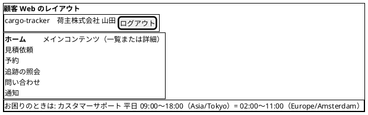

| 項目 | 顧客 Web | 社内業務 Web |
| :--- | :--- | :--- |
| 配置 | 左サイドナビ。幅が狭いときは上部のメニューに畳む | 左サイドナビ |
| 項目 | ホーム、見積依頼、予約、追跡の照会、問い合わせ、通知。荷受人はホームと追跡の照会だけ | 役割に応じて表示: 業務ホーム、見積依頼、経路設計、予約、追跡、有人案件、照会の記録、外部データ、利用者、監査証跡、KPI。「利用者」（S-20）はシステム管理者にだけ出す（Bolt 34） |
| ヘッダー | 企業名・利用者名、ログアウト。荷受人は言語の切替 | 役割名・利用者名、ログアウト |
| 窓口の案内 | すべての画面で同じ位置（下部）に、窓口と受付時間を利用者のタイムゾーンで示す（WCAG 3.2.6、R-11） | — |
| 現在地 | ナビの現在項目を太字と `aria-current="page"` で示す | 同左 |

ナビに表示しない項目は、URL を直接開いても権限がなければ A-04 を表示する（表示の制御を権限の防御にしない）。

実装（Bolt 8、2026-10-03 に承認）: レイアウトは Thymeleaf のフラグメント（`templates/layout/customer.html`・`staff.html`）で作り、Layout Dialect は使わない。Bootstrap 5.3 と htmx 2.0 は WebJars（webjars-locator-lite）で同梱し、共通の CSS は `static/css/app.css` に置く（操作の大きさ、`scroll-padding`、表の横スクロールの囲み、長い語の折り返し）。画面ごとのスタイルは書かない。Bolt 8 では、ナビにいまある画面だけを出した（顧客 Web: 見積依頼。社内業務 Web: 見積依頼、KPI 計測記録）。ヘッダーは認証（US-18）までは仮の主体の名前を出し、ログアウトは出さない。Bolt 14 で、ヘッダーに認証した利用者（荷主は企業名・利用者名、社内は役割名・利用者名）とログアウトを出し、ナビは役割ごとに荷主・営業の項目を出す（まだない画面は準備中の画面へ。2026-10-06 に承認）。Bolt 17 で、経路設計者のナビに経路設計（S-05）を出す。経路設計の画面（`/staff/routing-cases/**`）は経路設計者だけ、ほかの社内の画面（`/staff/**`）は営業担当者だけが開ける（2026-10-07。Bolt 17 計画の確認ポイント 11）。Bolt 26 で、追跡管理者のナビに追跡（S-11）を出す。追跡の画面（`/staff/tracking-records/**`）は追跡管理者だけが開ける（Bolt 26 計画の確認ポイント 4）。Bolt 27 で、荷主のナビの「追跡の照会」を C-10 に向ける。荷主の画面（`/customer/**`）の認可の規則は変えない（Bolt 27 計画の確認ポイント 9）。窓口の案内は「平日 09:00〜18:00（Asia/Tokyo）」とする（2026-10-06 に決定。D-29。利用者のタイムゾーンを持つ Bolt で、利用者のタイムゾーンで示す）。

## 画面遷移

確認（重要操作の実行前確認）は、詳細画面の中に開く確認の領域で行う（共通部品）。遷移図では、確認の段階を区別するために状態として描いている。

### 認証とアカウント

```plantuml
@startuml
title 認証とアカウントの画面遷移
[*] --> ログイン
ログイン : A-01
認証コード : A-02
登録 : A-07 認証アプリの登録
再設定の依頼 : A-05
再設定 : A-06
リンクを開く : /password-reset/{トークン}（画面なし。Bolt 33a）
無効なリンクの案内 : A-06 の無効なリンクの案内（Bolt 33a）
回復コードの保存 : A-07 回復コードの保存（登録の POST の応答）
再登録 : A-08 認証アプリの再登録（Bolt 33b）
新しい回復コード : A-08 新しい回復コードの保存（完了の POST の応答）
ログイン --> 認証コード : password が正しい
認証コード --> 登録 : 未登録（初回。Bolt 31b）
登録 --> 登録 : コードの誤り（同じキーで示し直す）
登録 --> 回復コードの保存 : 最初のコードが正しい（資格と回復コードを保存）
登録 --> 認証コード : 登録済み（同時の登録で負けた側を含む）
回復コードの保存 --> 認証コード : 「保存した」に印を付けて「ログインを続ける」
登録 --> 再認証の案内 : 登録を始めてから 15 分
ログイン --> ログイン : 誤り・ロック中（失敗箇所もロックも示さない。同じ文言と予告。Bolt 32）
ログイン --> 再設定の依頼 : password を忘れた
再設定の依頼 --> 再設定の依頼 : 入力の形の誤り（空・形式）
再設定の依頼 --> ログイン : 送信（登録の有無を示さない。?reset-requested で知らせを出す。Bolt 33）
再設定の依頼 --> リンクを開く : メールのリンクを開く（登録された有効な利用者だけに届く。Bolt 33a）
再設定の依頼 --> 再認証の案内 : 失効した Cookie のままリンクを開いた（リンクの URL は覚えない。もう一度リンクを開けば通る。既知の課題）
リンクを開く --> 再設定 : 使えるトークン（session にトークンの ID を置き、/password-reset/new へ PRG）
リンクを開く --> 無効なリンクの案内 : 期限切れ・使用済み・新しいリンクを送った後・存在しない
再設定 --> 再設定 : 短い・長い・72 バイトを超える・よく使われる・確認の不一致（トークンは使わない）
再設定 --> 無効なリンクの案内 : session にトークンの ID がない・送るまでに使えなくなった・利用停止・所属企業の無効
再設定 --> ログイン : 新しい password を設定（今の session を作り直し、?reset-completed で知らせを出す。新しい password と TOTP でログインし直す。Bolt 33a）
再設定 --> ログイン : 招待のリンクで初回の password を設定（?initial-password-set で知らせを出す。設定した password と TOTP の登録へ。Bolt 38b4）
無効なリンクの案内 --> 再設定の依頼 : 「新しいリンクを送る（初めて設定する場合も、ここから設定できます）」（Bolt 38b4）
無効なリンクの案内 --> ログイン : 「ログインに戻る」
認証コード --> ホーム : TOTP が正しい（session の ID を変える。8 時間の起点。覚えた要求があれば開いていた画面へ ?continue を付けて移す。Bolt 32e。Bolt 31c から 33a までは回復コードもここ）
認証コード --> 再登録 : 回復コードが正しい（session の ID を変える。8 時間の起点。回復コードでログインした印を置き、覚えた要求は残す。Bolt 33b）
再登録 --> 再登録 : コードの誤り（同じキーで示し直す）・15 分を過ぎた・秘密が読めない（新しいキーで示し直す。どれも置き換えない）
再登録 --> 新しい回復コード : 新しいコードが正しい（秘密を置き換え、回復コード 10 個を発行し直し、印を消す。コミットの後にほかの session を失効）
再登録 --> ホーム : 「後で登録する」（印は残る。覚えた要求か役割のホーム）・印がない・ログインから 15 分を過ぎた（役割のホーム）
新しい回復コード --> ホーム : 「保存した」に印を付けて「続ける」（POST。サーバーが覚えた要求か役割のホームへ移す）
ホーム --> 再登録 : 回復コードでログインした印の知らせの「認証アプリを登録し直す」（ログインから 15 分未満だけ。Bolt 33b）
認証コード --> ログイン : 誤り・再利用・使用済みの回復コード・ロック中（password の要素を捨てる。誤りは失敗の回数に数える。ロック中は数えない。覚えた要求は持ち越す。Bolt 32e）
認証コード --> 再認証の案内 : password の段から 5 分を過ぎた（覚えた要求は持ち越す。Bolt 32e）
ホーム --> 再認証の案内 : 無操作 30 分・TOTP から 8 時間・利用停止（S-20 の停止の確定。Bolt 34d）・所属企業の無効化（Bolt 32c。無操作と 8 時間では GET の画面を覚える。Bolt 32e）・ほかの端末での password の再設定（Bolt 33a。GET の画面を覚える）・ほかの端末での認証アプリの再登録（Bolt 33b。GET の画面を覚える）
ホーム --> 期限の到来の案内 : 警告の期限を過ぎた（ブラウザの時計。Bolt 32b）
期限の到来の案内 --> 再認証の案内 : 「画面を開き直す」（入力を控えに写す。戻り先を開き直して session が切れている。Bolt 32e・32f）
期限の到来の案内 --> 再認証の案内 : 「もう一度ログインする」（戻り先がない。送信の後に描き直した画面など。入力は控えない。Bolt 32e）
期限の到来の案内 --> ログイン : 「画面を開き直す」（入力を控えに写す。延長が失効で失敗した後。Bolt 32e・32f）
期限の到来の案内 --> ホーム : 「画面を開き直す」（session が生きている。ブラウザの期限が早い。入力を戻して知らせる。Bolt 32e・32f）
期限の到来の案内 : ログインした画面の上のモーダルでない案内（Bolt 32b）
ホーム --> 再認証の案内 : 送信が拒まれた（送信の前に入力を控えに写す。A-03・CSRF の 403・413 で拒まれた印を付ける。Bolt 32f）
ホーム --> 控えの案内 : ログインし直した後の画面の戻り先が控えと違う（拒まれた送信の控えなど。Bolt 32f）
控えの案内 : ログインした画面の main の前の案内（live region。Bolt 32f）
控えの案内 --> ホーム : 「入力していた画面を開く」（控えの戻り先の業務の画面。入力を戻して知らせる）・「入力していた内容を消す」（Bolt 32f）
認証コード --> 再認証の案内 : 利用停止・所属企業の無効化の後の送信（Bolt 32c）
ホーム --> 権限なし : 取り消した役割の URL（次の request から。Bolt 32c）
権限なし : A-04
再認証の案内 : A-03
再認証の案内 --> ログイン
ホーム : C-01 または S-01（役割で振り分け）
@enduml
```

A-02 の誤り・再利用（回復コードの誤り・使用済みを含む。Bolt 31c）では、password の要素を捨てて A-01 に戻し、「認証コードまたは回復コードが正しくないか、すでに使われています。もう一度ログインして、認証アプリに表示された新しいコードか、まだ使っていない回復コードを入れてください。」を示す。password を知った者が 1 つの session で TOTP を試し続けられないようにするため（ADR-011 の K-02）。password・TOTP・回復コードの誤りを合わせて数え、5 回続いたら 15 分ロックする（Bolt 32。ADR-011 の決定 9）。ロックは画面の遷移でなく内部の状態なので、遷移図には置かない（状態は[ドメインモデル](domain_model.md)のログインの失敗の状態遷移図）。ロック中は password の段も認証コードの段も誤りと同じ経路と文言にし、2 つの誤りの文言に一般の予告「続けて 5 回誤ると、15 分ログインできなくなります。」を足す（TOTP・回復コードの誤りも数えるので、予告を見ないままロックされないように）。ロックの有無と解ける時刻は示さない（AC2）。TOTP を登録していない利用者は、A-02 を経て A-07 に移り（Bolt 31b。Bolt 31 では登録の案内に送っていた）、登録して回復コードを保存した後、A-02 で TOTP を入れてログインを終える（ログイン → A-02 → 未登録なら A-07 → 回復コードの保存 → A-02 → ホーム）。登録は TOTP の要素を与えない（ADR-011 の決定 6）。認証アプリを使えない利用者は、A-02 の「認証アプリを使えない場合」を開いて回復コードを 1 つ入れ、ログインを終える（Bolt 31c。ADR-011 の決定 7）。回復コードで通ると A-08 に移る（Bolt 33b。ADR-011 の決定 10）。A-08 で認証アプリを登録し直すと新しい回復コード 10 個を受け取り、「続ける」で開いていた画面か役割のホームに着く。「後で登録する」を選ぶと同じ行き先に着き、印がある間（再登録の完了、ログアウト、session の失効まで）は業務の画面に知らせが出る。入口は回復コードでログインした印だけで、認証コードでログインした利用者は A-08 を開けない（機種を変えるときも回復コードでログインする。マニュアルの付録 B）。password の段だけの session は 5 分で失効し、A-03 に移す（A-02 を開いたまま放置した session を残さない）。A-07 を開いた session だけは、登録を始めてから 15 分を上限にする（認証アプリを入れて QR コードを読む時間を見込む。SEC-03）。

ログインした画面（遷移図のホーム）では、失効の 5 分前に警告し、延長しても画面を移らない（Bolt 32b。共通部品の「session の警告（Bolt 32b）」）。警告のまま期限を過ぎると、画面を移らずに期限の到来の案内を出す。案内のリンクの行き先は、GET で開いた業務の画面ならサーバーが渡した戻り先（その画面）、ほかの画面（送信の後の画面など）なら A-03 にする（Bolt 32e）。Bolt 32f から、戻り先があればリンクの語を「画面を開き直す」にし、押すと入力を控えに写してから開く。戻り先がなければ「もう一度ログインする」のままにする。戻り先を開き直したときにサーバーの session が切れていれば、失効の扱いが要求を覚えて A-03 へ移し（A-03 の問い合わせ先の案内を通す）、ログインし直すとその画面に戻る。延長が失効で失敗した後は、失効の扱いがすでに新しい session を作っているので、開き直すと未認証の要求として A-01 へ直接移る（A-03 を通らない）が、要求は覚えるので、ログインの後はその画面に戻る。ブラウザの期限が早く来ていて session が生きていれば、その画面がそのまま開き、控えた入力を戻して知らせる（Bolt 32f）。

送信（POST）の前にも入力を控えに写す（Bolt 32f）。サーバーの session が切れていた・CSRF のトークンが合わなかったなどで送信が拒まれた画面（A-03、CSRF の 403、413）で拒まれると、その画面が控えに「拒まれた」印を付ける（公開の画面でも、A-01 と認可の 403 は印を付けない。ログアウトでも送信の失敗でもないため）。ログインし直した後の画面（送信は覚えないので役割のホーム。Bolt 32e）の戻り先は控えと違うので、`main` の前に「送信できなかった入力があります。」と「入力していた画面を開く」「入力していた内容を消す」を出す。「入力していた画面を開く」で送信した画面を開くと入力が戻る。送信が届いた（送信の次にログインした画面が開いた）なら控えを捨てる。文言と捨てる時は共通部品の「入力の控え（Bolt 32f）」に置く。

TOTP の端末を失い回復コードもない場合は、システム管理者が S-20 で事前に決めた別経路の本人確認をしたうえで登録を解除し、本人は次回のログインで A-07 から登録し直す（SEC-10）。

password を忘れた利用者は、A-01 の「password を忘れた場合」から A-05 を開いて登録メールアドレスを送る（Bolt 33）。A-05 は公開の画面で、ナビゲーションの対象外にする（ログインした画面のナビにも出さない）。送った後は登録の有無にかかわらず A-01 に戻して同じ知らせを出し、メールは登録された有効な利用者にだけ届く。メールのリンクを開くと、トークンを確かめて session にトークンの ID だけを置き、トークンのない URL の A-06 へ移す（Bolt 33a）。使えないリンクは、理由によらず同じ無効なリンクの案内にする。A-06 は password の要素を与えず、設定したら A-01 に戻して新しい password と TOTP でログインし直す。その利用者のほかの端末の session は、次の操作で A-03 になる（[ADR-011](../../adr/cargo-tracker/011-mfa-totp.md)、[ADR-017](../../adr/cargo-tracker/017-notification-module-and-mail.md)）。

### 顧客 Web（荷主担当者）

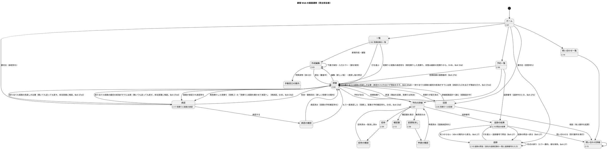

### 荷受人

荷受人は事前登録された利用者（US-18、US-19）である。未登録の荷受人企業の利用者は招待できないため、荷主担当者がシステム管理者へ登録を依頼する。

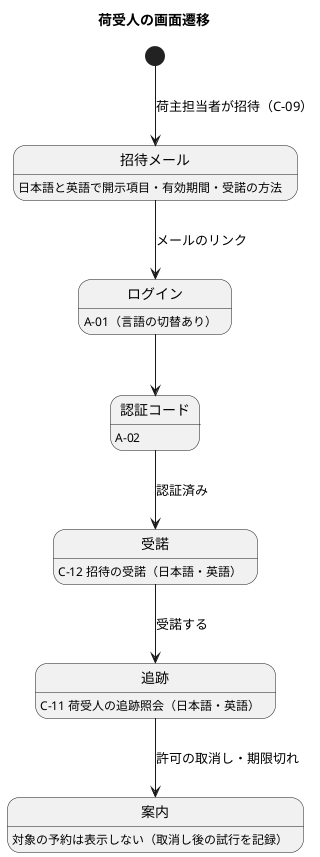

### 社内業務 Web（受付から本予約まで）

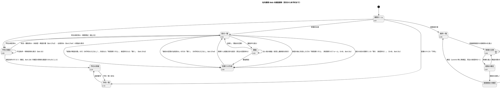

### 社内業務 Web（追跡・有人案件・照会）

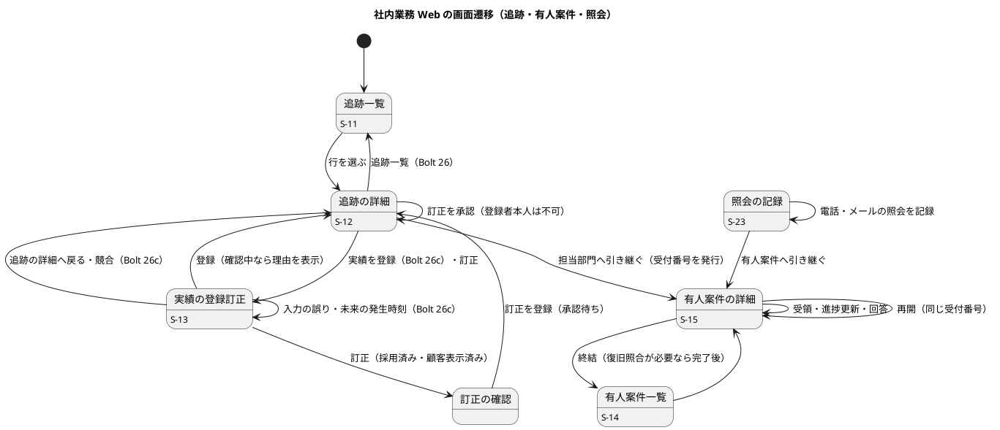

### 社内業務 Web（外部データ・管理）

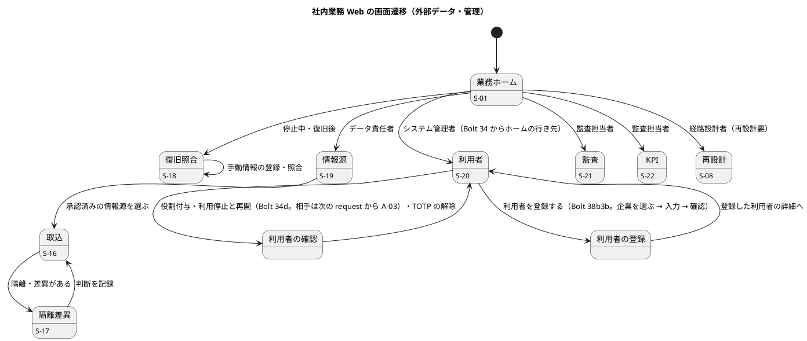

## 画面イメージ

主要な画面を示す。状態は文字とアイコン（`<&check>` などで表記）で示し、色だけに頼らない（BR-13）。日時は「年月日 時刻 タイムゾーン（UTC offset）」の形で、利用者のタイムゾーンを主にする。社内の画面で UTC が必要な箇所は括弧で併記する（BR-10、R-30）。画面イメージの企業名・番号・金額は説明用の架空の値である。

### A-01 ログイン

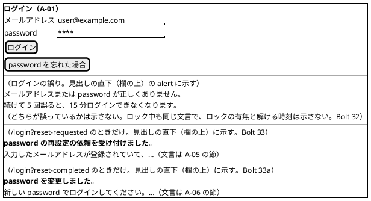

Bolt 14 の A-01 は、メールアドレス・password・「ログイン」と、ログインできない場合の問い合わせ先の案内だけにする。「password を忘れた場合」（A-05 へのリンク）は Bolt 33 で足す。ログインの誤り（`role="alert"`）と再設定の依頼の後に出す知らせ（`role="status"`）は、どちらも見出しの直下（欄の上）に示す。知らせの文言は A-05 の節に置く。Bolt 33a で、再設定の完了の知らせ（`/login?reset-completed` のときだけ。`role="status"`。印 `reset-completed` がなければ出さない。T-124）を同じ位置に足す。文言は A-06 の節に置く。password と認証コードの欄は貼り付けとパスワード管理ツールを妨げない。`autocomplete="username"`・`"current-password"`・`"one-time-code"` を付ける（WCAG 3.3.8）。

開発環境（`dev` プロファイル）では、開発体験を優先し、A-01 のメールアドレスと password を既定の開発用の利用者で入力済みにする（2026-10-06 に human:kakimomokuri が決定）。入力済みにするのは `dev` プロファイルの設定があるときだけで、既定の設定（ステージング・本番を含む）では入力済みにしない。値は開発用の利用者の固定の値で、本物の秘密を使わない。既定の設定で入力済みにならないことをテストで守る。Bolt 14 では `cargotracker.dev-login.accounts[n].role`・`email`・`password`（`application-dev.properties`。開発用の荷主担当者 2 人と営業担当者 1 人。経路設計者は Bolt 17、追跡管理者（`tracking-manager@dev.cargo-tracker.example`）は Bolt 26 で足した）を入れ、最初の利用者で A-01 を入力済みにし、A-01 の下に「開発用の利用者でログイン（開発環境だけ）」として利用者ごとのボタン（例: 「営業担当者でログイン（sales@dev.cargo-tracker.example）」）を出して、選んでそのままログインできるようにする（2026-10-06 に human:kakimomokuri が決定）。`dev` の外または `staging`・`prod` と一緒にこの設定があれば起動を失敗させる（ADR-011 の決定 3、ADR-012）。A-02（認証コード）は、開発用の利用者に固定の TOTP の秘密を持たせ、`dev` プロファイルのときだけその時点のコードを入力済みにする。TOTP を飛ばさず、開発環境でも 2 段階のログインを通す（2026-10-06 に human:kakimomokuri が承認。Bolt 13 の確認ポイント 7）。Bolt 31 で、`cargotracker.dev-login.accounts[n].totp-secret`（Base32。利用者ごとに別）を足し、利用者ごとのボタンで password の段を通った後、A-02 をその時点のコードで入力済みにして出す（「確認」を押す 1 回が増える）。コードは設定の固定の秘密だけから作り、利用者の表の秘密は復号しない（ADR-011 の決定 3）。同じ利用者で 30 秒以内に入り直すと、同じコードの再利用として拒否され A-01 に戻る（本体の再利用の拒否は開発環境でも変えない）。デモでは、入り直す前に次の 30 秒の刻みを待つ。

### A-02 認証コードの入力

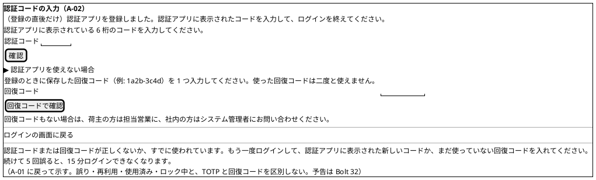

Bolt 31 の A-02 は、6 桁の数字の欄と「確認」だけにする。欄には `autocomplete="one-time-code"`・`inputmode="numeric"` を付け、貼り付けとパスワード管理ツールを妨げない（WCAG 3.3.8）。誤り・再利用は A-01 に戻して上の文言を示す（拒否の種類は監査記録の理由 `INVALID_TOTP`・`TOTP_REUSED` にだけ残す）。Bolt 32 で、ロック中も誤りと同じく A-01 に戻して同じ文言を示すことにし、文言に一般の予告「続けて 5 回誤ると、15 分ログインできなくなります。」を足した。ロック中の案内と解ける時刻は示さない（AC2。監査記録の理由 `LOCKED` にだけ残す。ADR-011 の決定 9）。

Bolt 31c で、回復コードの欄を足した（ADR-011 の決定 7）。

- 「認証アプリを使えない場合」は `<details>` で、中に別のフォーム（`name="recoveryCode"`、`autocomplete="off"`、`inputmode` は付けない）と「回復コードで確認」を置き、同じ `POST /login/totp` に送る。欄の形で TOTP と取り違えない。JavaScript も CSP の変更も要らない
- 回復コードは大文字・前後と中の空白・ハイフンなしの 8 文字・全角（IME で入れたまま）でも受け付ける（正規化。手で書き写したコードを打ち直させない）。形が合わなければ照合せずに拒む。欄の説明は「半角の数字と a〜f の英字で 8 文字。大文字、空白、ハイフンはあってもかまいません。」で、使い方の文とあわせて `aria-describedby` で読み上げる。`spellcheck="false"`（Bolt 31c の開発レビュー）
- 誤り・使用済み・形の違い・両方の欄がある送信は、TOTP の誤りと同じく A-01 に戻して上の文言を示す（拒否の種類は監査記録の理由 `INVALID_RECOVERY_CODE` にだけ残す）
- これまで A-02 にあった「認証アプリを使えない場合は…お問い合わせください」（SEC-10 の経路）は、`<details>` の中の回復コードの欄の下に「回復コードもない場合は…」として移す
- 登録の直後の案内（「認証アプリを登録しました。…」）は、session に登録を始めた時刻があるときだけ示す。TOTP・回復コードが通ったら登録を始めた時刻を消すので、ログインを終えた後に A-02 を開き直しても出ない（Bolt 31b のレビュー 13）
- Bolt 33b から、回復コードが通ったら A-08 へ移す（下の A-08 の節）。A-02 の文言は変えない（「使った回復コードは二度と使えません」は再登録の後も事実で、再登録で残りの回復コードも置き換わることは A-08 で示す）

### A-05 password の再設定の依頼

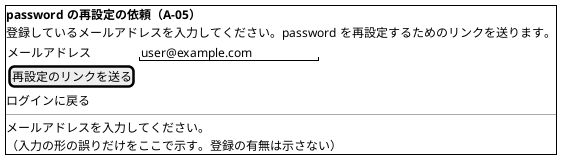

Bolt 33 の A-05 は、メールアドレスの欄（`autocomplete="email"`。貼り付けとパスワード管理ツールを妨げない。WCAG 3.3.8）と「再設定のリンクを送る」と「ログインに戻る」（A-01 へのリンク）だけにする。欄の誤りは欄の下に示し、`aria-describedby` で結ぶ（A-07 のコードの誤りと同じ形）。誤りのときは title に「エラー: 」を付け（「エラー: password の再設定の依頼 - cargo-tracker」）、欄に `autofocus` を付ける（読み上げはラベル・無効・説明の順）。

| 入力 | A-05 の文言 |
| :--- | :--- |
| 空（前後の空白だけを含む） | 「メールアドレスを入力してください。」 |
| 形式の誤り（`EmailAddress` が受け付けない値） | 「メールアドレスの形式が正しくありません。例: user@example.com」 |

形の誤りでは入れた値を残す。形が正しければ、登録の有無にかかわらず `/login?reset-requested` に移し、A-01 に次の知らせを出す（`role="status"`。ログインの誤りの文言とは別の位置）。

> **password の再設定の依頼を受け付けました。**
>
> 入力したメールアドレスが登録されていて、ご利用いただける状態であれば、再設定のリンクをそのアドレスへ送ります。
>
> - リンクの有効期限は 30 分で、1 回だけ使えます。
> - 数分たっても届かない場合は、迷惑メールのフォルダを確かめてから、もう一度依頼してください（前にリンクを送ってから 1 分以内の依頼では送りません。新しいリンクを送ると、前のリンクは使えなくなります）。
> - それでも届かない場合は、荷主の方は担当営業に、社内の方はシステム管理者にお問い合わせください。

知らせが出る場面と、事実と合うか（Bolt 32f の Try T-123）:

| 場面 | 実際に起きること | 知らせの各文が事実と合うか |
| :--- | :--- | :--- |
| 登録された有効な利用者 | 依頼のコミットの後にトークンを発行し、リンクを送る（応答は送信を待たない） | 合う。送るのは応答の後なので「送ります」とし、「送りました」と断定しない |
| 登録のないメールアドレス | 監査（`UNKNOWN_USER`）だけで、送らない | 合う（「登録されていて…であれば」の条件に当たらない）。届かないので、最後の問い合わせ先の文で次の行動を示す |
| 止められた利用者 | 監査（`SUSPENDED`）だけで、送らない | 合う（「ご利用いただける状態であれば」の条件に当たらない）。止めたことは示さない（IA-INV-09） |
| 所属企業の無効 | 監査（`COMPANY_INACTIVE`）だけで、送らない | 合う（同上） |
| 前にリンクを送ってから 1 分以内の繰り返し | 依頼の監査は残るが、ハンドラーが発行も送信もしない（1 分の起点は前の発行）。前のリンクは使えるまま | 合う（括弧の「前にリンクを送ってから 1 分以内の依頼では送りません」）。1 分を過ぎてから依頼し直すと新しいリンクを送り、前のリンクは使えなくなる（括弧の「新しいリンクを送ると、前のリンクは使えなくなります」） |
| 送信の失敗（SMTP の誤り） | 通知は FAILED になり、届かない | 合う（「届かない場合は…もう一度依頼」で回復できる。送れなかった依頼は利用者が依頼し直す） |
| ログイン済み・password の段の session で A-05 を開いた | 同じ A-05 を出し、入力したアドレスで扱う。session の利用者は変えない。戻った A-01 は、ログイン中も知らせとログインの欄を出す | 合う（知らせは入力したアドレスについて述べ、session の利用者に触れない） |
| 印のない `/login` | 依頼していない | 知らせを出さない（T-124） |

依頼の後に A-01 で知らせを読んだ利用者がそのままログインできるよう、A-01 のほかの部分（欄・ログインの誤りの文言・問い合わせ先の案内）は変えない。

### A-06 password の再設定

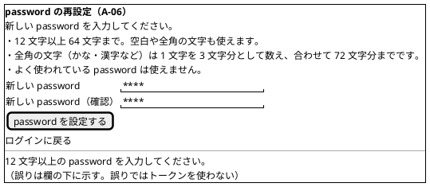

Bolt 33a の A-06 は、見出し「password の再設定」、説明（上の 3 つの条件）、「新しい password」と「新しい password（確認）」の 2 つの欄、「password を設定する」、「ログインに戻る」（A-01 へのリンク）だけにする。2 つの欄には `autocomplete="new-password"` を付け、貼り付けとパスワード管理ツールを妨げない（WCAG 3.3.8）。条件の数値（12・64・72）は password の方針の定数から描き、文言に数字を書き写さない。欄の誤りは A-05 と同じ形にする（欄の下に示して `aria-describedby` で結ぶ。誤りのときは title に「エラー: 」を付け（「エラー: password の再設定 - cargo-tracker」）、誤りの欄に `autofocus` を付ける）。誤りを示すときは、2 つの欄に入れた値を応答に書き戻さない（空で示す。A-01 が password を残さないのと同じ）。

初回の設定（Bolt 38b4。2026-10-26 の開始準備の決定 (4)、human:kakimomokuri）: 招待のリンク（用途 `USER_INVITATION`）で開いた A-06 は、見出し「password の設定」、説明「初めて使う password を入力してください。」、title「password の設定 - cargo-tracker」（誤りのときは「エラー: password の設定 - cargo-tracker」）にする。欄の名前・条件・ボタン・誤りの文言は再設定と同じ。controller が用途から見出しと説明を選んで渡し、テンプレートは用途の名前を比べない。再設定のリンクで初めて password を設定する利用者（招待のリンクが第三者の再設定の依頼で無効になった、遅れた DE-25 が本人の再設定に譲った、招待の期限が切れた）は、再設定の見出しと知らせのままにする（受け入れた。初回かは用途だけで決め、スキーマを変えない。ログインすれば A-07 が出る。開始準備の決定 (7)）。

誤りの文言を決める前に、誤りが出る場面と、文言が事実と合うかを表にした（Bolt 32f の Try T-123）。方針は 1 つの違反だけを返し、確かめる順は短い・長い・72 バイト・よく使われる、である。確認の不一致は画面の層で方針より先に見る。

| 入力 | 判定 | 文言（示す欄） | 文言が事実と合うか |
| :--- | :--- | :--- | :--- |
| 空（2 つの欄とも空） | 方針の `TOO_SHORT`（0 文字） | 「12 文字以上の password を入力してください。」（新しい password） | 合う（空も 12 文字に満たない）。空を別の文言にしない |
| 11 文字以下（code point で数える。空白と全角の文字も 1 文字） | `TOO_SHORT` | 同上 | 合う |
| 65 文字以上 | `TOO_LONG` | 「64 文字までの password を入力してください。」（新しい password） | 合う（全角の文字を含んでも、先に文字数で判定する） |
| 64 文字以下で、UTF-8 で 73 バイト以上（全角の文字を含む） | `TOO_MANY_BYTES` | 「全角の文字を含めると長すぎます。全角の文字（かな・漢字など）は 1 文字を 3 文字分として数え、合わせて 72 文字分までの password を入力してください。」（新しい password） | かな・漢字・全角の英数字と記号（UTF-8 で 3 バイト）では合う。半角の英数字と記号だけなら 64 文字で 64 バイトなので、この誤りは出ない。絵文字（4 バイト）とアクセント記号付きの文字（2 バイト）は文言の数え方と少しずれる。まれなので受け入れ、マニュアルで補う |
| よく使われる password の一覧に載っている（大文字小文字を区別しない） | `COMMON` | 「この password はよく使われているため、使えません。ほかの人に推測されにくい password を入力してください。」（新しい password） | 合う（同梱の一覧と一致した）。漏えい済みの照合は W10（SEC-05）なので「漏えい」とは言わない。一覧の 1 文字違いは通る |
| 確認の不一致（新しい password が空で確認だけ入れた場合を含む） | 画面の層 | 「確認の欄に、新しい password と同じものを入力してください。」（新しい password（確認）） | 合う。不一致を先に見るので、方針の誤りは不一致を直した後に出る（2 回の送信になりうる） |

使えないリンクの案内（`identity/password-reset-invalid`。リンクを開く GET と A-06 の GET・POST が同じ案内を返す）:

> **このリンクは使えません**
>
> 有効期限を過ぎた、使用済み、新しいリンクが送られた、などが考えられます。
>
> - メールが複数届いている場合は、いちばん新しいメールのリンクを開いてください。
> - すでに password を設定した場合は、その password でログインしてください。
> - リンク「新しいリンクを送る（初めて設定する場合も、ここから設定できます）」（A-05）
> - うまくいかない場合は、荷主の方は担当営業に、社内の方はシステム管理者にお問い合わせください。
>
> リンク「ログインに戻る」

title は「このリンクは使えません - cargo-tracker」にする。Bolt 38b4 から、再設定と招待の用途を問わず同じ案内にし、期限の時間を書かない（使えないトークンの用途は読まない。2026-10-26 の開始準備の決定 (2)・(6)、human:kakimomokuri）。どの理由で使えないかは示さない（IA-INV-09、SEC-08）。案内が出る場面と、事実と合うか:

| 場面 | 実際に起きること | 案内の各文が事実と合うか |
| :--- | :--- | :--- |
| 期限切れ（再設定は発行から 30 分、招待は 24 時間） | リンクを開く GET で使えない。session に何も置かない | 合う（「有効期限を過ぎた」。時間は書かない） |
| 使用済み（設定を終えた後にもう一度開いた。2 つのタブで先に設定した） | 使えない | 合う（「使用済み」「すでに password を設定した場合は…」） |
| 新しいリンクを送った後（依頼し直した） | 前のトークンは無効にした時刻が入っていて使えない | 合う（「新しいリンクが送られた」「いちばん新しいメール」） |
| at-least-once で先のリンクが無効になった（ハンドラーのやり直しで 2 通目が届く。Bolt 33 の既知の課題） | 1 通目のリンクは使えず、2 通目のリンクは使える | 合う（同上。利用者は依頼し直していないが「新しいリンクが送られた」は事実） |
| 存在しない（書き写しの誤り、リンクの一部だけを開いた） | ハッシュで見つからない | 「などが考えられます」で含む。理由を断定しない |
| 招待のリンクが使えなくなった（期限切れ、第三者の再設定の依頼で無効、遅れた DE-25 が本人の再設定に譲った。Bolt 38b4） | 使えない | 合う。「新しいリンクを送る（初めて設定する場合も、ここから設定できます）」で A-05 へ。そのリンクで開く A-06 は再設定の見出しで、監査は `PASSWORD_RESET_COMPLETED`（受け入れた。開始準備の決定 (7)） |
| 利用停止・所属企業の無効（A-06 の送信で分かる） | 方針の確認の後、トークンを使う前に分かり、トランザクションを戻す。監査を書かない | 理由を示さない（IA-INV-09）。依頼し直してもメールは送られず、A-05 の知らせの問い合わせ先の文で次の行動を示す |
| A-06 の URL を直接開いた・ブックマークから開いた（session にトークンの ID がない） | 案内を出す | 合う（「新しいリンクを送る」で回復できる） |
| 失効した Cookie のままリンクを開いた | この案内でなく、失効の扱いで A-03 に移る（下の A-03 の表） | 該当しない |

完了の知らせ（A-01。`/login?reset-completed`。`role="status"`。依頼の知らせと同じ位置）:

> **password を変更しました。**
>
> 新しい password でログインしてください。このブラウザでログインしていた場合は、ログアウトしました。
>
> 新しい password を正しく入れてもログインできない場合は、続けて誤ったログインのために、しばらくログインできなくなっていることがあります。15 分たってから、もう一度ログインしてください。

知らせが出る場面と、事実と合うか:

| 場面 | 実際に起きること | 知らせの各文が事実と合うか |
| :--- | :--- | :--- |
| ログインしていないブラウザ（ふつうの場合） | 新しい session で A-01 を出す | 合う。「このブラウザでログインしていた場合は」は条件に当たらない |
| ロック中の利用者 | password は変わるが、ロックと失敗の数は変えない（SEC-02）。ロックが解けるまでは正しい password でも誤りと同じ文言になる | 合う。2 つ目の段落はどの利用者にも同じに出し、ロックの有無を示さない。ロックは 5 回目の失敗から 15 分で解けるので、「15 分たってから」でログインできる |
| 同じ利用者がログイン中のブラウザ | 完了したら今の認証と session を捨てて新しい session を作る（方針の誤りで送り直せるように、完了の前には捨てない。Bolt 33a の開発レビューで、決定 2 の (6) の「完了の前に」から改めた） | 合う（「ログアウトしました」）。ログインし直すまで業務の画面は開けない |
| password の段の session（A-02・A-07 の途中） | 同上 | 合う（ログインの途中もログアウトに含める） |
| 別の利用者がログイン中のブラウザで、リンクを開いて設定した | 別の利用者の認証も捨てる。変わったのはリンクの持ち主の password | 合う（「このブラウザでログインしていた場合は、ログアウトしました」）。「新しい password でログインしてください」はリンクの持ち主に向けた文で、別の利用者は自分の password でログインし直す |
| ほかの端末でログインしていた（同じ利用者） | コミットの後に session を消し、次の操作で A-03 | 知らせでは述べない（消せなかったときも password は変わっており、知らせが事実と違わないように）。ほかの端末は A-03 の文言で分かる |
| TOTP を登録していない利用者・回復コードを使う利用者 | ログインの後の段は前と同じ（A-07・A-02） | 合う（「新しい password でログインしてください」だけで、認証アプリのコードに限らない。再設定のメールと同じ書き方） |
| 印のない `/login` | 設定していない | 知らせを出さない（T-124） |

初回の設定の完了の知らせ（A-01。`/login?initial-password-set`。`role="status"`。Bolt 38b4。2026-10-26 の開始準備の決定 (4)・(8)、human:kakimomokuri）:

> **password を設定しました。**
>
> このブラウザでログインしていた場合は、ログアウトしました。設定した password でログインし、認証アプリを登録してください。

| 場面 | 実際に起きること | 知らせの各文が事実と合うか |
| :--- | :--- | :--- |
| 登録された本人（ふつうの場合） | 新しい session で A-01 を出す。ログインすると A-07（認証アプリの登録）が出る | 合う |
| システム管理者が自分のブラウザで招待のリンクを開いた（別の利用者がログイン中） | 管理者の認証も捨てる | 合う（「このブラウザでログインしていた場合は、ログアウトしました」）。管理者は自分の password でログインし直す |
| ロック中の利用者 | 起こりうる（第三者の誤ったログインで。設定でロックは解けない。SEC-02） | 初回の知らせはロックを示さない（受け入れた。2026-10-27、human:kakimomokuri。マニュアル 2.6 の初回の設定の注で、15 分たってから試すよう案内する） |

A-03 の文言の場面（Bolt 33a で、再設定でほかの端末の session を消した場面を足した。Bolt 33b で、認証アプリの再登録でほかの端末の session を消した場面を足した）:

| 場面 | 1 文目の理由と合うか | 2 文目「ログインすると、開いていた画面に戻ります。」と合うか |
| :--- | :--- | :--- |
| 無操作 30 分 | 合う | GET の業務の画面なら合う（Bolt 32e） |
| ログインの手続きの時間切れ（password の段の 5 分、登録の 15 分） | 合う | 覚えた要求を持ち越すときは合う（Bolt 32e） |
| ログインから 8 時間 | 合う | GET の業務の画面なら合う（Bolt 32e） |
| 利用停止・所属企業の無効化・利用者の削除 | 当たる理由はない（止めたことは示さない。Bolt 32c で受け入れた） | 戻らない（Bolt 32e で受け入れた） |
| ほかの端末で password を再設定し、この session を消した（Bolt 33a） | 今までの文言には当たる理由がない。**「または password を再設定したため」を足す**（止めたことは示さないまま。利用停止の場面は今のまま） | GET の業務の画面なら合う（失効の扱いが要求を覚える） |
| ほかの端末で認証アプリを登録し直し（A-08）、この session を消した（Bolt 33b） | Bolt 33a の文言には当たる理由がない（password は変えていない）。**「、または認証アプリを登録し直したため」を足す**（password の再設定の文に倣う。並びを「…8 時間を過ぎたため、password を再設定したため、または認証アプリを登録し直したため」にする） | GET の業務の画面なら合う（失効の扱いが要求を覚える） |
| 失効した Cookie のまま再設定のリンクを開いた | 合う（無操作などで失効していた） | 合わない（リンクの URL は覚えない。既知の課題）。もう一度リンクを開けば通ることをマニュアルで補う |
| A-06 を開いたまま 30 分操作しなかった | 合う | 合わない（公開の URL は覚えない。再設定のトークンも 30 分で使えない。招待のトークンは 24 時間）。依頼し直すことをマニュアルで補う |

A-03 の 1 文目は「一定時間操作がなかったため、ログインの手続き（認証コードの入力や認証アプリの登録）を時間内に終えなかったため、ログインから 8 時間を過ぎたため、または password を再設定したため、ログアウトしました。もう一度ログインしてください。」にする。ほかの文は変えない。Bolt 33b で「認証アプリを登録し直したため」を足し、「一定時間操作がなかったため、ログインの手続き（認証コードの入力や認証アプリの登録）を時間内に終えなかったため、ログインから 8 時間を過ぎたため、password を再設定したため、または認証アプリを登録し直したため、ログアウトしました。もう一度ログインしてください。」にする（上の表の Bolt 33b の行。ほかの文は変えない）。

### A-07 認証アプリの登録

A-07 は、登録の画面と、登録を保存した応答で示す回復コードの保存の画面の 2 つからなる（Bolt 31b）。初めの設計は回復コードを登録の前の同じ画面に示していたが、それだと平文の回復コードを登録の途中の session（Spring Session JDBC の表）に置くことになるため、登録の後の 2 つ目の画面に分けた（Bolt 31b 計画の確認ポイント 4）。

登録の画面:

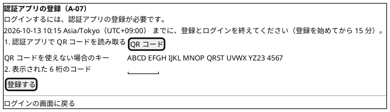

- QR コードはサーバーが作るインラインの SVG で、`role="img"` と代わりの文「認証アプリで読み取る QR コード」を付ける。色は `fill` の属性で付け、`style` は使わない（CSP）
- キーは Base32 を 4 文字ずつ区切って示す。QR コードと同じく秘密と同じ重さの値なので、応答は `Cache-Control: no-store` にし、session・記録には置かない。再読み込みやタブを 2 つ開いても、登録の途中は同じキーを示す
- コードの欄は `autocomplete="one-time-code"`・`inputmode="numeric"`（A-02 と同じ）
- コードの誤りは同じ画面にエラー要約で示し、同じキーで示し直す（認証アプリに登録済みのキーを使い続けられる）。password の要素は捨てない。誤りは失敗の回数に数えない（Bolt 32 で決めた。登録は認証のイベントを経ず、登録の誤りは自分の秘密の確かめで、他人の要素の推測にならない。ADR-011 の決定 9）
- 「ログインの画面に戻る」はログアウトの POST（A-02 と同じ）

回復コードの保存の画面（登録の POST の応答）:

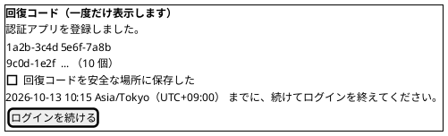

- 回復コードは 10 個で、形は `1a2b-3c4d`（8 文字の 16 進を 4 文字ずつハイフンで区切る）。一度だけ示し、どこにも保存しない（ハッシュだけを保存する。SEC-09）。応答は `Cache-Control: no-store`
- 「回復コードを安全な場所に保存した」は画面の必須のチェック（`required`）。サーバーは確かめない（回復コードは登録の時点で保存済みなので、確認は利用者への促し）
- 「ログインを続ける」は A-02 への GET のフォーム。A-02 で、登録に使ったコードか次のコードを入れてログインを終える
- 登録の画面と同じ期限の時刻（「… までに、続けてログインを終えてください」）を示す。登録を始めた時刻は A-02 で TOTP または回復コードが通るまで残る（通ったら消す。Bolt 31c）
- 再読み込み（登録の POST の再送）は、登録済みとして A-02 へ移す（回復コードはもう示さない）
- 回復コードは A-02 の「認証アプリを使えない場合」で使う（Bolt 31c。上の A-02 の節）

### A-08 認証アプリの再登録

A-08 は、回復コードでログインした利用者が認証アプリを登録し直す画面と、完了の POST の応答で示す新しい回復コードの保存の画面の 2 つからなる（Bolt 33b。US-18 AC9、SEC-10、[ADR-011](../../adr/cargo-tracker/011-mfa-totp.md) の決定 10）。A-07 と同じ形にし、秘密の発行のポート（`TotpSecretIssuer`）と QR コードを A-07 と共用する（A-08 は A-07 のサービス `TotpEnrollmentService` を呼ばない。途中の暗号文の扱いは部品 `TotpProvisioningStarter` に、回復コードの発行は `RecoveryCode.issueSet` に寄せ、2 つのサービスが使う。Bolt 33d）。A-02・A-07・A-08 のコードの欄の `pattern`（`[0-9]{6}`）と `maxlength`（6）は、画面がモデル `codeDigits` で渡す TOTP の桁数（`TotpCredential.DIGITS`）から描く（Bolt 33d。見出し・前文・説明の「6 桁」の文言はテンプレートに残す。表示は変えない）。A-08 の URL は、共通のレイアウトの知らせのリンクと A-08 の画面のフォームの送信先ともに、application 層の `SessionPaths` の URL を使う（Bolt 33c で `SessionKeys` に置き、Bolt 33f で分けた）（画面の層の `SessionUrlsAdvice` がモデルの `sessionUrls.reEnroll` として渡し、テンプレートは `@{${sessionUrls.reEnroll}}` で参照する。Bolt 33c。表示と振る舞いは変えない）。A-07 との違いは、2 つの要素がそろった session のログインした画面のレイアウト（`layout/customer`・`layout/staff`）に置くこと、「後で登録する」があること、ログインの手続きでなく登録し直しなので「ログインの画面に戻る」がないこと（期限の文言はある）、の 3 つである。ログインした画面なので session の警告（共通部品）は出る。印の知らせ（共通部品）は A-08 には出さない（同じことを画面の本文が言う）。Bolt 33f から、A-07 の「始めてから 15 分」・A-08 の「開いてから 15 分」・A-03 の「ログインから 8 時間」・回復コードでログインした印の知らせの「15 分」・session の警告の「ログインから 8 時間」も、画面の層がドメインルール `SessionPolicy` の期間を書いてモデルで渡し、テンプレートに数値を書かない（文の途中はインライン式（`[[...]]`）で描き、警告は属性 `data-lifetime-message` の値を `th:data-lifetime-message` で描く。表示は変えない）。

登録し直しの画面:

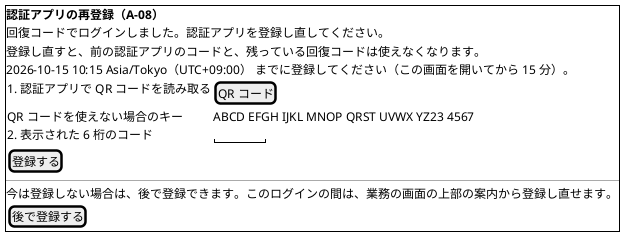

- 見出しと title は「認証アプリの再登録」（title は「認証アプリの再登録 - cargo-tracker」）
- QR コード・キー・コードの欄は A-07 と同じ（インラインの SVG に `role="img"` と代わりの文、キーは 4 文字ずつ、欄は `autocomplete="one-time-code"`・`inputmode="numeric"`）。応答は `Cache-Control: no-store`。再読み込みやタブを 2 つ開いても、途中は同じキーを示す（途中の暗号文と開いた時刻を session に置く。平文の秘密は置かない）
- 期限の時刻は開いた時刻から 15 分で、日時表示の共通部品で示す（再読み込みでは延ばさない）。期限を過ぎてから送った場合は下の文言で示し直す。画面は自動では変わらない。期限を過ぎた途中の値（暗号文・開いた時刻）は、GET で始め直すときに捨てて新しいキーと期限にする
- 印の期限（回復コードでログインしてから 15 分）は、A-08 の期限（開いてから 15 分）とは別に効く。印の期限を過ぎると、A-08 の GET・POST・「後で登録する」は役割のホームへ移す（業務の画面の知らせはリンクのない案内に変わる。下の共通部品）。印の期限はログインから数え、A-08 を開くのはログインの後なので、ふつうは印の期限が先に来る（2026-10-15 の開発レビューで human:kakimomokuri が決定。理由は [ADR-011](../../adr/cargo-tracker/011-mfa-totp.md) の決定 10）
- 「後で登録する」は別のフォームの POST（`/account/authenticator/later`。CSRF のトークン付き）で、印を確かめてから（印がない・期限を過ぎていれば役割のホーム）、印を残して覚えた要求の画面か役割のホームへ PRG で移す。リンクにしない（GET は状態を変えない）
- 「登録し直すと、前の認証アプリのコードと、残っている回復コードは使えなくなります。」は、完了するまで前のものが使えることも含めて事実と合う（置き換えるのは新しいコードを確かめた時点。ADR-011 の決定 10）

誤りの文言（エラー要約。A-07 と同じ位置と `role="alert"`、フォーカスを移す）:

| 場面 | 文言 | 振る舞い |
| :--- | :--- | :--- |
| コードの誤り | 「認証コードが正しくありません。認証アプリに表示されている最新のコードを入力してください。」（A-07 と同じ） | 置き換えない。同じキーで示し直す。失敗の回数に数えない |
| 期限切れ（開いてから 15 分を過ぎて送った） | 「登録し直しの期限を過ぎたため、新しいキーを発行しました。先ほど認証アプリに追加した項目は使えないので削除し、新しい QR コードを読み取ってください。登録し直すまでは、前の認証アプリのコードと残っている回復コードを使えます。」 | 置き換えない。途中の暗号文を捨て、新しいキーと新しい期限で示し直す。印の期限（ログインから 15 分）が A-08 の期限（開いてから 15 分）より先に来るので、画面からはほぼ届かない守りである（印の期限を過ぎた送信は役割のホームへ移る。サービスの判定は画面の確かめが漏れたときの守りとして残す） |
| 秘密が読めない（途中の暗号文が session にない・別の利用者のもの・鍵の版が違う・壊れた） | 「登録し直しの手続きが中断されたため、新しいキーを発行しました。先ほど認証アプリに追加した項目は使えないので削除し、新しい QR コードを読み取ってください。」 | 置き換えない。新しいキーで示し直す（A-07 の中断と同じ扱い。500 にしない） |

新しい回復コードの保存の画面（完了の POST の応答）:

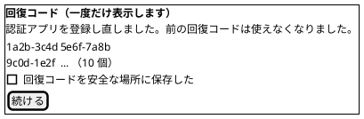

- A-07 の回復コードの保存の画面と同じ形（見出し「回復コードの保存」、10 個、形 `1a2b-3c4d`、説明の文、`Cache-Control: no-store`、「回復コードを安全な場所に保存した」は画面の必須のチェック）。違いは、1 文目を「認証アプリを登録し直しました。前の回復コードは使えなくなりました。」にすること、期限の時刻がないこと、ボタンを「続ける」にすること
- 「続ける」は POST のフォーム（`/account/authenticator/continue`。CSRF のトークン付き）で、サーバーが覚えた要求の画面（なければ役割のホーム）へ redirect する。行き先はサーバーが覚えた要求から決め、利用者の入力から作らない。GET のフォームにしないのは、GET のフォームは action の query を捨て、覚えた要求の query が消えるため（Bolt 33b の開発レビュー）。覚えた要求を読んで消すのは「続ける」と「後で登録する」の時で、完了の応答では消さない
- 再読み込み（完了の POST の再送）は、印と途中の属性が消えているので、置き換えずに役割のホームへ移す（新しい回復コードはもう示さない）
- ほかの端末のログアウトは述べない（失効が失敗しても置き換えは終わっており、文が事実と違わないように。A-06 の完了の知らせの前例）。ほかの端末は A-03 の文言で分かる

文言を決める前に、A-08 と知らせが出る場面と、文言が事実と合うかを表にした（Bolt 32f の Try T-123）:

| 場面 | 実際に起きること | 示すもの | 文言が事実と合うか |
| :--- | :--- | :--- | :--- |
| 回復コードでログインした（ふつうの場合） | 認証の入口が印（利用者の ID とログインした時刻）を置いて A-08 へ移す。session の ID は認証の入口がすでに変えている。覚えた要求は残す | A-08 | 合う（「回復コードでログインしました」） |
| 認証コードでログインした | 今のまま（覚えた要求か役割のホーム）。印を置かない | A-08 も知らせも出ない | 該当しない |
| 印のない session で A-08 の URL を開いた（ブックマーク・直接入力・完了の後の再送） | 役割のホームへ移す。置き換えない | 何も示さない | 合う（入口は印だけ。機種を変えるときも回復コードでログインする。マニュアルの付録 B） |
| password の段（A-02 の途中）で A-08 を開いた | A-02 へ移す（2 つの要素を求める認可と全 URL の見張りのまま） | A-02 | 合う |
| 同じ session で別の利用者に切り替えた後（回復コードでログインした後、ログアウトせずに A-01 から別の利用者の password を通した） | password の段の成功で印を消す。画面も印の利用者の ID と今の主体を比べる | 別の利用者には A-08 も知らせも出ない（A-08 を開くと役割のホーム） | 合う（前の利用者の印で別の利用者の認証アプリを登録し直させない。T-102） |
| 開いてから 15 分を過ぎて送った | サービスが期限切れを返し、置き換えない。印の期限（ログインから 15 分）が先に来るので、ふつうは印の期限を過ぎた送信として役割のホームへ移り、この分岐は画面からはほぼ届かない守りである | 期限切れの文言と新しいキー | 合う（置き換えていないので前のコードと回復コードが使える） |
| コードの誤り | 置き換えない。数えない | コードの誤りの文言 | 合う |
| 秘密が読めない・途中の暗号文がない | 置き換えない | 中断の文言と新しいキー | 合う |
| 新しいコードが正しい | 再登録の前に読んだ秘密のままのときだけ秘密を置き換え、回復コード 10 個を発行し直し、監査 `TOTP_RE_ENROLLED` を書く。印と途中の属性を消す。コミットの後にほかの session を失効させる（今の session は残す） | 新しい回復コードの保存の画面 | 合う（「登録し直しました」「前の回復コードは使えなくなりました」）。ほかの端末のログアウトは述べない |
| 完了をほかのタブからもう一度送った | 先の完了で印と途中の属性が消えているので、置き換えずに役割のホームへ移す。2 つの送信が同時でも、置き換えは再登録の前に読んだ秘密のままのときだけ行うので 1 回だけになる（後の送信は先の確定を待ち、「ほかの画面で先に登録し直していた」結果 `Superseded` になって置き換えも回復コードの発行し直しもしない。Bolt 33b のステップ 3 の統合テストで確かめた）。画面は印が消えた後と同じく役割のホームへ移す | 何も示さない（新しい回復コードは先のタブに 1 回だけ示す） | 合う |
| 古い秘密のコードで A-02 を通そうとした要求が置き換えと重なった（ほかの端末） | 置き換えの前に古い秘密で照合を終えた要求も、刻みの使用が秘密の一致の条件で 0 件になり通らない | その端末の A-01 の誤りの文言 | 合う（「認証コードまたは回復コードが正しくないか、すでに使われています」） |
| 「後で登録する」 | 印を確かめ（印がない・期限を過ぎていれば役割のホーム）、印を残して覚えた要求の画面か役割のホームへ移す | 業務の画面の印の知らせ（リンク「認証アプリを登録し直す」） | 合う（「認証アプリを登録し直してください」は印が有効な間だけ出る） |
| 回復コードでログインしてから 15 分を過ぎた（「後で登録する」の後、または A-08 を開いたまま） | 印の期限を過ぎたので、A-08 の GET・POST・「後で登録する」は役割のホームへ移す。置き換えない。印は session に残るが登録し直しには使えない（session を盗んだ者や離席中の端末に触れた者に、password なしで登録し直させない。2026-10-15 の開発レビューで human:kakimomokuri が決定） | 業務の画面の知らせがリンクのない案内に変わる（「回復コードでログインしてから 15 分を過ぎたため、この画面からは認証アプリを登録し直せません。登録し直すには、いったんログアウトして、回復コードでログインし直してください。」） | 合う（ログアウトして回復コードでログインし直すと、新しい印で A-08 に移る） |
| 後で登録してログアウトした・session が失効した | 印は session と一緒に消える。次のログインは A-02 で、認証アプリのコードがなければ残っている回復コードで入り、また A-08 に移る（新しい印で 15 分を数え直す） | 知らせは出ない（次に回復コードでログインすると A-08） | 合う。回復コードを使い切る前に登録し直すことをマニュアルで補う（残りの数の案内は #47）。印の期限を過ぎた後の案内（ログアウトして回復コードでログインし直す）もこの道筋と合う |
| ほかの端末でログインしていた（同じ利用者） | 完了のコミットの後に消し、次の操作で A-03 | A-03（「認証アプリを登録し直したため」を足す。上の A-06 の節の A-03 の表） | 文言を足して合わせる |
| ほかの session の失効が失敗した | 警告のログ。置き換えは完了している | 新しい回復コードの保存の画面 | 合う（ほかの端末のログアウトを述べていない） |
| 利用停止・所属企業の無効の後に送った | request ごとの確かめが先に A-03 へ移す（Bolt 32c）。確かめの後に止められた場合はサービスが利用できないを返し、置き換えない | A-03、または役割のホーム（次の request で A-03） | 合う（止めたことは示さない） |

### C-03 見積依頼の作成・編集

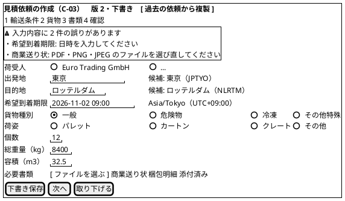

| 項目 | 振る舞い |
| :--- | :--- |
| 段階入力 | 輸送条件・貨物・書類・確認の 4 段階に分け、各段階で下書き保存する（要件定義 利用シーン）。R1.0 で下書きを保存するまでは、1 つのフォームの中のパネルの切り替えにする（2026-10-03 に承認、Bolt 8 のプロトタイプ。UI-HO-04）。段階ごとのサーバーの検証はせず、提出のときに今と同じ検証とエラー要約で示す。エラー要約のリンクを選ぶと、その項目のある段階を開いてフォーカスを移す。選んだファイルは段階を移っても残る。JavaScript がないときは全段階を 1 画面で示す。プロトタイプの操作性を人が確かめ、この形で残すと決めた（2026-10-03、UI-HO-04 の C-03 の分） |
| 港の入力 | 港名で検索し、候補から UN/LOCODE を選ぶ。UN/LOCODE を直接入力してもよい。直接入力では、前後の空白を除き小文字を大文字にそろえてから形式を確かめる（貼り付けや小文字の入力を誤りにしない。Bolt 1 で実装、Bolt 3 レビュー R-26）。空欄は「出発地: 入力してください」のように、形式の誤りと分けて示す |
| 複製 | 過去の見積依頼から輸送条件を引き継いで新しい下書きを作る。希望到着期限と必要書類は再入力させる（Q-INV-11） |
| エラー要約 | 送信に失敗したら画面上部に要約を表示し、要約へフォーカスを移す。各項目の誤りへのリンクを持つ。リンクは「表示名: 文言」の形にし、文言は表示名で始めない（入力欄の下の文言はラベルのすぐ下に出るため。2026-10-05 に human:kakimomokuri が決定、Bolt 6〜8 レビュー R-04） |
| 選択肢の入力 | 荷受人・貨物種別・荷姿は、一覧を開かずにすべて見えるラジオボタン（`fieldset` と `legend`）にする。選択の欄（select）のキー操作は OS によって違い（macOS では ↓ で一覧が開くだけ）、キー操作だけの主要フローを OS によらず確かめられないため（2026-10-02 に human:kakimomokuri が決定。Bolt 4）。荷受人は、企業マスターができたら（US-16）検索できる入力に変える |
| 貨物種別 | 一般以外を選ぶと、MVP の対象外であることと手動窓口の連絡先を表示する。提出ボタンは `aria-disabled` にして理由を関連付け、押したときにも理由をエラー要約で示す（Q-INV-02） |
| 版 | 提出済みの見積依頼を編集すると新しい版の下書きになる旨を表示する（Q-INV-03） |
| 失効の後の入力の戻し | 入力の控え（Bolt 32f。業務の下書き保存とは別のもの）を戻すと、全段階の欄に値が入り、画面は段階 1 から開く（読み込みのときは常に段階 1。段階の位置は控えない）。ファイルは控えないので、知らせの「ファイルは選び直してください。」に従い段階 3（書類）で選び直す。戻した値で貨物種別の案内と提出のボタンの状態が変わるよう、戻した欄に `input`・`change` のイベントを出す |
| ファイル | 「ファイルを選ぶ」ボタンで選べる。ドラッグ & ドロップは補助とする（WCAG 2.5.7）。書類の種類ごとに入力欄を分ける（商業送り状、梱包明細、その他の書類。2026-10-03 に承認、Bolt 7）。受け付ける形式と大きさの上限を、入力欄の説明に書く |
| 隠し項目 | `commandId`、期待版 |

### C-04 見積依頼の詳細（進み具合）

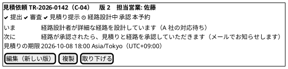

割り当てた経路に再設計要の印のある見積り（Bolt 37e3。US-07 AC5）は、承認の入口を出さず、状態の下の案内を理由に替える。荷主の画面なので、社内の語（再設計要、印、DE-06、経路版の番号）は出さない。

| 見積りの状態（印あり） | 承認の入口 | 状態の下の案内 | 出口 |
| :--- | :--- | :--- | :--- |
| 荷主承認待ち | 出さない | 「割り当てた経路の見直しが必要になったため、この見積りと経路は承認できません。担当営業にご相談ください。」（「承認してください」を出さない） | 担当営業に相談。有効期限の後に再見積り（D-86） |
| 承認済み | もともと出さない | 「割り当てた経路の見直しが必要になりました。本予約の扱いは担当営業からご連絡します。」（「担当営業が本予約を確定します。確定したらご連絡します。」を出さない） | 担当営業に相談 |

印のない見積りは今のまま。失効の案内（承認の後の失効を含む）は今のまま先に示す。案内は輸送要求の状態だけで組み立てていたので、見積りの印を引数で渡す（Bolt 37e3 計画の状態の組み合わせの行 1〜3）。

割り当てた経路の最初の区間が出発済みの見積り（Bolt 37e4。US-07 AC5、D-88。出発予定が表示する時刻と同時刻か前）も、承認の入口を出さず、状態の下の案内を理由に替える。荷主の画面なので、社内の語（区間、出発済み）は出さず、経路の表の列の語「航海」で示す。

| 見積りの状態（出発済み） | 承認の入口 | 状態の下の案内 | 出口 |
| :--- | :--- | :--- | :--- |
| 荷主承認待ち（再承認の見積りを含む） | 出さない | 「割り当てた経路の最初の航海がすでに出発したため、この見積りと経路は承認できません。担当営業にご相談ください。」（「承認してください」「もう一度承認してください」を出さない） | 担当営業に相談。有効期限の後に再見積り（D-88） |
| 承認済み | もともと出さない | 「割り当てた経路の最初の航海がすでに出発しました。本予約の扱いは担当営業からご連絡します。」（見積りの節の「担当営業が本予約を確定します。確定したらご連絡します。」を出さない） | 担当営業からの連絡 |

再設計要の印と出発済みの両方なら再設計要の案内だけを示す（理由の順）。失効の案内は今のまま先に示す。案内は再設計要の真偽までしか受け取っていなかったので、出発済みかも渡す（Bolt 37e4 計画の状態の組み合わせの行 8〜10）。

### C-05 見積りへの回答

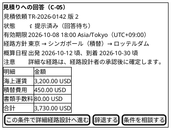

辞退には理由を必須とする（Q-INV-09）。相談は有人案件（種類: 見積りの相談）を起票し、見積りの状態は変えない。失効・置換済みの見積りの C-05 は開かず、理由を示して C-04 に戻す（Q-INV-07。Bolt 12）。上の画面イメージは辞退・相談を含む最終形で、Bolt 12 は「この条件で詳細経路設計へ進む」だけを出す（URL の表の C-05 の行。Bolt 12 レビュー R-24）。

### C-17 見積りと経路の承認

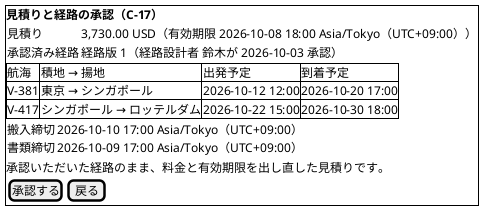

承認の後、本予約は担当営業が確定する（US-04）。荷主には承認済みであることと、予約の確定をメールで知らせることを示す。上の画面イメージは再承認の見積りの例で、「承認いただいた経路のまま、料金と有効期限を出し直した見積りです。」は再承認の見積り（荷主の回答の時刻が提示の時刻より前）のときだけ、「この見積りと経路で承認しますか」の前に示す。通常の見積りには出さない（D-85。Bolt 35d）。

割り当てた経路に再設計要の印のある見積りは、開いても送っても C-04 に戻し「TR-2026-0001 見積 1 は割り当てた経路の見直しが必要になったため承認できません。担当営業にご相談ください」を示す（Bolt 37e3。US-07 AC5。C-04 は承認の入口を出さないので、ここに届くのは URL やメールのリンクから開いたときと、開いた後に印が付いたとき）。置換済み・失効・承認済みの文言が先に出る（見積りの判定の順）。

割り当てた経路の最初の区間が出発済みの見積り（出発予定が承認の時刻と同時刻か前）も、開いても送っても C-04 に戻し「TR-2026-0001 見積 1 は割り当てた経路の最初の航海がすでに出発したため承認できません。担当営業にご相談ください」を示す（Bolt 37e4。US-07 AC5、D-88）。再設計要の文言が先に出る（見積りの判定の順の最後に出発済みを足す）。

### S-04 見積りの作成

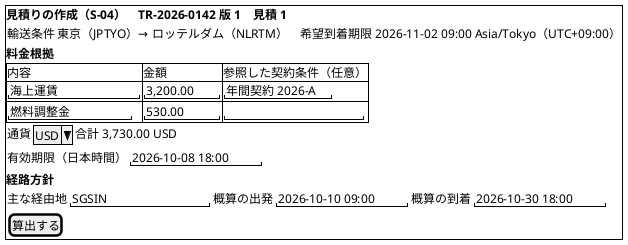

| 項目 | 振る舞い |
| :--- | :--- |
| 入力 | 料金明細（1〜10 行）・通貨・有効期限・経路方針を 1 つの画面で入れ、「算出する」で承認待ちまで進む（作成中のまま保存する操作は入れない）。誤りはエラー要約で示し、入力を残す（Q-INV-17） |
| 社内承認して提示 | 算出した見積り（承認待ち）を読み取り専用で示し、「社内承認して提示する」で提示する。承認者は認証（US-18）までは仮の営業担当者 |
| 日時 | 有効期限と経路方針の日時は日本時間で入れ、画面では利用者のタイムゾーンを主にし UTC を併記する |
| 再見積りできるか | ドメインの規則（`RequotePolicy`。輸送要求の状態 → 版 → 見積りの判定時刻の判定）で決め、再見積りのボタン・GET・POST が同じ理由を示す。見つからないかは画面が先に見る。S-02 の「… を再見積りする」のリンクはこの規則を通さず、見積りの状態と有効期限で出す（開いた GET が規則で判定する）（D-85。Bolt 35c） |
| 承認の後に失効した見積り | 荷主の承認の後に有効期限を過ぎた見積り（承認済み）は、「荷主の承認の後に有効期限（…）を過ぎました。承認済みの経路版と経路方針を引き継いで再見積りできます。荷主の再承認が要ります。」と示し、再見積りのボタンを出す。期限内の承認済みの見積りにはボタンを出さず、GET・POST は「…は荷主が承認済みで、まだ有効期限内です。本予約の確定へ進んでください」で拒む。輸送要求が予約確定済みの見積りは「…は本予約を確定済みのため、再見積りできません」で拒む（D-85。Bolt 35c） |
| 再見積りのフォーム（経路を持つ旧版） | 下の画面イメージ。引き継ぐ経路方針（主な経由地・概算の出発・到着）と経路版（案件番号・経路版・区間）を読み取り専用の文字で示し（入力欄にせず、送らない）、料金明細・通貨・有効期限だけを入れさせる。経路方針はサーバーで旧版の値を入れ、入力の誤りで描き直しても読み取り専用の表示を残す。「詳細な経路は、経路設計者の承認後に確定します。」は出さない。案内は「承認済みの経路版と経路方針を引き継ぎ、料金と有効期限だけを出し直します。算出すると見積 n を新しい見積りに置き換えます（有効期限を過ぎていれば失効として記録します）。提示すると荷主の再承認を待ちます。」。経路を持たない旧版からの再見積りは上の作成の画面と同じく経路方針を入れる（D-85。Bolt 35c） |
| 割り当てた経路 | 見積りの画面に、割り当てた経路（案件番号・経路版・区間）を荷主の画面（C-04・C-17）と同じ断片で示す。経路を引き継いだ承認待ちの見積りでも示し、荷主に何を示すかを社内で確かめられるようにする（D-85。Bolt 35c） |
| 再承認の見積り | 再見積りして提示した見積り（再承認の見積り。見積りの集約の問い合わせ「再承認の見積りか」で、荷主の回答の時刻が提示の時刻より前なら真。同時刻は偽）の荷主承認待ち・有効は「荷主の再承認を待っています（承認済みの経路版と経路方針を引き継いだ見積りです）。この見積りは読み取り専用です。」、承認済みは「荷主が {承認時刻}に再承認しました（承認済みの経路版と経路方針を引き継いだ見積りです）。この見積りは読み取り専用です。」と示す。旧版から引き継いだ回答時刻で「荷主が（日時）に詳細経路設計を依頼しました。」を出さない（Bolt 35c の既知の課題）。通常の見積りは今のまま。S-02 の経路設計中の表の並びは今のまま（D-85。Bolt 35d。human:kakimomokuri の決定 (3)） |
| 再設計要の経路（Bolt 37e3） | 割り当てた経路に再設計要の印があり有効期限内なら、承認済み・荷主承認待ちのどちらも再見積りのボタンを出さず、GET・POST は「TR-2026-0001 見積 1 は割り当てた経路が再設計要のため、有効期限まで再見積りできません。経路設計者と扱いを相談してください」で拒む（`RequotePolicy` が使う見積りの判定の理由 `ROUTE_REDESIGN_REQUIRED`。文言は承認の段の拒否の腕の中で言い分け、腕を増やさない）。印のある荷主承認待ちが失効したら、再見積りのボタンを今のまま出し、案内を「…を過ぎました。割り当てた経路が再設計要のため、経路を引き継いで再見積りしても荷主は承認できません。経路設計者と扱いを相談してから再見積りしてください。」にする。印のある承認済みが失効したときも同じ案内にする（今の「承認済みの経路版と経路方針を引き継いで再見積りできます。荷主の再承認が要ります。」は、新しい見積りも経路と印を引き継いで荷主が承認できないので出さない。開発レビューで決めた）（US-07 AC5。Bolt 37e3 計画の状態の組み合わせの行 10・11） |
| 出発済みの経路（Bolt 37e4） | 割り当てた経路の最初の区間が出発済み（出発予定が判定時刻と同時刻か前）で承認済み・有効期限内なら、再見積りのボタンを出さず、GET・POST は「TR-2026-0001 見積 1 は割り当てた経路の最初の区間が出発済みのため、有効期限まで再見積りできません。荷主と扱いを相談してください」で拒む（`RequotePolicy` が使う見積りの判定の理由 `ROUTE_ALREADY_DEPARTED`。これまでは「本予約の確定へ進んでください」と誤って案内した。文言は承認の段の拒否の腕の中で言い分け、腕を増やさない）。再設計要の印もあれば再設計要の文言。再見積りを受け付けるかどうかは変えず、期限の後は今のまま再見積りできる（新しい見積りも荷主の承認で拒まれる。D-88）（US-07 AC5。Bolt 37e4 計画の状態の組み合わせの行 14） |

再見積りのフォーム（経路を持つ旧版から。D-85。Bolt 35c）:

```plantuml
@startsalt
{+
  <b>再見積り（TR-2026-0142 見積 1 から）
  承認済みの経路版と経路方針を引き継ぎ、料金と有効期限だけを出し直します。算出すると、見積 1 を新しい見積りに置き換えます（有効期限を過ぎていれば失効として記録します）。提示すると荷主の再承認を待ちます。
  <b>料金根拠
  {#
    内容 | 金額 | 参照した契約条件（任意）
    "海上運賃            " | "3200.00  " | "年間契約 2026-A  "
    "燃料調整金          " | "530.00   " | "                 "
  }
  { 通貨 | ^USD^ | 合計 3,730.00 USD }
  { 有効期限（日本時間） | "                " }
  <b>引き継ぐ経路方針と経路版
  { 主な経由地 | SGSIN }
  { 概算の出発日時 | 2026-10-10 09:00 }
  { 概算の到着日時 | 2026-10-30 18:00 }
  <b>確定した経路（RC-2026-0088 経路版 1）
  {#
    航海 | 積地 → 揚地 | 出発予定 | 到着予定
    V-381 | JPTYO → SGSIN | 2026-10-12 12:00 | 2026-10-20 17:00
    V-417 | SGSIN → NLRTM | 2026-10-22 15:00 | 2026-10-30 18:00
  }
  { [ 算出する ] }
}
@endsalt
```

### S-06 経路候補の比較

```plantuml
@startsalt
{+
  <b>経路候補の比較（S-06）　案件 RC-2026-0088　版 1
  {
    条件 | 東京（JPTYO）→ ロッテルダム（NLRTM）　希望到着期限 2026-11-02 09:00 JST（UTC 00:00）
    経路方針（参考） | シンガポール積替
    情報 | 最終取得 2026-10-01 15:10 JST（UTC 06:10）
  }
  {#
    候補 | 判定 | 到着予定 | 接続余裕 | 理由・参照した航海情報の版
    1 | <&check> 適合 | 2026-10-30 18:00 JST | 26h | 情報版 V-381@3
    2 | <&check> 適合 | 2026-11-02 09:00 JST | 12h | 期限と同時刻（適合）
    3 | <&x> 除外 | 2026-10-29 12:00 JST | 10h | 情報不足（V-412 の情報は取得から 24 時間を過ぎている）。取得 2026-10-05 15:10 JST
    4 | <&x> 除外 | 2026-10-30 03:00 JST | 4h | 接続不足（必要 8h、シンガポール規則）
    5 | <&x> 除外 | 2026-11-03 21:00 JST | — | 期限超過 1d12h（閾値 2026-11-02 09:00 JST）
  }
  { [ 候補を再算出 ] | [ 候補 1 で確定へ ] | [ 専門判断を記録 ] }
}
@endsalt
```

| 項目 | 振る舞い |
| :--- | :--- |
| 判定の表示 | 「適合」「除外」を文字とアイコンで示す。除外には不適合の時刻・閾値・参照情報版（画面の語は「参照した航海情報の版」。Bolt 29c）を示す（R-INV-02） |
| 境界の扱い | 期限と同時刻・必要接続時間と同値は適合と表示する（R-INV-01） |
| 情報不足 | 外部情報が停止中なら最終採用値と取得時刻を示し、「情報不足」と表示する（R-INV-09）。Bolt 37b2: 航海の取得時刻から許容時間（24 時間。D-89）を過ぎてから算出した候補は除外し、候補の理由に航海番号・取得時刻・許容時間と参照した航海情報の版（AC4 の最終採用値）を示す。画面の上の警告は出さない（候補ごとの理由と重なるため） |
| 再算出 | 候補の表だけを部分更新し、更新が終わったときに 1 回だけライブリージョンで通知する |
| 再設計要（Bolt 37d2） | 確定した経路版が外部情報の更新で再設計要になったら、確定の欄を「再設計要の経路（候補 n）」とし、注意の枠で、条件を満たさなくなったため再設計要であること、候補の判定は確定のときのもので、この経路では確定し直せないこと、再設計の操作は今後の更新で入れること、担当営業と扱いを相談することを示す（R-INV-06・07。US-07 AC4・AC5）。理由（「、」でつなぐ）と再設計要にした時刻は、承認者・承認時刻・判断根拠と同じ欄の行で示す。候補の印は「再設計要の経路」、判定の印は「✓ 適合（確定のとき）」「✕ 除外（確定のとき）」。下の図 |

```plantuml
@startsalt
{+
  <b>経路候補の比較（S-06）　案件 RC-2026-0088　状態 再設計要
  {
    <b>再設計要の経路（候補 1）
    外部情報の更新で条件を満たさなくなったため再設計要です。
    候補の判定は確定のときのものです。この経路では確定し直せません。
    再設計の操作は今後の更新で入れます。担当営業と扱いを相談してください。
    {
      再設計要の理由 | 期限超過、接続不足
      再設計要にした時刻 | 2026-10-20 10:00 JST（UTC 01:00）
      承認者 | 経路設計者
      承認時刻 | 2026-10-02 14:00 JST（UTC 05:00）
      判断根拠 | …
    }
  }
  {#
    候補 | 判定 | 到着予定 | 接続余裕 | 理由・参照した航海情報の版
    1 再設計要の経路 | <&check> 適合（確定のとき） | 2026-10-30 18:00 JST | 26h | 情報版 V-381@3
  }
}
@endsalt
```

### S-09 予約の確定

```plantuml
@startsalt
{+
  <b>本予約の確定（S-09）　TR-2026-0142 見積 2
  {#
    確定条件 | 状態
    有効な見積り | <&check> 承認済み・有効期限 2026-10-08 18:00 JST（UTC 09:00）
    必須貨物情報 | <&check> 一般 / パレット × 12 / 8,400 kg / 32.5 m3
    荷主担当者の承認 | <&check> 2026-10-04 15:20 JST（UTC 06:20）
    承認済み経路版 | <&check> RC-2026-0088 版 1
  }
  この表示は開いた時刻での確認です。有効期限の判定は確定の時刻で行い、期限と同時刻以後は確定できません。
  ---
  <b>本予約を確定しますか
  {
    対象       | 見積依頼 TR-2026-0142 見積 2
    変更内容   | 本予約を確定し、追跡番号を発行します
    影響       | 確定の後の変更・取消しは申請と営業の承認が必要になります
    回復手段   | 集荷前なら変更・取消しを申請できます（申請の画面は準備中です）
  }
  [X] 契約条件と照合した（営業担当者の確認）
  { [ 本予約を確定する ] | [ 戻る ] }
}
@endsalt
```

画面そのものが確認の領域（C-17・S-07 と同じ。Bolt 23b で、確認の領域を別に開く 2 段の形から改めた）。条件が欠けていれば（貨物の要約が空、営業担当者の確認がない）、確定せずにエラー要約で欠けている条件をすべて示す（B-INV-01、R-30。Bolt 35、AC3）。特殊貨物を含む見積りは、開いたときから確定できないことと手動の窓口をエラー要約で示し、確認の領域とボタンを出さない（B-INV-04。Bolt 35、AC5。図は描かない）。サーバーの判定が正で、画面のチェックは補助。

割り当てた経路に再設計要の印のある見積りは、開いても送っても S-02 に戻し「TR-2026-0001 見積 1 は割り当てた経路が再設計要のため本予約を確定できません。経路設計者と扱いを相談してください。」を示す（Bolt 37e3。US-07 AC5、B-INV-05）。S-02 は印のある行に本予約の入口を出さないので、ここに届くのは URL から開いたときと、開いた後に印が付いたとき。予約の腐敗防止層が見積りの公開 API の理由を `QuotationUnavailability` に写し、知らない理由は未承認の文言に寄せる。

割り当てた経路の最初の区間が出発済みの見積り（出発予定が判定時刻と同時刻か前。送ったときは commit 時刻）は、開いても送っても S-02 に戻し「TR-2026-0001 見積 1 は割り当てた経路の最初の区間が出発済みのため本予約を確定できません。荷主と扱いを相談してください。」を示す（Bolt 37e4。US-07 AC5、D-88）。S-02 は出発済みの行に本予約の入口を出さないので、ここに届くのは URL から開いたときと、開いた後に出発の時刻を過ぎたとき。再設計要の印もあれば再設計要の文言にする。予約の腐敗防止層は `ROUTE_ALREADY_DEPARTED` を写す。

### S-20 利用者の管理（Bolt 34）

```plantuml
@startsalt
{+
  <b>利用者（S-20）
  {#
    企業 | 表示名 | メールアドレス | 利用状態 | 役割
    A 社 | 佐藤 | sato@example.com | 利用中 | 営業担当者
    A 社 | 鈴木 | suzuki@example.com | 利用中 | 経路設計者
    荷主株式会社 | 山田 | yamada@example.com | 利用中 | 荷主担当者
  }
}
@endsalt
```

```plantuml
@startsalt
{+
  <b>利用者の詳細（S-20）　佐藤
  {
    企業 | A 社（運用する会社）
    メールアドレス | sato@example.com
    利用状態 | 利用中
    今の役割 | 営業担当者
  }
  ---
  <b>役割
  付ける役割
  運用する会社の利用者に付けられる役割です。印を外すと、その役割を外します。
  [X] 営業担当者
  [X] 経路設計者
  [ ] 追跡管理者
  [ ] データ責任者
  [ ] カスタマーサポート
  { [ 変更内容を確認する ] }
}
@endsalt
```

```plantuml
@startsalt
{+
  <b>役割を変更しますか
  {
    対象       | A 社 佐藤（sato@example.com）
    今の役割   | 営業担当者
    足す役割   | 経路設計者
    外す役割   | なし
    影響       | 相手の次の操作から効きます。外した役割の画面は開けなくなります
    実行者     | システム管理者 高橋
    回復手段   | 元に戻すには、もう一度役割を変更してください
  }
  { [ 変更する ] | [ 戻る ] }
}
@endsalt
```

画面そのものが確認の領域（S-07・S-09 と同じ）。判定の規則（IA-INV-01 と企業の種類）はサーバーが正で、詳細の画面の表示は補助。拒否の文言（エラー要約。項目は「付ける役割」）:

| 理由 | 文言 |
| :--- | :--- |
| 自分の役割 | 自分の役割は変更できません。ほかのシステム管理者に依頼してください。 |
| 役割なし | 役割を 1 つ以上選んでください。 |
| 変更なし | 今の役割から変わっていません。足す役割か外す役割を選んでください。 |
| 監督の役割 | システム管理者・監査担当者の役割は、この画面では付けたり外したりできません。 |
| 企業の種類 | {役割の名前}は、{企業の種類}の利用者には付けられません。 |
| 職務分離 | システム管理者・監査担当者と、業務データを変更できる役割（{役割の名前}）は併せて付けられません。 |
| 古い版 | この利用者の情報が先に更新されました。最新の内容を確かめてから、もう一度変更してください。 |

完了の知らせ: 「役割を変更しました。相手の次の操作から効きます。」

企業の種類の規則は、荷主担当者は荷主企業、ほかの役割は A 社（画面では「運用する会社」）の利用者だけに付ける（IA-INV-13）。詳細のフォームは付けられる役割だけを並べるので、企業の種類と監督の役割の拒否は画面を経ない送信でだけ起きる。自分の詳細には「自分の役割は変更できません。ほかのシステム管理者に依頼してください。」、荷受人の企業の利用者の詳細には「荷受人の企業の利用者には役割を付けません。」と示す。

利用停止と再開（Bolt 34d。US-16 AC5。2026-10-17、human:kakimomokuri）は、詳細の役割の領域と別の「利用状態」の領域から行う（荷受人の企業の利用者にも出す）。利用中の利用者には停止の理由を選ぶ欄と「利用停止の内容を確認する」、停止中の利用者には「利用再開の内容を確認する」を出す（ボタンの名前は役割の変更の「変更内容を確認する」を含まない）。今の利用状態（利用中・利用停止）は領域の中に重ねて出さず、詳細の上の定義リスト（企業・メールアドレス・利用状態・今の役割）にだけ出す。役割の領域と利用状態の領域は同じ形の見出し（h2「役割」「利用状態」）を持ち、案内とフォームを見出しの下に置く（Bolt 34f。役割のチェックボックスの欄の名前は「付ける役割」、停止の理由の欄の名前は「停止の理由」）。「付ける役割」は変更した後に持つ役割の全体を表し、今の役割にも初めから印を付けるので、欄の説明に「印を外すと、その役割を外します。」を添える（Bolt 34f の開発レビューの決定）。ワイヤーフレームは役割の領域だけを描く（利用状態の領域は下のワイヤーフレーム）。

```plantuml
@startsalt
{+
  <b>利用状態
  停止の理由
  ( ) 利用終了
  ( ) 異動
  ( ) 緊急停止
  { [ 利用停止の内容を確認する ] }
}
@endsalt
```

```plantuml
@startsalt
{+
  <b>利用を停止しますか
  {
    対象       | A 社 佐藤（sato@example.com）
    現在の状態 | 利用中
    変更内容   | 利用を停止する（理由: 異動）
    影響       | 相手の次の操作から使えなくなります
    回復手段   | 再開できます
    実行者     | システム管理者 高橋
  }
  { [ 停止する ] | [ 戻る ] }
}
@endsalt
```

```plantuml
@startsalt
{+
  <b>利用を再開しますか
  {
    対象       | A 社 佐藤（sato@example.com）
    現在の状態 | 利用停止
    変更内容   | 利用を再開する
    影響       | 相手は次のログインから使えます
    回復手段   | もう一度停止できます
    実行者     | システム管理者 高橋
  }
  { [ 再開する ] | [ 戻る ] }
}
@endsalt
```

確認の領域の項目の名前は共通の確認の領域にそろえる（対象・現在の状態・変更内容・影響・回復手段・実行者、ボタンは役割の変更の確認の「変更する」と同じく動作の名前で「停止する」・「再開する」と「戻る」。利用者の登録の確認は「登録する」と「戻る」。Bolt 38b3b）。「戻る」は詳細へ戻る。判定の規則（IA-INV-01 の広げと IA-INV-14）はサーバーが正で、詳細の画面の表示は補助。自分の詳細には「自分の利用状態は変更できません。ほかのシステム管理者に依頼してください。」、監督の役割（システム管理者・監査担当者）を持つ利用者の詳細には「システム管理者・監査担当者の利用停止と再開は、この画面では行いません。」と一文で示し、操作を出さない。拒否の文言（エラー要約。見出しは「利用状態を変更できませんでした」。理由のない停止だけ停止の理由の欄へリンクする。詳細のエラー要約は役割の変更と利用状態の変更で 1 つにし、見出しとリンク先は controller が操作に応じて選ぶ。役割の変更の見出しは変えない。開発レビューの後）:

| 理由 | 文言 |
| :--- | :--- |
| 自分の変更 | 自分の利用状態は変更できません。ほかのシステム管理者に依頼してください。 |
| 監督の役割 | システム管理者・監査担当者の利用停止と再開は、この画面では行いません。 |
| 同じ状態 | 利用状態は既に{利用中・利用停止}です。最新の内容を確かめてください。 |
| 理由なし | 利用終了・異動・緊急停止のどれかを選んでください。（Bolt 37 までは「停止の理由を選んでください。」。Bolt 38 で、エラー要約のリンクの文が表示名で始まらないよう変えた） |
| 古い版 | この利用者の情報が先に更新されました。最新の内容を確かめてから、もう一度変更してください。 |

古い版の文言は役割の変更の文言（`STALE_MESSAGE`）をそのまま使う（誰が変えたかは言わない。状態の変更と役割の変更は版を共有する）。自分・監督の役割の拒否は、詳細が操作を出さないので画面を経ない送信でだけ起きる（同じ状態の拒否は、詳細を開いた後にほかの管理者が同じ変更を確定したときにも起きる。規則を版より先に判定するため）。同じ状態の拒否では、詳細のフォームの版を最新にして示す（ほかの管理者が先に同じ変更を確定したときに、次の操作が古い版で拒まれないように。開発レビューの後）。

完了の知らせ: 停止は「利用を停止しました。相手の次の操作から使えなくなります。」、再開は「利用を再開しました。相手は次のログインから使えます。」（開発レビューの後に、影響を一文で添えた）

再開の確定の後に、相手の session をすべて消す（停止の前の session を使い続けさせない。相手はログインし直す。消せなくても再開は戻さない）。停止の確定では、相手の未使用の password の再設定のリンクを使えなくする（同じトランザクション）。どちらも Bolt 34d の開発レビューの後の決定（2026-10-17、human:kakimomokuri。IA-INV-04・IA-INV-12）。

#### 利用者の登録（Bolt 38b3b）

システム管理者が一覧の「利用者を登録する」から、企業を選ぶ画面と入力の画面の 2 段（JS なし）で入れ、確認の領域を経て登録する（Bolt 38b3 の開始準備の決定 (2)〜(4)、Bolt 38b3b の開始準備の決定、2026-10-26、human:kakimomokuri）。メールアドレスと表示名は URL に載せない（確認と「戻る」は POST と hidden）。

```plantuml
@startsalt
{+
  <b>利用者の登録
  企業
  ( ) A 社（運用する会社）
  ( ) 荷主 B（荷主企業）
  [ 次へ ]
  利用者の一覧へ戻る
}
@endsalt
```

```plantuml
@startsalt
{+
  <b>利用者の登録　A 社（運用する会社）
  付ける役割
  [ ] 営業担当者
  [ ] 経路設計者
  メールアドレス | "                "
  表示名         | "                "
  { [ 確認する ] | 企業を選び直す }
}
@endsalt
```

```plantuml
@startsalt
{+
  <b>利用者を登録しますか
  {
    対象         | A 社（運用する会社）
    現在の状態   | 未登録
    変更内容     | hanako@example.com、新人 花子、営業担当者
    影響         | 登録したメールアドレスへ、初回の設定の案内（24 時間有効）を送ります。
    実行者       | システム管理者 高橋
    回復手段     | 誤って登録したときは、利用者の詳細から利用を停止してください（送った案内のリンクも使えなくなります）。
  }
  { [ 登録する ] | [ 戻る ] }
}
@endsalt
```

拒否の文言（エラー要約。見出しは「利用者を登録できませんでした」。リンクは「表示名: 文言」で、文言は表示名で始めない）。画面で見る誤り（メールアドレスの空と形、表示名の空、付ける役割のなし）はまとめて示し、それがなければ登録のサービスの判定の拒否を 1 件示す。

| 欄 | 理由 | 文言 |
| :--- | :--- | :--- |
| 企業 | 選んでいない | 登録する企業を 1 つ選んでください。 |
| 企業 | 無効・荷受人の企業 | 選んだ企業には利用者を登録できません。ほかの企業を選んでください。 |
| メールアドレス | 空 | 入力してください。 |
| メールアドレス | 形の誤り | 名前@ドメイン の形で入力してください（例: user@example.com）。 |
| メールアドレス | 重複（管理範囲の内外で同じ文。Bolt 38b の決定 (2)） | 既に登録されています。ほかのメールアドレスを入力してください。 |
| 表示名 | 空 | 入力してください。 |
| 表示名 | 規則（200 文字・見分けにくい文字。Bolt 38b3） | 見分けやすい文字で、200 文字以内で入力してください。 |
| 付ける役割 | なし | 1 つ以上選んでください。 |
| 付ける役割 | 企業の種類 | {役割の名前}は、{企業の種類}の利用者には付けられません。 |
| 付ける役割 | 監督の役割 | {役割の名前}は、この画面では付けられません。 |
| 付ける役割 | 職務分離 | 役割の変更と同じ文 |

企業の種類・監督の役割・職務分離の拒否は、入力の画面が付けられる役割だけを並べるので、画面を経ない送信でだけ起きる。誤りの画面は入力を戻す。メールアドレスの欄に `autocomplete` は付けない（本人の情報ではない）。

### 共通の確認の領域（重要操作）

本予約確定、取消し、権限変更、実績訂正、荷受人への共有・取消し、見積りと経路の承認は、詳細画面の中に開くこの確認の領域を経る（BR-13）。S-20 の役割の変更・利用状態の変更・利用者の登録（Bolt 38b3b）は、確認の領域そのものを別の画面にして経る。

```plantuml
@startsalt
{+
  <b>本予約を確定しますか
  {
    対象       | 見積依頼 TR-2026-0142 版 2
    現在の状態 | 荷主承認済み
    変更内容   | 本予約を確定し、追跡番号を発行する
    影響       | 以後の変更・取消しは営業承認が必要になる
    実行者     | 営業担当者 佐藤
    回復手段   | 集荷前なら取消申請で取り消せる
  }
  { [ 確定する ] | [ 戻る ] }
}
@endsalt
```

### C-10 追跡の照会（荷主）・C-11（荷受人）

一覧と追跡番号の入力（Bolt 27）。自社の追跡記録だけを出す（BR-07）。

```plantuml
@startsalt
{+
  <b>追跡の照会
  <b>追跡番号で照会する
  追跡番号
  "CTABCDEFGH2345"
  例: CTABCDEFGH2345
  [ 照会する ]
  <b>自社の貨物
  {#
    追跡番号 | 現在の状態 | 最新の到着見込み
    CTABCDEFGH2345 | 集荷済み | 2026-11-16 12:00 Asia/Tokyo（UTC+09:00）
    CTKLMNPQRS6789 | 集荷予定 | 2026-11-20 09:00 Asia/Tokyo（UTC+09:00）
  }
}
@endsalt
```

照会の結果（Bolt 27）。予定と主要実績は見出しで分けたリストにし、表の列や色では区別しない。点線の下は後の Bolt で足すもの（確認中の説明・判明している事実・次の行動・次回の更新は US-09 AC2・R1.0、問い合わせは US-20）。

```plantuml
@startsalt
{+
  <b>追跡の照会 CTABCDEFGH2345
  {
    追跡番号 | CTABCDEFGH2345
    現在の状態 | 集荷済み
    当初の到着予定 | 2026-11-15 09:00 Asia/Tokyo（UTC+09:00）
    最新の到着見込み | 2026-11-16 12:00 Asia/Tokyo（UTC+09:00）
  }
  <b>予定
  1. 航海 V100、JPTYO から KRPUS
  　 出発予定 2026-11-01 09:00 Asia/Tokyo（UTC+09:00）
  　 到着予定 2026-11-03 09:00 Asia/Tokyo（UTC+09:00）
  <b>主要実績
  発生時刻の順に示します。
  ・集荷、JPTYO
  　 発生 2026-11-01 11:30 Asia/Tokyo（UTC+09:00）
  　 出典 現場記録 F-118
  　 取得 2026-11-01 12:00 Asia/Tokyo（UTC+09:00）
  追跡の照会へ戻る
  ..
  （R1.0）確認中の説明・判明している事実・未確定のこと・次の行動・次回の更新
  （US-20）[ 問い合わせる ]
}
@endsalt
```

| 項目 | 荷主（C-10） | 荷受人（C-11） |
| :--- | :--- | :--- |
| 現在状態・確認中の説明 | 表示 | 表示 |
| 当初の予定と最新の見込み | 両方を並べて表示する（T-INV-10） | 到着予定として両方を表示する |
| 手続き中の段階 | 「目的地到着（通関等の手続き中）」のように表示する | 同左 |
| 予定と実績の表 | 区分・出典・取得時刻を含めて表示 | 到着予定と主要実績だけを表示し、最終更新時刻を示す |
| 料金、契約条件、書類、他の予約 | 自社分のみ | 表示しない（BR-07） |
| 問い合わせ | 有人案件を起票し、C-15 で受付番号と次回更新を示す | 荷主または有人窓口を案内する |
| 言語 | 日本語 | 日本語と英語 |

予定と実績は見出し（「予定」「主要実績」）と語（「出発予定」「発生」）で文字として分け、色だけで区別しない（T-INV-08、BR-13）。どの画面幅でもリストで示し、幅 320 CSS px でも横スクロールなしで読める（WCAG 1.4.10。Bolt 27 で、表の列で分ける形と 600px 未満でリストに切り替える形をやめ、S-12 の Bolt 26c の形にそろえた）。Bolt 27 は荷主（C-10）だけを作り、荷受人（C-11）の表示の違いは US-10・R1.1 で作る。

### C-14 問い合わせ一覧

```plantuml
@startsalt
{+
  <b>問い合わせ（C-14）
  {#
    受付番号 | 対象 | 状態 | 次回更新 | 最新の回答
    SC-2026-0057 | CT7Q-4K2M-91XA | <&clock> 対応中 | 2026-10-22 03:00 Asia/Tokyo | 運送会社に確認中です
    SC-2026-0049 | TR-2026-0142 | <&check> 回答済み | — | 料金の内訳を更新しました
  }
  ---
  受付時間: 平日 09:00〜18:00 Asia/Tokyo（UTC+09:00）。時間外の緊急のお問い合わせにも受付番号と次回更新日時をお知らせします。
}
@endsalt
```

C-15 の詳細では進捗と回答の履歴を示し、回答済みの案件には「解決しなかった」の操作で再開を依頼できる（US-23）。

### S-12 追跡の詳細（社内）

```plantuml
@startsalt
{+
  <b>追跡の詳細 CT7Q-4K2M-91XA
  実績 1 を登録しました。
  {
    追跡番号 | CT7Q-4K2M-91XA
    現在状態 | 集荷済み
    当初の到着予定 | 2026-11-15 09:00 Asia/Tokyo（UTC+09:00）
    最新の到着見込み | 2026-11-15 09:00 Asia/Tokyo（UTC+09:00）
    経路 | RC-2026-0001 版 1
  }
  <b>予定区間
  1. 区間 1、航海 V100、JPTYO から KRPUS
  2. 区間 2、航海 V200、KRPUS から USLAX
  <b>主要実績
  発生時刻の順に示します。
  * 実績 1、集荷、JPTYO
     発生 2026-11-01 11:30 Asia/Tokyo（UTC+09:00）
     出典 現場記録 F-118（取得 2026-11-01 12:00 …）
     状態 採用
  "実績を登録"
  "追跡一覧"
}
@endsalt
```

Bolt 26c の形（予定区間と主要実績をそれぞれ順序付きのリストで示す。共通部品「画面幅」）。後の Bolt で、主要実績の操作（訂正・確認。US-13・W7）、確認中の表示（状態バッジ）、タブ（実績と予定・訂正履歴・顧客への表示・有人案件）、予約の業務番号を足す。タブは中身を作る Bolt で足す（空のタブを出さない）。「顧客への表示」タブは、顧客が今見ている内容（C-10 と同じ）を示し、社内の確認状態と区別する（US-11）。カスタマーサポートには登録・訂正のボタンを表示しない。行内のボタンは 24 × 24 CSS px 以上の大きさにする（WCAG 2.5.8）。場所は UN/LOCODE だけで示す（港の名前の併記は既知の課題）。

### S-13 主要実績の登録

```plantuml
@startsalt
{+
  <b>主要実績の登録 CT7Q-4K2M-91XA
  {
    種類 | 積替港での到着は積替、積替港からの出発は出発を選んでください
    . | ( ) 集荷  ( ) 搬入  ( ) 出発  ( ) 積替  ( ) 到着  ( ) 引渡し
    場所 | UN/LOCODE。例: JPTYO
    . | "JPTYO   "
    発生時刻（日本時間） | 例: 2026-11-01 11:30。タイムゾーンは Asia/Tokyo（UTC+09:00）
    . | "2026-11-01 11:30"
    出典の種類 | ( ) 現場記録  ( ) 社内確認  ( ) 手動入力
    出典の参照 | 200 文字まで。例: 港湾の受付番号、現場の記録番号
    . | "F-118          "
  }
  [ 登録する ]
  "追跡の詳細へ戻る"
}
@endsalt
```

Bolt 26c の登録の画面。種類と出典の種類に既定の選択は置かない（誤った登録を防ぐ）。訂正（US-13）は確認の領域を経る別の画面の流れとして後の Bolt で足す。

### S-15 有人案件の詳細

```plantuml
@startsalt
{+
  <b>有人案件 SC-2026-0057（S-15）
  {
    種類 | 外部停止
    状態 | <&clock> 対応中
    担当 | 追跡管理部 鈴木（受領 2026-10-21 10:05 JST）
    回答期限 | 2026-10-22 12:00 Asia/Tokyo（UTC+09:00）
    次回更新 | 2026-10-21 18:00 Asia/Tokyo（UTC+09:00）
    復旧照合 | <&x> 未完了（照合 RR-0012）
  }
  {#
    日時 | 進捗・回答 | 更新者
    2026-10-21 10:20 JST | 港湾に再送を依頼 | 鈴木
  }
  { [ 進捗を更新 ] | [ 回答を記録 ] | [ 終結する ] }
  ---
  復旧照合が完了していないため、終結できません。
}
@endsalt
```

### S-16 外部データの取込

```plantuml
@startsalt
{+
  <b>外部データの取込（S-16）
  {
    情報源 | ^港湾 A（承認済み）^
    ファイル | [ ファイルを選ぶ ] port-a-20261021.csv
    [ 取り込む ]
  }
  {#
    分類 | 件数
    採用 | 118
    重複 | 4
    隔離 | 1
    差異 | 2
    受信件数 | 125
  }
  { [ 隔離・差異を確認する ] }
}
@endsalt
```

## 共通部品

| 部品 | 内容 | 根拠 |
| :--- | :--- | :--- |
| エラー要約 | 画面上部に誤りの件数と各項目へのリンクを並べ、送信失敗時にフォーカスを移す | BR-13、US 横断受入条件 |
| フォーム項目 | ラベルを必ず付け、誤りは項目の下に理由と直し方を示す。入力値は保持する。変更・新しい版の入力では現在の値を初期値にし、同じ情報を二度入力させない | BR-13、WCAG 3.3.7 |
| 状態バッジ | 文字 + アイコン。予定・実績・確認中・処理中・有人確認要を区別する | BR-13、RQ-03 |
| 日時表示 | UTC の値を利用者のタイムゾーンで「年月日 時刻 タイムゾーン（UTC offset）」と表示する。社内の画面で必要な箇所は UTC を括弧で併記する。略称（JST など）は表の中だけに使う。タイムゾーンは今は Asia/Tokyo に固定している。期間は画面ごとに次の 3 つの形で示す: 待ち時間（S-02。「2 日 4 時間」「3 時間 20 分」「15 分」。負は 0 分）、接続時間・接続余裕（S-06。日・時間・分のうち 0 でない部分を並べる。「1 日 12 時間」「4 時間 30 分」）、リードタイム・経過時間（S-22。「26 時間 30 分」。日に繰り上げず分未満は切り捨て）。形をそろえるかは日時の短い形とあわせて US-21 の残り（W9）で決める（D-84）。実装は `platform.web` の `DateTimeDisplay`・`DurationDisplay` の 1 か所（Bolt 22、#41） | BR-10、R-30 |
| 確認の領域 | 詳細画面の中に開き、対象・現在状態・変更内容・影響・実行者・回復手段を必須項目にする。開いたらフォーカスを領域の見出しへ移し、戻るで元のボタンへ戻す。S-20 の役割の変更・利用状態の変更・利用者の登録は、確認の領域を別の画面にする（項目は同じ。画面の見出しから読む。Bolt 38b3b） | BR-13 |
| 通知領域 | 部分更新の結果、確認中への遷移、escalation を `aria-live` で通知する。状態が変わったときだけ書き込み、問い合わせのたびには書き込まない | BR-13、R-30 |
| 処理中表示 | 予約サガなど非同期処理の状態を「処理中」「完了」「有人確認要」で示す。処理中を完了と表示しない。予約サガの失敗は「処理中」のまま示す（S-10・S-24 の「追跡の開始」。Bolt 25b）。荷主の画面（C-06 の「追跡の状況」）では貨物の側の状態として荷主の語で示す: 完了は「追跡中」、処理中・失敗は「追跡の開始待ち」、有人確認要は「追跡の開始待ち（担当営業が確認します）」（「準備中」は準備中の画面の語なので使わない。Bolt 27b） | ARCH-HO-02 |
| 競合表示 | 期待版が違うときに、最新版と自分の入力の差分を示し、再確認を求める | ARCH-HO-01、US-02、US-05 |
| session の警告 | ログインした画面（`layout/customer`・`layout/staff`）で、無操作による失効と発行から 8 時間の上限の 5 分前に、モーダルのダイアログで警告し、支援技術にも伝える。無操作の警告は画面を移らずに延長でき、8 時間の警告は延長できない（Bolt 32b。文言と振る舞いは下の「session の警告（Bolt 32b）」）。失効したら、再認証の後に GET で開いていた業務の画面へ戻す（Bolt 32e）。送信していない入力は入力の控えに写し、同じ利用者が同じ画面に戻ったら戻す（Bolt 32f。次の行） | WCAG 2.2.1、US 横断受入条件、R-15、ACC-06 |
| 入力の控えの知らせ | ログインした画面（`layout/customer`・`layout/staff`）の `main` の前に空の live region（`aria-live="polite"`。画面の結果の知らせの `role="status"` と区別する）を置き、失効の前の入力を戻したことと、ログアウトの前の入力があることを知らせる。フォーカスは移さない（Bolt 32f。文言と振る舞いは下の「入力の控え（Bolt 32f）」） | WCAG 4.1.3、US 横断受入条件、ACC-06 |
| 回復コードでログインした印の知らせ | ログインした画面（`layout/customer`・`layout/staff`）の上部に、回復コードでログインした印がある間だけ出す。ログインから 15 分未満は認証アプリを登録し直すよう知らせて A-08 へのリンクを出し、15 分を過ぎたらリンクのない案内（ログアウトして回復コードでログインし直す）に変える（Bolt 33b。文言と振る舞いは下の「回復コードでログインした印の知らせ（Bolt 33b）」） | US-18 AC9、SEC-10 |
| 無効の操作 | 操作できないボタンは `disabled` ではなく `aria-disabled` にし、理由を `aria-describedby` で関連付ける。押したときにも理由を示す | R-30 |
| 窓口の案内 | すべての顧客向け画面で同じ位置に、窓口と受付時間を利用者のタイムゾーンで示す | WCAG 3.2.6、R-11 |
| 固定ヘッダーとフォーカス | 固定ヘッダーや確認の領域の下にフォーカスが隠れないよう、`scroll-padding` で余白をとる | WCAG 2.4.11 |
| 操作の大きさ | ボタン・リンクの操作範囲を 24 × 24 CSS px 以上にする（`btn-sm` も含む） | WCAG 2.5.8 |
| ファイルの選択 | ボタンで選べるようにし、ドラッグ & ドロップは補助とする | WCAG 2.5.7 |
| 認証の入力 | 貼り付けとパスワード管理ツールを妨げない。`autocomplete` を付ける | WCAG 3.3.8 |
| 画面幅 | 320 CSS px まで横スクロールなしで読める。一覧の表は横スクロールの囲み（`.table-scroll`、`role="region"`、caption に結ぶ）に入れ、ページ全体は横スクロールさせない（WCAG 1.4.10 の表の例外。Bolt 8 の実装からの決まり）。追跡の履歴のような時系列の表は、狭い画面で時系列のリストに切り替える。S-12 の予定区間と主要実績は、どの幅でもそれぞれ順序付きのリストで示す（表とリストの 2 つの形を持たない。Bolt 26・26c）。主要実績は区間に結び付けず、発生時刻の順の別のリストにする（集荷・搬入・引渡しは区間の外の実績。Bolt 26 の終了報告で第一案とした「区間ごとに予定と実績を並べる形」を Bolt 26c で覆した） | WCAG 1.4.10 |

### session の警告（Bolt 32b）

ログインした画面（`layout/customer`・`layout/staff` の画面。2 つの要素がそろった session）だけに出す。警告の部分（`layout/session-warning`）と `/js/session-timeout.js` は共通のレイアウトに置く（[フロントエンドのアーキテクチャ](architecture_frontend.md) の「session の警告と延長」）。`layout/public` の画面（A-01〜A-07 と回復コードの保存、無効なリンクの案内、エラーの画面。A-05 は Bolt 33、A-06 と無効なリンクの案内は Bolt 33a）には出さない。password の段（A-02 の 5 分）と登録の途中（A-07 の 15 分）は警告しない（認証の手続きの画面で、業務の入力を持たない。A-07 は期限の時刻をすでに示している）。JavaScript が動かないときは何も出さない（今のとおり、期限を過ぎた次の request で A-03 に移る。GET の画面なら覚えて、ログインの後にその画面に戻る。Bolt 32e）。

| 状態 | 見出し | 本文 | ボタン・リンク |
| :--- | :--- | :--- | :--- |
| 無操作の警告 | まもなくログアウトします | 「画面の移動や送信がないため、あと N 分でログアウトします。続けて使う場合は「ログインを延長する」を押してください。」（N は残りの分。1 分未満は「1 分未満」。数えるのは画面の読み込みと送信と延長で、入力欄への入力は数えないので「操作」と言わない。Bolt 32b の開発レビュー） | 「ログインを延長する」（初期フォーカス）、「閉じる」 |
| 8 時間の警告 | まもなくログアウトします | 「ログインから 8 時間になるため、あと N 分でログアウトします。延長はできません。入力中の内容は、それまでに送信してください。」 | 「閉じる」（初期フォーカス）。延長のボタンは出さない |
| 延長の失敗（403・500・通信の失敗） | 無操作の警告のまま | 警告の中に「延長できませんでした。もう一度お試しください。ログアウトしても、入力中の内容はこのタブでログインし直すと戻ります。」を `role="alert"` の要素で差し込んで示す（Bolt 32f。期限が来ると入力を控えに写すため）。入力を控えられない画面（戻り先か利用者の鍵がない。送信の後に描き直した画面など）では「延長できませんでした。もう一度お試しください。続けて失敗する場合は、入力中の内容を書き写してから画面を開き直してください。」（403 は押し直しても通らないので次の行動を示す） | 「ログインを延長する」を残す |
| 期限の到来（戻り先があるとき） | なし（モーダルでない案内。`role="alert"`） | 「ログアウトした可能性があります。入力中の内容は送信されていません。「画面を開き直す」を押すと、入力中の内容をこのタブに控えてから開き直し、開いた画面に戻します（ログインを求められたら、ログインし直した後に戻します）。」（Bolt 32f） | リンク「画面を開き直す」。押すと入力を控えに写してから、サーバーが渡した戻り先（`data-return-path`。GET で開いた業務の画面。Bolt 32e）を開く（Bolt 32f） |
| 期限の到来（戻り先がないとき。送信の後に描き直した画面など） | なし（モーダルでない案内。`role="alert"`） | 「ログアウトした可能性があります。入力中の内容は送信されていません。必要なら書き写してから、もう一度ログインしてください。」 | リンク「もう一度ログインする」（A-03 の見出しの語にそろえる）。行き先は `/session-expired` |

- **開く時刻**: 無操作の期限と 8 時間の期限のうち、早いほうの 5 分前に開く。延長の後に 8 時間の期限が 5 分以内なら、8 時間の警告に替える。ほかのタブで画面を開くか延長して、期限が 5 分より先になったら閉じる（警告の時刻をタブの間でそろえる）
- **延長**: 「ログインを延長する」は画面を移らずに延長し、警告を閉じる。入力中の値は消えない。延長の応答が失効（A-03・A-01 への移動）なら期限の到来の案内に替える。403・500・通信の失敗は失効と分けて上の文言を示す（session が生きているのに「ログアウトした」と示さない）
- **8 時間の上限**: SEC-03 のセキュリティ上の必須の制限なので延長できない（WCAG 2.2.1 の Essential の例外。ACC-06）。延長できないことと、それまでに送信することを示す
- **フォーカス**: `<dialog>` を `showModal()` で開き、見出しと本文を `aria-labelledby`・`aria-describedby` で結ぶ（開いたときに本文が読まれる）。開いたら初期フォーカスのボタンにフォーカスを移す。閉じたら（延長・「閉じる」・Esc）開く前のフォーカスに戻す。開いたまま 8 時間の警告に替わったら、隠れた延長のボタンから「閉じる」にフォーカスを移す。延長の送信中は延長のボタンを止める
- **Esc**: 「閉じる」と同じで、延長しない。同じ期限では警告をもう開かない（期限が来たら期限の到来の案内に替わる。続けて使う場合は画面を開き直すか送信する。マニュアル 2.5）
- **残りの分**: 1 分ごとに書き換えるが、支援技術には毎回読ませない（ライブリージョンにしない。開いたときの本文で伝える）。残りは相対の分で示す。A-07 の期限は絶対の時刻とタイムゾーンで示すが、警告は 5 分以内のことで、時刻の書式とタイムゾーンをブラウザで組み立てない（日時表示の共通部品はサーバーの 1 か所にある）
- **期限の到来**: 期限を過ぎたら、モーダルを閉じてモーダルでない案内を画面の先頭（タブの順でも最初）に上端に留めて出し、案内の高さだけ `scroll-padding-top` を足して背後のフォーカスを隠さない（WCAG 2.4.11）。期限のぎわに押した延長が後から 204 で届いたら、案内を取り消す。自動で画面を移らず、背後の画面の入力を写し取れるようにする（Bolt 32f から、案内を出したときに入力を控えに写す。下の「入力の控え（Bolt 32f）」）。ブラウザの期限はサーバーより早く来ることがある（ブラウザが数えない request でもサーバーの期限は延びる）ので、文言は「可能性があります」とし断定しない。リンクは A-01 に向けない。Bolt 32e から、戻り先があればその画面を開き直し、なければ A-03 に向ける。サーバーの session が切れていれば失効の扱いが要求を覚えて A-03 へ移す（A-03 の問い合わせ先の案内を通す）ので、ログインし直すと同じ画面に戻る。延長が失効で失敗した後は A-01 へ直接移るが、ログインの後は同じ画面に戻る。session が生きていれば、その画面がそのまま開き、控えた入力を戻す（Bolt 32f）。戻り先は GET で開いた業務の画面にだけサーバーが渡す（送信の後の画面は送信の URL のまま描き直しており、開き直すと別の画面か 405 になるため）。Bolt 32f から、戻り先があればリンクの語を「画面を開き直す」にする（session が生きていればログインせずに開き直すだけなので「もう一度ログインする」は事実と合わない。Bolt 32e の開発レビュー）。期限のぎわに押した延長が後から 204 で届いて案内を取り消したら、期限の到来で写した控えも捨てる（画面の入力はそのまま残る）
- **モーダルのダイアログは session の警告だけの例外**: 確認（重要操作の実行前確認）は詳細画面の中の確認の領域で行い、別のダイアログを挟まない（「画面遷移」の冒頭、C-17・S-09）。session の警告は、どの画面の上にも出て、操作を止めて知らせる必要があるので、モーダルのダイアログにする。ほかの用途には広げない。`<dialog>` を選ぶのは、フォーカスの閉じ込め・背後の inert 化・Esc の扱いをブラウザが標準で持ち、Bootstrap のモーダルの JavaScript と属性の組み立てが要らないため

### 入力の控え（Bolt 32f）

失効の時に送信していない入力を失わないための部品である（US の横断受入条件の「未保存の入力は失われず再認証後に再開できる」、ACC-06）。仕組み（置き場所、キー、スクリプトの順序）は [フロントエンドのアーキテクチャ](architecture_frontend.md) の「入力の控え（Bolt 32f）」、捨てる時と利用者の確かめの理由は ADR-012 に置く。

**用語**: 「入力の控え」は、送信していない入力をブラウザのそのタブに写したものである。業務の「下書き」（輸送要求の版の状態、C-03 の下書き保存、追跡の下書き実績）とは別のもので、サーバーには保存せず、業務状態の正でもない。画面・マニュアル・設計文書では「控え」「控える」と言い、「下書き」と言わない。「控える」はシステムが写すことにだけ使い、利用者が自分で入力を写し取ることは「書き写す」「メモする」と言う（Bolt 32f の開発レビュー。同じ画面で 2 つの意味にしない）。

| 場面 | 振る舞い |
| :--- | :--- |
| 写す時 | 警告の期限の到来の案内を出したとき、「画面を開き直す」を押したとき、業務の画面の POST のフォームを送信する前。戻り先（`data-return-path`）のある画面でだけ写す |
| 写す欄 | `main` の中の POST のフォーム（`method` の属性で見分ける）の、テキスト・数・日付・選択・ラジオ・チェックの欄と `textarea` のうち、初期の値から変えた欄だけ。password・hidden（CSRF のトークンを含む）・ファイル・ボタンは写さない。GET のフォーム（照会）は写さない。変えた欄がなければ写さず、前の控えを残す。控えは 1 つのタブに 1 つで、新しく写したら置き換える。ただし、拒まれた送信の控えは、ほかの画面の送信では置き換えない（案内から開くか消すまで残す） |
| 戻す | 同じ利用者が、控えと同じ戻り先の画面を開いたら、自動で欄に値を入れ（HTML として解釈しない）、知らせを出し、控えを捨てる。C-03 は段階 1 から開く（「段階入力」の表） |
| 送信が拒まれた場合 | 送信が拒まれた画面（A-03、CSRF の 403、413。`main` の `data-session-input="rejected"`）が控えに「拒まれた」印を付ける。A-01 と認可の 403 は印を付けない（画面ごとに明示する。公開のレイアウトを使うだけでは付けない）。ログインし直した後の画面（役割のホームなど）の戻り先が控えと違えば、案内「送信できなかった入力があります。」を出す。「入力していた画面を開く」で控えの戻り先を開くと入力が戻る。期限の到来・「画面を開き直す」で写した控えも、A-03 を経ていれば同じ案内を出す |
| 捨てる時 | 戻したとき、送信が届いたとき（送信の控えで、拒まれた印がないままログインした画面が開いた）、「戻した入力を消す」・「入力していた内容を消す」、利用者が違うとき、写してから 8 時間を過ぎたとき（ログインした画面か公開の画面を開いたときに確かめる）、ログアウト（ヘッダーの「ログアウト」の送信、ログアウトの後のログインの画面 `/login?logout`）、期限の到来が取り消されたとき（期限の到来で写した控え）、拒まれた印がないまま戻り先と違うログインした画面を開いたとき（ログアウトしていない）、形の合わない控え。タブを閉じれば消える |
| 保持しないもの | 送信の後に入力の誤りで描き直した画面（戻り先がない。この画面のまま期限が来た入力は控えない。期限の到来の案内は「もう一度ログインする」のまま、本文で控えるよう促す）、ほかのタブ・ほかのブラウザでの戻し、ファイル（選び直す）。sessionStorage や JavaScript を使えないときは何もしない |

| 知らせ・案内 | 文言 | ボタン・リンク |
| :--- | :--- | :--- |
| 戻したことの知らせ | 「前に入力していた内容を戻しました。まだ送信していません。内容を確かめてから送信してください。」（session が生きたまま開き直すこともあるので、ログアウトを前提にしない）。段階入力の画面では「すべての段階に戻しました。確認の段階でまとめて見直せます。」、ファイルを選んでいた画面では「ファイルは選び直してください。」を足す | ボタン「戻した入力を消す」 |
| 戻した入力を消した後 | 「戻した入力を消しました。」 | なし |
| ログインした別の画面の案内 | 「送信できなかった入力があります。」（拒まれた理由は session の失効・CSRF のトークンの不一致・大きすぎる送信のいずれもありうるので、理由を言わない） | リンク「入力していた画面を開く」、ボタン「入力していた内容を消す」（リンクとボタンの一覧で、文脈なしに意味が分かる名前） |
| 案内を消した後 | 「入力していた内容を消しました。」 | なし |
| A-03 | 静的な 2 文目「ログインすると、開いていた画面に戻ります。送信していない入力は、サーバーには保存されていません。」。そのタブに戻せる見込みのある控え（8 時間を過ぎていない、送信が届いた控えでない）があるときだけ「このタブで同じ利用者がログインし直すと、ログアウトの前に入力していた内容を戻します。」を足す | 「ログインへ」（今のまま） |

- **知らせの領域**: 共通のレイアウト（`layout/customer`・`layout/staff`）の `main` の前に、空の live region（`aria-live="polite"`。画面の結果の知らせの `role="status"` と区別する）を置いておき、読み込みの後に文言を入れる（読み込みのときに領域ごと差し込むと、支援技術に読まれないことがある）。文言は `load` の 500 ms 後に入れる（読み込みの直後の更新は、画面の読み上げに重なって捨てられることがある。値を戻すのは読み込みの時のまま）。知らせと案内は同じ領域に出す。`role="alert"` にしない（急ぎの知らせでない）
- **フォーカス**: 知らせ・案内を出してもフォーカスは移さない（読み込んだ画面の最初の位置のまま）。「戻した入力を消す」・「入力していた内容を消す」を押すとボタンは無くなるので、フォーカスは領域（`tabindex="-1"`）に移し、消した後の文言を読ませる。中身の更新とフォーカスで 2 回読まれないよう、差し替える間だけ `aria-live` を止める
- **「戻した入力を消す」**: 控えを捨て、戻した欄のあるフォームを `form.reset()` で初期の値（画面を開いたときの値）に戻し、戻した欄に `input`・`change` を出して表示（貨物種別の案内、提出の `aria-disabled` など）を追随させる。戻した後に直した値も初期の値に戻る（マニュアルに書く）
- **「入力していた画面を開く」の行き先**: 控えの戻り先を、同じ origin の path と query に限って使う（`sameOriginPath`。`//`・`/\` で始まる path はほかの origin を指すので拒む）。ブラウザで path の前方一致の判定はしない
- **「まだ送信していません」**: 送信が届いたかは、送信の次に開いた画面がログインした画面か公開の画面かで見分ける。8 時間のぎわで、送信が届いた直後の移動（PRG の GET）が A-03 になると、届いた送信の入力が戻りうる（まれ）。文言は断定のままにし、既知の課題として ADR-012 に書き、マニュアルで一覧を確かめるよう補う。版（hidden）は写さないので、控えてから戻すまでにほかの人が同じものを更新していると、戻した入力をそのまま送ると更新を上書きしうる。「内容を確かめてから送信してください」で補い、既知の課題として ADR-012 に書く
- **取消しの利用者**: 利用を止められた利用者も同じ A-03 に移り、A-03 の一文も同じに出す（止めたことを示さない）。止められている間はログインできないので控えは戻らず、別の利用者がログインすると捨てる（ADR-012）

### 回復コードでログインした印の知らせ（Bolt 33b）

回復コードでログインし、A-08 で「後で登録する」を選んだ利用者に、認証アプリを登録し直すよう促す部品である（US-18 AC9、SEC-10、[ADR-011](../../adr/cargo-tracker/011-mfa-totp.md) の決定 10）。残りの回復コードが少ないときの案内は作らず、この知らせで再登録を促す（残りの数の案内は [#47](https://github.com/k2works/practical-domain-driven-design-in-enterpris-application/issues/47)）。

文言は印の状態で 2 つに分ける（画面の層の `RecoveryLogin.stateOf` が NONE・ACTIVE・EXPIRED を返す。NONE では出さない。15 分はドメインルール `SessionPolicy` の印の期間で、属性の名前は `SessionKeys` にある。Bolt 33c で寄せた。文言は変えない）:

| 印の状態 | 出す条件 | 文言 |
| :--- | :--- | :--- |
| ACTIVE | 印の利用者が今の主体で、回復コードでログインしてから 15 分未満 | 「回復コードでログインしました。認証アプリを登録し直してください。」とリンク「認証アプリを登録し直す」（A-08） |
| EXPIRED | 印の利用者が今の主体で、回復コードでログインしてから 15 分を過ぎた | 「回復コードでログインしてから 15 分を過ぎたため、この画面からは認証アプリを登録し直せません。登録し直すには、いったんログアウトして、回復コードでログインし直してください。」（リンクなし。A-08 を開いても役割のホームへ移るので、リンクを置かない） |

- **出す画面**: ログインした画面のレイアウト（`layout/customer`・`layout/staff`）のすべての画面。A-08 には出さない（画面の本文が同じことを言う）。公開の画面（`layout/public`）には出さない
- **出す条件**: session に回復コードでログインした印（利用者の ID とログインした時刻）があり、印の利用者の ID が今の主体と同じとき。15 分を過ぎたかで上の 2 つの文言を選ぶ。印は A-08 の完了・ログアウト（session と一緒に消える）・password の段の成功（同じ session での利用者の切り替え。認証の入口が 2 つの属性をどちらも消す）で消えるので、そのときから出ない。15 分を過ぎても印は消さない（EXPIRED の案内を出すため）
- **印の期限の理由**: 「後で登録する」の後も印が session の最大 8 時間残ると、session を盗んだ者や離席中の端末に触れた者が、password なしで認証アプリを登録し直せる（一時的な乗っ取りが、続く乗っ取りになる）。印はログインの直後だけ有効という受け入れの前提を守る（2026-10-15 の開発レビューで human:kakimomokuri が決定。[ADR-011](../../adr/cargo-tracker/011-mfa-totp.md) の決定 10）
- **位置と読み上げ**: ヘッダーの後、`main` の前（入力の控えの知らせの領域の前）に、`alert alert-warning` の見た目の静的な案内として置く。live region にも `role="alert"` にもしない（画面を開くたびに読み上げさせない。急ぎの知らせでない）。フォーカスは移さない。リンクの名前「認証アプリを登録し直す」は文脈なしで行き先が分かる（WCAG 2.4.4）
- **閉じる操作**: 置かない（印がある間は毎回出す。消すには登録し直すかログアウトする）
- **文言の場面**: 上の A-08 の節の場面の表の「後で登録する」「回復コードでログインしてから 15 分を過ぎた」「後で登録してログアウトした・session が失効した」「同じ session で別の利用者に切り替えた後」の行。印のない利用者（認証コードでログインした）には出ない

## メール通知（US-22）

| 種類 | 件名の例 | 本文 | 宛先 |
| :--- | :--- | :--- | :--- |
| 見積りの提示 | 【cargo-tracker】見積りが提示されました（TR-2026-0142） | 対象の番号と、C-05 へのリンクだけ | 荷主担当者 |
| 経路の承認 | 【cargo-tracker】経路が承認されました。承認をお願いします | C-17 へのリンク | 荷主担当者 |
| 見積りの期限間近 | 【cargo-tracker】見積りの期限が近づいています | 期限（利用者のタイムゾーン）と C-05 または C-17 へのリンク | 荷主担当者 |
| 本予約の確定 | 【cargo-tracker】本予約が確定しました（追跡番号） | C-07 へのリンク | 荷主担当者 |
| 確認中への遷移 | 【cargo-tracker】輸送状況を確認しています | C-10 へのリンク | 荷主担当者 |
| 荷受人への招待 | 【cargo-tracker】Tracking invitation / 追跡のご招待 | 日本語と英語で開示項目・有効期間・受諾の方法 | 荷受人 |
| 利用者の招待（Bolt 38b2b） | 【cargo-tracker】利用者の登録のご案内 | 初回の password の設定のリンク・期限・期限を過ぎたときの出口（下の節） | システム管理者が登録した利用者 |

料金・契約条件・書類・他の予約の情報はメールに書かない（N-INV-01）。送った通知は C-16 でも確認できる。

### password の再設定のメール（US-18 AC8。Bolt 33）

通知の公開 API（[ADR-017](../../adr/cargo-tracker/017-notification-module-and-mail.md)）で、依頼した登録メールアドレスへ送る。件名と本文は通知のテキストのテンプレートで組み立て、表に保存しない。日時の書式は画面と同じ（利用者のタイムゾーンと UTC offset。今は Asia/Tokyo に固定）。

件名: 「【cargo-tracker】password の再設定のご案内」

本文:

```text
cargo-tracker で、このメールアドレスの password の再設定の依頼を受け付けました。

次のリンクを開いて、新しい password を設定してください。
{再設定の URL}

このリンクは {期限} まで使えます（30 分間、1 回だけ）。
新しいリンクを送ると、このリンクは使えなくなります。
新しい password を設定した後は、ログインの画面から新しい password でログインし直してください。

この依頼に心当たりがない場合は、このメールを無視してください。
リンクを開かなければ、password は変わりません。
心当たりのないメールが続く場合は、荷主の方は担当営業に、社内の方はシステム管理者にお知らせください。
```

| 場面 | 本文の各文が事実と合うか |
| :--- | :--- |
| 依頼した本人 | 合う。リンク・期限・1 回だけ・新しいリンクを送ると前のリンクが使えなくなること・設定の後にログインの画面からログインし直すこと（A-06 は password の要素を与えない）を示す |
| TOTP を登録していない利用者・回復コードを使う利用者 | 合う。ログインし直す手順を認証アプリのコードに限らず「ログインの画面から新しい password で」と書くので、その後の段（A-07 の登録、A-02 の回復コード）はログインの画面からの流れのまま進める |
| 依頼していない本人（第三者が本人のアドレスで依頼した） | 合う。依頼を受け付けたのは事実で、誰が依頼したかは述べない。何もしなければ password は変わらず、前のリンクが使えなくなっても本人の password とログインには影響しない |

本文には業務の情報（料金・番号・企業名・他の利用者）を書かず、リンクと期限と使い方だけを書く（N-INV-01）。リンクは設定の公開の base URL（`cargotracker.public-base-url`）から組み立てる（Host ヘッダーから組み立てない）。文面は日本語だけを作り、英語の文面は決めていない（要求には言語を持たせる）。リンクを開くと、トークンを確かめて session にトークンの ID だけを置き、トークンのない URL の A-06 へ移す（Bolt 33a。画面の URL の表の「再設定のリンクを開く」）。Bolt 33 から 33a までは、リンクの先は仮の A-06（準備中）を返していた（トークンを読まず session に覚えない。2026-10-15 に human:kakimomokuri が決定）。

### 利用者の招待のメール（US-16 AC1。Bolt 38b2b）

システム管理者が利用者を登録したときに、登録したメールアドレスへ送る（送るのは登録のイベント DE-25 のハンドラー `UserInvitationMailEventHandler`。Bolt 38b2c）。通知の公開 API `UserInvitationMail`（[ADR-017](../../adr/cargo-tracker/017-notification-module-and-mail.md)）で送り、件名と本文は通知のテキストのテンプレートで組み立て、表に保存しない。リンクは再設定と同じ A-06 の形（最後の段がトークン。期限は 24 時間）。日時の書式は再設定のメールと同じ。

件名: 「【cargo-tracker】利用者の登録のご案内」

本文（短い文面にし、期限を過ぎたときの出口の 1 文を足した。2026-10-26、human:kakimomokuri）:

```text
cargo-tracker の利用者として、このメールアドレスが登録されました。
次のリンクを開いて、password を設定してください。
{設定の URL}
このリンクは {期限} まで、1 回だけ使えます。
期限を過ぎたときは、ログインの画面の「password を忘れた場合」から設定できます。
心当たりがない場合は、このメールを無視してください。
```

| 場面 | 本文の各文が事実と合うか |
| :--- | :--- |
| 登録された本人 | 合う。登録されたこと・リンク・期限・1 回だけを示す。設定の後のログインと認証アプリの登録（A-07）は、ログインの画面からの流れのまま進める |
| 別人のアドレスに届いた（登録の誤り） | 合う。何もしなければ password は設定されず、無視してよい。誰が登録したかは述べない |
| 招待の後に本人か第三者が再設定を依頼した・利用停止された | 一部だけ合う。リンクは期限の前でも使えなくなる（新しい発行と停止の確定は前の未使用のリンクを無効にする。受け入れたリスク。SEC-08）。出口は A-05（本人の再設定）で、本文の「password を忘れた場合」から設定できる（利用停止中は設定できない）。登録の後に本人か第三者が再設定を依頼していれば、遅れて配られた DE-25 で招待を送り直さない（Bolt 38b4） |
| 期限を過ぎた・メールが届かなかった | 期限を過ぎた場合は合う（出口は A-05）。届かなかった場合は本文が読まれないので、マニュアル（Bolt 38b4 の 2 章）で A-05 を案内する。登録したての利用者は利用中なので A-05 を使える |

本文には業務の情報（企業名・役割・登録した人）を書かない（N-INV-01）。文面は日本語だけを作る（荷受人への招待の日英とは別のもの）。招待の再送の操作は作らない（本人が A-05 で設定できる）。

## インタラクション

### 主要な操作フロー

#### 見積依頼から本予約まで（荷主担当者・営業担当者・経路設計者）

1. 荷主担当者が C-03 で輸送条件を段階的に入力し、下書き保存する（過去の依頼から複製してもよい）。
2. 荷主担当者が提出する。必須条件がそろっていなければエラー要約を表示し、下書きのまま残す。
3. 営業担当者が S-03 で審査を確定し、S-04 で料金根拠・有効期限・経路方針を入力して見積りを提示する。荷主へメールで知らせる。
4. 荷主担当者が C-05 で見積りと経路方針を確認し、詳細経路設計へ進むと回答する（辞退・相談も選べる）。
5. 経路設計者が S-06 で候補を比較し、S-07 で経路を確定する。経路版が見積りに割り当てられ、荷主へメールで知らせる。
6. 荷主担当者が C-17 で見積りと承認済み経路・締切を確認し、確認の領域を経て承認する。
7. 営業担当者が S-01 の最上位に出た「荷主承認済み」から S-09 を開き、確認の領域を経て本予約を確定する（S-01 を作るまでは、S-02 の予約の確定待ちの表から開く。Bolt 23b）。
8. S-24 の予約の詳細に追跡番号と「追跡の開始: 処理中」を表示する。予約サガが完了したら「完了」に更新し、通知領域で知らせる（注: Bolt 25 は自動の更新と通知領域を作らず、営業担当者が画面を更新して「完了」を確かめる。自動の更新は社内の画面の共通の部品の Bolt で）。荷主へ本予約の確定をメールで知らせる。

C-04 には、各段階の進み具合と「いま誰の対応待ちか」を表示し、荷主が状況を問い合わせずに分かるようにする。

Bolt 6 での輸送要求の状態と、荷主の画面（C-02・C-04）の表示の対応は次のとおり。営業の画面（S-02・S-03）の表示名は変えない。

| 状態 | 荷主の画面の表示 | いま誰の対応待ちか |
| :--- | :--- | :--- |
| 審査中 | 審査中（A 社の対応待ち） | A 社。営業担当者が審査している |
| 下書き（差し戻された） | 差戻し（お客様の対応待ち） | お客様。差戻しの理由を確かめ、直して出し直す |
| 見積り作成中 | 見積り作成中（A 社の対応待ち） | A 社。営業担当者が見積りを作成している |
| 見積提示済み | 見積提示済み（お客様の対応待ち） | お客様。見積りと経路方針を確かめ、回答する（C-05 で回答する。Bolt 10 で足し、Bolt 12 で回答を足した） |
| 経路設計中 | 経路設計中（A 社の対応待ち） | A 社。経路設計者が詳細な経路を設計している。案内「経路設計者が詳細な経路を設計しています。承認の準備ができたら担当営業からご連絡します」（Bolt 12 で足した。通知（US-22）ができるまでは担当営業から連絡する。Bolt 12 レビュー R-16） |
| 荷主承認待ち | 見積りと経路の承認待ち（お客様の対応待ち） | お客様。確定した経路と見積りを確かめ、承認する（C-17。Bolt 20） |
| 予約待ち | 予約待ち（A 社の対応待ち） | A 社。担当営業が本予約を確定する（US-04）（Bolt 20） |
| 予約確定済み | 予約確定済み | なし。案内「本予約を確定しました。追跡番号と追跡の状況は予約一覧で確かめられます。」の「予約一覧」を C-06 へのリンクにする（リンクの目的を同じ文で伝える。WCAG 2.4.4）。承認した見積りの記録は「…にこの見積りと経路を承認しました。」だけにし、確定の前の約束（担当営業が本予約を確定します）を出さない。見積りのコンテキストは追跡の開始を知らないので、追跡の状況は C-06 に任せる（Bolt 29b、#46。「準備中」は使わない。UI:925） |

Bolt 35d（D-85。human:kakimomokuri の決定 (5)）で、輸送要求が予約待ち・荷主承認待ちのときは、荷主の画面（C-02・C-04）の状態と案内を、荷主に見える最新の見積り（提示済みで見積り番号の最大）から選ぶ。輸送要求の状態は DE-24（予約待ち → 荷主承認待ち）・DE-04（荷主承認待ち → 予約待ち）の受け取りまで見積りに遅れるので、その間も見積りと食い違わないようにする。C-02 と C-04 は同じ選び方を使う。それ以外の状態（予約確定済みを含む）は上の表のとおり輸送要求から選ぶ。表示名は上の表にある言葉だけを使い、新しい語を作らない。選び方は画面の層（`TransportRequestLabels`）に置き、表示の対応だけを持つ（業務の規則を決めない。失効か・再承認の見積りかはドメインの値を使う）。見積りの状態の分岐は既定の枝を持たず、全部の状態を書く（見積りの状態を足したらここで扱いを決める。ADR-018）。組み合わせは次のとおり（再承認の見積りは、荷主の回答の時刻が提示の時刻より前の見積り。同時刻は再承認の見積りでない。Bolt 35d の開発レビューで経路の確定の時刻から改めた。human:kakimomokuri の決定 (7)）。C-04 の状態の下の案内は荷主が「すること」を、見積りの節の案内は見積りの「事実」を示し、同じ文を 2 回出さない（決定 (8)）。選び方は `TransportRequestLabelsCustomerStageTest` のデシジョンテーブルで確かめる。

| 輸送要求 | 最新の見積り | 状態（C-02・C-04） | 状態の下の案内（C-04） | 見積りの節の案内（C-04） |
| :--- | :--- | :--- | :--- | :--- |
| 荷主承認待ち | 通常の荷主承認待ち・有効 | 見積りと経路の承認待ち（お客様の対応待ち） | 上の表のまま | 依頼の文（実際の回答時刻）、承認の入口 |
| 荷主承認待ち（DE-04 の前） | 承認済み・有効（通常・再承認） | 予約待ち（A 社の対応待ち）（見積りから） | 予約待ちの案内（見積りから） | 通常は依頼の文と承認の文、再承認は承認の文だけ |
| 予約待ち | 承認済み・有効（通常） | 予約待ち（A 社の対応待ち） | 上の表のまま | 依頼の文（実際の回答時刻）、承認の文 |
| 予約待ち | 承認済み・時刻で失効（再見積りの前） | 見積り作成中（A 社の対応待ち）（見積りから） | 「承認の後に見積りの有効期限を過ぎました。担当営業が新しい見積りを用意しています。」 | 「承認の後に有効期限（…）を過ぎました。用意できたら、もう一度承認をお願いします。」の 1 文 |
| 予約待ち | 失効を記録・荷主承認済み（再見積りの後、提示の前。新しい見積りは荷主に見えない） | 見積り作成中（A 社の対応待ち）（見積りから） | 1 つ上の行と同じ | 1 つ上の行と同じ |
| 予約待ち（DE-24 の前） | 再承認の荷主承認待ち・有効 | 見積りと経路の承認待ち（お客様の対応待ち）（見積りから） | 「料金と有効期限を出し直した見積りが届きました。もう一度承認してください。」 | 「承認いただいた経路のまま、料金と有効期限を出し直した見積りです。」、承認の入口 |
| 荷主承認待ち（DE-24 の後） | 再承認の荷主承認待ち・有効 | 見積りと経路の承認待ち（お客様の対応待ち） | 1 つ上の行と同じ | 1 つ上の行と同じ |
| 荷主承認待ち・予約待ち | 荷主承認待ち・失効（通常、または再承認で D-86） | 見積りと経路の承認待ち（お客様の対応待ち）（予約待ちでも見積りから） | 上の表の荷主承認待ちの案内（「経路が確定しました。見積りと経路を確かめて承認してください。」。再承認の見積りでも同じ。D-86 で扱う） | 今のまま（「有効期限（…）を過ぎたため承認できません。新しい見積りは担当営業にご依頼ください。」）。再承認の見積りなら依頼の文は出さない |
| 予約待ち | 再承認の承認済み・有効 | 予約待ち（A 社の対応待ち） | 上の表のまま | 承認の文（依頼の文は出さない） |
| 予約確定済み | 承認済み（通常・再承認。期限の前後を問わない） | 予約確定済み（輸送要求から） | 上の表のまま | 承認の記録だけ（承認の後の失効の文を出さない。依頼の文は通常の見積りだけ） |

Bolt 37e3（US-07 AC5）で、輸送要求が荷主承認待ち・予約待ちのとき、最新の見積りが割り当てた経路に再設計要の印を持てば、状態は上の表のまま、状態の下の案内を理由に替え、承認の入口を出さない（「C-04 見積依頼の詳細（進み具合）」の節の表）。Bolt 37e4（US-07 AC5、D-88）で、最新の見積りの割り当てた経路の最初の区間が出発済みのときも同じく、状態は上の表のまま、状態の下の案内を理由に替え、承認の入口を出さない。再設計要の印もあれば再設計要の案内を示す。

#### 主要実績の訂正（追跡管理者 2 名）

1. 追跡管理者 A が S-13 で採用済みの実績の訂正を、理由を付けて登録する。確認の領域を経る。
2. 訂正は「承認待ち」になり、顧客への表示は変わらない（T-INV-06）。
3. 追跡管理者 B が S-12 で訂正を承認する。A 本人が承認しようとすると拒否し、別の追跡管理者が必要と示す。
4. 承認されると現在状態を導き直し、顧客への表示が変わる。

#### 問い合わせ（荷主担当者・カスタマーサポート）

1. 荷主担当者が C-10 で「問い合わせる」を選ぶ。有人案件を起票し、受付番号と次回更新日時を示す。営業時間外の優先度高の案件は、受付番号と次回更新日時を直ちに返す（SC-INV-04）。
2. カスタマーサポートが電話・メールで受けた照会は S-23 で記録し、必要なら有人案件へ引き継ぐ（IR-INV-02）。
3. 荷主担当者は C-14・C-15 で進捗と回答を確認し、解決しなければ同じ受付番号で再開を依頼する。

### エラーと例外の扱い

| 状況 | 表示 | 回復手段 |
| :--- | :--- | :--- |
| 入力の誤り | エラー要約と項目ごとの理由。入力値を保持する | 直して再送 |
| 期待版の不一致（他の人が先に更新） | 「この内容は他の利用者が更新しました」と、最新版と自分の入力の差分。Bolt 5 の S-03 は暫定で「他の利用者が先に更新しました。受付一覧から開き直してください」とだけ示す（差分の表示は ARCH-HO-01 の残りの Bolt） | 最新版を確認して再操作 |
| 二重送信 | 同じ `commandId` の再送には最初の結果を表示する（例: 既存の追跡番号） | 不要 |
| 同じ見積りからの別の確定 | 「TR-2026-0001 見積 1 はすでに予約に使われています（追跡番号 CTxxxxxxxxxxxx）。」と、文の外に既存の予約へのリンク「CTxxxxxxxxxxxx の予約の詳細を開く」（B-INV-11。Bolt 24） | 既存の予約を確認 |
| 同じ `commandId` で内容が違う（衝突） | 警告「TR-2026-0001 見積 1 は確定していません。この操作はすでに別の内容で受け付けています。受付一覧から開き直してください。」（B-INV-03。正しい画面の操作では起きない。Bolt 24） | 開き直して再操作 |
| 隠し項目（`commandId`）の欠け・形の誤り | 400（利用者が入れる値ではないため、項目のエラーにしない。Bolt 24） | 開き直して再操作 |
| 業務規則による拒否（失効、古い版、集荷後の変更など） | 拒否の理由と、代わりにできること（再見積り、新しい版、有人案件） | 案内に従う |
| 権限なし・他社のデータ | A-04。対象の存在の有無を推測できる情報を出さない。存在しない番号と同じ応答にする。試行は監査記録に残る | 戻る |
| session の失効が近い | 無操作の失効の 5 分前の警告と延長の操作。8 時間の上限の 5 分前は、延長できないことと送信を促す警告（Bolt 32b。共通部品「session の警告」） | 延長（8 時間の警告では送信してから再ログイン） |
| session の延長の失敗（403・500・通信の失敗） | 警告の中に「延長できませんでした。もう一度お試しください。ログアウトしても、入力中の内容はこのタブでログインし直すと戻ります。」（Bolt 32f。入力を控えられない画面では「…続けて失敗する場合は、入力中の内容を書き写してから画面を開き直してください。」）。失効とは分ける（Bolt 32b） | もう一度延長 |
| 警告の期限の到来 | モーダルでない案内（`role="alert"`）。画面を移らず、入力を画面に残す（Bolt 32b）。GET で開いた業務の画面ではリンク「画面を開き直す」で、入力を控えに写してからその画面を開き直す（Bolt 32e・32f）。戻り先がなければ「もう一度ログインする」（A-03 へ） | 「画面を開き直す」。ログインし直すと入力が戻る（戻り先がなければ、入力を自分で控えてから A-03 へ） |
| 再設定・招待のリンクが使えない（期限切れ・使用済み・新しいリンクを送った後・存在しない。A-06 の送信での利用停止・所属企業の無効を含む） | A-06 の無効なリンクの案内。どの理由かも用途も示さない（Bolt 33a・38b4） | 「新しいリンクを送る（初めて設定する場合も、ここから設定できます）」（A-05） |
| session の失効・利用停止・所属企業の無効化・ほかの端末での password の再設定（Bolt 33a） | A-03 の再認証の案内。業務データを表示しない。無操作・8 時間の失効では、ログインし直すと GET で開いていた業務の画面に戻る（Bolt 32e）。送信の後・利用停止・所属企業の無効化の後は役割のホームに着く。そのタブに入力の控えがあれば、同じ利用者がログインし直すと戻る（Bolt 32f） | 再ログイン |
| 送信が拒まれた（session の失効、CSRF のトークンの不一致の 403、413） | A-03・403・413。送信の前に写した入力の控えに拒まれた印を付ける（認可の 403 は付けない）。ログインし直した後の画面に「送信できなかった入力があります。」と「入力していた画面を開く」「入力していた内容を消す」（Bolt 32f） | 「入力していた画面を開く」で入力を戻し、確かめてから送信し直す |
| 役割の取消し | 取り消した役割の URL は A-04（Bolt 32c。次の request から）。残した役割の画面は使える | 戻る、問い合わせ |
| 非同期処理の遅れ・失敗 | 「処理中」のまま表示し、有人確認要になったら受付番号を示す | 有人案件で対応 |
| 外部情報の停止・鮮度超過 | 最終採用値・取得時刻・最新性を保証しない旨・次回更新・担当窓口 | 有人窓口 |
| メールの送信失敗 | 画面の通知一覧（C-16）に同じ内容を表示する | 画面で確認 |
| 予期しないエラー | 何が完了していて何が未完了かを示し、要求 ID を表示する | 再操作または問い合わせ（要求 ID を伝える） |

### 部分更新を使う箇所

ADR-005 のとおり、画面全体の遷移を基本とし、部分更新は次に限る。

| 箇所 | 使い方 | アクセシビリティ |
| :--- | :--- | :--- |
| 一覧の絞り込み | 絞り込み条件の変更で一覧の表だけを更新する | 件数の変化を通知領域で知らせる |
| 経路候補の再算出 | 候補の表だけを更新する | 更新が終わったときに 1 回通知する |
| 非同期処理の状態 | 「処理中」の間だけ状態の部分を問い合わせ（非機能要件の間隔）、完了・有人確認要で止める | 状態が変わったときだけ通知する |
| 確認の領域 | 詳細画面の中に確認の領域を開く | フォーカスを確認の領域へ移し、戻るで元のボタンへ戻す |
| session の警告 | 失効の 5 分前に警告を開く。サーバーに部分を求めず、ブラウザの時計で開き、延長だけを `fetch` で送る（htmx でない。htmx は 302 を黙って追い、失効を見分けられない。Bolt 32b。[フロントエンドのアーキテクチャ](architecture_frontend.md)） | 警告を支援技術に通知し、延長のボタンへフォーカスを移す（8 時間の警告は「閉じる」）。閉じたら開く前のフォーカスに戻す |

## 後続工程への引継ぎ

| ID | 引継ぎ内容 | 引継ぎ先 |
| :--- | :--- | :--- |
| UI-HO-01 | 主要フロー（見積依頼から本予約、実績の訂正、照会、問い合わせ）の E2E シナリオと、支援技術による手動確認の手順 | テスト戦略 |
| UI-HO-02 | 画面の応答時間、非同期処理の状態を問い合わせる間隔、session の警告の時刻 | 非機能要件 |
| UI-HO-03 | 顧客向け画面の HTML（部分更新の断片・エラー応答を含む）とメールに料金・契約条件・書類が含まれないことの自動テスト | テスト戦略 |
| UI-HO-04 | 経路候補の比較（S-06）と見積依頼の段階入力（C-03）の操作性をプロトタイプで確かめる。C-03 は Bolt 8 で確かめ、段階入力で残すと決めた（2026-10-03）。S-06 は W3 | 最初の Bolt |

## AI の仮定と要確認

- **本予約を確定する人**: US-04 の受入条件に従い、本予約の確定は営業担当者が社内業務 Web（S-09）で行う。荷主は見積りへの回答（C-05）と、見積りと経路の承認（C-17）を行う。
- **本予約と船腹の確保**: 確認書（C-13）と予約の詳細（C-07）に「本予約は A 社との輸送条件の確定であり、船腹の確保は運送会社の確認後に表示する」と示す。船腹の確保を画面で扱うかは業務責任者に確認する（R-28）。
- **KPI の照会者**: S-22 は監査担当者の画面とした。プロダクト責任者が使う場合の役割は OQ-07 の残項目で扱う。
- **荷主・社内の画面の言語**: 英語は荷受人向けの画面と招待メールだけとした。荷主の担当者が欧州にいる場合の英語対応は、パイロット顧客（OQ-01）が決まった後に判断する。
- **画面イメージの値**: 画面イメージの企業名・番号・金額・時刻は説明用の架空の値である。
