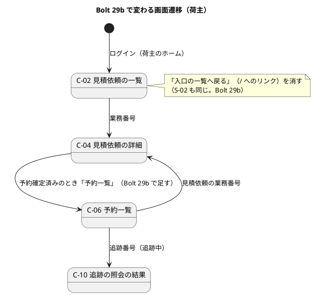

# Bolt 29b 計画 - マニュアルで見つけた画面の文言と表示の課題（#46 の前半）

## 基本情報

| 項目 | 内容 |
| :--- | :--- |
| Bolt | 第 29b 回（W5 の 2 本目。Release 0.1 の負債の返済） |
| 予定 | W5（2026-11-02 の週。前倒しで着手できる）、作業 2.5〜3 時間（承認ゲートと `uiTest`・SonarQube の待ち時間を除く） |
| 対象 | `quotation`（C-02・C-04・C-05・S-02 のテンプレートと荷主の状態の表示）、`identity`（S-22 のテンプレート）、テストの `documentation`（Code Smell） |
| GitHub | [#46](https://github.com/k2works/practical-domain-driven-design-in-enterpris-application/issues/46)。#46 は Bolt 29c（S-09・S-06）の終了報告の承認の後に閉じる |
| 承認ゲート | 計画の承認（確認ポイント 1〜11。`/goal Bolt29b` の指示により推奨のとおりで進めた）と終了報告。W4 の締めの決定（Release 1.0 の既定は計画と終了報告で止める）に従う。スキーマ・認可・外部連携・セキュリティは変えない |
| アプローチ | アウトサイドイン（既存の画面の文言と表示を直す。開発戦略の「Bolt ごとのアプローチの決め方」の「既存の集約に受入条件を足す」に準じる）。画面の振る舞い（表示・リンク）はコントローラーのテストとステップ定義から入る |
| 前の Bolt | [Bolt 29 終了報告](bolt_29_report.md) |

## Bolt ゴール

Release 0.1 のユーザーマニュアルを書くときに見つけた画面の課題のうち、テンプレートと画面の文言で直せる 4 か所を直し、画面を正しく読めば足りるようにする（マニュアルで言い換えたり避けたりしていた箇所をなくす）。あわせて、UI 設計の該当の記述と画面イメージ、マニュアルの該当の節とキャプチャを、直した画面に合わせる。

### 確かめたい仮説

| # | 仮説 | この Bolt で分かること |
| :--- | :--- | :--- |
| H1 | 4 か所はテンプレートと荷主の状態の文言だけで直せ、コンテキストの依存の向きもスキーマも変えずに済む（C-04 は予約一覧へ案内するだけで、見積りが追跡の開始を知る必要はない） | 変えたファイルの層。`allowedDependencies`・マイグレーションの変更が 0 か |
| H2 | マニュアルの節とキャプチャは `./gradlew manualScreenshots` の撮り直しと本文の数行の修正で追いつく（手作業で画像を置かない） | 撮り直したキャプチャの枚数と、直した本文の行数 |

## ふりかえりと前の Bolt からの引き継ぎ

| 入力 | 内容 | この Bolt での扱い |
| :--- | :--- | :--- |
| W5 の開始準備（2026-10-11） | #46 は Bolt 29b。開始準備の棚卸しで 6 か所の層と影響を調べ、human:kakimomokuri が 29b（テンプレートの 4 か所と Code Smell）と 29c（S-09 の貨物の要約と見出し、S-06 の参照情報版）に分けた。C-04 は表示と案内を直す案、S-09 はドメインの日本語名で要約する案、S-06 は語だけ直して値はそのままにする案に決めた | 29b は 4 か所。29c の範囲は W5 の節に書く |
| Bolt 29 の承認（2026-10-11） | Bolt 28 の SonarQube の Code Smell（`AcceptanceCriteriaCoverageTest.java:40` の正規表現）は Bolt 29b の開発レビューのときに直す | ステップ 4 |
| W4 の Try T-90 | 画面を作る Bolt の開発レビューに、マニュアルを書く立場の観点（画面に実装の語や業務ルールの番号が出ていないか、状態の表示が実際と合うか）を入れる | ステップ 5 の開発レビューにテクニカルライターの観点を入れる |
| W5 の Try T-89 | 後に回したものは Issue にし、週の見直しで開いている持ち越しを数える | 「入れない」の 2 項目（見積りが追跡の開始を知る仕組み、C-04 から追跡番号で C-06・C-10 へ直接つなぐこと）は、開始準備で採らないと決めた設計の代案で、後に回した作業ではない。Issue にせず、採らない理由を本計画に残す（確認ポイント 11）。S-09・S-06 は Bolt 29c（#46 のまま） |
| W4 の Try T-86 | 文言を変えたら `src/test` 全体を探す | 全ステップ。棚卸しで、変える文言を確かめるテストを数えた（下の「直す箇所」の表） |
| W4 の Try T-83・T-88 | 骨組みのまま流し、本命のアサーションで落ちることを確かめる。最初から通るテストは「見張り」と書く | 各ステップの Red |
| Bolt 29 の Try T-91〜T-94 | 待ちを残す、`pkill -f` を使わない、429 の環境では最初から `--max-workers=1` と再試行、「できない」と書く前に手順書と過去の報告を探す | 全ステップ。SonarQube は手順書の 9 節のとおり起動する |
| UI 設計 UI:925 | 荷主の画面では「準備中」は準備中の画面の語なので使わない。荷主の追跡の語は「追跡中」「追跡の開始待ち」 | C-04 の「（追跡の開始の準備中）」をやめる根拠 |

## スコープ

### 直す箇所

| # | 画面 | 今の表示 | 直した表示 | 変える層 | 文言を確かめるテスト | マニュアル・キャプチャ |
| :--- | :--- | :--- | :--- | :--- | :--- | :--- |
| 1 | S-22 KPI 計測記録 | 表の caption と囲みの aria-label「輸送要求ごとの KPI-01 の時刻とリードタイム」 | 「見積依頼ごとの KPI-01 の時刻とリードタイム」（画面の語は「見積依頼」。UI:78・101、マニュアルの用語集） | テンプレート（`identity/kpi-observations/list.html`）、UI:174 | なし（足す。確認ポイント 3） | 10 章 10.1 はすでに「見積依頼ごと」。`10-kpi-observations.png` を撮り直す |
| 2 | C-05 見積りへの回答 | 共通の断片の「詳細な経路は、経路設計者の承認後に確定します。」と、画面の「詳細な経路と日程は経路設計者の承認後に確定します。」が続けて出る | 画面の 1 文を消し、断片の 1 文だけにする（断片は C-04・S-04・C-17 と共有） | テンプレート（`quotation/transport-requests/response.html`）、UI:159 | `QuotationResponseControllerTest.java:97`、`RouteDesignUiSteps.java:68`（消す文を確かめている。断片の文に向け直す） | 4 章 4.1 の ④（:46）。`04-response.png` を撮り直す |
| 3 | C-02 見積依頼の一覧（荷主のホーム）、S-02 受付一覧（営業担当者のホーム） | 「入口の一覧へ戻る」（`/` へのリンク。どちらの役割もホームがこの一覧なので、開き直すだけ） | リンクを消す（UI:182 のとおり、Bolt 3 の入口の一覧はホームに置き換わった。ホームへはナビのブランドから戻れる） | テンプレート（`quotation/transport-requests/list.html`、`quotation/staff/transport-requests/list.html`） | なし（足す。確認ポイント 3） | 3 章・6 章・7 章は載せずに避けている。`03-request-list.png`、`06-intake-list-review.png`、`06-intake-list-presented.png`、`07-intake-list-ready-to-book.png` を撮り直す |
| 4 | C-04 見積依頼の詳細（荷主）。同じラベルを使う C-02 見積依頼の一覧の状態列も変わる（`TransportRequestController` の C-04 と C-02 の行。UI:966 の表は両方に効く） | 状態「予約確定済み（追跡の開始の準備中）」、案内「本予約を確定しました。追跡の準備ができたら、追跡番号で輸送の状況を照会できます。」（追跡が始まった後もこのまま） | 状態「予約確定済み」（社内の表示と同じ）。案内「本予約を確定しました。追跡番号と追跡の状況は予約一覧で確かめられます。」と、予約一覧（C-06 `/customer/bookings`）へのリンク | 荷主の状態のラベルと案内（`TransportRequestLabels`）、テンプレート（`quotation/transport-requests/detail.html`）、UI:968-977 の荷主の状態の表に BOOKED の行を足す | なし（足す。確認ポイント 3） | 1 章の表（`01-業務フロー.md:51`）。この状態のキャプチャはないので、撮影のシナリオに予約確定済みの C-04 を足して `05-request-detail-booked.png` を撮り、5 章 5.1 に載せる（確認ポイント 10。実行のとき 7 章の営業担当者の章ではなく、荷主の予約一覧の章に置き直した） |

### 設計の約束（Try T-1）

- コンテキストの依存の向き（`allowedDependencies`）とスキーマは変えない。C-04 は見積りのコンテキストの中で、荷主の画面の固定のリンク（C-06 の URL）を出すだけにする（予約の公開 API を引かない。引くと `booking → quotation :: api` と循環する）
- 文言は UI 設計を先に直し、テンプレートを UI 設計に合わせる（設計が正）
- マニュアルのキャプチャは `./gradlew manualScreenshots` で撮り直し、手作業で PNG を置かない

### 入れるもの・入れないもの

| 入れる | 入れない（後で） |
| :--- | :--- |
| 上の 4 か所と、UI 設計・マニュアル・キャプチャの対応 | S-09 の「確定条件（BR-01）」と貨物の要約「GENERAL / PALLET」、S-06 の参照情報版の語（Bolt 29c） |
| Bolt 28 の Code Smell（`AcceptanceCriteriaCoverageTest` の正規表現の簡素化） | 見積りが追跡の開始を知る仕組み（輸送要求の「追跡中」の状態。スキーマとドメインモデルを変える。今回は採らない） |
| 変えた文言の画面の振る舞いのテスト（コントローラーのテスト） | C-04 から C-06・C-10 へ追跡番号で直接つなぐこと（DE-07 の通知で追跡番号を写す。スキーマの変更になる） |

## 設計（この Bolt の範囲）

### ドメインモデル・状態遷移・データモデル

変えない。輸送要求の状態（予約確定済みが最後の状態。domain_model.md:398・409）も、表も、そのまま。荷主の画面の状態の表示名と案内だけを変える（4 図のうちドメインモデル・状態遷移・ER 図は省く）。

### 画面遷移

C-04 の予約確定済みのときだけ、予約一覧（C-06）へのリンクが増える。C-02・S-02 のホームへのリンクは消える（ホームへはナビのブランドから）。

## ステップ計画

状態の記号: `[ ]` 未着手、`[-]` 進行中、`[?]` 承認待ち、`[x]` 完了。各ステップの終わりに `check` が緑であることと、計画からの変更を設計文書に反映したこと（T-53）を確かめ、push して CI を確かめる（T-26、T-65）。コミットの前に、そのステップのファイルだけをステージしているか確かめる（T-84）。依存の取得は最初から `--max-workers=1` と再試行で流す（T-93）。

- [x] **1. UI 設計を直す** 【承認ゲート: なし】
  - ui_design.md: UI:174（S-22 の「輸送要求ごと」→「見積依頼ごと」）、UI:159 と C-05 の画面イメージ UI:573（重複の 1 文を消し、断片の文に任せると書く）、C-02・S-02 の「入口の一覧へ戻る」を出さないこと（UI:182 の注に足す）、UI:968-977 の荷主の状態の表に BOOKED（「予約確定済み」、案内と C-06 へのリンク）を足す
  - 完了の判定: `okf:check` ERROR 0
  - 結果（2026-10-11）: UI:159（C-05）、UI:174（S-22）、UI:182（ホームの注）、UI:573（C-05 の画面イメージ）、荷主の状態の表に予約確定済みの行を足した
- [ ] **2. S-22・C-02・S-02 の文言とリンク（直す箇所 1・3）** 【承認ゲート: なし】
  - Red: `KpiObservationControllerTest` に caption「見積依頼ごとの…」を、C-02（`TransportRequestControllerTest`）・S-02（`TransportRequestReviewControllerTest`）に「入口の一覧へ戻る」がないことを足し、落ちることを確かめる（T-88。リンクのテストは今の表示で落ちる本命のアサーション）
  - Green: テンプレートを直す
  - 完了の判定: `check` 緑
- [ ] **3. C-05 の案内の重複と C-04 の予約確定済み（直す箇所 2・4）** 【承認ゲート: なし】
  - Red: `QuotationResponseControllerTest` に「同じ画面に経路の確定の案内が 1 回だけ出る」を、`TransportRequestControllerTest` に予約確定済みの C-04 の状態「予約確定済み」・案内・C-06 へのリンクと、C-02 の BOOKED の行の状態「予約確定済み」を足して落ちることを確かめる。消す文を確かめている `QuotationResponseControllerTest.java:97`・`RouteDesignUiSteps.java:68` は断片の文に向け直す（T-86 で `src/test` 全体を探す）。向け直した 2 件は最初から通る「見張り」（T-88）
  - Green: `response.html` の 1 文を消す。`TransportRequestLabels` の荷主の BOOKED の状態と案内を直し、`detail.html` に予約確定済みのときだけ C-06 へのリンクを出す
  - 完了の判定: `check` 緑、`uiTest` 緑（`@US-24` の画面の層のシナリオが通る）
- [ ] **4. マニュアルとキャプチャ、Code Smell** 【承認ゲート: なし】
  - マニュアル（`creating-manual`）: 1 章の表（予約確定済み）、2 章 2.2 の①ヘッダー（左の cargo-tracker を押すと役割のホームへ戻る。「入口の一覧へ戻る」を消すため。キャプチャは要らない）、4 章 4.1 の ④（重複の言い換えを外す）、5 章 5.1（予約確定済みの見積依頼の詳細から予約一覧を開くこと。新しいキャプチャ）、用語集（予約確定済み）、10 章 10.1（caption の文言）。3・6・7 章はリンクを避けていた書き方を確かめる。撮影のシナリオ（`manual_screenshots.feature`）の本予約の確定の後に、荷主で C-04 を開いて `05-request-detail-booked.png` を撮る手順を足す。`./gradlew manualScreenshots` で 7 枚（`05-request-detail-booked.png` と、`10-kpi-observations.png`、`04-response.png`、`03-request-list.png`、`06-intake-list-review.png`、`06-intake-list-presented.png`、`07-intake-list-ready-to-book.png`））を撮る（ほかの画像は元に戻す）。HTML 版の出力も更新する
  - Code Smell: `AcceptanceCriteriaCoverageTest` の行の正規表現を `^\|\s*(US-\d+)\s*\|([^|]+)\|([^|]+)\|$` に簡素化する（前後の空白は `[^|]+` が吸収する。行は `strip()` 済み）。見張り: `Release01の受入条件ごとにwipでないシナリオがある` と `表の行が書式から外れると黙って落とさずに失敗する` が通り続けること
  - 完了の判定: `check`（`documentationTest` を含む）緑、`okf:check` ERROR 0
- [ ] **5. 開発レビューと終了報告** 【承認ゲート: 終了報告】
  - 開発レビュー（`developing-review`。プログラマー、テクニカルライター（T-90。マニュアルを書く立場で、画面に実装の語や業務ルールの番号が出ていないか、状態の表示が実際と合うか）、インタラクションデザイナー（リンクを消した後の戻り方、C-04 の案内とリンクの名前））
  - SonarQube（`sonar-local:check`。手順書の 9 節のとおり起動）、受入動画（`./gradlew demoVideo`。C-04 の予約確定済みの案内を写すシナリオがあれば。過去の Bolt の動画は元に戻す）
  - `bolt_29b_report.md`。release_plan の W5 の 29b の行と進捗、開発の索引を更新する。#46 は Bolt 29c の後に閉じる（この Bolt では進み具合をコメントする）

### 時間の配分と打ち切り

| # | 目安 | 打ち切り |
| :--- | :--- | :--- |
| 1 | 15 分 | — |
| 2 | 30 分 | — |
| 3 | 40 分 | C-04 のリンクで認可や画面の遷移のテストが広く落ちたら、リンクを外して案内の文だけにし、人に諮る |
| 4 | 60 分 | キャプチャの撮影が 429 などで 20 分を超えて進まなければ、本文だけを直して撮影を Bolt 29c に回す（人に諮る） |
| 5 | 30 分（`uiTest` と SonarQube の待ちを除く） | — |

## 確認ポイント（計画の承認の場でまとめて確認する。Try T-6）

| # | 確認すること | ステップ | 推奨 |
| :--- | :--- | :--- | :--- |
| 1 | **C-04 の直し方** | 3 | 状態を「予約確定済み」にし、案内で予約一覧（C-06）へつなぐ（開始準備で決めた案）。見積りのコンテキストは追跡の開始を知らないまま。代わりの案（予約から見積りへ追跡の開始を通知して「追跡中」の状態を足す）は、スキーマとドメインモデルの変更なので採らない |
| 2 | **C-04 の案内の文言とリンクの名前** | 3 | 案内「本予約を確定しました。追跡番号と追跡の状況は予約一覧で確かめられます。」。リンクの名前は行き先の画面の見出しにそろえて「予約一覧」（Bolt 25b・27b の前例: リンクの名前を行き先にそろえる）。ナビの項目名は「予約」なので呼び名が 2 つになるが、見出しに合わせることを優先して許す |
| 3 | 文言とリンクのテスト | 2・3 | caption・リンクの有無・C-04 と C-02 の状態と案内は、コントローラーのテスト（MockMvc の HTML の検査）で確かめる。画面の層のシナリオは足さない（既存の `@US-24`・`@US-21` などのシナリオが回帰として通ることを確かめる）。主成功の流れ（`main_flow_ui.feature`。Bolt 28 のデモ）の、本予約の後に予約一覧を直接開く手順も変えない |
| 4 | C-05 の重複のどちらを残すか | 3 | 共通の断片の文（「詳細な経路は、経路設計者の承認後に確定します。」）を残し、C-05 の画面の 1 文を消す。断片のこの文は経路がまだないときに出る（C-04・C-05・S-04）。断片の文を消すとほかの画面から案内が消えるため |
| 5 | 「入口の一覧へ戻る」 | 2 | 消す。どちらの一覧も役割のホームそのもので、戻る先がない。代わりの案は文言を「ホームへ戻る」にする（行き先は同じ一覧なので意味がない） |
| 6 | S-22 の語 | 2 | 「見積依頼ごと」。画面と荷主の語は「見積依頼」（UI:78「見積依頼（輸送要求）」）。マニュアル 10 章もすでにこの語 |
| 7 | **#46 の閉じ方** | 5 | Bolt 29c（S-09・S-06）の終了報告の承認の後に閉じる。29b では進み具合をコメントする |
| 8 | Code Smell をこの Bolt で直す | 4 | 直す（Bolt 29 の承認の決定）。正規表現の簡素化だけで、照合の結果は変えない |
| 9 | 承認ゲート | 全体 | 計画の承認と終了報告で止める（W4 の締めの決定の既定）。画面の文言の変更は計画の承認の場で確認ポイント 2・4〜6 として判断を受ける（T-80） |
| 10 | **デモ項目の証跡** | 4・5 | 予約確定済みの C-04 を写す `@demo` のシナリオはない。受入動画は撮らず、マニュアルの撮影のシナリオに予約確定済みの C-04 を足して撮るキャプチャ（`05-request-detail-booked.png`）と、コントローラーのテストを証跡にする。代わりの案は、主成功の流れ（`main_flow_ui.feature`）を「C-04 の『予約一覧』から開く」に変えて動画を撮り直す（Bolt 28 のデモの手順が変わる） |
| 11 | 採らない代案の扱い（T-89） | — | 見積りが追跡の開始を知る仕組み（輸送要求の「追跡中」の状態）と、C-04 から追跡番号で直接つなぐこと（DE-07 の通知で追跡番号を写す）は、開始準備で採らないと決めた代案なので Issue にしない。荷主から「見積依頼の詳細で追跡番号を見たい」という声が出たら、その時点でストーリーとして起こす |

## 完了条件

- [ ] 直す箇所 1〜4 の画面の文言・リンク・状態の表示が UI 設計どおりになり、コントローラーのテストで確かめた
- [ ] UI 設計（ui_design.md）の該当の記述と荷主の状態の表を直した
- [ ] マニュアルの該当の節（1・2・4・5・10 章と用語集）を直し、キャプチャ 7 枚（新しい 1 枚を含む）を `manualScreenshots` で撮った
- [ ] Bolt 28 の Code Smell を直した（照合のテストが通り続ける）
- [ ] `check`・`uiTest` が緑。push して CI を確かめた
- [ ] SonarQube の Quality Gate が PASS
- [ ] 開発レビュー（T-90 の観点を含む）と終了報告。#46 に進み具合をコメントした

### デモ項目

荷主が予約確定済みの見積依頼の詳細（C-04）を開くと、状態が「予約確定済み」と示され、案内から予約一覧（C-06）で追跡番号と追跡の状況を確かめられる。証跡はマニュアルのキャプチャ `05-request-detail-booked.png` とコントローラーのテスト（確認ポイント 10）。KPI 計測記録・見積りへの回答・受付一覧も、マニュアルのキャプチャで確かめる。

## 更新履歴

| 日付 | 更新内容 | 更新者 |
| :--- | :--- | :--- |
| 2026-10-11 | human:kakimomokuri が `/goal Bolt29b` で着手を指示した。確認ポイントはすべて推奨のとおりとし、途中のゲートは止めずに進め、根拠を終了報告に置く（T-36。Bolt 29 の前例） | anthropic/claude-opus-5-5、指示 human:kakimomokuri |
| 2026-10-11 | 開始準備の整合性検証（計画と設計 8 件、横断 7 件。高 0）の指摘を反映した。C-02 の状態列も変わること、C-05 の画面イメージ UI:573、予約確定済みの C-04 のキャプチャを足してデモ項目の証跡にすること（確認ポイント 10）、T-89 と採らない代案の扱い（確認ポイント 11）、マニュアル 2 章（ブランドからホームへ）、テストを置くクラス、時間の見込み、見張りの 2 件 | anthropic/claude-opus-5-5 |
| 2026-10-11 | 初版作成（承認待ち）。開始準備の棚卸しと、human:kakimomokuri の決定（29b と 29c に分ける、C-04 は表示と案内を直す、S-09 はドメインの日本語名、S-06 は語だけ直す）を反映した | anthropic/claude-opus-5-5 |

## 関連ドキュメント

- [リリース計画](release_plan.md)（W5）
- [Bolt 29 終了報告](bolt_29_report.md)
- [UI 設計](../../design/cargo-tracker/ui_design.md)（S-22、C-05、C-02・S-02、C-04 と荷主の状態の表）
- [ユーザーマニュアル](../../manual/index.md)（1・3・4・6・7・10 章）
