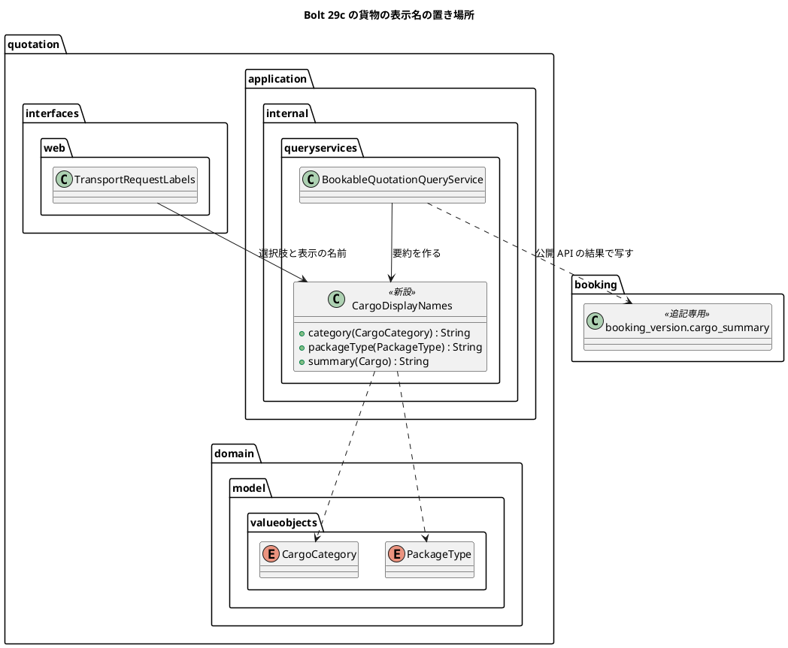

# Bolt 29c 計画 - 本予約の確定と経路候補の比較の画面の語（#46 の後半）

## 基本情報

| 項目 | 内容 |
| :--- | :--- |
| Bolt | 第 29c 回（W5 の 3 本目。Release 0.1 の負債の返済の最後） |
| 予定 | W5（2026-11-02 の週。前倒しで着手できる）、作業 2〜2.5 時間（承認ゲートと `uiTest`・SonarQube の待ち時間を除く） |
| 対象 | `quotation`（貨物の表示名の部品と、予約へ渡す貨物の要約。荷主の画面のラベル）、`booking`（S-09・S-24 の表示）、`routing`（S-06 の文言） |
| GitHub | [#46](https://github.com/k2works/practical-domain-driven-design-in-enterpris-application/issues/46)。終了報告の承認の後に閉じる |
| 承認ゲート | 計画の承認（確認ポイント 1〜10）と終了報告。W4 の締めの決定（Release 1.0 の既定は計画と終了報告で止める）に従う。スキーマ・認可・外部連携・セキュリティは変えない |
| アプローチ | アウトサイドイン（既存の画面の文言と表示を直す。開発戦略の「既存の集約に受入条件を足す」に準じる）。貨物の要約は公開 API の結果の値なので、公開 API の実装のテスト（`BookableQuotationQueryAdapterTest`）から入る |
| 前の Bolt | [Bolt 29b 終了報告](bolt_29b_report.md) |

## Bolt ゴール

#46 の残りの 2 か所を直し、営業担当者と経路設計者の画面にも実装の語と業務ルールの番号が出ないようにする。S-09 本予約の確定と S-24 予約の詳細の貨物は「一般 / パレット × 12 / 8,400 kg / 32.5 m3」と示し、見出しは「確定条件」にする。S-06 経路候補の比較の理由は「…。参照した航海情報の版 V-LATE@1」と示す。UI 設計・マニュアル・キャプチャを合わせ、#46 を閉じる。

### 確かめたい仮説

| # | 仮説 | この Bolt で分かること |
| :--- | :--- | :--- |
| H1 | 貨物の日本語名を見積りの application 層の 1 か所に置けば、要約と荷主の画面のラベルの両方が同じ名前を使え、ドメインの enum と共有カーネルは変えずに済む（Bolt 22 の D-84 と同じ考え方） | 名前の定義の数（1 か所か）、ドメイン層と `shared` の変更が 0 か、ArchUnit の層の規則に触れないか |
| H2 | 確定済みの予約版は追記専用で書き換えないので、新しい要約は新しく確定した予約だけに出る。開発用・デモ用のデータに古い要約の行はない（予約はシナリオか画面の操作でしか作られない） | 開発用のデータ（`db/dev-data`）とデモのサンプルに `cargo_summary` の行があるか |

## ふりかえりと前の Bolt からの引き継ぎ

| 入力 | 内容 | この Bolt での扱い |
| :--- | :--- | :--- |
| Bolt 29b の開始準備（2026-10-11） | #46 を 29b と 29c に分けた。S-09 は見積りのドメインの日本語名で要約する。S-06 は語だけ直して値はそのまま示す（human:kakimomokuri の決定） | この Bolt の範囲 |
| Bolt 29c の開始準備（2026-10-11） | human:kakimomokuri が決めた: 日本語名は見積りの application 層に置く（ドメインの enum は表示の関心で変えない）。S-06 の語は「参照した航海情報の版」。要約の数値の不要な 0 を落とし、桁区切りを入れる | 設計の約束、確認ポイント 1〜3 |
| Bolt 29b の Try T-95 | 状態の表示を直すときは、その状態で画面全体を見て、ほかの段落に古い前提の文が残っていないかを計画の段階で確かめる | 計画の段階で、S-09・S-24・S-06 の画面全体に、業務ルールの番号と実装の語がほかに出ていないかを調べた（下の「調べたこと」） |
| Bolt 29b の Try T-96 | リンクの有無のテストは、共通の部品に同じ行き先がないかを確かめてから絞る | この Bolt はリンクを足さない（当てはまらない） |
| W4 の Try T-86・T-88・T-90、Bolt 29 の T-91〜T-94 | 文言を変えたら `src/test` 全体を探す、骨組みのまま流して本命のアサーションで落とす、マニュアルを書く立場のレビュー、待ちを残す、`pkill -f` を使わない、429 の環境では最初から再試行、手順書を先に読む | 全ステップ |
| Bolt 29b の開発レビューの任意の指摘 | 撮影のデータの航海の名前が `UI-…-DIRECT` とテストデータの名前に見える | 入れない（撮影のデータを業務の名前にする作業は別に要る。W5 の締めで数える持ち越し） |

### 調べたこと（T-95）

- 画面に出る業務ルールの番号は S-09 の見出し「確定条件（BR-01）」だけ。ほかの番号（BR-13・BR-07・Q-INV-02・BR-03・T-INV-09）はテンプレートのコメントの中にある
- 貨物の要約は、見積りの `BookableQuotationQueryService.summary()` が enum の名前で組み立て、公開 API（`BookableQuotationResult.cargoSummary`）で予約に渡り、`booking.booking_version.cargo_summary`（追記専用）に写される。S-09 と S-24 はその文字列をそのまま出す
- 「参照情報版」はドメインの用語（ユビキタス言語。R-INV-02、業務のルールの層の受入シナリオ、ドメインイベント）として残す。変えるのは S-06 の画面の文言（`RoutingCaseViews`）だけ

## スコープ

### 直す箇所

| # | 画面 | 今の表示 | 直した表示 | 変える層 | 文言を確かめるテスト | マニュアル・キャプチャ |
| :--- | :--- | :--- | :--- | :--- | :--- | :--- |
| 1 | S-09 本予約の確定 | 見出し「確定条件（BR-01）」 | 「確定条件」 | テンプレート（`booking/staff/bookings/new.html`）、UI:130・682 | なし（足す） | 7 章 7.2 はすでに「確定条件」。`07-booking-new.png` を撮り直す |
| 2 | S-09・S-24 予約の詳細 | 貨物「GENERAL / PALLET × 12 / 8400.000 kg / 32.500 m3」 | 「一般 / パレット × 12 / 8,400 kg / 32.5 m3」（日本語名、不要な 0 を落とし整数部に桁区切り） | 見積りの application 層に貨物の表示名の部品を新設し、要約（`BookableQuotationQueryService`）と荷主の画面のラベル（`TransportRequestLabels`）が使う。UI:684、data_model.md の `cargo_summary` の注 | `BookableQuotationQueryAdapterTest.java:59`（今の書式を確かめている。新しい書式に向け直す） | 7 章 7.2・7.3。`07-booking-new.png`、`07-booking-detail.png` を撮り直す |
| 3 | S-06 経路候補の比較 | 理由「…。参照情報版 V-LATE@1」 | 「…。参照した航海情報の版 V-LATE@1」（値はそのまま） | `routing/interfaces/web/RoutingCaseViews`（`INFO_VERSION` と適合の根拠の文）、UI:172・657・670 | `RoutingCaseControllerTest.java:170`、`RoutingUiSteps.java:180`（向け直す。ステップの文の「参照情報版」はドメインの用語なので残す） | 8 章 8.2 の ⑥（「参照した情報の版」→ 画面の語に合わせる）。`08-candidates.png`、`08-confirmed.png` を撮り直す |

### 設計の約束（Try T-1）

- ドメインの enum（`CargoCategory`・`PackageType`）と共有カーネルは変えない。日本語名は見積りの application 層の部品（例: `quotation.application.internal.queryservices.CargoDisplayNames`）の 1 か所に置き、web 層の `TransportRequestLabels` はそれを使う（確認ポイント 1）
- 予約のコンテキストは貨物の要約を文字列として受け取るだけで、書式を知らない（変えない）
- 確定済みの予約版は書き換えない（追記専用。スキーマも変えない）
- 「参照情報版」はドメインの用語として残し、画面の語だけを変える

### 入れるもの・入れないもの

| 入れる | 入れない（後で） |
| :--- | :--- |
| 上の 3 か所と、UI 設計・データモデルの注・マニュアル・キャプチャの対応 | 確定済みの予約版の要約の書き換え（追記専用） |
| 貨物の表示名の部品と、要約の数値の書き方 | 採用情報版の値の書式の決定と分解（W7 の外部原本の取込とあわせて） |
| #46 を閉じる | 撮影のデータの航海の名前（Bolt 29b の任意の指摘） |

## 設計（この Bolt の範囲）

### ドメインモデル・状態遷移・データモデル

ドメインモデルと状態遷移は変えない（4 図のうちドメインモデル・状態遷移は省く）。データモデルは表を変えず、`booking.booking_version.cargo_summary` の注に「書式は見積りが決める。Bolt 29c から日本語名と数値の表示の書式。それより前の予約版は英語の値のまま」と書く（ER 図は省く）。

### 部品の置き場所

### 画面遷移

変えない（文言だけ）。

## ステップ計画

状態の記号: `[ ]` 未着手、`[-]` 進行中、`[?]` 承認待ち、`[x]` 完了。各ステップの終わりに `check` が緑であることと、計画からの変更を設計文書に反映したこと（T-53）を確かめ、push して CI を確かめる（T-26、T-65）。コミットの前に、そのステップのファイルだけをステージしているか確かめる（T-84）。依存の取得は最初から `--max-workers=1` と再試行で流す（T-93）。

- [ ] **1. UI 設計とデータモデルの注を直す** 【承認ゲート: なし】
  - ui_design.md: UI:130（S-09 の役割の「BR-01 の」を外す）、UI:165（S-09 の見出しと貨物の書式）、UI:682・684（画面イメージ）、UI:172・657・670（S-06 の理由の語。R-INV-02 の参照はドメインの規則として残す）。data_model.md の `cargo_summary` の注
  - 完了の判定: `okf:check` ERROR 0
- [ ] **2. 貨物の表示名と要約、S-09 の見出し（直す箇所 1・2）** 【承認ゲート: なし】
  - Red: `CargoDisplayNames` の単体テスト（4 つの貨物種別と 4 つの荷姿の名前、要約の書式: `8400.000`→`8,400`、`32.500`→`32.5`、`1200.500`→`1,200.5`、`0.250`→`0.25`）を書き、クラスがないことで落ちる（コンパイルの失敗）のではなく本命のアサーションで落ちるよう、骨組み（空の実装）を先に置く（T-88）。`BookableQuotationQueryAdapterTest.java:59` を新しい書式に向け直して落ちることを確かめる。`BookingControllerTest` に S-09 の見出し「確定条件」と「（BR-01）」がないことを足す
  - Green: `CargoDisplayNames` を実装し、`BookableQuotationQueryService.summary` と `TransportRequestLabels` の選択肢・表示の名前をそれに寄せる（荷主の画面の選択肢の値と表示は変わらない）。S-09 の見出しを直す
  - 完了の判定: `check` 緑（ArchUnit の層の規則と ModularityTest を含む）
- [ ] **3. S-06 の理由の語（直す箇所 3）** 【承認ゲート: なし】
  - Red: `RoutingCaseControllerTest.java:170` を「参照した航海情報の版 V-LATE@1」に向け直して落ちることを確かめる。`RoutingUiSteps.java:180` も向け直す（T-86 で `src/test` 全体を探す）
  - Green: `RoutingCaseViews` の `INFO_VERSION` と適合の根拠の文を直す
  - 完了の判定: `check` 緑、`uiTest` 緑（`@US-06`・`@US-04` の画面の層のシナリオと主成功の流れが通る）
- [ ] **4. マニュアルとキャプチャ** 【承認ゲート: なし】
  - マニュアル（`creating-manual`）: 7 章 7.2・7.3（貨物の表示）、8 章 8.2 の ⑥（画面の語「参照した航海情報の版」）。`./gradlew manualScreenshots` で 4 枚（`07-booking-new.png`、`07-booking-detail.png`、`08-candidates.png`、`08-confirmed.png`）を撮り直す（ほかの画像は元に戻す。日時だけが違う画像も戻す）
  - 完了の判定: `check` 緑、`okf:check` ERROR 0
- [ ] **5. 開発レビューと終了報告** 【承認ゲート: 終了報告】
  - 開発レビュー（`developing-review`。プログラマー（層と依存、書式の境界値）、テクニカルライター（T-90。画面に実装の語や業務ルールの番号が残っていないか、マニュアルと画面の一致）。リンクと画面遷移を変えないのでインタラクションデザイナーの観点は外す）。レビューにキャプチャを渡す
  - SonarQube（`sonar-local:check`。手順書の 9 節のとおり起動）
  - `bolt_29c_report.md`。release_plan の W5 の 29c の行と進捗、開発の索引を更新する。承認の後に #46 を閉じる

### 時間の配分と打ち切り

| # | 目安 | 打ち切り |
| :--- | :--- | :--- |
| 1 | 15 分 | — |
| 2 | 50 分 | ArchUnit の層の規則が web 層から application 層の部品への参照を拒んだら、置き場所を動かさずに人に諮る（CLAUDE.md の規則の例外は設計の判断） |
| 3 | 25 分 | — |
| 4 | 30 分 | — |
| 5 | 30 分（`uiTest` と SonarQube の待ちを除く） | — |

## 確認ポイント（計画の承認の場でまとめて確認する。Try T-6）

| # | 確認すること | ステップ | 推奨 |
| :--- | :--- | :--- | :--- |
| 1 | **貨物の表示名の部品の置き場所と名前** | 2 | `quotation.application.internal.queryservices.CargoDisplayNames`（開始準備の決定: application 層に置く）。web 層は既存の `commands`・`commandservices` と同じく application の部品を参照する |
| 2 | **要約の書式** | 2 | 「{貨物種別の名前} / {荷姿の名前} × {個数} / {総重量} kg / {容積} m3」。数値は不要な 0 を落とし（`stripTrailingZeros`）、整数部に 3 桁ごとのカンマを入れる（例: 8,400、32.5）。区切りの「 / 」と「 × 」は今のまま |
| 3 | **S-06 の語** | 3 | 「参照した航海情報の版」（開始準備の決定）。適合の根拠「期限まで 2 日（期限と接続時間を満たす）。参照した航海情報の版 V-201@1、V-301@1」と除外の理由の両方。「参照情報版」はドメインの用語として、業務のルールの層の受入シナリオとステップの文に残す |
| 4 | S-09 の見出し | 2 | 「確定条件」（マニュアル 7 章がすでにこの語）。表の中身（有効な見積り・必須貨物情報・荷主の承認・承認済み経路版）は変えない |
| 5 | 確定済みの予約版 | — | 書き換えない（追記専用）。デモ環境に Bolt 29c より前に確定した予約があれば英語の要約のまま出る。デモ環境のサンプルは予約を作らないので影響はない見込み（仮説 H2 で確かめる） |
| 6 | 文言のテスト | 2・3 | 要約の書式は `CargoDisplayNames` の単体テストと公開 API の実装のテストで、S-09 の見出しはコントローラーのテストで確かめる。画面の層のシナリオは足さない（既存のシナリオが回帰として通る） |
| 7 | 受入動画 | 5 | 撮らない。マニュアルのキャプチャ 4 枚とテストを証跡にする |
| 8 | **#46 の閉じ方** | 5 | 終了報告の承認の後に、29b・29c の結果をまとめてコメントして閉じる |
| 9 | 承認ゲート | 全体 | 計画の承認と終了報告で止める（W4 の締めの決定の既定） |
| 10 | 採らない代案（T-89） | — | 採用情報版の値の書式の決定と分解は W7（外部原本の取込）で値の形が決まるときに扱う。今は Issue にしない（後に回した作業ではなく、値の形が決まっていないため） |

## 完了条件

- [ ] S-09 の見出しと S-09・S-24 の貨物の要約、S-06 の理由の語が UI 設計どおりになり、テストで確かめた
- [ ] 貨物の日本語名が見積りの application 層の 1 か所にあり、ドメインの enum と共有カーネルを変えていない
- [ ] UI 設計・データモデルの注を直した
- [ ] マニュアル 7・8 章を直し、キャプチャ 4 枚を `manualScreenshots` で撮り直した
- [ ] `check`・`uiTest` が緑。push して CI を確かめた
- [ ] SonarQube の Quality Gate が PASS
- [ ] 開発レビュー（T-90 の観点を含む）と終了報告。承認の後に #46 を閉じた

### デモ項目

営業担当者が本予約の確定（S-09）を開くと、確定条件の表に「一般 / パレット × 12 / 8,400 kg / 32.5 m3」と示され、業務ルールの番号は出ない。経路設計者の経路候補の比較（S-06）の理由に「参照した航海情報の版」が示される。証跡はマニュアルのキャプチャとテスト（確認ポイント 7）。

## 更新履歴

| 日付 | 更新内容 | 更新者 |
| :--- | :--- | :--- |
| 2026-10-11 | 初版作成（承認待ち）。開始準備で、画面に出る業務ルールの番号と貨物の要約の作り方を調べ（T-95）、human:kakimomokuri の決定（日本語名は application 層、S-06 の語は「参照した航海情報の版」、要約の数値も直す）を反映した | anthropic/claude-opus-5-5 |

## 関連ドキュメント

- [リリース計画](release_plan.md)（W5）
- [Bolt 29b 計画](bolt_29b_plan.md)、[Bolt 29b 終了報告](bolt_29b_report.md)
- [UI 設計](../../design/cargo-tracker/ui_design.md)（S-09、S-06）
- [データモデル](../../design/cargo-tracker/data_model.md)（`booking.booking_version`）
- [ユーザーマニュアル](../../manual/index.md)（7・8 章）
