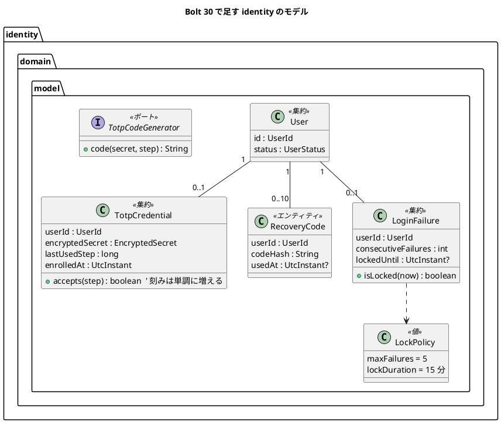
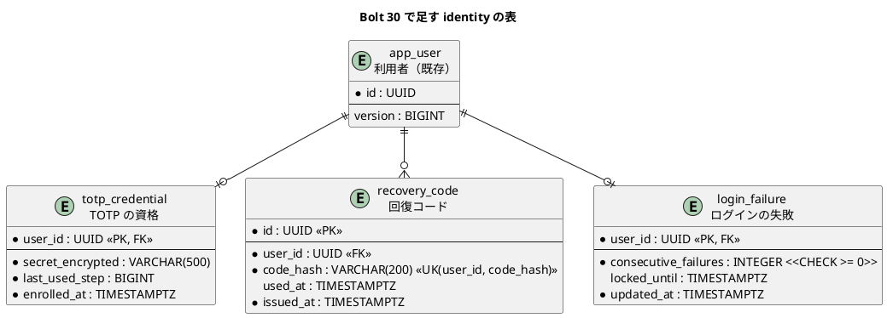

# Bolt 30 計画 - ADR-011 の採用と、TOTP の資格・回復コード・ログインの失敗の表とドメイン

## 基本情報

| 項目 | 内容 |
| :--- | :--- |
| Bolt | 第 30 回（W5 の 4 本目。US-18 の残りの最初の Bolt） |
| 予定 | W5（2026-11-02 の週。前倒しで着手できる）、作業 3.5〜4 時間（承認ゲートの待ち時間を除く） |
| 対象 | `identity`（ドメインのモデル、表、リポジトリ、TOTP の生成）、ADR-011、ドメインモデル・データモデル・技術スタック・非機能要件 |
| SP | 0（US-18 の SP 6 は #13 をクローズする Bolt 33b で数える） |
| GitHub | [#13](https://github.com/k2works/practical-domain-driven-design-in-enterpris-application/issues/13)（US-18、R1.0）。この Bolt では閉じない |
| 承認ゲート | **ステップごとに止める**（W4 の締めの決定: 認証の完成はステップごと）。確認必須の項目（スキーマ、セキュリティ、外部ライブラリ）は計画の承認の場で確認ポイントとして判断を受け、そのうえで各ステップの終わりに止める |
| アプローチ | インサイドアウト（開発戦略の中盤。新しい集約とスキーマをドメイン層とデータ層から固める）。画面と認証の流れ（Spring Security のフィルター）は Bolt 31 から |
| 前の Bolt | [Bolt 29c 終了報告](bolt_29c_report.md)、[Bolt 14 終了報告](bolt_14_report.md)、[Bolt 13 終了報告](bolt_13_report.md) |

## Bolt ゴール

ADR-011 を承認にし、US-18 の残り（TOTP によるログイン、初回の登録、ロック、回復コード、再登録）が乗る土台を作る。`identity` に TOTP の資格・回復コード・ログインの失敗の 3 つの表と、それぞれの不変条件を持つドメインのモデル・リポジトリを置き、TOTP の生成をポートと java-otp の実装に分けて RFC 6238 の試験ベクトルで固定する。画面と Spring Security の流れはまだ変えない（既存のログインの振る舞いは変わらない）。

### 確かめたい仮説

| # | 仮説 | この Bolt で分かること |
| :--- | :--- | :--- |
| H1 | 3 つの関心事を別の表にすれば、失敗の回数の更新（`UPDATE ... RETURNING`）と再利用の拒否（最後に使った刻みの条件付きの更新）と回復コードの消費（`used_at IS NULL` の条件付きの更新）を、利用者の行と版（楽観ロック）に触れずに 1 文の原子的な更新で書ける（ADR-011 の「更新の原子性」） | PostgreSQL の統合テストで、同時の 2 つの更新のうち 1 つだけが効くこと |
| H2 | java-otp を `identity.infrastructure` に閉じ込め、ドメインはポート（`TotpCodeGenerator`）だけを知る形で、RFC 6238 の試験ベクトルが通る | 契約テストの結果と、ArchUnit で java-otp の参照が `identity.infrastructure` の外にないこと |

## ふりかえりと前の Bolt からの引き継ぎ

| 入力 | 内容 | この Bolt での扱い |
| :--- | :--- | :--- |
| W5 の節の設計の決定（2026-10-11） | ADR-011 の採否は Bolt 30 の計画の承認の場で決める | 開始準備で human:kakimomokuri が決めた: 案のとおり採用する。表は関心事ごとに分ける。スパイク（`spikes/ts-01-totp/`）は Bolt 31 の後に消す（消すときにもう一度確かめる）。TOTP の秘密の暗号化の鍵の管理は Bolt 31 の計画で決める |
| W5 の節の「設計への反映が必要な事項」 | domain_model.md に TOTP の資格・回復コード・ログインの失敗の概念と不変条件がない。data_model.md は `app_user` の列だけで、ADR-011 の表の分け方と食い違う | ステップ 1 でドメインモデルとデータモデルを先に直す |
| W5 の節の「Bolt 13・14 からの持ち込み」 | K-02（AC2 と 2 段階の画面・ロックの表示の緊張）は Bolt 30・32、S-01（CSRF と same-site）・S-02（送信元ごとの流量の制限）・R-08（URL ごとの要素）は 30・31、K-03（ステージング・本番での dev の拒否）・K-04（NTP）は 30、AC7 の画面の認可・特性テスト・スパイクの削除は 30・31、T-40・T-42 は 30〜33b | Bolt 30 で扱うのは K-04（非機能要件に NTP の前提を書く）と T-42（値がない・対応がないときに失敗へ倒す）。K-03 は W10 の運用準備（IaC・CD）に送ることを確認ポイントにする。K-02・S-01・S-02・R-08・AC7 の認可・特性テストは、画面と Spring Security を扱う Bolt 31・32 の計画の確認ポイントにする（確認ポイント 9） |
| Bolt 13 の Try T-40 | 認証のフィルターを足すときは、権限が上がる段ごとに session の ID の変化と期限の確認の順をテストで確かめる | この Bolt はフィルターを足さない（Bolt 31） |
| Bolt 14 の Try T-42 | 認証・認可の部品を足すときは、値がない・対応がないときに失敗へ倒すかを計画の確認ポイントにする | 確認ポイント 6（資格のない利用者、回復コードの尽きた利用者、壊れた秘密） |
| Bolt 29c の Try T-97・T-98 | 文言を作る部品を使う画面を数える、たとえの表の意味を読み比べる | この Bolt は画面を変えない（当てはまらない） |
| W4 の Try T-83・T-88、Bolt 29 の T-91〜T-94 | 骨組みのまま流して本命のアサーションで落とす、待ちを残す、`pkill -f` を使わない、429 の環境では最初から再試行、手順書を先に読む | 全ステップ |

## スコープ

### 設計の約束（Try T-1）

- 画面・Spring Security のフィルター・既存のログインの振る舞いは変えない（Bolt 31 から）
- java-otp への依存は `identity.infrastructure` に閉じ込め、ArchUnit で守る（ADR-011 のコンプライアンス）
- 失敗の回数・再利用の拒否・回復コードの消費は、読んでから書く形にせず、1 文の条件付きの更新で判定する（ADR-011 の「更新の原子性」）
- 秘密は暗号文の列にだけ置く。暗号化の部品と鍵は Bolt 31（この Bolt は暗号文を受け渡すだけで、平文の秘密を表に書かない）
- 回復コードはハッシュだけを保存する（平文を表に書かない。SEC-09）

### 入れるもの・入れないもの

| 入れる | 入れない（後で） |
| :--- | :--- |
| ADR-011 を承認にする。tech_stack.md（TOTP のライブラリ）、非機能要件（NTP の前提。K-04） | 2 段階のログインのフィルター・A-02・初回の登録の画面（Bolt 31） |
| domain_model.md・data_model.md の TOTP の資格・回復コード・ログインの失敗 | TOTP の秘密の暗号化の部品と鍵（Bolt 31 の計画で決める） |
| マイグレーション（3 つの表、PostgreSQL と H2）と `afterMigrate` の権限 | ロックの判定を認証に組み込むこと（Bolt 32） |
| ドメインのモデルとリポジトリ（MyBatis）と、原子的な更新の統合テスト | 回復コードの発行の流れ（Bolt 31）・回復コードによる再登録（Bolt 33b） |
| `TotpCodeGenerator` のポートと java-otp の実装、RFC 6238 の契約テスト、ArchUnit の規則 | スパイクの削除（Bolt 31 の後） |

## 設計（この Bolt の範囲）

### ドメインモデル

| 概念 | 不変条件 | 出典 |
| :--- | :--- | :--- |
| TOTP の資格 | 1 人に 1 つ。最後に使った時間の刻みは単調に増え、それ以下の刻みのコードは受け付けない（再利用の拒否） | ADR-011、US-18 AC1 |
| 回復コード | 1 人に 10 個（発行のたびに置き換える）。ハッシュだけを持ち、一度使ったら使えない | SEC-09、US-18 AC7・AC9 |
| ログインの失敗 | password か TOTP の失敗が 5 回続いたら、その時点から 15 分ロックする。ロック中の試行は数えない。成功で 0 に戻す。存在しないメールアドレスの失敗では作らない | IA-INV-03、US-18 AC3、ADR-011 |

状態遷移: ログインの失敗の「数えている → ロック中 → （15 分の経過）数えている」は、表の値（回数と期限）と時刻で決まる。状態の列は持たない（図は省く）。

### データモデル

- 3 つの表は `app_user` の `version` に触れない。`last_used_step` と `consecutive_failures` は条件付きの `UPDATE` で更新する（確認ポイント 2）
- `data_model.md` の `app_user` の `totp_secret_encrypted`・`failed_attempts`・`locked_until` は、この 3 つの表に置き換える（設計への反映）

### 画面遷移

変えない（画面は Bolt 31 から）。ユーザーマニュアルも変えない。

## ステップ計画

状態の記号: `[ ]` 未着手、`[-]` 進行中、`[?]` 承認待ち、`[x]` 完了。各ステップの終わりに `check` が緑であることと、計画からの変更を設計文書に反映したこと（T-53）を確かめ、push して CI を確かめる（T-26、T-65）。そのステップのファイルだけをステージする（T-84）。依存の取得は最初から `--max-workers=1` と再試行で流す（T-93）。

- [ ] **1. ADR-011 の採用と設計文書** 【承認ゲート: 設計文書】
  - ADR-011 のステータスを「承認」にし、決定（案）を決定にする。開始準備の決定（表は関心事ごと、暗号化の鍵は Bolt 31、スパイクは Bolt 31 の後に消す）を書く
  - domain_model.md の `identity`: TOTP の資格・回復コード・ログインの失敗の概念と不変条件、`TotpCodeGenerator` のポート
  - data_model.md: 3 つの表の定義、`app_user` の W5 の列の記述を置き換える
  - tech_stack.md: TOTP のライブラリを java-otp 1.0.0 に（`dev.samstevens.totp` の候補を外す）
  - non_functional.md: TOTP の前提としてサーバーの時計の同期（NTP。ECS なら Amazon Time Sync）を書く（K-04）
  - 完了の判定: `okf:check` ERROR 0、`documentationTest` 緑
- [ ] **2. 表（マイグレーション）** 【承認ゲート: スキーマ】
  - Red: リポジトリの統合テスト（PostgreSQL。`MyBatisIdentityRepositoriesIntegrationTest` の前例）に、3 つの表へ書いて読む骨組みを書き、表がないことで落ちることを確かめる（本命は次のステップのアサーション。ここは表の有無）
  - Green: マイグレーション（`V2026110209xxxx__create_identity_totp.sql`。共通。H2 と PostgreSQL の両方で動く構文）。外部キー、CHECK（`consecutive_failures >= 0`、`last_used_step >= 0`）、一意制約（`recovery_code` の `(user_id, code_hash)`）。`afterMigrate` の権限は既存の「スキーマのすべての表」の付与で足りるかを確かめる（足りなければ足す）
  - 完了の判定: `check` 緑（H2 の起動の確かめと PostgreSQL の統合テストを含む）
- [ ] **3. ドメインのモデル** 【承認ゲート: Red・Green】
  - Red: 単体テスト。TOTP の資格（刻みの単調増加、同じ刻み・前の刻みを拒む）、回復コード（使ったら使えない、ハッシュの照合は一定時間）、ログインの失敗（4 回はロックしない・5 回でロック、ロックは 14 分 59 秒で解けず 15 分で解ける、ロック中の失敗は数えない、成功で 0 に戻る）。骨組みを先に置き、本命のアサーションで落とす（T-88）
  - Green: `TotpCredential`・`RecoveryCode`・`LoginFailure`・`LockPolicy`（`identity.domain.model`）。時刻は引数で受け取る（`Clock` を持たない）
  - 完了の判定: `check` 緑、用語集の整合テスト（Living Glossary）が通る
- [ ] **4. リポジトリと原子的な更新** 【承認ゲート: Red・Green】
  - Red: PostgreSQL の統合テスト。失敗の回数の加算が `RETURNING` の値で判定でき、2 つの同時の加算で 2 回分になること。再利用の拒否で、同じ刻みの 2 つの同時の更新のうち 1 つだけが効くこと。回復コードの消費で、同じコードの 2 つの同時の消費のうち 1 つだけが効くこと。存在しない利用者の失敗では行を作らないこと
  - Green: `TotpCredentialRepository`・`RecoveryCodeRepository`・`LoginFailureRepository`（ドメインのポート）と MyBatis の実装、メモリの実装（受入シナリオ用。写しを返す。T-61）
  - 完了の判定: `check` 緑、AT-04（マッパーの SQL が自スキーマだけを参照する）が通る
- [ ] **5. TOTP の生成のポートと java-otp** 【承認ゲート: 外部ライブラリ】
  - Red: 契約テスト（RFC 6238 の試験ベクトル。6 桁は ADR-011 のスパイクと同じ値、8 桁は RFC の付録 B の値）。ArchUnit の規則（`com.eatthepath.otp` を参照するのは `identity.infrastructure` だけ）を、違反を一時的に入れて落ちることを確かめる
  - Green: `build.gradle` に `com.eatthepath:java-otp:1.0.0` を足し、`identity.infrastructure` に実装（HMAC-SHA1、30 秒の刻み）。前後 1 つの窓の照合と一定時間の比較は、ドメインかアプリケーションの側に置く（確認ポイント 4）
  - 完了の判定: `check` 緑（OWASP の依存の検査が CI にあればそれも）
- [ ] **6. 開発レビューと終了報告** 【承認ゲート: 終了報告】
  - 開発レビュー（`developing-review`。プログラマー（原子的な更新と並行性、境界値）、アーキテクト（集約の分け方、ポートの置き場所、ArchUnit）、テスター（セキュリティの境界値）。画面を変えないのでテクニカルライター・インタラクションデザイナーの観点は外す）
  - SonarQube（`sonar-local:check`。手順書の 9 節）
  - `bolt_30_report.md`。release_plan の W5 の 30 の行と進捗、開発の索引を更新する。#13 に進み具合をコメントする

### 時間の配分と打ち切り

| # | 目安 | 打ち切り |
| :--- | :--- | :--- |
| 1 | 40 分 | — |
| 2 | 30 分 | H2 と PostgreSQL の構文の違いで 20 分を超えたら、ベンダーごとの場所（`h2/`・`postgresql/`）に分けて人に諮る |
| 3 | 45 分 | — |
| 4 | 50 分 | 同時の更新のテストが不安定なら、並行の確かめを 1 つの更新の件数（0 か 1）の確かめに置き換え、並行のテストは後に回して人に諮る |
| 5 | 35 分 | ライブラリの取得ができなければ（429 の再試行を超えて）、JDK の実装（ADR-011 の代わりの案 a）を人に諮る |
| 6 | 40 分（SonarQube の待ちを除く） | 合計で 4 時間を超えると見えたら、ステップ 5 を Bolt 30b に分けて人に諮る |

## 確認ポイント（計画の承認の場でまとめて確認する。Try T-6）

| # | 確認すること | ステップ | 推奨 |
| :--- | :--- | :--- | :--- |
| 1 | **ADR-011 の採用**（開始準備で決めた） | 1 | 案のとおり採用する（java-otp 1.0.0。MIT、推移的な依存なし）。2 段階のログイン・開発環境の入力済みの 5 つの層・`identity` への置き方は ADR のとおり（実装は Bolt 31 から） |
| 2 | **表の分け方と列**（開始準備で決めた） | 2 | 関心事ごとの 3 つの表（上のデータモデル）。主キーは `totp_credential`・`login_failure` が `user_id`、`recovery_code` が `id`（UUID）。`last_used_step` は TOTP の刻みの番号（`epoch 秒 / 30`）。暗号文の列は `VARCHAR(500)`（暗号の方式は Bolt 31 で決めるので、余裕を取る） |
| 3 | 集約の分け方 | 3 | TOTP の資格とログインの失敗は、利用者とは別の集約にする（利用者の版に触れずに原子的に更新するため）。回復コードは TOTP の資格の集約に含めず、別のエンティティとリポジトリにする（消費を 1 文の条件付きの更新にするため）。代わりの案は、回復コードを TOTP の資格の集約の中に持つ（発行と置き換えは集約で守れるが、消費が読んでから書く形になる） |
| 4 | 時間の窓の照合と一定時間の比較の置き場所 | 5 | ドメインの `TotpCredential` が「前後 1 つの刻みのうち一致したもの」を受け付ける判定を持ち、コードの生成はポート（`TotpCodeGenerator`）に任せる。一定時間の比較は JDK の `MessageDigest.isEqual` を使う。窓の幅（前後 1 つ）は ADR-011 のとおり |
| 5 | 回復コードのハッシュの方式 | 3・4 | password と同じ `PasswordEncoder`（bcrypt）にする（回復コードは低エントロピーの総当たりから守る）。照合は利用者の未使用のコードを順に比べる（最大 10 個）。代わりの案は SHA-256（速いが総当たりに弱い） |
| 6 | **値がない・対応がないときの扱い**（T-42） | 3〜5 | 失敗へ倒す。資格のない利用者の TOTP の照合は拒否、未使用の回復コードがなければ拒否、秘密が復号できない・刻みが負なら例外（受け付けない）。ログインの失敗の行がない利用者は「0 回・ロックなし」として扱う（存在しないメールアドレスの失敗では行を作らない） |
| 7 | **外部ライブラリ** | 5 | `com.eatthepath:java-otp:1.0.0` を足す（確認必須の外部ライブラリの導入）。OWASP の依存の検査と SonarQube で確かめる |
| 8 | 承認ゲート | 全体 | ステップごとに止める（W4 の締めの決定）。ステップ 2（スキーマ）・5（外部ライブラリ）は確認必須 |
| 9 | Bolt 13・14 からの持ち込みの割り振り | — | Bolt 30 で扱うのは K-04（NTP）と T-42。K-03（ステージング・本番での dev の拒否と IaC）は W10 の運用準備に送る。K-02・S-01・S-02・R-08・AC7 の画面の認可・特性テスト・T-40 は、画面と Spring Security を扱う Bolt 31・32 の計画の確認ポイントにする |
| 10 | スパイクの削除 | — | Bolt 31 の後（本体に 2 段階のログインと特性テストがそろってから）。消すときにもう一度確かめる（開始準備の決定） |

## 完了条件

- [ ] ADR-011 が「承認」になり、ドメインモデル・データモデル・技術スタック・非機能要件を直した
- [ ] 3 つの表のマイグレーションが H2 と PostgreSQL で通る
- [ ] ドメインのモデルの不変条件（刻みの単調増加、一度だけの回復コード、5 回・15 分のロック）が単体テストで確かめられ、境界値がある
- [ ] リポジトリの原子的な更新が PostgreSQL の統合テストで確かめられた（同時の更新のうち 1 つだけが効く）
- [ ] TOTP の生成が RFC 6238 の試験ベクトルで通り、java-otp の参照が `identity.infrastructure` に閉じている（ArchUnit）
- [ ] `check` が緑。push して CI を確かめた。SonarQube の Quality Gate が PASS、`okf:check` ERROR 0
- [ ] 開発レビューと終了報告。#13 に進み具合をコメントした

### デモ項目

なし（画面と認証の流れを変えない）。証跡は単体テスト・統合テスト・契約テスト・ArchUnit の結果。

## 更新履歴

| 日付 | 更新内容 | 更新者 |
| :--- | :--- | :--- |
| 2026-10-11 | 初版作成（承認待ち）。開始準備で、ADR-011・今の `identity` の表とコード・Bolt 13・14 からの持ち込みを調べ、human:kakimomokuri の決定（ADR-011 を案のとおり採用、表は関心事ごと、スパイクは Bolt 31 の後に消す、暗号化の鍵は Bolt 31 の計画）を反映した | anthropic/claude-opus-5-5 |

## 関連ドキュメント

- [リリース計画](release_plan.md)（W5）
- [ADR-011](../../adr/cargo-tracker/011-mfa-totp.md)、[ADR-012](../../adr/cargo-tracker/012-authentication-principal-and-session.md)
- [Bolt 13 終了報告](bolt_13_report.md)、[Bolt 14 終了報告](bolt_14_report.md)
- [ドメインモデル](../../design/cargo-tracker/domain_model.md)（アクセス・監査）、[データモデル](../../design/cargo-tracker/data_model.md)（`identity`）
- [ユーザーストーリー](../../requirements/cargo-tracker/user_story.md)（US-18）、[非機能要件](../../design/cargo-tracker/non_functional.md)（SEC-04〜10）
