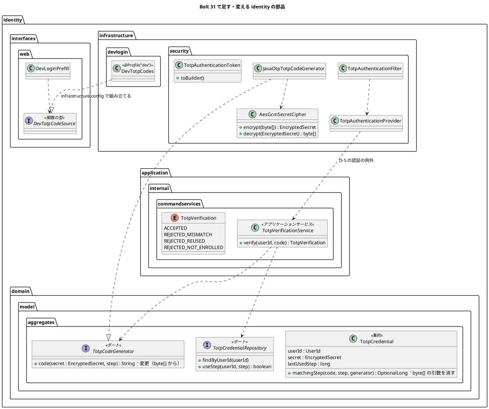
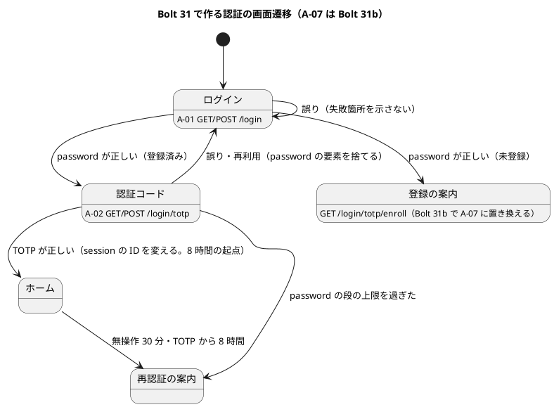

# Bolt 31 計画 - TOTP の秘密の暗号化と 2 段階のログイン（A-02）

## 基本情報

| 項目 | 内容 |
| :--- | :--- |
| Bolt | 第 31 回（W5 の 5 本目。US-18 の残りの 2 本目） |
| 予定 | W5（2026-11-02 の週。前倒しで着手できる）。作業は約 4 時間 25 分（承認ゲートの待ち時間を除く。「時間の配分と打ち切り」） |
| 対象 | `identity`（秘密の暗号化、TOTP を確かめるアプリケーションのサービス、Spring Security の 2 段階化、A-02、監査の分け方、dev の入力済み）、層の規則（D-5）、画面の層のテストのログインの手順、ADR-011・ADR-012、ドメインモデル・UI 設計・データモデル・非機能要件・アーキテクチャ・技術スタック、リリース計画 |
| SP | 0（US-18 AC1 の TOTP の部分。US-18 の SP 6 は #13 をクローズする Bolt 33b で数える。リリース計画の Bolt 31 の SP 2 は、AC7 を作る Bolt 31b に移す） |
| GitHub | [#13](https://github.com/k2works/practical-domain-driven-design-in-enterpris-application/issues/13)（US-18、R1.0）。この Bolt では閉じない |
| 承認ゲート | **ステップごとに止める**（W4 の締めの決定: 認証の完成はステップごと）。確認必須（セキュリティ、認可、構造（層の規則）、データベース（dev-data））は計画の承認の場で確認ポイントとして判断を受け、そのうえで各ステップの終わりに止める |
| 承認ゲートの扱い | 2026-10-13 に human:kakimomokuri が計画を承認した（確認ポイント 1〜13 は推奨のとおり）。あわせて人の指示（`/goal Bolt31`）により、ステップの承認ゲートで止まらずに進める。止まらなかったゲートごとに根拠を書き、終了報告の承認の議題に置く（T-36） |
| アプローチ | インサイドアウト（開発戦略の中盤）。暗号化とアプリケーションのサービスを内側から固め、認証の流れはセキュリティの統合テストで外側から確かめる |
| 前の Bolt | [Bolt 30 終了報告](bolt_30_report.md)、[Bolt 14 終了報告](bolt_14_report.md)、[Bolt 13 終了報告](bolt_13_report.md) |

## Bolt ゴール

password が正しい利用者に A-02（認証コード）を求め、TOTP が通ってはじめて業務の画面を開けるようにする。最長 8 時間は TOTP が初めて通った時刻から数える（US-18 AC1・AC5、ADR-011）。TOTP の秘密は表に暗号文で置き、復号から消去までをインフラ層の中で済ませる（SEC-16、Bolt 30 の議題 2 の②）。開発環境と画面の層のテストも 2 段階のログインを通す（TOTP を飛ばさない）。初回の登録（A-07）・回復コード・特性テスト・引数の解決は Bolt 31b で作る。

### 確かめたい仮説

| # | 仮説 | この Bolt で分かること |
| :--- | :--- | :--- |
| H1 | スパイク（`spikes/ts-01-totp/`）の構成（`@EnableMultiFactorAuthentication`、`toBuilder()` を宣言した独自のトークン、`mfaEnabled` のフィルター）を本体の Spring Session JDBC の上に移しても、要素の権限が直列化を通って次の request に残り、TOTP の段で session の ID が変わる | セキュリティの統合テスト（PostgreSQL の Testcontainers）で、2 つの要素がそろうまで業務の画面を開けないこと、TOTP の段の前後で session の ID が違うこと |
| H2 | `TotpCodeGenerator` が `EncryptedSecret` を受ける形にすれば、平文の秘密がドメインとアプリケーションの層に出ない。dev の入力済みは利用者の表の秘密を復号せずに作れる（ADR-011 の dev の 3 層目） | ArchUnit（暗号化の部品と `javax.crypto` を参照するのが `identity.infrastructure` だけ）と、dev のコードの部品が利用者の表を読まないこと |

## ふりかえりと前の Bolt からの引き継ぎ

| 入力 | 内容 | この Bolt での扱い |
| :--- | :--- | :--- |
| 開始準備の決定（2026-10-13、human:kakimomokuri） | 31 と 31b に分ける。暗号化は AES-GCM（新しい依存を足さず、JDK の `Cipher` で組む。確認ポイント 1）で、鍵は環境変数、暗号文に鍵の版の接頭辞を付ける。K-02 は受け入れてロックと監査記録で抑える。`TotpCodeGenerator` は `EncryptedSecret` を受ける | 本計画の範囲と、確認ポイント 1〜4 |
| 整合性検証の指摘への回答（2026-10-13、human:kakimomokuri） | D-5 に認証の例外を足す。dev のコードは dev 専用の部品を関数の型で注入する。画面の層のテストは刻みを戻す。特性テストと引数の解決（ADR-012 の見直しの 4）は 31b に送る | 確認ポイント 5〜8 |
| Bolt 30 の議題 2 | ①回復コードの発行し直しの同時実行、②`TotpCodeGenerator` の平文の受け渡し、③最初の失敗の主キーの競合、④未使用の回復コードの並び順 | ②はこの Bolt のステップ 2。①④は回復コードを発行する Bolt 31b、③は Bolt 32 |
| Bolt 30 の Try T-99 | 同じ規則をドメインと SQL の 2 か所に書くときは、境界値のテストを契約テストに置き、両方の実装で動かす | この Bolt は SQL に新しい規則を足さない。刻みの使用（`useStep`）の境界は Bolt 30 の契約テストにある。最長 8 時間と password の段の上限の境界は統合テストに置く |
| Bolt 30 の Try T-100 | 同時の更新のテストは、先のトランザクションのコミットを止め、後の操作が待っていることを確かめてから放す | 同じコードの同時の送信（1 つだけ通る）の統合テスト（ステップ 3） |
| W4 の Try T-83・T-88・T-89・T-90 | 骨組みのまま流して本命のアサーションで落とす（最初から通るテストは「見張り」と書く）。後に回したものは Issue にする。画面を作る Bolt の開発レビューに、マニュアルを書く立場の観点を入れる | 全ステップ。A-02 を作るので、ステップ 7 の開発レビューにテクニカルライターの観点を入れる（T-90）。T-89 から外れる扱いは確認ポイント 12 |
| Bolt 13 の Try T-40 | 権限が上がる段ごとに、session の ID の変化と期限の確認の順をテストで確かめる | ステップ 4（TOTP の段の ID の変化、期限切れの session に TOTP を送っても延びない） |
| Bolt 13・14 からの持ち込み | K-02、S-01、S-02、R-08（Bolt 13 のレビュー）、AC7 の画面の認可、特性テスト（R-16）、スパイクの削除 | K-02・S-01・R-08 はこの Bolt（確認ポイント 3・9・10）。特性テストと AC7 の画面の認可は Bolt 31b、S-02 は Bolt 32、スパイクの削除は Bolt 31b の後（確認ポイント 12） |
| ADR-012 の「W5 で見直すこと」 | 1 成功のイベントの分け方、2 `hasRole` と要素の権限、3 request ごとの DB の問い合わせを 1 回に、4 引数の解決で TOTP まで済んでいない主体を渡さない、5 ロックの数え方 | 1・2 はこの Bolt（ステップ 5）。4 は Bolt 31b、3 は request ごとの役割の確認（AC6）と同じ仕組みなので Bolt 32、5 は Bolt 32（確認ポイント 8） |
| 番号のずれ（開始準備で見つけた） | `release_plan.md` の Bolt 31 の行は TOTP の登録を「A-05」と書くが、UI 設計の A-05 は password の再設定の依頼で、登録は A-07 | ステップ 1 で直す |

## スコープ

### 設計の約束（Try T-1）

- 平文の TOTP の秘密は、`identity.infrastructure` の中だけで扱い、使い終えたら配列を消す。ドメインとアプリケーションの層には `EncryptedSecret` だけを渡す。31b の A-07 で画面に出す `otpauth://` の URI と手入力の Base32 は、`identity.infrastructure` で作った表示用の値として渡す（31b で、この約束の例外として書く）
- 暗号文は `v1:` の形で鍵の版を先頭に持つ。知らない版・壊れた暗号文は失敗へ倒す（受け付けない。T-42）
- 2 つの要素（`FACTOR_PASSWORD`・`FACTOR_TOTP`）は、全体の注釈（`@EnableMultiFactorAuthentication`）で、認証が要るすべての URL に求める。password の要素だけで入れるのは、A-02（`/login/totp`）と登録の案内（`/login/totp/enroll`）だけ。ほかのコンテキストは `FACTOR_*` を参照しない（ArchUnit。ADR-011 のコンプライアンス）
- 最長 8 時間の起点（`AUTHENTICATED_AT`）は、その session で初めて TOTP が通った時刻にする。password の段だけの session は、password を確かめた時刻（`PASSWORD_VERIFIED_AT`）から短い上限で失効させる（確認ポイント 4）。どちらの時刻もない認証済みの session は、今と同じく失効させる（fail-closed）。期限の確認は 2 つの要素の認証より前に置く（ADR-011）
- dev の入力済みは、`dev` の設定に書いた開発用の固定の秘密だけからコードを作り、利用者の表の秘密は復号しない（ADR-011 の dev の 3 層目）。controller は生成器や秘密を直接参照しない（1 層目）。TOTP を飛ばす経路は作らない

### 入れるもの・入れないもの

| 入れる | 入れない（後で） |
| :--- | :--- |
| 秘密の暗号化（AES-GCM、鍵の版、鍵のプロパティ）と、`TotpCodeGenerator` のシグネチャの変更 | A-07 の初回の登録、QR、秘密の生成と `otpauth://` の URI、回復コードの発行（Bolt 31b） |
| TOTP を確かめるアプリケーションのサービスと、層の規則 D-5 の認証の例外 | 回復コードによるログイン（A-02 の回復コードの欄。Bolt 31b で発行とあわせて作る。回復コードによる再登録は Bolt 33b） |
| 2 段階のログイン（`/login/totp`、A-02）、登録の案内（31b で A-07 に置き換える）、8 時間の起点の移動と password の段の上限 | ロックの判定と表示（Bolt 32）、送信元ごとの流量の制限（S-02。Bolt 32） |
| ADR-012 の見直しの 1・2。TOTP の失敗の監査（利用者と理由） | ADR-012 の見直しの 4（引数の解決と `@WithAuthenticatedActor`。Bolt 31b）、3（request ごとの問い合わせを 1 回に。Bolt 32） |
| セキュリティの統合テストの 2 段階化、`FACTOR_*` と暗号化の ArchUnit、画面の層のログインの手順 | 枠組みの振る舞いの特性テスト（R-16。Bolt 31b） |
| dev の利用者の TOTP の資格（dev-data）と A-02 の入力済み | session の失効の警告と入力の保持（Bolt 32b）、password の再設定（Bolt 33） |
| — | ユーザーマニュアルの「2 章 ログインと共通の画面」とキャプチャ（Bolt 33b でまとめて直す。W5 の節の決定） |

## 設計（この Bolt の範囲）

### ドメインモデル

| 部品 | 責務 | 出典 |
| :--- | :--- | :--- |
| `TotpVerificationService` | 利用者の TOTP の資格を引き、前後 1 つの刻みで照合し（`TotpCredential#matchingStep`）、一致した刻みを条件付きの更新で使う（`useStep` の件数が 0 なら再利用）。結果は `TotpVerification`（同じパッケージの enum）で返す。利用者に示す文言は拒否の種類によらず 1 つにし、種類は監査記録の理由にだけ残す（AC2）。時刻は `Clock` から刻みに直す | ADR-011、IA-INV-10 |
| `AesGcmSecretCipher` | 鍵の版ごとの鍵で AES-GCM（256 ビットの鍵、96 ビットの IV を毎回乱数で作る。spring-security-crypto の `Encryptors` の既定の IV は 16 バイトなので、JDK の `Cipher` で組み、鍵の扱いだけ揃える）。暗号文は `v1:` と Base64。知らない版・タグの不一致は例外 | SEC-16、確認ポイント 1 |
| TOTP の認証の部品 | スパイクの `TotpAuthenticationFilter`・`TotpAuthenticationToken`（`toBuilder()` を宣言）・`TotpAuthenticationProvider` を本体の置き場所に移す。provider はアプリケーションのサービスを呼び、結果を認証の成否に直すだけにする | ADR-011 |
| `DevTotpCodes`・`DevTotpCodeSource` | `DevTotpCodeSource` は `identity.interfaces.web` に置く関数の型（利用者のメールアドレスからその時点のコードを返す。dev の利用者でなければ空）。`DevTotpCodes` は `identity.infrastructure.devlogin` に `@Profile("dev")` で置き、`cargotracker.dev-login.accounts[n].totp-secret`（Base32）だけからコードを作る（利用者の表を読まない）。組み立ては `identity.infrastructure.config` | ADR-011 の dev の 1・3 層目、確認ポイント 6 |

置き場所: アプリケーションのサービスは `identity.application.internal.commandservices`（前例は `quotation`・`booking` の `application.internal.commandservices`。リリース計画の Bolt 34 の行の予定とも同じ置き場所）。`identity` には初めての `commandservices` なので、`package-info.java` を置き、`@Service` と `IdentityConfiguration` の組み立てを合わせる（architecture_backend.md:272-274）。Spring Security の部品と暗号化は `identity.infrastructure.security`（前例 `JavaOtpTotpCodeGenerator`・`BcryptRecoveryCodeHasher`）。

状態遷移: 認証の段は「未認証 → password 済み（`FACTOR_PASSWORD`）→ 2 つの要素（`FACTOR_PASSWORD`・`FACTOR_TOTP`）」で、session の中の権限で決まる。ドメインの状態は増えない（図は省く）。

### データモデル

表は変えない（Bolt 30 の `totp_credential` を使う）ので、ER 図は省く。`secret_encrypted VARCHAR(500)` に `v1:` と Base64（IV 12 バイト + 秘密 20 バイト + タグ 16 バイト = 48 バイト → 64 文字）が入る。

- dev-data（`db/dev-data/V20261013xxxx00__seed_dev_totp_credentials.sql`。版は作成した日の時刻で、`V20261011083300` より後）に、開発用の利用者 5 人の TOTP の資格を足す。暗号文は dev の固定の鍵で、設定の `totp-secret` を暗号化した値。利用者ごとに別の秘密にする（ADR-011 の dev の 4 層目）。マイグレーションの追加なので、ステップ 6 の承認ゲートで確かめる
- 監査記録の `action` に `PASSWORD_VERIFIED` を足し、`LOGIN_SUCCEEDED` の意味を「2 つの要素がそろった」に変える。`reason` に `INVALID_TOTP`・`TOTP_REUSED` を足す（列に CHECK 制約はないので、マイグレーションは要らない。data_model.md:925 の一覧を直す）
- data_model.md の 909 行目（暗号化の方式と鍵は Bolt 31）を、決めた方式に改める

### 画面遷移

- A-02 は 6 桁の数字の欄（`autocomplete="one-time-code"`、`inputmode="numeric"`）と「確認」。`factor.reason` に応じた案内は出さない（A-02 に来る理由は password の後だけなので、案内を変える場面がない。確認ポイント 11）
- TOTP の誤り・再利用は、UI 設計の遷移（ui_design.md:253「認証コード --> ログイン」）のとおり、password の要素を捨てて A-01 に戻し、「認証コードが正しくありません。もう一度ログインしてください。」を示す（確認ポイント 11）。失敗を数えるのは Bolt 32
- 未登録の利用者は、31b までは登録の案内（「認証アプリの登録の画面は準備中です。システム管理者にお問い合わせください。」。業務の画面は開けない）に送る。ステージング・本番の利用者はまだいない（利用者の管理は Bolt 34）ので、業務への影響はない
- A-01 の dev の利用者ごとのボタンは、password の段の後に A-02 を入力済みで出す（「確認」を押す 1 回が増える）。同じ利用者が 30 秒以内に入り直すと、同じコードの再利用として拒否される（UI 設計の dev の節とデモの注意に書く）
- A-03 の文言の「ログインから 8 時間」の起点は TOTP が通った時刻になる（文言は変えず、UI 設計の説明を直す）
- ユーザーマニュアルは Bolt 33b でまとめて直す（W5 の節の決定）

## ステップ計画

状態の記号: `[ ]` 未着手、`[-]` 進行中、`[?]` 承認待ち、`[x]` 完了。各ステップの終わりに `check` が緑であることと、計画からの変更を設計文書に反映したこと（T-53）を確かめ、push して CI を確かめる（T-26、T-65）。そのステップのファイルだけをステージする（T-84）。依存の取得は最初から `--max-workers=1` と再試行で流す（T-93）。

- [x] **1. 設計文書** 【承認ゲート: 設計文書】
  - ADR-011: 開始準備の決定（K-02 を受け入れる理由とロック・監査記録で抑えること、暗号化の方式と鍵の版、`TotpCodeGenerator` の形、dev のコードの部品の置き方）と、R-08 の比較の結果（確認ポイント 10）を書く。`SecurityFilterChain` の置き場所（`identity.infrastructure.config`。115 行目の「W5 で決める」）を決定にする。「未確認の項目」のうち、この Bolt で解くもの（鍵の管理、Base32 の出どころ、Spring Session JDBC の上での直列化）を移す。28 行目のスパイクの削除の時期を「Bolt 31b の後」に直す
  - ADR-012: 「W5 で見直すこと」の 1・2 をこの Bolt、4 を 31b、3 を Bolt 32 と書く。D-5 の認証の例外（確認ポイント 5）を決定に足す（Bolt 32 のロックの数え方も同じ形）
  - domain_model.md: 182 行目の `TotpCodeGenerator` の定義（暗号文と時間の刻みから）、957 行目の役割の分け方（照合と刻みの使用はアプリケーションのサービス）、959 行目の監査の操作（`PASSWORD_VERIFIED`）、IA-INV-03（982 行目）の「発行後 8 時間」を「TOTP が初めて通った時刻から 8 時間」に。用語集に `TotpVerificationService` を足す（`LivingGlossaryConsistencyTest`）
  - ui_design.md: 画面と URL の表に A-02（`GET/POST /login/totp`）と登録の案内（`GET /login/totp/enroll`）の行、A-02 の節と salt の画面イメージ、遷移図（誤りで A-01 へ戻る、password の段の上限で A-03）、A-03 の 8 時間の起点（181・255 行目）、dev の節（481 行目）の A-02 の入力済みと 30 秒以内の入り直し
  - data_model.md（909 行目の暗号化、925 行目の `action`・`reason` の一覧）、non_functional.md の SEC-03（148 行目。8 時間の起点）と SEC-16（方式と鍵の版、鍵は環境変数で本番は Secrets Manager から注入）、tech_stack.md（53 行目の QR を Bolt 31b に、暗号化に JDK の `Cipher` を使うこと）、architecture_backend.md（274 行目付近に D-5 の認証の例外）
  - release_plan.md の W5 の節: Bolt の分け方の表で 31 を 31 と 31b に分け（SP 2 は 31b）、31 の「A-05」を「A-07」に直す。31b に回復コードによるログイン、33b に回復コードによる再登録と分担を書く。ADR-012 の 3 を Bolt 32 の行に移し、Bolt 32 の行に「開始準備で 32 を分けるかを見直す」を足す。32b の行に「8 時間の起点は TOTP の時刻（Bolt 31）」を足す。Bolt 13・14 からの持ち込みの表で、AC7 の認可と特性テストを 31b、スパイクの削除を「31b の後」に直す
  - 完了の判定: `okf:check` ERROR 0、`documentationTest` 緑
- [x] **2. 秘密の暗号化と生成のポートの変更** 【承認ゲート: Red・Green】
  - Red: `AesGcmSecretCipher` の単体テスト（往復で一致、同じ平文でも暗号文が毎回違う、`v1:` が付く、知らない版・タグの改ざん・Base64 の誤りで例外、鍵が 32 バイトでなければ起動で失敗）。鍵のプロパティが環境変数 `CARGOTRACKER_TOTPSECRETKEYS_V1` から結び付くことの起動のテスト。`TotpCodeGenerator` の契約テスト（RFC 6238 の試験ベクトル）を `EncryptedSecret` を受ける形に直して落とす
  - Green: `identity.infrastructure.security` に `AesGcmSecretCipher` と鍵のプロパティ（`cargotracker.totp-secret-keys.v1`、Base64。既存の `cargotracker.dev-login`・`document-storage` と同じく、コンテキストの段を入れない。`@ConfigurationProperties` で起動時に確かめる）。`TotpCodeGenerator#code(EncryptedSecret, long)` に変え、`JavaOtpTotpCodeGenerator` の中で復号 → 生成 → 配列を消す。`TotpCredential#matchingStep` から `byte[] secret` の引数を消し、自分の `secret` を生成器に渡す
  - ArchUnit: `AesGcmSecretCipher` と `javax.crypto` を参照するのが `identity.infrastructure` だけであること（違反を入れて落ちることも確かめる）
  - 完了の判定: `check` 緑
- [x] **3. TOTP を確かめるアプリケーションのサービスと D-5 の例外** 【承認ゲート: Red・Green、構造（層の規則）】
  - Red: 単体テスト（メモリのリポジトリと偽の生成器）。今の刻み・前後 1 つの刻みは通る、2 つ離れた刻みは拒む、同じ刻みの 2 回目は再利用として拒む、資格がない利用者は拒む（T-42）、通った刻みが記録される。PostgreSQL の統合テストで、同じコードの同時の 2 つの確かめのうち 1 つだけが通ること（T-100）
  - Green: `identity.application.internal.commandservices`（`package-info.java`）に `TotpVerificationService` と `TotpVerification`。`IdentityConfiguration` で組み立てる
  - 層の規則: `LayerArchitectureTest` の D-5 に「`identity.infrastructure.security` は `identity.application.internal.commandservices` を参照してよい」の狭い例外を足す（サガの例外と同じ書き方。理由を `because` に書く）。例外の外（例: `infrastructure.persistence` から `commandservices`）は落ちることを、違反を入れて確かめる
  - 完了の判定: `check` 緑、AT-02（D-5 を含む）が通る
- [x] **4. Spring Security の 2 段階化と A-02** 【承認ゲート: セキュリティ・認可】
  - Red: セキュリティの統合テスト（`AuthenticationSecurityIntegrationTest` の前例。PostgreSQL の Testcontainers と `MutableClock`）に次を書いて落とす
    - password だけでは業務の画面（`/customer/**`・`/staff/**`・`/`）を開けず A-02 に導かれる。TOTP が通ると元の URL か役割のホームへ行く
    - TOTP の段で session の ID が変わる（T-40）。A-02 の POST に CSRF のトークンが要る（S-01）
    - password の段を経ずに `/login/totp` へ POST しても通らない。別の利用者の password の後に先の利用者の TOTP の要素が引き継がれない
    - TOTP の誤り・再利用で A-01 に戻り、password の要素が残らない。未登録の利用者は登録の案内に行き、業務の画面を開けない
    - 8 時間: 7 時間 59 分 59 秒は使える・8 時間で A-03、起点が TOTP の時刻であること（password の時刻ではない）、期限切れの session に TOTP を送っても延びない（ADR-011。T-40）
    - password の段の上限: 上限の直前は A-02 を送れる・上限で A-03。2 つの要素がそろって `AUTHENTICATED_AT` がない session は失効する（fail-closed を保つ）
    - 配備の前の形の session の行を置いて request すると、A-03 に送られる（確認ポイント 4）
  - Green: `SecurityConfiguration` に `@EnableMultiFactorAuthentication(authorities = {FACTOR_PASSWORD, FACTOR_TOTP})`、`DelegatingMissingAuthorityAccessDeniedHandler`（`FACTOR_TOTP` が足りなければ `/login/totp`）、`/login/totp` と `/login/totp/enroll` は `FACTOR_PASSWORD` だけで入れる規則、TOTP のフィルター（`HttpSessionSecurityContextRepository`、`http.getSharedObject(SessionAuthenticationStrategy.class)` で formLogin と同じ ID の変更と CSRF）、`TotpAuthenticationToken`（`toBuilder()`）・`TotpAuthenticationProvider`。`LoginController` に A-02（`identity/login-totp.html`）と登録の案内。`LoginSuccessHandler` は password の段で `PASSWORD_VERIFIED_AT` を置き、TOTP の段の成功（初めて通ったときだけ）で `AUTHENTICATED_AT` を置く。`SessionLifetimeFilter` は要素の数で上限を選ぶ
  - 完了の判定: `check` 緑（既存のセキュリティの統合テストは、ステップ 6 でログインの手順を 2 段階にするまで、password の段の後に TOTP の段を送る補助を足して通す）
- [x] **5. ADR-012 の見直しの 1・2 と TOTP の失敗の監査** 【承認ゲート: セキュリティ・認可】
  - 1: 監査の操作を `PASSWORD_VERIFIED`（password の段の成功）と `LOGIN_SUCCEEDED`（2 つの要素がそろった）に分ける。`AuthenticationAuditListener` で要素の権限を見て分け、`AuditAction` に足す
  - TOTP の失敗: 今のリスナーは失敗の主体を `String.valueOf(principal)` のメールアドレスとして引くので、TOTP の失敗（主体は `CargoUserDetails`）が `UNKNOWN_USER` と記録される。TOTP の失敗は利用者と理由（`INVALID_TOTP`・`TOTP_REUSED`）で記録する。`AuthenticationRejection` に足す。Bolt 32 のロックはこの記録を前提にする
  - 成功・失敗の記録が同じ transaction で書かれること（IA-INV-08）を統合テストで確かめる
  - 2: 認可の条件（`hasRole`）は、全体の注釈で要素を求めるので、URL ごとの規則は役割だけのままにする。要素の欠けた主体で業務の URL を開けないことを全 URL で確かめる（ステップ 4 の後では最初から通るので「見張り」と書く。T-88）
  - 完了の判定: `check` 緑
- [x] **6. 画面の層のログインの手順と dev の入力済み** 【承認ゲート: セキュリティ、データベース（dev-data）】
  - ArchUnit: ほかのコンテキストが `FACTOR_*`（`FactorGrantedAuthority`）を参照しない
  - 画面の層: `BrowserSession.signInAs` の待ちを「`/login` を離れた」から「A-02 を経て業務の画面に着いた」に直す（`/login/totp` も "/login" を含むので、今の待ちは 2 段目で終わらない）。`UiUsers` で TOTP の資格を作り、テストの固定の秘密から A-02 のコードを作って入れる。ログインの前に、テストの準備として `totp_credential` の `last_used_step` を戻す（同じ利用者の 30 秒以内の入り直しで再利用として拒否されないため。確認ポイント 7）。`login_ui.feature`（`@US-18`）に 2 段階のシナリオ（誤りのコードで A-01 に戻る）を足す
  - dev の入力済み: `DevLoginProperties.Account` と `DevLoginPrefill.Account` に `totpSecret` を足し、`cargotracker.dev-login.accounts[n].totp-secret`（Base32。利用者ごとに別）を `application-dev.properties` に置く。`DevTotpCodes`・`DevTotpCodeSource`（上の表）を作り、`DevLoginPrefill` が A-02 にその時点のコードを入れる。Base32 の復号は `identity.infrastructure` に自分で書き、RFC 4648 の試験ベクトルで確かめる（確認ポイント 6）
  - dev-data に TOTP の資格を足す。dev-data の暗号文を dev の鍵で復号すると設定の `totp-secret` と一致すること、利用者ごとに秘密が違うことをテストにする（ADR-011 の dev の 4 層目）。既定・staging・prod の設定で A-02 が入力済みにならないこと、dev-login の設定が `dev` の外にあると起動しないこと（既存）を確かめる
  - 完了の判定: `check` と `uiTest` が緑。H2 の `bootRun`（dev）で A-01 → A-02 → ホームを手で通す
- [x] **7. 開発レビューと終了報告** 【承認ゲート: 終了報告】
  - 開発レビュー（`developing-review`。プログラマー（フィルターの構成、暗号化、窓の 3 つの刻みごとに復号が 3 回になること）、アーキテクト（置き場所、D-5 の例外、ArchUnit、ADR との整合）、テスター（セキュリティの境界値）、テクニカルライター（A-02 と登録の案内の文言。T-90））
  - SonarQube（`sonar-local:check`。手順書の 9 節）
  - `bolt_31_report.md`。release_plan の W5 の 31 の行と進捗、開発の索引を更新する。#13 に進み具合をコメントする

### 時間の配分と打ち切り

| # | 目安 | 打ち切り |
| :--- | :--- | :--- |
| 1 | 30 分 | — |
| 2 | 35 分 | — |
| 3 | 40 分 | 同時の確かめのテストが不安定なら、1 つの確かめの更新の件数（0 か 1）の確かめに置き換え、並行のテストは後に回して人に諮る |
| 4 | 55 分 | Spring Session JDBC の上で要素の権限が復元できず 20 分を超えたら、止めて人に諮る（確認ポイント 4） |
| 5 | 25 分 | — |
| 6 | 40 分 | 画面の層のテストの直しが 30 分を超えたら、止めて人に諮る（dev の入力済みを Bolt 31b に送る案） |
| 7 | 40 分（SonarQube の待ちを除く） | — |

合計 265 分（約 4 時間 25 分）。開始準備で、特性テスト（R-16）と ADR-012 の見直しの 4 を Bolt 31b に送って半日に収めた（確認ポイント 8）。合計で 4.5 時間を超えると見えたら、止めて人に諮る。

## 確認ポイント（計画の承認の場でまとめて確認する。Try T-6）

| # | 確認すること | ステップ | 推奨 |
| :--- | :--- | :--- | :--- |
| 1 | **暗号化の方式と鍵**（開始準備で決めた。セキュリティ） | 1・2 | AES-GCM（新しい依存なし。JDK の `Cipher` で 96 ビットの IV）。鍵は 256 ビットを Base64 で環境変数 `CARGOTRACKER_TOTPSECRETKEYS_V1`（プロパティ `cargotracker.totp-secret-keys.v1`）から渡し、本番は Secrets Manager から注入する（W10 の IaC）。暗号文は `v1:<Base64>`。鍵を替えるときは `v2` を足し、読むときは接頭辞の版の鍵で復号し、書くときは最新の版で暗号化する（入れ替えの手順は W10 の運用手順書）。dev とテストは固定の鍵（本物の秘密ではない）。鍵がない・長さが違うと起動で失敗する |
| 2 | **`TotpCodeGenerator` の形**（開始準備で決めた。Bolt 30 の議題 2 の②） | 2 | `code(EncryptedSecret, long step)` に変える。復号から消去までを `JavaOtpTotpCodeGenerator` の中で済ませ、平文の秘密をドメインとアプリケーションの層に出さない |
| 3 | **K-02**（開始準備で決めた） | 1・4 | 受け入れる。password が正しいときだけ A-02 に進める（一般的な 2 段階のログインの形）。推測はロック（Bolt 32、5 回・15 分）と監査記録で抑え、判断を ADR-011 に書く。ロックの表示の文言は Bolt 32 |
| 4 | **password の段の上限と、Spring Session JDBC の上の直列化**（セキュリティ） | 4 | password の段だけの session は、`PASSWORD_VERIFIED_AT` から 5 分で失効させ A-03 に送る（A-02 を開いたまま放置した session を残さない。無操作 30 分より短くする）。2 つの要素がそろったら `AUTHENTICATED_AT` から 8 時間。要素の権限を足すと配備の前の session は復元できないので、復元の失敗を無効な session として扱い A-03 に送る。デモ環境では配備のときにログインし直してもらう |
| 5 | **層の規則 D-5 の認証の例外**（整合性検証の指摘への回答で決めた。構造） | 1・3 | `identity.infrastructure.security` から `identity.application.internal.commandservices` だけを参照してよい狭い例外を、サガの例外と同じ書き方で ArchUnit・architecture_backend.md・ADR-012 に足す。Spring Security の provider と listener は認証の入口で、業務の判断はアプリケーションのサービスに置く。Bolt 32 のロックの数え方（ADR-012 の見直しの 5）も同じ形 |
| 6 | **dev のコードの部品**（整合性検証の指摘への回答で決めた）と Base32 の出どころ（ADR-011 の未確認） | 6 | `identity.infrastructure.devlogin` に `@Profile("dev")` の `DevTotpCodes`、`identity.interfaces.web` に関数の型 `DevTotpCodeSource`、組み立ては `infrastructure.config`。集約でないドメインのポートは足さない（Bolt 30 の既知の課題「ポートが増えたら ADR」に当たらない）。Base32 は `identity.infrastructure` に自分で書き（RFC 4648、30 行ほど）、RFC 4648 の試験ベクトルで確かめる。`commons-codec` は今の実行時の依存にない（開始準備で `runtimeClasspath` を見た）。Bolt 31b の `otpauth://` の URI でも使う |
| 7 | **画面の層のテストの再利用の扱い**（整合性検証の指摘への回答で決めた） | 6 | `UiUsers` がログインの前に、テストの準備として `last_used_step` を戻す（待ちのない決定的な形）。本体の再利用の拒否は変えない。dev では 30 秒以内の入り直しは拒否されることを UI 設計とデモの注意に書く |
| 8 | **31b に送るもの**（整合性検証の指摘への回答で決めた）と ADR-012 の見直しの 3 を Bolt 32 に送ること | 1 | 特性テスト（R-16）と ADR-012 の見直しの 4（引数の解決と `@WithAuthenticatedActor`）を 31b に送り、この Bolt を約 4 時間 25 分にする。31b の間、引数の解決は今の形（要素を見ない）だが、全体の注釈で業務の URL に 2 つの要素を求めるので、要素の欠けた主体は controller に届かない。見直しの 3 は request ごとの DB の確かめ（AC6）を入れる Bolt 32 で、主体を作り直す形とあわせて作る。Bolt 32 は範囲が重いので、開始準備で分けるかを見直す |
| 9 | **S-01**（CSRF と `same-site=lax`） | 4 | 今の設定（`same-site=lax`、Spring Security の CSRF のトークン）を保つ。A-02 の POST にもトークンが要ることを統合テストで確かめる。lax は外のサイトからの POST に cookie を付けないので、トークンと二重に守る |
| 10 | **R-08**（Bolt 13 のレビュー。全体の注釈と URL ごとの要素） | 1・4 | 全体の注釈を採る。password の要素だけで入れる例外は、この Bolt の A-02（`/login/totp`）と登録の案内（`/login/totp/enroll`）、31b の A-07（同じ URL）、33 の A-06 に限り、`requestMatchers` に足す。新しい URL を足したときに要素の要求が漏れない（既定で 2 つを求める）ほうが安全。比較を ADR-011 に書く |
| 11 | A-02 の誤りの行き先と案内 | 1・4 | UI 設計のとおり、誤り・再利用は password の要素を捨てて A-01 に戻す（「認証コードが正しくありません。もう一度ログインしてください。」）。password を知った者が 1 つの session で TOTP を試し続けられない。`factor.reason` に応じた案内は出さない |
| 12 | 後の Bolt に送るものと T-89、スパイクの削除 | — | 議題 2 の①④・QR の描き方（ZXing のインラインの SVG なら CSP を変えずに済む）・AC7 の画面の認可・特性テスト・ADR-012 の見直しの 4 は Bolt 31b、議題 2 の③・S-02・ADR-012 の見直しの 3・5 は Bolt 32。どれも #13 の中の作業で、W5 の節の Bolt の分け方の表で追うので、T-89（後に回したものは Issue にする）から外れて Issue にしない。スパイクは Bolt 31b の後に消す（本体に登録と回復コードがそろってから。消すときにもう一度確かめる） |
| 13 | 承認ゲート | 全体 | ステップごとに止める（W4 の締めの決定）。ステップ 3 は構造（層の規則）、4・5 はセキュリティと認可、6 はデータベース（dev-data）の確認必須 |

## 完了条件

- [ ] password が正しくても TOTP が通るまで業務の画面を開けず、TOTP が通ると元の URL か役割のホームへ行く（全 URL）
- [ ] TOTP の段で session の ID が変わり、最長 8 時間を TOTP が初めて通った時刻から数え、期限切れの session に TOTP を送っても延びない。password の段だけの session は 5 分で失効する
- [ ] 同じコードの再利用と同時の送信のうち 1 つだけが通る
- [ ] TOTP の秘密が `v1:` の暗号文で表にあり、平文の秘密は `identity.infrastructure` の外に出ない（ArchUnit）
- [ ] D-5 の認証の例外が狭く書かれ、例外の外の違反は落ちる
- [ ] 監査記録が「password を確かめた」と「ログインした」に分かれ、TOTP の失敗が利用者と理由で記録される
- [ ] dev で A-01 → A-02 → ホームを入力済みで通れ、既定の設定では入力済みにならない。dev-data の暗号文と設定の秘密が一致する
- [ ] `FACTOR_*` の ArchUnit がある
- [ ] `check` と `uiTest` が緑。push して CI を確かめた。SonarQube の Quality Gate が PASS、`okf:check` ERROR 0
- [ ] 開発レビューと終了報告。#13 に進み具合をコメントした

### デモ項目

- dev（H2 の `bootRun`）で、営業担当者のボタン → A-02（入力済み）→ 「確認」→ S-02。誤りのコードで A-01 に戻ること
- 画面の層のシナリオ（`login_ui.feature` の 2 段階）の動画

## 更新履歴

| 日付 | 更新内容 | 更新者 |
| :--- | :--- | :--- |
| 2026-10-13 | 初版作成（承認待ち）。開始準備で、ADR-011・ADR-012・今の `identity` のコードとテスト・スパイク・Bolt 13・14・30 からの持ち込みを調べ、human:kakimomokuri の決定（31 と 31b に分ける、AES-GCM と環境変数の鍵と版の接頭辞、K-02 を受け入れる、`TotpCodeGenerator` は `EncryptedSecret` を受ける）を反映した | anthropic/claude-opus-5-5 |
| 2026-10-13 | 詳細整合性検証と横断整合性検証の指摘を反映した。human:kakimomokuri の回答（D-5 に認証の例外を足す、dev のコードは dev 専用の部品を関数の型で注入する、画面の層のテストは刻みを戻す、特性テストと ADR-012 の見直しの 4 を 31b に送る）を確認ポイント 5〜8 にした。password の段の上限（fail-closed との両立）、A-02 と登録の案内の認可の例外、環境変数の名前、TOTP の失敗の監査と理由、A-02 の誤りの行き先を UI 設計に合わせる、設計文書の直し（domain_model.md・SEC-03・data_model.md:925・ui_design.md の A-02・ADR-011 の `SecurityFilterChain`・release_plan の持ち込みの表と 31b・32・32b・33b の行）、dev の秘密の一致のテスト、T-89 から外れる扱い、AT-02 の番号、前例の置き場所を直した | anthropic/claude-opus-5-5 |
| 2026-10-13 | 計画の承認を記録した。確認ポイント 1〜13 は推奨のとおり。`/goal Bolt31` により、ステップの承認ゲートで止まらずに進める（T-36） | anthropic/claude-opus-5-5、承認 human:kakimomokuri |
| 2026-10-13 | ステップ 1〜7 を終えた（`/goal Bolt31`）。計画から変えたこと: 成功の監査の分け方をステップ 5 から 4 に前倒しした（2 段階にすると password の段でも成功のイベントが出るため）。配備の前の session は、復元の失敗の変換ではなく、password の段の時刻がないので期限の判定で A-03 に送る形にした（復元は失敗しなかった）。CSRF のトークンがまだ session にない A-02 の送信は既存の扱いどおり A-03。dev のコードの部品の組み立てが層の規則に当たり、合成ルートの例外を人に諮った（2026-10-13 に human:kakimomokuri が決定）。開発レビューで、期限の上限を認証の要素で選ぶ形、復号の失敗の扱い、TOTP の誤りの文言、登録の案内を直した。鍵は `@ConfigurationProperties` でなく `Binder` で結び付けた（起動を失敗させる振る舞いは同じ）。[Bolt 31 終了報告](bolt_31_report.md) | anthropic/claude-opus-5-5 |

## 関連ドキュメント

- [リリース計画](release_plan.md)（W5）
- [ADR-011](../../adr/cargo-tracker/011-mfa-totp.md)、[ADR-012](../../adr/cargo-tracker/012-authentication-principal-and-session.md)
- [Bolt 30 計画](bolt_30_plan.md)、[Bolt 30 終了報告](bolt_30_report.md)、[Bolt 13 終了報告](bolt_13_report.md)、[Bolt 14 終了報告](bolt_14_report.md)
- [ドメインモデル](../../design/cargo-tracker/domain_model.md)（アクセス・監査）、[データモデル](../../design/cargo-tracker/data_model.md)（`identity`）、[UI 設計](../../design/cargo-tracker/ui_design.md)（A-01・A-02・A-03・A-07）、[バックエンドのアーキテクチャ](../../design/cargo-tracker/architecture_backend.md)（D-5）
- [ユーザーストーリー](../../requirements/cargo-tracker/user_story.md)（US-18）、[非機能要件](../../design/cargo-tracker/non_functional.md)（SEC-03・SEC-09・SEC-16）
