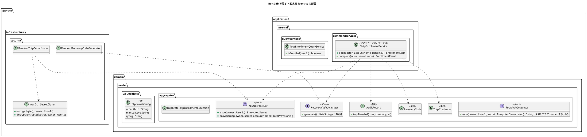
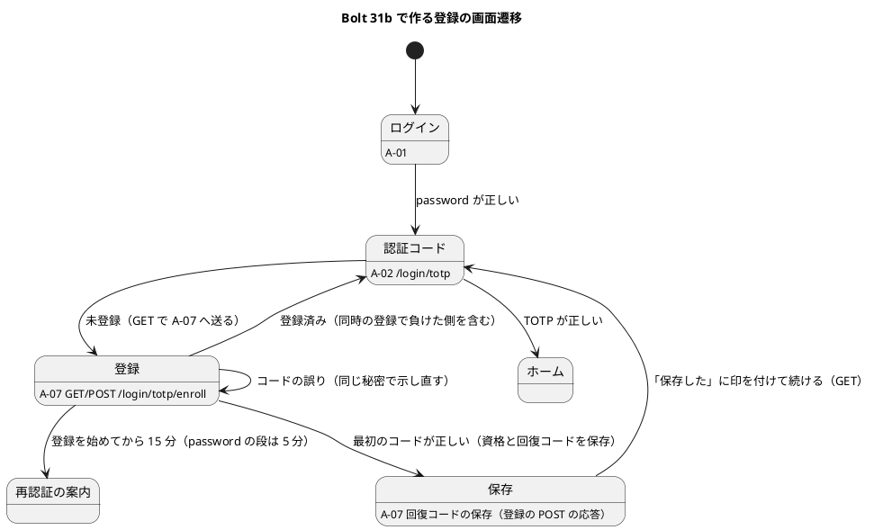

# Bolt 31b 計画 - 暗号文の AAD と初回の TOTP の登録（A-07）・回復コードの発行

## 基本情報

| 項目 | 内容 |
| :--- | :--- |
| Bolt | 第 31b 回（W5 の 6 本目。US-18 の残りの 3 本目） |
| 予定 | W5（2026-11-02 の週。前倒しで着手できる）。作業は約 4 時間 30 分（承認ゲートの待ち時間を除く。「時間の配分と打ち切り」）。上限に近い |
| 対象 | `identity`（暗号化の AAD、TOTP の秘密の発行と回復コードの生成のポート、登録のアプリケーションのサービス、A-07 の 2 つの画面、QR、登録の途中の上限）、dev-data の暗号文、ADR-011・ADR-012、UI 設計・ドメインモデル・データモデル・技術スタック・非機能要件、リリース計画 |
| SP | 2（US-18 AC7。SP は #13 をクローズする Bolt 33b で数える） |
| GitHub | [#13](https://github.com/k2works/practical-domain-driven-design-in-enterpris-application/issues/13)（US-18、R1.0）。この Bolt では閉じない |
| 承認ゲート | **ステップごとに止める**（W4 の締めの決定: 認証の完成はステップごと）。確認必須（セキュリティ、外部ライブラリ（ZXing）、データベース（dev-data）、画面の流れの変更）は計画の承認の場で確認ポイントとして判断を受ける |
| 承認ゲートの扱い | 2026-10-13 に human:kakimomokuri が計画を承認した（確認ポイント 1〜17 は推奨のとおり）。あわせて人の指示（`/goal Bolt31b`）により、ステップの承認ゲートで止まらずに進める。止まらなかったゲートごとに根拠を書き、終了報告の承認の議題に置く（T-36）。途中で規則の例外が要れば人に諮る |
| アプローチ | インサイドアウト（開発戦略の中盤）。新しい集約もスキーマもなく Bolt 30 の集約に AC7 を足すので、開発戦略の表ではアウトサイドインに当たるが、W5 の表で US-18 はインサイドアウトと決めている（development_strategy.md:344）。不確実性が暗号文の形（AAD）と秘密の発行のポート（平文を infrastructure に閉じる）にあり、内側から固めるほうが早い |
| 前の Bolt | [Bolt 31 終了報告](bolt_31_report.md)、[Bolt 30 終了報告](bolt_30_report.md) |

## Bolt ゴール

TOTP を登録していない利用者が、password の後に A-07 で認証アプリを登録できるようにする（US-18 AC7）。サーバーが秘密を発行して QR と手入力のキーで示し、利用者が入れた最初のコードで確かめてから TOTP の資格を保存し、一度だけ使える回復コード 10 個を発行して一度だけ示す（SEC-09）。登録の後は A-02 で TOTP を入れてログインを終える。あわせて、TOTP の秘密の暗号文を利用者に結び付け（AAD）、DB で別の利用者の暗号文に入れ替えられても復号できないようにする。

### 確かめたい仮説

| # | 仮説 | この Bolt で分かること |
| :--- | :--- | :--- |
| H1 | 秘密の平文は `identity.infrastructure` のポートの実装の中だけで扱い、session には暗号文（の文字列）だけを置ける。秘密と同じ重さの表示の値（`otpauth://` の URI、手入力のキー、QR の SVG）は、ポートが作って登録の画面に一度だけ渡し、記録（`toString`）・session・キャッシュには出さない | ArchUnit（ZXing と暗号を参照するのが `identity.infrastructure` だけ）、Spring Session JDBC を通した統合テストで session の属性が暗号文だけであること、`TotpProvisioning#toString` が値を隠すこと、A-07 の応答が `Cache-Control: no-store` であること |
| H2 | 初回の登録の保存（TOTP の資格の追加と回復コード 10 個の置き換え）を 1 つのトランザクションにし、TOTP の資格の主キーで同時の登録を 1 つに絞れば、初回の登録で回復コードが 20 個になる競合は起きない（Bolt 30 の議題 2 の①のうち初回の登録の分。発行し直しの競合は AC9 の Bolt 33b） | 同時の 2 つの登録の統合テスト（T-100 の重ね方）で、1 つだけが通り、回復コードは 10 個、負けた側は 500 にならず A-02 へ送られること |

## ふりかえりと前の Bolt からの引き継ぎ

| 入力 | 内容 | この Bolt での扱い |
| :--- | :--- | :--- |
| 開始準備の決定（2026-10-13、human:kakimomokuri） | 31b と 31c に分ける。password の段だけで開く画面の主体は identity の中だけの型にする（`AuthenticatedActor` は 2 つの要素がそろった主体だけ）。QR は ZXing でインラインの SVG。AAD は 31b で入れる | 本計画の範囲と、確認ポイント 1〜5 |
| 整合性検証の指摘への回答（2026-10-13、human:kakimomokuri） | 登録の途中だけ password の段の上限を 15 分にする。回復コードの「保存した」は画面の必須だけ。先取りの登録は受け入れて ADR に書く。`TotpProvisioning` はドメインの値で値を隠す | 確認ポイント 6〜9 |
| Bolt 31 の Try T-101 | 置き場所の決定が層の規則の例外を伴いそうなときは、骨組みを置いて ArchUnit を流して確かめる | 開始準備で行った（隔離した作業ツリーはパスの長さで作れず、元の作業ツリーに一時的に置いて消した）。ポート 2 つを `aggregates`、`TotpProvisioning` を `valueobjects`、実装を `infrastructure.security`、サービスを `commandservices`・`queryservices`（`@Service` を付ける）、画面の層から両サービスを呼ぶ形は、ArchUnit と Spring Modulith の検証をすべて通った。31c に送る password の段の主体の型は、`identity.interfaces.web` に置くと infrastructure の引数の解決からの参照が層の規則に当たり、`identity.domain.model.valueobjects` に置くと通った（確認ポイント 5） |
| Bolt 31 の Try T-102 | 認証の段の状態を足すときは、同じ session での利用者の切り替えを境界のテストに入れる | ステップ 5（登録の途中の session に別の利用者の password を送ると、前の利用者の登録の途中の暗号文は使えず、新しい秘密になる） |
| Bolt 31 の Try T-103 | 複数行の書き換えはスクリプトのファイルにして実行する | 全ステップ |
| Bolt 31 の Try T-104 | SonarQube はステップ 6 の後、開発レビューの前に流す | 本計画のステップは 6 つなので、ステップ 6 の最初に流す |
| Bolt 14 の Try T-42 | 認証・認可の部品を足すときは、値がない・対応がないときに失敗へ倒すかを計画の確認ポイントにする | 確認ポイント 11（登録の途中の暗号文が session にない POST、別の利用者の暗号文、鍵の版の違う暗号文、主キーの違反、ZXing の生成の失敗） |
| Bolt 30 の Try T-99 | 同じ規則を 2 か所に書くときは、境界のテストを両方で動かす | 「登録済みなら拒む」をサービス（`begin`・`complete`）と DB の主キーの 2 か所で守るので、サービスの単体テストと PostgreSQL の同時の 2 つの統合テストの両方で確かめる |
| Bolt 31 の既知の課題（31b） | 主体の型、照合の 3 値、`isEnrolled` の置き場所、入口と暗号のパッケージ、AAD、`FACTOR_*` の ArchUnit、低の指摘、議題 2 の①④、QR、AC7 の画面の認可、特性テスト、見直しの 4、スパイクの削除 | この Bolt: AAD、`isEnrolled` の置き場所、議題 2 の①（初回の登録の分）④、QR、AC7 の画面の認可。31c: 主体の型、照合の 3 値、`FACTOR_*` の ArchUnit、低の指摘（`REJECTED_NOT_ENROLLED` の監査の理由を含む）、特性テスト、見直しの 4、回復コードによるログイン、入口と暗号のパッケージ、スパイクの削除 |
| W4 の Try T-83・T-88・T-89・T-90 | 骨組みのまま流して本命のアサーションで落とす。後に回したものは Issue にする。画面を作る Bolt の開発レビューにテクニカルライターの観点 | 全ステップ。A-07 を作るので、ステップ 6 にテクニカルライターの観点を入れる |
| Bolt 13 の Try T-40 | 権限が上がる段ごとに session ID の変化と期限の確認の順を確かめる | この Bolt は要素を与えない（登録の後は A-02 で TOTP の要素を得る。確認ポイント 2）ので、権限は上がらない。登録の途中の上限（15 分）は期限の確認の中で確かめる |

## スコープ

### 設計の約束（Try T-1）

- TOTP の秘密の平文は `identity.infrastructure` のポートの実装の中だけで扱う。session には暗号文の文字列（`EncryptedSecret#value()`）だけを置き、取り出すときに `EncryptedSecret` に戻す（`EncryptedSecret` は直列化できる型ではなく、Spring Session JDBC は Java の直列化を使うため。ドメインの値に `Serializable` は足さない）
- 秘密と同じ重さの表示の値（`otpauth://` の URI、手入力のキー、QR の SVG）は、ポートの実装が作り、`TotpProvisioning`（`toString` で値を隠す）で登録の画面に一度だけ渡す。session・flash の属性・記録には置かない。A-07 の応答は `Cache-Control: no-store`
- 暗号文は `totp-secret:` と利用者 ID（`UserId#value()` の UUID の小文字の形）を AAD にして暗号化し、別の利用者の暗号文では復号できない（失敗へ倒す。T-42）
- 回復コードの平文は、登録を保存した応答で一度だけ示し、どこにも保存しない（ハッシュだけを保存する。SEC-09）
- 登録は TOTP の要素を与えない。登録の後は A-02 で TOTP を入れて 2 つの要素をそろえる（認証の流れを 1 つに保つ）
- 登録の画面（`/login/totp/enroll`。GET・POST とも同じ URL）は password の要素だけで開ける（Bolt 31 の R-08 の例外のとおり）。登録済みの利用者は A-02 へ送る（2 つの要素がそろった主体は登録済みなので、同じ振り分けでよい。画面の層は要素の権限を見ない。ArchUnit）

### 入れるもの・入れないもの

| 入れる | 入れない（後で） |
| :--- | :--- |
| AAD（暗号化・復号・生成のポートの形、dev-data の暗号文の作り直し） | 照合の 3 値をドメインに寄せる（31c） |
| TOTP の秘密の発行と回復コードの生成のポート（`identity.infrastructure` の実装。ZXing の QR の SVG） | password の段の主体の型と、ADR-012 の見直しの 4（引数の解決。31c） |
| 登録のアプリケーションのサービス（最初のコードの確かめ、資格と回復コードの保存、監査記録）、`isEnrolled` の置き場所の見直し | A-02 での回復コードによるログイン（31c） |
| A-07 の 2 つの画面（登録、回復コードの保存）、AC7 の画面の認可、登録の途中の上限（15 分） | 特性テスト（R-16）、`FACTOR_*` の ArchUnit の空振り対策、Bolt 31 の低の指摘、入口と暗号のパッケージ（31c） |
| 初回の登録の同時の競合（議題 2 の①の初回の分）、回復コードの並び順（④） | 回復コードの発行し直しと再登録（AC9。Bolt 33b） |
| 画面の層のシナリオ（未登録の利用者の登録からログインまで） | ユーザーマニュアル（Bolt 33b でまとめて直す。W5 の節の決定） |

## 設計（この Bolt の範囲）

### ドメインモデル

| 部品 | 責務 | 出典 |
| :--- | :--- | :--- |
| `TotpSecretIssuer` | 160 ビットの秘密を乱数で作り、AAD を付けて暗号化して返す。表示の値（`otpauth://totp/cargo-tracker:<メールアドレス>?secret=…&issuer=cargo-tracker&digits=6&period=30&algorithm=SHA1`、4 文字ずつ区切った手入力のキー、QR のインラインの SVG。色は `fill` の属性で付け、`style` は使わない。CSP が `style-src` を許さないため）は、暗号文から実装の中で作る | ADR-011、確認ポイント 3 |
| `RecoveryCodeGenerator` | 回復コード 10 個を乱数で作る（形は UI 設計の `1a2b-3c4d`。8 文字の 16 進を 4 文字ずつハイフンで区切る。32 ビット。ロック（5 回）と bcrypt で総当たりを抑える）。10 個のうちに重複がないこと | SEC-09、確認ポイント 4 |
| `TotpEnrollmentService` | `begin`: 登録済みなら `DuplicateTotpEnrollmentException`。登録の途中の暗号文を受けたら、同じ利用者の AAD で復号できる限りそれを使い続け（GET の再読み込みやタブを 2 つ開いても秘密を変えない）、なければ新しく発行する。暗号文と表示の値（`EnrollmentStart`）を返す。`complete`: 暗号文と入れたコードで前後 1 つの刻みを照合し、1 つのトランザクションで TOTP の資格を追加し（最後に使った刻みは 0。登録のコードは A-02 でもう一度使える。確認ポイント 2）、回復コード 10 個をハッシュで保存し、監査記録（`TOTP_ENROLLED`。主体の利用者 ID と企業 ID）を書き、回復コードの平文（`EnrollmentResult`）を返す。主キーの違反（同時の登録）はリポジトリの実装で `DuplicateTotpEnrollmentException` に写す（前例 `DuplicateEmailException`） | US-18 AC7、IA-INV-10・11、SEC-09 |
| `EnrollmentStart`・`EnrollmentResult` | `commandservices` の record。`EnrollmentStart`（暗号文、`TotpProvisioning`）、`EnrollmentResult`（`Enrolled`（回復コードの平文の一覧）・`CodeRejected`・`AlreadyEnrolled`・`SecretUnusable`）。`accountName` は主体のメールアドレス | — |
| `TotpEnrollmentQueryService` | 登録済みか（画面の層から呼ぶ。`TotpVerificationService` から移す。確認ポイント 10） | — |

置き場所: 新しいポートは前例（`TotpCodeGenerator`・`RecoveryCodeHasher`・`TrackingNumberIssuer`）にそろえて `identity.domain.model.aggregates` に置く（確認ポイント 12）。`TotpProvisioning` は `valueobjects`（`@ValueObject`。ZXing を infrastructure に閉じるにはポートが表示の値を返すしかない、という理由を ADR-011 に書く。確認ポイント 9）。登録のサービスは `commandservices`、問い合わせは `queryservices`（どちらも `@Service` を付け、`IdentityConfiguration` の `@Bean` で組む）。`ENROLL_URL` の定数は `LoginSuccessHandler` から A-07 の側（`SecurityConfiguration` の認可と controller が参照する定数）へ移す。

状態遷移: 利用者の登録の状態は「未登録（資格なし）→ 登録済み（資格あり）」で、資格の有無で決まる（状態の列は持たない）。登録の途中は session の属性（暗号文の文字列と登録を始めた時刻）で、図は省く。

### データモデル

表は変えない（ER 図は省く）。

- `totp_credential.secret_encrypted` の暗号文は、AAD を付けた形に変わる（列の形 `v1:<Base64>` は同じ）。本番の利用者はまだいない（Bolt 34 まで）ので、作り直すのは dev-data の暗号文 5 件だけ（`V20261013111500__seed_dev_totp_credentials.sql` は適用済みの版なので、新しい版で `UPDATE` する。確認ポイント 1）
- 監査記録の `action` に `TOTP_ENROLLED` を足す（CHECK 制約はないので、マイグレーションは要らない。data_model.md の一覧を直す）
- 回復コードの並び順（議題 2 の④）: `findUnusedByUserId` は並び順を約束しない（照合はすべての未使用のコードと比べる）。SQL の `ORDER BY issued_at, id` は残す（並びは決まるが約束はしない）。契約テストとリポジトリの Javadoc（いまは「発行した順に返す」）を直す

### 画面遷移

- A-07（登録）: 「1. 認証アプリで QR コードを読み取る」（インラインの SVG。`role="img"` と代わりの文「認証アプリで読み取る QR コード」）、「QR コードを使えない場合のキー」（4 文字ずつ）、「2. 表示された 6 桁のコード」（`autocomplete="one-time-code"`、`inputmode="numeric"`）、「登録する」、登録の期限の目安（「この画面を開いてから 15 分以内に登録してください。」）、「ログインの画面に戻る」。誤りは同じ画面にエラー要約で示す（password の要素は捨てない。確認ポイント 13）
- A-07（回復コードの保存）: 「回復コード（一度だけ表示します）」10 個、「回復コードを安全な場所に保存した」（画面の必須のチェック）、「ログインを続ける」（GET で A-02 へ。確認ポイント 7）。再読み込みは登録済みとして A-02 へ送る
- 登録の画面の URL は `/login/totp/enroll` の 1 つ（GET・POST）。Bolt 31 の登録の案内（`totp-enroll.html`）は A-07 に置き換える
- UI 設計は回復コードを登録の前の同じ画面に示す形なので、登録の後の 2 つ目の画面に変える（確認ポイント 4。設計への反映が必要）
- ユーザーマニュアルは Bolt 33b でまとめて直す

## ステップ計画

状態の記号: `[ ]` 未着手、`[-]` 進行中、`[?]` 承認待ち、`[x]` 完了。各ステップの終わりに `check` が緑であることと、計画からの変更を設計文書に反映したこと（T-53）を確かめ、push して CI を確かめる（T-26、T-65）。そのステップのファイルだけをステージする（T-84）。複数行の書き換えはスクリプトのファイルにする（T-103）。

- [x] **1. 設計文書** 【承認ゲート: 設計文書】
  - ADR-011: AAD（決定 5。AAD の文字列、dev のコードの部品の AAD は開発用の利用者のメールアドレスから決める作り物の ID で DB の利用者 ID とは別であること）、登録の流れ（秘密の発行、最初のコードの確かめ、要素は与えない、回復コードは登録の後に一度だけ、登録の途中の上限 15 分）、QR（ZXing、インラインの SVG、`fill` の属性）、`TotpProvisioning` を値に置く理由、新しいポートの置き場所、議題 2 の①④の決定、先取りの登録のリスクを受け入れること（確認ポイント 8）。28 行目のスパイクの削除を「Bolt 31c の後」に、174 行目の A-02 の回復コードの入力を 31c に、62・184・185 行目（QR・URI・発行は 31b で決める）を決定に移す
  - ADR-012: 「W5 で見直すこと」の 4 の割り振りを 31c に（104・109・121 行目）。password の段の主体の型を `identity.domain.model.valueobjects` に置く見込み（T-101 の結果。31c で決める）
  - ui_design.md: A-07 の 2 つの画面の節と salt、画面と URL の表（登録の案内を A-07 に置き換える。180・181 行目）、遷移図（A-02 を経て A-07。248・249 行目）、A-02 の回復コードの欄を 31c に（180・508 行目）
  - domain_model.md（用語集に `TotpSecretIssuer`・`RecoveryCodeGenerator`・`TotpProvisioning`・`TotpEnrollmentService`・`TotpEnrollmentQueryService`、`TotpCodeGenerator` の形（182 行目）、`TotpVerificationService` から `isEnrolled` が抜けること（183 行目）、ポートの説明（958 行目）、IA-INV-11 の発行の形）、data_model.md（暗号文の AAD、`TOTP_ENROLLED`、並び順）、tech_stack.md（ZXing の行）、non_functional.md の SEC-03（登録の途中の 15 分）・SEC-09・SEC-16
  - release_plan.md の W5 の節: 31b の行を本計画に、31c の行を足す（SP は 31b に 2、31c に 0）。33b の行（589 行目「回復コードによるログインは 31b」を 31c に）、持ち込みの表（601・605 行目の見直しの 4・特性テスト・スパイクの削除を 31c に）。順序（31b → 31c → 32。32 の見直しの 3 は 31c の引数の解決と同じ部品に触り、33b の再登録は 31c の回復コードのログインを前提にする）と、W5 が 13 本になり祝日の週で SP も上限を超えることを W5 の締めで確かめると書く
  - 完了の判定: `okf:check` ERROR 0、`documentationTest` 緑
- [x] **2. AAD** 【承認ゲート: Red・Green、データベース（dev-data）】
  - Red: `AesGcmSecretCipher` の単体テスト（同じ利用者 ID なら往復できる、別の利用者 ID では復号できない、AAD の文字列の形）、生成器の契約テストを `code(UserId, EncryptedSecret, long)` に直して落とす。統合テスト「DB で別の利用者の暗号文に入れ替えると TOTP が通らず、500 にせず A-01 に戻る」
  - Green: 暗号化・復号に AAD、`TotpCodeGenerator` のシグネチャ、`TotpCredential#matchingStep` が自分の利用者 ID を渡す。`DevTotpCodes` は設定の秘密を、開発用の利用者のメールアドレスから決める作り物の ID を AAD にして内部で扱う（利用者の表を読まない）。dev-data の暗号文を新しい版のマイグレーションで作り直す
  - 直すテスト: `TestSecretCiphers`、`AesGcmSecretCipherTest`、`JavaOtpTotpCodeGeneratorTest`、`TotpCredentialTest`、`DevTotpCodesTest`、`DevTotpCredentialsDevProfileTest`（DB の利用者 ID を AAD にして復号）、`AuthenticationSecurityIntegrationTest`・`TotpVerificationServiceIntegrationTest`・`UiUsers`（暗号化の呼び出し）
  - 完了の判定: `check` 緑
- [x] **3. 秘密の発行・回復コードの生成・登録のサービス** 【承認ゲート: Red・Green、外部ライブラリ】
  - Red: `RandomTotpSecretIssuer` の単体テスト（20 バイト、利用者ごとに違う、URI の形、キーが Base32 の 4 文字区切り、QR の SVG を ZXing で読み戻すと URI に戻る、SVG に `style` がない）、`TotpProvisioning#toString` が値を隠す、`RandomRecoveryCodeGenerator`（10 個、形、重複しない）、`TotpEnrollmentService` の単体テスト（登録済みは拒む、途中の暗号文を使い続ける、別の利用者の暗号文は使わず新しく発行する、誤ったコードは保存しない、正しいコードで資格と回復コード 10 個と監査記録、回復コードの平文はハッシュと照合できる、復号できない暗号文は `SecretUnusable`）、PostgreSQL の統合テスト（同時の 2 つの登録で 1 つだけ通り回復コードは 10 個、負けた側は `AlreadyEnrolled`。T-100・T-99）
  - Green: `build.gradle` に `com.google.zxing:core` を足す（確認ポイント 3）。ポートと実装、`TotpProvisioning`、`TotpEnrollmentService`（`@Service`・`IdentityConfiguration`）、`TotpEnrollmentQueryService`（`isEnrolled` を移す）、`AuditAction.TOTP_ENROLLED` と `AuditRecord.totpEnrolled`、`DuplicateTotpEnrollmentException`、回復コードのリポジトリの Javadoc（並び順を約束しない）
  - ArchUnit: ZXing を `identity.infrastructure` に閉じる規則と、空振りを防ぐ見張り（秘密の発行の実装が ZXing を使う）。秘密の発行と回復コードの生成の実装は application に依存しない規則（D-5 の認証の例外は `identity.infrastructure.security` 全体にかかるので、入口でない部品の守りを足す）。違反を入れて落ちることを確かめる
  - 完了の判定: `check` 緑、ZXing の依存の脆弱性（GitHub Advisory・OSV を手で引く）とライセンスを終了報告に書く
- [x] **4. A-07 の 2 つの画面と登録の途中の上限** 【承認ゲート: セキュリティ、画面】
  - Red: セキュリティの統合テスト（本物の Spring Session JDBC の上で）
    - 未登録の利用者は password の後に A-02 を経て A-07 に来る。QR と手入力のキーが出て、応答が `no-store`。GET の再読み込みでキーが変わらない。session の属性に平文の秘密も表示の値もない
    - 誤ったコードでは保存せず、同じ秘密で示し直す。正しいコードで回復コード 10 個の画面になり、監査記録に `TOTP_ENROLLED`。回復コードの画面の再読み込み（登録の POST の再送）は A-02 へ送る
    - 「ログインを続ける」で A-02 に来て、登録のコードで TOTP を通せる
    - 登録済みの利用者（2 つの要素がそろった主体を含む）は A-07 を開けず A-02 へ送られる。A-07 の POST に CSRF のトークンが要る。登録の途中の暗号文が session にない POST は A-07 を開き直す
    - 登録の途中の上限: A-07 を開いてから 15 分の 1 秒前は使える・15 分で A-03。A-07 を開いていない password の段は 5 分のまま。2 つの要素がそろった後は 8 時間（登録の途中の時刻は使わない）
  - Green: A-07 の controller（`identity.interfaces.web`）、`login-totp-enroll.html`・`login-totp-recovery-codes.html`（Bolt 31 の `totp-enroll.html` を置き換える）、登録の途中の暗号文の文字列と登録を始めた時刻を session に置く・登録の後に消す、`SessionLifetimeFilter` の登録の途中の上限、`ENROLL_URL` の定数の移動、`LoginSuccessHandler` は登録の有無を見ずに A-02 へ送る（A-02 の controller が未登録を A-07 へ送る）、`SecurityConfiguration` の組み立ての直し
  - 直すテスト: `AuthenticationSecurityIntegrationTest` の「TOTP を登録していない利用者は…登録の案内へ移り」（password の後に A-02 を経て A-07 に変わる）
  - 完了の判定: `check` 緑
- [x] **5. 利用者の切り替えと画面の層** 【承認ゲート: セキュリティ】
  - 統合テスト: 登録の途中の session に別の利用者の password を送ると、前の利用者の登録の途中の暗号文は使えず（AAD）、新しい秘密になる（T-102）。登録の途中の時刻も新しい利用者の password の段で消える
  - 画面の層: `login_ui.feature` に「未登録の利用者が A-07 で登録し、回復コードを保存して A-02 でログインする」（`UiUsers` に未登録の利用者を作る口を足す。QR の代わりに手入力のキーからコードを作る）。デモの印 `@demo @demo-bolt-31b/enroll`
  - 完了の判定: `check` と `uiTest` が緑
- [-] **6. SonarQube と開発レビューと終了報告** 【承認ゲート: 終了報告】
  - SonarQube（`sonar-local:check`。T-104 で開発レビューの前に流す）
  - 開発レビュー（プログラマー、アーキテクト、テスター（セキュリティの境界）、テクニカルライター（A-07 の文言。T-90））
  - デモの動画（`demoVideo`）と #13 への添付（`issue:attach-demo`）。`bolt_31b_report.md`。release_plan の W5 の 31b の行、開発の索引。#13 に進み具合をコメントする

### 時間の配分と打ち切り

| # | 目安 | 打ち切り |
| :--- | :--- | :--- |
| 1 | 35 分 | — |
| 2 | 40 分 | — |
| 3 | 55 分 | ZXing の取得ができなければ（429 の再試行を超えて）、QR を後に回して手入力のキーだけで進めるかを人に諮る |
| 4 | 65 分 | — |
| 5 | 30 分 | — |
| 6 | 45 分（SonarQube と動画の待ちを除く） | — |

合計 270 分（約 4 時間 30 分）。上限に近い。開始準備で、password の段の主体の型を、引数の解決を変える 31c に一緒に送った（確認ポイント 5）。合計で 4.5 時間を超えると見えたら、止めて人に諮る（候補: 画面の層のシナリオを 31c に送る）。

## 確認ポイント（計画の承認の場でまとめて確認する。Try T-6）

| # | 確認すること | ステップ | 推奨 |
| :--- | :--- | :--- | :--- |
| 1 | **AAD**（開始準備で決めた。セキュリティ、データベース） | 2 | AAD は `totp-secret:` と利用者 ID の UUID の小文字の形（`UserId#toString()` ではなく `value()`）の UTF-8。用途の接頭辞で、将来ほかの値を同じ鍵で暗号化しても取り違えない。生成のポートは `code(UserId, EncryptedSecret, long)`。dev-data の暗号文は新しい版のマイグレーション（`UPDATE`）で作り直す（適用済みの版は書き換えない）。dev のコードの部品は開発用の利用者のメールアドレスから決める作り物の ID（`UUID.nameUUIDFromBytes`）を AAD にして内部で扱う（利用者の表を読まない。ADR-011 の dev の 3 層目。DB の暗号文の利用者 ID とは別） |
| 2 | **登録は TOTP の要素を与えない**（セキュリティ） | 4 | 登録の後は A-02 で TOTP を入れて 2 つの要素をそろえる。登録で確かめたコードの刻みは使ったことにしない（最後に使った刻みは 0）ので、同じコードを A-02 でもう一度使える。登録を認証のフィルターにしない（認証の流れと session ID の変更・8 時間の起点を A-02 の 1 か所に保つ） |
| 3 | **QR**（開始準備で決めた。外部ライブラリ） | 3 | `com.google.zxing:core`（Apache-2.0、実行時の推移的な依存なし）を足し、秘密の発行の実装の中で QR の行列からインラインの SVG を作る。CSP は変えない（色は `fill` の属性）。画面は `th:utext` で、自分で作った SVG にだけ使う。版は Maven Central の最新の安定版を確かめる。脆弱性は GitHub Advisory・OSV を手で引く |
| 4 | **回復コードを登録の後の画面で示す**（画面の流れの変更。UI 設計への反映が必要） | 1・4 | UI 設計は回復コードを登録の前の同じ画面に示すが、それだと平文の回復コードを登録の途中の session（Spring Session JDBC の表）に置くことになる。登録を保存した POST の応答で一度だけ示し（PRG にしない。再読み込みは登録済みとして A-02 へ送る）、どこにも保存しない。形は `1a2b-3c4d`（UI 設計のとおり） |
| 5 | **password の段の主体の型を 31c に送る** | — | 引数の解決を「2 つの要素がそろった主体だけ」にする 31c で、A-02・A-07 が受ける型と一緒に作る。31b の A-07 は今の A-02 と同じく `AuthenticatedActor` で受ける。T-101 の確かめで、型を `identity.interfaces.web` に置くと infrastructure の引数の解決からの参照が層の規則に当たり、`identity.domain.model.valueobjects` に置くと通った。開始準備の回答（identity の中だけの型）の範囲で、置き場所は値の側にする見込み（31c の計画の確認ポイント） |
| 6 | **登録の途中だけ password の段の上限を 15 分にする**（整合性検証の指摘への回答で決めた。セキュリティ） | 4 | A-07 を開いた時刻（登録の途中の時刻）を session に置き、それがある password の段だけ、その時刻から 15 分を上限にする。登録の途中の時刻は password の段の 5 分の中でしか置けない（A-07 を開けるのは期限の確認の後）。2 つの要素がそろったら使わない。A-07 に期限の目安を示す。SEC-03 に書く |
| 7 | **回復コードの「保存した」は画面の必須だけ**（整合性検証の指摘への回答で決めた） | 4 | 「ログインを続ける」は A-02 への GET のフォームで、チェックは `required`。回復コードは登録の時点で保存済みなので、確認は利用者への促し。サーバーの状態を増やさない。テストは属性の有無で確かめる |
| 8 | **先取りの登録のリスクを受け入れる**（整合性検証の指摘への回答で決めた） | 1 | 未登録の利用者の password を知った者は本人より先に自分の認証アプリを登録できる（初回の登録に共通）。受け入れるリスクとして ADR-011 に書く。抑える手段は `TOTP_ENROLLED` の監査記録、ロック（Bolt 32）、システム管理者の別経路の解除と本人への通知（#47、W6）。初回の password の渡し方は利用者の管理（Bolt 34）で決める |
| 9 | **`TotpProvisioning` を値に置く**（整合性検証の指摘への回答で決めた） | 1・3 | `valueobjects` に置き、`toString` で値を隠す（`EncryptedSecret` の前例）。ZXing を infrastructure に閉じるにはポートが表示の値を返すしかない、という理由を ADR-011 に書く。画面には一度だけ渡し、応答は `no-store` |
| 10 | `isEnrolled` の置き場所（Bolt 31 のレビュー 13） | 3・4 | `queryservices` の `TotpEnrollmentQueryService` に移し、画面の層だけが呼ぶ。`LoginSuccessHandler`（認証の入口）は登録の有無を見ずに A-02 へ送り、A-02 の controller が未登録を A-07 へ送る。D-5 の例外は広げない（入口から queryservices を呼ぶと規則に当たる） |
| 11 | **失敗へ倒す場面**（T-42） | 3・4 | 登録の途中の暗号文が session にない POST は A-07 を開き直す（新しい秘密）。別の利用者の暗号文・鍵の版の違う暗号文・壊れた暗号文は `SecretUnusable` にし、A-07 を開き直して「登録をやり直してください」を示す（500 にしない）。主キーの違反（同時の登録で負けた側）は登録済みとして A-02 へ送る。ZXing の生成の失敗は 500 のまま（実装の誤りで、利用者の入力では起きない）でエラーのログを出す |
| 12 | 新しいポートの置き場所（Bolt 30 の既知の課題「ポートが増えたら ADR」） | 1・3 | 前例どおり `identity.domain.model.aggregates` に置き、ADR-011 に「認証の要素のポート（生成・発行・ハッシュ・回復コードの生成）は aggregates に置く」と書く。ポートの置き場所を分けるのは、ほかのコンテキストでも増えたときに ADR で諮る |
| 13 | A-07 のコードの誤りの扱い | 4 | 同じ画面にエラー要約で示し、同じ秘密で示し直す（利用者は認証アプリに登録済みの秘密を使い続ける）。password の要素は捨てない（登録は認証の段ではない）。誤りは失敗の回数に数えない（ロックは Bolt 32 で、登録の誤りを数えるかもそこで決める） |
| 14 | Bolt 30 の議題 2 の①④ | 3 | ①初回の登録は 1 つのトランザクションで、TOTP の資格の追加（主キー）を先に行う。同時の 2 つの登録は主キーで片方が失敗してロールバックし、回復コードは 10 個のまま。回復コードの発行し直しの競合（AC9）は Bolt 33b で確かめる。④未使用の回復コードの並び順は約束しない（SQL の `ORDER BY` は残す） |
| 15 | 入口と暗号の部品のパッケージ（Bolt 31 のレビュー 11） | 3 | この Bolt では分けない。代わりに、秘密の発行と回復コードの生成の実装は application に依存しない ArchUnit の規則を足す（D-5 の例外の守りを補う）。31c で `identity.infrastructure.crypto` に分けて例外を入口だけに狭めるかを諮る |
| 16 | 後の Bolt に送るものと T-89 | — | 31c: 主体の型、照合の 3 値、見直しの 4、回復コードによるログイン、特性テスト、`FACTOR_*` の ArchUnit、Bolt 31 の低の指摘（`REJECTED_NOT_ENROLLED` の監査の理由を含む）、入口と暗号のパッケージ、スパイクの削除。どれも #13 の中の作業で、W5 の節の Bolt の分け方の表で追う（T-89 から外れて Issue にしない。Bolt 31 と同じ扱い） |
| 17 | 承認ゲート | 全体 | ステップごとに止める（W4 の締めの決定）。ステップ 2 はデータベース（dev-data）、3 は外部ライブラリ、4・5 はセキュリティの確認必須 |

## 完了条件

- [ ] 未登録の利用者が password の後に A-02 を経て A-07 で登録でき、回復コード 10 個を一度だけ見て、A-02 でログインを終えられる
- [ ] 誤ったコードでは保存しない。登録済みの利用者と 2 つの要素がそろった主体は A-07 を開けない。登録の途中だけ上限が 15 分
- [ ] 平文の秘密と表示の値は session にも記録にも出ない（A-07 の応答は `no-store`）。暗号文は利用者に結び付き、別の利用者の暗号文では TOTP が通らない
- [ ] 同時の登録のうち 1 つだけが通り、回復コードは 10 個。負けた側は 500 にならない
- [ ] ZXing と暗号の参照が `identity.infrastructure` に閉じている（ArchUnit）
- [ ] `check` と `uiTest` が緑。push して CI を確かめた。SonarQube の Quality Gate が PASS、`okf:check` ERROR 0
- [ ] 開発レビュー、デモの動画と #13 への添付、終了報告。#13 に進み具合をコメントした

### デモ項目

- 画面の層のシナリオの動画（`@demo @demo-bolt-31b/enroll`）: 未登録の利用者のログイン → A-02 → A-07（QR とキー）→ コード → 回復コード 10 個 → 「保存した」→ A-02 → ホーム

## 更新履歴

| 日付 | 更新内容 | 更新者 |
| :--- | :--- | :--- |
| 2026-10-13 | 初版作成（承認待ち）。開始準備で、Bolt 31 の終了報告の議題 5 と既知の課題、UI 設計の A-07、今の回復コードの集約とリポジトリを調べ、human:kakimomokuri の決定（31b と 31c に分ける、password の段の主体は identity の中だけの型、QR は ZXing でインラインの SVG、AAD は 31b）を反映した | anthropic/claude-opus-5-5 |
| 2026-10-13 | 詳細整合性検証（21 件）と横断整合性検証（17 件）の指摘と、T-101 の骨組みの確かめの結果を反映した。human:kakimomokuri の回答（登録の途中だけ 15 分、「保存した」は画面の必須だけ、先取りの登録は受け入れて ADR に書く、`TotpProvisioning` は値で値を隠す）を確認ポイント 6〜9 にした。session には暗号文の文字列を置く、表示の値は秘密と同じ重さとして扱う、GET の再読み込みで秘密を変えない、AAD の文字列、監査記録の企業 ID、同時の登録で負けた側の応答、A-02 を経て A-07 へ、画面の層は要素の権限を見ない、失敗へ倒す場面（T-42）、T-99、31c に移すことで古くなる上流の記述、直すテスト、アプローチの理由、ZXing の見張りと入口でない部品の規則、ステップの番号を直した | anthropic/claude-opus-5-5 |
| 2026-10-13 | 計画の承認を記録した。確認ポイント 1〜17 は推奨のとおり。`/goal Bolt31b` により、ステップの承認ゲートで止まらずに進める（T-36） | anthropic/claude-opus-5-5、承認 human:kakimomokuri |
| 2026-10-13 | 開発レビューの直しで計画から変えたことを記録した。(1) 同時の登録の負けた側: 計画は「負けた側は `AlreadyEnrolled`」としていたが、ステップ 3 では例外を controller で受けていた。レビューでサービスの中にまとめ（`TransactionTemplate` の外側で受ける）、計画どおりの結果に戻した。(2) 登録を始めた時刻: 登録の後に消す計画を、A-02 で TOTP が通るまで残す形に改めた（回復コードを書き写す時間を同じ 15 分に含める）。期限は時刻で示す。(3) `begin` の戻り値: 計画の「秘密と表示の値」を `EnrollmentStart`（`Started`・`AlreadyEnrolled`）にした（ステップ 3）。(4) A-03 の文言にログインの手続きの時間切れを足した | anthropic/claude-opus-5-5 |

## 関連ドキュメント

- [リリース計画](release_plan.md)（W5）
- [Bolt 31 計画](bolt_31_plan.md)、[Bolt 31 終了報告](bolt_31_report.md)、[Bolt 30 終了報告](bolt_30_report.md)
- [ADR-011](../../adr/cargo-tracker/011-mfa-totp.md)、[ADR-012](../../adr/cargo-tracker/012-authentication-principal-and-session.md)
- [ドメインモデル](../../design/cargo-tracker/domain_model.md)（アクセス・監査）、[データモデル](../../design/cargo-tracker/data_model.md)（`identity`）、[UI 設計](../../design/cargo-tracker/ui_design.md)（A-02・A-07）
- [ユーザーストーリー](../../requirements/cargo-tracker/user_story.md)（US-18 AC7）、[非機能要件](../../design/cargo-tracker/non_functional.md)（SEC-03・SEC-09・SEC-16・SEC-17）
