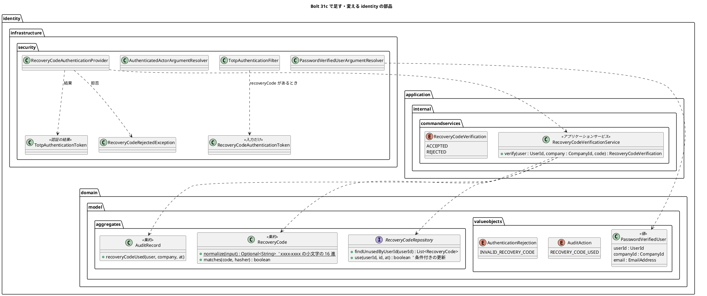
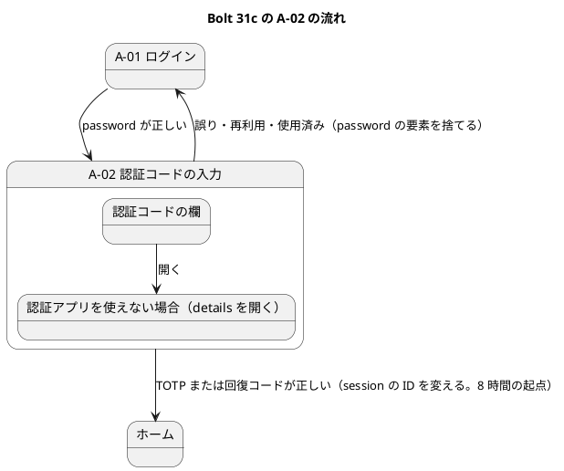
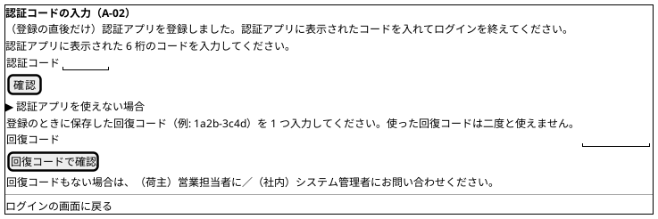

# Bolt 31c 計画 - 回復コードによるログインと password の段の主体の型

## 基本情報

| 項目 | 内容 |
| :--- | :--- |
| Bolt | 第 31c 回（W5 の 7 本目。US-18 の残りの 4 本目） |
| 予定 | W5（2026-11-02 の週。前倒しで着手できる）。作業は約 4 時間 25 分（承認ゲートの待ち時間を除く。「時間の配分と打ち切り」）。上限に近い |
| 対象 | `identity`（回復コードの確かめのアプリケーションのサービス、回復コードの正規化、A-02 の回復コードの欄と認証、password の段の主体の型、引数の解決、監査）、画面の単体テストの主体（`@WithAuthenticatedActor`）、ADR-011・ADR-012、UI 設計・ドメインモデル・データモデル・非機能要件・アーキテクチャ、リリース計画 |
| SP | 0（US-18 の残りの SP は #13 をクローズする Bolt 33b で数える） |
| GitHub | [#13](https://github.com/k2works/practical-domain-driven-design-in-enterpris-application/issues/13)（US-18、R1.0）。この Bolt では閉じない |
| 承認ゲート | **ステップごとに止める**（W4 の締めの決定: 認証の完成はステップごと）。確認必須（セキュリティ、構造、画面の流れの変更）は計画の承認の場で確認ポイントとして判断を受ける |
| 承認ゲートの扱い | 2026-10-13 に human:kakimomokuri が計画を承認した（確認ポイント 1〜11 は推奨のとおり）。あわせて人の指示（「承認して止めずに進める」）により、ステップの承認ゲートで止まらずに進める。止まらなかったゲートごとに根拠を書き、終了報告の承認の議題に置く（T-36）。途中で規則の例外が要れば人に諮る |
| アプローチ | インサイドアウト（開発戦略の中盤。W5 の表で US-18 はインサイドアウト。development_strategy.md:344 の「データとドメインから」）。回復コードの集約と条件付きの消費（Bolt 30）はあるので、ドメインの正規化と主体の値から固め、サービス、認証の入口、画面の順に足す |
| 前の Bolt | [Bolt 31b 終了報告](bolt_31b_report.md)、[Bolt 31 終了報告](bolt_31_report.md) |

## Bolt ゴール

TOTP の端末を持っていない利用者が、A-02 で回復コードを 1 つ使ってログインを終えられるようにする（US-18 AC9 のうちログインの分。SEC-09）。使った回復コードは二度と使えない。あわせて、password の段だけの主体を identity の中だけの型（`PasswordVerifiedUser`）に分け、ほかのコンテキストが受ける `AuthenticatedActor` を 2 つの要素がそろった主体だけにする（ADR-012 の「W5 で見直すこと」の 4）。

### 確かめたい仮説

| # | 仮説 | この Bolt で分かること |
| :--- | :--- | :--- |
| H1 | 回復コードを TOTP と同じ入口（`POST /login/totp`）で受け、認証の結果を TOTP と同じ型・同じ要素の権限（`TotpAuthenticationToken`、`FACTOR_TOTP`）にすれば、業務の認可・session の ID の変更・8 時間の起点・成功の監査を変えずに 2 つ目の要素の手段を足せる | セキュリティの統合テストで、回復コードで通った主体が `FACTOR_PASSWORD` と `FACTOR_TOTP` の両方を持ち、業務の URL を開け、session の ID が変わり、8 時間の起点が置かれ、監査記録が `LOGIN_SUCCEEDED` になること。業務の認可の設定と `CargoUserDetails`・session の属性に差分がないこと |
| H2 | 引数の解決が 2 つの要素がそろった主体だけに `AuthenticatedActor` を渡しても、ほかのコンテキストの controller の本体は変わらない（本番では全体の注釈で、要素の欠けた主体はもともと届かない） | ほかのコンテキストの本体のコードに差分がないこと。フィルターを外した画面の単体テスト（`@WithAuthenticatedActor` を使う 11 ファイル）は、主体の工場が `FactorGrantedAuthority` で 2 つの要素を足すことで、ファイルに差分なく緑のままであること |

## ふりかえりと前の Bolt からの引き継ぎ

| 入力 | 内容 | この Bolt での扱い |
| :--- | :--- | :--- |
| 開始準備の決定（2026-10-13、human:kakimomokuri） | 31c と 31d に分ける。回復コードは A-02 の `
` で開く別の欄（`recoveryCode`）で受け、同じ `POST /login/totp` に送る。通ったら `FACTOR_TOTP` を与え、監査は専用の操作にする。password の段の主体の型は `identity.domain.model.valueobjects` に置く | 本計画の範囲と、確認ポイント 1〜4 |
| Bolt 31b の Try T-105 | デモの動画は、レビューの直しで画面の文言が変わらないと確かめてから撮る | ステップ 6 で、開発レビューの直しの後に動画を撮る |
| Bolt 31b の Try T-106 | 「ないこと」を確かめるテストには「あるべきものがあること」の確かめを並べる | 回復コードの平文が記録・監査・session に出ないことの確かめに、使った記録（`used_at`）と `RECOVERY_CODE_USED` があることを並べる。引数の解決が `AuthenticatedActor` を渡さないことの確かめに、`PasswordVerifiedUser` を渡すことを並べる。A-02 のモデルの `currentActor` が空であることに、2 つの要素がそろった主体では業務の画面に名前が出ることを並べる |
| Bolt 31 の Try T-101 | 置き場所の決定が層の規則の例外を伴いそうなときは、骨組みを置いて ArchUnit を流して確かめる | Bolt 31b の開始準備で確かめた（`valueobjects` に置くと通る）。この Bolt では新しい置き場所を作らない（回復コードのサービスは `commandservices`、provider と引数の解決は `infrastructure.security`。どちらも D-5 の認証の例外の範囲） |
| Bolt 31 の Try T-102 | 認証の段の状態を足すときは、同じ session での利用者の切り替えを境界のテストに入れる | 回復コードの欄を開いた session で別の利用者の password を送ると、前の利用者の回復コードでは通らないこと（回復コードは主体の利用者 ID で探す） |
| Bolt 31 の Try T-103・T-104 | 書き換えはスクリプトのファイルにする。SonarQube は開発レビューの前に流す | 全ステップ。ステップ 6 の最初に SonarQube |
| Bolt 31b のレビュー 10 | bcrypt を行ロックの後に置かない | 未使用のコードの読み出しと照合（最大 10 回の bcrypt）はトランザクションの外で行い、消費と監査記録だけを 1 つのトランザクションにする（確認ポイント 8） |
| Bolt 30 の Try T-99・T-100 | 境界のテストを両方の実装で動かす。同時の更新は片方のコミットを止めて待ちを確かめる | 回復コードの同時の消費（同じコードを 2 つの session で送る）は、条件付きの更新で 1 つだけが通ることを PostgreSQL の統合テストで確かめる（`use` の契約テストは Bolt 30 にある）。正規化はドメインの単体テストと、サービスの単体テストの両方で確かめる |
| Bolt 14 の Try T-42 | 値がない・対応がないときに失敗へ倒す | 確認ポイント 7（回復コードの欄と TOTP の欄が両方ある送信、形の違う回復コード、回復コードのない利用者） |
| ADR-012 の「W5 で見直すこと」の 4 | 引数の解決で TOTP まで済んでいない主体を渡さない。`@WithAuthenticatedActor` に要素の権限を足す。A-02・A-07 が受ける型を分ける | ステップ 3 |
| Bolt 31b の既知の課題（31c） | 主体の型と見直しの 4、回復コードによるログインと登録の後の A-02 の案内（レビュー 13）。そのほか（照合の 3 値、`REJECTED_NOT_ENROLLED` の監査の理由、`FACTOR_*` の ArchUnit、SVG の組み立て、定数、入口と暗号のパッケージ、特性テスト、スパイクの削除） | 前の 2 つはこの Bolt。そのほかは開始準備の決定で 31d に送る（この Bolt で足す `RecoveryCodeVerification` も 31d の照合の結果の見直しに含める） |
| W4 の Try T-83・T-88・T-89・T-90 | 骨組みのまま流して本命のアサーションで落とす。見張り。後に回したものは Issue にする。画面を作る Bolt の開発レビューにテクニカルライターの観点 | 全ステップ。A-02 に欄を足すので、ステップ 6 にテクニカルライターの観点を入れる。31d は #13 の中の作業として W5 の表で追う（T-89 から外れる扱いは 31b と同じ） |

## スコープ

### 設計の約束（Try T-1）

- 回復コードは TOTP と同じ入口（`TotpAuthenticationFilter`、`POST /login/totp`）で受け、確かめる前の入力だけを別の認証のトークン（`RecoveryCodeAuthenticationToken`。`eraseCredentials` で平文を消す）にして、別の provider（`RecoveryCodeAuthenticationProvider`）で確かめる。provider は認証の結果として TOTP と同じ `TotpAuthenticationToken.authenticated(details, FACTOR_TOTP)` を返す。結果の型を変えないので、mfaEnabled の要素の合わせ（`toBuilder()`）、成功の監査の判定（`LOGIN_SUCCEEDED`）、session の直列化、業務の認可、session の ID の変更、CSRF の作り直し、8 時間の起点が 1 か所に保たれる。`CargoUserDetails` と session の属性は変えない
- 拒否は `RecoveryCodeRejectedException`（`BadCredentialsException` を継ぐ）で表し、`DefaultAuthenticationEventPublisher` の対応表に足して失敗のイベントを出す（対応表にない例外ではイベントが出ず、監査記録が書かれない）。監査のリスナーはこの型で理由 `INVALID_RECOVERY_CODE` を書く
- 回復コードの形の知識（正規化と形の確かめ）はドメインに置く（`RecoveryCode.normalize`）。照合と消費はアプリケーションのサービス（`identity.application.internal.commandservices`）に置く。未使用のコードのすべてとハッシュで照合し（トランザクションの外）、一致したコードを条件付きの更新で使い、監査記録 `RECOVERY_CODE_USED` と同じトランザクションにする（`TransactionTemplate`。監査の追記が失敗したら使用も戻る）。更新できなかったら（同時の消費で負けた）拒む
- 回復コードの平文は、照合の後どこにも残さない（記録・監査・session・例外のメッセージ）
- 誤り・使用済みは TOTP の誤りと同じく password の要素を捨てて A-01 に戻す（1 つの session で試し続けさせない。K-02）。拒否の種類は監査記録の理由にだけ残す
- `AuthenticatedActor` は 2 つの要素がそろった主体だけ。password の段だけで開く画面（A-02・A-07）は `PasswordVerifiedUser`（identity の中だけの型）を受ける

### 入れるもの・入れないもの

| 入れる | 入れない（後で） |
| :--- | :--- |
| 回復コードの正規化（ドメイン）と確かめのサービス（照合、条件付きの消費、監査記録） | 回復コードによる TOTP の再登録と、残りが少ないときの案内（AC9。Bolt 33b） |
| A-02 の回復コードの欄（`
`）、入力のトークンと provider と拒否の例外、入口のフィルターの振り分け、A-01 の誤りの文言 | 失敗の回数を数えてロックする（Bolt 32。回復コードの誤りも数えるかもそこで決める） |
| 監査の操作 `RECOVERY_CODE_USED`、拒否の理由 `INVALID_RECOVERY_CODE` | 照合の 3 値をドメインに寄せる（`RecoveryCodeVerification` を含む）、`REJECTED_NOT_ENROLLED` の監査の理由（31d） |
| `PasswordVerifiedUser` と引数の解決、`AuthenticatedActor` の引数の解決を 2 つの要素がそろった主体だけにする、`@WithAuthenticatedActor` の要素の権限 | `FACTOR_*` の ArchUnit の空振り対策、入口と暗号のパッケージ、特性テスト（R-16）、Bolt 31 の低の指摘、SVG の組み立て・定数、スパイクの削除（31d） |
| 登録の後に A-02 に来たときの案内（Bolt 31b のレビュー 13） | ユーザーマニュアル（Bolt 33b でまとめて直す。W5 の節の決定） |
| 画面の層のシナリオ（回復コードでログインする） | request ごとの問い合わせを 1 回にする（ADR-012 の見直しの 3。Bolt 32） |

## 設計（この Bolt の範囲）

### ドメインモデル

- `RecoveryCode.normalize` は前後と中の空白を除き、小文字にし、ハイフンのない 8 文字には 4 文字目の後にハイフンを入れ、`^[0-9a-f]{4}-[0-9a-f]{4}$` に合わなければ空を返す（照合しない。bcrypt を回さない）
- `RecoveryCodeVerificationService#verify` は、正規化した後、未使用のコードのすべてと照合する（トランザクションの外。最大 10 回の bcrypt）。一致したコードの `use` と監査記録 `RECOVERY_CODE_USED` を `TransactionTemplate` の 1 つのトランザクションにする。使えたら `ACCEPTED`。形が合わない・一致しない・使えない（同時の消費で負けた）・回復コードがない（TOTP を登録していない利用者を含む。回復コードは登録と一緒にしか発行されない。IA-INV-11）ときは `REJECTED`（使用済みのコードは未使用の一覧に出ないので、誤りと区別できない。理由を細かく分けない）
- `PasswordVerifiedUser` は、password の段がそろった主体から作る identity の中だけの値（`@ValueObject` の record。`EmailAddress` は同じパッケージの値）。メールアドレスは dev の A-02 の入力済みと、登録の URI のアカウント名に使う（controller から `Principal` の引数を外す）
- 状態遷移図は省く（回復コードの状態は Bolt 30 の「未使用 → 使用済み」のまま。この Bolt はログインでの消費の入口を足すだけ）

### データモデル

表は変えない（ER 図は省く）。`recovery_code.used_at` を条件付きの更新で書く（Bolt 30 の `use`。`WHERE id = :id AND user_id = :userId AND used_at IS NULL`）。監査記録の操作と理由の列は文字列なので、`RECOVERY_CODE_USED` と `INVALID_RECOVERY_CODE` はマイグレーションを要さない（データモデルの操作と理由の一覧に足す）。

### 画面遷移

画面の形（UI 設計「A-02」に足す）:

- 回復コードの欄は `
` の中の別のフォーム（`name="recoveryCode"`、`autocomplete="off"`、`inputmode` は付けない）。JavaScript も CSP の変更も要らない
- 今の A-02 の「認証アプリを使えない場合は…お問い合わせください」（SEC-10 の経路）は、`
` の中の回復コードの欄の下に移す（確認ポイント 5）
- 誤り・使用済みは TOTP と同じく A-01 に戻す。A-01 の文言は TOTP と回復コードの両方に合う形に変える（確認ポイント 5）
- 登録の直後の案内は、session に登録を始めた時刻があるときだけ示す。TOTP・回復コードが通ったら登録を始めた時刻を消す（ログインを終えた後に A-02 を開き直しても出ない。確認ポイント 9）

## ステップ計画

状態の記号: `[ ]` 未着手、`[-]` 進行中、`[?]` 承認待ち、`[x]` 完了。各ステップの終わりに `check` が緑であることと、計画からの変更を設計文書に反映したこと（T-53）を確かめ、push して CI を確かめる（T-26、T-65）。そのステップのファイルだけをステージする（T-84）。複数行の書き換えはスクリプトのファイルにする（T-103）。ステップの順はインサイドアウト（ドメインの正規化と主体の値 → サービス → 主体の型と引数の解決 → 認証の入口と画面）。主体の型を入口と画面より先に作り、A-02 の controller を 2 回直さない。

- [x] **1. 設計文書** 【承認ゲート: 設計文書】
  - ADR-011: 回復コードによるログイン（同じ入口、入力のトークンと結果の型、`RecoveryCodeRejectedException` と対応表、`FACTOR_TOTP`、照合の回数と bcrypt の時間とトランザクションの境界、正規化、拒否の扱い）。105 行目の「TOTP の欄で受け付け」を「A-02 の別の欄で受け付け」に、28 行目のスパイクの削除の時期を「Bolt 31d」に、40 行目の 31c の範囲から特性テストを外して 31d に、197 行目の「入口と暗号のパッケージは Bolt 31c で諮る」を 31d に直す。246 行目（T-35）の A-02 で誤ったときの次の操作と、確認ポイント 5 の文言を合わせる
  - ADR-012: 見直しの 4 を「決めた」に移す（`PasswordVerifiedUser` の置き場所と項目、引数の解決の振る舞い）。64 行目の監査の操作と理由の一覧に `RECOVERY_CODE_USED`・`INVALID_RECOVERY_CODE` を、68 行目の入口と暗号のパッケージを 31d に直す
  - ui_design.md: A-02 の salt と 511 行目（回復コードの欄、登録の直後の案内、問い合わせ先の移動）、画面と URL の表の A-02（180 行目の「回復コードの欄は Bolt 31c」）、A-03（183 行目の 8 時間の起点を「TOTP または回復コードが初めて通った時刻」に）、画面遷移図（230〜252 行目。回復コードで A-02 からホームへ）、A-07 の節（563・566 行目）、A-01 の誤りの文言
  - domain_model.md: 用語集に `RecoveryCodeVerificationService`・`RecoveryCodeVerification`・`PasswordVerifiedUser`、`AuditAction`・`AuthenticationRejection` の値。208 行目の `AuthenticatedActor` の説明に「2 つの要素がそろった主体だけ」。967 行目の監査の操作の本文。IA-INV-11（994 行目）にログインでの消費・正規化・同時の消費で 1 つだけ通ること
  - data_model.md: 監査の操作と理由の一覧（925 行目。抜けている `TOTP_ENROLLED` も足す）、910 行目の消費の SQL に `AND user_id = :userId`（実装の `AuthenticationFactorMapper.xml:77` に合わせる）
  - non_functional.md: SEC-09 に回復コードによるログイン（一度だけ、正規化、誤りの扱い）、SEC-03 の 8 時間の起点を「TOTP または回復コードが初めて通った時刻（`FACTOR_TOTP`）」に
  - architecture_backend.md: 引数の解決が `FACTOR_TOTP` を確かめること、`PasswordVerifiedUser` を受ける controller の規則、新しい provider が D-5 の認証の例外の範囲に収まること
  - release_plan.md の W5 の節: 31c の行を本計画に、31d の行を足す（SP 0、アプローチはリファクタリング、承認ゲートはステップごと（構造））。32 の行（588 行目）に「回復コードの誤りも失敗の回数に数えるか」。596 行目の本数と一覧（14 本）と順序（31c → 31d → 32、31c → 33b）。持ち込みの表の 608 行目（特性テスト・スパイクの削除を 31d に）
  - 完了の判定: `okf:check` ERROR 0、`documentationTest` 緑
- [x] **2. 回復コードの正規化と確かめのサービス** 【承認ゲート: Red・Green】
  - Red: `RecoveryCode.normalize` の単体テスト（大文字・前後と中の空白・ハイフンなしを受ける、16 進でない・長さの違う形は空）。`RecoveryCodeVerificationService` の単体テスト（正しいコードで使った時刻が入り監査記録 `RECOVERY_CODE_USED`、同じコードの二度目は拒む、誤ったコード・形の違うコード・回復コードのない利用者は拒み何も書かない（形の違うコードは照合しない）、ほかの利用者のコードでは通らない、監査の追記が失敗したら使用も戻る、照合の後に平文を記録に出さない）。PostgreSQL の統合テスト（同じコードを 2 つのトランザクションで同時に使うと 1 つだけ通る。T-100）
  - Green: `RecoveryCode.normalize`、サービス（`@Service`・`IdentityConfiguration`・`TransactionTemplate`）、`RecoveryCodeVerification`、`AuditAction.RECOVERY_CODE_USED`・`AuditRecord.recoveryCodeUsed`、`AuthenticationRejection.INVALID_RECOVERY_CODE`。SpotBugs の EI_EXPOSE_REP2 が出れば、Bolt 31・31b と同じくこのクラスに限って抑止する（`config/spotbugs/exclude.xml`）
  - 完了の判定: `check` 緑
- [x] **3. password の段の主体の型と引数の解決** 【承認ゲート: セキュリティ、構造】
  - Red: 引数の解決の単体テスト（password の要素だけの主体には `AuthenticatedActor` を渡さず例外、`Optional<AuthenticatedActor>` は空。2 つの要素がそろった主体には渡す。`PasswordVerifiedUser` は password の要素がある主体に渡す、未認証なら例外）。セキュリティの統合テスト（GET `/login/totp` のモデルの `currentActor` が空で、`PasswordVerifiedUser` の利用者 ID で登録の有無を引いて A-07 に振り分ける。2 つの要素がそろった主体では業務の画面のヘッダーに名前が出る）。ArchUnit（`PasswordVerifiedUser` を受ける controller は `LoginController`・`TotpEnrollmentController` だけ。空振りを防ぐ見張り（2 つの controller が受けている）を並べる。identity の外からの参照は `ModularityTest` が止めるので重ねない）
  - Green: `PasswordVerifiedUser`、`PasswordVerifiedUserArgumentResolver`（`IdentityWebConfiguration` に登録）、`AuthenticatedActorArgumentResolver` が `FACTOR_TOTP` を確かめる、`LoginController`・`TotpEnrollmentController` を `PasswordVerifiedUser` で受け `Principal` の引数を外す（`TotpEnrollmentService` の引数も `AuthenticatedActor` から `PasswordVerifiedUser` に変える）、`WithAuthenticatedActorSecurityContextFactory` が `FactorGrantedAuthority` で `FACTOR_PASSWORD`・`FACTOR_TOTP` を足す。`AuthenticationArchitectureTest.java:109` のコメントの「31c で諮る」を 31d に直す
  - 完了の判定: `check` 緑。ほかのコンテキストの本体のコードと、`@WithAuthenticatedActor` を使う 11 ファイルに差分がない（H2）
- [x] **4. A-02 の回復コードの欄と認証** 【承認ゲート: セキュリティ、画面】
  - Red: セキュリティの統合テスト（本物のフィルターの連なりと Spring Session JDBC の上で）
    - 回復コードで A-02 を通ると、主体が `FACTOR_PASSWORD` と `FACTOR_TOTP` の両方を持ち、session の ID が変わり、業務の URL を開け、8 時間の起点が置かれ、監査記録に `RECOVERY_CODE_USED` と `LOGIN_SUCCEEDED`（`PASSWORD_VERIFIED` ではない）
    - 使ったコードでもう一度ログインすると A-01 に戻り、監査記録の理由は `INVALID_RECOVERY_CODE`。誤ったコード・形の違うコードも同じ。session・監査記録に回復コードの平文がなく、使ったコードの `used_at` はある（T-106）
    - `recoveryCode` と `code` の両方がある送信は拒み、監査記録に `INVALID_RECOVERY_CODE` が残る。どちらもない送信は TOTP の誤りと同じ（確認ポイント 7）
    - 回復コードの欄を開いた session で別の利用者の password を送ると、前の利用者の回復コードでは通らない（T-102）
    - CSRF のトークンが要る。password の段を経ない送信は A-01（誤りの文言なし）
    - 登録の直後の A-02 に案内が出て、ログインを終えた後に A-02 を開き直すと出ない
  - Green: `RecoveryCodeAuthenticationToken`（入力だけ、`eraseCredentials`）・`RecoveryCodeAuthenticationProvider`（結果は `TotpAuthenticationToken.authenticated`）・`RecoveryCodeRejectedException`、`TotpAuthenticationFilter` の振り分け、成功の後に登録を始めた時刻を消す、`SecurityConfiguration` の provider の登録と例外の対応表、`AuthenticationAuditListener` の拒否の理由の分岐、`login-totp.html` の `
` と登録の直後の案内と問い合わせ先の移動（3 行目の古い注釈も直す）、`login.html` の誤りの文言
  - 完了の判定: `check` 緑
- [x] **5. 画面の層** 【承認ゲート: セキュリティ】
  - `login_ui.feature` に「認証アプリを使えない荷主担当者が回復コードでログインする」（`UiUsers` に回復コードを発行する口を足す。平文はテストの準備で決めた値）。印は `@US-18-AC9 @demo @demo-bolt-31c/recovery`（AC9 のログインの分。再登録は 33b で同じ印のシナリオを足し、`test_strategy.md` の受入条件の照合の表の AC9 は 33b で「完了」にする）
  - 完了の判定: `check` と `uiTest` が緑
- [-] **6. SonarQube と開発レビューとデモと終了報告** 【承認ゲート: 終了報告】
  - SonarQube（`sonar-local:check`。T-104 で開発レビューの前に流す）
  - 開発レビュー（プログラマー、アーキテクト、テスター（セキュリティの境界）、テクニカルライター（A-02 の回復コードの欄・案内・A-01 の誤りの文言。T-90））
  - レビューの直しの後にデモの動画（`demoVideo`）を撮り、#13 に添付する（`issue:attach-demo`。T-105）。`bolt_31c_report.md`。release_plan の W5 の 31c の行、開発の索引。#13 に進み具合をコメントする

### 時間の配分と打ち切り

| # | 目安 | 打ち切り |
| :--- | :--- | :--- |
| 1 | 35 分 | — |
| 2 | 50 分 | — |
| 3 | 60 分 | ほかのコンテキストの本体のコードを変える必要が出たら、止めて人に諮る（H2 が崩れる） |
| 4 | 65 分 | — |
| 5 | 20 分 | — |
| 6 | 35 分（SonarQube と動画の待ちを除く） | — |

合計 265 分（約 4 時間 25 分）。上限に近い。4.5 時間を超えると見えたら、止めて人に諮る（候補: 登録の直後の案内を 31d に送る）。

## 確認ポイント（計画の承認の場でまとめて確認する。Try T-6）

| # | 確認すること | ステップ | 推奨 |
| :--- | :--- | :--- | :--- |
| 1 | **31c と 31d に分ける**（開始準備で決めた） | — | 31c: 回復コードによるログイン、主体の型、見直しの 4（32 と 33b が前提にする振る舞い）。31d: 照合の 3 値（この Bolt の `RecoveryCodeVerification` を含む）、`REJECTED_NOT_ENROLLED` の監査の理由、`FACTOR_*` の ArchUnit の空振り対策、入口と暗号のパッケージ、特性テスト（R-16）、Bolt 31 の低の指摘、SVG の組み立て・定数、スパイクの削除（構造の直し。アプローチはリファクタリング）。順序は 31c → 31d → 32（32 のロックは 31d の照合の 3 値の後のほうが数え方を置きやすい）。W5 は 14 本になる |
| 2 | **回復コードの欄**（開始準備で決めた。画面） | 4 | A-02 の `
` で開く別のフォーム（`name="recoveryCode"`）で、同じ `POST /login/totp` に送る。ADR-011 の「TOTP の欄で受け付け」（スパイクの形）を改める。欄の形で取り違えない |
| 3 | **要素と監査と結果の型**（開始準備で決めた。セキュリティ） | 2・4 | 通ったら `FACTOR_TOTP` を与える（業務の認可を変えない）。provider の結果は `TotpAuthenticationToken.authenticated` を使い回し、`RecoveryCodeAuthenticationToken` は確かめる前の入力だけにする（別の結果の型にすると、`toBuilder()`・成功の監査の判定・直列化の守りを重ねて作ることになる）。監査は回復コードの使用 `RECOVERY_CODE_USED` と `LOGIN_SUCCEEDED` の 2 行。誤りは A-01 に戻し、理由 `INVALID_RECOVERY_CODE` を監査にだけ残す。拒否の例外 `RecoveryCodeRejectedException` を失敗のイベントの対応表に足す |
| 4 | **`PasswordVerifiedUser`**（開始準備で決めた。構造） | 3 | `identity.domain.model.valueobjects` に置く `@ValueObject` の record（T-101 で層の規則を通ることを確かめた）。項目は利用者 ID・企業 ID・メールアドレス（`EmailAddress`）。`AuthenticatedActor` の引数の解決は `FACTOR_TOTP` がない主体に渡さず例外にし、`Optional<AuthenticatedActor>` は空にする（2 つの要素がそろっていない主体を業務の型で渡さない。本番では全体の注釈で業務の URL に届かないので、届いたら実装の誤り） |
| 5 | **A-01 の誤りの文言と A-02 の案内**（画面） | 4 | A-01 の誤り: 「認証コードまたは回復コードが正しくないか、すでに使われています。もう一度ログインして、認証アプリに表示された新しいコードか、まだ使っていない回復コードを入れてください。」（TOTP と回復コードを区別せず、AC2 と同じく拒否の種類は監査記録にだけ残す。ADR-011 の T-35「再入力か回復コード」と合う）。A-02 の「認証アプリを使えない場合は…お問い合わせください」（SEC-10 の経路）は `
` の中の回復コードの欄の下に「回復コードもない場合は…」として移す。開発レビューで直すとステップ 4・5 をやり直すので、計画の承認で決める |
| 6 | **回復コードの正規化**（セキュリティ） | 2 | ドメイン（`RecoveryCode.normalize`）に置く（形はドメインの知識。domain_model.md:186）。前後と中の空白を除き、小文字にし、ハイフンのない 8 文字は 4 文字目の後にハイフンを入れ、`^[0-9a-f]{4}-[0-9a-f]{4}$` に合わなければ照合せずに拒む（bcrypt を回さない）。手で書き写したコードを打ち直させない |
| 7 | **失敗へ倒す場面**（T-42） | 2・4 | 回復コードのない利用者（TOTP を登録していない利用者を含む）の回復コードは拒む（TOTP の資格のリポジトリには依存しない）。`recoveryCode` と `code` の両方がある送信は、フィルターで投げずに回復コードの入力として provider に渡し、provider が照合せずに `RecoveryCodeRejectedException` で拒む（失敗のイベントが出て監査記録 `INVALID_RECOVERY_CODE` が残り、Bolt 32 のロックの数にも入る。どちらを確かめたか曖昧にしない）。どちらもない送信は TOTP の誤りと同じ。照合の途中の例外は 500 にせず拒否してログを出す |
| 8 | **照合の時間とトランザクションの境界**（セキュリティ） | 2 | 未使用のコードのすべてと照合するので、1 回の送信で最大 10 回の bcrypt（約 1 秒）。読み出しと照合はトランザクションの外で行い、消費と監査記録だけを 1 つのトランザクションにする（DB の接続を照合の間持たない。Bolt 31b のレビュー 10）。誤りは A-01 に戻すので 1 つの session で続けられず、password の段を毎回通る必要がある。回数の上限はロック（Bolt 32）で抑える。照合の時間で一致の位置が分かる心配は、使用済みが一覧に出ない形なので受け入れる |
| 9 | **登録の直後の A-02 の案内**（Bolt 31b のレビュー 13） | 4 | session に登録を始めた時刻があるときだけ示す（登録を始めた時刻は A-02 で TOTP が通るまで残す。ADR-011 の決定 6）。TOTP・回復コードが通ったら登録を始めた時刻を消し、ログインを終えた後に A-02 を開き直しても出さない（8 時間の判定は要素で選ぶので、消しても上限は変わらない）。新しい session の属性は足さない |
| 10 | 後の Bolt に送るものと T-89 | — | 31d は確認ポイント 1。33b: 回復コードによる再登録と残りが少ないときの案内。32: 回復コードの誤りも失敗の回数に数えるか（release_plan の 32 の行に書く）。どれも #13 の中の作業で、W5 の節の Bolt の分け方の表で追う（T-89 から外れて Issue にしない。31・31b と同じ扱い） |
| 11 | 承認ゲート | 全体 | ステップごとに止める（W4 の締めの決定）。ステップ 3・4・5 はセキュリティ、3 は構造の確認必須 |

## 完了条件

- [ ] A-02 で回復コードを使ってログインを終えられ、session の ID が変わり、業務の URL を開け、監査記録が `RECOVERY_CODE_USED` と `LOGIN_SUCCEEDED` になる。使った回復コードは二度と使えない（同時の消費でも 1 つだけ）
- [ ] 回復コードの誤り・使用済み・形の違い・両方の欄がある送信は A-01 に戻り、監査記録に理由だけが残る。平文は記録・監査・session に出ない
- [ ] `AuthenticatedActor` は 2 つの要素がそろった主体だけに渡る。A-02・A-07 は `PasswordVerifiedUser` を受ける。ほかのコンテキストの本体のコードと、`@WithAuthenticatedActor` を使うテストのファイルは変わらない
- [ ] `check` と `uiTest` が緑。push して CI を確かめた。SonarQube の Quality Gate が PASS、`okf:check` ERROR 0
- [ ] 開発レビュー、レビューの後のデモの動画と #13 への添付、終了報告。#13 に進み具合をコメントした

### デモ項目

- 画面の層のシナリオの動画（`@demo @demo-bolt-31c/recovery`）: 荷主担当者のログイン → A-02 →「認証アプリを使えない場合」を開く → 回復コード → ホーム

## 更新履歴

| 日付 | 更新内容 | 更新者 |
| :--- | :--- | :--- |
| 2026-10-13 | 初版作成（承認待ち）。開始準備で、Bolt 31b の終了報告の Try と既知の課題、ADR-012 の見直しの 4、UI 設計の A-02、回復コードの集約とリポジトリ、引数の解決と TOTP の入口を調べ、human:kakimomokuri の決定（31c と 31d に分ける、回復コードは `
` の別の欄、`FACTOR_TOTP` と専用の監査、主体の型は `valueobjects`）を反映した | anthropic/claude-opus-5-5 |
| 2026-10-13 | 詳細整合性検証（16 件）と横断整合性検証（17 件）の指摘を反映した。provider の結果を `TotpAuthenticationToken` にすること（成功の監査の判定と `toBuilder()`）、拒否の例外と失敗のイベントの対応表、トランザクションの境界（照合は外、消費と監査は 1 つ）、正規化をドメインに置くことと形の正規表現、`PasswordVerifiedUser` の `EmailAddress`、両方の欄がある送信の拒み方、A-01 の誤りの文言と問い合わせ先の移動（確認ポイント 5）、登録の直後の案内の条件、A-02 のヘッダーのテストの空振り（T-106）、ステップ 3 と 4 の入れ替え、ステップ 1 の対象（non_functional・architecture_backend、ADR・UI 設計・ドメインモデル・データモデル・release_plan の行）、4 図の省略の明記、H2 の根拠、`@US-18-AC9`、SpotBugs を直した | anthropic/claude-opus-5-5 |
| 2026-10-13 | 計画の承認を記録した。確認ポイント 1〜11 は推奨のとおり。ステップの承認ゲートで止まらずに進める（T-36） | anthropic/claude-opus-5-5、承認 human:kakimomokuri |
| 2026-10-13 | 開発レビューの直しで計画から変えたことを記録した。(1) 正規化に全角（NFKC）・全角スペース・長音を足した（計画は半角の空白・大文字・ハイフンの抜けだけ）。(2) 入力のトークンの平文は `eraseCredentials` で消す計画だったが、ProviderManager は入力に呼ばないので「request の範囲でしか持たない」に書き方を改めた。(3) 要素の判定を `AuthenticationFactors` にまとめ、`AuthenticatedActor` の引数の解決は `FACTOR_PASSWORD` と `FACTOR_TOTP` の両方を確かめる形にした。(4) 回復コードの欄の説明の文を「半角の数字と a〜f の英字で 8 文字。…」にし、salt の問い合わせ先を実装の文に合わせた | anthropic/claude-opus-5-5 |

## 関連ドキュメント

- [リリース計画](release_plan.md)（W5）
- [Bolt 31b 計画](bolt_31b_plan.md)、[Bolt 31b 終了報告](bolt_31b_report.md)、[Bolt 31 終了報告](bolt_31_report.md)
- [ADR-011](../../adr/cargo-tracker/011-mfa-totp.md)、[ADR-012](../../adr/cargo-tracker/012-authentication-principal-and-session.md)
- [ドメインモデル](../../design/cargo-tracker/domain_model.md)（アクセス・監査）、[データモデル](../../design/cargo-tracker/data_model.md)（`identity`）、[UI 設計](../../design/cargo-tracker/ui_design.md)（A-01・A-02）、[非機能要件](../../design/cargo-tracker/non_functional.md)（SEC-03・SEC-09）、[バックエンドのアーキテクチャ](../../design/cargo-tracker/architecture_backend.md)（D-5）
