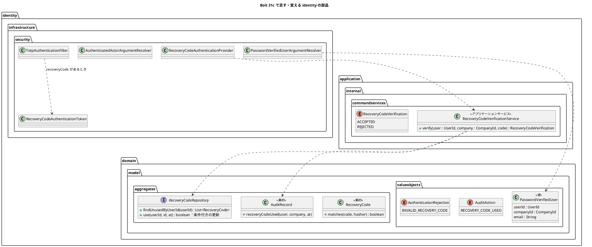
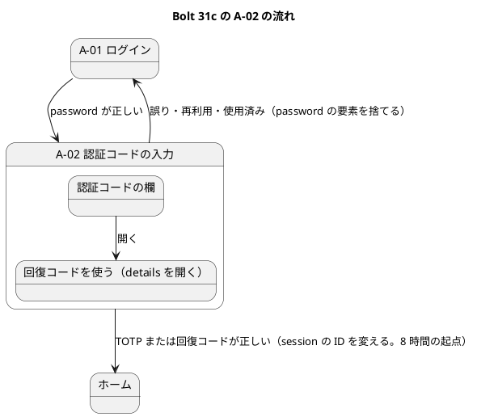
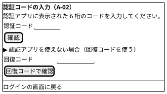

# Bolt 31c 計画 - 回復コードによるログインと password の段の主体の型

## 基本情報

| 項目 | 内容 |
| :--- | :--- |
| Bolt | 第 31c 回（W5 の 7 本目。US-18 の残りの 4 本目） |
| 予定 | W5（2026-11-02 の週。前倒しで着手できる）。作業は約 4 時間 20 分（承認ゲートの待ち時間を除く。「時間の配分と打ち切り」） |
| 対象 | `identity`（回復コードの確かめのアプリケーションのサービス、A-02 の回復コードの欄と認証、password の段の主体の型、引数の解決、監査）、画面の単体テストの主体（`@WithAuthenticatedActor`）、ADR-011・ADR-012、UI 設計・ドメインモデル・データモデル、リリース計画 |
| SP | 0（US-18 の残りの SP は #13 をクローズする Bolt 33b で数える） |
| GitHub | [#13](https://github.com/k2works/practical-domain-driven-design-in-enterpris-application/issues/13)（US-18、R1.0）。この Bolt では閉じない |
| 承認ゲート | **ステップごとに止める**（W4 の締めの決定: 認証の完成はステップごと）。確認必須（セキュリティ、画面の流れの変更）は計画の承認の場で確認ポイントとして判断を受ける |
| アプローチ | インサイドアウト（開発戦略の中盤。W5 の表で US-18 はインサイドアウト）。回復コードの集約と条件付きの消費（Bolt 30）はあるので、内側のサービスから固め、認証の入口と画面を後に足す |
| 前の Bolt | [Bolt 31b 終了報告](bolt_31b_report.md)、[Bolt 31 終了報告](bolt_31_report.md) |

## Bolt ゴール

TOTP の端末を持っていない利用者が、A-02 で回復コードを 1 つ使ってログインを終えられるようにする（US-18 AC9 のうちログインの分。SEC-09）。使った回復コードは二度と使えない。あわせて、password の段だけの主体を identity の中だけの型（`PasswordVerifiedUser`）に分け、ほかのコンテキストが受ける `AuthenticatedActor` を 2 つの要素がそろった主体だけにする（ADR-012 の「W5 で見直すこと」の 4）。

### 確かめたい仮説

| # | 仮説 | この Bolt で分かること |
| :--- | :--- | :--- |
| H1 | 回復コードを TOTP と同じ入口（`POST /login/totp`）と同じ要素の権限（`FACTOR_TOTP`）で受ければ、業務の認可・session の ID の変更・8 時間の起点を変えずに 2 つ目の要素の手段を足せる | セキュリティの統合テストで、回復コードで通った主体が業務の URL を開け、session の ID が変わり、8 時間の起点が置かれること。業務の認可の設定に差分がないこと |
| H2 | 引数の解決が 2 つの要素がそろった主体だけに `AuthenticatedActor` を渡しても、ほかのコンテキストの controller は変わらない（全体の注釈で、要素の欠けた主体はもともと届かない） | ほかのコンテキストの本体のコードに差分がなく、画面の単体テストは `@WithAuthenticatedActor` に要素の権限を足すだけで緑のままであること |

## ふりかえりと前の Bolt からの引き継ぎ

| 入力 | 内容 | この Bolt での扱い |
| :--- | :--- | :--- |
| 開始準備の決定（2026-10-13、human:kakimomokuri） | 31c と 31d に分ける。回復コードは A-02 の `
` で開く別の欄（`recoveryCode`）で受け、同じ `POST /login/totp` に送る。通ったら `FACTOR_TOTP` を与え、監査は専用の操作にする。password の段の主体の型は `identity.domain.model.valueobjects` に置く | 本計画の範囲と、確認ポイント 1〜4 |
| Bolt 31b の Try T-105 | デモの動画は、レビューの直しで画面の文言が変わらないと確かめてから撮る | ステップ 6 で、開発レビューの直しの後に動画を撮る |
| Bolt 31b の Try T-106 | 「ないこと」を確かめるテストには「あるべきものがあること」の確かめを並べる | 回復コードの平文が記録・監査・session に出ないことの確かめに、回復コードを使った記録（`used_at`）があることを並べる。引数の解決が `AuthenticatedActor` を渡さないことの確かめに、`PasswordVerifiedUser` を渡すことを並べる |
| Bolt 31 の Try T-101 | 置き場所の決定が層の規則の例外を伴いそうなときは、骨組みを置いて ArchUnit を流して確かめる | Bolt 31b の開始準備で確かめた（`valueobjects` に置くと通る）。この Bolt では新しい置き場所を作らない（回復コードのサービスは `commandservices`、引数の解決は `infrastructure.security`。どちらも既存の例外の範囲） |
| Bolt 31 の Try T-102 | 認証の段の状態を足すときは、同じ session での利用者の切り替えを境界のテストに入れる | 回復コードの欄を開いた session で別の利用者の password を送ると、前の利用者の回復コードでは通らないこと（回復コードは主体の利用者 ID で探す） |
| Bolt 31 の Try T-103・T-104 | 書き換えはスクリプトのファイルにする。SonarQube は開発レビューの前に流す | 全ステップ。ステップ 6 の最初に SonarQube |
| Bolt 30 の Try T-99・T-100 | 境界のテストを両方の実装で動かす。同時の更新は片方のコミットを止めて待ちを確かめる | 回復コードの同時の消費（同じコードを 2 つの session で送る）は、条件付きの更新で 1 つだけが通ることを PostgreSQL の統合テストで確かめる（契約テストは Bolt 30 にある） |
| Bolt 14 の Try T-42 | 値がない・対応がないときに失敗へ倒す | 確認ポイント 7（回復コードの欄と TOTP の欄が両方ある送信、形の違う回復コード、回復コードのない利用者、TOTP を登録していない利用者） |
| ADR-012 の「W5 で見直すこと」の 4 | 引数の解決で TOTP まで済んでいない主体を渡さない。`@WithAuthenticatedActor` に要素の権限を足す。A-02・A-07 が受ける型を分ける | ステップ 4 |
| Bolt 31b の既知の課題（31c） | 主体の型と見直しの 4、回復コードによるログインと登録の後の A-02 の案内（レビュー 13）。そのほか（照合の 3 値、`REJECTED_NOT_ENROLLED` の監査の理由、`FACTOR_*` の ArchUnit、SVG の組み立て、定数、入口と暗号のパッケージ、特性テスト、スパイクの削除） | 前の 2 つはこの Bolt。そのほかは開始準備の決定で 31d に送る |
| W4 の Try T-83・T-88・T-89・T-90 | 骨組みのまま流して本命のアサーションで落とす。見張り。後に回したものは Issue にする。画面を作る Bolt の開発レビューにテクニカルライターの観点 | 全ステップ。A-02 に欄を足すので、ステップ 6 にテクニカルライターの観点を入れる。31d は #13 の中の作業として W5 の表で追う（T-89 から外れる扱いは 31b と同じ） |

## スコープ

### 設計の約束（Try T-1）

- 回復コードは TOTP と同じ入口（`TotpAuthenticationFilter`、`POST /login/totp`）で受け、別の認証のトークン（`RecoveryCodeAuthenticationToken`）と provider で確かめる。通ったら TOTP と同じ要素の権限 `FACTOR_TOTP` を与える（業務の認可、session の ID の変更、CSRF の作り直し、8 時間の起点を 1 か所に保つ）
- 照合と消費はアプリケーションのサービス（`identity.application.internal.commandservices`）に置く。未使用のコードのすべてとハッシュで照合し、一致したコードを条件付きの更新で使う（`RecoveryCodeRepository#use`）。更新できなかったら（同時の消費で負けた）拒む
- 回復コードの平文は、照合の後どこにも残さない（記録・監査・session・例外のメッセージ）
- 誤り・使用済みは TOTP の誤りと同じく password の要素を捨てて A-01 に戻す（1 つの session で試し続けさせない。K-02）。拒否の種類は監査記録の理由にだけ残す
- `AuthenticatedActor` は 2 つの要素がそろった主体だけ。password の段だけで開く画面（A-02・A-07）は `PasswordVerifiedUser`（identity の中だけの型）を受ける

### 入れるもの・入れないもの

| 入れる | 入れない（後で） |
| :--- | :--- |
| 回復コードの確かめのサービス（照合、条件付きの消費、監査記録） | 回復コードによる TOTP の再登録と、残りが少ないときの案内（AC9。Bolt 33b） |
| A-02 の回復コードの欄（`
`）、認証のトークンと provider、入口のフィルターの振り分け | 失敗の回数を数えてロックする（Bolt 32。回復コードの誤りも数える見込み） |
| 監査の操作 `RECOVERY_CODE_USED`、拒否の理由 `INVALID_RECOVERY_CODE` | 照合の 3 値をドメインに寄せる、`REJECTED_NOT_ENROLLED` の監査の理由（31d） |
| `PasswordVerifiedUser` と引数の解決、`AuthenticatedActor` の引数の解決を 2 つの要素がそろった主体だけにする、`@WithAuthenticatedActor` の要素の権限 | `FACTOR_*` の ArchUnit の空振り対策、入口と暗号のパッケージ、特性テスト（R-16）、Bolt 31 の低の指摘、SVG の組み立て・定数、スパイクの削除（31d） |
| 登録の後に A-02 に来たときの案内（Bolt 31b のレビュー 13） | ユーザーマニュアル（Bolt 33b でまとめて直す。W5 の節の決定） |
| 画面の層のシナリオ（回復コードでログインする） | request ごとの問い合わせを 1 回にする（ADR-012 の見直しの 3。Bolt 32） |

## 設計（この Bolt の範囲）

### ドメインモデル

- `RecoveryCodeVerificationService#verify` は、未使用のコードのすべてと照合し（最大 10 回の bcrypt）、一致したコードを `use` で使う。使えたら監査記録 `RECOVERY_CODE_USED` を同じトランザクションで書き、`ACCEPTED` を返す。一致しない・使えない（同時の消費で負けた）・回復コードがないときは `REJECTED`（拒否の理由を細かく分けない。使用済みのコードは未使用の一覧に出ないので、誤りと区別できない）
- `PasswordVerifiedUser` は、password の段がそろった主体から作る identity の中だけの値。ほかのコンテキストからは参照しない（ArchUnit で守る）

### データモデル

スキーマは変えない。`recovery_code.used_at` を条件付きの更新で書く（Bolt 30 の `use`）。監査記録の操作の列（`audit_record.action`）は文字列なので、`RECOVERY_CODE_USED` と拒否の理由 `INVALID_RECOVERY_CODE` はマイグレーションを要さない（データモデルの操作の一覧に足す）。

### 画面遷移

画面の形（UI 設計「A-02」に足す）:

- 回復コードの欄は `
` の中の別のフォーム（`name="recoveryCode"`、`autocomplete="off"`、`inputmode` は付けない）。JavaScript も CSP の変更も要らない
- 回復コードは大文字・小文字と前後の空白、ハイフンの有無を問わずに受け、`xxxx-xxxx` の小文字に正規化して照合する（確認ポイント 6）
- 誤り・使用済みは TOTP と同じく A-01 に戻し、「認証コードが正しくないか、すでに使われています。…」を示す（文言は確認ポイント 5）
- 登録の直後（回復コードの保存の画面の「ログインを続ける」）に A-02 に来たときは、「認証アプリを登録しました。認証アプリに表示されたコードを入れてログインを終えてください。」を示す（Bolt 31b のレビュー 13。session の登録を始めた時刻があるときだけ）

## ステップ計画

状態の記号: `[ ]` 未着手、`[-]` 進行中、`[?]` 承認待ち、`[x]` 完了。各ステップの終わりに `check` が緑であることと、計画からの変更を設計文書に反映したこと（T-53）を確かめ、push して CI を確かめる（T-26、T-65）。そのステップのファイルだけをステージする（T-84）。複数行の書き換えはスクリプトのファイルにする（T-103）。

- [ ] **1. 設計文書** 【承認ゲート: 設計文書】
  - ADR-011: 回復コードによるログイン（同じ入口、`FACTOR_TOTP`、別のトークンと provider、照合の回数と bcrypt の時間、正規化、拒否の扱い）。105 行目の「TOTP の欄で受け付け」を「A-02 の別の欄で受け付け」に直す（開始準備の決定）
  - ADR-012: 見直しの 4 を「決めた」に移す（`PasswordVerifiedUser` の置き場所と、引数の解決の振る舞い）。31d に送るものを書く
  - ui_design.md: A-02 の salt と表（回復コードの欄、登録の直後の案内）。511 行目の「回復コードの欄は Bolt 31c」を決定に移す
  - domain_model.md（用語集に `RecoveryCodeVerificationService`・`PasswordVerifiedUser`・`RECOVERY_CODE_USED`）、data_model.md（監査の操作と拒否の理由の一覧）
  - release_plan.md の W5 の節: 31c の行を本計画に、31d の行を足す（SP 0）。持ち込みの表（604・608 行目の特性テスト・スパイクの削除を 31d に）。順序（31c → 31d → 32、31c → 33b）
  - 完了の判定: `okf:check` ERROR 0、`documentationTest` 緑
- [ ] **2. 回復コードの確かめのサービス** 【承認ゲート: Red・Green】
  - Red: `RecoveryCodeVerificationService` の単体テスト（正しいコードで使った時刻が入り監査記録 `RECOVERY_CODE_USED`、同じコードの二度目は拒む、誤ったコード・回復コードのない利用者は拒み何も書かない、ほかの利用者のコードでは通らない、正規化（大文字・空白・ハイフンなし）、照合の後に平文を記録に出さない）。PostgreSQL の統合テスト（同じコードを 2 つのトランザクションで同時に使うと 1 つだけ通る。T-100）
  - Green: サービス（`@Service`・`IdentityConfiguration`）、`RecoveryCodeVerification`、`AuditAction.RECOVERY_CODE_USED`・`AuditRecord.recoveryCodeUsed`、`AuthenticationRejection.INVALID_RECOVERY_CODE`
  - 完了の判定: `check` 緑
- [ ] **3. A-02 の回復コードの欄と認証** 【承認ゲート: セキュリティ、画面】
  - Red: セキュリティの統合テスト（本物のフィルターの連なりと Spring Session JDBC の上で）
    - 回復コードで A-02 を通ると、session の ID が変わり、業務の URL を開け、8 時間の起点が置かれ、監査記録に `RECOVERY_CODE_USED` と `LOGIN_SUCCEEDED`
    - 使ったコードでもう一度ログインすると A-01 に戻り、監査記録の理由は `INVALID_RECOVERY_CODE`。誤ったコードも同じ
    - `recoveryCode` と `code` の両方がある送信、どちらもない送信（確認ポイント 7）
    - 回復コードの欄を開いた session で別の利用者の password を送ると、前の利用者の回復コードでは通らない（T-102）
    - CSRF のトークンが要る。password の段を経ない送信は A-01（誤りの文言なし）
  - Green: `RecoveryCodeAuthenticationToken`・`RecoveryCodeAuthenticationProvider`、`TotpAuthenticationFilter` の振り分け、`SecurityConfiguration` の provider の登録と例外の対応表（`DefaultAuthenticationEventPublisher` の失敗のイベント）、`AuthenticationAuditListener` の理由、`login-totp.html` の `
` と登録の直後の案内
  - 完了の判定: `check` 緑
- [ ] **4. password の段の主体の型と引数の解決** 【承認ゲート: セキュリティ、構造】
  - Red: 引数の解決の単体テスト（password の要素だけの主体には `AuthenticatedActor` を渡さず例外、`Optional<AuthenticatedActor>` は空。2 つの要素がそろった主体には渡す。`PasswordVerifiedUser` は password の要素がある主体に渡す、未認証なら例外）。ArchUnit（`PasswordVerifiedUser` を identity の外が参照しない）。A-02 のヘッダーに利用者の名前が出ない（`currentActor` が空）
  - Green: `PasswordVerifiedUser`、`PasswordVerifiedUserArgumentResolver`（`IdentityWebConfiguration` に登録）、`AuthenticatedActorArgumentResolver` が `FACTOR_TOTP` を確かめる、`LoginController`・`TotpEnrollmentController` を `PasswordVerifiedUser` で受ける（`TotpEnrollmentService` の引数も `AuthenticatedActor` から利用者 ID と企業 ID に変える）、`WithAuthenticatedActorSecurityContextFactory` に `FACTOR_PASSWORD`・`FACTOR_TOTP` を足す
  - 完了の判定: `check` 緑。ほかのコンテキストの本体のコードに差分がない（H2）
- [ ] **5. 画面の層** 【承認ゲート: セキュリティ】
  - `login_ui.feature` に「認証アプリを使えない荷主担当者が回復コードでログインする」（`UiUsers` に回復コードを発行する口を足す。平文はテストの準備で決めた値）。デモの印 `@demo @demo-bolt-31c/recovery`
  - 完了の判定: `check` と `uiTest` が緑
- [ ] **6. SonarQube と開発レビューとデモと終了報告** 【承認ゲート: 終了報告】
  - SonarQube（`sonar-local:check`。T-104 で開発レビューの前に流す）
  - 開発レビュー（プログラマー、アーキテクト、テスター（セキュリティの境界）、テクニカルライター（A-02 の回復コードの欄と案内の文言。T-90））
  - レビューの直しの後にデモの動画（`demoVideo`）を撮り、#13 に添付する（`issue:attach-demo`。T-105）。`bolt_31c_report.md`。release_plan の W5 の 31c の行、開発の索引。#13 に進み具合をコメントする

### 時間の配分と打ち切り

| # | 目安 | 打ち切り |
| :--- | :--- | :--- |
| 1 | 30 分 | — |
| 2 | 45 分 | — |
| 3 | 65 分 | — |
| 4 | 60 分 | ほかのコンテキストの本体のコードを変える必要が出たら、止めて人に諮る（H2 が崩れる） |
| 5 | 25 分 | — |
| 6 | 35 分（SonarQube と動画の待ちを除く） | — |

合計 260 分（約 4 時間 20 分）。4.5 時間を超えると見えたら、止めて人に諮る（候補: 登録の直後の案内を 31d に送る）。

## 確認ポイント（計画の承認の場でまとめて確認する。Try T-6）

| # | 確認すること | ステップ | 推奨 |
| :--- | :--- | :--- | :--- |
| 1 | **31c と 31d に分ける**（開始準備で決めた） | — | 31c: 回復コードによるログイン、主体の型、見直しの 4（32 と 33b が前提にする振る舞い）。31d: 照合の 3 値、`REJECTED_NOT_ENROLLED` の監査の理由、`FACTOR_*` の ArchUnit の空振り対策、入口と暗号のパッケージ、特性テスト（R-16）、Bolt 31 の低の指摘、SVG の組み立て・定数、スパイクの削除（構造の直し）。順序は 31c → 31d → 32（32 のロックは 31d の照合の 3 値の後のほうが数え方を置きやすい）。W5 は 14 本になる |
| 2 | **回復コードの欄**（開始準備で決めた。画面） | 3 | A-02 の `
` で開く別のフォーム（`name="recoveryCode"`）で、同じ `POST /login/totp` に送る。ADR-011 の「TOTP の欄で受け付け」（スパイクの形）を改める。欄の形で取り違えない |
| 3 | **要素と監査**（開始準備で決めた。セキュリティ） | 2・3 | 通ったら `FACTOR_TOTP` を与える（業務の認可を変えない）。監査は回復コードの使用 `RECOVERY_CODE_USED` と `LOGIN_SUCCEEDED` の 2 行。誤りは A-01 に戻し、理由 `INVALID_RECOVERY_CODE` を監査にだけ残す |
| 4 | **`PasswordVerifiedUser`**（開始準備で決めた。構造） | 4 | `identity.domain.model.valueobjects` に置く（T-101 で層の規則を通ることを確かめた）。項目は利用者 ID・企業 ID・メールアドレス（dev の A-02 の入力済みと登録の URI のアカウント名に使う）。`AuthenticatedActor` の引数の解決は `FACTOR_TOTP` がない主体に渡さず例外にする（全体の注釈で業務の URL には届かないので、届いたら実装の誤り）。`Optional<AuthenticatedActor>`（ヘッダー）は空にする（A-02 のヘッダーに利用者の名前を出さない） |
| 5 | **回復コードの誤りの文言**（画面） | 3 | TOTP と同じ文言を使う（「認証コードが正しくないか、すでに使われています。認証アプリに新しいコードが表示されてから、もう一度ログインしてください。」）。回復コードの誤りを区別して示さない（AC2 と同じく、拒否の種類は監査記録にだけ残す）。テクニカルライターの観点で、回復コードの利用者に「新しいコードが表示されてから」が合わないかをレビューで確かめる |
| 6 | **回復コードの正規化**（セキュリティ） | 2 | 前後の空白を除き、小文字にし、ハイフンのない 8 文字は 4 文字目の後にハイフンを入れる。形が合わなければ照合せずに拒む（bcrypt を回さない）。手で書き写したコードを打ち直させない |
| 7 | **失敗へ倒す場面**（T-42） | 2・3 | 回復コードのない利用者・TOTP を登録していない利用者の回復コードは拒む。`recoveryCode` と `code` の両方がある送信は拒む（どちらを確かめたか曖昧にしない）。どちらもない送信は TOTP の誤りと同じ。照合の途中の例外は 500 にせず拒否してログを出す |
| 8 | **照合の時間**（セキュリティ） | 2 | 未使用のコードのすべてと照合するので、1 回の送信で最大 10 回の bcrypt（約 1 秒）。誤りは A-01 に戻すので 1 つの session で続けられず、password の段を毎回通る必要がある。回数の上限はロック（Bolt 32）で抑える。照合を途中で打ち切って時間で一致の位置が分かる心配は、使用済みが一覧に出ない形なので受け入れる |
| 9 | **登録の直後の A-02 の案内**（Bolt 31b のレビュー 13） | 3 | session に登録を始めた時刻があり、TOTP の資格がある（登録を終えた）ときだけ案内を示す。新しい session の属性は足さない |
| 10 | 後の Bolt に送るものと T-89 | — | 31d は確認ポイント 1。33b: 回復コードによる再登録と残りが少ないときの案内。32: 回復コードの誤りも失敗の回数に数えるか。どれも #13 の中の作業で、W5 の節の Bolt の分け方の表で追う（T-89 から外れて Issue にしない。31・31b と同じ扱い） |
| 11 | 承認ゲート | 全体 | ステップごとに止める（W4 の締めの決定）。ステップ 3・4・5 はセキュリティ、4 は構造の確認必須 |

## 完了条件

- [ ] A-02 で回復コードを使ってログインを終えられ、session の ID が変わり、業務の URL を開ける。使った回復コードは二度と使えない（同時の消費でも 1 つだけ）
- [ ] 回復コードの誤り・使用済みは A-01 に戻り、監査記録に理由だけが残る。平文は記録・監査・session に出ない
- [ ] `AuthenticatedActor` は 2 つの要素がそろった主体だけに渡る。A-02・A-07 は `PasswordVerifiedUser` を受ける。ほかのコンテキストの本体のコードは変わらない
- [ ] `check` と `uiTest` が緑。push して CI を確かめた。SonarQube の Quality Gate が PASS、`okf:check` ERROR 0
- [ ] 開発レビュー、レビューの後のデモの動画と #13 への添付、終了報告。#13 に進み具合をコメントした

### デモ項目

- 画面の層のシナリオの動画（`@demo @demo-bolt-31c/recovery`）: 荷主担当者のログイン → A-02 →「認証アプリを使えない場合」を開く → 回復コード → ホーム

## 更新履歴

| 日付 | 更新内容 | 更新者 |
| :--- | :--- | :--- |
| 2026-10-13 | 初版作成（承認待ち）。開始準備で、Bolt 31b の終了報告の Try と既知の課題、ADR-012 の見直しの 4、UI 設計の A-02、回復コードの集約とリポジトリ、引数の解決と TOTP の入口を調べ、human:kakimomokuri の決定（31c と 31d に分ける、回復コードは `
` の別の欄、`FACTOR_TOTP` と専用の監査、主体の型は `valueobjects`）を反映した | anthropic/claude-opus-5-5 |

## 関連ドキュメント

- [リリース計画](release_plan.md)（W5）
- [Bolt 31b 計画](bolt_31b_plan.md)、[Bolt 31b 終了報告](bolt_31b_report.md)、[Bolt 31 終了報告](bolt_31_report.md)
- [ADR-011](../../adr/cargo-tracker/011-mfa-totp.md)、[ADR-012](../../adr/cargo-tracker/012-authentication-principal-and-session.md)
- [ドメインモデル](../../design/cargo-tracker/domain_model.md)（アクセス・監査）、[データモデル](../../design/cargo-tracker/data_model.md)（`identity`）、[UI 設計](../../design/cargo-tracker/ui_design.md)（A-02）
