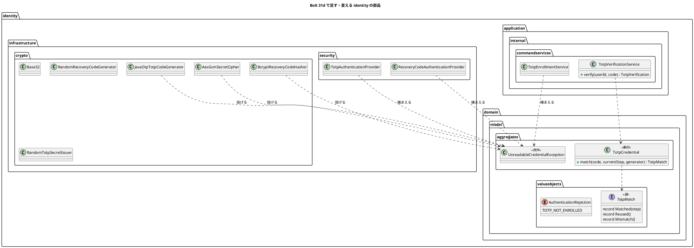

# Bolt 31d 計画 - 認証の部品の守りの直し（照合の 3 値、暗号のパッケージ、特性テスト、スパイクの削除）

## 基本情報

| 項目 | 内容 |
| :--- | :--- |
| Bolt | 第 31d 回（W5 の 8 本目。US-18 の残りの 5 本目） |
| 予定 | W5（2026-11-02 の週。前倒しで着手できる）。作業は約 4 時間 30 分（承認ゲートの待ち時間を除く。「時間の配分と打ち切り」）。上限に近い |
| 対象 | `identity`（TOTP の照合の結果、確かめのサービス、監査の理由、保存した要素を読めないときの例外、暗号の部品のパッケージ、層の規則）、ArchUnit・セキュリティの統合テスト・特性テスト、スパイク（`spikes/ts-01-totp/`）、ADR-011・ADR-012、ドメインモデル・データモデル・アーキテクチャ、リリース計画 |
| SP | 0（US-18 の残りの SP は #13 をクローズする Bolt 33b で数える） |
| GitHub | [#13](https://github.com/k2works/practical-domain-driven-design-in-enterpris-application/issues/13)（US-18、R1.0）。この Bolt では閉じない |
| 承認ゲート | **ステップごとに止める**（W4 の締めの決定: 認証の完成はステップごと）。確認必須（構造（パッケージの移動と層の規則の例外の範囲、新しい `package-info.java`）、ファイルの削除（スパイク）、セキュリティ（失敗へ倒す範囲の変更））は計画の承認の場で確認ポイントとして判断を受ける |
| 承認ゲートの扱い | 2026-10-13 に human:kakimomokuri が計画を承認した（確認ポイント 1〜9 は推奨のとおり）。あわせて人の指示（「推奨のまま承認して止めずに進める」）により、ステップの承認ゲートで止まらずに進める。止まらなかったゲートごとに根拠を書き、終了報告の承認の議題に置く（T-36）。対応表に当てはまらないスパイクのテスト、層の規則の新しい例外が要るときは止めて人に諮る |
| アプローチ | リファクタリング（release_plan の 31d の行）。開発戦略の表（development_strategy.md:116-122）では技術タスクに当たり、テストの入口は検証の手段（ArchUnit・見張り）。構造の直し（パッケージ、見張り、特性テスト、スパイク）は守りのテストを先に足して緑のまま動かす。振る舞いの変わる 2 つ（照合の結果と監査の理由、失敗へ倒す範囲）は、W5 の表のとおりインサイドアウトの TDD（Red から）にする |
| 前の Bolt | [Bolt 31c 終了報告](bolt_31c_report.md)、[Bolt 31b 終了報告](bolt_31b_report.md)、[Bolt 31 終了報告](bolt_31_report.md) |

## Bolt ゴール

認証の部品の守りを、次の変更（Bolt 32 のロック、33b の再登録）の前に固める。TOTP の照合の結果（一致・再利用・不一致）をドメインの値にし、資格を作り直して再利用を見分ける回り道（`wasAlreadyUsed`）をなくす。暗号の部品を `identity.infrastructure.crypto` に分け、層の規則 D-5 の認証の例外を入口（`identity.infrastructure.security`）だけにする。保存した要素を読めないとき（復号の失敗・ハッシュの形の誤り）だけを拒否に倒し、ほかの実装の誤りを利用者の誤りに見せない。`FACTOR_*` の参照・業務の URL・ログの平文・枠組みの暗黙の振る舞いに見張りを置き、スパイクを本体のテストとの対応を確かめてから消す。

### 確かめたい仮説

| # | 仮説 | この Bolt で分かること |
| :--- | :--- | :--- |
| H1 | 照合の結果をドメインの値（一致した刻み・再利用・不一致）にすれば、確かめのサービスは結果を写すだけになり、再利用の判別に資格を作り直す必要がなくなる | `TotpVerificationService` から `wasAlreadyUsed` が消え、拒否のときの生成の呼び出しが窓の刻みの数（3 回。刻み 0 は 2 回）だけになること（今は数字のコードで刻み 1 以上なら 6 回） |
| H2 | 暗号の部品を別のパッケージに分ければ、D-5 の認証の例外をパッケージ単位の規則のまま入口だけに狭められ、クラス名の一覧の規則がいらなくなる | 暗号の部品が D-5 の例外の対象（`identity.infrastructure.security`）から外れ、既存の規則（合成ルートと入口の外の infrastructure は application に依存しない。`LayerArchitectureTest.java:97-105`）が `crypto` にもかかること（見張りで確かめる）。足す規則は「`crypto` は `security` に依存しない」だけで、違反を入れると落ちること |

## ふりかえりと前の Bolt からの引き継ぎ

| 入力 | 内容 | この Bolt での扱い |
| :--- | :--- | :--- |
| 開始準備の決定（2026-10-13、human:kakimomokuri） | 守りの直しを 31d に入れ、低の指摘は該当する部品に触る Bolt（32・33b）で直す。暗号の部品を `identity.infrastructure.crypto` に分けて D-5 の例外を狭める。`FACTOR_TOTP`・`TotpAuthenticationToken` は改名せず、用語集と Javadoc に「TOTP または回復コードで与える 2 つ目の要素」と書く。スパイクは特性テストを本体に移してから消す | 本計画の範囲と、確認ポイント 1〜4 |
| Bolt 31c の Try T-107 | 「ないこと」を確かめるテストは、確かめる対象がその時点で存在することを先に確かめる | ログの平文の見張りは、同じ実行でその利用者の ID のエラーの行がログにあることを先に確かめる（エラーのログが出る場面に限る）。`FACTOR_*` の見張りは、走査したファイルの数が 0 でなく `TotpAuthenticationToken.java` が見つかることを先に確かめる。全 URL の見張りは、一覧の数が 0 でないことを先に確かめる |
| Bolt 31c の Try T-108 | 枠組みに任せる約束は「どの部品がいつ呼ぶか」を計画に書き、呼ばれることをテストで確かめる | 特性テスト（R-16）の 3 つは、どれも枠組みのどの部品の既定の振る舞いかを書き、その振る舞いを直接確かめる（確認ポイント 6） |
| Bolt 31c の Try T-109 | 設計文書を並行して任せるときは、設計文書を先に push してからコードを push する | ステップ 1 を push してからステップ 2 のコードを push する。サブエージェントに任せるなら、その完了と push を待ってからコードを push する |
| Bolt 31 の Try T-101 | 置き場所の決定が層の規則の例外を伴いそうなときは、骨組みを置いて ArchUnit を流して確かめる | 開始準備で行った（2026-10-13）。`identity.infrastructure.crypto` に `RecoveryCodeHasher` を実装する仮のクラスを置き、`LayerArchitectureTest`・`ModularityTest`・`AuthenticationArchitectureTest`・`DddAnnotationArchitectureTest`・`ComponentScanTest`・`DomainArchitectureTest` が緑のままであることを確かめ、仮のクラスを消した |
| Bolt 31 の Try T-103・T-104 | 書き換えはスクリプトのファイルにする（ヒアドキュメントにしない）。SonarQube は開発レビューの前に流す | 全ステップ。ステップ 6 の最初に SonarQube |
| Bolt 31c の既知の課題（31d） | 照合の 3 値、`REJECTED_NOT_ENROLLED` の監査の理由、`FACTOR_*` の ArchUnit の空振り対策、入口と暗号のパッケージ、特性テスト（R-16）、平文がログに出ない見張り、provider の例外の捕捉の範囲、`FACTOR_TOTP` の名前、スパイクの削除。低（定数・SVG・時計の設定・登録を始めた時刻のキー・回復コードの形の知識の 2 か所・Bolt 31 の低の指摘ほか） | 前のものはこの Bolt。照合の 3 値は TOTP だけで、回復コードの `RecoveryCodeVerification` は 2 値のまま（確認ポイント 2）。`FACTOR_TOTP` の名前は用語集に書くだけ。低は開始準備の決定で 32・33b に送る（確認ポイント 8） |
| Bolt 31 の開発レビュー 17 | `FACTOR_*` の ArchUnit がコンパイル時の定数の埋め込みで空振りし得る。見張りが GET の代表の URL だけ | ステップ 4 |
| Bolt 13 のレビュー R-16 | `toBuilder()` の要否、既定のリポジトリ、`issuedAt` の時計を特性テストに固定する（D-47。ADR-011 のコンプライアンス） | ステップ 4（確認ポイント 6） |
| W4 の Try T-83・T-88・T-89 | 骨組みのまま流して本命のアサーションで落とす。見張り。後に回したものは Issue にする | 全ステップ。32・33b に送るものは #13 の中の作業として W5 の表で追う（T-89 から外れる扱いは 31・31b・31c と同じ） |

## スコープ

### 設計の約束（Try T-1）

- 振る舞いの変更は 2 つだけ。①`REJECTED_NOT_ENROLLED` の監査の理由を `INVALID_TOTP` から `TOTP_NOT_ENROLLED` に分ける（利用者への応答は変えない。AC2）。②入口（provider）が拒否に倒すのは、保存した要素を読めないとき（復号の失敗・ハッシュの形の誤り）だけにし、ほかの `IllegalArgumentException`（値の検証など実装の誤り）は 500 にしてエラーのログに残す（ADR-011 の決定 7 の「照合の途中の例外は 500 にせず拒否」を改める。確認ポイント 5）
- TOTP の照合の結果はドメインの値 `TotpMatch`（sealed interface。入れ子の record `Matched(step)`・`Reused`・`Mismatch`）にし、`TotpCredential#match` が返す。比べる回数を一致の位置で変えない（一定時間）ことと、形の違うコードでは生成器を呼ばないことは保つ
- 保存した要素を読めないことは、ドメインの例外 `UnreadableCredentialException`（`identity.domain.model.aggregates`。ポートと同じ置き場所。`IllegalArgumentException` を継ぐ）で表す。暗号の部品がこれを投げ、入口の provider と登録のサービスがこれだけを捕まえる
- 暗号の部品（`AesGcmSecretCipher`・`Base32`・`BcryptRecoveryCodeHasher`・`JavaOtpTotpCodeGenerator`・`RandomRecoveryCodeGenerator`・`RandomTotpSecretIssuer`）は `identity.infrastructure.crypto` に置き、application にも入口（`security`）にも依存しない。D-5 の認証の例外は `identity.infrastructure.security` だけ
- `FACTOR_TOTP`・`TotpAuthenticationToken` の名前は変えない（session の直列化の互換。ADR-012 のネガティブ）。意味（TOTP または回復コードで与える 2 つ目の要素）は用語集と Javadoc に書く
- スパイクは、6 つのテストのクラス（34 のテストのメソッド）と、本体のテスト・後の Bolt の計画・ADR の記録との対応表で、すべてが結び付いていることを確かめてから消す。対応表は終了報告に残す

### 入れるもの・入れないもの

| 入れる | 入れない（後で） |
| :--- | :--- |
| `TotpMatch` と `TotpCredential#match`、確かめのサービスの簡素化、監査の理由 `TOTP_NOT_ENROLLED` | 回復コードの照合の結果を 3 値にする（使用済みは未使用の一覧に出ないので区別できない。2 値のまま。確認ポイント 2） |
| `UnreadableCredentialException` と、失敗へ倒す範囲の絞り込み（入口と登録のサービス） | `RecoveryCode` の構築子の空のハッシュ（DB の破損）は 500 のまま（実装の誤り・データの破損として扱う。確認ポイント 5） |
| `identity.infrastructure.crypto` への移動と `package-info.java`、D-5 の例外の範囲の見直し、パッケージ単位の ArchUnit | 定数（桁数・周期・アルゴリズム）、SVG の組み立てのまとめ方、登録を始めた時刻のキーの定数、回復コードの形の知識の 2 か所（33b） |
| `FACTOR_*` の参照の見張り（ソースの走査）、全 URL の見張り（ハンドラーの一覧から）、ログの平文の見張り、特性テスト（R-16） | Bolt 31 の低の指摘、3 つの統合テストの時計の設定、`DataAccessException` の扱いほか（32。確認ポイント 8） |
| スパイクの削除と対応表、本体にない確かめ（bcrypt の強さ 10）の追加 | ユーザーマニュアル（画面を変えないので、この Bolt では直さない） |

## 設計（この Bolt の範囲）

### ドメインモデル

- `TotpCredential#match` は窓の刻み（3 つ。刻み 0 は 2 つ）のすべてを一定時間で比べ、使っていない刻みで一致すれば `Matched(step)`、使った刻み以下でだけ一致すれば `Reused`、どれとも一致しなければ `Mismatch` を返す。形の違うコード（数字以外、空）は生成器を呼ばずに `Mismatch`。`matchingStep` は `match` に置き換える（呼び出し元は確かめのサービス（`TotpVerificationService.java:45`）と登録のサービス（`TotpEnrollmentService.java:124`））
- 確かめのサービスは `Matched` のときだけ条件付きの更新で刻みを使い、更新できなければ（同時の確かめで後になった）`REJECTED_REUSED` を返す。`Reused` は `REJECTED_REUSED`、`Mismatch` は `REJECTED_MISMATCH`
- `@ValueObject` は `TotpMatch` だけに付け、用語集は 1 行にする（入れ子の record は外側のソースで用語集の照合を受ける。確認ポイント 2）
- `UnreadableCredentialException` を投げる場所: `AesGcmSecretCipher#decrypt`（知らない鍵の版・壊れた暗号文・別の利用者の暗号文）、`JavaOtpTotpCodeGenerator`（今 `InvalidKeyException` を `IllegalArgumentException` に包んでいる所。`JavaOtpTotpCodeGenerator.java:64-65`）、`BcryptRecoveryCodeHasher#matches`（`DelegatingPasswordEncoder` が知らない `{id}` の接頭辞で投げる `IllegalArgumentException` を包み直す。bcrypt の形の誤りは枠組みが false を返すので、一致しないとして扱われる）。ポートの Javadoc の `@throws`（`TotpSecretIssuer.java:19` ほか）も直す
- 状態遷移図は省く（TOTP の資格と回復コードの状態は Bolt 30 のまま）

### データモデル

表は変えない（ER 図は省く）。監査記録の理由の一覧に `TOTP_NOT_ENROLLED` を足す（`identity.audit_record.reason` は CHECK 制約のない文字列の列なので、マイグレーションは要らない）。

### 画面遷移

画面は変えない（画面遷移図は省く。ユーザーマニュアルも直さない）。

## ステップ計画

状態の記号: `[ ]` 未着手、`[-]` 進行中、`[?]` 承認待ち、`[x]` 完了。各ステップの終わりに `check` が緑であることと、計画からの変更を設計文書に反映したこと（T-53）を確かめ、push して CI を確かめる（T-26、T-65）。そのステップのファイルだけをステージする（T-84）。複数行の書き換えはスクリプトのファイルにする（T-103）。ステップ 1 を push してからコードのステップを push する（T-109）。

- [ ] **1. 設計文書** 【承認ゲート: 設計文書】
  - ADR-011: 照合の結果（`TotpMatch`）、`UnreadableCredentialException` と失敗へ倒す範囲（決定 7 の表の 218 行目「照合の途中の例外は 500 にせず拒否」を改める）、暗号の部品のパッケージ（決定 5 の 157 行目・決定 6 の 203 行目・コンプライアンスの 287 行目の ArchUnit の範囲）、`FACTOR_TOTP` の名前を残す理由、スパイクの削除（28 行目、58 行目のスパイクへのリンクはコミットに固定したリンクに、302 行目の参考資料）、コンプライアンスの節に新しい見張り（`FACTOR_*` のソースの走査、全 URL、ログの平文、特性テスト）と R-16 の特性テストの形（284〜285 行目）
  - ADR-012: D-5 の認証の例外を `identity.infrastructure.security`（入口）だけにしたこと（決定 6、コンプライアンスの 121 行目）、監査の理由の一覧（64 行目）に `TOTP_NOT_ENROLLED`
  - architecture_backend.md: D-5 の節（276〜277 行目。暗号の部品のパッケージ、例外の範囲、クラス名の一覧の規則をパッケージの規則に置き換えたこと、`UnreadableCredentialException` の向き（crypto が投げ、入口が捕まえる））
  - domain_model.md: 用語集に `TotpMatch`・`UnreadableCredentialException`、`TotpCredential` の説明（照合の結果）、`TotpVerificationService` の説明（183 行目「照合し」を「資格の照合の結果（`TotpMatch`）を写す」に）、`FACTOR_TOTP`・`TotpAuthenticationToken` の意味、監査の理由の値（194 行目）
  - data_model.md: 監査の理由の一覧に `TOTP_NOT_ENROLLED`（ui_design.md:521 は画面を通る理由だけを書いているので直さない）
  - release_plan.md の W5 の節: 31d の行（587 行目）を本計画に（回復コードは 2 値のまま、低の指摘を送る、承認ゲートは構造・セキュリティ・ファイルの削除）。557 行目の W5 のアプローチの説明に 31d はリファクタリング（振る舞いの変更は 2 つだけ）と書く。32 の行（588 行目）と 33b の行に送る低の指摘（確認ポイント 8。32 は範囲が重いので開始準備で分けるかを見直す材料になると添える）
  - 完了の判定: `okf:check` ERROR 0、`documentationTest` 緑。push してからステップ 2 のコードを push する（T-109）
- [ ] **2. 照合の結果をドメインに寄せる** 【承認ゲート: Red・Green】
  - Red: `TotpCredential#match` の単体テスト（今の刻みで一致は `Matched`、窓の前後で一致は `Matched`、使った刻み以下でだけ一致は `Reused`、どれとも一致しない数字のコードは `Mismatch`、生成の呼び出しは数字のコードで窓の刻みの数（刻み 0 は 2 回）、形の違う・空のコードは生成器を呼ばずに `Mismatch`）。確かめのサービスの単体テスト（拒否のときの生成の呼び出しが窓の刻みの数だけ）。監査の理由の統合テスト（TOTP を登録していない利用者の A-02 の送信は理由 `TOTP_NOT_ENROLLED`。今は `INVALID_TOTP`）
  - Green: `TotpMatch`（sealed interface と入れ子の 3 つの record、`@ValueObject`）、`TotpCredential#match`（`matchingStep` を置き換え、登録のサービスも直す）、確かめのサービスから `wasAlreadyUsed` を消す、`AuthenticationRejection.TOTP_NOT_ENROLLED` と監査のリスナーの写し
  - 書き直すテスト: `TotpCredentialTest` の `matchingStep` のテスト（83〜180 行目）を `match` に。`TotpVerificationServiceTest` の `REJECTED_NOT_ENROLLED` のテストは既にある（Red にならない）
  - 完了の判定: `check` 緑。契約テストと統合テストは期待値を変えずに緑（API の名前の変更だけ）
- [ ] **3. 読めない要素の例外と、暗号の部品のパッケージ** 【承認ゲート: セキュリティ、構造】
  - Red（振る舞い）: provider の単体テスト（`UnreadableCredentialException` は拒否、ただの `IllegalArgumentException` は捕まえずに投げる（500 になる））。登録のサービスの単体テスト（読めない暗号文は `SecretUnusable`、ただの `IllegalArgumentException` は投げる）。暗号の部品の単体テスト（復号の失敗・生成器の鍵の誤り・知らない接頭辞のハッシュは `UnreadableCredentialException`）。書き直すテスト: `RecoveryCodeAuthenticationProviderTest.java:97-98`（ただの `IllegalArgumentException` で拒否されることを確かめている）、`AesGcmSecretCipherTest` ほかの `IllegalArgumentException` の期待（専用の例外は `IllegalArgumentException` を継ぐので、型を狭めて確かめ直す）
  - Green（振る舞い）: `UnreadableCredentialException`、3 つの暗号の部品が投げる、2 つの provider と登録のサービスがこれだけを捕まえる、ポートの Javadoc の `@throws`
  - Red（構造。守りを先に）: ArchUnit「`identity.infrastructure.crypto` は `identity.infrastructure.security` に依存しない」と、見張り（`crypto` に 6 つの暗号の部品がある、既存の規則（合成ルートと入口の外の infrastructure は application に依存しない）が `crypto` のクラスにかかる）。暗号の部品が移るまで見張りが落ちることを確かめる
  - Green（構造）: 6 つのクラスとそのテスト、テストの共通部品 `TestSecretCiphers` を `identity.infrastructure.crypto` に移す（`git mv`）。`crypto/package-info.java` を足し（暗号の部品。application と入口に依存しない）、`security/package-info.java` の説明を入口だけに直す。利用者の import を直す（main: `IdentityConfiguration`・`DevLoginGuardConfiguration`・`devlogin/DevTotpCodes`。test: `UiUsers`・`DevTotpCodesTest`・`DevTotpCredentialsDevProfileTest`・`TotpVerificationServiceIntegrationTest`・`TotpSecretKeysBindingTest`・security の 3 つの統合テスト）。`AuthenticationArchitectureTest` のクラス名の一覧の規則（「秘密の発行と回復コードの生成の実装は application に依存しない」）を消し、暗号・ZXing・TOTP のライブラリの閉じ込めを `identity.infrastructure.crypto` に狭める（`AesGcmSecretCipher` を参照してよいのは crypto・合成ルート・dev の部品。`Base32` は dev の部品も使うが規則の対象外）。違反を入れて落ちることを確かめる（T-88）
  - 完了の判定: `check` 緑。`identity.infrastructure.security` に暗号の部品が残っていない
- [ ] **4. 守りのテスト** 【承認ゲート: セキュリティ】
  - `FACTOR_*` の参照の見張り: `src/main/java` を走査し、`"FACTOR_` の文字列と `FactorGrantedAuthority` を書いているファイルが `identity/infrastructure/security` と合成ルート `identity/infrastructure/config` の中だけであることを確かめる（コンパイル時の定数の埋め込みで ArchUnit が見落とす分。範囲は ArchUnit の既存の規則より狭く、入口と合成ルートだけ）。走査したファイルの数が 0 でなく、`TotpAuthenticationToken.java` が見つかることを先に確かめる（T-107）
  - 全 URL の見張り: `RequestMappingHandlerMapping` の一覧から、認証の画面（`/login`・`/login/totp`・`/login/totp/enroll`・`/session-expired`）、`/error`、静的な資源を除くすべての URL（GET と POST。POST には CSRF のトークンを付ける）について、password の段だけの主体が A-02 へ導かれることを確かめる。パスの変数は仮の値で埋める（正規表現の候補は最初の値、ID は乱数の UUID、番号は形の合う仮の値）。主体の役割は URL の接頭辞の規則（`SecurityConfiguration.java:144-153`）に合わせる（`/customer` は荷主、`/staff/routing-cases` は経路設計者、`/staff/tracking-records` は追跡管理者、ほかの `/staff` は営業、`/` は荷主）。役割の誤り（403）と A-02 への誘導を区別するため。一覧の数が 0 でないことを先に確かめる。今の代表の URL のテスト（`AuthenticationSecurityIntegrationTest` の「役割があってもTOTPの要素の欠けた主体はどの業務のURLも開けない」）は置き換える
  - ログの平文の見張り: `OutputCaptureExtension` で、TOTP の秘密を復号できない利用者の A-02 の送信と、保存した回復コードのハッシュの形の誤り（知らない接頭辞）の利用者の回復コードの送信の後、ログにその利用者の ID のエラーの行があり（T-107）、送ったコード・回復コード・password・秘密の Base32 がないこと
  - 特性テスト（R-16。Spring Security の版を上げるときの守り。確認ポイント 6）: ①mfaEnabled の認証のフィルターは、認証の結果の型が `toBuilder()` を持つときだけ前の要素の権限を合わせる（`toBuilder()` を持たない結果の型では `FACTOR_PASSWORD` が落ちる）、②認証のフィルター（`AbstractAuthenticationProcessingFilter`）の既定の文脈の置き場所は request の属性で、次の request に残らない（`TotpAuthenticationFilter` が session の置き場所を明示する理由）、③`FactorGrantedAuthority` の `issuedAt` はアプリケーションの `Clock` でなく枠組みの時計で決まる（最長 8 時間の判定に使わない理由）
  - 完了の判定: `check` 緑。見張りは違反を入れて落ちることを確かめる（T-88）
- [ ] **5. スパイクを消す** 【承認ゲート: ファイルの削除】
  - スパイクのテスト（`MfaLoginTest` 18、`DevLoginPrefillTest` 5、`TotpCandidatesTest` 6（パラメーター化の展開で 29 件）、`PasswordStorageTest` 3、`SessionTimeoutTest` 1、`SpikeSetupTest` 1。計 34 のメソッド）と、本体のテスト・後の Bolt の計画・ADR の記録との対応表を作る（確認ポイント 7 の分け方）。本体にない確かめのうち本体の守りになるもの（bcrypt の強さ 10）は本体にテストを足す
  - `spikes/ts-01-totp/` を消す（`git rm -r`）。ほかから参照されていないことを確かめる（Gradle の設定・CI・文書のリンク）。文書のスパイクへのリンク（ADR-011:58 は develop の外部リンクなので `okf:check` で検出されない）と、`JavaOtpTotpCodeGenerator` の Javadoc のスパイクへの言及は、コミットに固定したリンクか記述に直す
  - 完了の判定: `check` 緑、`okf:check` ERROR 0、`spikes/ts-01-totp` を参照する記述が文書とコードに残っていない（固定したリンクを除く）
- [ ] **6. SonarQube と開発レビューと終了報告** 【承認ゲート: 終了報告】
  - SonarQube（`sonar-local:check`。T-104）
  - 開発レビュー（プログラマー、アーキテクト、テスター（守りのテストの空振り））。画面を変えないのでテクニカルライターの観点は設計文書だけにする
  - `bolt_31d_report.md`（スパイクとの対応表を含む）。release_plan の W5 の 31d の行、開発の索引。#13 に進み具合をコメントする。画面を変えないのでデモの動画は撮らない

### 時間の配分と打ち切り

| # | 目安 | 打ち切り |
| :--- | :--- | :--- |
| 1 | 30 分 | — |
| 2 | 45 分 | — |
| 3 | 60 分 | 層の規則・Spring Modulith に新しい例外が要ると分かったら、止めて人に諮る |
| 4 | 70 分 | 特性テストの①が枠組みの内部に深く依存して書けないと分かったら、統合テストでの振る舞いの確かめ（今あるもの）に留め、理由を報告に書く |
| 5 | 30 分 | 確認ポイント 7 の分け方に当てはまらないスパイクのテストが見つかったら、止めて人に諮る |
| 6 | 35 分（SonarQube の待ちを除く） | — |

合計 270 分（約 4 時間 30 分。Bolt 31・31b・31c と同じく上限に近い）。4.5 時間を超えると見えたら、止めて人に諮る（候補: ログの平文の見張りを 32 に送る）。

## 確認ポイント（計画の承認の場でまとめて確認する。Try T-6）

| # | 確認すること | ステップ | 推奨 |
| :--- | :--- | :--- | :--- |
| 1 | **範囲と低の指摘の送り先**（開始準備で決めた） | — | 守りの直しを 31d に入れる。低の指摘は該当する部品に触る Bolt で直す（確認ポイント 8）。W5 は 14 本のまま |
| 2 | **照合の結果の形** | 2 | TOTP は sealed interface `TotpMatch` と入れ子の 3 つの record（`Matched(step)`・`Reused`・`Mismatch`）を `identity.domain.model.valueobjects` に置き、`@ValueObject` は `TotpMatch` だけに付ける（用語集は 1 行。`Matched` のような一般的な名前を用語集に並べない）。アプリケーションの `TotpVerification`（4 値。未登録を含む）は残し、`TotpMatch` を写す。回復コードの `RecoveryCodeVerification` は 2 値のまま（使用済みは未使用の一覧に出ないので再利用と誤りを区別できない。区別するには使用済みのコードとも照合する必要があり、bcrypt が倍になる）。release_plan の 31d の行の「`RecoveryCodeVerification` を含む」を改める |
| 3 | **監査の理由 `TOTP_NOT_ENROLLED`**（振る舞いの変更 ①） | 2 | TOTP を登録していない利用者の A-02 の送信（A-02 の画面は A-07 へ送るので、画面を経ない送信だけ）は、今は理由 `INVALID_TOTP`。運用で「登録していないのに TOTP を送った」と区別できるよう分ける。利用者への応答は変えない（AC2） |
| 4 | **暗号の部品のパッケージ**（開始準備で決めた。構造、新しいファイル） | 3 | `identity.infrastructure.crypto` に 6 つのクラスと `TestSecretCiphers` を移し、`crypto/package-info.java` を新しく作る。D-5 の認証の例外は `identity.infrastructure.security` のまま（入口だけになる）。足す規則は「`crypto` は `security` に依存しない」だけ（application の分は既存の規則がかかる。見張りで確かめる）。T-101 の骨組みの確かめは済んだ |
| 5 | **失敗へ倒す範囲**（振る舞いの変更 ②。セキュリティ） | 3 | 保存した要素を読めないことを `UnreadableCredentialException`（`identity.domain.model.aggregates`。ポートと同じ置き場所なので登録のサービスも参照できる。`IllegalArgumentException` を継ぐ）で表し、2 つの provider と登録のサービスはこれだけを捕まえる。名前は TOTP の秘密と回復コードのハッシュの両方を指す「保存した認証の要素を読めない」にする。ほかの `IllegalArgumentException`（値の検証など実装の誤り）は 500 にしてエラーのログに残す（今は拒否に倒れ、利用者に「コードの誤り」と見え、ログを見ないと気付けない）。ログインは通さないので失敗へは倒れたまま。`RecoveryCode` の構築子の空のハッシュ（DB の破損）は 500 のまま（データの破損は利用者の誤りに見せない）。ADR-011 の決定 7 の「照合の途中の例外は 500 にせず拒否」（T-42）を「読めない要素は拒否、実装の誤りは 500」に改める |
| 6 | **特性テストの範囲**（R-16） | 4 | 3 つを、枠組みの部品の既定の振る舞いとして直接確かめる（T-108）。①Spring Security の mfaEnabled の合わせを、`toBuilder()` を持つ型と持たない型の 2 つの認証の結果で比べる（フィルターを本物で組む単体テスト）。②`AbstractAuthenticationProcessingFilter` の既定の文脈の置き場所（request の属性）では次の request に残らないこと（R-16 と ADR-011 のコンプライアンスの「既定のリポジトリでは request の中にしか残らない」）。③`issuedAt` の時計。書けなければ打ち切りの欄のとおり |
| 7 | **スパイクの削除と対応表の分け方**（開始準備で決めた。ファイルの削除） | 5 | 34 のメソッドを次の 4 つに分ける。(a) 本体のテストに対応する（2 段階のログイン、再利用、8 時間の境界、session ID、切り替え、回復コード、開発用の入力済みなど）。(b) 後の Bolt の計画に対応する（ロックの 5 本は Bolt 32。ADR-011 のコンプライアンスの節に書いてある）。(c) ADR の記録として残す（採らなかった候補の比較（`TotpCandidatesTest` の候補 a・c）は ADR-011 の比較の表、Argon2id は Bouncy Castle がないと符号化できない学びは ADR-011 の password の保存の決定、Spring Security 7 系の確認（`SpikeSetupTest`）は技術スタック）。(d) 本体に足す（bcrypt の強さ 10）。どれにも当てはまらないものが見つかったら止めて人に諮る |
| 8 | **低の指摘の送り先** | — | 33b（登録と再登録の部品に触る）: 桁数・周期・アルゴリズムの定数、SVG の組み立て、登録を始めた時刻のキーの定数、回復コードの形の知識の 2 か所、`TotpEnrollmentService` の引数の型（31c の議題 4）、`normalize` の戻り値の型。32（ロックで統合テストと認証の入口に触る）: Bolt 31 の低の指摘（Base32 の不正な長さ、T-100 の待ちの判定、刻みを戻す SQL の重複、dev のテストの刻みの境界、合成ルートのクラスの分け方）、3 つの統合テストの時計の設定、`DataAccessException` の扱い、回復コードの誤りも数えるか、8 時間の起点の値と監査の順のテスト。どれも #13 の中の作業として W5 の表で追う。Bolt 31 の鍵の長さの境界と、31c のテストの名前・置き場所は直し済み |
| 9 | 承認ゲート | 全体 | ステップごとに止める（W4 の締めの決定）。ステップ 3 は構造とセキュリティ、4 はセキュリティ、5 はファイルの削除の確認必須 |

## 完了条件

- [ ] TOTP の照合の結果がドメインの値になり、確かめのサービスに `wasAlreadyUsed` がない。契約テストと統合テストは期待値を変えずに緑。TOTP を登録していない利用者の送信は理由 `TOTP_NOT_ENROLLED`
- [ ] 入口と登録のサービスは `UnreadableCredentialException` だけを拒否に倒し、ほかの `IllegalArgumentException` は 500 になる（テストあり）
- [ ] 暗号の部品が `identity.infrastructure.crypto` にあり、D-5 の認証の例外は入口だけ。`crypto` は application と `security` に依存しない（ArchUnit、見張り付き）
- [ ] `FACTOR_*` の参照・全 URL・ログの平文の見張りと、特性テスト（R-16）の 3 つがある。見張りは違反を入れて落ちる
- [ ] スパイクとの対応表で分け方に当てはまらないテストがなく、スパイクを消した
- [ ] `check` と `uiTest` が緑。push して CI を確かめた。SonarQube の Quality Gate が PASS、`okf:check` ERROR 0
- [ ] 開発レビューと終了報告。#13 に進み具合をコメントした

## 更新履歴

| 日付 | 更新内容 | 更新者 |
| :--- | :--- | :--- |
| 2026-10-13 | 初版作成（承認待ち）。開始準備で、Bolt 31c の終了報告の Try（T-107〜T-109）と既知の課題、Bolt 31 のレビュー 17、Bolt 13 の R-16、スパイクのテスト、照合と確かめのサービス、層の規則を調べ、human:kakimomokuri の決定（守りの直しを 31d・低は 32 以降、暗号の部品を crypto に分ける、`FACTOR_TOTP` は改名せず用語集に書く、スパイクは特性テストを移してから消す）を反映した | anthropic/claude-opus-5-5 |
| 2026-10-13 | 詳細整合性検証（19 件）と横断整合性検証（17 件）の指摘と、T-101 の骨組みの確かめの結果を反映した。`FACTOR_*` の見張りの範囲に合成ルートを含める、スパイクのテストの数（6 クラス・34 メソッド）と対応表の分け方、特性テスト②を枠組みの既定の置き場所に、ログの見張りをエラーのログが出る場面に、読めない要素の例外をドメインに置き登録のサービスも狭める（名前を `UnreadableCredentialException` に）、投げる場所の一覧、振る舞いの変更を 2 つと書く、失敗へ倒す範囲の完了条件、全 URL の見張りの除外・パスの変数・CSRF・役割、`TotpMatch` の入れ子と用語集、足す規則を「crypto は security に依存しない」だけに、利用者の一覧と `package-info.java`、Red と書き直すテストの区別、ステップ 1 の対象（ADR の行・release_plan の 557 行目・用語集の説明）、アプローチの理由、低の指摘の送り先の漏れを直した | anthropic/claude-opus-5-5 |
| 2026-10-13 | 計画の承認を記録した。確認ポイント 1〜9 は推奨のとおり。ステップの承認ゲートで止まらずに進める（T-36） | anthropic/claude-opus-5-5、承認 human:kakimomokuri |

## 関連ドキュメント

- [リリース計画](release_plan.md)（W5）
- [Bolt 31c 計画](bolt_31c_plan.md)、[Bolt 31c 終了報告](bolt_31c_report.md)、[Bolt 31 終了報告](bolt_31_report.md)、[Bolt 13 終了報告](bolt_13_report.md)
- [ADR-011](../../adr/cargo-tracker/011-mfa-totp.md)、[ADR-012](../../adr/cargo-tracker/012-authentication-principal-and-session.md)
- [ドメインモデル](../../design/cargo-tracker/domain_model.md)（アクセス・監査）、[バックエンドのアーキテクチャ](../../design/cargo-tracker/architecture_backend.md)（D-5）
