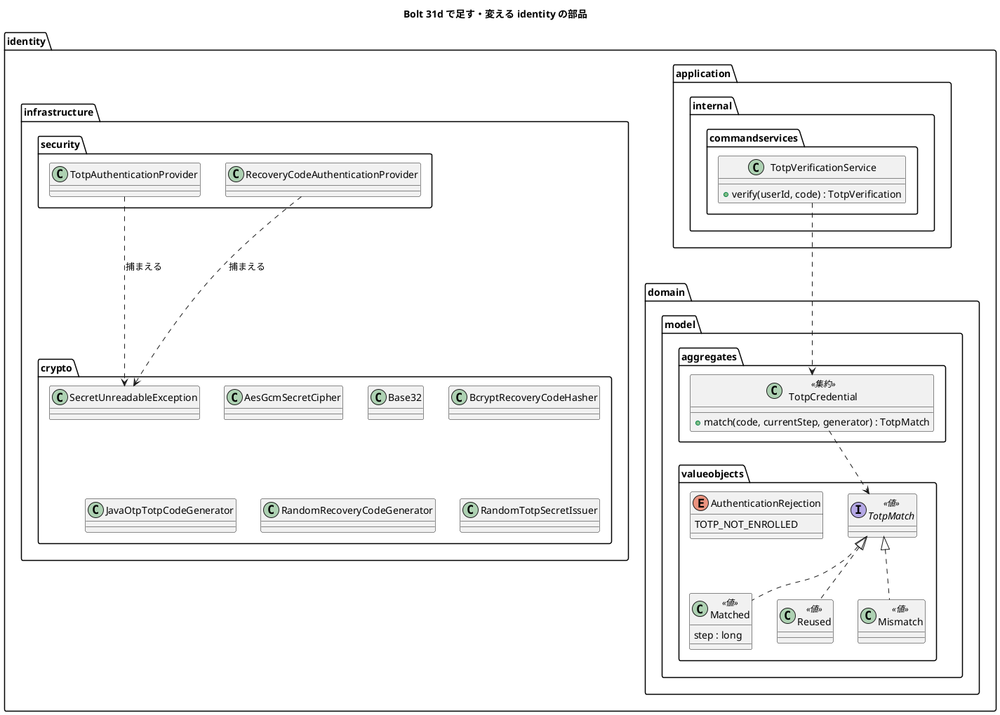

# Bolt 31d 計画 - 認証の部品の守りの直し（照合の 3 値、暗号のパッケージ、特性テスト、スパイクの削除）

## 基本情報

| 項目 | 内容 |
| :--- | :--- |
| Bolt | 第 31d 回（W5 の 8 本目。US-18 の残りの 5 本目） |
| 予定 | W5（2026-11-02 の週。前倒しで着手できる）。作業は約 4 時間 15 分（承認ゲートの待ち時間を除く。「時間の配分と打ち切り」） |
| 対象 | `identity`（TOTP の照合の結果、確かめのサービス、監査の理由、暗号の部品のパッケージ、層の規則）、ArchUnit・セキュリティの統合テスト・特性テスト、スパイク（`spikes/ts-01-totp/`）、ADR-011・ADR-012、ドメインモデル・データモデル・アーキテクチャ、リリース計画 |
| SP | 0（US-18 の残りの SP は #13 をクローズする Bolt 33b で数える） |
| GitHub | [#13](https://github.com/k2works/practical-domain-driven-design-in-enterpris-application/issues/13)（US-18、R1.0）。この Bolt では閉じない |
| 承認ゲート | **ステップごとに止める**（W4 の締めの決定: 認証の完成はステップごと）。確認必須（構造（パッケージの移動と層の規則の例外の範囲）、ファイルの削除（スパイク）、セキュリティ）は計画の承認の場で確認ポイントとして判断を受ける |
| アプローチ | リファクタリング（release_plan の 31d の行）。振る舞いは変えない（監査の理由の 1 つを除く。確認ポイント 3）。先に守り（テスト）を足し、緑のまま構造を動かす。TDD の三原則は振る舞いの変わる照合の結果と監査の理由に使う |
| 前の Bolt | [Bolt 31c 終了報告](bolt_31c_report.md)、[Bolt 31b 終了報告](bolt_31b_report.md)、[Bolt 31 終了報告](bolt_31_report.md) |

## Bolt ゴール

認証の部品の守りを、次の変更（Bolt 32 のロック、33b の再登録）の前に固める。TOTP の照合の結果（一致・再利用・不一致）をドメインの値にし、資格を作り直して再利用を見分ける回り道（`wasAlreadyUsed`）をなくす。暗号の部品を `identity.infrastructure.crypto` に分け、層の規則 D-5 の認証の例外を入口（`identity.infrastructure.security`）だけにする。`FACTOR_*` の参照・業務の URL・ログの平文・枠組みの暗黙の振る舞いに見張りを置き、スパイクを本体のテストとの対応を確かめてから消す。

### 確かめたい仮説

| # | 仮説 | この Bolt で分かること |
| :--- | :--- | :--- |
| H1 | 照合の結果をドメインの値（一致した刻み・再利用・不一致）にすれば、確かめのサービスは結果を写すだけになり、再利用の判別に資格を作り直す必要がなくなる | `TotpVerificationService` から `wasAlreadyUsed` が消え、拒否の時の生成の呼び出しが 1 回の照合の分（窓の 3 刻み）だけになること（今は 6 回） |
| H2 | 暗号の部品を別のパッケージに分ければ、D-5 の認証の例外をパッケージ単位の規則のまま入口だけに狭められ、クラス名の一覧の規則がいらなくなる | `LayerArchitectureTest` の例外の対象から暗号の部品が外れ、`crypto` は application に依存しない規則をパッケージで書けること。違反を入れると落ちること |

## ふりかえりと前の Bolt からの引き継ぎ

| 入力 | 内容 | この Bolt での扱い |
| :--- | :--- | :--- |
| 開始準備の決定（2026-10-13、human:kakimomokuri） | 守りの直しを 31d に入れ、低の指摘（定数・SVG・時計の設定・Bolt 31 の低）は該当する部品に触る Bolt（32・33b）で直す。暗号の部品を `identity.infrastructure.crypto` に分けて D-5 の例外を狭める。`FACTOR_TOTP`・`TotpAuthenticationToken` は改名せず、用語集と Javadoc に「TOTP または回復コードで与える 2 つ目の要素」と書く。スパイクは特性テストを本体に移してから消す | 本計画の範囲と、確認ポイント 1〜4 |
| Bolt 31c の Try T-107 | 「ないこと」を確かめるテストは、確かめる対象がその時点で存在することを先に確かめる | ログの平文の見張りは、同じ実行でその利用者の行がログにあることを先に確かめる。`FACTOR_*` の見張りは、走査したファイルの数が 0 でないことを先に確かめる |
| Bolt 31c の Try T-108 | 枠組みに任せる約束は「どの部品がいつ呼ぶか」を計画に書き、呼ばれることをテストで確かめる | 特性テスト（R-16）の 3 つは、どれも枠組みのどの部品の振る舞いかを書き、その振る舞いを直接確かめる（確認ポイント 6） |
| Bolt 31c の Try T-109 | 設計文書を並行して任せるときは、設計文書を先に push してからコードを push する | ステップ 1 を push してからステップ 2 に入る。サブエージェントに任せるなら、その完了と push を待ってからコードを push する |
| Bolt 31 の Try T-101 | 置き場所の決定が層の規則の例外を伴いそうなときは、骨組みを置いて ArchUnit を流して確かめる | 開始準備の横断検証で、`identity.infrastructure.crypto` に空のクラスを置いて `LayerArchitectureTest`・`ModularityTest` を流し、層の規則と Spring Modulith に当たらないことを確かめる |
| Bolt 31 の Try T-103・T-104 | 書き換えはスクリプトのファイルにする（ヒアドキュメントにしない）。SonarQube は開発レビューの前に流す | 全ステップ。ステップ 6 の最初に SonarQube |
| Bolt 31c の既知の課題（31d） | 照合の 3 値（`TotpVerification`・`RecoveryCodeVerification` を一緒に）、`REJECTED_NOT_ENROLLED` の監査の理由、`FACTOR_*` の ArchUnit の空振り対策、入口と暗号のパッケージ、特性テスト（R-16）、平文がログに出ない見張り、provider の例外の捕捉の範囲、`FACTOR_TOTP` の名前、スパイクの削除。低（定数・SVG・時計の設定・登録を始めた時刻のキー・回復コードの形の知識の 2 か所・Bolt 31 の低の指摘） | 前のものはこの Bolt（`FACTOR_TOTP` の名前は用語集に書くだけ）。低は開始準備の決定で 32・33b に送る（確認ポイント 8） |
| Bolt 31 の開発レビュー 17 | `FACTOR_*` の ArchUnit がコンパイル時の定数の埋め込みで空振りし得る。見張りが GET の代表の URL だけ | ステップ 4 |
| Bolt 13 のレビュー R-16 | `toBuilder()` の要否、既定のリポジトリ、`issuedAt` の時計を特性テストに固定する | ステップ 4（確認ポイント 6） |
| W4 の Try T-83・T-88・T-89 | 骨組みのまま流して本命のアサーションで落とす。見張り。後に回したものは Issue にする | 全ステップ。32・33b に送るものは #13 の中の作業として W5 の表で追う（T-89 から外れる扱いは 31・31b・31c と同じ） |

## スコープ

### 設計の約束（Try T-1）

- 振る舞いは変えない。例外は `REJECTED_NOT_ENROLLED` の監査の理由を `INVALID_TOTP` から `TOTP_NOT_ENROLLED` に分けること（利用者への応答は変えない。AC2）
- TOTP の照合の結果はドメインの値 `TotpMatch`（`Matched(step)`・`Reused`・`Mismatch`）にし、`TotpCredential#match` が返す。比べる回数を一致の位置で変えない（一定時間）ことは保つ
- 暗号の部品（`AesGcmSecretCipher`・`Base32`・`BcryptRecoveryCodeHasher`・`JavaOtpTotpCodeGenerator`・`RandomRecoveryCodeGenerator`・`RandomTotpSecretIssuer`）は `identity.infrastructure.crypto` に置き、application にも Spring Security の入口の部品にも依存しない。D-5 の認証の例外は `identity.infrastructure.security` だけ
- `FACTOR_TOTP`・`TotpAuthenticationToken` の名前は変えない（session の直列化の互換。ADR-012 のネガティブ）。意味（TOTP または回復コードで与える 2 つ目の要素）は用語集と Javadoc に書く
- スパイクは、本体のテストとの対応表で、確かめたことがすべて本体のテストか後の Bolt の計画に結び付いていることを確かめてから消す。対応表は終了報告に残す

### 入れるもの・入れないもの

| 入れる | 入れない（後で） |
| :--- | :--- |
| `TotpMatch` と `TotpCredential#match`、確かめのサービスの簡素化、監査の理由 `TOTP_NOT_ENROLLED` | 回復コードの照合の結果を 3 値にする（使用済みは未使用の一覧に出ないので区別できない。2 値のまま。確認ポイント 2） |
| `identity.infrastructure.crypto` への移動と D-5 の例外の範囲の見直し、パッケージ単位の ArchUnit | 定数（桁数・周期・アルゴリズム）、SVG の組み立てのまとめ方、登録を始めた時刻のキーの定数、回復コードの形の知識の 2 か所（33b。登録と再登録の部品に触るとき） |
| `FACTOR_*` の参照の見張り（ソースの走査）、全 URL の見張り（ハンドラーの一覧から）、ログの平文の見張り、特性テスト（R-16） | Bolt 31 の低の指摘（Base32 の不正な長さ、T-100 の待ちの判定、刻みを戻す SQL の重複、dev のテストの刻みの境界、合成ルートのクラスの分け方）、3 つの統合テストの時計の設定（32。統合テストに触るとき） |
| provider の例外の捕捉を、復号・ハッシュの形の誤りの専用の例外に狭める | `DataAccessException` の扱い（32） |
| スパイクの削除と対応表 | ユーザーマニュアル（画面を変えないので、この Bolt では直さない） |

## 設計（この Bolt の範囲）

### ドメインモデル

- `TotpCredential#match` は窓の 3 刻みのすべてを一定時間で比べ、使っていない刻みで一致すれば `Matched(step)`、使った刻み以下でだけ一致すれば `Reused`、どれとも一致しなければ `Mismatch` を返す。`matchingStep` は `match` に置き換える（呼び出し元は確かめのサービスと登録のサービスの 2 つ）
- 確かめのサービスは `Matched` のときだけ条件付きの更新で刻みを使い、更新できなければ（同時の確かめで後になった）`REJECTED_REUSED` を返す
- 暗号の部品の復号の失敗（知らない鍵の版・壊れた暗号文・別の利用者の暗号文）とハッシュの形の誤りは、`IllegalArgumentException` でなく専用の例外 `SecretUnreadableException`（`identity.infrastructure.crypto`、`IllegalArgumentException` を継ぐ）で表し、provider はこれだけを捕まえる（ほかの `IllegalArgumentException` は実装の誤りとして 500 にする。確認ポイント 5）
- 状態遷移図は省く（TOTP の資格の状態（刻みの使用）は Bolt 30 のまま）

### データモデル

表は変えない（ER 図は省く）。監査記録の理由の一覧に `TOTP_NOT_ENROLLED` を足す（文字列の列なのでマイグレーションは要らない）。

### 画面遷移

画面は変えない（画面遷移図は省く。ユーザーマニュアルも直さない）。

## ステップ計画

状態の記号: `[ ]` 未着手、`[-]` 進行中、`[?]` 承認待ち、`[x]` 完了。各ステップの終わりに `check` が緑であることと、計画からの変更を設計文書に反映したこと（T-53）を確かめ、push して CI を確かめる（T-26、T-65）。そのステップのファイルだけをステージする（T-84）。複数行の書き換えはスクリプトのファイルにする（T-103）。ステップ 1 を push してからコードのステップを push する（T-109）。

- [ ] **1. 設計文書** 【承認ゲート: 設計文書】
  - ADR-011: 照合の結果（`TotpMatch`）、暗号の部品のパッケージ（`identity.infrastructure.crypto`）と復号の失敗の専用の例外、スパイクの削除と対応表（28 行目の「Bolt 31d で消す」を実際の結果に）、`FACTOR_TOTP` の名前を残す理由。コンプライアンスの節に新しい見張り（`FACTOR_*` のソースの走査、全 URL、ログの平文、特性テスト）
  - ADR-012: D-5 の認証の例外を `identity.infrastructure.security`（入口）だけにしたこと（決定 6 と「W5 で見直すこと」の後ろの記述）、監査の理由 `TOTP_NOT_ENROLLED`
  - architecture_backend.md: D-5 の節（暗号の部品のパッケージ、例外の範囲、クラス名の一覧の規則をパッケージの規則に置き換えたこと）
  - domain_model.md: 用語集に `TotpMatch`、`TotpCredential` の説明（照合の結果）、`FACTOR_TOTP`・`TotpAuthenticationToken` の意味（TOTP または回復コードで与える 2 つ目の要素）、監査の理由の値
  - data_model.md: 監査の理由の一覧に `TOTP_NOT_ENROLLED`
  - release_plan.md の W5 の節: 31d の行を本計画に。32・33b の行に送る低の指摘（確認ポイント 8）
  - 完了の判定: `okf:check` ERROR 0、`documentationTest` 緑。push してからステップ 2 に入る（T-109）
- [ ] **2. 照合の結果をドメインに寄せる** 【承認ゲート: Red・Green】
  - Red: `TotpCredential#match` の単体テスト（今の刻みで一致は `Matched`、窓の前後で一致は `Matched`、使った刻み以下でだけ一致は `Reused`、どれとも一致しない・形の違う・空のコードは `Mismatch`、生成の呼び出しは結果によらず窓の 3 回）。確かめのサービスの単体テスト（拒否のときの生成の呼び出しが 3 回、`REJECTED_NOT_ENROLLED`）。監査の理由の統合テスト（TOTP を登録していない利用者の A-02 の送信は理由 `TOTP_NOT_ENROLLED`。今は `INVALID_TOTP`）
  - Green: `TotpMatch`（sealed interface と 3 つの record）、`TotpCredential#match`（`matchingStep` を置き換え、登録のサービスも直す）、確かめのサービスから `wasAlreadyUsed` を消す、`AuthenticationRejection.TOTP_NOT_ENROLLED` と監査のリスナーの写し
  - 完了の判定: `check` 緑。既存の TOTP のテスト（契約テスト・統合テスト）は直さずに緑（振る舞いを変えない）
- [ ] **3. 暗号の部品のパッケージを分ける** 【承認ゲート: 構造】
  - Red（守りを先に）: ArchUnit「`identity.infrastructure.crypto` は application と `identity.infrastructure.security` に依存しない」と、その見張り（`crypto` に 6 つのクラスがある）。D-5 の認証の例外の対象を `identity.infrastructure.security` のままにし、暗号の部品が移るまで見張りが落ちることを確かめる
  - Green: 6 つのクラスとテストを `identity.infrastructure.crypto` に移す（`git mv`）。`SecretUnreadableException` を足し、復号とハッシュの形の誤りをこれで投げる。provider はこれだけを捕まえる。`AuthenticationArchitectureTest` のクラス名の一覧の規則（「秘密の発行と回復コードの生成の実装は application に依存しない」）をパッケージの規則に置き換え、暗号・ZXing・TOTP のライブラリの閉じ込めの規則を `identity.infrastructure.crypto` に狭める（`AesGcmSecretCipher` を参照してよいのは crypto と合成ルートと dev の部品だけ）。違反を入れて落ちることを確かめる
  - 完了の判定: `check` 緑。`identity.infrastructure.security` に暗号の部品が残っていない
- [ ] **4. 守りのテスト** 【承認ゲート: セキュリティ】
  - `FACTOR_*` の参照の見張り: `src/main/java` を走査し、`"FACTOR_` の文字列と `FactorGrantedAuthority` を書いているファイルが `identity/infrastructure/security` の中だけであることを確かめる（コンパイル時の定数の埋め込みで ArchUnit が見落とす分）。走査したファイルの数が 0 でないこと、`TotpAuthenticationToken.java` が見つかることを先に確かめる（T-107）
  - 全 URL の見張り: `RequestMappingHandlerMapping` の一覧から、認証の画面（`/login`・`/login/totp`・`/login/totp/enroll`・`/session-expired`・`/logout`）と静的な資源を除くすべての URL（GET・POST）について、password の段だけの主体が A-02 へ導かれることを確かめる。一覧の数が 0 でないことを先に確かめる
  - ログの平文の見張り: `OutputCaptureExtension` で、回復コードの誤り・TOTP の秘密を復号できない利用者の A-02 の送信の後、ログにその利用者の ID の行があり（T-107）、回復コード・TOTP のコード・password・秘密の Base32 がないこと
  - 特性テスト（R-16。Spring Security と Spring Session の版を上げるときの守り。確認ポイント 6）: ①mfaEnabled のフィルターは、認証の結果の型が `toBuilder()` を持つときだけ前の要素の権限を合わせる（`toBuilder()` を持たない結果の型では `FACTOR_PASSWORD` が落ちる）、②認証の文脈の置き場所は Spring Session JDBC の session（`HttpSessionSecurityContextRepository` が `platform.spring_session_attributes` に書く）、③`FactorGrantedAuthority` の `issuedAt` はアプリケーションの `Clock` でなく枠組みの時計で決まる（最長 8 時間の判定に使わない理由）
  - 完了の判定: `check` 緑。見張りは違反を入れて落ちることを確かめる（T-88）
- [ ] **5. スパイクを消す** 【承認ゲート: ファイルの削除】
  - スパイクのテスト（`MfaLoginTest` 15 本、`DevLoginPrefillTest` 5 本）と、本体のテストまたは後の Bolt の計画（ロックの 5 本は Bolt 32。ADR-011 のコンプライアンスの節）との対応表を作り、対応のないものがないことを確かめる。対応のないものがあれば、消す前に本体のテストを足すか、人に諮る
  - `spikes/ts-01-totp/` を消す（`git rm -r`）。ほかから参照されていないことを確かめる（`settings.gradle`・CI・文書のリンク）。文書のスパイクへのリンクはコミットの固定のリンクに直す
  - 完了の判定: `check` 緑、`okf:check` ERROR 0（リンク切れがない）
- [ ] **6. SonarQube と開発レビューと終了報告** 【承認ゲート: 終了報告】
  - SonarQube（`sonar-local:check`。T-104）
  - 開発レビュー（プログラマー、アーキテクト、テスター（守りのテストの空振り））。画面を変えないのでテクニカルライターの観点は設計文書だけにする
  - `bolt_31d_report.md`（スパイクとの対応表を含む）。release_plan の W5 の 31d の行、開発の索引。#13 に進み具合をコメントする。画面を変えないのでデモの動画は撮らない

### 時間の配分と打ち切り

| # | 目安 | 打ち切り |
| :--- | :--- | :--- |
| 1 | 30 分 | — |
| 2 | 45 分 | — |
| 3 | 45 分 | 層の規則・Spring Modulith に新しい例外が要ると分かったら、止めて人に諮る |
| 4 | 70 分 | 特性テストの①が枠組みの内部に深く依存して書けないと分かったら、統合テストでの振る舞いの確かめ（今あるもの）に留め、理由を報告に書く |
| 5 | 30 分 | 対応のないスパイクのテストが見つかったら、止めて人に諮る |
| 6 | 35 分（SonarQube の待ちを除く） | — |

合計 255 分（約 4 時間 15 分）。4.5 時間を超えると見えたら、止めて人に諮る（候補: ログの平文の見張りを 32 に送る）。

## 確認ポイント（計画の承認の場でまとめて確認する。Try T-6）

| # | 確認すること | ステップ | 推奨 |
| :--- | :--- | :--- | :--- |
| 1 | **範囲と低の指摘の送り先**（開始準備で決めた） | — | 守りの直しを 31d に入れる。低の指摘は該当する部品に触る Bolt で直す（確認ポイント 8）。W5 は 14 本のまま |
| 2 | **照合の結果の形** | 2 | TOTP は sealed interface `TotpMatch` と 3 つの record（`Matched(step)`・`Reused`・`Mismatch`）を `identity.domain.model.valueobjects` に置く。アプリケーションの `TotpVerification`（4 値。未登録を含む）は残し、`TotpMatch` を写す。回復コードの `RecoveryCodeVerification` は 2 値のまま（使用済みは未使用の一覧に出ないので再利用と誤りを区別できない。区別するには使用済みのコードとも照合する必要があり、bcrypt が倍になる） |
| 3 | **監査の理由 `TOTP_NOT_ENROLLED`**（振る舞いの変更） | 2 | TOTP を登録していない利用者の A-02 の送信（A-02 の画面は A-07 へ送るので、画面を経ない送信だけ）は、今は理由 `INVALID_TOTP`。運用で「登録していないのに TOTP を送った」と区別できるよう分ける。利用者への応答は変えない（AC2） |
| 4 | **暗号の部品のパッケージ**（開始準備で決めた。構造） | 3 | `identity.infrastructure.crypto` に 6 つのクラスを移す。D-5 の認証の例外は `identity.infrastructure.security` のまま（入口だけになる）。`crypto` は application と `security` に依存しない（パッケージの規則）。T-101 のとおり、開始準備の横断検証で骨組みを置いて層の規則と Spring Modulith を流す |
| 5 | **provider の例外の捕捉を狭める**（セキュリティ） | 3 | 復号の失敗とハッシュの形の誤りを専用の例外 `SecretUnreadableException`（`IllegalArgumentException` を継ぐので、捕まえる側を変えないうちは今と同じに動く）で表し、provider はこれだけを捕まえる。ほかの `IllegalArgumentException`（値の検証など実装の誤り）は 500 にしてエラーのログに残す（今は拒否に倒れ、「コードの誤り」に見えてしまう） |
| 6 | **特性テストの範囲**（R-16） | 4 | 3 つ（`toBuilder()` の要否、文脈の置き場所、`issuedAt` の時計）を、枠組みの部品の振る舞いとして直接確かめる（T-108）。①は Spring Security の mfaEnabled の合わせを、`toBuilder()` を持つ型と持たない型の 2 つの認証の結果で比べる単体テストにする（フィルターを本物で組む）。書けなければ打ち切りの欄のとおり |
| 7 | **スパイクの削除**（開始準備で決めた。ファイルの削除） | 5 | 対応表で、スパイクの 20 本のテストがすべて本体のテストか後の Bolt の計画（ロックは Bolt 32。ADR-011 のコンプライアンスの節に書いてある）に結び付くことを確かめてから消す。開発用の入力済み（`DevLoginPrefillTest`）は本体の `DevLoginPrefillDevProfileTest`・`DevTotpCredentialsDevProfileTest` に対応する見込み |
| 8 | **低の指摘の送り先** | — | 33b（登録と再登録の部品に触る）: 桁数・周期・アルゴリズムの定数、SVG の組み立て、登録を始めた時刻のキーの定数、回復コードの形の知識の 2 か所、`TotpEnrollmentService` の引数の型（31c の議題 4）。32（ロックで統合テストと認証の入口に触る）: Bolt 31 の低の指摘、3 つの統合テストの時計の設定、`DataAccessException` の扱い、回復コードの誤りも数えるか。どれも #13 の中の作業として W5 の表で追う |
| 9 | 承認ゲート | 全体 | ステップごとに止める（W4 の締めの決定）。ステップ 3 は構造、4 はセキュリティ、5 はファイルの削除の確認必須 |

## 完了条件

- [ ] TOTP の照合の結果がドメインの値になり、確かめのサービスに `wasAlreadyUsed` がない。既存の TOTP のテストは直さずに緑。TOTP を登録していない利用者の送信は理由 `TOTP_NOT_ENROLLED`
- [ ] 暗号の部品が `identity.infrastructure.crypto` にあり、D-5 の認証の例外は入口だけ。`crypto` は application と `security` に依存しない（ArchUnit、見張り付き）
- [ ] `FACTOR_*` の参照・全 URL・ログの平文の見張りと、特性テスト（R-16）の 3 つがある。見張りは違反を入れて落ちる
- [ ] スパイクとの対応表で対応のないテストがなく、スパイクを消した
- [ ] `check` と `uiTest` が緑。push して CI を確かめた。SonarQube の Quality Gate が PASS、`okf:check` ERROR 0
- [ ] 開発レビューと終了報告。#13 に進み具合をコメントした

## 更新履歴

| 日付 | 更新内容 | 更新者 |
| :--- | :--- | :--- |
| 2026-10-13 | 初版作成（承認待ち）。開始準備で、Bolt 31c の終了報告の Try（T-107〜T-109）と既知の課題、Bolt 31 のレビュー 17、Bolt 13 の R-16、スパイクのテスト、照合と確かめのサービス、層の規則を調べ、human:kakimomokuri の決定（守りの直しを 31d・低は 32 以降、暗号の部品を crypto に分ける、`FACTOR_TOTP` は改名せず用語集に書く、スパイクは特性テストを移してから消す）を反映した | anthropic/claude-opus-5-5 |

## 関連ドキュメント

- [リリース計画](release_plan.md)（W5）
- [Bolt 31c 計画](bolt_31c_plan.md)、[Bolt 31c 終了報告](bolt_31c_report.md)、[Bolt 31 終了報告](bolt_31_report.md)
- [ADR-011](../../adr/cargo-tracker/011-mfa-totp.md)、[ADR-012](../../adr/cargo-tracker/012-authentication-principal-and-session.md)
- [ドメインモデル](../../design/cargo-tracker/domain_model.md)（アクセス・監査）、[バックエンドのアーキテクチャ](../../design/cargo-tracker/architecture_backend.md)（D-5）
