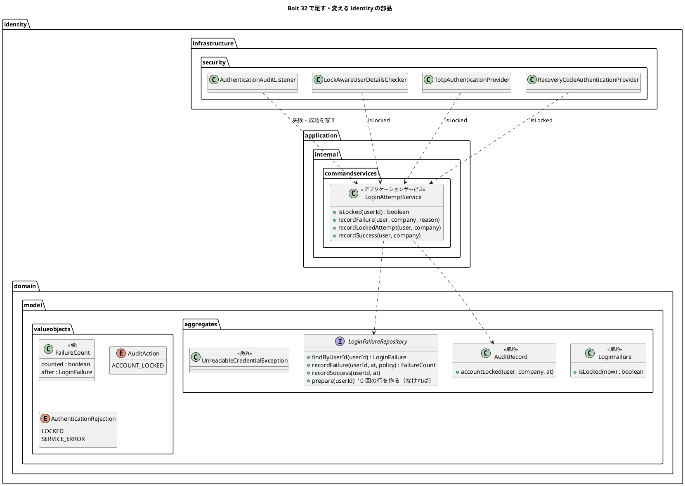
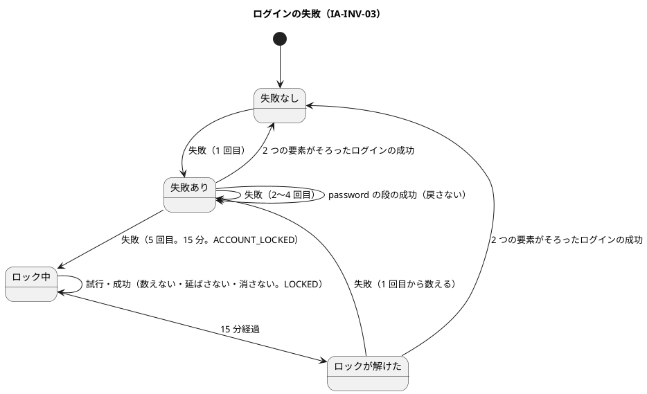
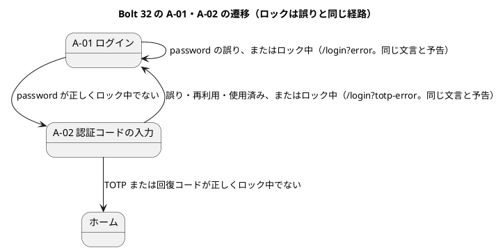
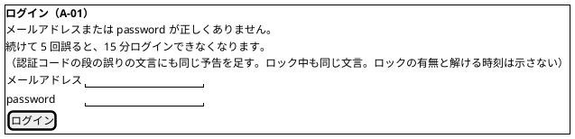

# Bolt 32 計画 - ログインのロック（US-18 AC3）

## 基本情報

| 項目 | 内容 |
| :--- | :--- |
| Bolt | 第 32 回（W5 の 9 本目。US-18 の残りの 6 本目） |
| 予定 | W5（2026-11-02 の週。前倒しで着手できる）。作業は約 4 時間 30 分（承認ゲートの待ち時間を除く。「時間の配分と打ち切り」）。上限に近い |
| 対象 | `identity`（ログインの失敗のリポジトリ、ロックと監査をまとめるアプリケーションのサービス、認証の入口（照合の後の確認・2 つの provider・監査のリスナー）、A-01 の誤りの文言、読めない要素の例外）、セキュリティの統合テスト・特性テスト、画面の層、ADR-011・ADR-012、UI 設計・ドメインモデル・データモデル・非機能要件・アーキテクチャ・ユーザーストーリーの注記、リリース計画 |
| SP | 2（目安。US-18 の SP は #13 をクローズする Bolt 33b で数える。release_plan.md:595） |
| GitHub | [#13](https://github.com/k2works/practical-domain-driven-design-in-enterpris-application/issues/13)（US-18、R1.0）。この Bolt では閉じない |
| 承認ゲート | **ステップごとに止める**（W4 の締めの決定: 認証の完成はステップごと）。確認必須（セキュリティ（ロック・応答・例外の扱い）、データベース（失敗の記録の作成の競合の扱い）、画面の文言）は計画の承認の場で確認ポイントとして判断を受ける |
| 承認ゲートの扱い | 2026-10-13 に human:kakimomokuri が計画を承認した（確認ポイント 1〜11 は推奨のとおり）。あわせて人の指示（「推奨のまま承認して止めずに進める」）により、ステップの承認ゲートで止まらずに進める。止まらなかったゲートごとに根拠を書き、終了報告の承認の議題に置く（T-36）。読み出しの DB の誤りで入口の構成を大きく変える必要が出たときと、層の規則の新しい例外が要るときは止めて人に諮る |
| アプローチ | インサイドアウト（W5 の表で US-18 はインサイドアウト。development_strategy.md:344）。集約もスキーマも新しく作らない（ログインの失敗の集約・方針・表は Bolt 30）ので、開発戦略の表（116-122 行）ではアウトサイドインに当たるが、不確実性がトランザクションの境界と同時実行（同時の失敗、最初の失敗の作成の競合、ロックの監査を 1 行だけ書くこと）にあるので内側から固める。認証の流れはセキュリティの統合テストで外側から確かめる |
| 前の Bolt | [Bolt 31d 終了報告](bolt_31d_report.md)、[Bolt 31c 終了報告](bolt_31c_report.md)、[Bolt 30 終了報告](bolt_30_report.md) |

## Bolt ゴール

password・TOTP・回復コードの失敗が 5 回続いたら、その時点から 15 分ロックし、追加の試行を拒む（US-18 AC3、IA-INV-03）。ロック中も誤りと同じ応答にし、利用者の存在もロックも第三者に推測させない（AC2）。失敗の数え方と監査記録はアプリケーションのサービスで 1 つのトランザクションにまとめ（ADR-012 の見直しの 5、IA-INV-08）、監査のリスナーとロックの確かめは入口の写しだけにする。

### 確かめたい仮説

| # | 仮説 | この Bolt で分かること |
| :--- | :--- | :--- |
| H1 | 失敗の数え方と監査記録をアプリケーションのサービスの 1 つのトランザクションにまとめ、リポジトリが「数えたか」と「数えた後の状態」を返せば、監査記録と回数が食い違わず、ロックの監査も 1 行だけになる（IA-INV-08） | 失敗の監査記録の追記が失敗したら回数も戻ること（単体テスト）。同じ利用者の同時の失敗が両方数えられ、両方の監査記録があり、同時の 4・5 回目でも `ACCOUNT_LOCKED` が 1 行だけであること（PostgreSQL の統合テスト。T-100） |
| H2 | ロックを password の照合の後の確認で見れば、応答の文言と時間でロックが分からない | ロック中の正しい password と誤った password が、どちらも password の照合を通って同じ応答（`/login?error`、同じ文言）になること。ロック中の試行は数えず期限も延びないこと |

## ふりかえりと前の Bolt からの引き継ぎ

| 入力 | 内容 | この Bolt での扱い |
| :--- | :--- | :--- |
| 開始準備の決定（2026-10-13、human:kakimomokuri） | 32 と 32c に分ける（32: ロック、32c: AC6 の request ごとの役割の確認と見直しの 3、31d から送った低の指摘）。S-02 は W10 の WAF に送る。ロック中は誤りと同じ文言で、一般の予告だけを足す（解ける時刻は示さない）。`UnreadableCredentialException` は `RuntimeException` を継ぐ形に替える | 本計画の範囲と、確認ポイント 1〜4 |
| Bolt 31d の Try T-110 | コミットは pathspec で作る。`git mv` を使う作業と設計文書のコミットを並行させない | 全ステップ。設計文書をサブエージェントに任せる間は、コードの作業で `git mv` を使わない |
| Bolt 31d の Try T-111 | テストの出力の取り込みは、見張りたい操作の間だけ（`LogCapture`） | DB の誤りのエラーのログの見張りは `LogCapture` を使う |
| Bolt 31d の Try T-112 | 見張りの違反は、見張りを足した理由になった書き方そのものを入れて確かめる | ロックの規則（ロック中は数えない・延ばさない・成功で外さない、ロックの監査は 1 行）は、それぞれを外す変異を入れて落ちることを確かめる |
| Bolt 31c の Try T-106〜T-109 | 「ないこと」の確かめに「あること」を並べる。対象の存在を先に確かめる。枠組みに任せる約束は誰がいつ呼ぶかを書く。設計文書を先に push | 数えない・延ばさない・監査が残らないの確かめに、数えた場面の行と監査を並べる。枠組みの振る舞い（確認ポイント 6・8）を特性テストに固定する |
| Bolt 30 の Try T-99 | 同じ規則をドメインと SQL に書くときは、境界のテストを両方の実装で動かす | ログインの失敗の規則（`LoginFailure` と SQL、`InMemoryLoginFailureRepository`）の境界（4・5 回、14 分 59 秒・15 分、解けた後の 1 回目）を契約テストで両方の実装に流す。H2 の契約テストも緑のままにする |
| Bolt 31d の既知の課題（32） | `UnreadableCredentialException` の親の型、実装の誤りは 500 の統合テスト、`DataAccessException` の扱い、provider の単体テストの拒否の 3 値と監査のリスナーの単体テスト、`{bcrypt}` で中身が壊れたハッシュ、回復コードの誤りも数えるか | この Bolt。31d から送った低の指摘（Bolt 31 の低、3 つの統合テストの時計の設定、8 時間の起点の値と監査の順）は開始準備の決定で 32c に送る |
| Bolt 31d のスパイクとの対応表 | ロックの 5 本（`MfaLoginTest` の 5 回でロック・4 回・14 分 59 秒・成功で数え直し・password の後のロックで TOTP も拒否）を Bolt 32 に送った | ステップ 3 の統合テストで受け、終了報告に対応を書く |
| Bolt 30 の議題 2 の③ | 同じ利用者の最初の失敗が同時に 2 つ届くと、片方が記録の作成で一意制約に当たる | ステップ 2（確認ポイント 7） |
| Bolt 31 のレビュー 16 | IA-INV-08 の同じトランザクションを確かめていない | 仮説 H1 |
| UI 設計の A-07（ui_design.md:558） | A-07 の登録のコードの誤りを数えるかは Bolt 32 で決める | 確認ポイント 5 |
| W4 の Try T-83・T-88・T-89・T-90 | 骨組みのまま流して本命のアサーションで落とす。見張り。後に回したものは Issue にする。画面を作る Bolt の開発レビューにテクニカルライターの観点 | 全ステップ。A-01・A-02 の文言を変えるので、ステップ 6 にテクニカルライターの観点を入れる。32c は #13 の中の作業として W5 の表で追う |

## スコープ

### 設計の約束（Try T-1）

- 失敗の数え方（IA-INV-03）はログインの失敗の集約（`LoginFailure`）と方針（`LockPolicy`）のまま。数える・外す・監査記録を書くのはアプリケーションのサービス `LoginAttemptService`（`identity.application.internal.commandservices`）で、監査記録と回数を 1 つのトランザクションにする（IA-INV-08、ADR-012 の見直しの 5）。監査のリスナーは失敗・成功のイベントをサービスに写すだけ
- 数えるのは password・TOTP・回復コードの誤り（`AuthenticationFailureBadCredentialsEvent`）。数えないのは、ロック中の試行、存在しない利用者、password が正しく利用停止・無効な企業で拒んだとき（Disabled のイベント）、入口の DB の誤り。利用停止の利用者でも password が誤っていれば数える。0 に戻すのは 2 つの要素（TOTP または回復コード）がそろったログインの成功だけ
- ロック中の試行は、正しい password（Locked のイベント）でも誤った password（BadCredentials のイベント）でも、サービスがロック中と見分けて理由 `LOCKED` を書き、数えない
- ロックの確かめは 1 か所（`LoginAttemptService#isLocked`）。password の段は照合の後の確認（入口の部品 `LockAwareUserDetailsChecker` が `isLocked` を見て `LockedException`、続けて今の利用停止の確認）、TOTP・回復コードの段は provider が確かめる前に見て `LockedException`。`CargoUserDetails` には項目を足さない（直列化の互換を保つ）
- 画面はロックの有無を示さない。A-01 の 2 つの誤りの文言（password の段、認証コードの段）に一般の予告「続けて 5 回誤ると、15 分ログインできなくなります。」を足す
- ロックの監査: この失敗でロックしたときだけ `ACCOUNT_LOCKED`（結果 `SUCCESS`、理由なし、操作者は利用者と企業）を書く（同じトランザクション）

### 入れるもの・入れないもの

| 入れる | 入れない（後で） |
| :--- | :--- |
| `LoginAttemptService`、リポジトリの戻り値（数えたかと数えた後の状態）、最初の失敗の作成の競合、監査のリスナーの書き換え | AC6 の request ごとの役割の確認、ADR-012 の見直しの 3（32c） |
| ロックの確かめ（照合の後の確認、TOTP・回復コードの前）、A-01 の誤りの文言の予告 | S-02 の送信元ごとの流量の制限（W10 の WAF。開始準備の決定） |
| 監査の操作 `ACCOUNT_LOCKED`、拒否の理由 `LOCKED`・`SERVICE_ERROR` | ロックの解除の操作（システム管理者。US-16 の利用者の管理、Bolt 34） |
| Bolt 31d から: `UnreadableCredentialException` を `RuntimeException` に、実装の誤りは 500 の統合テスト、`DataAccessException` の扱い、provider の拒否の 3 値と監査のリスナーの単体テスト、`{bcrypt}` で中身が壊れたハッシュの特性テスト | 31d から送った低の指摘（Bolt 31 の低、時計の設定、8 時間の起点の値と監査の順。32c） |
| 画面の層のシナリオ（5 回誤るとロックされ、正しい password でもログインできない） | ユーザーマニュアル（Bolt 33b でまとめて直す。W5 の節の決定） |
| | `login_failure` の列の注釈（「password と TOTP」）の直し（マイグレーションが要る。データモデルの文書だけを直し、表の注釈は次に表を変えるときに直す） |

## 設計（この Bolt の範囲）

### ドメインモデル

- `LoginAttemptService#recordFailure` は、まず主たるトランザクションの外で 0 回の行を用意し（`prepare`。なければ作る。一意制約の違反はトランザクションの外で受けて、既にあるとして続ける。確認ポイント 7）、次に 1 つのトランザクションで、数え（`recordFailure` は条件付きの更新の件数から「数えたか」と数えた後の状態を返す）、数えなかった（ロック中）なら理由 `LOCKED`、数えたなら与えた理由で `LOGIN_FAILED` を書き、数えてロックしたら `ACCOUNT_LOCKED` を書く。`recordLockedAttempt` は `LOGIN_FAILED`（理由 `LOCKED`）だけを書く。`recordSuccess` は `LOGIN_SUCCEEDED` を書き、回数を 0 に戻す（ロック中なら戻さない。IA-INV-03）
- `isLocked` は問い合わせだが、認証の入口から呼ぶので、D-5 の認証の例外の範囲（入口から呼べるのは `commandservices` だけ）に置く。`isEnrolled` を `queryservices` に移した Bolt 31b の前例は、入口から呼ばない問い合わせだったため（呼ぶのは画面の層）。理由を ADR-012 に書く
- 監査のリスナーは、password の段の成功（`PASSWORD_VERIFIED`）とログアウトは今のまま書く。失敗はイベントの型で分ける: BadCredentials（TOTP・回復コードの拒否を含む）は `recordFailure`、Locked は `recordLockedAttempt`、Disabled は今の理由（利用停止・無効な企業。数えない）、ServiceException（入口の DB の誤り）は理由 `SERVICE_ERROR`（数えない）
- `UnreadableCredentialException` は `RuntimeException` を継ぐ（開始準備の決定。Bolt 31d の議題 4）。捕まえる側は変わらない
- 状態遷移図（ログインの失敗。domain_model.md にも載せる）:

### データモデル

表は変えない（ER 図は省く）。`login_failure`（Bolt 30）をそのまま使う。最初の失敗の作成の同時の競合（議題 2 の③）は、主たるトランザクションの前に 0 回の行を作り、一意制約の違反をトランザクションの外で受ける（確認ポイント 7）。監査記録の操作 `ACCOUNT_LOCKED` と理由 `LOCKED`・`SERVICE_ERROR` は文字列の列なのでマイグレーションは要らない。

### 画面遷移

遷移は変えない。ロックは誤りと同じ経路にする（UI 設計の遷移図の「ロック中」の状態と「ロック中 → ログイン : 15 分経過」は、画面の遷移でなく内部の状態なので、遷移図から外し、上のドメインの状態遷移図に移す）。

画面の形（A-01 の 2 つの誤りの文言に予告を足す）:

## ステップ計画

状態の記号: `[ ]` 未着手、`[-]` 進行中、`[?]` 承認待ち、`[x]` 完了。各ステップの終わりに `check` が緑であることと、計画からの変更を設計文書に反映したこと（T-53）を確かめ、push して CI を確かめる（T-26、T-65）。コミットは pathspec で作り、そのステップのファイルだけを入れる（T-84、T-110）。複数行の書き換えはスクリプトのファイルにする（T-103）。ステップ 1 を push してからコードのステップを push する（T-109）。

- [ ] **1. 設計文書** 【承認ゲート: 設計文書】
  - ADR-011: ロック（数え方の置き場所と 1 つのトランザクション、数える失敗と数えない失敗（回復コードを数える、A-07 は数えない）、成功で戻す時点、ロックの確かめの位置と 1 か所の判定、理由の優先（ロック中は利用停止より先に `LOCKED`）、ロックの監査、最初の失敗の作成の競合、DB の誤りの扱い、`{bcrypt}` の壊れたハッシュを受け入れる理由、TOTP の段は照合の前にロックを見るので時間でロックが分かることを受け入れる理由（K-02 で password が正しいことは分かっている））。直す行: 58・114（「password と TOTP」→ 回復コードも）、224（回復コードを数えるかは 32 → 決定）、276（A-02 のロック中の案内と解ける時刻）、292（解ける時刻を示して待つ）、296-297（ロックの確認は照合より先・表示から存在が分かる）。S-02 を W10 の WAF に送ることと受け入れるリスク。`UnreadableCredentialException` の親の型（決定 8 を改める）
  - ADR-012: 見直しの 5 を「決めた」に移し、`isLocked` を `commandservices` に置く理由を書く。見直しの 3 を 32c に（104 行目）。63 行目（数え方を listener に足す）、95 行目（ネガティブの `CargoUserDetails` の項目の変更。この Bolt では足さない）、96 行目（レート制限は W10 の WAF）
  - ui_design.md: A-01 の salt 本体（470-487 行目あたり）と 2 つの誤りの文言、画面と URL の表の A-01・A-02（180 行目の「ロック中の案内は Bolt 32」）、画面遷移図のロック中の状態（245・255・262 行目）と説明（270 行目）、521 行目、A-07 の 558 行目（登録の誤りは数えないと決めた）
  - domain_model.md: 用語集に `LoginAttemptService`・`FailureCount`、`AuditAction`・`AuthenticationRejection` の値、`LoginFailure` の行（181 行目。回復コードも）、identity のサービスの説明（971 行目）、IA-INV-03・IA-INV-08 の説明、ログインの失敗の状態遷移図
  - data_model.md: 監査の操作と理由の一覧（925 行目）、`login_failure` の行（908 行目の競合の扱いを決定に。列の注釈は直さない理由）
  - non_functional.md: SEC-02（ロック）、SEC-11（表示）、OBS-09（`ACCOUNT_LOCKED` を使う）、SEC-20（WAF に S-02）、AUD-01（ロックの監査）
  - architecture_backend.md: `LoginAttemptService`・監査のリスナー・照合の後の確認の部品・2 つの provider が D-5 の認証の例外の範囲に収まること
  - user_story.md: US-18 の決定の注記（回復コードの誤りも数える、ロック中も誤りと同じ応答、S-02 は W10）
  - release_plan.md の W5 の節: 32 の行を本計画に、32c の行を足す（AC6、見直しの 3、31d から送った低の指摘を 1 つずつ。SP 0）。557 行目の言い方（32 はスキーマも集約も新しく作らない）。Bolt の本数（15 本）と順序（32 → 32c。32c と 32b に依存はない。33b は 32c に依存しない）。W5 の状態と主なタスク（553・617 行目）。持ち込みの表の 607 行目（S-02 を W10 の WAF に）。リスク台帳（S-02 の行）
  - 完了の判定: `okf:check` ERROR 0、`documentationTest` 緑。push してからコードを push する
- [ ] **2. 数え方と監査をまとめるサービス** 【承認ゲート: Red・Green、データベース】
  - Red: リポジトリの契約テスト（MyBatis（PostgreSQL・H2）とメモリ: `prepare` が 2 回でも 1 行、`recordFailure` が数えたかと数えた後の状態を返す、境界の 4・5 回・14 分 59 秒・15 分、解けた後の 1 回目。T-99）。`LoginAttemptService` の単体テスト（失敗で `LOGIN_FAILED` と回数、5 回目で `ACCOUNT_LOCKED`、ロック中の失敗は理由 `LOCKED` で数えない、`recordLockedAttempt`、成功で 0 に戻しロック中は戻さない、監査の追記が失敗したら回数も戻る、存在しない利用者は記録を作らない）。PostgreSQL の統合テスト（同じ利用者の最初の失敗が同時に 2 つでも両方数えられる（議題 2 の③）、同時の失敗が両方の監査記録を持つ、同時の 4・5 回目で `ACCOUNT_LOCKED` が 1 行だけ。T-100）
  - Green: `FailureCount`、リポジトリの `prepare` と `recordFailure` の戻り値（更新の件数）、`LoginAttemptService`（`@Service`、`IdentityConfiguration` で組み立て、`TransactionTemplate`）、`AuditRecord.accountLocked`、`AuditAction.ACCOUNT_LOCKED`、`AuthenticationRejection.LOCKED`・`SERVICE_ERROR`、SpotBugs の EI_EXPOSE_REP2 の抑止（クラス単位。5 つ目）。Bolt 32 で扱うと書いた注釈（`LoginFailureRepository.java:20`、`AuthenticationFactorMapper.xml:88`、`MyBatisLoginFailureRepository.java:14`）を直す
  - 完了の判定: `check` 緑（H2 の契約テストを含む）
- [ ] **3. 認証の入口のロック** 【承認ゲート: セキュリティ、画面】
  - Red: セキュリティの統合テスト
    - AC3 の境界: 4 回はロックされず 5 回でロック、14 分 59 秒はロック中で 15 分で解ける、15 分後に 1 回誤ってもロックされない（1 回目から数える）
    - 合わせて数える: password と TOTP と回復コードの失敗を合わせて 5 回
    - AC2: ロック中は正しい password でも誤った password でも `/login?error` で同じ文言（入れたメールアドレスの残り方も同じ）。存在しないメールアドレスで 6 回誤ったときの応答がロック中の利用者の応答と同じで、`login_failure` に行が作られない
    - 数えない・延ばさない: ロック中の試行は数えず期限も延びず、監査記録の理由は `LOCKED`（あることも確かめる。T-106）
    - 戻す: TOTP で終えたログインでも回復コードで終えたログインでも 0 に戻る。password が通って TOTP を 4 回誤り、もう一度 password を通しても数は戻らず、5 回目でロックされる
    - password の段の後にロックされたら（別の session の失敗で）、正しい TOTP・回復コードも拒み `/login?totp-error`
    - 監査記録: `LOGIN_FAILED` の理由と `ACCOUNT_LOCKED` が数えた回数と合う。利用者の切り替え（T-102）: 別の利用者の失敗は数えない
    - スパイクの 5 本（ロック）に対応する確かめがそろっている
  - 単体テスト: 監査のリスナー（イベントの型ごとの写し）、provider の拒否の 3 値（`@EnumSource`）、照合の後の確認の部品（ロック → `LockedException`、ロックでなく利用停止 → 今の例外）
  - 特性テスト（`SpringSecurityCharacterizationTest` に足す。T-108）: `DaoAuthenticationProvider` は照合の後の確認を照合が通ったときだけ呼ぶ、`LockedException` の失敗のイベントは `AuthenticationFailureLockedEvent`、`ProviderManager` はアカウントの状態の例外でほかの provider を試さない、利用者の読み出しの例外は `InternalAuthenticationServiceException` に包まれる
  - Green: `LockAwareUserDetailsChecker`（`SecurityConfiguration` の照合の後の確認に組む）、`AuthenticationAuditListener` の書き換え、2 つの provider がロックを見る、`login.html` の 2 つの文言、`SecurityConfiguration` の組み立て（`AuthenticationAuditListener.java:22` の注釈も直す）
  - 完了の判定: `check` 緑
- [ ] **4. Bolt 31d から送った例外の扱い** 【承認ゲート: セキュリティ】
  - `UnreadableCredentialException` を `RuntimeException` に（テストの型の確かめを合わせる）
  - 実装の誤りは 500 の統合テスト（TOTP の生成器が素の `IllegalArgumentException` を投げる偽物の部品で、500 になり、監査の失敗が残らず、数えないこと）
  - `DataAccessException` の扱い（確認ポイント 8）: 書き込み（数え方・監査の書き込み）の DB の誤りは 500 にしてエラーのログを残す。読み出しの DB の誤りは、password の段（利用者・ロックの読み出し）は枠組みが失敗へ倒し `/login?error`（理由 `SERVICE_ERROR`、数えない）、TOTP の段は 500。それぞれを統合テストで 1 本ずつ確かめ、エラーのログ（`LogCapture`）を確かめる
  - `{bcrypt}` で中身が壊れたハッシュは、枠組みが false を返す（一致しない。利用者の誤りとして数えられる）ことを特性テストに固定する（確認ポイント 9）
  - 完了の判定: `check` 緑
- [ ] **5. 画面の層** 【承認ゲート: セキュリティ】
  - `login_ui.feature` に「password を 5 回誤った荷主担当者は、正しい password でも同じ誤りの文言でログインできない」（`@US-18-AC3 @demo @demo-bolt-32/lock`）。画面の層には時計を進める部品がないので、解けることは統合テストに任せる
  - 完了の判定: `check` と `uiTest` が緑
- [ ] **6. SonarQube と開発レビューとデモと終了報告** 【承認ゲート: 終了報告】
  - SonarQube（`sonar-local:check`。T-104）
  - 開発レビュー（プログラマー、アーキテクト、テスター（ロックの境界と同時の失敗）、テクニカルライター（A-01 の文言と予告。T-90））
  - レビューの直しの後にデモの動画を撮り、#13 に添付する（T-105）。`bolt_32_report.md`（スパイクのロックの 5 本との対応を含む）。release_plan の W5 の 32 の行、開発の索引。#13 に進み具合をコメントする

### 時間の配分と打ち切り

| # | 目安 | 打ち切り |
| :--- | :--- | :--- |
| 1 | 35 分 | — |
| 2 | 60 分 | — |
| 3 | 75 分 | — |
| 4 | 40 分 | 読み出しの DB の誤りの扱いで入口の構成を大きく変える必要が出たら、32c に送るかを人に諮る |
| 5 | 20 分 | — |
| 6 | 40 分（SonarQube と動画の待ちを除く） | — |

合計 270 分（約 4 時間 30 分。Bolt 31 系と同じく上限に近い）。4.5 時間を超えると見えたら、止めて人に諮る（候補: ステップ 4 の `{bcrypt}` の特性テストを 32c に送る）。

## 確認ポイント（計画の承認の場でまとめて確認する。Try T-6）

| # | 確認すること | ステップ | 推奨 |
| :--- | :--- | :--- | :--- |
| 1 | **32 と 32c に分ける**（開始準備で決めた） | — | 32: ロック（AC3、見直しの 5、議題 2 の③、Bolt 31d から送った例外の扱い）。32c: AC6 の request ごとの役割の確認、見直しの 3、31d から送った低の指摘（Bolt 31 の低（Base32 の不正な長さ、T-100 の待ちの判定、刻みを戻す SQL の重複、dev のテストの刻みの境界、合成ルートのクラスの分け方）、3 つの統合テストの時計の設定、8 時間の起点の値と監査の順）。SP は目安で 32 に 2、32c に 0（数えるのは 33b）。W5 は 15 本 |
| 2 | **S-02 を W10 の WAF に送る**（開始準備で決めた） | 1 | 利用者を変えながら password を試す攻撃は利用者ごとのロックでは止まらない。本番の前段の WAF の送信元ごとの流量の規則（W10、SEC-20）で扱い、それまでは受け入れる（パイロットの前で本番の利用者はいない）。ADR-011 とリスク台帳に書く |
| 3 | **ロック中の応答と予告**（開始準備で決めた。セキュリティ、画面） | 3 | ロック中も誤りと同じ応答（password の段は `/login?error`、TOTP・回復コードの段は `/login?totp-error`。どちらも誤りと同じ文言）。予告「続けて 5 回誤ると、15 分ログインできなくなります。」は、A-01 の 2 つの誤りの文言（password の段、認証コードの段）の両方に足す（TOTP・回復コードの誤りも数えるので、予告を見ないままロックされないように）。解ける時刻は示さない |
| 4 | **`UnreadableCredentialException` を `RuntimeException` に**（開始準備で決めた） | 4 | 継ぐ型を替え、ADR-011 の決定 8 を改める。捕まえる側（2 つの provider、登録のサービス）は変えない |
| 5 | **数える失敗と成功で戻す時点**（セキュリティ） | 2・3 | 数える: password・TOTP・回復コードの誤り（利用停止の利用者でも password が誤っていれば数える）。数えない: ロック中の試行（期限も延ばさない。理由 `LOCKED`）、存在しない利用者、password が正しく利用停止・無効な企業で拒んだとき、入口の DB の誤り、A-07 の登録のコードの誤り（登録は認証のイベントを経ず、登録の誤りは自分の秘密の確かめで、他人の要素の推測にならない）。0 に戻す: 2 つの要素がそろったログインの成功だけ（password の段の成功では戻さない。password を知る者が TOTP を試しながら回数を戻せないように） |
| 6 | **ロックの確かめの位置と 1 か所の判定**（セキュリティ。T-108） | 3 | 判定は `LoginAttemptService#isLocked` の 1 か所。password の段は `DaoAuthenticationProvider` の照合の後の確認（今の `AccountStatusUserDetailsChecker` を包む入口の部品 `LockAwareUserDetailsChecker` が、まず `isLocked` を見て `LockedException`、次に今の利用停止の確認）。照合の前に確かめると応答の時間でロックが分かる（Bolt 14 の利用停止と同じ理由）。理由の優先はロックが先（ロック中で利用停止の利用者は `LOCKED`）。`CargoUserDetails` には項目を足さない（足すと配備の前の session の boolean が false で復元され「ロック中」になる。ロックの状態は session に写さない）。`LockedException` の失敗のイベントは `AuthenticationFailureLockedEvent`（既定の対応）。TOTP・回復コードの provider は確かめる前に `isLocked` を見て `LockedException`（失敗のハンドラーが `/login?totp-error` に戻す）。この段は照合の前に見るので bcrypt の時間でロックが分かるが、password が正しいことは K-02 で既に分かっているので受け入れる |
| 7 | **最初の失敗の作成の同時の競合**（Bolt 30 の議題 2 の③。データベース） | 2 | 主たるトランザクションの前に、別の短いトランザクションで 0 回の行を作る（`prepare`。入れ子にしないので接続を 2 本持たない。採番の `prepareYear` と同じ形）。一意制約の違反はトランザクションの外で受けて、既にあるとして続ける（ADR-007 の「一意制約の違反は同じトランザクションで捕まえない」）。数える・監査は主たるトランザクションに残す（IA-INV-08）。議題 2 の③の別の案「利用者を作るときに行を作る」は、利用者の管理（Bolt 34）と既存の利用者のデータの移行が要るので採らない |
| 8 | **`DataAccessException` の扱い**（Bolt 31d から。セキュリティ） | 4 | 書き込み（数え方・監査）の DB の誤りは 500 にしてエラーのログを残す（監査記録なしにログインを通さない。IA-INV-08）。読み出しの DB の誤りは段で違う: password の段（利用者・ロックの読み出し）は枠組みが `InternalAuthenticationServiceException` に包んで失敗へ倒し `/login?error` になる（ログインは通さない）。これを受け入れ、監査の理由は `SERVICE_ERROR`（数えない）にする。TOTP の段（ロックの読み出し）は 500。password の段も 500 にそろえるには枠組みの失敗の扱いを変える必要があり、得るものが小さい |
| 9 | **`{bcrypt}` で中身が壊れたハッシュ**（Bolt 31d から） | 4 | 枠組みは false を返す（照合が一致しない。利用者の誤りとして数えられる）。読めない要素として扱うには bcrypt の形の知識を持ち込むことになる。この Bolt では扱いを変えず、特性テストで固定し、ADR に受け入れる理由（壊すには DB への書き込みが要る）を書く |
| 10 | 後の Bolt に送るものと T-89 | — | 32c: AC6、見直しの 3、31d から送った低の指摘。33b: 登録の部品の低の指摘（Bolt 31d から）。ロックの解除の操作は US-16（Bolt 34）。`login_failure` の列の注釈は次に表を変えるときに直す。どれも W5 の節の表で追う |
| 11 | 承認ゲート | 全体 | ステップごとに止める（W4 の締めの決定）。ステップ 2 はデータベース、3・4・5 はセキュリティの確認必須 |

> **実装での逸脱（Bolt 32 のステップ 4）**: password の段のロックの読み出しの DB の誤りは、照合の後の確認の例外を枠組みが包まないため `/login?error` でなく 500 になった。`/login?error`（理由 `SERVICE_ERROR`）になるのは利用者の読み出しの誤りだけ。ADR-011 の決定 9 の「DB の誤り」を事実に合わせ、終了報告に記録した。完了条件の「確認ポイント 8 のとおり」は、この注記を含めて判定する。

## 完了条件

- [ ] password・TOTP・回復コードの失敗が合わせて 5 回続くとロックされ、15 分の間は正しい認証情報でも拒まれ、15 分で解け、解けた後は 1 回目から数える。ロック中の試行は数えず期限も延びない。2 つの要素がそろったログインで 0 に戻り、password の段の成功では戻らない
- [ ] ロック中も誤りと同じ応答（password の段は `/login?error`、認証コードの段は `/login?totp-error`）で、ロックの有無と解ける時刻は示さない。存在しないメールアドレスの応答とも同じ。A-01 の 2 つの誤りの文言に予告がある
- [ ] 失敗の監査記録と回数が 1 つのトランザクションで、ロックで `ACCOUNT_LOCKED` が 1 行、ロック中の試行で理由 `LOCKED` が残る。同時の最初の失敗も両方数えられる
- [ ] `UnreadableCredentialException` が `RuntimeException` を継ぎ、実装の誤りは端から端まで 500 になる。DB の誤りの扱いが確認ポイント 8 のとおり（統合テスト）
- [ ] `check` と `uiTest` が緑。push して CI を確かめた。SonarQube の Quality Gate が PASS、`okf:check` ERROR 0
- [ ] 開発レビュー、レビューの後のデモの動画と #13 への添付、終了報告（スパイクのロックの 5 本との対応を含む）。#13 に進み具合をコメントした

### デモ項目

- 画面の層のシナリオの動画（`@demo @demo-bolt-32/lock`）: 荷主担当者が password を 5 回誤る → 正しい password でも同じ誤りの文言（予告つき）でログインできない

## 更新履歴

| 日付 | 更新内容 | 更新者 |
| :--- | :--- | :--- |
| 2026-10-13 | 初版作成（承認待ち）。開始準備で、Bolt 31d の終了報告の Try（T-110〜T-112）と既知の課題、US-18 AC3・AC2、ADR-011 のロックの決定、ログインの失敗の集約とリポジトリ（Bolt 30）、認証の入口を調べ、human:kakimomokuri の決定（32 と 32c に分ける、S-02 は W10 の WAF、ロック中は誤りと同じ文言で予告だけ、`UnreadableCredentialException` を `RuntimeException` に）を反映した | anthropic/claude-opus-5-5 |
| 2026-10-13 | 詳細整合性検証（20 件）と横断整合性検証（26 件）の指摘を反映した。ロック中の誤った password の監査の理由と `ACCOUNT_LOCKED` を 1 行にする見分け方（リポジトリが数えたかを返す）、最初の失敗の作成を主たるトランザクションの前に（接続の枯渇を避ける）、ロックの確かめを 1 か所にし `CargoUserDetails` に項目を足さない（直列化の互換）、`isLocked` を commandservices に置く理由、DB の誤りを書き込みと読み出しに分けた扱い、予告を認証コードの段の文言にも、A-07 の誤りを数えない、利用停止の数え方の書き分けと理由の優先、AC3 の境界（解けた後の 1 回目、password の段の成功で戻さない）と AC2（存在しない利用者と同じ応答）のテスト、スパイクの 5 本の対応、特性テスト、T-99 の契約テスト、画面の層で時計を進めない、ステップ 1 の対象の行（ADR・UI 設計・ドメインモデル・データモデル・非機能要件・アーキテクチャ・ユーザーストーリー・release_plan）、アプローチの理由、SP の書き方、遷移図、SpotBugs、注釈の直しを反映した | anthropic/claude-opus-5-5 |
| 2026-10-13 | 計画の承認を記録した。確認ポイント 1〜11 は推奨のとおり。ステップの承認ゲートで止まらずに進める（T-36） | anthropic/claude-opus-5-5、承認 human:kakimomokuri |

## 関連ドキュメント

- [リリース計画](release_plan.md)（W5）
- [Bolt 31d 終了報告](bolt_31d_report.md)、[Bolt 31c 終了報告](bolt_31c_report.md)、[Bolt 30 終了報告](bolt_30_report.md)
- [ADR-011](../../adr/cargo-tracker/011-mfa-totp.md)、[ADR-012](../../adr/cargo-tracker/012-authentication-principal-and-session.md)
- [ドメインモデル](../../design/cargo-tracker/domain_model.md)（アクセス・監査、IA-INV-03・IA-INV-08）、[データモデル](../../design/cargo-tracker/data_model.md)（`login_failure`）、[UI 設計](../../design/cargo-tracker/ui_design.md)（A-01・A-02）
