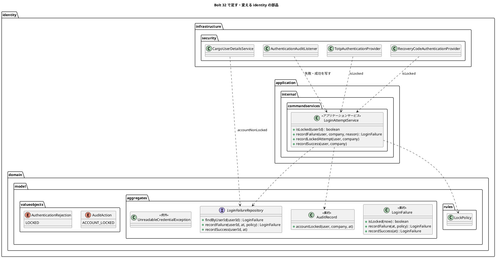
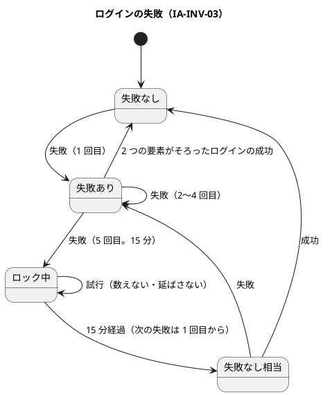
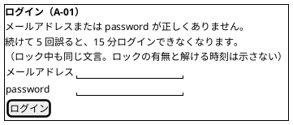

# Bolt 32 計画 - ログインのロック（US-18 AC3）

## 基本情報

| 項目 | 内容 |
| :--- | :--- |
| Bolt | 第 32 回（W5 の 9 本目。US-18 の残りの 6 本目） |
| 予定 | W5（2026-11-02 の週。前倒しで着手できる）。作業は約 4 時間 20 分（承認ゲートの待ち時間を除く。「時間の配分と打ち切り」） |
| 対象 | `identity`（ログインの失敗の集約とリポジトリ、ロックと監査をまとめるアプリケーションのサービス、認証の入口（利用者の読み出し・2 つの provider・監査のリスナー）、A-01 の誤りの文言、読めない要素の例外）、セキュリティの統合テスト、画面の層、ADR-011・ADR-012、UI 設計・ドメインモデル・データモデル・非機能要件、リリース計画 |
| SP | 2（US-18 AC3。release_plan の 32 の行） |
| GitHub | [#13](https://github.com/k2works/practical-domain-driven-design-in-enterpris-application/issues/13)（US-18、R1.0）。この Bolt では閉じない |
| 承認ゲート | **ステップごとに止める**（W4 の締めの決定: 認証の完成はステップごと）。確認必須（セキュリティ（ロック・応答・例外の扱い）、データベース（失敗の記録の作成の競合の扱い）、画面の文言）は計画の承認の場で確認ポイントとして判断を受ける |
| アプローチ | インサイドアウト（開発戦略の中盤。W5 の表で US-18 はインサイドアウト）。ログインの失敗の集約・方針・リポジトリ（Bolt 30）から固め、サービス、認証の入口、画面の順に足す |
| 前の Bolt | [Bolt 31d 終了報告](bolt_31d_report.md)、[Bolt 31c 終了報告](bolt_31c_report.md)、[Bolt 30 終了報告](bolt_30_report.md) |

## Bolt ゴール

password・TOTP・回復コードの失敗が 5 回続いたら、その時点から 15 分ロックし、追加の試行を拒む（US-18 AC3、IA-INV-03）。ロック中も password の誤りと同じ応答にし、利用者の存在もロックも第三者に推測させない（AC2）。失敗の数え方と監査記録はアプリケーションのサービスで 1 つのトランザクションにまとめ（ADR-012 の見直しの 5、IA-INV-08）、監査のリスナーは入口だけにする。

### 確かめたい仮説

| # | 仮説 | この Bolt で分かること |
| :--- | :--- | :--- |
| H1 | 失敗の数え方と監査記録をアプリケーションのサービスの 1 つのトランザクションにまとめれば、監査のリスナーは結果を写すだけになり、監査記録と回数が食い違わない（IA-INV-08） | 失敗の監査記録の追記が失敗したら回数も戻ること（単体テスト）。同じ利用者の同時の失敗が両方数えられ、両方の監査記録があること（PostgreSQL の統合テスト） |
| H2 | ロックを password の照合の後の確認（`accountLocked`、`AccountStatusUserDetailsChecker`）で見れば、応答の文言と時間でロックが分からない | ロック中の正しい password と誤った password が同じ応答（`/login?error`）になり、どちらも password の照合を通ること。ロック中の試行は数えず期限も延びないこと |

## ふりかえりと前の Bolt からの引き継ぎ

| 入力 | 内容 | この Bolt での扱い |
| :--- | :--- | :--- |
| 開始準備の決定（2026-10-13、human:kakimomokuri） | 32 と 32c に分ける（32: ロック、32c: AC6 の request ごとの役割の確認と見直しの 3、テストの低の指摘）。S-02 は W10 の WAF に送る。ロック中は誤りと同じ文言で、A-01 に一般の予告だけを足す（解ける時刻は示さない）。`UnreadableCredentialException` は `RuntimeException` を継ぐ形に替える | 本計画の範囲と、確認ポイント 1〜4 |
| Bolt 31d の Try T-110 | コミットは pathspec で作る。`git mv` を使う作業と設計文書のコミットを並行させない | 全ステップ。設計文書をサブエージェントに任せる間は、コードの作業で `git mv` を使わない |
| Bolt 31d の Try T-111 | テストの出力の取り込みは、見張りたい操作の間だけ（`LogCapture`） | ロックの監査のログの見張りを足すときは `LogCapture` を使う |
| Bolt 31d の Try T-112 | 見張りの違反は、見張りを足した理由になった書き方そのものを入れて確かめる | ロックの見張り（ロック中は数えない・延ばさない・成功で外さない）は、それぞれの規則を外す変異を入れて落ちることを確かめる |
| Bolt 31c の Try T-107〜T-109 | 「ないこと」の確かめは対象の存在を先に。枠組みに任せる約束は誰がいつ呼ぶかを書く。設計文書を先に push | 全ステップ。`AccountStatusUserDetailsChecker` がいつ `LockedException` を投げるか、失敗のイベントの対応（`AuthenticationFailureLockedEvent`）を計画に書き、テストで確かめる（確認ポイント 6） |
| Bolt 31d の既知の課題（32） | `UnreadableCredentialException` の親の型、「実装の誤りは 500」の端から端までの統合テスト、`DataAccessException` の扱い、provider の単体テストの拒否の 3 値と監査のリスナーの単体テスト、`{bcrypt}` で中身が壊れたハッシュ、回復コードの誤りも数えるか。テストの低の指摘（Bolt 31 の低、3 つの統合テストの時計の設定、8 時間の起点の値と監査の順） | 前のものはこの Bolt。テストの低の指摘は開始準備の決定で 32c に送る |
| Bolt 30 の議題 2 の③ | 同じ利用者の最初の失敗が同時に 2 つ届くと、片方が記録の作成で一意制約に当たる（`LoginFailureRepository` の Javadoc） | ステップ 2（確認ポイント 7） |
| Bolt 31 のレビュー 16 | IA-INV-08 の同じトランザクションを確かめていない | 仮説 H1 |
| Bolt 31 の Try T-101 | 置き場所の決定が層の規則の例外を伴いそうなときは、骨組みを置いて ArchUnit を流して確かめる | 新しい置き場所はない（サービスは `commandservices`、入口は D-5 の認証の例外の範囲） |
| W4 の Try T-83・T-88・T-89・T-90 | 骨組みのまま流して本命のアサーションで落とす。見張り。後に回したものは Issue にする。画面を作る Bolt の開発レビューにテクニカルライターの観点 | 全ステップ。A-01 の文言を変えるので、ステップ 6 にテクニカルライターの観点を入れる。32c は #13 の中の作業として W5 の表で追う |

## スコープ

### 設計の約束（Try T-1）

- 失敗の数え方（IA-INV-03）はログインの失敗の集約（`LoginFailure`）と方針（`LockPolicy`）のまま。数える・外す・ロックの監査記録を書くのはアプリケーションのサービス `LoginAttemptService`（`identity.application.internal.commandservices`）で、監査記録と回数を 1 つのトランザクションにする（IA-INV-08、ADR-012 の見直しの 5）。監査のリスナーは失敗・成功のイベントをサービスに写すだけ
- 数えるのは password・TOTP・回復コードの誤り（`AuthenticationFailureBadCredentialsEvent`）。ロック中の拒否・存在しない利用者・利用停止は数えない。2 つの要素がそろったログインの成功（`LOGIN_SUCCEEDED`）で 0 に戻す（password の段の成功では戻さない）
- ロックは password の照合の後に確かめる（`CargoUserDetails` の `accountNonLocked`、`AccountStatusUserDetailsChecker`）。ロック中は正しい password でも誤った password でも同じ応答（`/login?error`）。TOTP・回復コードの provider も確かめる前にロックを見て拒む（password の段の後にロックされた場合）
- 画面はロックの有無を示さない。A-01 の誤りの文言に一般の予告（「続けて 5 回誤ると 15 分ログインできなくなります」）を足す
- ロックの監査: 5 回目の失敗でロックしたら `ACCOUNT_LOCKED` を書く（同じトランザクション）。ロック中の拒否は `LOGIN_FAILED` の理由 `LOCKED`（数えない）

### 入れるもの・入れないもの

| 入れる | 入れない（後で） |
| :--- | :--- |
| `LoginAttemptService`（数える・外す・ロックの監査記録を 1 つのトランザクションで）、監査のリスナーの書き換え | AC6 の request ごとの役割の確認、ADR-012 の見直しの 3（32c） |
| ロックの確かめ（password の照合の後、TOTP・回復コードの前）、A-01 の誤りの文言の予告 | S-02 の送信元ごとの流量の制限（W10 の WAF。開始準備の決定） |
| 監査の操作 `ACCOUNT_LOCKED`、拒否の理由 `LOCKED` | ロックの解除の操作（システム管理者。US-16 の利用者の管理、Bolt 34） |
| 最初の失敗の同時の作成の競合（議題 2 の③） | テストの低の指摘（Bolt 31 の低、時計の設定、8 時間の起点の値と監査の順。32c） |
| Bolt 31d から: `UnreadableCredentialException` を `RuntimeException` に、実装の誤りは 500 の統合テスト、`DataAccessException` の扱い、provider の拒否の 3 値と監査のリスナーの単体テスト、`{bcrypt}` で中身が壊れたハッシュ | ユーザーマニュアル（Bolt 33b でまとめて直す。W5 の節の決定） |
| 画面の層のシナリオ（5 回誤るとロックされ、正しい password でもログインできない） | |

## 設計（この Bolt の範囲）

### ドメインモデル

- `LoginAttemptService#recordFailure` は 1 つのトランザクションで、監査記録 `LOGIN_FAILED`（理由）を書き、回数を数え、この失敗でロックしたら `ACCOUNT_LOCKED` を書く。`recordLockedAttempt` は `LOGIN_FAILED`（理由 `LOCKED`）だけを書き、数えない。`recordSuccess` は `LOGIN_SUCCEEDED` を書き、回数を 0 に戻す（ロック中なら戻さない。IA-INV-03）
- 監査のリスナーは、password の段の成功（`PASSWORD_VERIFIED`）とログアウトは今のまま書く。失敗と 2 つの要素の成功はサービスに写す
- `UnreadableCredentialException` は `RuntimeException` を継ぐ（開始準備の決定。Bolt 31d の議題 4）。捕まえる側は変わらない
- 状態遷移図（ログインの失敗）:

### データモデル

表は変えない（ER 図は省く）。`login_failure`（Bolt 30）をそのまま使う。最初の失敗の作成の同時の競合（議題 2 の③）は、作成の一意制約の違反を受けて既にある行を数える（確認ポイント 7）。監査記録の操作 `ACCOUNT_LOCKED` と理由 `LOCKED` は文字列の列なのでマイグレーションは要らない。

### 画面遷移

A-01 の誤りの文言だけを変える（遷移は変えない）。UI 設計の「ロック中 : A-01 にロック中の案内」の状態と「ロック中の案内と解ける時刻は Bolt 32」を、「ロック中も誤りと同じ応答（AC2）」に改める。

## ステップ計画

状態の記号: `[ ]` 未着手、`[-]` 進行中、`[?]` 承認待ち、`[x]` 完了。各ステップの終わりに `check` が緑であることと、計画からの変更を設計文書に反映したこと（T-53）を確かめ、push して CI を確かめる（T-26、T-65）。コミットは pathspec で作り、そのステップのファイルだけを入れる（T-84、T-110）。複数行の書き換えはスクリプトのファイルにする（T-103）。ステップ 1 を push してからコードのステップを push する（T-109）。

- [ ] **1. 設計文書** 【承認ゲート: 設計文書】
  - ADR-011: ロック（数え方の置き場所と 1 つのトランザクション、数える失敗と数えない失敗、成功で戻す時点、ロックの確かめの位置と応答、ロックの監査、最初の失敗の作成の競合）、S-02 を W10 の WAF に送ることと受け入れるリスク、`UnreadableCredentialException` の親の型（決定 8 を改める）
  - ADR-012: 見直しの 5 を「決めた」に移す。見直しの 3 を 32c に
  - ui_design.md: A-01 の誤りの文言と予告、画面遷移図のロック中の状態、A-02 の「ロック中の案内と解ける時刻は Bolt 32」を改める
  - domain_model.md（用語集に `LoginAttemptService`、`AuditAction`・`AuthenticationRejection` の値、IA-INV-03・IA-INV-08 の説明）、data_model.md（監査の操作と理由の一覧）、non_functional.md（SEC-05 などロックの記述）
  - release_plan.md の W5 の節: 32 の行を本計画に、32c の行を足す（AC6、見直しの 3、テストの低の指摘。SP 0）。Bolt の本数（15 本）と順序（32 → 32c → 32b、33 は依存なし）
  - 完了の判定: `okf:check` ERROR 0、`documentationTest` 緑。push してからコードを push する
- [ ] **2. 数え方と監査をまとめるサービス** 【承認ゲート: Red・Green、データベース】
  - Red: `LoginAttemptService` の単体テスト（失敗で `LOGIN_FAILED` と回数、5 回目で `ACCOUNT_LOCKED`、ロック中の試行は数えず `LOCKED` だけ、成功で 0 に戻しロック中は戻さない、監査の追記が失敗したら回数も戻る、存在しない利用者は記録を作らない）。PostgreSQL の統合テスト（同じ利用者の最初の失敗が同時に 2 つでも両方数えられる（議題 2 の③）、同時の失敗が両方の監査記録を持つ。T-100）
  - Green: `LoginAttemptService`（`TransactionTemplate`）、`AuditRecord.accountLocked`、`AuditAction.ACCOUNT_LOCKED`、`AuthenticationRejection.LOCKED`、リポジトリの最初の失敗の作成の競合の扱い
  - 完了の判定: `check` 緑
- [ ] **3. 認証の入口のロック** 【承認ゲート: セキュリティ、画面】
  - Red: セキュリティの統合テスト（5 回の失敗の境界: 4 回はロックされず 5 回でロック、14 分 59 秒はロック中で 15 分で解ける。password と TOTP と回復コードの失敗を合わせて数える。ロック中は正しい password でも `/login?error` で誤りと同じ文言、ロック中の試行は数えず期限も延びない、2 つの要素がそろったログインで 0 に戻る、password の段の後にロックされたら正しい TOTP・回復コードも拒む、監査記録（`LOGIN_FAILED` の理由、`ACCOUNT_LOCKED`）が数えた回数と合う。利用者の切り替え（T-102）: 別の利用者の失敗は数えない）。監査のリスナーの単体テスト（失敗・成功をサービスに写す、拒否の理由の写し）。provider の単体テストの拒否の 3 値（`@EnumSource`）
  - Green: `CargoUserDetails` の `accountNonLocked`（`CargoUserDetailsService` が `LoginFailureRepository` を読む）、`AuthenticationAuditListener` の書き換え（`AuthenticationFailureLockedEvent` は `recordLockedAttempt`）、2 つの provider がロックを見る、`login.html` の文言、`SecurityConfiguration` の組み立て
  - 完了の判定: `check` 緑
- [ ] **4. Bolt 31d から送った例外の扱い** 【承認ゲート: セキュリティ】
  - `UnreadableCredentialException` を `RuntimeException` に（テストの型の確かめを合わせる）
  - 実装の誤りは 500 の統合テスト（TOTP の生成器が素の `IllegalArgumentException` を投げる偽物の部品で、500 になり監査の失敗が残らず数えないこと）
  - `DataAccessException` の扱い（数え方・監査の書き込みが DB の誤りで失敗したら、ログインを通さず 500 にしてエラーのログを残す。確認ポイント 8）
  - `{bcrypt}` で中身が壊れたハッシュ（枠組みは false を返す）を読めない要素として扱うか（確認ポイント 9）
  - 完了の判定: `check` 緑
- [ ] **5. 画面の層** 【承認ゲート: セキュリティ】
  - `login_ui.feature` に「password を 5 回誤った荷主担当者は正しい password でもログインできず、15 分後にログインできる」（`@US-18-AC3 @demo @demo-bolt-32/lock`。時計は画面の層の部品で進める）
  - 完了の判定: `check` と `uiTest` が緑
- [ ] **6. SonarQube と開発レビューとデモと終了報告** 【承認ゲート: 終了報告】
  - SonarQube（`sonar-local:check`。T-104）
  - 開発レビュー（プログラマー、アーキテクト、テスター（ロックの境界と同時の失敗）、テクニカルライター（A-01 の文言と予告。T-90））
  - レビューの直しの後にデモの動画を撮り、#13 に添付する（T-105）。`bolt_32_report.md`。release_plan の W5 の 32 の行、開発の索引。#13 に進み具合をコメントする

### 時間の配分と打ち切り

| # | 目安 | 打ち切り |
| :--- | :--- | :--- |
| 1 | 30 分 | — |
| 2 | 55 分 | — |
| 3 | 70 分 | — |
| 4 | 40 分 | `DataAccessException` の扱いで入口の構成を大きく変える必要が出たら、32c に送るかを人に諮る |
| 5 | 25 分 | 画面の層で時計を進められなければ、ロックまでのシナリオだけにし、解けることは統合テストに任せる |
| 6 | 40 分（SonarQube と動画の待ちを除く） | — |

合計 260 分（約 4 時間 20 分）。4.5 時間を超えると見えたら、止めて人に諮る（候補: ステップ 4 の `{bcrypt}` の壊れたハッシュを 32c に送る）。

## 確認ポイント（計画の承認の場でまとめて確認する。Try T-6）

| # | 確認すること | ステップ | 推奨 |
| :--- | :--- | :--- | :--- |
| 1 | **32 と 32c に分ける**（開始準備で決めた） | — | 32: ロック（AC3、見直しの 5、議題 2 の③、Bolt 31d から送った例外の扱い）。32c: AC6 の request ごとの役割の確認、見直しの 3、テストの低の指摘（Bolt 31 の低、3 つの統合テストの時計の設定、8 時間の起点の値と監査の順）。SP 2 は 32 で数える（32c は 0）。W5 は 15 本 |
| 2 | **S-02 を W10 の WAF に送る**（開始準備で決めた） | 1 | 利用者を変えながら password を試す攻撃は利用者ごとのロックでは止まらない。本番の前段の WAF の送信元ごとの流量の規則（W10）で扱い、それまでは受け入れる（パイロットの前で本番の利用者はいない）。ADR-011 とリスク台帳に書く |
| 3 | **ロック中の応答**（開始準備で決めた。セキュリティ、画面） | 3 | ロック中も password の誤りと同じ応答（`/login?error`、同じ文言）。A-01 の誤りの文言に一般の予告「続けて 5 回誤ると、15 分ログインできなくなります。」を足す。解ける時刻は示さない。UI 設計の「ロック中の案内と解ける時刻」を改める |
| 4 | **`UnreadableCredentialException` を `RuntimeException` に**（開始準備で決めた） | 4 | 継ぐ型を替え、ADR-011 の決定 8 を改める。捕まえる側（2 つの provider、登録のサービス）は変えない。実装の誤りの側のテストは `isExactlyInstanceOf(IllegalArgumentException)` のまま有効 |
| 5 | **数える失敗と成功で戻す時点**（セキュリティ） | 2・3 | 数えるのは password・TOTP・回復コードの誤り（回復コードも数える。総当たりを抑える。Bolt 31d のアーキテクトの推奨）。数えないのは、ロック中の拒否（期限も延ばさない）、存在しない利用者、利用停止・無効な企業、CSRF などの入口の拒否。0 に戻すのは 2 つの要素がそろったログインの成功だけ（password の段の成功では戻さない。password を知る者が TOTP を試しながら回数を戻せないように） |
| 6 | **ロックの確かめの位置と枠組みの部品**（セキュリティ。T-108） | 3 | password の段は `DaoAuthenticationProvider` の照合の後の確認（`AccountStatusUserDetailsChecker` が `accountNonLocked` を見て `LockedException`）。照合の前に確かめると、応答の時間でロックが分かる（Bolt 14 の利用停止と同じ理由）。`LockedException` の失敗のイベントは `AuthenticationFailureLockedEvent`（`DefaultAuthenticationEventPublisher` の既定の対応）で、リスナーはこれを数えない試行として写す。TOTP・回復コードの provider は確かめる前に `LoginAttemptService#isLocked` を見て `LockedException` を投げる（入口の失敗のハンドラーは A-01 に戻す。A-02 の誤りと同じ `totp-error` の文言） |
| 7 | **最初の失敗の作成の同時の競合**（Bolt 30 の議題 2 の③。データベース） | 2 | リポジトリの「なければ作る」で一意制約の違反になったら、既にある行として続けて数える（同じトランザクションの中で違反を捕まえず、作成を別のトランザクションにする。ADR-007 の「一意制約の違反は同じトランザクションで捕まえない」）。PostgreSQL の統合テストで同時の 2 つの最初の失敗が両方数えられることを確かめる |
| 8 | **`DataAccessException` の扱い**（Bolt 31d から） | 4 | 数え方・監査の書き込みが DB の誤りで失敗したら、ログインを通さず 500（エラーのログ）。監査記録なしにログインを通さない（IA-INV-08）。失敗の数えに失敗しても誤りの応答（`/login?error`）にはしない（数えられていない失敗を利用者の誤りに見せない） |
| 9 | **`{bcrypt}` で中身が壊れたハッシュ**（Bolt 31d から） | 4 | 枠組みは false を返す（照合が一致しない）。読めない要素として扱うには形の確かめが要り、bcrypt の形の知識を持ち込むことになる。この Bolt では扱いを変えず、特性テストで「false を返す（利用者の誤りとして数えられる）」ことを固定し、ADR に受け入れる理由を書く（壊すには DB への書き込みが要る） |
| 10 | 後の Bolt に送るものと T-89 | — | 32c: AC6、見直しの 3、テストの低の指摘。33b: 登録の部品の低の指摘（Bolt 31d から）。ロックの解除の操作は US-16（Bolt 34）。どれも W5 の節の表で追う |
| 11 | 承認ゲート | 全体 | ステップごとに止める（W4 の締めの決定）。ステップ 2 はデータベース、3・4・5 はセキュリティの確認必須 |

## 完了条件

- [ ] password・TOTP・回復コードの失敗が 5 回続くとロックされ、15 分の間は正しい認証情報でも拒まれ、15 分で解ける。ロック中の試行は数えず期限も延びない。2 つの要素がそろったログインで 0 に戻る
- [ ] ロック中も誤りと同じ応答で、ロックの有無と解ける時刻は示さない。A-01 に一般の予告がある
- [ ] 失敗の監査記録と回数が 1 つのトランザクションで、ロックで `ACCOUNT_LOCKED`、ロック中の試行で理由 `LOCKED` が残る。同時の最初の失敗も両方数えられる
- [ ] `UnreadableCredentialException` が `RuntimeException` を継ぎ、実装の誤りは端から端まで 500 になる（統合テスト）
- [ ] `check` と `uiTest` が緑。push して CI を確かめた。SonarQube の Quality Gate が PASS、`okf:check` ERROR 0
- [ ] 開発レビュー、レビューの後のデモの動画と #13 への添付、終了報告。#13 に進み具合をコメントした

### デモ項目

- 画面の層のシナリオの動画（`@demo @demo-bolt-32/lock`）: 荷主担当者が password を 5 回誤る → 正しい password でも同じ誤りの文言 → 15 分後にログインできる

## 更新履歴

| 日付 | 更新内容 | 更新者 |
| :--- | :--- | :--- |
| 2026-10-13 | 初版作成（承認待ち）。開始準備で、Bolt 31d の終了報告の Try（T-110〜T-112）と既知の課題、US-18 AC3・AC2、ADR-011 のロックの決定、ログインの失敗の集約とリポジトリ（Bolt 30）、認証の入口を調べ、human:kakimomokuri の決定（32 と 32c に分ける、S-02 は W10 の WAF、ロック中は誤りと同じ文言で予告だけ、`UnreadableCredentialException` を `RuntimeException` に）を反映した | anthropic/claude-opus-5-5 |

## 関連ドキュメント

- [リリース計画](release_plan.md)（W5）
- [Bolt 31d 終了報告](bolt_31d_report.md)、[Bolt 31c 終了報告](bolt_31c_report.md)、[Bolt 30 終了報告](bolt_30_report.md)
- [ADR-011](../../adr/cargo-tracker/011-mfa-totp.md)、[ADR-012](../../adr/cargo-tracker/012-authentication-principal-and-session.md)
- [ドメインモデル](../../design/cargo-tracker/domain_model.md)（アクセス・監査、IA-INV-03・IA-INV-08）、[データモデル](../../design/cargo-tracker/data_model.md)（`login_failure`）、[UI 設計](../../design/cargo-tracker/ui_design.md)（A-01）
