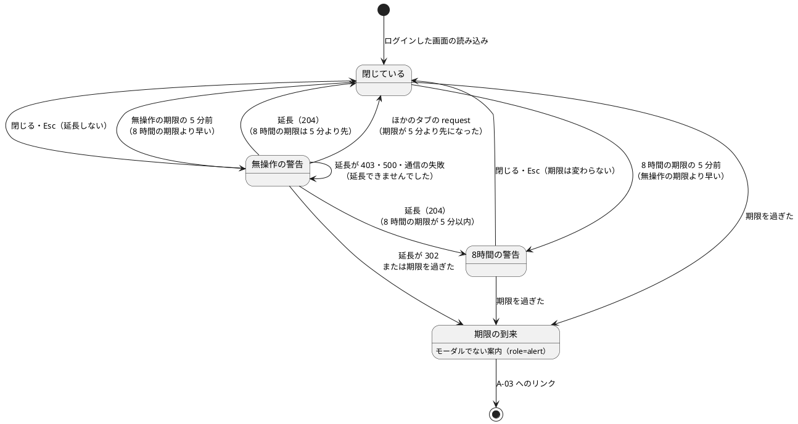
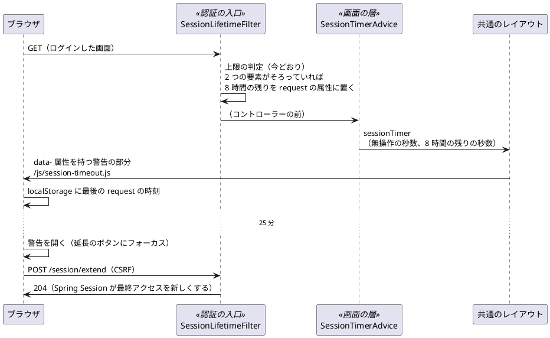

# Bolt 32b 計画 - session の失効の警告と延長（ACC-06）

## 基本情報

| 項目 | 内容 |
| :--- | :--- |
| Bolt | 第 32b 回（W5 の 12 本目。US-18 の残りの 9 本目） |
| 予定 | W5（2026-11-02 の週。前倒しで着手できる）。作業は約 4 時間 30 分（承認ゲートと人の手動確認の待ち時間を除く。上限ちょうど。「時間の配分と打ち切り」） |
| 対象 | `identity`（8 時間の残りの算出を認証の入口に置き画面に渡す、延長の URL）、共通のレイアウト（顧客 Web・社内業務 Web）、警告のダイアログと JavaScript、画面の層のテストの部品（`BrowserSession`）、UI 設計、フロントエンドとバックエンドのアーキテクチャ、非機能要件、ADR-011・ADR-012、テスト戦略、ユーザーストーリー、リリース計画、ユーザーマニュアル |
| SP | 0（US-18 の SP は #13 をクローズする Bolt 33b で数える。横断の受入条件は SP を持たない） |
| GitHub | [#13](https://github.com/k2works/practical-domain-driven-design-in-enterpris-application/issues/13)（US-18、R1.0）。この Bolt では閉じない |
| 承認ゲート | **ステップごとに止める**（W4 の締めの決定: 認証の完成はステップごと）。確認必須（セキュリティ（延長の URL、認証の入口から画面への値の渡し方、ブラウザに置く値）、構造（新しい UI のパターンのモーダルのダイアログ）、新しいファイル）は計画の承認の場で確認ポイントとして判断を受ける |
| アプローチ | インサイドアウト（W5 の表の 32b の行）。開発戦略の表ではインサイドアウトは「新しい集約・スキーマを作る」ときで、32b はドメインもデータも変えないので表から外れる。外れる理由: 不確実性とリスクがサーバーの側（認証の入口から画面への値の渡し方、延長の URL のセキュリティ、Spring Security の CSRF と失効の経路）にあり、セキュリティの統合テストと単体テストから入るほうが早く確かめられる。画面は、ブラウザの時計の骨組みをステップ 3 の最初に確かめてから、画面の層の受入シナリオで外側から確かめる |
| 前の Bolt | [Bolt 32d 終了報告](bolt_32d_report.md)、[Bolt 32c 終了報告](bolt_32c_report.md)、[Bolt 14 終了報告](bolt_14_report.md)（A-03 と無操作 30 分） |

## Bolt ゴール

ログインした利用者が、無操作の失効に気づかないまま作業を失わないようにする。無操作 30 分の失効の 5 分前に警告し、画面を移らずに延長できる（入力中の値は消えない）。発行から 8 時間の上限は延長できないので、5 分前に「延長できない」ことと送信を促す警告を出す。警告は支援技術に伝わり、延長のボタンにフォーカスが移る（UI 設計の「部分更新を使う箇所」と共通部品の「session の警告」）。

### 確かめたい仮説

| # | 仮説 | この Bolt で分かること |
| :--- | :--- | :--- |
| H1 | 残り時間は、サーバーが画面に出した秒数（無操作の期限と 8 時間の残り）からブラウザの時計で数えれば足りる。残りを問い合わせる定期の request は要らない（問い合わせ自体が無操作の期限を延ばしてしまう） | 画面の層の受入シナリオで、警告が 25 分の時点で出て、延長の後は次の 25 分まで出ないこと。延長でサーバーの session の最終アクセスが新しくなること（統合テスト） |
| H2 | Playwright のブラウザのコンテキストの時計（`BrowserContext.clock()`）で時間を進めれば、30 分を待たずに警告・延長・タブの間の同期・期限の到来を確かめられる | ステップ 3 の最初に、骨組み（時計を入れて 25 分進めると、`setTimeout` で開く最小のダイアログが開く）で確かめる（W4 の T-83「骨組みのまま流して本命で落とす」。T-114「枠組みに頼る確認ポイントは確かめてから決める」）。効かなければ止めて諮る |

### 開始準備で確かめたこと（T-114）

- **A-03 の「開いていた画面に戻ります」は、無操作の失効では成り立っていない**: 無操作の失効は `sessionManagement().invalidSessionUrl` が要求を保存せずに A-03 へ移す。8 時間の上限は `SessionLifetimeFilter` が session を捨てて A-03 へ移す。どちらも開いていた画面の URL を覚えないので、A-03 から「ログインへ」で入り直すとホームに着く（Bolt 31 のレビュー 5 の「確かめていない」）。画面の文言を直して復帰を作るのは Bolt 32e（開始準備の決定）。マニュアルの同じ記述の扱いは確認ポイント 9
- **層の規則**: 画面の層（`interfaces`）は `infrastructure` に依存できない（`LayerArchitectureTest`）。要素の権限（`FACTOR_TOTP`）を参照できるのは認証の入口と合成ルートだけ（`FactorAuthorityReferenceTest`）。8 時間の起点（`SessionLifetime.AUTHENTICATED_AT`）と上限（`MAX_LIFETIME`）も認証の入口にある。よって 8 時間の残りは認証の入口（`SessionLifetimeFilter`）で算出して request の属性に置き、画面の層はその属性を名前で読む。無操作の期限の秒数は画面の層が `HttpSession.getMaxInactiveInterval()` で読める。名前を 2 つの定数で持つことは確認ポイント 5
- **CSRF と失効の経路**: `CsrfFilter` は `SessionLifetimeFilter` より前に動く。無操作で失効した session では CSRF のトークンも消えているので、延長の POST は CSRF のトークンがない拒否（`MissingCsrfTokenException`）になり、`invalidSessionUrl` があるため A-03 への 302 になる（ADR-012 の「session に CSRF のトークンがない古いフォームの送信も A-03」）。session が生きていてトークンが誤っているときだけ 403 になる。どちらもステップ 2 の統合テストで確かめる
- **CSP とダイアログ**: `default-src 'self'` でインラインのスクリプトを許さない。JavaScript は `/js/` の外部のファイルにする（`transport-request-form.js` と同じ）。ダイアログは HTML の `<dialog>` と `showModal()` で作る。理由は、フォーカスの閉じ込めと背後の inert 化、Esc の扱いをブラウザが標準で持ち、Bootstrap のモーダルの JavaScript と属性の組み立てを要らなくするため（Bootstrap の JavaScript は読み込み済みで、今の CSP でも動く。CSP は選んだ理由ではない）
- **htmx を使わない理由**: UI 設計（:35）とフロントエンドのアーキテクチャ（:29）は session の警告を部分更新（htmx 相当）に数えている。延長は htmx でなく `fetch` で送る。htmx（XHR）は 302 を黙って追い、A-03 の HTML を 200 で受けるので、失効を見分けられない。`fetch` は `redirect: 'manual'` で 302 を `opaqueredirect` として受けられる。警告を開く時刻もブラウザだけの関心で、サーバーの部分を返す request が要らない。ステップ 1 で両文書に書く
- **画面の層の受入シナリオの時計**: 画面の層のテストのアプリは本物の時計（`Clock.systemUTC()`）で動き、`MutableClock` も共通の時計のステップ（`ClockSteps`）も使わない（`UiTestConfiguration`・`RunUiCucumberTest` の glue）。よってサーバーの時計は進められない。8 時間の警告は、テストの部品が session の属性 `cargotracker.session.authenticatedAt` を 7 時間 56 分前の時刻に書き換えてから画面を開いて確かめる（画面の層のテストは `JdbcTemplate` を持つ。`UiUsers`）。ブラウザの時計は Playwright 1.63 の `Clock`（`BrowserContext.clock()`。同じコンテキストのページが同じ時計を使う）で動かせる。Spring Session の無操作の期限はサーバーの実時間で数えるので、画面の層のシナリオではサーバーの session を実際に失効させない（サーバーの失効は統合テスト）
- **数える request**: 今のテンプレートに `hx-get`・`hx-post` はない（画面の操作はすべて画面の移動）。`SessionLifetimeFilter` は公開の資源（`/js/**` など）でも session を読むので、資源の request でもサーバーの期限は延びるが、資源は画面の読み込みと同時に読まれる。よってブラウザは「画面の読み込み」と「延長」を数えれば足りる。ブラウザが数えない request（`layout/public` の A-04・エラーの画面、書類のダウンロード）でもサーバーの期限は延びるので、ブラウザの期限はサーバーより早く来ることがある（安全側。期限を過ぎたときの文言は断定しない。確認ポイント 7）

## ふりかえりと前の Bolt からの引き継ぎ

| 入力 | 内容 | この Bolt での扱い |
| :--- | :--- | :--- |
| 開始準備の決定（2026-10-14、human:kakimomokuri） | 32b（警告と延長）と 32e（入力の保持と開いていた画面への復帰）に分ける。8 時間の上限も 5 分前に警告する（延長はできない）。警告の時刻はタブの間でそろえる。延長は POST の専用の URL | 本計画の範囲と、確認ポイント 1〜4 |
| Bolt 32d の Try T-117 | 規則のテストは、その規則を外したときだけ落ちる入力を選び、規則ごとに文言で確かめる | ステップ 2 の延長の URL の CSRF・認証・失効のテストは、それぞれ 1 つの条件だけを外した request で確かめる。延長の最終アクセスは、先に行を古くしてから確かめる（ほかの request でも最終アクセスは新しくなるため） |
| Bolt 32d の Try T-118 | CI の結果を各ステップで残したいときは、前の push の CI を待ってから次を push する | 全ステップ |
| Bolt 32d の既知の課題（時計の受け方） | 統合テストの時計を `Clock` で受けて `MutableClock` に型変換する書き方が 6 クラスに散らばる。報告は「次に identity の統合テストを触る Bolt でそろえる」 | 確認ポイント 6。この Bolt は既存の 6 クラスを書き換えないので、新しいテストだけを `MutableClock` を直接受ける形で書く（報告の「触る Bolt」の約束を「書き換える Bolt」と読む。違いを承認の場で確かめる） |
| Bolt 32d の既知の課題（フラグ引数） | 画面の層のステップの `submitLogin(String, boolean)` のフラグ引数は、画面の層のステップを触る Bolt で分ける | `LoginUiSteps` は触らない（新しいステップ定義のクラスを作り、ログインは今の共通のステップを使う）。分けるのは `LoginUiSteps` を書き換える Bolt |
| Bolt 32c の Try T-115・T-116 | 「〜では〜しない」の約束は、その条件が成り立つ場面で確かめる。SonarQube はテストとコードを書き換えていない間に流す | ステップ 2 の「延長は 8 時間の上限を延ばさない」は、上限の近い session で延長してから上限を過ぎて確かめる。ステップ 6 |
| Bolt 32 の Try T-113 | 共有の表の件数はそのテストの利用者で絞る | 延長の最終アクセスは、そのテストの session の行で確かめる（`SpringSessionRows`） |
| Bolt 31 のレビュー 5（テクニカルライター、高） | A-03 の「開いていた画面に戻ります」が実装と合うか確かめていない | 確かめた（上の「開始準備で確かめたこと」）。直すのは Bolt 32e。ステップ 1 でリリース計画の 32e の行に書く |
| Bolt 31c のレビュー 14（中、33b に送った） | 登録を始めた時刻のキーを 2 つの定数で読み書きしている | 同じ形の 3 つ目を足すかを確認ポイント 5 で決める |
| Bolt 14 のレビュー（利用者の代表） | 入力の保持と失効の前の警告は、利用者の信頼にかかわるため W5 で必ず入れる | 警告と延長はこの Bolt、入力の保持は Bolt 32e（どちらも W5） |
| W4 の Try T-83・T-88・T-89・T-90 | 骨組みのまま流して本命で落とす。見張り。後に回したものは Issue か計画の表に。画面の文言を変える Bolt にテクニカルライターの観点 | H2 の骨組み。警告の文言は UI 設計に書いてから作り、開発レビューにテクニカルライターを入れる。後に回すものはステップ 1 でリリース計画の 32e・33b の行に書く |

## スコープ

### 入れるもの・入れないもの

| 入れる | 入れない（後で） |
| :--- | :--- |
| 無操作 30 分の失効の 5 分前の警告と、画面を移らない延長（`POST /session/extend`。CSRF のトークン付き。204 を返す） | 失効の時の入力の保持と、再認証の後に開いていた画面へ戻すこと（Bolt 32e。A-03 の画面の文言の直しも 32e） |
| 発行から 8 時間の上限の 5 分前の警告（延長のボタンを出さない。送信を促す） | password の段（A-02 の 5 分）と登録の途中（A-07 の 15 分）の警告（A-07 は期限の時刻をすでに示している。認証の手続きの画面で、業務の入力を持たない） |
| 警告の時刻を複数のタブの間でそろえる（最後にサーバーへ request した時刻だけを `localStorage` で共有する） | 部分更新（htmx）の request を最後の request の時刻に数えること（今のテンプレートに部分更新がない。足す Bolt で数える） |
| 期限の時刻を過ぎたら、ダイアログをモーダルでない案内に替える（A-03 へのリンク。自動で画面を移らず、入力を画面に残して写し取れるようにする） | 警告までの時間・失効までの時間を利用者が変える設定。警告の英語（荷受人の画面の多言語は US-10 の Bolt に申し送る） |
| 顧客 Web と社内業務 Web の共通のレイアウト（`layout/customer`・`layout/staff`）に警告の部分と JavaScript を置く。`layout/public` の画面（A-01〜A-04、エラーの画面）には置かない | 警告の音・ブラウザの通知 |
| 画面の層のテストの部品 `BrowserSession` に、ブラウザの時計を入れる操作と別のタブを開く操作、session の属性を書き換える部品を足す | `LoginUiSteps` のフラグ引数（書き換える Bolt で分ける） |
| UI 設計・フロントエンドとバックエンドのアーキテクチャ・非機能要件（ACC-06）・ADR-011・ADR-012・テスト戦略・ユーザーストーリー・リリース計画（32e・33b の行）の更新 | — |
| ユーザーマニュアル（2.2 画面の構成に session の警告と延長、2.4 の注意・補足と付録 B の Q1-2 に警告と延長）と画面のキャプチャ、デモの動画の録画（利用者に見える振る舞いが変わる。メモリの規則「振る舞いが変わる Bolt はマニュアルを完了条件に入れる」）。#13 への添付は終了報告の承認の後（運用の手順書） | — |
| 支援技術（NVDA または VoiceOver）による人の手動確認（テスト戦略のアクセシビリティの表） | — |

### 設計の約束（Try T-1）

- **残り時間の渡し方**: ログインした画面（2 つの要素がそろった session）の応答に、無操作の期限の秒数（`HttpSession.getMaxInactiveInterval()`。今は 1800）と、8 時間の上限までの残りの秒数を出す。8 時間の残りは `SessionLifetimeFilter` が上限の判定と同じ起点・同じ時計で算出し、2 つの要素がそろった session のときだけ request の属性（`cargotracker.request.sessionLifetimeRemainingSeconds`。session の属性の接頭辞 `cargotracker.session.` と分ける）に置く（password の段・登録の途中・起点のない session では置かない）。画面の層の `@ControllerAdvice`（`identity.interfaces.web.SessionTimerAdvice`。共通の画面のモデルの属性を足す前例は `CurrentActorAdvice`）は、request の属性があるときだけ `request.getSession(false)` で無操作の秒数を読み、モデルの属性 `sessionTimer` にする（引数で `HttpSession` を受けると session を作ってしまうため受けない）。共通のレイアウトが警告の部分の `data-` 属性に書く
- **延長**: `POST /session/extend`（`identity.interfaces.web.SessionController`）。公開の URL にせず、認証・request ごとの利用者の確かめ（Bolt 32c）・上限の判定・CSRF の今のフィルターをすべて通す。Spring Session がその request で session の最終アクセスを新しくするので、コントローラーは 204 を返すだけにする。8 時間の上限は延びない。監査記録は書かない（延長はログインでも権限の変更でもない）
- **ブラウザの数え方**（`/js/session-timeout.js`。`layout/customer`・`layout/staff` の head に直接置く）: 画面の読み込みと延長の 204 の時刻を「最後の request の時刻」とし、`localStorage` に置く（キー `cargotracker.session.lastRequestAt`。値はミリ秒の時刻だけ）。無操作の期限は「最後の request の時刻 + 無操作の秒数」、8 時間の期限は「読み込みの時刻 + 8 時間の残りの秒数」。早いほうの期限の 5 分前に警告を開く。ほかのタブが `localStorage` を更新したら（`storage` のイベント）期限を数え直し、警告が要らなくなったら閉じる。`localStorage` を使えないときは、そのタブの時刻だけで数える
- **延長の応答の扱い**: 204 なら閉じる。`opaqueredirect`（302。失効した session は A-03 へ、ログインしていない session は A-01 へ移される）なら「ログアウトしました」の案内に替える。それ以外（403・500・通信の失敗）は「延長できませんでした。もう一度お試しください。」を警告の中に示し、延長のボタンを残す（session が生きているのに「ログアウトしました」と出さない）
- **警告のダイアログ**（`layout/session-warning` の部分。文言は UI 設計）: `<dialog>` を `showModal()` で開き、`aria-labelledby`・`aria-describedby` で見出しと本文を結ぶ。開いたら延長のボタンにフォーカスを移す（8 時間の警告では「閉じる」）。閉じたら開く前のフォーカスに戻す。残りの分は 1 分ごとに書き換えるが、支援技術には毎回読ませない（開いたときの本文で伝える）。残りは相対の分で示す（A-07 の期限は絶対の時刻とタイムゾーンで示すが、警告は 5 分以内のことで、時刻の書式とタイムゾーンをブラウザで組み立てない）。Esc（`cancel`）は「閉じる」と同じで延長しない（期限が来たら案内に替わる）。延長の後に 8 時間の期限が 5 分以内なら、8 時間の警告に替える。期限を過ぎたら、モーダルを閉じて同じ部分をモーダルでない案内（`role="alert"`。「操作がなかったため、ログアウトした可能性があります」と A-03 へのリンク）にし、背後の画面の入力を写し取れるようにする。JavaScript がないときは何も出さない（今の振る舞い）
- **モーダルのダイアログは session の警告だけの例外**: UI 設計は確認を画面の中の確認の領域で行い、別のダイアログを挟まない（:232）。session の警告は、どの画面の上にも出て操作を止めて知らせる必要があるため、モーダルのダイアログにする。この例外を UI 設計に書く

## 設計（この Bolt の範囲）

この Bolt はドメインのモデルとデータモデルを変えない。4 図のうち、ドメインモデル図と ER 図は対象がないので省く。警告のダイアログの状態遷移図と、残り時間の受け渡しの図を置く。画面遷移は、期限の到来の案内から A-03 へのリンクが増える（今の「ホーム → A-03 → A-01」の経路に合わせ、A-01 へ直接移さない。A-03 の問い合わせ先の案内を通す）。

### 警告のダイアログの状態

### 残り時間の受け渡し

## ステップ計画

状態の記号: `[ ]` 未着手、`[-]` 進行中、`[?]` 承認待ち、`[x]` 完了。各ステップの終わりに `check` が緑であることと、計画からの変更を設計文書に反映したこと（T-53）を確かめ、push して CI を確かめる（T-26、T-65、T-118）。コミットは pathspec で作り、そのステップのファイルだけを入れる（T-84、T-110）。複数行の書き換えはスクリプトのファイルにする（T-103）。ステップ 1 を push してからコードのステップを push する（T-109）。

- [x] **1. 設計文書** 【承認ゲート: 設計文書】
  - ui_design.md:
    - 前提の表（:35・:38）、共通部品の表の「session の警告」（:1012）、エラーと例外の扱い（:1089・:1090）、部分更新を使う箇所（:1107）を 32b（警告と延長）と 32e（入力の保持と画面への復帰）に分けて書く
    - 警告のダイアログ（無操作の警告・8 時間の警告・延長できませんでした・期限の到来の案内）の文言、フォーカスの動き、Esc、相対の分で示す理由。モーダルのダイアログは session の警告だけの例外（:232 の方針との関係）
    - 警告の出ない画面（`layout/public` の A-01〜A-04・エラーの画面）。画面遷移図に期限の到来の案内から A-03 への遷移
    - A-03 の行の「入力の保持と失効 5 分前の警告（ACC-06）は W5」を「警告と延長は Bolt 32b、入力の保持と開いていた画面への復帰は Bolt 32e」に直す
  - architecture_frontend.md:
    - 「session の時間制限」を 32b と 32e に分ける
    - 共通のレイアウトの部分と `/js/session-timeout.js`、タブの間の同期、残り時間はサーバーが出した秒数から数える（定期の問い合わせをしない）こと
    - htmx でなく `fetch` にする理由（ADR-005 の部分更新の方針との関係）
    - 数える request と、ブラウザの期限が早く来ることがある既知の制約
    - 共通のレイアウトの部品を `identity.interfaces.web` に置く判断（前例は `CurrentActorAdvice`）
  - architecture_backend.md: 認証の入口の部品の節に、8 時間の残りを request の属性の名前で画面の層に渡す契約（層の規則に例外を足さない理由、名前の一致をテストで守る）と `SessionController`・`SessionTimerAdvice`
  - non_functional.md の ACC-06: 8 時間の上限は SEC-03 のセキュリティ上の必須の制限（WCAG 2.2.1 の Essential の例外）として延長を出さず、5 分前に警告する。延長は画面を移らない
  - ADR-012: 延長の URL（`POST /session/extend`。今のフィルターを通し、8 時間の上限を延ばさない。CSRF と失効の経路）と、8 時間の残りを認証の入口から request の属性で画面に渡すこと（改訂の経緯）
  - ADR-011 の :136 の「無操作 30 分 | `server.servlet.session.timeout=30m` … 振る舞いは確かめていない」を、ADR-012 と `spring.session.timeout` に合わせて直す（改訂の経緯）
  - test_strategy.md:
    - 画面の層の受入シナリオで、ブラウザの時計を Playwright の `BrowserContext.clock()` で進めること。サーバーの session は実時間で失効させない（サーバーの失効は統合テスト）。8 時間は session の属性を書き換えて確かめる
    - 認証の行（:342）を 32b と 32e に分け、共通部品のテスト（:349）に session の警告を足す
  - user_story.md の :501 の「失効 5 分前の警告は W5 に残す」に、32b（警告と延長）と 32e（入力の保持）の分担を書く
  - release_plan.md の W5 の節:
    - 32b の行を本計画に（承認ゲートは「ステップごと（セキュリティ、構造、画面）」）。32e の行（入力の保持と開いていた画面への復帰、A-03 の文言、Bolt 31 のレビュー 5）を足す
    - US-18 の Bolt の順序（32d → 32b → 32e）、W5 の本数（17 本）、「session の失効の警告の範囲」の決定の反映先（32b・32e）
    - 33b の行に、確認ポイント 5 の結果（(b) なら「32b の残り時間の属性の名前も同じ直しの対象」）
    - ユーザーマニュアルの段落（32b の 2.2・2.4・付録 B、32e の分）、進み具合の行（:628）、W5 の状態
  - 完了の判定: `okf:check` ERROR 0、`documentationTest` 緑
- [ ] **2. 8 時間の残りと延長の URL** 【承認ゲート: Red・Green、セキュリティ】
  - Red（単体テスト `SessionLifetimeFilterTest`）: 2 つの要素がそろった session で、8 時間の残りの秒数が request の属性に置かれる（起点の直後、上限の 1 秒前）。password の段・登録の途中・起点のない session・認証の前では置かれない。上限を過ぎたら今どおり A-03（属性は置かない）
  - Red（統合テスト `SessionTimerSecurityIntegrationTest`。`@IdentityIntegrationTest`、`MutableClock` を直接受け、`@BeforeEach` で時刻を置く）:
    - ログインした業務の画面のモデルの `sessionTimer` に、無操作の秒数（1800）と 8 時間の残りの秒数（時計を 2 時間進めたら 6 時間分）がある。応答の HTML の `data-` 属性にも出る
    - A-02（password の段）の request では、request の属性もモデルの `sessionTimer` もない
    - 延長: `SpringSessionRows.idle` で最終アクセスを 20 分戻してから `POST /session/extend` を送り、204 で、その session の行の最終アクセスが今に近い（`SpringSessionRows` に `last_access_time` を読む補助を足す）
    - 業務の画面を GET して session に CSRF のトークンを作ってから、トークンなし・誤ったトークンで送ると 403（T-117）
    - 無操作で失効した session（`SpringSessionRows.idle` で 31 分戻す）の延長は A-03 への 302（CSRF のトークンのない拒否の経路）
    - password の段だけの session の延長は A-02 へ、8 時間を過ぎた session の延長は A-03 へ。ログインしていない request は A-01 へ（MockMvc の `csrf()` を付けた前提。実際のブラウザでは session がないので A-03 になる、と前提を書く）
    - 延長は 8 時間の上限を延ばさない（上限の 1 分前に延長し、時計を 1 分進めると A-03。T-115）
    - 認証の入口と画面の層の request の属性の名前が同じ値であること（確認ポイント 5 の (b) のとき）
  - Green: `SessionLifetimeFilter` が 8 時間の残りを request の属性に置く（上限の判定と同じ起点と時計）。`SessionTimerAdvice` と `SessionController` を作る
  - 完了の判定: `check` 緑（ArchUnit の層の規則と要素の権限の参照の見張りを含む）
- [ ] **3. 警告のダイアログと JavaScript** 【承認ゲート: Green（画面）、構造】
  - 骨組み（H2）: `BrowserSession` にブラウザの時計を入れる操作（`signInAs` の前に `context.clock().install()`）を足し、`setTimeout` で開く最小のダイアログを 25 分進めて開くことを、仮のシナリオで確かめる。効かなければ止めて諮る
  - `layout/session-warning` の部分（`<dialog>`、延長のフォームは `th:action` で CSRF のトークンを持つ）を `layout/customer`・`layout/staff` に入れる（`currentActor` と `sessionTimer` があるときだけ）。`<dialog>` と `::backdrop` と案内の表示を `app.css` に足す
  - `/js/session-timeout.js`（「設計の約束」のブラウザの数え方・延長の応答の扱い・ダイアログの状態）
  - `templates/identity/session-expired.html` のコメントの「入力の保持と失効の前の警告は W5」を 32b・32e に直す
  - 完了の判定: `check` 緑。dev で起動し、画面の読み込みと延長の POST が通ることを目で確かめる
- [ ] **4. 画面の層の受入シナリオ** 【承認ゲート: Red・Green】
  - `BrowserSession` に、別のタブを開く操作と、session の属性 `cargotracker.session.authenticatedAt` を書き換える部品（`JdbcTemplate`。Java の直列化の値を書く）を足す
  - `session_timeout_ui.feature`（`@ui @US-18`。横断の受入条件の失効の警告。時計を入れる前提が要るので `login_ui.feature`・`layout_ui.feature` と分ける）と、ステップ定義のクラス（新規。`LoginUiSteps` は触らない）:
    - 無操作で 25 分たつと警告が出て、延長のボタンにフォーカスがある。axe の違反がない
    - 延長すると警告が閉じ、入力中の値が残り、次の 25 分まで警告が出ない（`@demo @demo-bolt-32b/extend`）
    - ログインから 7 時間 56 分の session（属性を書き換える）で画面を開くと、延長のボタンのない 8 時間の警告が出る
    - 同じブラウザの別のタブで画面を開くと、もう一方のタブの警告が閉じる
    - 警告のまま期限を過ぎると、モーダルでない案内と A-03 へのリンクに替わり、入力中の値が残っている
  - 完了の判定: `uiTest` 緑。警告を外す違反（JavaScript の読み込みを外す）で落ちることを確かめる（T-112）
- [ ] **5. ユーザーマニュアルとデモの録画** 【承認ゲート: マニュアル】
  - 2.2 画面の構成に「session の警告と延長」（警告の出ない画面も書く）。2.4 の注意・補足と付録 B の Q1-2 に、警告と延長（8 時間は延長できない）を足す。「開いていた画面に戻ります」は確認ポイント 9 の結果に従う
  - 警告のダイアログのキャプチャ（`manual_screenshots.feature`。時計を `signInAs` の前に入れる）
  - デモの動画（`@demo-bolt-32b/extend`）を録画して保存する。#13 への添付と `ops/scripts/issue_demo.js`・運用の手順書の表への追記は、終了報告の承認の後（運用の手順書）
  - 完了の判定: `manual:build` が通る。`okf:check` ERROR 0
- [ ] **6. SonarQube と開発レビューと支援技術の確認と終了報告** 【承認ゲート: 支援技術の手動確認、終了報告】
  - SonarQube（`sonar-local:check`。テストとコードを書き換えていない間に流す。T-116）
  - 開発レビュー（プログラマー、アーキテクト（認証の入口から画面への値の渡し方、延長の URL）、テスター（時計を進めるシナリオ）、テクニカルライター（警告の文言とマニュアル。T-90）、インタラクションデザイナー（ダイアログのフォーカスと支援技術への通知））
  - 人による支援技術の手動確認（NVDA または VoiceOver）: 警告が読み上げられること、延長のボタンへのフォーカス、閉じた後のフォーカスの戻り、期限の到来の案内の読み上げ。手順は AI が用意し、結果を終了報告に記録する
  - `bolt_32b_report.md`。release_plan の W5 の 32b の行、開発の索引。#13 に進み具合をコメントする

### 時間の配分と打ち切り

| # | 目安 | 打ち切り |
| :--- | :--- | :--- |
| 1 | 45 分 | — |
| 2 | 60 分 | — |
| 3 | 55 分 | 骨組みで時計が効かなければ止めて諮る |
| 4 | 55 分 | タブの間の同期と 8 時間の警告のシナリオが書けなければ、8 時間は統合テストの値で確かめ（画面の層では確かめない）、既知の課題にする |
| 5 | 25 分 | — |
| 6 | 30 分（SonarQube と人の手動確認の待ちを除く） | — |

合計 270 分（約 4 時間 30 分。上限ちょうど）。超えると見えたら止めて諮る（候補: 期限の到来の案内を 32e に送る。32e は失効の時の振る舞いを扱う）。

## 確認ポイント（計画の承認の場でまとめて確認する。Try T-6）

| # | 確認すること | ステップ | 推奨 |
| :--- | :--- | :--- | :--- |
| 1 | **分け方**（開始準備で決めた） | 1 | 32b は警告と延長、32e は失効の時の入力の保持と再認証の後に開いていた画面へ戻すこと（A-03 の画面の文言と Bolt 31 のレビュー 5）。32e の入力の保持の置き場所（ブラウザかサーバーか）は 32e の開始準備で決める |
| 2 | **8 時間の上限の警告**（開始準備で決めた） | 1〜4 | 5 分前に警告する。延長のボタンは出さず、延長できないことと送信を促す。8 時間の上限そのものは変えない（SEC-03）。WCAG 2.2.1 の Essential の例外として ACC-06 に根拠を書く |
| 3 | **タブの間の同期**（開始準備で決めた。セキュリティ） | 3・4 | `localStorage` に置くのは最後の request の時刻（ミリ秒の数）だけ。業務データ・利用者の識別子・session ID は置かない。ログアウトしても消さない（次のログインの画面の読み込みで上書きされる。値から分かるのは最後に画面を開いた時刻だけ） |
| 4 | **延長の URL**（開始準備で決めた。セキュリティ） | 2 | `POST /session/extend`。CSRF のトークンを求め、認証・request ごとの利用者の確かめ・上限の判定の今のフィルターをすべて通す（公開の URL にしない）。204 を返すだけで、8 時間の上限は延ばさない。監査記録は書かない（延長はログインでも権限の変更でもない。BR-13 の監査の対象に当たらない） |
| 5 | **認証の入口から画面への値の渡し方**（構造。Bolt 31c のレビュー 14 との関係） | 1・2 | (b) 8 時間の残りは `SessionLifetimeFilter` が request の属性に置き、画面の層の `SessionTimerAdvice` が名前で読む。名前は 2 つの定数で持ち、一致をテストで守る（層の規則に例外を足さない）。レビュー 14 で 33b に送った「キーを 2 つの定数で持つ」負債と同じ形なので、33b の行に「32b の属性の名前も同じ直しの対象」と書き、33b でまとめて置き場所を決める。代わりの (a) は、33b でとる解決（両方の層から参照できる置き場所）を 32b で先にとる。設計の判断が 33b の範囲（登録の部品）と絡むので推奨しない |
| 6 | **統合テストの時計の受け方**（Bolt 32d の既知の課題） | 2 | この Bolt で足すテストは `MutableClock` を直接受け、`@BeforeEach` で時刻を置く。既存の 6 クラスは書き換えない（報告の「次に identity の統合テストを触る Bolt でそろえる」を「書き換える Bolt」と読む。32b は新しいクラスを足すだけ） |
| 7 | **期限を過ぎたときの画面** | 1・3・4 | 自動で A-03 へ移らず、モーダルを閉じてモーダルでない案内（「操作がなかったため、ログアウトした可能性があります」と A-03 へのリンク）にする。背後の画面の入力を写し取れる（保持は 32e）。ブラウザの期限はサーバーより早く来ることがある（数えない request がある）ので、文言は断定しない。延長の 302 だけを失効として扱い、403・500・通信の失敗は「延長できませんでした」 |
| 8 | **新しいファイルと UI のパターン**（構造） | 2〜5 | `SessionTimerAdvice`・`SessionController`（`identity.interfaces.web`）、`layout/session-warning.html`、`/js/session-timeout.js`、`session_timeout_ui.feature` とステップ定義、`SessionTimerSecurityIntegrationTest`。モーダルのダイアログは session の警告だけの例外として UI 設計に書く。延長は htmx でなく `fetch`（理由は「開始準備で確かめたこと」） |
| 9 | **マニュアルの「開いていた画面に戻ります」** | 5 | 2.4 と付録 B の Q1-2 から、この Bolt で外す（利用者向けの事実として誤りと分かったため）。画面（A-03）の文言は 32e で復帰を作るときに直す（32e で復帰ができたらマニュアルにも戻す）。画面とマニュアルが 32e までずれることを受け入れる |
| 10 | **マニュアルとデモ** | 5 | 入れる（利用者に見える振る舞いが変わる）。2.2・2.4・付録 B、警告のダイアログのキャプチャ。デモは録画までをこの Bolt で、#13 への添付は終了報告の承認の後 |
| 11 | **支援技術の手動確認** | 6 | 人が NVDA または VoiceOver で確かめる（テスト戦略）。AI が手順を用意し、結果を終了報告に記録する |
| 12 | **用語** | 1 | 上流の文書（ユーザーストーリー・UI 設計・リリース計画・テスト戦略）に合わせて「警告」にする。「予告」は Bolt 32 の A-01 のロックの予告で使っている |
| 13 | 承認ゲート | 全体 | ステップごとに止める（W4 の締めの決定）。ステップ 2 はセキュリティ、3 は構造（新しい UI のパターン）、6 は人の手動確認 |

## 完了条件

- [ ] ログインした画面で、無操作の期限の 5 分前に警告が開き、延長のボタンにフォーカスが移る。延長すると画面を移らずに閉じ、サーバーの session の最終アクセスが新しくなる
- [ ] 8 時間の上限の 5 分前に、延長のボタンのない警告が開く。延長は 8 時間の上限を延ばさない
- [ ] 警告の時刻がタブの間でそろう。期限を過ぎるとモーダルでない案内に替わり、入力が画面に残る。延長の失敗は失効と分けて示す
- [ ] `layout/public` の画面と password の段の画面には警告が出ない。層の規則と要素の権限の参照の見張りは例外を足さずに緑
- [ ] UI 設計・フロントエンドとバックエンドのアーキテクチャ・ACC-06・ADR-011・ADR-012・テスト戦略・ユーザーストーリー・リリース計画（32e・33b の行）を更新した
- [ ] ユーザーマニュアル（2.2・2.4・付録 B）とキャプチャを更新し、デモの動画を録画した（#13 への添付は終了報告の承認の後）
- [ ] 人による支援技術の手動確認の結果を終了報告に記録した
- [ ] `check` と `uiTest` が緑。push して CI を確かめた。SonarQube の Quality Gate が PASS、`okf:check` ERROR 0
- [ ] 開発レビュー、終了報告。#13 に進み具合をコメントした

## 更新履歴

| 日付 | 更新内容 | 更新者 |
| :--- | :--- | :--- |
| 2026-10-14 | ステップ 1 を終えた。計画からの変更: 期限の到来の案内の文言から「操作がなかったため」を外した（8 時間の上限でも同じ案内が出るため）。警告を出さない画面に、`layout/public` を使う A-07 と回復コードの保存の画面を足した。「別のダイアログは挟まない」の方針は ui_design の :232 でなく C-17・S-09 の行にあったので、そこを参照した | anthropic/claude-opus-5-5 |
| 2026-10-14 | 承認（確認ポイント 1〜13 は推奨のまま）。`/goal Bolt32b` の下で、ステップの承認ゲートでは止めずに進め、終了報告でまとめて確かめを受ける。ステップ 6 の支援技術の手動確認は人が行う | human:kakimomokuri |
| 2026-10-14 | 詳細整合性検証（14 件）と横断整合性検証（18 件）の指摘を反映した。用語を上流に合わせて「警告」にした。画面の層のテストはサーバーの時計を動かせないので、8 時間は session の属性を書き換えて確かめる。アプローチの欄に表から外れる理由、H2 の骨組みをステップ 3 の最初に、`SessionLifetimeFilterTest` の単体テスト。CSRF と失効の経路（無操作の失効の延長は CSRF の拒否で A-03、403 は session にトークンがあるときだけ）、延長の最終アクセスは行を古くしてから確かめる。延長の応答の扱い（302 だけを失効に）、Esc・8 時間への切り替え・期限の到来をモーダルでない案内に、A-03 へのリンク。htmx でなく `fetch`・モーダルのダイアログの例外・`<dialog>` を選ぶ理由。属性の名前の 2 つの定数と Bolt 31c のレビュー 14 の関係（確認ポイント 5）、request の属性の接頭辞、`SessionTimerAdvice` は session を作らない。ステップ 1 の対象に ui_design の 5 か所・architecture_backend・ADR-011・test_strategy の 2 か所・user_story・release_plan の付随の節。`BrowserSession` の時計と別のタブ、JavaScript を置くレイアウト、`app.css`、テンプレートのコメント。マニュアルは 2.4 と付録 B の Q1-2 を直す（確認ポイント 9）。デモの添付は終了報告の承認の後。支援技術の手動確認。Bolt 32d のフラグ引数と時計の受け方の引き継ぎ。T-101 の引用を直した。時間を 4 時間 30 分に | anthropic/claude-opus-5-5 |
| 2026-10-14 | 初版作成（承認待ち）。開始準備で、ACC-06・UI 設計・フロントエンドのアーキテクチャ・ADR-012、今の失効の経路（A-03 の「開いていた画面に戻ります」が無操作の失効で成り立たないこと）、層の規則、CSP、Playwright の時計を調べ、human:kakimomokuri の決定（32b と 32e に分ける、8 時間も警告する、タブの間でそろえる、延長は POST の専用の URL）を反映した | anthropic/claude-opus-5-5 |

## 関連ドキュメント

- [リリース計画](release_plan.md)（W5）
- [Bolt 32d 終了報告](bolt_32d_report.md)、[Bolt 32c 終了報告](bolt_32c_report.md)、[Bolt 14 終了報告](bolt_14_report.md)、[Bolt 31c 終了報告](bolt_31c_report.md)（レビュー 14）
- [ユーザーストーリー](../../requirements/cargo-tracker/user_story.md)（横断受入条件、US-18）
- [非機能要件](../../design/cargo-tracker/non_functional.md)（ACC-06、SEC-03）、[UI 設計](../../design/cargo-tracker/ui_design.md)、[フロントエンドのアーキテクチャ](../../design/cargo-tracker/architecture_frontend.md)、[バックエンドのアーキテクチャ](../../design/cargo-tracker/architecture_backend.md)
- [ADR-011](../../adr/cargo-tracker/011-mfa-totp.md)、[ADR-012](../../adr/cargo-tracker/012-authentication-principal-and-session.md)、[テスト戦略](../../design/cargo-tracker/test_strategy.md)
