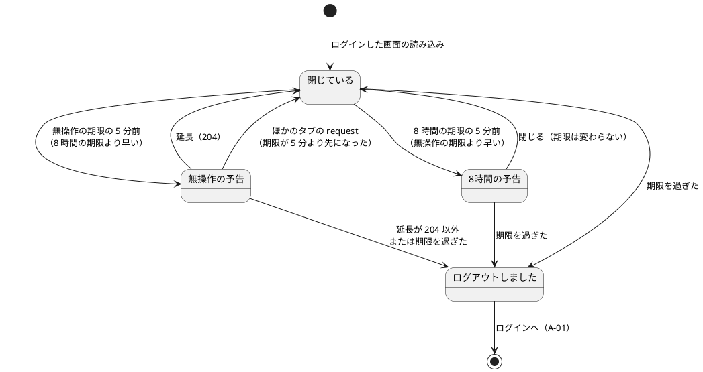
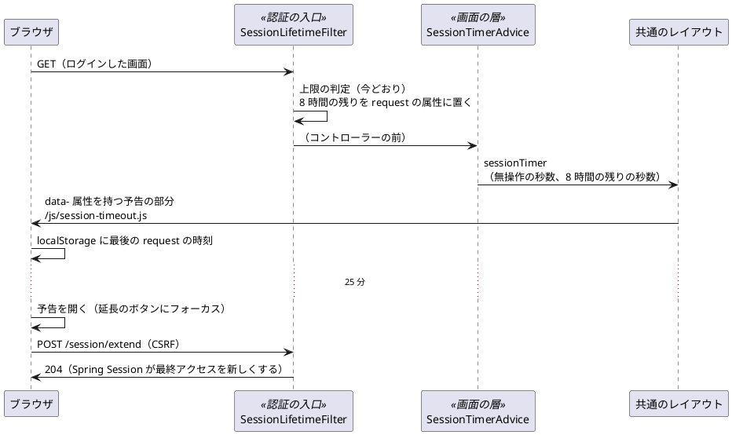

# Bolt 32b 計画 - session の失効の予告と延長（ACC-06）

## 基本情報

| 項目 | 内容 |
| :--- | :--- |
| Bolt | 第 32b 回（W5 の 12 本目。US-18 の残りの 9 本目） |
| 予定 | W5（2026-11-02 の週。前倒しで着手できる）。作業は約 4 時間 15 分（承認ゲートの待ち時間を除く。上限に近い。「時間の配分と打ち切り」） |
| 対象 | `identity`（8 時間の残りの算出を認証の入口に置き、画面に渡す。延長の URL）、共通のレイアウト（顧客 Web・社内業務 Web）、予告のダイアログと JavaScript、UI 設計、フロントエンドのアーキテクチャ、非機能要件、ADR-012、テスト戦略、リリース計画、ユーザーマニュアル |
| SP | 0（US-18 の SP は #13 をクローズする Bolt 33b で数える。横断の受入条件は SP を持たない） |
| GitHub | [#13](https://github.com/k2works/practical-domain-driven-design-in-enterpris-application/issues/13)（US-18、R1.0）。この Bolt では閉じない |
| 承認ゲート | **ステップごとに止める**（W4 の締めの決定: 認証の完成はステップごと）。確認必須（セキュリティ（延長の URL、認証の入口から画面への値の渡し方）、新しいファイル（JavaScript、レイアウトの部分、コントローラー））は計画の承認の場で確認ポイントとして判断を受ける |
| アプローチ | インサイドアウト（W5 の表の 32b の行）。サーバーの部品（8 時間の残りの算出、延長の URL）をセキュリティの統合テストで先に作り、レイアウトと JavaScript を画面の層の受入シナリオ（Playwright の時計）で外側から確かめる |
| 前の Bolt | [Bolt 32d 終了報告](bolt_32d_report.md)、[Bolt 32c 終了報告](bolt_32c_report.md)、[Bolt 14 終了報告](bolt_14_report.md)（A-03 と無操作 30 分） |

## Bolt ゴール

ログインした利用者が、無操作の失効に気づかないまま作業を失わないようにする。無操作 30 分の失効の 5 分前に予告し、画面を移らずに延長できる（入力中の値は消えない）。発行から 8 時間の上限は延長できないので、5 分前に「延長できない」ことと送信を促す予告を出す。予告は支援技術に伝わり、延長のボタンにフォーカスが移る（UI 設計の状態表示）。

### 確かめたい仮説

| # | 仮説 | この Bolt で分かること |
| :--- | :--- | :--- |
| H1 | 残り時間はサーバーが画面に出した秒数（無操作の期限と 8 時間の残り）から、ブラウザの時計で数えれば足りる。残りを問い合わせる定期の request は要らない（問い合わせ自体が無操作の期限を延ばしてしまう） | 画面の層の受入シナリオで、予告が 25 分の時点で出て、延長の後は次の 25 分まで出ないこと。延長の後にサーバーの session の最終アクセスが新しくなること（統合テスト） |
| H2 | Playwright のブラウザのコンテキストの時計（`BrowserContext.clock()`）で時間を進めれば、30 分を待たずに予告・延長・タブの間の同期・失効を確かめられる | ステップ 4 の最初に骨組み（時計を入れて 25 分進め、予告が出る）で確かめる（T-101） |

### 開始準備で確かめたこと（T-101・T-114）

- **A-03 の「開いていた画面に戻ります」は、無操作の失効では成り立っていない**: 無操作の失効は `sessionManagement().invalidSessionUrl` が要求を保存せずに A-03 へ移し、8 時間の上限は `SessionLifetimeFilter` が session を捨てて A-03 へ移す。どちらも開いていた画面の URL を覚えないので、A-03 から「ログインへ」で入り直すとホームに着く（Bolt 31 のレビュー 5 の「確かめていない」）。Bolt 32e で直す（開始準備の決定）。この Bolt では A-03 の文言を変えない
- **層の規則**: 画面の層（`interfaces`）は `infrastructure` に依存できない（`LayerArchitectureTest`）。要素の権限（`FACTOR_TOTP`）を参照できるのは認証の入口と合成ルートだけ（`FactorAuthorityReferenceTest`）。8 時間の起点（`SessionLifetime.AUTHENTICATED_AT`）と上限（`MAX_LIFETIME`）も認証の入口にある。よって 8 時間の残りは認証の入口（`SessionLifetimeFilter`）で算出して request の属性に置き、画面の層はその属性を名前で読む（属性の名前は固定の文字列で、画面の層と認証の入口の値が同じことをテストで守る。`TotpEnrollmentController.STARTED_AT` と同じ書き方）。無操作の期限の秒数は画面の層が `HttpSession.getMaxInactiveInterval()` で読める
- **CSP**: `default-src 'self'` でインラインのスクリプトを許さない。JavaScript は `/js/` の外部のファイルにする（`transport-request-form.js` と同じ）。ダイアログは HTML の `<dialog>` と `showModal()` で作る（Bootstrap のモーダルの JavaScript を使わず、インラインの style も足さない）
- **画面の層の受入シナリオの時計**: サーバーの時計は共通のステップ「現在時刻が … である」（`ClockSteps`、`MutableClock`）で動かせる（8 時間の残り）。ブラウザの時計は Playwright 1.63 の `Clock`（`BrowserContext.clock()`。同じコンテキストのページが同じ時計を使う）で動かせる。Spring Session の無操作の期限はサーバーの実時間で数える（Bolt 32d の既知の課題の `SpringSessionRows.idle`）ので、画面の層のシナリオではサーバーの session を実際に失効させない。失効の後のサーバーの振る舞い（A-03）は Bolt 14 の統合テストが確かめている
- **部分更新**: 今のテンプレートに `hx-get`・`hx-post` はない（画面の操作はすべて画面の移動）。よってサーバーへの request は「画面の読み込み」と「延長」の 2 つだけを数えればよい。htmx の request を後で足したら、そのときに数える（下の「入れない」）

## ふりかえりと前の Bolt からの引き継ぎ

| 入力 | 内容 | この Bolt での扱い |
| :--- | :--- | :--- |
| 開始準備の決定（2026-10-14、human:kakimomokuri） | 32b（予告と延長）と 32e（入力の保持と開いていた画面への復帰）に分ける。8 時間の上限も 5 分前に予告する（延長はできない）。予告の時刻はタブの間でそろえる。延長は POST の専用の URL | 本計画の範囲と、確認ポイント 1〜4 |
| Bolt 32d の Try T-117 | 規則のテストは、その規則を外したときだけ落ちる入力を選び、規則ごとに文言で確かめる | ステップ 2 の属性の名前の一致のテストと、延長の URL の CSRF・認証のテストは、それぞれ 1 つの条件だけを外した request で確かめる |
| Bolt 32d の Try T-118 | CI の結果を各ステップで残したいときは、前の push の CI を待ってから次を push する | 全ステップ |
| Bolt 32d の既知の課題 | 統合テストの時計を `Clock` で受けて `MutableClock` に型変換する書き方が 6 クラスに散らばる。共有の `MutableClock` の時刻を各テストの前に置くのは約束だけ | 確認ポイント 6。この Bolt で足す統合テストは `@IdentityIntegrationTest` を付け、`MutableClock` を直接受け、`@BeforeEach` で時刻を置く。既存の 6 クラスは触らない |
| Bolt 32c の Try T-115・T-116 | 「〜では〜しない」の約束は、その条件が成り立つ場面で確かめる。SonarQube はテストとコードを書き換えていない間に流す | ステップ 2 の「延長は 8 時間の上限を延ばさない」は、上限の近い session で延長してから上限を過ぎて確かめる。ステップ 6 |
| Bolt 32 の Try T-113 | 共有の表の件数はそのテストの利用者で絞る | 延長の後の最終アクセスは、そのテストの session の行で確かめる（`SpringSessionRows`） |
| Bolt 31 のレビュー 5（テクニカルライター、高） | A-03 の「開いていた画面に戻ります」が実装と合うか確かめていない | 確かめた（上の「開始準備で確かめたこと」）。直すのは Bolt 32e。ステップ 1 でリリース計画の 32e の行に書く |
| Bolt 14 のレビュー（利用者の代表） | 入力の保持と失効の前の警告は、利用者の信頼にかかわるため W5 で必ず入れる | 予告と延長はこの Bolt、入力の保持は Bolt 32e（どちらも W5） |
| W4 の Try T-83・T-88・T-89・T-90 | 骨組みのまま流して本命で落とす。見張り。後に回したものは Issue か計画の表に。画面の文言を変える Bolt にテクニカルライターの観点 | 全ステップ。予告の文言は UI 設計に書いてから作り、開発レビューにテクニカルライターを入れる |

## スコープ

### 入れるもの・入れないもの

| 入れる | 入れない（後で） |
| :--- | :--- |
| 無操作 30 分の失効の 5 分前の予告と、画面を移らない延長（`POST /session/extend`。CSRF のトークン付き。204 を返す） | 失効の時の入力の保持と、再認証の後に開いていた画面へ戻すこと（Bolt 32e。A-03 の文言の直しも 32e） |
| 発行から 8 時間の上限の 5 分前の予告（延長のボタンを出さない。送信を促す） | password の段（A-02 の 5 分）と登録の途中（A-07 の 15 分）の予告（A-07 は期限の時刻をすでに示している。認証の手続きの画面で、業務の入力を持たない） |
| 予告の時刻を複数のタブの間でそろえる（最後にサーバーへ request した時刻だけを `localStorage` で共有する。業務データは置かない） | 部分更新（htmx）の request を最後の request の時刻に数えること（今のテンプレートに部分更新がない。足す Bolt で数える） |
| 失効の時刻を過ぎたら、ダイアログを「ログアウトしました」の案内（「ログインへ」）に替える（自動で画面を移らない。入力を画面に残す） | 予告までの時間・失効までの時間を利用者が変える設定 |
| 顧客 Web と社内業務 Web の共通のレイアウト（`layout/customer`・`layout/staff`）に予告の部分を置く。認証の前の画面（`layout/public`）には置かない | 予告の音・ブラウザの通知 |
| UI 設計・フロントエンドのアーキテクチャ・非機能要件（ACC-06）・ADR-012・テスト戦略・リリース計画（32e の行）の更新 | — |
| ユーザーマニュアル（2.2 画面の構成にログアウトの予告と延長、付録 B）と画面のキャプチャ、デモの動画（利用者に見える振る舞いが変わる。メモリの規則「振る舞いが変わる Bolt はマニュアルを完了条件に入れる」） | — |

### 設計の約束（Try T-1）

- **残り時間の渡し方**: ログインした画面（2 つの要素がそろった session）の応答に、無操作の期限の秒数（`HttpSession.getMaxInactiveInterval()`。今は 1800）と、8 時間の上限までの残りの秒数を出す。8 時間の残りは `SessionLifetimeFilter` が上限の判定と同じ起点・同じ時計で算出し、request の属性（固定の名前 `cargotracker.session.lifetimeRemainingSeconds`）に置く。画面の層の `@ControllerAdvice`（`identity.interfaces.web.SessionTimerAdvice`）が 2 つの値をモデルの属性 `sessionTimer` にし、共通のレイアウトが予告の部分の `data-` 属性に書く。2 つの要素がそろっていない session と認証の前の画面には出さない
- **延長**: `POST /session/extend`（`identity.interfaces.web.SessionController`）。認証と request ごとの利用者の確かめ（Bolt 32c）と上限の判定は今のフィルターをそのまま通す（延長の URL を公開の URL にしない）。Spring Session がその request で session の最終アクセスを新しくするので、コントローラーは 204 を返すだけにする。8 時間の上限は延びない。失効した session の延長は、今のフィルターが A-03 へ移す（302）。JavaScript は 204 以外を失効として扱う（`fetch` の `redirect: 'manual'`）
- **ブラウザの数え方**（`/js/session-timeout.js`）: 画面の読み込みと延長の 204 の時刻を「最後の request の時刻」とし、`localStorage` に置く（キー `cargotracker.session.lastRequestAt`。値はミリ秒の時刻だけ）。無操作の期限は「最後の request の時刻 + 無操作の秒数」、8 時間の期限は「読み込みの時刻 + 8 時間の残りの秒数」。早いほうの期限の 5 分前に予告を開く。ほかのタブが `localStorage` を更新したら（`storage` のイベント）期限を数え直し、予告が要らなくなったら閉じる。`localStorage` を使えないときは、そのタブの時刻だけで数える
- **予告のダイアログ**（`layout/session-warning` の部分。UI 設計の文言）: `<dialog>` を `showModal()` で開き、`aria-labelledby`・`aria-describedby` で見出しと本文を結ぶ。開いたら延長のボタンにフォーカスを移す（8 時間の予告では「閉じる」）。閉じたら開く前のフォーカスに戻す。残りの分は 1 分ごとに書き換えるが、支援技術には毎回読ませない（開いたときの本文で伝える）。延長に成功したら閉じる。失効の時刻を過ぎたら、同じダイアログを「ログアウトしました」の案内に替える。JavaScript がないときは何も出さない（今の振る舞い）

## 設計（この Bolt の範囲）

この Bolt はドメインのモデルとデータモデルを変えない。4 図のうち、ドメインモデル図と ER 図は対象がないので省く。予告のダイアログの状態遷移図と、残り時間の受け渡しの図を置く。画面遷移は変わらない（ダイアログは画面を移らない。失効の後は今の A-03）。

### 予告のダイアログの状態

### 残り時間の受け渡し

## ステップ計画

状態の記号: `[ ]` 未着手、`[-]` 進行中、`[?]` 承認待ち、`[x]` 完了。各ステップの終わりに `check` が緑であることと、計画からの変更を設計文書に反映したこと（T-53）を確かめ、push して CI を確かめる（T-26、T-65、T-118）。コミットは pathspec で作り、そのステップのファイルだけを入れる（T-84、T-110）。複数行の書き換えはスクリプトのファイルにする（T-103）。ステップ 1 を push してからコードのステップを push する（T-109）。

- [ ] **1. 設計文書** 【承認ゲート: 設計文書】
  - ui_design.md: 「状態表示」の session の警告の行と、共通のレイアウトの節に予告のダイアログ（無操作の予告・8 時間の予告・ログアウトしました）の文言とフォーカスの動きを書く。A-03 の行の「入力の保持と失効 5 分前の警告（ACC-06）は W5」を「予告と延長は Bolt 32b、入力の保持と開いていた画面への復帰は Bolt 32e」に直す
  - architecture_frontend.md の「session の時間制限」: 共通のレイアウトの部分と `/js/session-timeout.js`、タブの間の同期、残り時間はサーバーが出した秒数から数える（定期の問い合わせをしない）こと
  - non_functional.md の ACC-06: 8 時間の上限も 5 分前に予告する（延長はできない）。延長は画面を移らない
  - ADR-012: 延長の URL（`POST /session/extend`。今のフィルターを通し、8 時間の上限を延ばさない）と、8 時間の残りを認証の入口から request の属性で画面に渡すこと（改訂の経緯）
  - test_strategy.md: 画面の層の受入シナリオで、ブラウザの時計を Playwright の `BrowserContext.clock()` で進めること。サーバーの session は実時間で失効させない（サーバーの失効は統合テスト）
  - release_plan.md の W5 の節: 32b の行を本計画に、32e の行（入力の保持と開いていた画面への復帰、A-03 の文言、Bolt 31 のレビュー 5）を足す。US-18 の Bolt の順序（32d → 32b → 32e）、W5 の本数（17 本）、「session の失効の警告の範囲」の決定の反映先（32b・32e）。W5 の状態
  - 完了の判定: `okf:check` ERROR 0、`documentationTest` 緑
- [ ] **2. 8 時間の残りと延長の URL** 【承認ゲート: Red・Green、セキュリティ】
  - Red（統合テスト `SessionTimerSecurityIntegrationTest`。`@IdentityIntegrationTest`、`MutableClock` を直接受ける）:
    - ログインした画面の応答に、無操作の秒数（1800）と 8 時間の残りの秒数（時計を 2 時間進めたら 6 時間分）が出る
    - 認証の前の画面（A-01・A-03）と password の段の画面（A-02）には出ない
    - `POST /session/extend` が CSRF のトークン付きで 204 を返し、その session の行の最終アクセスが新しくなる
    - CSRF のトークンがなければ 403、ログインしていなければ A-01 へ、password の段だけなら A-02 へ、8 時間を過ぎていれば A-03 へ（どれも 1 つの条件だけを外す。T-117）
    - 延長は 8 時間の上限を延ばさない（上限の 1 分前に延長し、時計を 1 分進めると A-03。T-115）
    - 認証の入口と画面の層の属性の名前が同じ値であること
  - Green: `SessionLifetimeFilter` が 8 時間の残りを request の属性に置く（上限の判定と同じ起点と時計）。`SessionTimerAdvice` と `SessionController` を作る
  - 完了の判定: `check` 緑（ArchUnit の層の規則と要素の権限の参照の見張りを含む）
- [ ] **3. 予告のダイアログと JavaScript** 【承認ゲート: Green（画面）】
  - `layout/session-warning` の部分（`<dialog>`、延長のフォームは `th:action` で CSRF のトークンを持つ）を `layout/customer`・`layout/staff` に入れる（`currentActor` と `sessionTimer` があるときだけ）
  - `/js/session-timeout.js`（「設計の約束」のブラウザの数え方とダイアログの状態）
  - 完了の判定: `check` 緑。dev で起動し、時計を進めずに画面の読み込み・延長の POST が通ることを目で確かめる
- [ ] **4. 画面の層の受入シナリオ** 【承認ゲート: Red・Green】
  - 骨組み: Playwright の時計を入れて 25 分進め、予告が出ることを先に確かめる（H2、T-101。時計が効かなければ止めて諮る）
  - `session_timeout_ui.feature`（`@ui @US-18`。横断の受入条件の失効の予告）:
    - 無操作で 25 分たつと予告が出て、延長のボタンにフォーカスがある。axe の違反がない
    - 延長すると予告が閉じ、入力中の値が残り、次の 25 分まで予告が出ない（`@demo @demo-bolt-32b/extend`）
    - ログインから 7 時間 55 分を過ぎた画面では、延長のボタンのない 8 時間の予告が出る（サーバーの時計を進めてから画面を開く）
    - 同じブラウザの別のタブで画面を開くと、もう一方のタブの予告が閉じる
    - 予告のまま 30 分を過ぎると、「ログアウトしました」の案内と「ログインへ」に替わる
  - 完了の判定: `uiTest` 緑。予告を外す違反（JavaScript の読み込みを外す）で落ちることを確かめる（T-112）
- [ ] **5. ユーザーマニュアルとデモ** 【承認ゲート: マニュアル】
  - 2.2 画面の構成に「ログアウトの予告と延長」、付録 B に「作業の途中でログアウトされる」の対処（延長、8 時間）。予告のダイアログのキャプチャ（`manual_screenshots.feature`）
  - デモの動画（`@demo-bolt-32b/extend`）を撮り、#13 に添付する（`issue:attach-demo`。`ops/scripts/issue_demo.js` と運用の手順書に対応を足す）
  - 完了の判定: `manual:build` が通る。`okf:check` ERROR 0
- [ ] **6. SonarQube と開発レビューと終了報告** 【承認ゲート: 終了報告】
  - SonarQube（`sonar-local:check`。テストとコードを書き換えていない間に流す。T-116）
  - 開発レビュー（プログラマー、アーキテクト（認証の入口から画面への値の渡し方、延長の URL）、テスター（時計を進めるシナリオ）、テクニカルライター（予告の文言とマニュアル。T-90）、インタラクションデザイナー（ダイアログのフォーカスと支援技術への通知））
  - `bolt_32b_report.md`。release_plan の W5 の 32b の行、開発の索引。#13 に進み具合をコメントする

### 時間の配分と打ち切り

| # | 目安 | 打ち切り |
| :--- | :--- | :--- |
| 1 | 35 分 | — |
| 2 | 50 分 | — |
| 3 | 45 分 | — |
| 4 | 55 分 | 骨組みで時計が効かなければ止めて諮る。タブの間の同期のシナリオが書けなければ、同期は統合テストで確かめられないので既知の課題にして 32e で書く |
| 5 | 30 分 | — |
| 6 | 40 分（SonarQube の待ちを除く） | — |

合計 255 分（約 4 時間 15 分。上限に近い）。4.5 時間を超えると見えたら止めて諮る（候補: 失効の後の「ログアウトしました」の案内を 32e に送る。32e は失効の時の振る舞いを扱う）。

## 確認ポイント（計画の承認の場でまとめて確認する。Try T-6）

| # | 確認すること | ステップ | 推奨 |
| :--- | :--- | :--- | :--- |
| 1 | **分け方**（開始準備で決めた） | 1 | 32b は予告と延長、32e は失効の時の入力の保持と再認証の後に開いていた画面へ戻すこと（A-03 の文言と Bolt 31 のレビュー 5）。32e の入力の保持の置き場所（ブラウザかサーバーか）は 32e の開始準備で決める |
| 2 | **8 時間の上限の予告**（開始準備で決めた） | 1〜4 | 5 分前に予告する。延長のボタンは出さず、延長できないことと送信を促す。8 時間の上限そのものは変えない（SEC-03） |
| 3 | **タブの間の同期**（開始準備で決めた。セキュリティ） | 3・4 | `localStorage` に置くのは最後の request の時刻（ミリ秒の数）だけ。業務データ・利用者の識別子・session ID は置かない。ログアウトしても消さない（次のログインの画面の読み込みで上書きされる。値から分かるのは最後に画面を開いた時刻だけ） |
| 4 | **延長の URL**（開始準備で決めた。セキュリティ） | 2 | `POST /session/extend`。CSRF のトークンを求め、認証・request ごとの利用者の確かめ・上限の判定の今のフィルターをすべて通す（公開の URL にしない）。204 を返すだけで、8 時間の上限は延ばさない。監査記録は書かない（延長はログインでも権限の変更でもない。BR-13 の監査の対象に当たらない） |
| 5 | **認証の入口から画面への値の渡し方**（構造） | 2 | 8 時間の残りは `SessionLifetimeFilter` が request の属性に置き、画面の層の `SessionTimerAdvice` が名前で読む。層の規則（画面の層は `infrastructure` に依存しない）と要素の権限の参照の見張りを変えずに済む（規則の例外を足さない）。属性の名前の一致はテストで守る |
| 6 | **統合テストの時計の受け方**（Bolt 32d の既知の課題） | 2 | この Bolt で足すテストは `MutableClock` を直接受け、`@BeforeEach` で時刻を置く。既存の 6 クラスは触らない（触る Bolt でそろえる、の約束のまま） |
| 7 | **失効の時刻を過ぎたときの画面** | 3・4 | 自動で A-03 へ移らず、ダイアログを「ログアウトしました」と「ログインへ」に替える（画面の入力を消さない。保持は 32e）。サーバーの session は今どおり失効していて、次の request は A-03 |
| 8 | **新しいファイル** | 2〜5 | `SessionTimerAdvice`・`SessionController`（`identity.interfaces.web`）、`layout/session-warning.html`、`/js/session-timeout.js`、`session_timeout_ui.feature` とステップ定義、`SessionTimerSecurityIntegrationTest` |
| 9 | **マニュアルとデモ** | 5 | 入れる（利用者に見える振る舞いが変わる）。2.2 と付録 B、予告のダイアログのキャプチャ、延長のデモの動画 |
| 10 | 承認ゲート | 全体 | ステップごとに止める（W4 の締めの決定）。ステップ 2 はセキュリティの確認必須 |

## 完了条件

- [ ] ログインした画面で、無操作の期限の 5 分前に予告が開き、延長のボタンにフォーカスが移る。延長すると画面を移らずに閉じ、サーバーの session の最終アクセスが新しくなる
- [ ] 8 時間の上限の 5 分前に、延長のボタンのない予告が開く。延長は 8 時間の上限を延ばさない
- [ ] 予告の時刻がタブの間でそろう。失効の時刻を過ぎると「ログアウトしました」の案内に替わる
- [ ] 認証の前の画面と password の段の画面には予告が出ない。層の規則と要素の権限の参照の見張りは例外を足さずに緑
- [ ] UI 設計・フロントエンドのアーキテクチャ・ACC-06・ADR-012・テスト戦略・リリース計画（32e の行）を更新した
- [ ] ユーザーマニュアル（2.2・付録 B）とキャプチャを更新し、デモの動画を #13 に添付した
- [ ] `check` と `uiTest` が緑。push して CI を確かめた。SonarQube の Quality Gate が PASS、`okf:check` ERROR 0
- [ ] 開発レビュー、終了報告。#13 に進み具合をコメントした

## 更新履歴

| 日付 | 更新内容 | 更新者 |
| :--- | :--- | :--- |
| 2026-10-14 | 初版作成（承認待ち）。開始準備で、ACC-06・UI 設計・フロントエンドのアーキテクチャ・ADR-012、今の失効の経路（A-03 の「開いていた画面に戻ります」が無操作の失効で成り立たないこと）、層の規則、CSP、Playwright の時計を調べ、human:kakimomokuri の決定（32b と 32e に分ける、8 時間も予告する、タブの間でそろえる、延長は POST の専用の URL）を反映した | anthropic/claude-opus-5-5 |

## 関連ドキュメント

- [リリース計画](release_plan.md)（W5）
- [Bolt 32d 終了報告](bolt_32d_report.md)、[Bolt 32c 終了報告](bolt_32c_report.md)、[Bolt 14 終了報告](bolt_14_report.md)
- [ユーザーストーリー](../../requirements/cargo-tracker/user_story.md)（横断受入条件、US-18）
- [非機能要件](../../design/cargo-tracker/non_functional.md)（ACC-06、SEC-03）、[UI 設計](../../design/cargo-tracker/ui_design.md)、[フロントエンドのアーキテクチャ](../../design/cargo-tracker/architecture_frontend.md)
- [ADR-012](../../adr/cargo-tracker/012-authentication-principal-and-session.md)、[テスト戦略](../../design/cargo-tracker/test_strategy.md)
