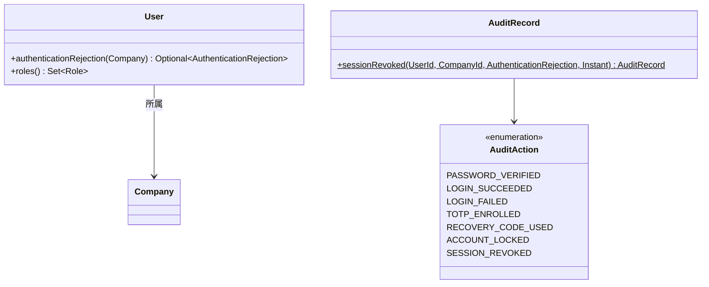
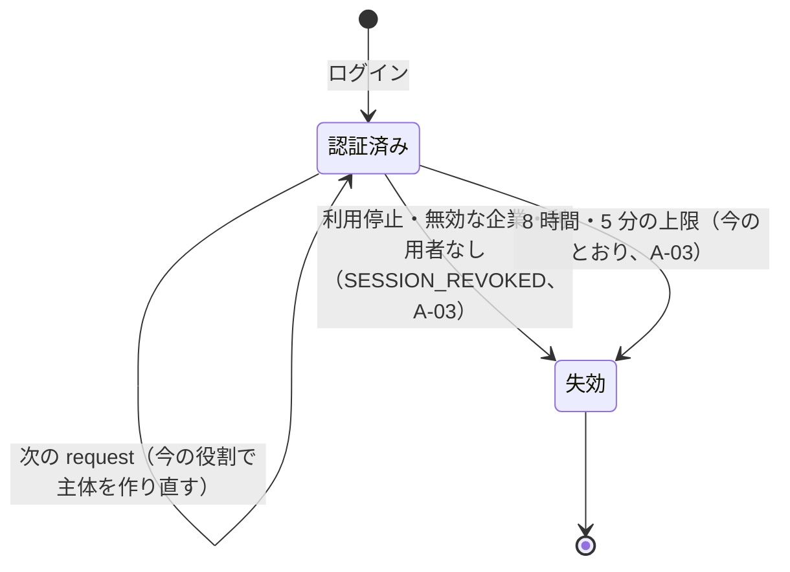

# Bolt 32c 計画 - request ごとの利用者の確かめ（US-18 AC6）

## 基本情報

| 項目 | 内容 |
| :--- | :--- |
| Bolt | 第 32c 回（W5 の 10 本目。US-18 の残りの 7 本目） |
| 予定 | W5（2026-11-02 の週。前倒しで着手できる）。作業は約 3 時間 35 分（承認ゲートの待ち時間を除く。「時間の配分と打ち切り」） |
| 対象 | `identity`（request ごとの確かめのフィルター、利用者・役割・企業を 1 回で読む部品、監査の操作 `SESSION_REVOKED`）、`SecurityConfiguration`、セキュリティの統合テスト・特性テスト、画面の層、ADR-012・ADR-011、ドメインモデル・データモデル・UI 設計・非機能要件・アーキテクチャ・ユーザーストーリーの注記、リリース計画 |
| SP | 0（目安。US-18 の SP は #13 をクローズする Bolt 33b で数える） |
| GitHub | [#13](https://github.com/k2works/practical-domain-driven-design-in-enterpris-application/issues/13)（US-18、R1.0）。この Bolt では閉じない |
| 承認ゲート | **ステップごとに止める**（W4 の締めの決定: 認証の完成はステップごと）。確認必須（セキュリティ（取消しの応答・主体の差し替え）、認可、データベースの読み出しの形）は計画の承認の場で確認ポイントとして判断を受ける |
| アプローチ | インサイドアウト（W5 の表で US-18 はインサイドアウト）。スキーマも集約も新しく作らないが、不確実性が request ごとの問い合わせの形（1 回にまとめる）と、枠組みの中での主体の差し替え（要素の権限を保つ、session に保存しない）にあるので内側から固め、認可の流れはセキュリティの統合テストで外側から確かめる |
| 前の Bolt | [Bolt 32 終了報告](bolt_32_report.md)、[Bolt 31c 終了報告](bolt_31c_report.md)（引数の解決。見直しの 4） |

## Bolt ゴール

利用停止・所属企業の無効化・権限の取消しを、既存の session の次の request から反映する（US-18 AC6、IA-INV-04、SEC-12）。request ごとに利用者 ID から主体を作り直して差し替え、問い合わせは 1 回にまとめる（ADR-012 の見直しの 3）。止められた利用者の session は捨てて A-03 に送り、監査記録 `SESSION_REVOKED` を残す。

### 確かめたい仮説

| # | 仮説 | この Bolt で分かること |
| :--- | :--- | :--- |
| H1 | 認証済みの request ごとに、利用者 ID から利用者・役割・企業を 1 回の SQL で読み、主体を作り直して差し替えれば、ログインの時点の役割でなく今の役割で認可できる | 役割を DB で変えた次の request から、取り消した役割の URL が拒まれ、足した役割の URL が開けること（統合テスト）。1 つの request の問い合わせが 1 回であること（数える見張り） |
| H2 | 差し替えは request の中だけにし、session に保存しなくても、毎回作り直すので古い役割が戻らない | 差し替えた後の request でも DB の今の値で判定されること。要素の権限（`FACTOR_PASSWORD`・`FACTOR_TOTP`）と session の起点の時刻が保たれ、A-02 の途中の主体が業務の URL に届かないままであること |

## ふりかえりと前の Bolt からの引き継ぎ

| 入力 | 内容 | この Bolt での扱い |
| :--- | :--- | :--- |
| 開始準備の決定（2026-10-14、human:kakimomokuri） | 32c と 32d に分ける（32c: AC6 と見直しの 3。32d: 31d から送った低の指摘と Bolt 32 の既知の課題のテストの整理）。止められた利用者の session は捨てて A-03 へ。監査は新しい操作 `SESSION_REVOKED`。Bolt 32 の議題 4・5 はどちらも採らない（4 の「15 分たってから」はマニュアル（Bolt 33b）に書く。5 は利用者の管理の監査を作る Bolt 34 で見直す） | 本計画の範囲と、確認ポイント 1〜4 |
| Bolt 32 の Try T-113 | 共有の表の件数は、テストの前後の差か、そのテストの利用者で絞って確かめる | `SESSION_REVOKED` の監査記録はそのテストの利用者で絞る |
| Bolt 32 の Try T-114 | 枠組みが例外をどう扱うかに頼る確認ポイントは、特性テストの形にして確かめてから決める | 確認ポイント 5（主体の差し替えと保存）・6（フィルターの位置）を開始準備の骨組みで確かめ、ステップ 2 で特性テストに固定する |
| Bolt 31d の Try T-110〜T-112 | pathspec のコミット、`LogCapture`、見張りの違反は理由になった書き方そのもので | 全ステップ。問い合わせを 1 回にする見張りは、利用者と企業を別々に読む書き方を入れて落ちることを確かめる |
| Bolt 31c の Try T-106〜T-109 | 「ないこと」に「あること」を並べる。対象の存在を先に確かめる。枠組みに任せる約束は誰がいつ呼ぶかを書く。設計文書を先に push | 取り消した役割の URL が拒まれる確かめに、残した役割の URL が開ける確かめを並べる |
| ADR-012 の見直しの 3 | request ごとの DB の確かめ（SEC-12・AC6）は、利用者 ID から主体を作り直して差し替える形にし、問い合わせを 1 回にまとめる | ステップ 2・3 |
| Bolt 14 の決定（ADR-012 の決定 2） | 認可はログインの時点の役割。request ごとの確かめは AC6 とあわせて W5 | この Bolt で置き換える |
| Bolt 32 の既知の課題 | 32c の項目（見直しの 3、AC6）、議題 4・5 の判断 | 本計画。ほかは 32d・33b・34（確認ポイント 1） |
| W4 の Try T-83・T-88・T-89・T-90 | 骨組みのまま流して本命のアサーションで落とす。見張り。後に回したものは Issue にする。画面を作る Bolt の開発レビューにテクニカルライターの観点 | 全ステップ。画面の文言は変えないので、テクニカルライターの観点は A-03 に送る流れの説明（設計文書）に絞る |

## スコープ

### 設計の約束（Try T-1）

- 確かめは request ごとに 1 回。認証済みの主体（`CargoUserDetails`）を持つ request で、利用者 ID から利用者・役割・所属企業を 1 回の SQL で読む。未認証の request と、認証の前の公開の URL（A-01・A-03・静的なファイル）では読まない
- 判断は今のドメインの規則のまま（`User#authenticationRejection(company)`。利用停止 `SUSPENDED`、無効な企業 `COMPANY_INACTIVE`）。利用者が見つからないときは `UNKNOWN_USER` として同じ扱い
- 拒否なら session を捨て、セキュリティのコンテキストを消し、A-03（`/session-expired`）に送る。業務データは出さない。監査記録 `SESSION_REVOKED`（結果 `FAILURE`、理由 `SUSPENDED`・`COMPANY_INACTIVE`・`UNKNOWN_USER`、操作者は利用者と企業。利用者がないときは操作者なし）を書く
- 拒否でなければ、今の役割・表示名・企業名で主体（`AuthenticatedActor`）を作り直し、認証の要素の権限（`FACTOR_PASSWORD`・`FACTOR_TOTP`）と認証の型はそのままに差し替える。差し替えは request の中だけで、session には保存しない（毎回作り直すので古い値が戻らない。`CargoUserDetails` の直列化の形も変えない）
- 役割が変わっただけのときは記録しない（利用者の管理の監査（Bolt 34）で残る）
- password の段だけの主体（A-02・A-07 の途中）にも同じ確かめをかける（止められた利用者に TOTP の段を続けさせない）

### 入れるもの・入れないもの

| 入れる | 入れない（後で） |
| :--- | :--- |
| request ごとの確かめのフィルター、利用者・役割・企業を 1 回で読む部品、主体の差し替え | 31d から送った低の指摘（Bolt 31 の低、3 つの統合テストの時計の設定、8 時間の起点の値と監査の順）、Bolt 32 の既知の課題のテストの整理（独自の Spring のコンテキスト、axe は 1 回目だけ）（32d） |
| 監査の操作 `SESSION_REVOKED` | 利用停止・権限の取消しの操作（US-16 の利用者の管理、Bolt 34。この Bolt では DB の値を変えて確かめる） |
| 特性テスト（主体の差し替えが session に保存されないこと、フィルターの位置） | 「5 回」「15 分」の文言と方針の重複、ログインの監査の 2 つの経路（Bolt 32 の議題 5。Bolt 34） |
| 画面の層のシナリオ（利用停止された荷主担当者の次の操作が A-03 になる） | ユーザーマニュアル（Bolt 33b でまとめて直す。Bolt 32 の議題 4 の一文もそこに書く） |

## 設計（この Bolt の範囲）

### ドメインモデル

集約と規則は変えない。監査の操作に 1 つ足す。

### データモデル

スキーマは変えない。`identity.audit_record.action` は `VARCHAR(100)` で制約がないので、`SESSION_REVOKED` はマイグレーションなしで書ける。読み出しは `app_user`・利用者の役割・`company` を結合する 1 つの SQL（`IdentityMapper.xml` に足す）。

### 状態遷移

利用者・企業の状態は変えない。session の流れを足す。

### 画面遷移

新しい画面と文言はない。業務の画面から A-03 へ送る遷移が 1 つ増える（UI 設計の A-03 の説明に「利用停止・無効な企業の後の次の操作」を足す）。

## ステップ計画

状態の記号: `[ ]` 未着手、`[-]` 進行中、`[?]` 承認待ち、`[x]` 完了。各ステップの終わりに `check` が緑であることと、計画からの変更を設計文書に反映したこと（T-53）を確かめ、push して CI を確かめる（T-26、T-65）。コミットは pathspec で作り、そのステップのファイルだけを入れる（T-84、T-110）。複数行の書き換えはスクリプトのファイルにする（T-103）。ステップ 1 を push してからコードのステップを push する（T-109）。

- [ ] **1. 設計文書** 【承認ゲート: 設計文書】
  - ADR-012: 見直しの 3 を「決めた」に移す（フィルターの位置、1 回の SQL、差し替えは request の中だけ、拒否で A-03 と `SESSION_REVOKED`）。決定 2 の「認可はログインの時点の役割」を改める。代替案の表の「認可を request ごとに DB で確かめるのも今入れる」の行に、W5 で入れたことを書く
  - ADR-011: Bolt 32 の議題 4・5 の判断（採らない理由と、Bolt 33b のマニュアル・Bolt 34 での見直し）
  - domain_model.md: 用語集の `AuditAction` に `SESSION_REVOKED`、IA-INV-04 の説明（実現する場所）
  - data_model.md: 監査の操作の一覧に `SESSION_REVOKED`
  - ui_design.md: A-03 の説明と画面遷移（利用停止・無効な企業の後の次の操作）
  - non_functional.md: SEC-12（request ごとに DB の現在値で判断する。実現した Bolt）、AUD-01（`SESSION_REVOKED`）、性能の注記（認証済みの request ごとに 1 回の SQL）
  - architecture_backend.md: request ごとの確かめのフィルターと 1 回で読む部品の置き場所（確認ポイント 5）
  - user_story.md: US-18 の AC6 の注記（A-03 に送る、`SESSION_REVOKED`）
  - release_plan.md の W5 の節: 32c の行を本計画に、32d の行を足す（31d から送った低の指摘、Bolt 32 の既知の課題のテストの整理。SP 0）。Bolt の本数（16 本）と順序（32c → 32d。32d は 32c に依存しない）。W5 の状態と主なタスク（Bolt 32 の承認を反映）
  - 完了の判定: `okf:check` ERROR 0、`documentationTest` 緑。push してからコードを push する
- [ ] **2. 1 回で読む部品と主体の差し替え** 【承認ゲート: Red・Green、データベース】
  - Red: 読み出しの部品のテスト（PostgreSQL・H2: 利用者・役割・企業を 1 回で読む、役割が複数でも 1 行の利用者になる、利用者がなければ空、企業が無効・利用停止もそのまま読める）。特性テスト（`SpringSecurityCharacterizationTest` に足す。T-114）: request の中で差し替えた主体が明示的に保存しなければ session に残らないこと、`Authentication#toBuilder` で主体と権限を替えても認証の型と要素の権限が保てること
  - Green: `IdentityMapper.xml` の結合の SQL、読み出しの部品（確認ポイント 5）、`AuditAction.SESSION_REVOKED`、`AuditRecord.sessionRevoked`
  - 完了の判定: `check` 緑（H2 を含む）
- [ ] **3. request ごとの確かめのフィルター** 【承認ゲート: セキュリティ、認可】
  - Red: セキュリティの統合テスト
    - AC6 の利用停止: ログインした後に利用者を `SUSPENDED` にすると、次の業務の request は A-03 に送られ、業務データを出さず、session が捨てられ、`SESSION_REVOKED`（理由 `SUSPENDED`）が 1 行残る。止める前の request は開ける（あることも確かめる。T-106）
    - 無効な企業: 所属企業を無効にすると同じ（理由 `COMPANY_INACTIVE`）
    - 権限の取消し: 役割を外すと、次の request でその役割の URL が拒まれ、残した役割の URL は開ける。足した役割の URL は次の request から開ける。監査記録は書かない
    - password の段だけの主体（A-02 の途中）も、利用停止の後は A-02 の送信が A-03 になる
    - 問い合わせ: 認証済みの 1 つの request で読み出しが 1 回（見張り。利用者と企業を別々に読む書き方を入れて落ちることを確かめる。T-112）。未認証の request と公開の URL では読まない
    - 期限の切れた session は今のとおり A-03（期限の確かめが先で、DB を読まない）
  - Green: フィルター（`identity.infrastructure.security`。`SessionLifetimeFilter` の後、認可の前）、`SecurityConfiguration` の組み立て
  - 完了の判定: `check` 緑
- [ ] **4. 画面の層** 【承認ゲート: セキュリティ】
  - `login_ui.feature` か業務の画面の feature に「利用停止された荷主担当者の次の操作は、業務データを出さずに A-03 に移る」（`@US-18-AC6 @demo @demo-bolt-32c/revoked`）。利用停止の操作はまだないので、テストの手順が DB の値を変える
  - 完了の判定: `check` と `uiTest` が緑
- [ ] **5. SonarQube と開発レビューとデモと終了報告** 【承認ゲート: 終了報告】
  - SonarQube（`sonar-local:check`。T-104）
  - 開発レビュー（プログラマー、アーキテクト（フィルターと読み出しの部品の置き場所）、テスター（取消しの境界と問い合わせの回数））
  - レビューの直しの後にデモの動画を撮り、#13 に添付する（T-105）。`bolt_32c_report.md`。release_plan の W5 の 32c の行、開発の索引。#13 に進み具合をコメントする

### 時間の配分と打ち切り

| # | 目安 | 打ち切り |
| :--- | :--- | :--- |
| 1 | 35 分 | — |
| 2 | 50 分 | 主体の差し替えが枠組みの中でできない（session に保存される、要素の権限が落ちる）と分かったら、止めて人に諮る |
| 3 | 70 分 | — |
| 4 | 25 分 | 画面の層で DB の値を変える手段がなければ、統合テストに任せてシナリオを 32d に送るかを人に諮る |
| 5 | 35 分（SonarQube と動画の待ちを除く） | — |

合計 215 分（約 3 時間 35 分）。

## 確認ポイント（計画の承認の場でまとめて確認する。Try T-6）

| # | 確認すること | ステップ | 推奨 |
| :--- | :--- | :--- | :--- |
| 1 | **32c と 32d に分ける**（開始準備で決めた） | — | 32c: AC6、見直しの 3。32d: 31d から送った低の指摘（Bolt 31 の低（Base32 の不正な長さ、T-100 の待ちの判定、刻みを戻す SQL の重複、dev のテストの刻みの境界、合成ルートのクラスの分け方）、3 つの統合テストの時計の設定、8 時間の起点の値と監査の順）、Bolt 32 の既知の課題のテストの整理（独自の Spring のコンテキスト、axe は 1 回目だけ）。SP は 0。W5 は 16 本 |
| 2 | **止められた利用者の次の request**（開始準備で決めた。セキュリティ） | 3 | session を捨てて A-03 に送る。新しい画面と文言は作らず、止められたことも示さない（AC6 の「再認証が要求される」に当たる。理由は管理者に確かめてもらう）。役割が変わっただけなら主体を作り直して続ける |
| 3 | **監査 `SESSION_REVOKED`**（開始準備で決めた） | 2・3 | 拒否で session を捨てたときだけ、理由（`SUSPENDED`・`COMPANY_INACTIVE`・`UNKNOWN_USER`）と書く。スキーマは変えない。役割の変更は書かない |
| 4 | **Bolt 32 の議題 4・5**（開始準備で決めた） | 1 | どちらも採らない。4 は A-01 の文言を承認どおりに保ち、「15 分たってから」はマニュアル（Bolt 33b）に書く。5 は利用者の管理の監査を作る Bolt 34 で見直す。ADR-011 に書く |
| 5 | **1 回で読む部品の置き場所**（構造。T-101 の骨組みで確かめる） | 2・3 | `identity.infrastructure.persistence` に読み出しの部品（利用者・役割・企業を 1 つの SQL で読み、`User` と `Company` を組み立てて返す）を置き、フィルター（`identity.infrastructure.security`）から呼ぶ。infrastructure の中の参照なので層の規則に例外は要らない。判断は `User#authenticationRejection` のまま（ドメイン）。`UserRepository` に足す案は、集約のリポジトリが別の集約（企業）を返すので採らない。`application.internal.queryservices` に置く案は、入口から呼べるのを `commandservices` に限る D-5 の例外を広げるので採らない。骨組みで規則に当たったら、置き場所を動かさず人に諮る |
| 6 | **主体の差し替えの仕方**（セキュリティ。T-114） | 2・3 | `SessionLifetimeFilter` の後、認可の前に置くフィルターで、今の `Authentication` を `toBuilder` で主体（作り直した `CargoUserDetails`）と役割の権限だけ替え、要素の権限は残す。セキュリティのコンテキストに入れるが session には保存しない。期限の切れた session は先に A-03 に送られ、DB を読まない |
| 7 | **password の段だけの主体にもかける**（セキュリティ） | 3 | かける。止められた利用者に TOTP・回復コードの段を続けさせない。A-02・A-07 の途中の主体も `CargoUserDetails` を持つので同じ部品で扱える |
| 8 | **性能**（非機能） | 1・3 | 認証済みの request ごとに 1 回の SQL を足す。キャッシュは入れない（入れると AC6 の「次の request から」が崩れる）。W10 の性能の評価で計測項目に入れる |
| 9 | 後の Bolt に送るものと T-89 | — | 32d: 確認ポイント 1 のもの。33b: マニュアル（議題 4 の一文を含む）。34: 利用停止・権限の取消しの操作、ログインの監査の 2 つの経路（議題 5）。どれも W5 の節の表で追う |
| 10 | 承認ゲート | 全体 | ステップごとに止める（W4 の締めの決定）。ステップ 2 はデータベース、3・4 はセキュリティと認可の確認必須 |

## 完了条件

- [ ] 利用停止・所属企業の無効化の後の次の request は、業務データを出さずに session を捨てて A-03 に移り、`SESSION_REVOKED` が残る。password の段だけの主体も同じ
- [ ] 役割の取消し・追加が次の request から認可に効き、要素の権限と session の起点の時刻は保たれる
- [ ] 認証済みの 1 つの request の読み出しが 1 回で、未認証の request では読まない
- [ ] `check` と `uiTest` が緑。push して CI を確かめた。SonarQube の Quality Gate が PASS、`okf:check` ERROR 0
- [ ] 開発レビュー、レビューの後のデモの動画と #13 への添付、終了報告。#13 に進み具合をコメントした

### デモ項目

- 画面の層のシナリオの動画（`@demo @demo-bolt-32c/revoked`）: 荷主担当者がログインして業務の画面を開く → 利用停止される → 次の操作で A-03 に移る

## 更新履歴

| 日付 | 更新内容 | 更新者 |
| :--- | :--- | :--- |
| 2026-10-14 | 初版作成（承認待ち）。開始準備で、Bolt 32 の終了報告の Try（T-113・T-114）と既知の課題、US-18 AC6、ADR-012 の見直しの 3、認証の入口と層の規則を調べ、human:kakimomokuri の決定（32c と 32d に分ける、止められた利用者は A-03、`SESSION_REVOKED` を書く、Bolt 32 の議題 4・5 は採らない）を反映した | anthropic/claude-opus-5-5 |

## 関連ドキュメント

- [リリース計画](release_plan.md)（W5）
- [Bolt 32 終了報告](bolt_32_report.md)、[Bolt 31c 終了報告](bolt_31c_report.md)
- [ADR-012](../../adr/cargo-tracker/012-authentication-principal-and-session.md)、[ADR-011](../../adr/cargo-tracker/011-mfa-totp.md)
- [ドメインモデル](../../design/cargo-tracker/domain_model.md)（IA-INV-04）、[データモデル](../../design/cargo-tracker/data_model.md)（`audit_record`）、[UI 設計](../../design/cargo-tracker/ui_design.md)（A-03）、[非機能要件](../../design/cargo-tracker/non_functional.md)（SEC-12）
