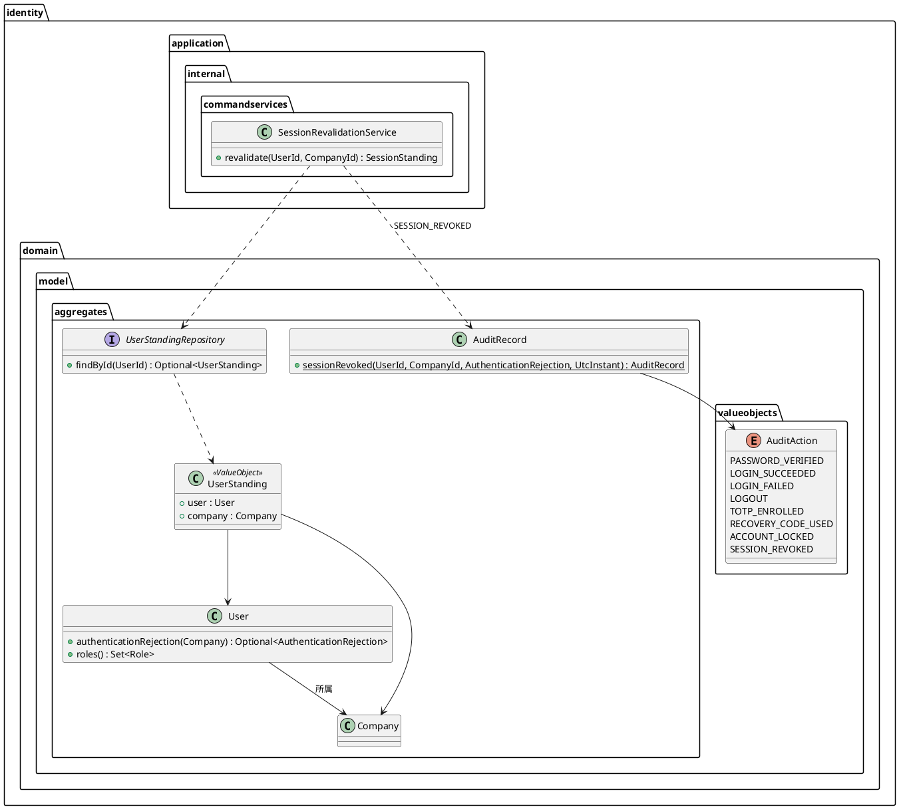
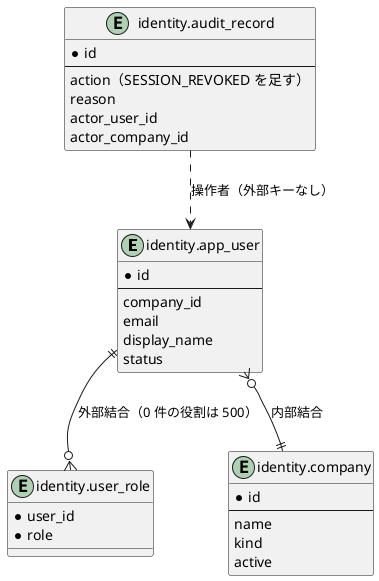
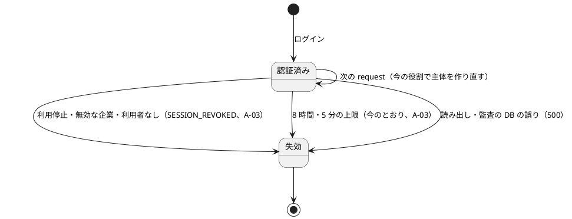
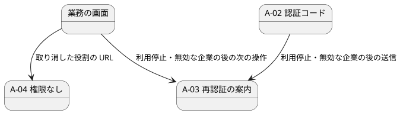

# Bolt 32c 計画 - request ごとの利用者の確かめ（US-18 AC6）

## 基本情報

| 項目 | 内容 |
| :--- | :--- |
| Bolt | 第 32c 回（W5 の 10 本目。US-18 の残りの 7 本目） |
| 予定 | W5（2026-11-02 の週。前倒しで着手できる）。作業は約 4 時間 15 分（承認ゲートの待ち時間を除く。「時間の配分と打ち切り」） |
| 対象 | `identity`（利用者と企業の組を 1 回で読むポートと MyBatis の実装、判定と監査のアプリケーションのサービス `SessionRevalidationService`、入口のフィルター `SessionRevalidationFilter`、監査の操作 `SESSION_REVOKED`）、`SecurityConfiguration`、セキュリティの統合テスト・特性テスト、画面の層、ユーザーマニュアル（2 章の 2.3・2.4、付録 B）、ADR-012・ADR-011、ドメインモデル・データモデル・UI 設計・非機能要件・アーキテクチャ・ユーザーストーリーの注記、リリース計画 |
| SP | 0（目安。US-18 の SP は #13 をクローズする Bolt 33b で数える） |
| GitHub | [#13](https://github.com/k2works/practical-domain-driven-design-in-enterpris-application/issues/13)（US-18、R1.0）。この Bolt では閉じない |
| 承認ゲート | **ステップごとに止める**（W4 の締めの決定: 認証の完成はステップごと）。確認必須（セキュリティ（取消しの応答・主体の差し替え）、認可、データベース（読み出しの形）、構造（新しいポートとサービス））は計画の承認の場で確認ポイントとして判断を受ける |
| アプローチ | インサイドアウト（W5 の表で US-18 はインサイドアウト）。スキーマも集約も新しく作らないが、不確実性が request ごとの問い合わせの形（1 回にまとめる）と、枠組みの中での主体の差し替え（要素の権限を保つ、session に保存しない）にあるので内側から固め、認可の流れはセキュリティの統合テストで外側から確かめる（Bolt 32 と同じ理由づけ） |
| 前の Bolt | [Bolt 32 終了報告](bolt_32_report.md)、[Bolt 31c 終了報告](bolt_31c_report.md)（引数の解決。見直しの 4） |

## Bolt ゴール

利用停止・所属企業の無効化・権限の取消しを、既存の session の次の request から反映する（US-18 AC6、IA-INV-04、SEC-12 のうち役割と利用状態の分）。request ごとに利用者 ID から利用者・役割・企業を 1 回で読み、アプリケーションのサービスが今のドメインの規則で判定して主体を作り直す（ADR-012 の見直しの 3）。止められた利用者の session は捨てて A-03 に送り、監査記録 `SESSION_REVOKED` を残す。取り消した役割の URL は A-04（権限なし）になる。

### 確かめたい仮説

| # | 仮説 | この Bolt で分かること |
| :--- | :--- | :--- |
| H1 | 認証済みの request ごとに、利用者 ID から利用者・役割・企業を 1 回の SQL で読み、主体を作り直して差し替えれば、ログインの時点の役割でなく今の役割で認可できる | 役割を DB で変えた次の request から、取り消した役割の URL が A-04 になり、残した役割の URL が開け、足した役割の URL とナビの項目が出ること（統合テスト）。1 つの request の読み出しが 1 回であること（呼び出しを数える見張り） |
| H2 | 差し替えは request の中だけにし、session に保存しなくても、毎回作り直すので古い役割が戻らない | 差し替えた後の request でも DB の今の値で判定されること。要素の権限（`FACTOR_PASSWORD`・`FACTOR_TOTP`）と session の起点の時刻が保たれ、A-02 の途中の主体が業務の URL に届かないままであること |

### 開始準備で確かめたこと（T-101・T-114）

使い捨ての特性テスト（コミットしていない。ステップ 2 で `SpringSecurityCharacterizationTest` に正式に足す）で、Spring Security 7.1.1 の次の振る舞いを確かめた（2026-10-14）。

- `TotpAuthenticationToken` と `UsernamePasswordAuthenticationToken` の `toBuilder()` で主体と `ROLE_` の権限だけを替えても、認証の型、認証済みの印、要素の権限（発行時刻も同じ）が残る
- `SecurityContextHolderFilter`（`HttpSessionSecurityContextRepository`）の下で、request の中で `SecurityContextHolder.createEmptyContext()` の新しい文脈に差し替えても、明示的に保存しなければ session の文脈は前のまま

置き場所（確認ポイント 5）は、`identity.domain.model.aggregates` のポートを `identity.infrastructure.persistence` が実装し、`commandservices` のサービスを `identity.infrastructure.security` の入口が呼ぶ既存の形と同じなので、層の規則（`LayerArchitectureTest` の D-5 と認証の例外）に新しい例外は要らない。骨組みの ArchUnit はステップ 2 の Red の最初に流す。

## ふりかえりと前の Bolt からの引き継ぎ

| 入力 | 内容 | この Bolt での扱い |
| :--- | :--- | :--- |
| 開始準備の決定（2026-10-14、human:kakimomokuri） | 32c と 32d に分ける（32c: AC6 と見直しの 3。32d: 31d から送った低の指摘と Bolt 32 の既知の課題のテストの整理）。止められた利用者の session は捨てて A-03 へ。監査は新しい操作 `SESSION_REVOKED`。Bolt 32 の議題 4・5 はどちらも採らない（4 の「15 分たってから」はマニュアル（Bolt 33b）に書く。5 は利用者の管理の監査を作る Bolt 34 で見直す） | 本計画の範囲と、確認ポイント 1〜4 |
| Bolt 32 の Try T-113 | 共有の表の件数は、テストの前後の差か、そのテストの利用者で絞って確かめる | `SESSION_REVOKED` の監査記録はそのテストの利用者で絞る |
| Bolt 32 の Try T-114 | 枠組みが例外をどう扱うかに頼る確認ポイントは、特性テストの形にして確かめてから決める | 上の「開始準備で確かめたこと」。ステップ 2 で特性テストに固定する |
| Bolt 31d の Try T-110〜T-112 | pathspec のコミット、`LogCapture`、見張りの違反は理由になった書き方そのもので | 全ステップ。読み出し 1 回の見張りは、利用者と企業を別々のリポジトリで読む書き方を入れて落ちることを確かめる（T-112）。読み出しと監査の書き込みの DB の誤りのエラーのログは `LogCapture` で確かめる（T-111） |
| Bolt 31c の Try T-106・T-107 | 「ないこと」に「あること」を並べる。対象の存在を先に確かめる | 取り消した役割の URL が拒まれる確かめに、残した役割の URL が開ける確かめを並べる。「session が捨てられた」を確かめる前に、止める前の request で session があり開けることを確かめる |
| Bolt 31c の Try T-108 | 枠組みに任せる約束は、どの部品がいつ呼ぶかを書く | 「session に保存しない」の例外: A-02・A-07 が通ったときは `TotpAuthenticationFilter`・回復コードのフィルターが結果の文脈を session に保存する。そのときの主体は差し替えた後の（今の値の）主体なので、古い値は戻らない。特性テストと統合テストで確かめる |
| Bolt 31b の Try T-102 | 同じ session での利用者の切り替え | 同じ session で別の利用者にログインし直したとき、確かめが後の利用者で行われることを統合テストで 1 本確かめる |
| ADR-012 の見直しの 3 | request ごとの DB の確かめ（SEC-12・AC6）は、利用者 ID から主体を作り直して差し替える形にし、問い合わせを 1 回にまとめる | ステップ 2・3 |
| Bolt 14 の決定（ADR-012 の決定 2） | 認可はログインの時点の役割。request ごとの確かめは AC6 とあわせて W5 | この Bolt で置き換える |
| Bolt 32 の既知の課題 | 32c の項目（見直しの 3、AC6）、議題 4・5 の判断。ほかの項目 | 本計画。ほかの行き先は確認ポイント 9 |
| W4 の Try T-83・T-88・T-89・T-90 | 骨組みのまま流して本命のアサーションで落とす。見張り。後に回したものは Issue にする。画面を作る Bolt の開発レビューにテクニカルライターの観点 | 全ステップ。画面の文言は変えないが、A-03 の文言が止められた利用者には事実と合わない（確認ポイント 2）ので、ステップ 5 のレビューにテクニカルライターの観点を入れる。#13 の外に送るもの（議題 5 → Bolt 34）は release_plan の 34 の行に書く |

## スコープ

### 設計の約束（Try T-1）

- 確かめは request ごとに 1 回。認証済みの主体（`CargoUserDetails`）を持つ request で、入口のフィルター `SessionRevalidationFilter`（`identity.infrastructure.security`）がアプリケーションのサービス `SessionRevalidationService`（`identity.application.internal.commandservices`）を呼ぶ。未認証の request と匿名の主体では呼ばない
- フィルターの位置は `SessionLifetimeFilter` の直後（`addFilterAfter(…, SessionLifetimeFilter.class)`）。`UsernamePasswordAuthenticationFilter` と `TotpAuthenticationFilter` より前なので、止められた利用者の A-02・A-07 の送信も認証の前に A-03 になる。期限の切れた session は先に A-03 に送られ、DB を読まない
- 読み出しはドメインのポート `UserStandingRepository`（`identity.domain.model.aggregates`。利用者と所属企業の組 `UserStanding` を返す）で 1 回。実装は `MyBatisUserStandingRepository`（`identity.infrastructure.persistence`）で、`identity.app_user` と `identity.company` を内部結合し、`identity.user_role` を外部結合する 1 つの SQL。役割の数だけ出る行を 1 人の `User` にたたむ
- 判定は今のドメインの規則のまま（`User#authenticationRejection(company)`。利用停止 `SUSPENDED`、無効な企業 `COMPANY_INACTIVE`）。利用者が見つからないときは `UNKNOWN_USER`
- 拒否なら、サービスが `SESSION_REVOKED`（結果 `FAILURE`、理由 `SUSPENDED`・`COMPANY_INACTIVE`・`UNKNOWN_USER`、操作者は session の主体の利用者 ID と企業 ID）を 1 つのトランザクションで書く。フィルターは session を捨て、セキュリティのコンテキストを消し、A-03（`/session-expired`）に送る。業務データは出さない
- 拒否でなければ、サービスが今の役割・表示名・企業名・メールアドレスで `AuthenticatedActor` を作って返し、フィルターが `CargoUserDetails`（`enabled` は true、`passwordHash` は null）を作り直し、`toBuilder()` で主体と `ROLE_` の権限だけを替える（要素の権限は残す）。新しい文脈（`createEmptyContext`）に入れ、session には保存しない
- 役割が変わっただけのときは記録しない（利用者の管理の監査（Bolt 34）で残る）。取り消した役割の URL は今の認可で拒まれ、A-04（権限なし）になる
- 誤りは fail-closed: 読み出しの DB の誤り、監査の書き込みの誤り、役割が 0 件の利用者（`User` が作れない。データの不整合）は、フィルターが session を捨ててから例外を投げ直し 500 にする（業務データは出さず、エラーのログを残す）
- password の段だけの主体（A-02・A-07 の途中）にも同じ確かめをかける（止められた利用者に TOTP・回復コードの段を続けさせない）

### 入れるもの・入れないもの

| 入れる | 入れない（後で） |
| :--- | :--- |
| `UserStandingRepository`・`UserStanding` と MyBatis の実装、`SessionRevalidationService`、`SessionRevalidationFilter`、主体の差し替え | 31d から送った低の指摘（Bolt 31 の低、3 つの統合テストの時計の設定、8 時間の起点の値と監査の順）、Bolt 32 の既知の課題のテストの整理（独自の Spring のコンテキスト、axe は 1 回目だけ）（32d） |
| 監査の操作 `SESSION_REVOKED`、`AuditRecord.sessionRevoked` | 利用停止・権限の取消しの操作（US-16 の利用者の管理、Bolt 34。この Bolt では DB の値を変えて確かめる） |
| 特性テスト（主体の差し替えが session に保存されないこと、`toBuilder` で要素の権限が残ること） | SEC-12 の担当範囲（US-16、Bolt 34・W6）と参照許可（US-19、IA-INV-06） |
| 画面の層のシナリオ（利用停止された荷主担当者の次の操作が A-03 になる） | 2 章の 2.1 を 2 段階のログイン（A-02・A-07・回復コード）とロックの予告に書き直すこと、Bolt 32 の議題 4 の一文（Bolt 33b でまとめて直す） |
| ユーザーマニュアルの AC6 の分（人の指示。2026-10-14）: 2 章の 2.3「権限がありません」と 2.4「もう一度ログインしてください」に、管理者が役割・利用を変えた後の次の操作で示されることを足す。付録 B の Q1-2・Q1-3 も同じ。画面と文言は変わらないのでキャプチャは撮り直さない | |
| `SecurityConfiguration`・`CargoUserDetails` の Javadoc の「ログインの時点の役割」を直す | ログインの監査の書き込みの経路を 1 か所に寄せるか（Bolt 32 の議題 5。この Bolt の `SESSION_REVOKED` はサービスで書くので経路を増やさない。Bolt 34） |

## 設計（この Bolt の範囲）

### ドメインモデル

集約と規則は変えない。読み出しのポートと監査の操作を足す。

`SessionStanding` はサービスの戻り値で、今の主体（`AuthenticatedActor` とメールアドレス）か、拒否の理由（`AuthenticationRejection`）のどちらか。`AuthenticationRejection` は「認証を受け付けなかった理由」に、session の取消しの理由にも使うことを足す。

### データモデル

スキーマは変えない。`identity.audit_record.action` は `VARCHAR(100)` で制約がないので、`SESSION_REVOKED` はマイグレーションなしで書ける。読み出しは次の 3 つの表を 1 つの SQL で結合する（`IdentityMapper.xml` と `IdentityMapper.java` に足す）。`access_grant`（参照許可）は US-19 で足す。

### 状態遷移

利用者・企業の状態は変えない。session の流れを足す。

### 画面遷移

新しい画面と文言はない。UI 設計の画面遷移図にはすでに「権限取消し → 再認証の案内（A-03）」の矢印がある（ui_design.md:261）ので、これを「利用停止・無効な企業 → A-03」と「役割の取消し → A-04」に分ける。ナビゲーションの構成表は変えない。ナビの項目と表示名は、差し替えた主体で次の request から変わる。

## ステップ計画

状態の記号: `[ ]` 未着手、`[-]` 進行中、`[?]` 承認待ち、`[x]` 完了。各ステップの終わりに `check` が緑であることと、計画からの変更を設計文書に反映したこと（T-53）を確かめ、push して CI を確かめる（T-26、T-65）。コミットは pathspec で作り、そのステップのファイルだけを入れる（T-84、T-110）。複数行の書き換えはスクリプトのファイルにする（T-103）。ステップ 1 を push してからコードのステップを push する（T-109）。

- [x] **1. 設計文書** 【承認ゲート: 設計文書】
  - ADR-012: 見直しの 3 を「決めた」に移す（フィルターの位置、1 回の SQL のポート、判定と監査は `commandservices` のサービス、差し替えは request の中だけ、拒否で A-03 と `SESSION_REVOKED`、役割の取消しは A-04、fail-closed）。決定 2 の「認可はログインの時点の役割」を改める。決定 3（A-03 へ送る条件とフィルターの順）、決定 4（監査の操作に `SESSION_REVOKED`）、決定 6（`SessionRevalidationService` が D-5 の認証の例外の範囲に収まる）、ネガティブの「W5 まで…最長 8 時間使える」（解消した）、代替案の表の「認可を request ごとに DB で確かめるのも今入れる」（W5 で入れた）、コンプライアンス（AC6 と読み出し 1 回の統合テスト）、改訂の経緯
  - ADR-011: Bolt 32 の議題 4・5 の判断（採らない理由と、Bolt 33b のマニュアル・Bolt 34 での見直し）。58 行目の 32c の「Bolt 31d から送った低の指摘」を 32d に
  - domain_model.md: 用語集に `UserStanding`・`UserStandingRepository`・`SessionRevalidationService`、`AuditAction` に `SESSION_REVOKED`（979 行目の監査の操作の経緯）、199 行目の `AuthenticationRejection` の定義（session の取消しの理由にも使う）、IA-INV-04（実現する場所）、IA-INV-08（取消しの監査も同じトランザクション。1003 行目）、認証の要素のポートと並ぶポートの説明（977 行目）
  - data_model.md: 監査の操作の一覧に `SESSION_REVOKED`（結果を `FAILURE` にする理由。`ACCOUNT_LOCKED` は `SUCCESS`。925 行目）、916 行目（request ごとに確かめる表に `company` を足し、`access_grant` は US-19 で足す）、930 行目（Bolt 14 の「ログインの時点の役割」を Bolt 32c で置き換えた）
  - ui_design.md: A-03（91 行目。利用停止・無効な企業の後の次の操作）、A-04（184 行目。役割の取消しの後の URL）、A-02 の行（180 行目。利用停止の後の送信は A-03）、画面遷移図の 261 行目の矢印を 2 つに分ける、1087 行目（権限の取消しは A-04）
  - non_functional.md: SEC-12（164 行目。Bolt 32c で役割・利用状態・企業の有効性を実現。担当範囲は US-16、参照許可は US-19）、AUD-01（`SESSION_REVOKED`）、PERF-01・02 の注記（認証済みの request ごとに 1 回の SQL。キャッシュは入れない。W10 の性能の評価で計測する）
  - architecture_backend.md: request ごとの確かめのフィルター・サービス・ポートの置き場所と依存の向き
  - user_story.md: US-18 の AC6 の注記（止められた利用者は A-03、役割の取消しは A-04 で「管理者への確認」に当たる、`SESSION_REVOKED`）、503 行目（Bolt 14 の「ログインの時点の役割」を Bolt 32c で置き換えた）
  - release_plan.md の W5 の節: 32c の行を本計画に（承認ゲートに「データベース（読み出しの形）」と「構造」を足す）、32d の行を足す（31d から送った低の指摘、Bolt 32 の既知の課題のテストの整理。SP 0、アプローチはリファクタリング（テストの整理で、件数と結果を変えない）、承認ゲートは構造。32b と同じ session の上限の部品のテストに触るので 32d → 32b の順）。557 行目の局面とアプローチに 32d、598 行目の順序（32c → 32d → 32b。32d の理由は「32 で認証の入口と統合テストを直した後に、31d から送った低の指摘を片づける」を 32c から移す）と本数（16 本）、553・625・764 行目（Bolt 32 の終了報告の承認、W5 の状態）、592 行目の 33b の行（マニュアルに議題 4 の一文）、593 行目の 34 の行（議題 5: ログインの監査の書き込みの経路の見直し）、617 行目のユーザーマニュアルの段落（議題 4 の一文は 33b、AC6 の 2.3・2.4・付録 B は 32c）
  - 完了の判定: `okf:check` ERROR 0、`documentationTest` 緑。push してからコードを push する
- [ ] **2. 1 回で読むポートと判定のサービス** 【承認ゲート: Red・Green、データベース、構造】
  - Red: 層の規則の骨組み（ポート・実装・サービス・フィルターの空のクラスで `LayerArchitectureTest` が緑のまま。T-101）。読み出しの契約テスト（PostgreSQL・H2: 利用者・役割・企業を 1 回で読む、役割が複数でも 1 人の `User` になる、利用者がなければ空、無効な企業・利用停止もそのまま読める、役割が 0 件なら例外）。`SessionRevalidationService` の単体テスト（利用停止・無効な企業・利用者なしで拒否の理由と `SESSION_REVOKED` 1 行、拒否でなければ今の役割・表示名・企業名の主体を返し監査を書かない、監査の追記が失敗したら例外）。特性テスト（`SpringSecurityCharacterizationTest` に足す。T-114）: 「開始準備で確かめたこと」の 2 つ
  - Green: `UserStanding`・`UserStandingRepository`、`IdentityMapper.xml`・`IdentityMapper.java` の結合の SQL と `MyBatisUserStandingRepository`、`SessionRevalidationService`（`IdentityConfiguration` で組み立て、`TransactionTemplate`）、`AuditAction.SESSION_REVOKED`、`AuditRecord.sessionRevoked`（`UtcInstant`、理由の null を拒む）
  - 完了の判定: `check` 緑（H2 の契約テストを含む）
- [ ] **3. request ごとの確かめのフィルター** 【承認ゲート: セキュリティ、認可】
  - Red: セキュリティの統合テスト
    - AC6 の利用停止: ログインして業務の画面を開ける（あること。T-106・T-107）→ 利用者を `SUSPENDED` にする → 次の業務の request は A-03 に送られ、業務データを出さず、session が捨てられ、そのテストの利用者の `SESSION_REVOKED`（理由 `SUSPENDED`）が 1 行残る（T-113）
    - 無効な企業: 所属企業を無効にすると同じ（理由 `COMPANY_INACTIVE`）。利用者を消すと同じ（理由 `UNKNOWN_USER`）
    - 権限の取消し: 役割を外すと、次の request でその役割の URL が A-04（403）になり、残した役割の URL は開ける。足した役割の URL とナビの項目は次の request から出る。監査記録は書かない。要素の権限と 8 時間の起点の時刻は変わらない
    - password の段だけの主体: 利用停止の後は A-02 の送信が A-03 になり、TOTP の照合と `LOGIN_SUCCEEDED` が起きない
    - 同じ session での利用者の切り替え（T-102）: 後の利用者で確かめる
    - 読み出し 1 回: 認証済みの 1 つの request で `UserStandingRepository` の呼び出しが 1 回で、`UserRepository`・`CompanyRepository` は呼ばれない（`@MockitoSpyBean`。利用者と企業を別々に読む書き方を入れて落ちることを確かめる。T-112）。未認証の request と公開の URL では呼ばない。期限の切れた session でも呼ばない
    - fail-closed: 読み出しの DB の誤り、`SESSION_REVOKED` の書き込みの誤り、役割 0 件は 500 で、session が捨てられ、エラーのログが残る（`LogCapture`。T-111）
  - Green: `SessionRevalidationFilter`、`SecurityConfiguration` の組み立て（`addFilterAfter(…, SessionLifetimeFilter.class)`）、`SecurityConfiguration.java:55-57` と `CargoUserDetails.java:17-19` の Javadoc
  - 完了の判定: `check` 緑
- [ ] **4. 画面の層** 【承認ゲート: セキュリティ】
  - 業務の画面の feature に「利用停止された荷主担当者の次の操作は、業務データを出さずに A-03 に移る」（`@US-18-AC6 @demo @demo-bolt-32c/revoked`）。利用停止の操作はまだないので、テストの手順が DB の値を変える
  - 完了の判定: `check` と `uiTest` が緑
- [ ] **5. ユーザーマニュアル** 【承認ゲート: 設計文書】（人の指示。2026-10-14）
  - `creating-manual` の手順で、`docs/manual/02-ログインと共通の画面.md` の 2.3（役割を外された後に、その役割の画面を開くと示される）と 2.4（「この画面でできること」に、管理者が利用を止めた後の次の操作でも示されることを足す。「注意・補足」の問い合わせ先の行を、続けてログインできないときにも当てる）、`付録B-トラブルシューティング.md` の Q1-2・Q1-3 を直す。画面に出ない理由（利用停止）はマニュアルにだけ書き、画面の文言は変えない（確認ポイント 2）
  - 画面と文言は変わらないので、キャプチャ（`02-forbidden.png`・`02-session-expired.png`）は撮り直さない。2.1 の 2 段階のログインの書き直しは Bolt 33b のまま
  - 完了の判定: `okf:check` ERROR 0、`documentationTest` 緑。マニュアルの HTML の出力（`npx gulp manual:build`。`docs/assets/manual-output/cargo-tracker/`）を作り直す
- [ ] **6. SonarQube と開発レビューとデモと終了報告** 【承認ゲート: 終了報告】
  - SonarQube（`sonar-local:check`。T-104）
  - 開発レビュー（プログラマー、アーキテクト（フィルター・サービス・ポートの置き場所）、テスター（取消しの境界と読み出しの回数）、テクニカルライター（A-03 の文言と止められた利用者、マニュアルの 2.3・2.4・付録 B。T-90））
  - レビューの直しの後にデモの動画を撮り、#13 に添付する（T-105）。`bolt_32c_report.md`。release_plan の W5 の 32c の行、開発の索引。#13 に進み具合をコメントする

### 時間の配分と打ち切り

| # | 目安 | 打ち切り |
| :--- | :--- | :--- |
| 1 | 40 分 | — |
| 2 | 60 分 | 骨組みが層の規則に当たったら、置き場所を動かさず止めて人に諮る（CLAUDE.md） |
| 3 | 75 分 | — |
| 4 | 25 分 | 画面の層で DB の値を変える手段がなければ、統合テストに任せてシナリオを 32d に送るかを人に諮る |
| 5 | 20 分 | — |
| 6 | 35 分（SonarQube と動画の待ちを除く） | — |

合計 255 分（約 4 時間 15 分。上限に近い）。4.5 時間を超えると見えたら、止めて人に諮る（候補: ステップ 4 の画面の層のシナリオを 32d に送る）。

## 確認ポイント（計画の承認の場でまとめて確認する。Try T-6）

| # | 確認すること | ステップ | 推奨 |
| :--- | :--- | :--- | :--- |
| 1 | **32c と 32d に分ける**（開始準備で決めた） | — | 32c: AC6、見直しの 3。32d: 31d から送った低の指摘（Bolt 31 の低（Base32 の不正な長さ、T-100 の待ちの判定、刻みを戻す SQL の重複、dev のテストの刻みの境界、合成ルートのクラスの分け方）、3 つの統合テストの時計の設定、8 時間の起点の値と監査の順）、Bolt 32 の既知の課題のテストの整理（独自の Spring のコンテキスト、axe は 1 回目だけ）。SP は 0。W5 は 16 本。順序は 32c → 32d → 32b |
| 2 | **止められた利用者の次の request**（開始準備で決めた。セキュリティ） | 3 | session を捨てて A-03 に送る。新しい画面と文言は作らず、止められたことも示さない（AC6 の「再認証が要求される」に当たる。理由は管理者に確かめてもらう）。ただし A-03 の今の文言は「一定時間操作がなかったため、…ログアウトしました」で、止められた利用者には事実と合わない（ui_design.md:183）。止められたことを本人に示さない利点を採り、文言は変えない。止められた利用者はログインし直すと A-01 で誤りになり、管理者に確かめる流れになる |
| 3 | **監査 `SESSION_REVOKED`**（開始準備で決めた） | 2・3 | 拒否で session を捨てたときだけ、理由（`SUSPENDED`・`COMPANY_INACTIVE`・`UNKNOWN_USER`）と、操作者（session の主体の利用者 ID と企業 ID。利用者が消えていても追跡できるように残す。表に外部キーはない）で書く。結果は `FAILURE`。スキーマは変えない。役割の変更は書かない |
| 4 | **Bolt 32 の議題 4・5**（開始準備で決めた） | 1 | どちらも採らない。4 は A-01 の文言を承認どおりに保ち、「15 分たってから」はマニュアル（Bolt 33b）に書く。5 は利用者の管理の監査を作る Bolt 34 で見直す（34 の行に書く）。この Bolt の `SESSION_REVOKED` はサービスで書くので、監査を直接書く経路を増やさない。ADR-011 に書く |
| 5 | **読み出しと判定の置き場所**（構造。2 つの整合性検証で案を並べ直した） | 2・3 | ポート `UserStandingRepository`（`identity.domain.model.aggregates`。利用者と企業の組を返す）を MyBatis で実装し、判定（`User#authenticationRejection`）と `SESSION_REVOKED` の書き込みはアプリケーションのサービス `SessionRevalidationService`（`commandservices`）、入口のフィルターはサービスを呼んで結果を session と主体に写すだけ（ADR-012 の決定 6 の「業務の判断はアプリケーションのサービス、入口は結果を写すだけ」、Bolt 32 の `isLocked` の前例と同じ。D-5 の認証の例外の範囲に収まる）。採らない案: フィルターが `infrastructure.persistence` の具象を直接呼ぶ（合成ルートの外から persistence を参照する前例がなく、判定と監査が入口に入る）。`UserRepository` に企業を返すメソッドを足す（集約のリポジトリが別の集約を返す）。`queryservices` に置く（D-5 の例外を広げる。監査を書くのでコマンドでもある）。今の 2 つのリポジトリで 3 回読む（見直しの 3 の「1 回」に反する） |
| 6 | **主体の差し替えの仕方とフィルターの位置**（セキュリティ。T-114 で確かめた） | 2・3 | `SessionLifetimeFilter` の直後（`UsernamePasswordAuthenticationFilter`・`TotpAuthenticationFilter` より前）。今の `Authentication` を `toBuilder()` で主体（作り直した `CargoUserDetails`）と `ROLE_` の権限だけ替え、要素の権限は残す。新しい文脈に入れ、session には保存しない。A-02・A-07 が通ったときだけ、認証のフィルターが差し替えた後の主体で保存する |
| 7 | **password の段だけの主体にもかける**（セキュリティ） | 3 | かける。止められた利用者に TOTP・回復コードの段を続けさせない。A-02・A-07 の途中の主体（`UsernamePasswordAuthenticationToken`）も `CargoUserDetails` を持つので同じ部品で扱える |
| 8 | **誤りの扱いと性能**（セキュリティ、非機能） | 2・3 | 読み出しの DB の誤り・監査の書き込みの誤り・役割 0 件は、session を捨ててから 500（fail-closed。ADR-012 の監査に失敗したら通さない形と同じ）。認証済みの request ごとに 1 回の SQL を足し、キャッシュは入れない（入れると AC6 の「次の request から」が崩れる）。PERF-01・02 に注記し、W10 の性能の評価で計測項目に入れる |
| 9 | 後の Bolt に送るものと T-89 | — | 32d: 確認ポイント 1 のもの。33b: マニュアルの 2.1 の 2 段階のログインの書き直し（議題 4 の一文を含む。AC6 の分は 32c のステップ 5）。34: 利用停止・権限の取消しの操作、ログインの監査の書き込みの経路（議題 5）、`LoginAttemptService` などの `@Service` と `@Bean` の二重の定義、回復コードのログインの IA-INV-08 の範囲（回復コードの消費と `LOGIN_SUCCEEDED` が別のトランザクション）の文書化。W10: 存在する利用者と存在しない利用者の DB の往復の回数、S-02 の受入テストの置き場所、request ごとの SQL の計測。どれも W5 の節の表か W10 の持ち込みで追う |
| 10 | 承認ゲート | 全体 | ステップごとに止める（W4 の締めの決定）。ステップ 2 はデータベースと構造、3・4 はセキュリティと認可の確認必須。5 はマニュアル |

## 完了条件

- [ ] 利用停止・所属企業の無効化・利用者の削除の後の次の request は、業務データを出さずに session を捨てて A-03 に移り、`SESSION_REVOKED` が残る。password の段だけの主体も同じで、TOTP の照合に進まない
- [ ] 役割の取消し・追加が次の request から認可とナビに効き（取り消した URL は A-04）、要素の権限と session の起点の時刻は保たれる
- [ ] 認証済みの 1 つの request の読み出しが 1 回で、未認証の request と期限の切れた session では読まない。読み出し・監査の誤りと役割 0 件は session を捨てて 500
- [ ] `check` と `uiTest` が緑。push して CI を確かめた。SonarQube の Quality Gate が PASS、`okf:check` ERROR 0
- [ ] ユーザーマニュアルの 2 章の 2.3・2.4 と付録 B の Q1-2・Q1-3 が、AC6 の振る舞い（役割を外された後は「権限がありません」、利用を止められた後は「もう一度ログインしてください」）を説明している。マニュアルの HTML を作り直した
- [ ] 開発レビュー、レビューの後のデモの動画と #13 への添付、終了報告。#13 に進み具合をコメントした

### デモ項目

- 画面の層のシナリオの動画（`@demo @demo-bolt-32c/revoked`）: 荷主担当者がログインして業務の画面を開く → 利用停止される → 次の操作で A-03 に移る

## 更新履歴

| 日付 | 更新内容 | 更新者 |
| :--- | :--- | :--- |
| 2026-10-14 | 初版作成（承認待ち）。開始準備で、Bolt 32 の終了報告の Try（T-113・T-114）と既知の課題、US-18 AC6、ADR-012 の見直しの 3、認証の入口と層の規則を調べ、human:kakimomokuri の決定（32c と 32d に分ける、止められた利用者は A-03、`SESSION_REVOKED` を書く、Bolt 32 の議題 4・5 は採らない）を反映した | anthropic/claude-opus-5-5 |
| 2026-10-14 | 詳細整合性検証（21 件）と横断整合性検証（21 件）の指摘を反映した。判定と監査を `commandservices` のサービスに、読み出しをドメインのポートにして置き場所の案を並べ直した、フィルターの位置を `SessionLifetimeFilter` の直後と明記した、役割の取消しは A-04 にし UI 設計の 3 か所を直す、役割 0 件・DB の誤り・監査の誤りは fail-closed の 500、`user_role` の外部結合、`UtcInstant` と `LOGOUT`、監査の操作者、A-03 の文言の確認、4 図を PlantUML にし ER 図と画面遷移図を足した、ステップ 1 の対象の行（ADR-012 の決定 3・4・6・ネガティブ・コンプライアンス、domain_model・data_model・ui_design・non_functional・user_story・release_plan の行）、32d の行の書き方と順序、T-102・T-107・T-108・T-111 の扱い、既知の課題の行き先。T-114 の特性（`toBuilder` と session への保存）を使い捨てのテストで確かめた結果を書いた | anthropic/claude-opus-5-5 |
| 2026-10-14 | 人の指示で、完了条件とステップ 5 にユーザーマニュアルの AC6 の分（2 章の 2.3・2.4、付録 B の Q1-2・Q1-3。キャプチャは撮り直さない）を入れた。見込みを約 4 時間 15 分に直した | anthropic/claude-opus-5-5、指示 human:kakimomokuri |
| 2026-10-14 | 承認（確認ポイント 1〜10 は推奨のまま）。`/goal Bolt 32c` の下で、ステップの承認ゲートでは止めずに進め、終了報告でまとめて確かめを受ける | human:kakimomokuri |

## 関連ドキュメント

- [リリース計画](release_plan.md)（W5）
- [Bolt 32 終了報告](bolt_32_report.md)、[Bolt 31c 終了報告](bolt_31c_report.md)
- [ADR-012](../../adr/cargo-tracker/012-authentication-principal-and-session.md)、[ADR-011](../../adr/cargo-tracker/011-mfa-totp.md)
- [ドメインモデル](../../design/cargo-tracker/domain_model.md)（IA-INV-04・IA-INV-08）、[データモデル](../../design/cargo-tracker/data_model.md)（`audit_record`、`user_role`）、[UI 設計](../../design/cargo-tracker/ui_design.md)（A-03・A-04）、[非機能要件](../../design/cargo-tracker/non_functional.md)（SEC-12、PERF-01・02）
