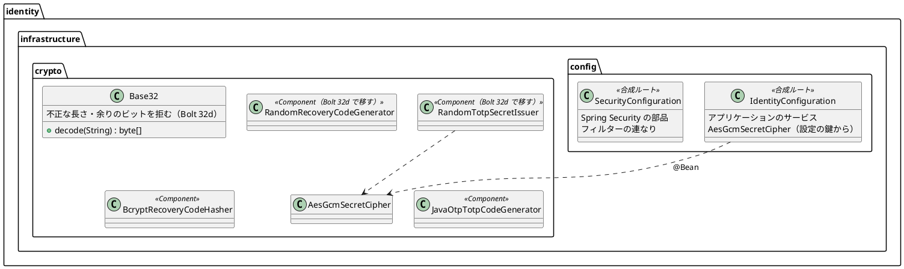

# Bolt 32d 計画 - 認証の部品の低の指摘とテストの整理

## 基本情報

| 項目 | 内容 |
| :--- | :--- |
| Bolt | 第 32d 回（W5 の 11 本目。US-18 の残りの 8 本目） |
| 予定 | W5（2026-11-02 の週。前倒しで着手できる）。作業は約 4 時間（承認ゲートの待ち時間を除く。「時間の配分と打ち切り」） |
| 対象 | `identity`（`Base32` の不正な長さ、合成ルートの部品の組み立て方）、identity のテスト（統合テストの Spring のコンテキスト、テストの補助、同時の待ちの判定、dev のテストの刻みの境界、8 時間の起点の値と監査の順）、画面の層のロックのシナリオの axe、ADR-011、アーキテクチャ、テスト戦略、リリース計画 |
| SP | 0（US-18 の SP は #13 をクローズする Bolt 33b で数える） |
| GitHub | [#13](https://github.com/k2works/practical-domain-driven-design-in-enterpris-application/issues/13)（US-18、R1.0）。この Bolt では閉じない |
| 承認ゲート | **ステップごとに止める**（W4 の締めの決定: 認証の完成はステップごと）。確認必須（構造（合成ルートの部品の組み立て方、テストの共通の設定））は計画の承認の場で確認ポイントとして判断を受ける |
| アプローチ | リファクタリング（W5 の表の 32d の行）。テストの整理と組み立ての変更は振る舞いを変えず、テストの件数と結果を変えない（足すテストを除く）。振る舞いが変わるのは `Base32` の不正な長さの 1 つだけで、そこはインサイドアウトの TDD にする |
| 前の Bolt | [Bolt 32c 終了報告](bolt_32c_report.md)、[Bolt 32 終了報告](bolt_32_report.md)、[Bolt 31d 終了報告](bolt_31d_report.md) |

## Bolt ゴール

Bolt 31 から送ってきた認証の部品の低の指摘を片づけ、Bolt 32・32c で増えた identity の統合テストの重複と揺れの元を整理する。不正な Base32 は失敗へ倒し、合成ルートの組み立て方を規則にそろえ、統合テストが作る Spring のコンテキストの数を減らし、テストの確かめを強める（同時の待ちは PostgreSQL のロックの待ちで判定、8 時間の起点は値で、監査は順で確かめる）。

### 確かめたい仮説

| # | 仮説 | この Bolt で分かること |
| :--- | :--- | :--- |
| H1 | 時計の設定と spy の組を共通にすれば、identity の統合テストの Spring のコンテキストの数が減り、テストの件数と結果は変わらない | 整理の前後で、identity の統合テストが起動したコンテキストの数（ログの起動の行の数）と、`check` の件数・失敗 0 を比べる |
| H2 | 同時の操作の「待ち」を PostgreSQL のロックの待ち（`pg_stat_activity` の `wait_event_type = 'Lock'`）で判定すれば、「500 ミリ秒の間に終わらない」より確かな証拠になる | 待ちの判定を外す（後の操作を先に終わらせる）違反を入れて、同時のテストが落ちることを確かめる（T-112） |

## ふりかえりと前の Bolt からの引き継ぎ

| 入力 | 内容 | この Bolt での扱い |
| :--- | :--- | :--- |
| 開始準備の決定（2026-10-14、human:kakimomokuri） | Base32 の不正な長さは失敗へ倒す。合成ルートは今のクラスの分け方のまま規則を書く（外れている部品だけ動かす）。統合テストのコンテキストは時計と spy の両方をまとめる。ほかの 6 項目もすべて入れる | 本計画の範囲と、確認ポイント 1〜4 |
| Bolt 32c の Try T-115 | 「〜では呼ばない・読まない」の約束は、その条件が成り立つ場面で確かめる | ステップ 4 の共通の補助（session の有無）とステップ 5 の待ちの判定は、条件が成り立つ場面（session がある、待っている）を先に確かめる |
| Bolt 32c の Try T-116 | SonarQube はテストとコードを書き換えていない間に流す | ステップ 6 |
| Bolt 32 の Try T-113・T-114 | 共有の表の件数はそのテストの利用者で絞る。枠組みに頼る確認ポイントは特性テストで確かめる | ステップ 5 の監査の順は、そのテストの利用者で絞って `occurred_at` の順で確かめる |
| Bolt 31d の Try T-110〜T-112 | pathspec のコミット、`LogCapture` は見張る操作の間だけ、見張りの違反は理由になった書き方で | 全ステップ。H2 の違反は「待たずに終わる」書き方そのもので確かめる |
| Bolt 31 の低の指摘（Bolt 31 のレビュー 18） | Base32 の不正な長さ、T-100 の待ちの判定、刻みを戻す SQL の重複、dev のテストの刻みの境界、合成ルートのクラスの分け方 | ステップ 2〜5 |
| Bolt 31d から送った指摘 | 3 つの統合テストの時計の設定、8 時間の起点の値と監査の順のテスト | ステップ 4・5 |
| Bolt 32 の既知の課題 | 統合テストの独自の Spring のコンテキスト、画面の層のロックのシナリオで 5 回の誤りのたびに axe を流している | ステップ 4・5 |
| Bolt 32c の既知の課題 | `sessionExists`（Base64 の cookie と `platform.spring_session`）の重複、`SessionRevalidationSecurityIntegrationTest` の独自のコンテキスト | ステップ 4 |
| W4 の Try T-83・T-88・T-89・T-90 | 骨組みのまま流して本命で落とす。見張り。後に回したものは Issue か計画の表に。画面の文言を変える Bolt にテクニカルライターの観点 | 全ステップ。画面と文言は変えないので、テクニカルライターの観点は文書（ADR・テスト戦略）に絞る |

## スコープ

### 入れるもの・入れないもの

| 入れる | 入れない（後で） |
| :--- | :--- |
| `Base32.decode` が不正な長さ（8 で割った余りが 1・3・6）と、余りのビットが 0 でない文字列を `IllegalArgumentException` で拒む | Bolt 33b に送った低の指摘（桁数・周期・アルゴリズムの定数、SVG の組み立て、登録を始めた時刻のキーの定数、回復コードの形の知識、`TotpEnrollmentService` の引数の型、`normalize` の戻り値の型） |
| 合成ルートの規則（下の「設計の約束」）と、外れている暗号の部品 2 つ（`RandomTotpSecretIssuer`・`RandomRecoveryCodeGenerator`）を部品探索に移す | 合成ルートのクラスを分けること（今の分け方のまま） |
| 統合テストの共通の時計の設定（1 つの `@TestConfiguration`）と、spy を使う 2 つのクラスの共通の基底 | `@Service` と `@Bean` の二重の定義、ログインの監査の書き込みの経路（Bolt 34） |
| テストの補助: 刻みを戻す SQL（3 か所）と session の行の有無（`sessionExists` など 5 か所の Spring Session の表の参照）を共通にする | ロックと IA-INV-04 の明文化（Bolt 34。Bolt 32c の議題 6） |
| `OverlappingTransactions` の待ちを PostgreSQL のロックの待ちで判定する | 500 の応答の画面の確かめ、監査の書き込みの誤りのロールバックの統合テスト（Bolt 32c の既知の課題。W10 の運用の Bolt で見直す） |
| dev の A-02 の入力済みのテストの刻みの境界の揺れ | ユーザーマニュアル（利用者に見える振る舞いは変わらない。画面と文言も変えない） |
| 8 時間の起点の値（TOTP・回復コードが通った時刻）と、監査記録の順（`PASSWORD_VERIFIED` → `LOGIN_SUCCEEDED` など）のテスト | デモの動画（画面の振る舞いが変わらない） |
| 画面の層のロックのシナリオで、axe を 1 回目の誤りだけにする | |

### 設計の約束（Try T-1）

- **合成ルートの規則**（architecture_backend.md に書く）: 送信アダプター（`infrastructure.persistence`・`infrastructure.crypto`）は `@Repository`・`@Component` で部品探索に拾わせる。合成ルート（`infrastructure.config`）の `@Bean` は、アプリケーションのサービス（`application` は部品探索から外す）、設定の値から作る部品（`AesGcmSecretCipher` の鍵）、Spring Security の部品とフィルターの連なりに限る。`IdentityConfiguration` はアプリケーションのサービスと設定から作る部品、`SecurityConfiguration` は Spring Security の部品、`DevLoginGuardConfiguration`・`IdentityWebConfiguration` は今のまま
- **Base32**: 埋め草（`=`）を除いた長さを 8 で割った余りが 1・3・6 なら拒む（RFC 4648 で現れない長さ）。最後の文字の余りのビットが 0 でなければ拒む（同じバイト列に 2 つの書き方を許さない）。dev の固定の秘密の設定が不正なら、起動の時点で失敗する（今は黙って短い秘密になる）
- **テストの共通の設定**: 時計は `identity` のテストの共通の `@TestConfiguration`（`MutableClock` を `@Primary`）を `@Import` する。同じ組の設定を使うクラスは Spring のコンテキストを共有する。spy（`@MockitoSpyBean`）を使う 2 つのクラス（`AuthenticationErrorHandlingIntegrationTest`・`SessionRevalidationSecurityIntegrationTest`）は、同じ spy の組を持つ共通の基底のクラスを継ぐ。spy は各テストの後に `reset` する（ほかのテストに漏らさない）
- **待ちの判定**: `OverlappingTransactions` は、後の操作の接続が `pg_stat_activity` で `wait_event_type = 'Lock'` になるまで待ってから先をコミットする（タイムアウトで失敗）。今の「500 ミリ秒の間に終わらない」の確かめは残す（ロックの待ちと、終わっていないことの両方）

## 設計（この Bolt の範囲）

この Bolt はドメインのモデル・データモデル・画面を変えない（リファクタリングと `Base32` の 1 つの振る舞い）。4 図のうち、状態遷移図・ER 図・画面遷移図は対象がないので省く。部品の組み立ての図だけを置く。

### ドメインモデル（変えない）と部品の組み立て

## ステップ計画

状態の記号: `[ ]` 未着手、`[-]` 進行中、`[?]` 承認待ち、`[x]` 完了。各ステップの終わりに `check` が緑であることと、計画からの変更を設計文書に反映したこと（T-53）を確かめ、push して CI を確かめる（T-26、T-65）。コミットは pathspec で作り、そのステップのファイルだけを入れる（T-84、T-110）。複数行の書き換えはスクリプトのファイルにする（T-103）。ステップ 1 を push してからコードのステップを push する（T-109）。

- [ ] **1. 設計文書** 【承認ゲート: 設計文書】
  - architecture_backend.md: 合成ルートの規則（「設計の約束」）。暗号の部品の節に、部品探索で拾うことを足す
  - ADR-011 の決定 1: Base32 は不正な長さと余りのビットを拒む（Bolt 32d）。改訂の経緯
  - test_strategy.md の統合テストの節: identity の統合テストは共通の時計の設定と spy の基底で Spring のコンテキストを共有する。同時の待ちは PostgreSQL のロックの待ちで判定する
  - release_plan.md の W5 の節: 32d の行を本計画に（承認ゲートは「構造」）、W5 の状態
  - 完了の判定: `okf:check` ERROR 0、`documentationTest` 緑
- [ ] **2. Base32 の不正な長さ** 【承認ゲート: Red・Green】
  - Red: `Base32Test` に、余りが 1・3・6 の長さ（埋め草の有無の両方）、余りのビットが 0 でない最後の文字（例: `MY` は通り `MZ` は拒む）、正しい長さの全部（余り 0・2・4・5・7）が今どおり通ることを足す（「ないこと」に「あること」を並べる。T-106）
  - Green: `Base32.decode` で長さと余りのビットを確かめる
  - 完了の判定: `check` 緑。dev の設定の秘密（`application-dev` の 5 人分）が今どおり読めること（`DevTotpCodesTest`・`DevTotpCredentialsDevProfileTest`）
- [ ] **3. 合成ルートの規則** 【承認ゲート: 構造】
  - `RandomTotpSecretIssuer`・`RandomRecoveryCodeGenerator` に `@Component` を付け、`IdentityConfiguration` の `@Bean` を外す。`ComponentScanTest`・ArchUnit・起動のテストが緑のまま
  - 見張り: `IdentityConfiguration`・`SecurityConfiguration` の `@Bean` の戻り値の型が、アプリケーションのサービス・`AesGcmSecretCipher`・Spring Security の型のどれかであること（ArchUnit か反射のテスト）。違反（暗号の部品の `@Bean` を足す）を入れて落ちることを確かめる（T-112）
  - 完了の判定: `check` 緑
- [ ] **4. テストの共通の設定と補助** 【承認ゲート: 構造】
  - 前: identity の統合テストが起動した Spring のコンテキストの数を数える（`test` のログの起動の行。H1）
  - 共通の時計の設定（`identity` のテストの `@TestConfiguration`）を作り、5 つの統合テスト（`AuthenticationSecurityIntegrationTest`・`LoginLockSecurityIntegrationTest`・`RecoveryCodeLoginSecurityIntegrationTest`・`TotpEnrollmentSecurityIntegrationTest`・`SessionRevalidationSecurityIntegrationTest`）の入れ子の `FixedClock` を置き換える
  - spy の共通の基底（`UserStandingRepository`・`UserRepository`・`CompanyRepository`・`AuditRecordRepository`・`TotpCodeGenerator`・`LoginFailureRepository`）を作り、2 つのクラスが継ぐ。各テストの後に `reset`
  - 共通の補助: 刻みを戻す SQL（`AuthenticationSecurityIntegrationTest`・`DevLoginPrefillDevProfileTest`・`UiUsers`）と、Spring Session の表を見る補助（`sessionExists`・属性の名前の読み出し。5 つのクラス）
  - 後: コンテキストの数と、`check` の件数・失敗 0 を比べる
  - 完了の判定: `check` 緑。テストの件数は整理の前と同じ
- [ ] **5. テストの確かめを強める** 【承認ゲート: Red・Green】
  - `OverlappingTransactions`: 後の操作の接続のロックの待ちを `pg_stat_activity` で確かめる。違反（後の操作が待たずに終わる。たとえば先の操作の行ロックを取らない更新）を入れて落ちることを確かめる（H2、T-112）
  - dev の A-02 の入力済みのテスト: コードを作ってから画面を開くまでに刻みをまたぐと揺れる。画面に出たコードが、送る前後の刻みのどちらかのコードであることを確かめ、画面に出たコードを送る
  - 8 時間の起点の値: 時計を進めて password の段と TOTP（と回復コード）の段の時刻を分け、`AUTHENTICATED_AT` の値が TOTP・回復コードが通った時刻であることを確かめる。監査記録はそのテストの利用者で絞り、`occurred_at` の順で `PASSWORD_VERIFIED` → `LOGIN_SUCCEEDED`（回復コードは `PASSWORD_VERIFIED` → `RECOVERY_CODE_USED`・`LOGIN_SUCCEEDED`）であることを確かめる（T-113）
  - 画面の層のロックのシナリオ: 誤りの 2 回目以降は axe を流さない（1 回目と、ロックの後の画面だけ）
  - 完了の判定: `check` と `uiTest` が緑
- [ ] **6. SonarQube と開発レビューと終了報告** 【承認ゲート: 終了報告】
  - SonarQube（`sonar-local:check`。テストとコードを書き換えていない間に流す。T-116）
  - 開発レビュー（プログラマー、アーキテクト（合成ルートの規則）、テスター（共通の設定と待ちの判定）、テクニカルライター（ADR・テスト戦略の書き方））
  - `bolt_32d_report.md`。release_plan の W5 の 32d の行、開発の索引。#13 に進み具合をコメントする。デモの動画は撮らない（画面の振る舞いが変わらない）

### 時間の配分と打ち切り

| # | 目安 | 打ち切り |
| :--- | :--- | :--- |
| 1 | 25 分 | — |
| 2 | 25 分 | — |
| 3 | 30 分 | 見張りが ArchUnit で書きにくければ、反射のテストにする |
| 4 | 60 分 | spy の基底でコンテキストがまとまらなければ、時計の共通化だけにして spy は既知の課題にする |
| 5 | 60 分 | — |
| 6 | 40 分（SonarQube の待ちを除く） | — |

合計 240 分（約 4 時間）。4.5 時間を超えると見えたら、止めて人に諮る（候補: ステップ 5 の 8 時間の起点の値と監査の順を 32b に送る。32b は同じ session の上限の部品に触る）。

## 確認ポイント（計画の承認の場でまとめて確認する。Try T-6）

| # | 確認すること | ステップ | 推奨 |
| :--- | :--- | :--- | :--- |
| 1 | **Base32 の不正な長さ**（開始準備で決めた） | 2 | 失敗へ倒す。余りが 1・3・6 の長さと、余りのビットが 0 でない最後の文字を拒む。使うのは dev の固定の秘密の設定だけで、本番の経路（A-07 の手入力のキーは表示だけ。復号しない）には影響しない |
| 2 | **合成ルートの分け方**（開始準備で決めた。構造） | 1・3 | クラスは今のまま分けず、規則を architecture_backend に書く。規則から外れている暗号の部品 2 つを部品探索に移す。`@Bean` の戻り値の型の見張りを足す |
| 3 | **統合テストのコンテキスト**（開始準備で決めた。構造） | 4 | 時計の共通の設定と、spy の共通の基底の両方。spy の基底は、spy を使わないテストが継がないよう、2 つのクラスだけにする |
| 4 | **範囲**（開始準備で決めた） | 全体 | ほかの 6 項目もすべて入れる。4.5 時間を超えると見えたら止めて諮る |
| 5 | **待ちの判定の置き場所** | 5 | `OverlappingTransactions` は PostgreSQL の統合テストだけが使うので、`pg_stat_activity` に頼ってよい。判定の SQL はテストの補助の中に置き、本体のコードに置かない |
| 6 | **マニュアルとデモ** | — | 入れない。利用者に見える振る舞いも画面も変わらない（Base32 は dev の設定だけ）。メモリの規則（振る舞いが変わる Bolt はマニュアルを完了条件に入れる）には当たらない |
| 7 | 後の Bolt に送るものと T-89 | — | 33b: 31d から送った低の指摘（今のまま）。34: `@Service` と `@Bean` の二重の定義、ログインの監査の書き込みの経路、ロックと IA-INV-04。W10: 500 の応答の画面と監査の書き込みのロールバックの統合テスト、request ごとの SQL の計測。どれも W5 の節の表か W10 の持ち込みで追う |
| 8 | 承認ゲート | 全体 | ステップごとに止める（W4 の締めの決定）。ステップ 3・4 は構造の確認必須 |

## 完了条件

- [ ] `Base32.decode` が不正な長さと余りのビットを拒み、正しい長さはすべて今どおり通る。dev の設定の秘密が読める
- [ ] 合成ルートの規則が architecture_backend に書かれ、暗号の部品はすべて部品探索で拾われ、`@Bean` の戻り値の型の見張りがある
- [ ] identity の統合テストが共通の時計の設定と spy の基底を使い、Spring のコンテキストの数が減った（前後の数を報告に書く）。テストの件数は整理の前と同じ（足したテストを除く）
- [ ] 刻みを戻す SQL と Spring Session の表の参照が、それぞれ 1 か所の補助になった
- [ ] 同時の待ちを PostgreSQL のロックの待ちで判定し、違反で落ちることを確かめた。dev の A-02 のテストが刻みの境界で揺れない。8 時間の起点は値で、監査は順で確かめる。ロックのシナリオの axe は 1 回目だけ
- [ ] `check` と `uiTest` が緑。push して CI を確かめた。SonarQube の Quality Gate が PASS、`okf:check` ERROR 0
- [ ] 開発レビュー、終了報告。#13 に進み具合をコメントした

## 更新履歴

| 日付 | 更新内容 | 更新者 |
| :--- | :--- | :--- |
| 2026-10-14 | 初版作成（承認待ち）。開始準備で、Bolt 31 の低の指摘、Bolt 31d・32・32c の既知の課題、Bolt 32c の Try（T-115・T-116）を調べ、human:kakimomokuri の決定（Base32 は失敗へ倒す、合成ルートは今のまま規則を書く、コンテキストは時計と spy の両方、ほかの 6 項目もすべて入れる）を反映した | anthropic/claude-opus-5-5 |

## 関連ドキュメント

- [リリース計画](release_plan.md)（W5）
- [Bolt 32c 終了報告](bolt_32c_report.md)、[Bolt 32 終了報告](bolt_32_report.md)、[Bolt 31d 終了報告](bolt_31d_report.md)
- [ADR-011](../../adr/cargo-tracker/011-mfa-totp.md)（決定 1）、[ADR-012](../../adr/cargo-tracker/012-authentication-principal-and-session.md)
- [バックエンドのアーキテクチャ](../../design/cargo-tracker/architecture_backend.md)、[テスト戦略](../../design/cargo-tracker/test_strategy.md)
