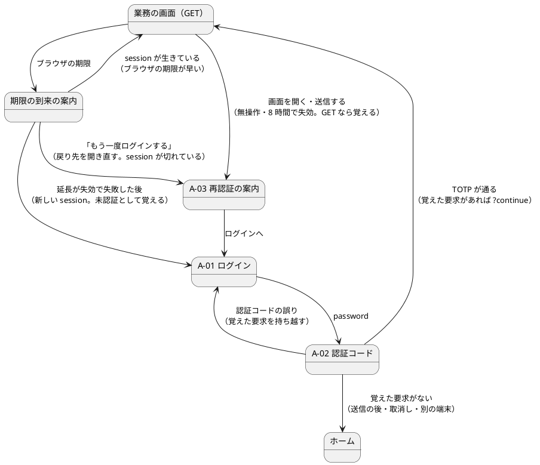
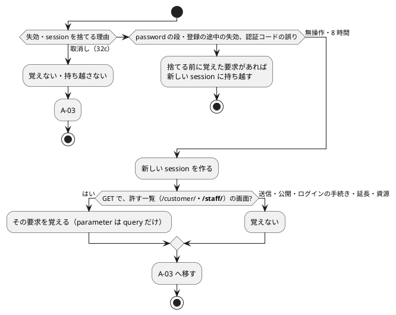

# Bolt 32e 計画 - 失効の後に開いていた画面へ戻す（ACC-06）

## 基本情報

| 項目 | 内容 |
| :--- | :--- |
| Bolt | 第 32e 回（W5 の 13 本目。US-18 の残りの 10 本目） |
| 予定 | W5（2026-11-02 の週。前倒しで着手できる）。作業は約 4 時間 20 分（承認ゲートの待ち時間を除く。「時間の配分と打ち切り」） |
| 対象 | `identity`（失効の扱い `invalidSessionStrategy`、`SessionLifetimeFilter`、認証コードの誤りの扱い、`SessionTimerAdvice` の戻り先、`SecurityConfiguration`）、警告の期限の到来の案内のリンク（`session-timeout.js`・`layout/session-warning`）、A-03、UI 設計、アーキテクチャ（バックエンド・フロントエンド）、ACC-06、ADR-012、テスト戦略、ユーザーストーリー、リリース計画、ユーザーマニュアル |
| SP | 0（US-18 の SP は #13 をクローズする Bolt 33b で数える。横断の受入条件は SP を持たない） |
| GitHub | [#13](https://github.com/k2works/practical-domain-driven-design-in-enterpris-application/issues/13)（US-18、R1.0）。この Bolt では閉じない |
| 承認ゲート | **ステップごとに止める**（W4 の締めの決定）。確認必須（セキュリティ（覚える要求の範囲、持ち越し、利用者に結び付けないこと）、構造（失効の扱いの差し替え）、新しいファイル）は計画の承認の場で確認ポイントとして判断を受ける |
| アプローチ | インサイドアウト（W5 の表の 32e の行）。開発戦略の表ではインサイドアウトは「新しい集約・スキーマを作る」ときで、32e はドメインもデータも変えないので表から外れる。外れる理由: 振る舞いの大半がサーバーの認証の入口（失効の経路ごとに要求を覚えるか・持ち越すか）にあり、セキュリティの統合テストから入るほうが早く確かめられる。画面（案内のリンク）は受入シナリオの Red から入る。認証の入口と横断の部品だけを変える Bolt（32・32c・32b・32e）を開発戦略の表に足すかは、W5 の締めの議題にする |
| 前の Bolt | [Bolt 32b 終了報告](bolt_32b_report.md)、[Bolt 32c 終了報告](bolt_32c_report.md)、[Bolt 32d 終了報告](bolt_32d_report.md)、[Bolt 14 終了報告](bolt_14_report.md) |

## Bolt ゴール

無操作 30 分または 8 時間の上限でログアウトした利用者が、もう一度ログインすると、ログアウトしたときに開いていた画面（GET で開いた業務の画面）に戻る。A-03 の「ログインすると、開いていた画面に戻ります。」を事実にし、戻らない場合（送信の後、利用を止められたとき）をマニュアルで補う。送信の後の失効の扱いと、送信していない入力の保持は Bolt 32f で作る（この Bolt では「送信していない入力は保存されていません」のまま）。

### 確かめたい仮説

| # | 仮説 | この Bolt で分かること |
| :--- | :--- | :--- |
| H1 | 失効を見つけたところ（無操作は失効の扱い `invalidSessionStrategy`、8 時間は `SessionLifetimeFilter`）で、開いていた業務の画面の GET を新しい session に覚えれば、今の TOTP の成功の扱い（`SavedRequestAwareAuthenticationSuccessHandler`）がそこへ戻す | 統合テストで、失効 → A-03 → A-01 → A-02 → 開いていた画面（`?continue` 付き）、の流れを無操作と 8 時間で確かめる |
| H2 | 警告の期限の到来の案内のリンクを「サーバーが渡した戻り先を開き直す」にすれば、ブラウザが先に期限に気づいた場合でも、サーバーが失効を見つけて要求を覚える | 画面の層の受入シナリオで、ブラウザの時計とサーバーの session の行の両方を古くしてから案内のリンクを押し、ログインの後に同じ画面に戻ることを確かめる |

### 開始準備で確かめたこと（T-114。spring-security 7.1.1 の jar を javap で確かめた。詳細整合性検証）

- **戻す仕組みはある**: TOTP が通った後の `FirstTotpSuccessHandler` は `SavedRequestAwareAuthenticationSuccessHandler` を継ぎ（既定の `HttpSessionRequestCache`）、session に覚えた要求があれば `?continue` を付けてそこへ、なければ `/`（役割のホーム）へ移す。`?continue` の GET で `RequestCacheAwareFilter` が覚えた要求を消す
- **失効では覚えていない**: 無操作の失効は `invalidSessionUrl(A-03)`（`SimpleRedirectInvalidSessionStrategy`。新しい session を作ってから移す）が要求を覚えずに A-03 へ移す。8 時間の上限は `SessionLifetimeFilter` が session を捨てて A-03 へ移す
- **CSRF の拒否も同じ失効の扱いを通る**: `CsrfConfigurer` は `MissingCsrfTokenException` に `InvalidSessionAccessDeniedHandler(sessionManagement の invalidSessionStrategy)` を当てる。`invalidSessionStrategy(...)` を設定すると、それが使われる
- **フィルターの順序**: CsrfFilter → LogoutFilter → SessionLifetimeFilter → SessionRevalidationFilter → 認証 → RequestCacheAwareFilter → … → SessionManagementFilter → ExceptionTranslationFilter → AuthorizationFilter。無操作の失効の GET は SessionManagementFilter で、POST は CsrfFilter で見つかる。8 時間は SessionLifetimeFilter が先に処理する
- **覚えた要求はログインの途中で残る**: password の段の `changeSessionId` は同じ session の ID だけを替えるので、属性は残る。A-01 の GET（`continue` なし）と A-02 の表示は覚えた要求を消さず、上書きもしない
- **今は消える場面**: 認証コード・回復コードの誤り（`DiscardPasswordFactorFailureHandler` が session を捨てる）と password の段の 5 分の失効（`SessionLifetimeFilter`）では、覚えた要求も消える
- **ブラウザが先に気づく場合**: Bolt 32b の警告の期限の到来の案内のリンクは A-03 へ直接移るので、サーバーは開いていた画面を知らない
- **送信の後の画面**: 入力の誤りの画面は送信の URL のまま描き直す（例: `POST /customer/transport-requests/{業務番号}/versions`。GET の受け口がない）。この画面の URL を開き直すと別の画面か 405 になる

## ふりかえりと前の Bolt からの引き継ぎ

| 入力 | 内容 | この Bolt での扱い |
| :--- | :--- | :--- |
| 開始準備の決定（2026-10-14、human:kakimomokuri） | 32e（画面への復帰）と 32f（入力の保持）に分ける。入力の保持はブラウザの sessionStorage（利用者を確かめて戻す、password・CSRF のトークン・ファイルは置かない）、自動で戻して知らせ「戻した入力を消す」を出す。利用を止められた利用者には、復帰も保持もしない | 本計画の範囲（GET の画面への復帰と取消しの扱い）。32f の決定と、32e から送るもの（送信の後の失効、案内のリンクで離れる前に入力を写すこと）はステップ 1 でリリース計画の 32f の行に書く |
| Bolt 32b の Try T-119 | 否定の確かめは、先にそれが出ていることを確かめてから | 「覚えない」のテスト（取消し、送信、公開の URL）は、同じ流れで覚える場合のテストと対にする |
| Bolt 32b の Try T-120 | 共通のレイアウト・共通の部品を変えたら、`check` を先に | ステップ 3 |
| Bolt 32d の Try T-117 | 規則のテストは、その規則を外したときだけ落ちる入力で | 覚える条件（GET、許す path の一覧）を 1 つずつ外したテスト |
| Bolt 32c の Try T-115 | 「〜では〜しない」は、その条件が成り立つ場面で確かめる | 取消し・password の段の失効は、業務の画面を開いていた session で確かめる |
| Bolt 32b の既知の課題 | ブラウザの期限は早く来ることがある、`localStorage` は利用者を区別しない、8 時間の画面のシナリオは DB の属性の書き換えに頼る、書類のダウンロードは数えない | 早く来る場合は確認ポイント 5。8 時間のシナリオは同じ書き換えを使う（Spring Session の保存方式を変えたら見直す）。利用者の区別は確認ポイント 4。ダウンロードは覚える対象にしない（許す一覧の外） |
| Bolt 32d の既知の課題 | 統合テストの `Clock` から `MutableClock` への型変換（6 クラス）、`submitLogin` のフラグ引数 | 新しいテストは `MutableClock` を直接受ける。既存の 6 クラスと `LoginUiSteps` は書き換えない（32b と同じ扱い） |
| Bolt 31 のレビュー 5、Bolt 14 のレビューの R-14 | A-03 の「開いていた画面に戻ります」 | この Bolt で事実にする |
| Bolt 32b の開発レビュー（テクニカルライター） | 32e で直すマニュアルの箇所 | ステップ 4 |

## スコープ

### 入れるもの・入れないもの

| 入れる | 入れない（後で） |
| :--- | :--- |
| 無操作の失効と 8 時間の上限で、開いていた業務の画面の GET（許す一覧 `/customer/**`・`/staff/**`）を新しい session に覚えて A-03 へ移す | 送信（POST）の後の失効で、送信した画面へ戻すこと（Bolt 32f。入力の保持とあわせて、ブラウザが送信の前に下書きと戻り先を持つ） |
| 覚えるかどうかに関わらず、失効の扱いは新しい session を作ってから A-03 へ移す（古い Cookie のままの A-03 の 302 の繰り返しを防ぐ） | 送信していない入力の保持と戻し方（Bolt 32f） |
| 認証コード・回復コードの誤り、password の段の 5 分の失効では、覚えた要求を新しい session に持ち越す | 利用を止められた利用者・所属企業の無効化（Bolt 32c の取消し）での復帰（開始準備の決定） |
| 警告の期限の到来の案内のリンク: サーバーが GET で開いた業務の画面にだけ渡す戻り先（`data-return-path`）があれば開き直し、なければ今どおり A-03 へ移る | 覚えた要求を利用者に結び付けること（確認ポイント 4） |
| A-03 の文言の確かめ、マニュアル 2.4・2.5・付録 B の Q1-2・Q1-5 | 部分更新（htmx）の request（今のテンプレートに部分更新はない） |
| UI 設計・アーキテクチャ・ACC-06・ADR-012・テスト戦略・ユーザーストーリー・リリース計画の更新 | — |
| デモの動画（失効の後に開いていた画面へ戻る）。終了報告の承認の後に #13 に添付し、添付の対応表の 2 か所に bolt-32e を足す | — |

### 設計の約束（Try T-1）

- **覚える要求**: GET で、path が許す一覧（`/customer/**`・`/staff/**`）に当たる要求だけ。`POST`（延長・ログアウト・業務の送信）・公開の URL・ログインの手続き・静的な資源・`/`・書類のダウンロード（一覧の外。`/customer/**` の下にあれば除く一覧で外す。実装で URL を確かめる）は覚えない。覚えるのは Spring Security の `HttpSessionRequestCache` に `RequestMatcher`（GET かつ許す一覧）を渡したもので、`FirstTotpSuccessHandler` と同じ属性の名前と `continue` の引数名を使う。GET の要求の parameter は query だけなので、送信の本体は session に入らない
- **失効の扱い**（`identity.infrastructure.security.ExpiredSessionRequestSaver`。名前は実装で決める）: 失効した request について、新しい session を作り、上の条件に当たれば要求を覚え、A-03 へ移す。`SecurityConfiguration` の `sessionManagement` を `invalidSessionUrl` から `invalidSessionStrategy` に替える（CSRF の拒否の失効も同じ扱いを通る）。許す一覧の `RequestMatcher` は合成ルートが渡す（`SessionRevalidationFilter` の `publicRequests()` と同じ形。認証の入口から画面の層を参照しない）
- **8 時間の上限**: `SessionLifetimeFilter` が、2 つの要素のそろった session の上限で session を捨てたときに、上の部品で新しい session に覚える
- **持ち越し**: password の段の 5 分・登録の途中の 15 分の失効（`SessionLifetimeFilter`）と、認証コード・回復コードの誤り（`DiscardPasswordFactorFailureHandler`）で session を捨てるときは、捨てる前の session に覚えた要求があれば新しい session に移す（ログインし直した後に戻れるように）
- **取消し**: `SessionRevalidationFilter`（Bolt 32c）は変えない（覚えず、持ち越さない）
- **戻り先を画面に渡す**: `SessionTimerAdvice` が、GET で許す一覧に当たる request のときだけ戻り先（path と query）を `sessionTimer` に足し、警告の部分が `data-return-path` に書く。送信の後の画面（POST で描いた画面）には渡さない
- **期限の到来の案内のリンク**: 戻り先があれば、リンクの行き先をそれにする。サーバーの session が切れていれば失効の扱いが覚えて A-03 へ移る。延長が失効で失敗した後（失効の扱いが新しい session を作っている）は、開き直すと未認証の要求として A-01 へ移る（覚えて戻る。A-03 を通らない。確認ポイント 5）。ブラウザの期限が早く来ていて session が生きていれば、その画面がそのまま開く。戻り先がなければ今どおり A-03
- **利用者に結び付けない**: 覚えた要求は利用者を区別しない（無操作の失効では、失効した session から利用者が分からない）。別の利用者がログインすると前の URL へ移り、認可で拒まれれば A-04 になる（確認ポイント 4）

## 設計（この Bolt の範囲）

この Bolt はドメインのモデルとデータモデルを変えない。4 図のうち、ドメインモデル図と ER 図は対象がないので省く。状態遷移図は、新しい状態を持つものがない（覚えた要求は session の属性で、Spring Security が消す）ので省く。画面遷移と、覚えるかの判定を置く。

### 失効から開いていた画面へ戻る画面遷移

### 覚えるかの判定

## ステップ計画

状態の記号: `[ ]` 未着手、`[-]` 進行中、`[?]` 承認待ち、`[x]` 完了。各ステップの終わりに `check` が緑であることと、計画からの変更を設計文書に反映したこと（T-53）を確かめ、push して CI を確かめる（T-26、T-65、T-118）。コミットは pathspec で作る（T-84、T-110）。複数行の書き換えはスクリプトのファイルにする（T-103）。ステップ 1 を push してからコードのステップを push する（T-109）。

- [ ] **1. 設計文書** 【承認ゲート: 設計文書】
  - ui_design.md: A-03 の行（失効の後に開いていた画面に戻る。戻らない場合）、前提の表（:38）、画面遷移図と説明（:262・:275。案内のリンクの行き先、延長の失敗の後の A-01、ラベルを「もう一度ログインする」に）、session の警告の節（期限の到来の案内のリンク、:1035）、エラーと例外の扱い（:1116・:1117）
  - architecture_backend.md: 認証の入口の部品の節に、失効の扱い（`invalidSessionStrategy`、覚える要求の条件、許す一覧は合成ルートが渡す）と持ち越し
  - architecture_frontend.md: 「session の時間制限」（:108）と警告の節の 32e・32f の書き分け、期限の到来の案内のリンク
  - non_functional.md の ACC-06: 画面への復帰は Bolt 32e、入力の保持は Bolt 32f
  - ADR-012: 失効の扱いで要求を覚えること（覚える要求、新しい session、持ち越し、取消しでは覚えない、利用者に結び付けない、forward headers に頼ること（R-13 の W10 の確かめ））、:56 の `invalidSessionUrl` の記述。改訂の経緯
  - test_strategy.md: 認証の行（:344）の 32e・32f の分
  - user_story.md の :501: 32b・32e・32f の分担
  - release_plan.md の W5 の節:
    - 32e の行を本計画に。32f の行を足す（入力の保持。開始準備の決定: sessionStorage、利用者を確かめて戻す、password・CSRF のトークン・ファイルは置かない、自動で戻して知らせ「戻した入力を消す」、取消しでは保持しない。32e から送るもの: 送信の後の失効で送信した画面へ戻すこと、案内のリンクで画面を離れる前と送信の前に入力を写すこと、戻り先は 32e の戻り先と同じ鍵にすること）
    - US-18 の Bolt の順序（32b → 32e → 32f → 33b。32f は #13 をクローズする 33b より前）、W5 の本数（18 本）、「session の失効の警告の範囲」の決定の反映先（32b・32e・32f）、局面とアプローチの段落、デモの項目、ユーザーマニュアルの段落、W5 の状態
  - 完了の判定: `okf:check` ERROR 0、`documentationTest` 緑
- [ ] **2. 失効の扱いで要求を覚え、持ち越す** 【承認ゲート: Red・Green、セキュリティ、構造】
  - Red（統合テスト `ReturnAfterExpirySecurityIntegrationTest`。`@IdentityIntegrationTest`、`MutableClock` を直接受ける。ログインし直す前に `AuthenticationFactorFixtures.resetTotpStep` で刻みを戻す）:
    - 無操作で失効した session（`SpringSessionRows.idle` で 31 分）で業務の画面を開くと A-03 へ移り、ログインし直すとその画面（`?continue` 付き）へ移る。覚えた要求に query 以外の parameter がない
    - 8 時間を過ぎた session で業務の画面を開くと、同じく戻る
    - 古い Cookie のまま A-03 を開くと 200（302 を繰り返さない）
    - 失効した session の送信（業務の POST、`POST /session/extend`、`POST /logout`）では覚えず、ログインし直すとホームへ移る（T-119。上の覚える場合と対）
    - 公開の URL・許す一覧の外の GET では覚えない
    - 業務の画面を開いて失効した後、A-02 で認証コードを 1 回誤ってからログインし直しても、その画面へ戻る（持ち越し）。password の段の 5 分の失効の後も戻る
    - 業務の画面を開いていた利用者が利用を止められ、利用を戻してからログインし直すとホームへ移る（取消しでは覚えない。T-115）
    - 覚えた要求は別の利用者がログインしても使われ、認可で拒まれる（受け入れた振る舞いの特性テスト。確認ポイント 4）
    - ログインした業務の画面の GET の応答に `data-return-path` がある。送信の後の画面（入力の誤りの画面）にはない
  - Green: 失効の扱いの部品、`SecurityConfiguration`、`SessionLifetimeFilter`（コンストラクターが変われば `SessionLifetimeFilterTest` も直す）、`DiscardPasswordFactorFailureHandler`、`SessionTimerAdvice` の戻り先
  - 完了の判定: `check` 緑（層の規則と全 URL の見張りを含む）
- [ ] **3. 期限の到来の案内のリンク（画面の層の Red から）** 【承認ゲート: Red・Green（画面）】
  - Red（`session_timeout_ui.feature`。機能の説明を「サーバーの session を失効させるシナリオもある」に直す）:
    - 警告のまま期限を過ぎ、サーバーの session も切れた後に案内の「もう一度ログインする」を押すと、再認証の案内を経て、ログインし直した後に同じ画面に戻る（`@demo @demo-bolt-32e/return`）
    - 警告のまま期限を過ぎても、サーバーの session が生きていれば、案内のリンクで同じ画面がログインしたまま開く（T-119 の対）
  - Green: `layout/session-warning` と `session-timeout.js`（戻り先があればリンクにする）
  - 完了の判定: `check` を先に（T-120）、続けて `uiTest` が緑
- [ ] **4. 画面の層の受入シナリオの残りとマニュアル** 【承認ゲート: Red・Green、マニュアル】
  - `session_timeout_ui.feature` に足す: サーバーの session が無操作で切れた後に画面を開き直すと、再認証の案内を経てログインし直した後に同じ画面に戻る。ログインから 8 時間を過ぎた session で画面を開くと、同じく戻る
  - マニュアル: 2.4（画面の説明の ①、操作手順 2、画面の開き方、注意・補足の食い違いの補足を消し、戻らない場合（送信の後、利用を止められたとき、別の端末）を書く）、2.5（期限の到来の案内のリンク）、付録 B の Q1-2・Q1-5。キャプチャの撮り直しが要るかを確かめる
  - `templates/identity/session-expired.html` のコメント（入力の保持は 32f）
  - デモの動画（`@demo-bolt-32e/return`）を録画する
  - 完了の判定: `check` と `uiTest` が緑。`manual:build` が通る
- [ ] **5. SonarQube と開発レビューと終了報告** 【承認ゲート: 終了報告】
  - SonarQube（T-116）
  - 開発レビュー（プログラマー、アーキテクト（失効の扱いの差し替え、持ち越し、許す一覧）、テスター、テクニカルライター（A-03 とマニュアル。T-90））
  - `bolt_32e_report.md`。release_plan の W5 の 32e の行、開発の索引。#13 に進み具合をコメントする。終了報告の承認の後に、デモの動画を #13 に添付し、`ops/scripts/issue_demo.js` と運用の手順書の添付先の表に bolt-32e を足す

### 時間の配分と打ち切り

| # | 目安 | 打ち切り |
| :--- | :--- | :--- |
| 1 | 45 分 | — |
| 2 | 90 分 | 持ち越しが Spring Security の失敗の扱いの順序で書きにくければ、認証コードの誤りの持ち越しを既知の課題にして 32f に送る（A-03 とマニュアルに書く） |
| 3 | 40 分 | — |
| 4 | 45 分 | — |
| 5 | 40 分（SonarQube の待ちを除く） | — |

合計 260 分（約 4 時間 20 分）。4.5 時間を超えると見えたら止めて諮る。

## 確認ポイント（計画の承認の場でまとめて確認する。Try T-6）

| # | 確認すること | ステップ | 推奨 |
| :--- | :--- | :--- | :--- |
| 1 | **分け方と 32f の決定**（開始準備で決めた） | 1 | 32e は GET で開いた画面への復帰、32f は入力の保持と送信の後の失効。32f の決定と 32e から送るものはリリース計画の 32f の行に書く |
| 2 | **取消しでは戻さない**（開始準備で決めた） | 2 | 利用を止められた利用者・所属企業の無効化（Bolt 32c）では覚えず、持ち越さない |
| 3 | **覚える要求の範囲**（セキュリティ） | 2 | GET で許す一覧（`/customer/**`・`/staff/**`）の画面だけ。送信（POST）は覚えない（Referer を使わない。オープンリダイレクトと、送信の本体が session に入ることを避ける）。戻り先はサーバーの request から作るので他のサイトへは移らない |
| 4 | **覚えた要求を利用者に結び付けない**（セキュリティ） | 2 | 結び付けない。無操作の失効では失効した session から利用者が分からず、8 時間の上限だけ結び付けると振る舞いが分かれる。別の利用者がログインすると前の URL（業務番号を含みうる）へ移るが、認可で拒まれ A-04 になる（データは見えない。URL の path は見える）。共用の端末ではログアウトしてから離れる運用で補う（マニュアル）。32f の入力の保持は利用者を確かめる（業務の入力そのものなので） |
| 5 | **期限の到来の案内のリンク**（画面） | 3 | 戻り先（GET の画面）があれば開き直し、なければ A-03。延長が失効で失敗した後は A-01 へ直接移る（A-03 の問い合わせ先の案内を通らない）が、ログインの後は同じ画面へ戻る。ブラウザの期限が早く session が生きていれば画面がそのまま開き、入力は消える（32f で離れる前に写す）。リンクの語「もう一度ログインする」は変えない |
| 6 | **持ち越し**（セキュリティ） | 2 | 認証コード・回復コードの誤りと password の段・登録の途中の失効では、覚えた要求を新しい session に持ち越す（ログインの手続きをやり直すだけなので、戻る先を失わない） |
| 7 | **A-03 の文言** | 1・4 | 「ログインすると、開いていた画面に戻ります。」を残す。戻らない場合（送信の後、利用を止められたとき）はマニュアル 2.4 で補う。「送信していない入力は保存されていません。」は 32f まで今のまま |
| 8 | **新しいファイル** | 2 | 失効の扱いの部品（`identity.infrastructure.security`）、`ReturnAfterExpirySecurityIntegrationTest` |
| 9 | **マニュアルとデモ** | 4・5 | 入れる。2.4・2.5・付録 B。デモの動画は録画まで、#13 への添付と添付の対応表の更新は終了報告の承認の後 |
| 10 | 承認ゲート | 全体 | ステップごとに止める。ステップ 2 はセキュリティと構造の確認必須 |

## 完了条件

- [ ] 無操作 30 分と 8 時間の上限で失効した後、もう一度ログインすると、GET で開いていた業務の画面に戻る（画面を開き直したとき、警告の案内のリンクを押したとき）。認証コードの誤りと password の段の失効をはさんでも戻る
- [ ] 送信・取消し・公開の URL・許す一覧の外では覚えない（覚える場合と対で確かめた）。A-03 は 302 を繰り返さない
- [ ] UI 設計・アーキテクチャ・ACC-06・ADR-012・テスト戦略・ユーザーストーリー・リリース計画（32e・32f の行）を更新した
- [ ] ユーザーマニュアル（2.4・2.5・付録 B）を更新し、デモの動画を録画した（#13 への添付は終了報告の承認の後）
- [ ] `check` と `uiTest` が緑。push して CI を確かめた。SonarQube の Quality Gate が PASS、`okf:check` ERROR 0
- [ ] 開発レビュー、終了報告。#13 に進み具合をコメントした

## 更新履歴

| 日付 | 更新内容 | 更新者 |
| :--- | :--- | :--- |
| 2026-10-14 | 承認（確認ポイント 1〜10 は推奨のまま）。`/goal Bolt32e` の下で、ステップの承認ゲートでは止めずに進め、終了報告でまとめて確かめを受ける | human:kakimomokuri |
| 2026-10-14 | 詳細整合性検証（16 件）と横断整合性検証（19 件）の指摘を反映した。spring-security 7.1.1 の jar で、CSRF の拒否も `invalidSessionStrategy` を通ること・フィルターの順序・`changeSessionId` の後も覚えた要求が残ること・A-01 と A-02 が消さないことを確かめた（T-114）。送信は覚えない（Referer を使わない。オープンリダイレクトと送信の本体を避け、送信の後の失効は 32f に送った）。覚えるのは GET で許す一覧の画面だけ。覚えるかに関わらず新しい session を作る（A-03 の 302 の繰り返しを防ぐ）。認証コードの誤りと password の段の失効では持ち越す。戻り先は GET の画面にだけサーバーが渡す（送信の後の画面の URL を開き直さない）。延長の失敗の後の A-01 への直接の遷移、利用者に結び付けないこと、確認ポイント 4〜6。ステップ 3 を画面の層の Red から。ステップ 1 の文書の漏れ（アーキテクチャ・ACC-06・user_story・ui_design の各行・release_plan の段落）、32d・32b の既知の課題と T-115 の引き継ぎ、デモの添付の対応表 | anthropic/claude-opus-5-5 |
| 2026-10-14 | 初版作成（承認待ち）。開始準備で、TOTP の成功の扱い（覚えた要求へ戻す）、無操作と 8 時間の失効の経路（要求を覚えない）、警告の期限の到来の案内のリンクを調べ、human:kakimomokuri の決定（32e と 32f に分ける、入力の保持は sessionStorage で自動で戻して知らせる、取消しでは戻さない）を反映した | anthropic/claude-opus-5-5 |

## 関連ドキュメント

- [リリース計画](release_plan.md)（W5）
- [Bolt 32b 終了報告](bolt_32b_report.md)、[Bolt 32c 終了報告](bolt_32c_report.md)、[Bolt 32d 終了報告](bolt_32d_report.md)、[Bolt 31 終了報告](bolt_31_report.md)（レビュー 5）
- [Bolt 14 のレビュー](../../review/cargo-tracker/bolt_14_review_20261006.md)（R-14）
- [ユーザーストーリー](../../requirements/cargo-tracker/user_story.md)（横断受入条件）
- [UI 設計](../../design/cargo-tracker/ui_design.md)（A-03、session の警告）、[非機能要件](../../design/cargo-tracker/non_functional.md)（ACC-06）
- [ADR-012](../../adr/cargo-tracker/012-authentication-principal-and-session.md)、[テスト戦略](../../design/cargo-tracker/test_strategy.md)
