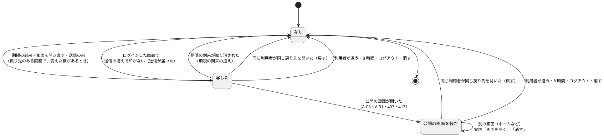
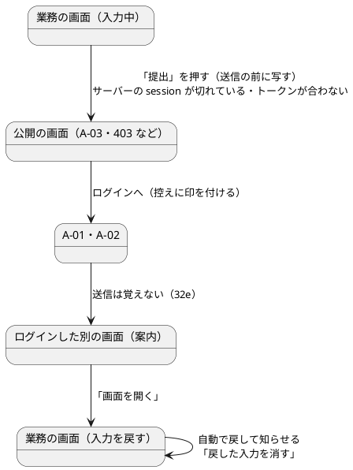

# Bolt 32f 計画 - 失効の時の入力の保持（ACC-06）

## 基本情報

| 項目 | 内容 |
| :--- | :--- |
| Bolt | 第 32f 回（W5 の 14 本目。US-18 の残りの 11 本目） |
| 予定 | W5（2026-11-02 の週。前倒しで着手できる）。作業は約 5 時間（承認ゲートの待ち時間を除く。目安の 4.5 時間を超えるが、開始準備の決定で 1 本にした。「時間の配分と打ち切り」） |
| 対象 | 共通のレイアウト（顧客 Web・社内業務 Web・公開の画面）と警告の部分、入力の控えの JavaScript、A-03 の文言、UI 設計、フロントエンドのアーキテクチャ、ACC-06・SEC-17・PRV-01、ADR-005・ADR-012、テスト戦略、ユーザーストーリー、リリース計画、ユーザーマニュアル。サーバーの認証の入口は変えない（画面に利用者の ID を渡すだけ） |
| SP | 0（US-18 の SP は #13 をクローズする Bolt 33b で数える。横断の受入条件は SP を持たない） |
| GitHub | [#13](https://github.com/k2works/practical-domain-driven-design-in-enterpris-application/issues/13)（US-18、R1.0）。この Bolt では閉じない |
| 承認ゲート | **ステップごとに止める**（W4 の締めの決定）。確認必須（セキュリティ（業務の入力をブラウザに置くこと、利用者の確かめ、捨てる時、案内の戻り先）、新しいファイル、ADR-005 の例外）は計画の承認の場で確認ポイントとして判断を受ける |
| アプローチ | アウトサイドイン。開発戦略の表（Bolt ごとのアプローチの決め方）では、新しい集約もスキーマも作らず受入条件を画面に足す Bolt はアウトサイドインに当たる。W5 の既定（US-18 はインサイドアウト）と W5 の表の 32f の行（「インサイドアウト（32e に倣う）」）から外れる理由は、振る舞いのほとんどがブラウザの JavaScript にあり、サーバーの変更が小さい（画面に利用者の ID を渡す、A-03 の文言）ため。画面の層の受入シナリオの Red から入り、サーバーの小さな変更は統合テストを先に書く。ステップ 1 で W5 の表の 32f の行と「局面とアプローチ」の段落を直す |
| 前の Bolt | [Bolt 32e 終了報告](bolt_32e_report.md)、[Bolt 32b 終了報告](bolt_32b_report.md) |

## Bolt ゴール

ログアウトしたときに送信していなかった入力を失わない。警告の期限が来たとき、「画面を開き直す」を押したとき、送信する前に、変えた欄をブラウザのそのタブに「入力の控え」として写す。同じ利用者が同じ画面に戻ったら自動で戻し、戻したことと「まだ送信していない」ことを知らせ、「戻した入力を消す」を出す。送信が公開の画面（再認証の案内など）で拒まれた場合は、ログインし直した後の画面に「ログアウトの前に入力していた内容があります」と、その画面を開く手段を出す。

用語: 業務の「下書き」（輸送要求版の状態、C-03 の下書き保存、追跡の下書き実績）と区別するため、この Bolt で作るものは「入力の控え」と呼ぶ（ステップ 1 で用語の扱いを UI 設計に書く）。

### 確かめたい仮説

| # | 仮説 | この Bolt で分かること |
| :--- | :--- | :--- |
| H1 | 入力の控えをブラウザの sessionStorage に置き、写すとき（期限の到来・画面を開き直す・送信の前）と戻すとき（同じ利用者・同じ戻り先）を JavaScript で扱えば、サーバーに業務の入力を残さずに受入条件を満たせる | 画面の層の受入シナリオで、失効の後にログインし直した画面に入力が戻ること、別の利用者には戻らないことを確かめる |
| H2 | 「送信がサーバーに届いたか」はサーバーに聞かなくても、送信の次に読み込んだ画面がログインした画面（届いた）か公開の画面（A-03・403・413・A-01。拒まれた）かで分かる | 公開のレイアウトの小さなスクリプトが送信の控えに「拒まれた」印を付け、ログインした画面で印のない送信の控えを捨てる。送信が届いた後に控えが残らないこと、CSRF のトークンが合わず 403 で拒まれた送信でも入力を失わないことをシナリオで確かめる |

### 開始準備で確かめたこと（T-114。2 つの整合性検証で確かめた）

- **戻り先**: Bolt 32e で、ログインした業務の画面の GET には戻り先（`data-return-path`。context path を含む path と生の query）が警告の部分に出る（`SessionLifetimeFilter`）。送信の後に描き直した画面（入力の誤りの画面）には出ない。ログインし直して戻った画面の戻り先には `continue` が入る（`?continue`・`&continue`）
- **利用者の ID**: `currentActor`（`AuthenticatedActor`）の `userId()` は `UserId`（UUID の値オブジェクト）。画面に出すときは `userId().value()` にする（record の `toString` を出さない）
- **公開の画面**: A-01〜A-04、413、500 などのエラーの画面は `layout/public` を使い、今は JavaScript を読まない（scripts の引数もない）。CSP は `default-src 'self'` なので外部のファイルにする。`/js/**` は公開の URL
- **フォーム**: ヘッダーのログアウト（`layout/customer`・`layout/staff`）と警告の延長（`layout/session-warning`）のフォームは `main` の外。業務の画面には GET のフォーム（追跡の一覧の照会 `tracking/tracking-records/list.html`）と、入力のないボタンだけのフォーム（経路設計・見積りの詳細）もある
- **C-03 の段階入力**: 段階は「次へ」と段階の一覧で切り替わり、読み込みのときは常に段階 1 を開く。値の `change` に反応するのは貨物種別の案内と提出のボタンだけ（`transport-request-form.js`）。このスクリプトは head で defer、警告の部分のスクリプトは body の最後で defer なので、DOMContentLoaded では先に初期化される
- **CSRF の拒否**: 生きている session に誤ったトークンで送ると 403（別のタブでログインし直した後の古いタブ、ログインし直した後にブラウザの「戻る」で戻った画面）。403 は `error/403.html`（公開のレイアウト）
- **期限の到来の取り消し**: `session-timeout.js` は、ほかのタブの延長や期限のぎわの 204 で期限の到来を取り消す（`unexpire()`）
- **取消し**: 利用を止められた利用者も同じ A-03 に移る（理由は示さない）。ブラウザでは失効と見分けられない（開始準備の決定で、取消しでも控えを捨てない形に決定を変えた）

## ふりかえりと前の Bolt からの引き継ぎ

| 入力 | 内容 | この Bolt での扱い |
| :--- | :--- | :--- |
| 開始準備の決定（2026-10-14、human:kakimomokuri。Bolt 32e と 32f の開始準備） | sessionStorage、利用者を確かめて戻す、password・CSRF のトークン・ファイルは置かない、自動で戻して知らせ「戻した入力を消す」。送信したら失効していた場合は戻した後の画面に案内。写すのは期限の到来・送信の前・画面を開き直す前。捨てるのは戻したら・送信が届いたら・8 時間で。案内のリンクの語は「画面を開き直す」。1 本で作る。取消しでは保持しない決定は変えて受け入れる（取消しの利用者はログインし直せないので戻らない。利用を戻されたら自分の入力が戻る）。ADR-005 に例外を書き、詳細は ADR-012 | 本計画の範囲と確認ポイント 1〜7 |
| Bolt 32e から送られたもの | 送信の後の失効、案内のリンクで離れる前と送信の前に写すこと、戻り先は 32e の戻り先と同じ鍵、A-03 の入力の文言、案内のリンクの語 | すべて入れる |
| Bolt 32e の Try T-121・T-122 | URL の判定は認可と同じ道具で（文字列の `startsWith` で path を判定しない）。共通の部品の振る舞いを変える前に、既存のテストとステップを探す | 案内の戻り先は、サーバーが渡した戻り先を `session-timeout.js` の `sameOriginPath` で同じ origin に限って使う（ブラウザで path の前方一致の判定はしない）。直すのは `session_timeout_ui.feature` の期限の到来の案内のリンクの「もう一度ログインする」（:70・:78・:87・:107）とシナリオの名前（:75・:104）。A-03・A-01 の操作を指す「再認証の案内からもう一度ログインする」「ログインの画面からもう一度ログインする」は直さない。既存の :84（session が生きていれば開き直す）は、入力が戻り知らせが出る期待に変わる |
| Bolt 32b の Try T-119・T-120 | 否定の確かめは、先にそれが出ていることを確かめてから。共通の部品を変えたら `check` を先に | 「戻らない」「案内が出ない」「控えが残らない」は、同じ流れで先に控えが写っていること（sessionStorage を読む）を確かめてから。ステップ 3 |
| Bolt 32d の Try T-117 | 規則のテストは、その規則を外したときだけ落ちる入力で | 捨てる条件（別の利用者、8 時間、送信が届いた、ログアウト、期限の到来の取り消し）を 1 つずつ外したシナリオ。8 時間は 7 時間 59 分と対にする |
| Bolt 32b・32e の既知の課題 | ブラウザの期限は早く来ることがある、`localStorage` は利用者を区別しない、別のタブでログインし直した後の古いタブの 403、Storage を使えないときは確かめていない、共有の時計と実時間の Spring Session に頼るテスト | 控えは sessionStorage（タブごと）で利用者の ID で確かめる。403 で拒まれた送信も控えを残す（H2）。sessionStorage を使えないときは何もしない（確かめない。既知の課題に残す）。テストは 32e と同じく session の行を古くする |
| W4 の Try T-90 | 画面の文言を変える Bolt にテクニカルライターの観点 | 知らせ・案内・A-03・期限の到来の案内の本文・延長の失敗の文言を UI 設計に書いてから作り、開発レビューにテクニカルライターを入れる |

## スコープ

### 入れるもの・入れないもの

| 入れる | 入れない（後で） |
| :--- | :--- |
| 控えを写す: 警告の期限の到来のとき、「画面を開き直す」を押したとき、業務の画面の POST のフォームを送信する前。戻り先（`data-return-path`）のある画面でだけ | サーバーに業務の入力を置くこと（開始準備の決定） |
| 写す欄: `main` の中の POST のフォームの、テキスト・数・日付・選択・ラジオ・チェックの欄と `textarea` のうち、初期の値（`defaultValue`・`defaultChecked`・`defaultSelected`）から変えた欄だけ。password・hidden（CSRF のトークンを含む）・ファイル・ボタンは写さない。変えた欄がなければ写さず、前の控えを残す | 送信の後に入力の誤りで描き直した画面の控え（戻り先がない。この画面のまま期限が来た入力は保持しない。既知の課題。UI 設計とマニュアルに書く） |
| GET のフォーム（照会）は写さない | ファイルの保持（選び直してもらう。知らせる） |
| 戻す: 同じ利用者が同じ戻り先の画面を開いたら自動で戻し、知らせ「ログアウトの前の入力を戻しました。まだ送信していません。」と「戻した入力を消す」を出す（ファイルの欄があれば選び直す旨。C-03 は段階 1 から開く） | 複数の画面の控え（1 つのタブに 1 つ。新しく写したら置き換える） |
| 送信が拒まれた場合: 公開のレイアウトの画面（A-03・A-01・403・413 など）で、送信の控えに「拒まれた」印を付ける。ログインし直した後の別の画面に「ログアウトの前に入力していた内容があります」と「画面を開く」「消す」を出す | 別のタブ・別のブラウザでの戻し（sessionStorage はタブごと） |
| 捨てる: 戻したとき、送信が届いたとき（ログインした画面で印のない送信の控え）、「戻した入力を消す」・案内の「消す」、利用者が違うとき、写してから 8 時間（ログインした画面を開いたときに確かめる）、ログアウトの送信、期限の到来が取り消されたとき（期限の到来で写した控え） | sessionStorage を使えないときの代わり（何もしない） |
| 期限の到来の案内: 戻り先があればリンクを「画面を開き直す」にし、押したら写してから開き直す。本文と延長の失敗の文言を保持に合わせる。戻り先がなければ今どおり「もう一度ログインする」（A-03 へ） | — |
| A-03: 静的な文言は控えめにし、そのタブに控えがあるときだけスクリプトが「このタブでログインし直すと、入力していた内容を戻します」を足す | — |
| UI 設計・フロントエンドのアーキテクチャ・ACC-06・SEC-17・PRV-01・ADR-005・ADR-012・テスト戦略・ユーザーストーリー・リリース計画の更新、マニュアル（2.1・2.4・2.5・3 章・付録 B）とキャプチャ、デモの動画、支援技術の手動確認 | — |

### 設計の約束（Try T-1）

- **入力の控え**（`/js/session-input.js`。1 つのファイルで、ログインした画面（警告の部分の中）と公開の画面（`layout/public`）の両方で読み、置かれた画面で役割を切り替える）: sessionStorage のキー `cargotracker.session.savedInput` に 1 件の JSON（利用者の ID、戻り先（正規化したもの）、写した時刻、写した理由（`expired`・`reopen`・`submit`）、拒まれた印、欄の値の一覧（フォームの順番・欄の名前・種類・値・ファイルの欄があったか））。sessionStorage を使えないときは何もしない
- **利用者の ID**: 警告の部分に `data-user="${currentActor.userId().value()}"` を出す（自分の画面に自分の内部の識別子。業務データでも個人情報でもない。出す理由は ADR-012 に書く）
- **戻り先の正規化**: 写すときと比べるときは同じ関数で、戻り先の query から `continue` を除き、それ以外は生の文字列のまま残す。比べる相手は今の画面の `data-return-path`（`location` でなく）
- **写す**: 期限の到来は `session-timeout.js` が出す CustomEvent（`cargotracker:session-expired`）で、取り消しは `cargotracker:session-unexpired` で受ける。「画面を開き直す」は案内の領域でクリックを受ける（案内は後から差し込まれるため）。送信の前は POST のフォームの `submit` を `main` で受ける
- **公開の画面の印**: 公開のレイアウトで読み込まれたら、写した理由が送信の控えに「拒まれた」印を付ける。A-03 では、控えがあり利用者の確かめの前でも戻せる見込みがあるとき（印を付けた控えか、期限の到来・開き直しの控え）だけ一文を足す
- **ログインした画面で**: 捨てる条件（利用者が違う、8 時間を過ぎた、送信の控えで印がない）を見る。残れば、今の画面の戻り先と同じなら戻して知らせ、控えを捨てる。違えば、拒まれた送信の控えと、期限の到来・開き直しの控えのうちログアウトを経たもの（拒まれた印と同じく公開の画面で印を付ける）について、案内「ログアウトの前に入力していた内容があります」と「画面を開く」（戻り先を `sameOriginPath` で同じ origin の path と query に限る）「消す」を出す
- **戻し方**: 欄に値を入れ（`.value`・`.checked`。HTML として解釈しない）、`input`・`change` のイベントを出す。DOMContentLoaded の後（ほかの画面のスクリプトの初期化の後）に戻す。C-03 は段階 1 のまま
- **知らせと案内**: 共通のレイアウトの `main` の前に、空の `role="status"` の領域を置いておき、後から文言を入れる（読み込みの時に差し込むと読まれないことがある）。フォーカスは移さない。「戻した入力を消す」は控えを捨て、戻した欄を `form.reset()` で初期の値に戻し、「戻した入力を消しました」を知らせる
- **ログアウト**: ヘッダーのログアウトの送信で控えを捨てる
- **ADR-005 の例外**: 入力の控えは送信前の入力の写しで、業務状態の正ではない（正はサーバー）。ADR-005 に例外として改訂の経緯を足し、置き場所・捨てる時・利用者の確かめ・個人情報（荷受人の連絡先など。PRV-01）と XSS の露出（SEC-17）・共用のパソコン（閉じたタブを開き直すと復元されることがある）は ADR-012 に書く

## 設計（この Bolt の範囲）

この Bolt はドメインのモデルとデータモデルを変えない（控えはブラウザに置く）。4 図のうち、ドメインモデル図と ER 図は対象がないので省く。入力の控えの状態遷移図と、送信が拒まれた場合の画面遷移図を置く。

### 入力の控えの状態

### 送信が拒まれた場合

## ステップ計画

状態の記号: `[ ]` 未着手、`[-]` 進行中、`[?]` 承認待ち、`[x]` 完了。各ステップの終わりに `check` が緑であることと、計画からの変更を設計文書に反映したこと（T-53）を確かめ、push して CI を確かめる（T-26、T-65、T-118）。コミットは pathspec で作る（T-84、T-110）。複数行の書き換えはスクリプトのファイルにする（T-103）。ステップ 1 を push してからコードのステップを push する（T-109）。共通の部品を変えたら `check` を先に流す（T-120）。

- [x] **1. 設計文書** 【承認ゲート: 設計文書】
  - ui_design.md: 用語（入力の控えと業務の下書きの区別）、session の警告の節（期限の到来の案内の本文とリンクの語「画面を開き直す」・戻り先がないとき、延長の失敗の文言）、知らせと案内の文言・`role="status"`・フォーカスを移さないこと・「消す」の後の知らせ、共通部品の表に「入力の控えの知らせ」、A-03 の行と文言、エラーと例外の扱い（:1037・:1045・:1118・:1119）、画面遷移図のラベル（:262-264）とログインした別の画面の案内からの遷移、送信の後に描き直した画面は保持しないこと、C-03 は段階 1 から開くこと
  - architecture_frontend.md: 部分更新の方針の例外（:29）、「session の時間制限」と警告の節の入力の保持（`session-input.js`、キーと中身、写す時・戻す時・捨てる時、正規化、CustomEvent、公開のレイアウトでの印、スクリプトの順序）、「ブラウザが持つのは時刻と戻り先の path だけ」（:117・:119）と「利用者の識別子は置かない」（:116）の書き分け、取消しの扱い（:120）
  - non_functional.md: ACC-06（入力の保持、送信が拒まれた場合の案内）、SEC-17（XSS のとき控えが読まれる。CSP と `.value` で入れることで抑える）、PRV-01（荷受人の連絡先などがそのタブに最長 8 時間残る）
  - ADR-005: 入力の控えを「業務状態をクライアントに持たない」の例外として改訂の経緯に足す
  - ADR-012: 入力の控え（置き場所、利用者の ID を画面に出す理由、捨てる時、取消しの決定の変更（:63）、送信が拒まれた判定、共用のパソコンと閉じたタブの復元、個人情報と XSS）、:67 の記述。改訂の経緯
  - test_strategy.md: 認証の行の 32f の分
  - user_story.md の :501: 32f の分担の完了
  - release_plan.md の W5 の節: 32f の行（内容・アプローチ・承認ゲートの列）、「局面とアプローチ」の段落（:557。32f が表から外れる理由、W5 の締めの議題に 32f を足す）、取消しの決定の変更（:593）、デモの項目（入力の保持）、ユーザーマニュアルの段落、W5 の状態
  - 完了の判定: `okf:check` ERROR 0、`documentationTest` 緑
- [ ] **2. 画面の層の受入シナリオ（Red）** 【承認ゲート: Red】
  - 既存のシナリオの直し（T-122）: 期限の到来の案内のリンクの「もう一度ログインする」（:70・:78・:87・:107）とシナリオの名前（:75・:104）を「画面を開き直す」に。:84（session が生きていれば開き直す）は入力が戻り知らせが出る期待に変える
  - `session_timeout_ui.feature` に足す（`@US-18`。横断の受入条件の「未保存の入力は失われず再認証後に再開できる」）。否定の前に、同じ流れで控えが写っていることを sessionStorage で確かめる（T-119）:
    - 警告のまま期限を過ぎ、サーバーの session も切れた後に「画面を開き直す」と、ログインし直した後に入力が戻り、知らせが出る（`@demo @demo-bolt-32f/restore`）
    - 「戻した入力を消す」で入力が初期の値に戻り、控えが残らない
    - サーバーの session が切れた後に「提出」を押すと、ログインし直した後の画面に案内が出て、「画面を開く」で入力が戻る
    - CSRF のトークンが合わず 403 で拒まれた送信でも、ログインし直した後に入力を戻せる
    - 送信が届いた後に控えが残らない
    - 別の利用者がログインし直すと、入力は戻らず案内も出ない
    - 写してから 7 時間 59 分なら戻り、8 時間を過ぎると戻らない（T-117）
    - ログアウトすると控えが残らない
    - 期限の到来が取り消されたら（別のタブで延長）、期限の到来の控えが残らない
    - password・CSRF のトークン・ファイルは控えに写らない。ファイルの欄があれば知らせに選び直す旨が出る
    - 延長が失効で失敗した後に「画面を開き直す」から A-01 でログインし直しても入力が戻る
  - 統合テスト（`SessionTimerSecurityIntegrationTest` に足す）: ログインした画面に `data-user` と知らせの領域が出て、公開の画面（A-03・403）に入力の控えのスクリプトが出る
  - 完了の判定: 足したシナリオが、狙いの理由（入力が戻らない・案内が出ない・控えが残る）で落ちる
- [ ] **3. 入力の控え（Green）** 【承認ゲート: Green（画面）、セキュリティ】
  - `/js/session-input.js`（新規）、`session-timeout.js`（CustomEvent、リンクの語と本文、戻り先がないとき）、`layout/session-warning`（`data-user`、スクリプト、本文と延長の失敗の文言）、`layout/customer`・`layout/staff`（知らせの領域）、`layout/public`（スクリプト）、A-03（静的な文言と一文を足す場所）
  - 完了の判定: `check` を先に（T-120）、続けて `uiTest` が緑。違反（送信の前に写さない）で送信のシナリオが落ちることを確かめる（T-112）
- [ ] **4. マニュアルとデモ** 【承認ゲート: マニュアル】
  - マニュアル: 2.1（共用のパソコン: ログアウトで控えを捨てる、ログアウトせずに離れるとタブに残る、閉じたタブを開き直すと復元されることがある）、2.4（A-03 の文言、入力が戻ること、ログインし直した後の案内と「画面を開く」、ほかのタブでは入力は戻らないこと、送信の後に描き直した画面の場合）、2.5（「画面を開き直す」、戻したことの知らせと「戻した入力を消す」、ファイルは選び直す、「入力中の内容は消えます」を直す）、3 章（C-03 は段階 1 から開く。ファイルは段階 3 で選び直す）、付録 B の Q1-2・Q1-5。知らせのキャプチャ（`manual_screenshots.feature`）、A-03 のキャプチャの撮り直し
  - デモの動画（`./gradlew demoVideo`。`@demo-bolt-32f/restore`）を録画する
  - 完了の判定: `manual:build` が通る。`okf:check` ERROR 0
- [ ] **5. SonarQube と開発レビューと支援技術の確認と終了報告** 【承認ゲート: 支援技術の手動確認、終了報告】
  - SonarQube（T-116）
  - 開発レビュー（プログラマー、アーキテクト（ブラウザに置く業務の入力、利用者の確かめ、送信の判定、ADR-005）、テスター、テクニカルライター（知らせ・案内・A-03・マニュアル。T-90）、インタラクションデザイナー（知らせの支援技術への伝わり方、フォーカス））
  - 人による支援技術の手動確認（NVDA または VoiceOver。知らせと案内が読まれるか、「戻した入力を消す」の後）。手順は AI が用意し、結果を終了報告に記録する
  - `bolt_32f_report.md`。release_plan の W5 の 32f の行、開発の索引。#13 に進み具合をコメントする。終了報告の承認の後に、デモの動画を #13 に添付し、添付の対応表（`docs/operation/cargo-tracker/index.md` の #13 の行と `ops/scripts/issue_demo.js` の `BOLT_ISSUES`）に bolt-32f を足す

### 時間の配分と打ち切り

| # | 目安 | 打ち切り |
| :--- | :--- | :--- |
| 1 | 50 分 | — |
| 2 | 60 分 | — |
| 3 | 110 分 | 送信が拒まれた場合の案内（ログインした別の画面）が書けなければ、案内を既知の課題にし、「同じ画面を開くと戻る」をマニュアルで伝える |
| 4 | 40 分 | — |
| 5 | 45 分（SonarQube と人の手動確認の待ちを除く） | — |

合計 305 分（約 5 時間。開始準備の決定で 1 本にした）。5.5 時間を超えると見えたら止めて諮る（候補: 8 時間・期限の到来の取り消しのシナリオを単体の確かめに寄せる）。

## 確認ポイント（計画の承認の場でまとめて確認する。Try T-6）

| # | 確認すること | ステップ | 推奨 |
| :--- | :--- | :--- | :--- |
| 1 | **送信が拒まれた場合**（開始準備で決めた） | 3 | ログインし直した後の画面に「ログアウトの前に入力していた内容があります」と「画面を開く」「消す」を出す。戻り先はブラウザが送信の前に写した、その画面の戻り先（サーバーが渡したもの。`sameOriginPath` で同じ origin に限る）。サーバーには渡さない |
| 2 | **写す時と写す欄**（開始準備で決めた） | 3 | 期限の到来・画面を開き直す・送信の前。戻り先のある画面の POST のフォームで、変えた欄だけ。password・hidden・ファイルは写さない |
| 3 | **捨てる時**（開始準備で決めた。セキュリティ） | 3 | 戻したとき、送信が届いたとき、消すとき、利用者が違うとき、写してから 8 時間（ログインした画面を開いたときに確かめる）、ログアウト、期限の到来の取り消し。タブを閉じれば消えるが、閉じたタブを開き直したときやブラウザの復元・タブの複製では残ることがある |
| 4 | **取消しの決定の変更**（開始準備で決めた） | 1 | 「取消しでは保持しない」を「取消しでも控えはそのタブに残るが、戻るのは同じ利用者がログインし直せたときだけ」に変える。止められている間はログインできず、利用を戻されたら自分の入力が戻る。他の利用者には戻らない。ADR-012・release_plan・アーキテクチャを書き換える |
| 5 | **ADR-005 の例外**（開始準備で決めた） | 1 | ADR-005 に「入力の控えは送信前の入力の写しで業務状態の正ではない」例外を改訂の経緯として足し、詳細は ADR-012 |
| 6 | **ブラウザに置く業務の入力**（セキュリティ） | 1・3 | 個人情報（荷受人の連絡先など）がそのタブに最長 8 時間残りうる（PRV-01）。XSS があれば読まれる（SEC-17。CSP と `.value` で入れることで抑える）。共用のパソコンはログアウトで捨てる（マニュアル 2.1） |
| 7 | **送信が届いたかの判定**（セキュリティ・データ） | 3 | 送信の次の画面が公開の画面なら拒まれた（控えを残す）、ログインした画面なら届いた（捨てる）。8 時間のぎわで送信が届いた直後のリダイレクトが A-03 になると、送信済みの入力が戻りうる（まれ。知らせの文言を「まだ送信していません」と断定せず、一覧で確かめる旨を添えるかは UI 設計で決める。既知の課題） |
| 8 | **A-03 の文言** | 1・3 | 静的な文言は「送信していない入力は、このタブでログインし直すと戻る場合があります。」のように控えめにし、控えがあるときだけスクリプトが一文を足す（UI 設計で決める）。取消しの利用者にも同じ画面（止めたことを示さない） |
| 9 | **期限の到来の案内** | 1・3 | 戻り先があれば「画面を開き直す」（押したら写す）。なければ今どおり「もう一度ログインする」（A-03 へ）。本文と延長の失敗の文言も保持に合わせる |
| 10 | **新しいファイル** | 2・3 | `/js/session-input.js`（ログインした画面と公開の画面の両方で 1 つ） |
| 11 | **マニュアル・デモ・支援技術** | 4・5 | 入れる。2.1・2.4・2.5・3 章・付録 B、知らせのキャプチャ、A-03 のキャプチャの撮り直し。デモの動画は録画まで、#13 への添付は終了報告の承認の後。人による支援技術の手動確認 |
| 12 | **アプローチ** | 1 | アウトサイドイン（開発戦略の表に合う。W5 の既定と表の 32f の行から外れる理由は基本情報）。W5 の表と段落を直す |
| 13 | 承認ゲート | 全体 | ステップごとに止める。ステップ 3 はセキュリティの確認必須、5 は人の手動確認 |

## 完了条件

- [ ] 警告の期限が来たとき・「画面を開き直す」を押したとき・送信する前に、変えた欄が控えに写り、同じ利用者が同じ画面に戻ると自動で戻り、戻したことが知らされる
- [ ] 送信が公開の画面（A-03・403 など）で拒まれた場合、ログインし直した後の画面に案内が出て、画面を開くと入力が戻る
- [ ] 戻したとき・送信が届いたとき・消すとき・別の利用者・8 時間・ログアウト・期限の到来の取り消しで控えを捨てる（捨てる場合と戻る場合を対で確かめた）。password・CSRF のトークン・ファイルは写さない
- [ ] 期限の到来の案内のリンクの語と本文、延長の失敗の文言、A-03 の文言が保持に合っている
- [ ] UI 設計・フロントエンドのアーキテクチャ・ACC-06・SEC-17・PRV-01・ADR-005・ADR-012・テスト戦略・ユーザーストーリー・リリース計画を更新した
- [ ] ユーザーマニュアル（2.1・2.4・2.5・3 章・付録 B）とキャプチャを更新し、デモの動画を録画した（#13 への添付は終了報告の承認の後）
- [ ] 人による支援技術の手動確認の結果を終了報告に記録した
- [ ] `check` と `uiTest` が緑。push して CI を確かめた。SonarQube の Quality Gate が PASS、`okf:check` ERROR 0
- [ ] 開発レビュー、終了報告。#13 に進み具合をコメントした

## 更新履歴

| 日付 | 更新内容 | 更新者 |
| :--- | :--- | :--- |
| 2026-10-14 | 承認（確認ポイント 1〜13 は推奨のまま）。`/goal Bolt32f` の下で、ステップの承認ゲートでは止めずに進め、終了報告でまとめて確かめを受ける。ステップ 5 の支援技術の手動確認は人が行う | human:kakimomokuri |
| 2026-10-14 | 詳細整合性検証（19 件）と横断整合性検証（22 件）の指摘を反映し、human:kakimomokuri の決定（1 本で作る、取消しの決定を変えて受け入れる、ADR-005 に例外を書き詳細は ADR-012）を受けた。用語を「下書き」から「入力の控え」に（業務の下書きとの衝突）。送信が届いたかの判定を A-03 だけでなく公開の画面すべての印に広げた（403 で拒まれた送信の入力を失わない）。写すのは変えた欄だけ、GET のフォームは写さない。戻り先は正規化して今の画面の `data-return-path` と比べる。ログアウトと期限の到来の取り消しで捨てる。A-03 の文言は控えめにしスクリプトで足す。知らせの領域を先に置く。CustomEvent でつなぐ。送信の後に描き直した画面は保持しない（既知の課題）。8 時間のぎわの二重の送信のおそれ（確認ポイント 7）。ADR-005・SEC-17・PRV-01・アーキテクチャの各行・release_plan の段落・マニュアル 2.1 と 3 章をステップ 1・4 に足した。人による支援技術の手動確認を足した。アプローチをアウトサイドインに直した | anthropic/claude-opus-5-5 |
| 2026-10-14 | 初版作成（承認待ち）。開始準備で、32e の戻り先と警告の部分、`currentActor` の利用者の ID、A-03 の公開のレイアウトと CSP、業務の画面のフォームを調べ、human:kakimomokuri の決定（送信したら失効していた場合はホームに案内、写すのは期限の到来・送信の前・画面を離れる前、捨てるのは戻したら・送信が通ったら・8 時間で、リンクの語は「画面を開き直す」）を反映した | anthropic/claude-opus-5-5 |

## 関連ドキュメント

- [リリース計画](release_plan.md)（W5）
- [Bolt 32e 終了報告](bolt_32e_report.md)、[Bolt 32b 終了報告](bolt_32b_report.md)
- [ユーザーストーリー](../../requirements/cargo-tracker/user_story.md)（横断受入条件）
- [UI 設計](../../design/cargo-tracker/ui_design.md)（A-03、session の警告）、[フロントエンドのアーキテクチャ](../../design/cargo-tracker/architecture_frontend.md)、[非機能要件](../../design/cargo-tracker/non_functional.md)（ACC-06、SEC-17、PRV-01）
- [ADR-005](../../adr/cargo-tracker/005-server-side-rendering.md)、[ADR-012](../../adr/cargo-tracker/012-authentication-principal-and-session.md)、[テスト戦略](../../design/cargo-tracker/test_strategy.md)
