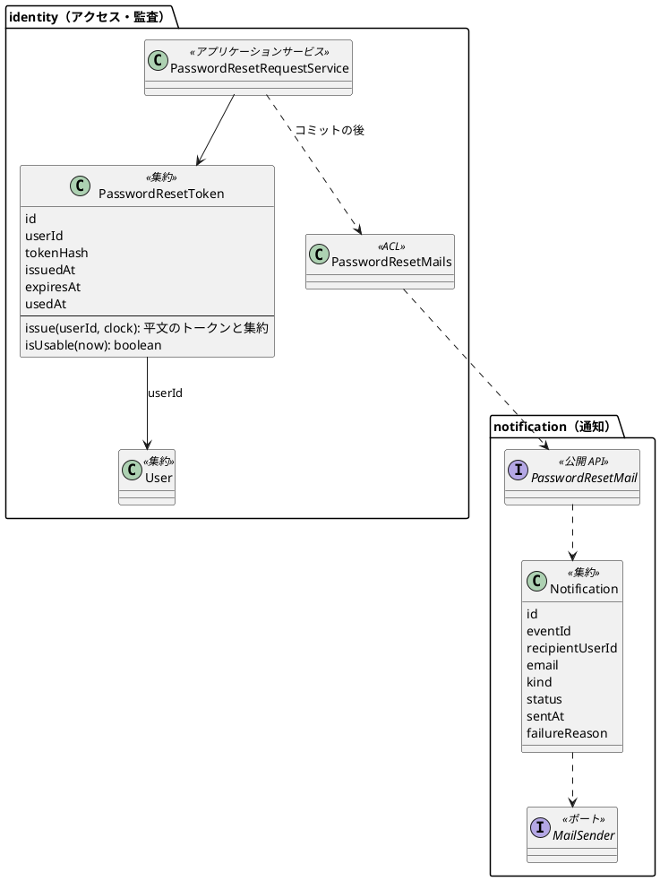
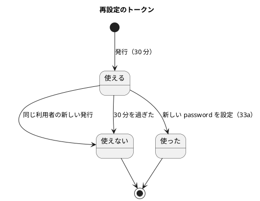
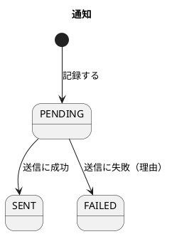
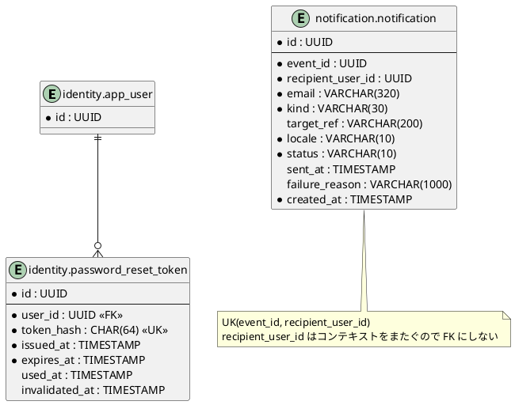
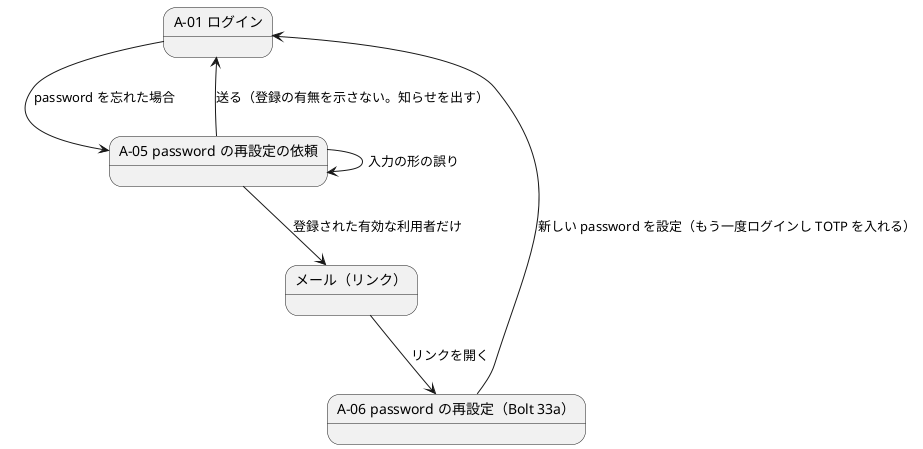

# Bolt 33 計画 - 通知モジュールの新設と password の再設定の依頼（US-18 AC8 の前半）

## 基本情報

| 項目 | 内容 |
| :--- | :--- |
| Bolt | 第 33 回（W5 の 15 本目。US-18 の残りの 12 本目） |
| 予定 | W5（2026-11-02 の週。前倒しで着手できる）。作業は約 4.5 時間（承認ゲートの待ち時間を除く。「時間の配分と打ち切り」） |
| 対象 | 新しい `notification` モジュール（公開 API、通知の集約と表、送信のポートと SMTP・ログの送信アダプター）、`identity`（再設定のトークンの集約と表、再設定の依頼のサービス、通知の ACL、A-05 の画面、A-01 のリンク、監査の種類）、`SecurityConfiguration`（公開の URL）、アーキテクチャのテスト、設計文書、ユーザーマニュアル |
| SP | 0（US-18 の SP は #13 をクローズする Bolt 33b で数える） |
| GitHub | [#13](https://github.com/k2works/practical-domain-driven-design-in-enterpris-application/issues/13)（US-18、R1.0）。この Bolt では閉じない |
| 承認ゲート | **ステップごとに止める**（W4 の締めの決定。W5 の表の 33 の行: セキュリティ、外部連携、モジュールの境界、スキーマ）。確認必須（新しいモジュール・新しい表・外部連携（SMTP）・依存の追加・セキュリティ）は計画の承認の場で確認ポイントとして判断を受ける |
| アプローチ | インサイドアウト（開発戦略の表: 新しい集約とスキーマを作る Bolt。W5 の既定と表の 33 の行どおり）。通知の集約と再設定のトークンの集約の単体テストから入り、リポジトリ・送信アダプターの統合テスト、再設定の依頼のサービス、画面の順に外へ広げる。認証の入口に触る部分（公開の URL）はセキュリティの統合テストで外側から確かめる |
| 前の Bolt | [Bolt 32f 終了報告](bolt_32f_report.md) |

## Bolt ゴール

password を忘れた利用者が、A-01 の「password を忘れた場合」から A-05 で登録メールアドレスを入れて送ると、登録された有効な利用者なら 1 回だけ使える 30 分の再設定のリンクがそのアドレスへ届く。画面は登録の有無にかかわらず同じ応答を返し、依頼は監査に残る。メールは新しい通知モジュールの公開 API を通して送り、送信の記録（本文とリンクは保存しない）を通知モジュールに残す。

この Bolt では、リンクを開いて新しい password を設定する画面（A-06）は作らない（Bolt 33a）。届いたリンクは、33a までは「見つからない」画面になる（デモ環境・本番に出す前に 33a を終える）。

### 確かめたい仮説

| # | 仮説 | この Bolt で分かること |
| :--- | :--- | :--- |
| H1 | 送信の公開 API を `notification.interfaces.api` に置き、`identity` から `application.internal.outboundservices.acl` 経由で呼べば、通知の部品を `identity` に持たずに、モジュールと層の規則（ModularityTest・LayerArchitectureTest・PublicApiArchitectureTest）を例外なしで守れる | アーキテクチャのテストが緑のまま、統合テストで Mailpit にメールが届く |
| H2 | 依頼の応答と送信を切り離せば（トークンの発行と監査はその場のトランザクション、送信はコミットの後に別のスレッド）、登録の有無で応答の内容も時間もほぼ変わらない | 登録あり・なし・止められた利用者で、画面の応答が同じで、応答がメールの送信を待たないこと（送信アダプターを遅くしても応答が待たない）を統合テストで確かめる |

### 開始準備で確かめたこと（T-114）

- **通知モジュール**: `notification` パッケージはまだない。`identity` の `allowedDependencies` は `{"shared", "quotation :: events", "platform :: web"}`（`identity/package-info.java:6-8`）。公開 API の前例は `booking.interfaces.api.TrackingStartNotification` とアダプター `booking.interfaces.api.internal.TrackingStartNotificationAdapter`、呼ぶ側の ACL は `tracking.application.internal.outboundservices.acl.BookingTrackingStarts`、組み立ては `TrackingConfiguration:33-34`。`identity` にはまだ `outboundservices.acl` がない
- **層の規則**: 他のコンテキストの `*.interfaces.api` を参照してよいのは `application.internal.outboundservices.acl..` と `infrastructure.config..` だけ（`LayerArchitectureTest:82-84`）。application は web・jdbc・mybatis・servlet に依存しない（:193-203。mail はまだ列挙されていない）。公開 API は `java..`・`shared.domain..`・`*.interfaces.api` だけに依存し、インターフェースか record（`PublicApiArchitectureTest:21-32`）
- **認証の入口**: 既定は全 URL に password と TOTP の 2 つの要素を求める（`@EnableMultiFactorAuthentication`。`SecurityConfiguration:79-80`）。公開の URL は `PUBLIC_PATHS`（:93-95）で、`SessionRevalidationFilter` の確かめも受けない（:234）。A-01 のテンプレートには「password を忘れた場合（A-05）は W5 で足す」のコメントだけがある（`identity/login.html:4`）
- **利用者**: `User` は password を変えるメソッドを持たず、`UserRepository` に更新がない（33a で足す）。状態は `UserStatus`（ACTIVE・SUSPENDED）と所属企業の有効・無効
- **監査**: `AuditAction` に再設定の値はない。`audit_record.action` に CHECK 制約はない（値を足すマイグレーションは要らない。data_model.md:925）。存在しないメールアドレスは操作者を空にし、アドレスを残さない（ADR-012:83）
- **依存とコンテナ**: `spring-boot-starter-mail` はない。メールのコンテナ（Mailpit など）は compose にも Testcontainers にもない。統合テストの Testcontainers は `TestcontainersConfiguration`（PostgreSQL）に集まっている
- **デモ環境**: Heroku は dev プロファイルのまま動く（ADR-013、`deploy_demo.js`）。dev の外で dev の部品が動くと起動を止める前例は `DevLoginGuard`
- **設計文書の欠け**（詳細整合性検証で確かめる）: 再設定のトークンの概念・不変条件（domain_model.md）と表（data_model.md）がない（release_plan の W5 の「設計への反映が必要な事項」）。通知の種類の表（domain_model.md:1075-1082）に password の再設定がなく、`identity` から同期で送る形も書かれていない。A-05・A-06 の URL・画面イメージ・文言、再設定のメールの件名・本文がない（ui_design.md）。ADR-011:298 は A-06 を password の要素だけの例外の URL に挙げ、UI 設計の遷移は A-06 → A-02 になっている（開始準備の決定で A-06 → A-01 に変える）。tech_stack.md にメールを受けるコンテナの名前がない

## ふりかえりと前の Bolt からの引き継ぎ

| 入力 | 内容 | この Bolt での扱い |
| :--- | :--- | :--- |
| 開始準備の決定（2026-10-15、human:kakimomokuri） | (1) 33 と 33a に分ける（33 は通知モジュールと依頼から送信まで、33a は A-06 の設定・TOTP を求める・完了の監査）。(2) dev はメールをログに出す送信アダプター（dev の外では起動を止める）。統合テストは Testcontainers の Mailpit で SMTP を確かめる。ステージング・本番は SES の SMTP（W10）。(3) A-06 で設定したら A-01 に戻してログインし直す（A-06 は password の要素を与えない。ADR-011:298 の例外は要らなくなる）。(4) 通知モジュールに送信の記録（`notification` の表、種類 `PASSWORD_RESET`）を作る | 本計画の範囲と確認ポイント 1〜4 |
| W5 の決定（2026-10-11） | 通知モジュールを W5 で最小に作り、送信の公開 API を `notification.interfaces.api` に置く。`identity` の `allowedDependencies` に `notification :: api` を足す。新しいモジュールと外部連携なので Bolt 33 の計画の承認の場で確認ポイントとして判断を受ける | 確認ポイント 1・5 |
| Bolt 32f の Try T-123 | 知らせ・案内の文言を決める前に、出る場面を表にし、すべての場面で事実と合うかを確かめる | A-05 の送信の後の A-01 の知らせ（登録あり・なし・止められた利用者・入力の誤り）を UI 設計に表で書いてから決める。メールの本文も同じ（依頼した本人・依頼していない本人） |
| Bolt 32f の Try T-124 | 「この画面を経た」で振る舞いを変えるときは、画面に印を明示する | A-01 の知らせは query（`?reset-requested`）で明示し、レイアウトで推論しない |
| Bolt 32d・32b の Try T-117・T-119・T-106・T-107 | 規則のテストは、その規則を外したときだけ落ちる入力で。否定の確かめは先に肯定を確かめてから | トークンの期限（29 分 59 秒と 30 分）、登録なし・止められた利用者でメールが送られないこと（同じテストで登録ありなら届くことを先に確かめる）、監査の件数はそのテストの利用者で絞る（T-113） |
| Bolt 31 の Try T-101 | 置き場所の決定が層の規則の例外を伴いそうなときは、開始準備の横断検証で骨組みのクラスを置いて ArchUnit を流す | ステップ 2 の最初に `notification` の骨組み（package-info、公開 API のインターフェース、アダプター）と `identity` の ACL を置き、アーキテクチャのテストを先に流す |
| Bolt 31 の Try T-108 | 枠組みに任せる約束は、どの部品がいつ呼ぶかを書き、呼ばれたことを確かめる | 送信をコミットの後に別のスレッドで呼ぶ部品（`@TransactionalEventListener(AFTER_COMMIT)` と非同期の実行）を計画に書き、ロールバックしたら送らないことを確かめる |
| Bolt 30〜32 の T-103・T-110・T-120 | 複数行の書き換えはスクリプトのファイル、コミットは pathspec、共通の部品を変えたら `check` を先に | ステップ計画の前提に書く |
| 32f から持ち越した既知の課題 | 要求の属性の名前の 3 組の重複は 33b | この Bolt では扱わない |

## スコープ

### 入れるもの・入れないもの

| 入れる | 入れない（後で） |
| :--- | :--- |
| `notification` モジュールの新設: `package-info`（`allowedDependencies = {"shared"}`）、公開 API（`notification.interfaces.api`。password の再設定のメールを送る 1 つの操作と、要求・結果の record）、アダプター（`interfaces.api.internal`） | US-22 の業務イベントの購読と荷主への通知（W9） |
| 通知の集約（宛先の利用者・アドレス・種類・対象・言語・状態・送信時刻・失敗の理由）とリポジトリ、`notification` スキーマの `notification` の表（data_model.md:932-960 のとおり。種類は `PASSWORD_RESET` だけを使う）。本文とリンクは保存しない | 送信の再試行・バウンスと苦情の記録（OBS-11。W9・W10） |
| 送信のポートと 2 つのアダプター: SMTP（`spring-boot-starter-mail` の `JavaMailSender`）と、dev のログに出す送信（dev の外では起動を止める） | SES の SMTP の設定と送信元の認証（SPF・DKIM。W10 の運用準備） |
| 統合テストのメールのコンテナ（Testcontainers の Mailpit） | ローカルの起動での Mailpit（dev はログに出す。開始準備の決定） |
| `identity`: 再設定のトークンの集約（利用者・トークンのハッシュ・発行時刻・期限 30 分・使った時刻）とリポジトリ、`identity.password_reset_token` の表 | トークンを使う・password を変える・期限切れと使用済みの画面（A-06。Bolt 33a） |
| 再設定の依頼のサービス: 有効な利用者（ACTIVE かつ所属企業が有効）にだけトークンを発行し、コミットの後に通知の ACL で送る。同じ利用者の未使用のトークンは新しい発行で無効にする。短い間の繰り返しの依頼は送らない（確認ポイント 7） | 送信元ごとの流量の制限（WAF。W10、SEC-20 に A-05 の URL を足す） |
| 監査の種類 `PASSWORD_RESET_REQUESTED`（登録なしは操作者を空にし、アドレスを残さない） | `PASSWORD_RESET_COMPLETED`（33a） |
| 画面: A-01 に「password を忘れた場合」のリンク、A-05（`GET`・`POST /password-reset`）、送信の後は A-01 に戻して知らせる（登録の有無を示さない） | A-06 の URL（`/password-reset/{token}` など。33a で決める） |
| リンクの URL は設定の公開の base URL から組み立てる（Host ヘッダーから組み立てない） | — |
| 画面の層の受入シナリオ（`login_ui.feature` に AC8 の前半）、セキュリティの統合テスト、アーキテクチャのテストの更新 | デモの動画（再設定の流れを通して録れる 33a で撮る） |
| 設計文書（domain_model・data_model・architecture_backend・tech_stack・ui_design・non_functional・ADR-011・test_strategy・user_story・release_plan）、ユーザーマニュアル（2 章に「password を忘れた場合」の依頼までと A-05 のキャプチャ、付録 B） | マニュアルの A-06 の手順（33a） |

### 設計の約束（Try T-1）

- **通知の公開 API**（`notification.interfaces.api`）: インターフェース `PasswordResetMail`（仮の名前。ステップ 1 で決める）の `send(PasswordResetMailRequest)` が `MailDispatchReceipt`（`Sent`・`Failed`）を返す。要求の record は依頼の ID（UUID。通知の `event_id` にする）、宛先の利用者の ID（UUID）、アドレス、再設定の URL、期限（`UtcInstant`）、言語。戻り値は Java の標準・共有カーネルの型と文字列だけ（architecture_backend.md:141）
- **通知の中**: アダプターが通知のアプリケーションサービスを呼ぶ。サービスは通知を PENDING で記録してから送信のポートを呼び、SENT か FAILED（理由）にする。同じ `event_id` と宛先の通知が既にあれば送らない（UK(event_id, recipient_user_id)。N-INV の重複防止）。件名と本文は通知モジュールのテンプレート（Thymeleaf のテキストのテンプレート）で組み立て、本文に料金などを書かない（N-INV-01）
- **送信のポート**: 通知の `application.internal.outboundservices`（ポート）と `infrastructure`（`SmtpMailSender`、`LoggingMailSender`）。application は `org.springframework.mail` に依存しない（LayerArchitectureTest の禁止に mail を足す）。`LoggingMailSender` は dev のプロファイルでだけ Bean になり、dev の外で有効になれば起動を止める（`DevLoginGuard` に倣う）
- **再設定のトークン**: 32 バイトの乱数（`SecureRandom`）を URL 安全な Base64 にしたものをリンクに入れ、表には SHA-256 のハッシュだけを置く（平文を保存しない）。期限は発行から 30 分（`Clock` から）。不変条件: 1 回だけ使える、期限を過ぎたら使えない、同じ利用者の新しい発行で前の未使用のトークンは使えなくなる（33a で使う側を作る。この Bolt では発行と無効化）
- **依頼のサービス**（`identity.application.internal.commandservices.PasswordResetRequestService`）: メールアドレスで利用者を探し、有効なら発行・監査を同じトランザクションで書き、ドメインのイベント（または アプリケーションのイベント）を出す。コミットの後に別のスレッドで ACL を呼んで送る。登録なし・止められた利用者・所属企業の無効は、監査だけ書いて送らない。応答はどの場合も同じ
- **画面**: `identity.interfaces.web.PasswordResetController`。`GET /password-reset` で A-05、`POST /password-reset` は入力の形の誤り（空・形式）だけ A-05 で示し、それ以外は `/login?reset-requested` に PRG で戻す。A-01 は `reset-requested` のとき「入力したメールアドレスが登録されていれば、password を再設定するためのリンクを送りました。…」（文言は T-123 で場面を並べてから UI 設計で決める）。`/password-reset` と `/password-reset/**` を `PUBLIC_PATHS` に足す。CSRF は既定のまま
- **組み立て**: `identity.infrastructure.config` で ACL に公開 API を渡す。`identity/package-info.java` の `allowedDependencies` に `"notification :: api"` を足す。ModularityTest のモジュール一覧に通知を足す

## 設計（この Bolt の範囲）

4 図のうち、ドメインモデル図・状態遷移図・ER 図・画面遷移図を、この Bolt の範囲に絞って置く（ステップ 1 で設計文書に反映する）。

### ドメインモデル

### 状態遷移

### ER 図

列の型・名前・コメント・追記専用の印・afterMigrate のコールバックはステップ 1 で data_model.md の規約（:1111 以降）に合わせて決める。

### 画面遷移

## ステップ計画

状態の記号: `[ ]` 未着手、`[-]` 進行中、`[?]` 承認待ち、`[x]` 完了。各ステップの終わりに `check` が緑であることと、計画からの変更を設計文書に反映したこと（T-53）を確かめ、push して CI を確かめる（T-26、T-65、T-118）。コミットは pathspec で作る（T-84、T-110）。複数行の書き換えはスクリプトのファイルにする（T-103）。ステップ 1 を push してからコードのステップを push する（T-109）。共通の部品を変えたら `check` を先に流す（T-120）。

- [ ] **1. 設計文書** 【承認ゲート: 設計文書】
  - domain_model.md: `identity` に再設定のトークン（概念・不変条件。IA-INV の番号を足す）、AuditAction の用語に `PASSWORD_RESET_REQUESTED`。通知の節に password の再設定の種類と、`identity` から公開 API で同期に呼ぶ形（業務のイベントの購読と並ぶ 2 つ目の入口）
  - data_model.md: `identity.password_reset_token` の表（列・制約・コメント）、`notification` の表をこの Bolt で作ること、audit_record の action の範囲（:925）
  - architecture_backend.md: モジュールの一覧の通知の行（:71。W5 の最小の新設と公開 API）、`allowedDependencies`（:285）、application の mail への依存の禁止
  - tech_stack.md: メール送信の行（:60）に Mailpit（統合テスト）と dev のログに出す送信、バージョン
  - ui_design.md: 画面の URL の表に A-05（と 33a の A-06 は「33a で決める」）、A-05 の画面イメージ（salt）と文言、A-01 の知らせ（T-123 の場面の表）、画面遷移の A-06 → A-01、再設定のメールの件名と本文
  - non_functional.md: SEC-08 の詳細（トークンのハッシュ、新しい発行で前を無効、繰り返しの依頼、登録の有無を示さない、送信を応答から切り離す）。SEC-20 に A-05 の URL を足す（W10）
  - ADR-011: :298 の A-06 の例外を消し、改訂の経緯に開始準備の決定（A-06 は password の要素を与えず A-01 に戻す）を書く
  - test_strategy.md（認証・通知の行）、user_story.md（:501 付近の分担）、release_plan.md（W5 の 33 の行の内容と 33a の行、デモ項目、ユーザーマニュアルの段落、W5 の状態）
  - 完了の判定: `okf:check` ERROR 0、`documentationTest` 緑
- [ ] **2. 通知モジュール（インサイドアウト）** 【承認ゲート: モジュールの境界、スキーマ、外部連携】
  - 最初に骨組み（`notification/package-info.java`、公開 API のインターフェースと record、アダプターの空の実装、`identity` の ACL と組み立て）を置き、ModularityTest・LayerArchitectureTest・PublicApiArchitectureTest を流す（T-101）
  - 通知の集約の単体テスト（状態の遷移、失敗の理由の長さ）→ マイグレーション（`notification` スキーマと表、afterMigrate）→ リポジトリの統合テスト → 送信のサービス（重複の防止、PENDING → SENT・FAILED）→ SMTP の送信アダプター（Testcontainers の Mailpit で件名・本文・宛先を確かめる）→ `LoggingMailSender` と dev の外での起動の停止
  - 依存の追加: `spring-boot-starter-mail`（Boot 管理）、Mailpit のコンテナのイメージ（版を固定。2 週間以上前の版）
  - 完了の判定: `check` 緑。アーキテクチャのテストに例外を足していない
- [ ] **3. 再設定のトークンと依頼のサービス（インサイドアウト）** 【承認ゲート: セキュリティ、スキーマ】
  - トークンの集約の単体テスト（期限の 29 分 59 秒と 30 分、ハッシュだけを持つ、無効化）→ マイグレーション → リポジトリの統合テスト（新しい発行で前を無効、ハッシュで探す）→ 依頼のサービス（有効・登録なし・止められた利用者・所属企業の無効・繰り返し。監査の記録。T-113 で件数を絞る）→ コミットの後に送ること（ロールバックしたら送らない、応答が送信を待たない。T-108）
  - 完了の判定: `check` 緑。登録なしでメールが送られないことを、同じテストで登録ありなら届くことと対で確かめる（T-119）
- [ ] **4. 画面（A-01 のリンク、A-05）** 【承認ゲート: 画面、セキュリティ】
  - セキュリティの統合テスト: `/password-reset` が未認証で開ける、CSRF のトークンがない送信は 403、送信の後は `/login?reset-requested` に戻り、登録の有無で応答（リダイレクト先・本文）が同じ
  - 画面の層の受入シナリオ（`login_ui.feature`、`@US-18`）: A-01 から A-05 を開いて送ると A-01 に知らせが出て、登録された利用者にはリンクを含むメールが届く（届いたかは Mailpit の API か送信の記録で確かめる。ステップ 2 で決める）。登録のないアドレスでも同じ知らせが出てメールは届かない。axe の違反 0
  - `PasswordResetController`、テンプレート `identity/password-reset-request.html`（`layout/public`）、A-01 のリンクと知らせ、`PUBLIC_PATHS`
  - 完了の判定: `check` を先に（T-120）、続けて `uiTest` が緑。送信を応答のトランザクションの中に戻す違反で、応答が送信を待つテストが落ちることを確かめる（T-112）
- [ ] **5. マニュアル** 【承認ゲート: マニュアル】
  - 2 章に「password を忘れた場合」（A-01 のリンク、A-05 で送る、メールが届かないとき、リンクは 30 分・1 回だけ・新しい依頼で前のリンクは使えない、設定の手順は 33a で足す旨は書かない（33a までリンクの先がないので、33a と同じ日に公開する前提を終了報告に書く））。付録 B に「再設定のメールが届かない」。A-05 のキャプチャ（`manual_screenshots.feature`）と A-01 の撮り直し（リンクが増える）
  - 完了の判定: `manual:build` が通る。`okf:check` ERROR 0
- [ ] **6. SonarQube と開発レビューと終了報告** 【承認ゲート: 終了報告】
  - SonarQube（T-116）
  - 開発レビュー（プログラマー、アーキテクト（モジュールの境界、公開 API、コミットの後の送信）、テスター、テクニカルライター（A-05・A-01 の知らせ・メールの本文・マニュアル。T-90）、セキュリティの観点（列挙、トークン、Host ヘッダー、ログに出す送信））
  - `bolt_33_report.md`。release_plan の W5 の 33 の行、開発の索引。#13 に進み具合をコメントする

### 時間の配分と打ち切り

| # | 目安 | 打ち切り |
| :--- | :--- | :--- |
| 1 | 50 分 | — |
| 2 | 75 分 | Mailpit のコンテナで詰まったら、SMTP の確かめを `GreenMail` などの組み込みに替えるかを諮る |
| 3 | 55 分 | 繰り返しの依頼の抑止（確認ポイント 7）が書けなければ、W10 の WAF に寄せて既知の課題にする |
| 4 | 45 分 | — |
| 5 | 20 分 | — |
| 6 | 30 分（SonarQube の待ちを除く） | — |

合計 275 分（約 4.5 時間）。5 時間を超えると見えたら止めて諮る（候補: 送信の記録の FAILED の経路を 33a に送る）。

## 確認ポイント（計画の承認の場でまとめて確認する。Try T-6）

| # | 確認すること | ステップ | 推奨 |
| :--- | :--- | :--- | :--- |
| 1 | **新しいモジュール**（構造の変更。開始準備・W5 で決めた） | 1・2 | `notification` を新設し、公開 API を `notification.interfaces.api`、アダプターを `interfaces.api.internal` に置く。`notification` の `allowedDependencies` は `shared` だけ。`identity` に `notification :: api` を足し、`identity.application.internal.outboundservices.acl` から呼ぶ。層の規則に例外を足さない |
| 2 | **dev のメール**（開始準備で決めた） | 2 | dev はログに出す送信アダプター（宛先・件名・本文。リンクを含む）。dev の外で有効になれば起動を止める。デモ環境（Heroku）でもログに出る（デモの利用者のアドレスだけ） |
| 3 | **A-06 の後**（開始準備で決めた。セキュリティ） | 1 | A-06 は password の要素を与えない。設定したら A-01 に戻し、新しい password と TOTP でログインし直す。ADR-011:298 の A-06 の例外を消し、UI 設計の遷移を A-06 → A-01 に直す（作るのは 33a） |
| 4 | **送信の記録**（開始準備で決めた。スキーマ） | 1・2 | data_model の `notification` の表をこの Bolt で作る。`event_id` は再設定の依頼の ID。本文とリンクは保存しない。`recipient_user_id` はコンテキストをまたぐので FK にしない |
| 5 | **外部連携と依存**（外部ライブラリの導入） | 2 | `spring-boot-starter-mail`（Boot 管理の版）を足す。統合テストは Testcontainers の Mailpit（`GenericContainer`、版を固定）。ステージング・本番の SES の SMTP の設定は W10 |
| 6 | **再設定のトークン**（セキュリティ・スキーマ） | 1・3 | 32 バイトの乱数を URL 安全な Base64 でリンクに入れ、表には SHA-256 のハッシュだけを置く。期限 30 分。同じ利用者の新しい発行で前の未使用のトークンは使えなくなる（`invalidated_at`）。`identity.password_reset_token` の表を足す |
| 7 | **繰り返しの依頼**（セキュリティ） | 3 | 同じ利用者に、前の発行から 1 分以内の依頼ではトークンを発行せず送らない（メールの爆撃と、発行による前のリンクの無効化の悪用を抑える）。応答は同じ。送信元ごとの流量は W10 の WAF（SEC-20 に A-05 の URL を足す） |
| 8 | **登録の有無を示さない**（セキュリティ） | 3・4 | 登録あり・なし・止められた利用者・所属企業の無効で、画面の応答（リダイレクト先と知らせ）を同じにする。送信はコミットの後に別のスレッドで行い、応答が送信を待たない（時間の差を小さくする。トークンの発行と監査の書き込みの差は残る。既知の課題） |
| 9 | **リンクの URL**（セキュリティ） | 2・3 | 設定の公開の base URL（`cargotracker.public-base-url` など）から組み立て、request の Host ヘッダーから組み立てない。dev の既定は `http://localhost:8080`、デモ環境は Heroku の URL を Config Vars に足す |
| 10 | **監査**（セキュリティ） | 3 | `PASSWORD_RESET_REQUESTED` を足す。登録あり（送った・繰り返しで送らなかった）・止められた利用者は操作者を記録し、登録なしは操作者を空にしてアドレスを残さない。理由（`reason`）で送らなかった理由を分ける |
| 11 | **A-06 ができるまでのリンク** | 4・6 | 33a までリンクの先は「見つからない」。デモ環境への配備は CI で自動なので、33 と 33a の間にデモ環境で再設定を依頼すると、使えないリンクがログに出る（デモの利用者だけ。受け入れる）。本番は W10 まで出ない |
| 12 | **マニュアル** | 5 | 入れる。2 章に依頼までの手順と A-05 のキャプチャ、A-01 の撮り直し、付録 B。A-06 の手順とデモの動画は 33a |
| 13 | **アプローチ** | 全体 | インサイドアウト（W5 の既定と表の 33 の行どおり） |
| 14 | **承認ゲート** | 全体 | ステップごとに止める。ステップ 2 はモジュールの境界・スキーマ・外部連携、3 はセキュリティ・スキーマ、4 は画面・セキュリティ |

## 完了条件

- [ ] A-01 の「password を忘れた場合」から A-05 で送ると、登録された有効な利用者には 30 分・1 回だけのリンクを含むメールが届き、登録の有無にかかわらず同じ知らせが A-01 に出る
- [ ] トークンは表にハッシュだけがあり、新しい発行で前のトークンが使えなくなる。繰り返しの依頼では送らない
- [ ] 依頼が監査に記録される（登録なしは操作者を空にし、アドレスを残さない）
- [ ] 通知モジュールが公開 API で送信を受け、送信の記録（本文とリンクなし）を残す。dev はログに出し、dev の外では起動を止める
- [ ] アーキテクチャのテストに例外を足さずに緑
- [ ] 設計文書（domain_model・data_model・architecture_backend・tech_stack・ui_design・non_functional・ADR-011・test_strategy・user_story・release_plan）を更新した
- [ ] ユーザーマニュアル（2 章・付録 B）とキャプチャを更新した
- [ ] `check` と `uiTest` が緑。push して CI を確かめた。SonarQube の Quality Gate が PASS、`okf:check` ERROR 0
- [ ] 開発レビュー、終了報告。#13 に進み具合をコメントした

## 更新履歴

| 日付 | 更新内容 | 更新者 |
| :--- | :--- | :--- |
| 2026-10-15 | 初版作成（承認待ち）。開始準備で、`notification` がないこと、公開 API と ACL の前例、認証の入口の公開の URL、`User` と監査の種類、依存とコンテナ、デモ環境を調べ、human:kakimomokuri の決定（33 と 33a に分ける、dev はログに出す送信と統合テストの Mailpit、A-06 の後は A-01 に戻す、送信の記録を作る）を反映した | anthropic/claude-opus-5-5 |

## 関連ドキュメント

- [リリース計画](release_plan.md)（W5）
- [Bolt 32f 終了報告](bolt_32f_report.md)
- [ユーザーストーリー](../../requirements/cargo-tracker/user_story.md)（US-18 AC8）
- [ドメインモデル](../../design/cargo-tracker/domain_model.md)（アクセス・監査、通知）、[データモデル](../../design/cargo-tracker/data_model.md)（`notification`、`identity`）、[バックエンドのアーキテクチャ](../../design/cargo-tracker/architecture_backend.md)、[技術スタック](../../design/cargo-tracker/tech_stack.md)
- [UI 設計](../../design/cargo-tracker/ui_design.md)（A-01・A-05・A-06）、[非機能要件](../../design/cargo-tracker/non_functional.md)（SEC-08、SEC-20）、[テスト戦略](../../design/cargo-tracker/test_strategy.md)
- [ADR-011](../../adr/cargo-tracker/011-mfa-totp.md)、[ADR-012](../../adr/cargo-tracker/012-authentication-principal-and-session.md)
