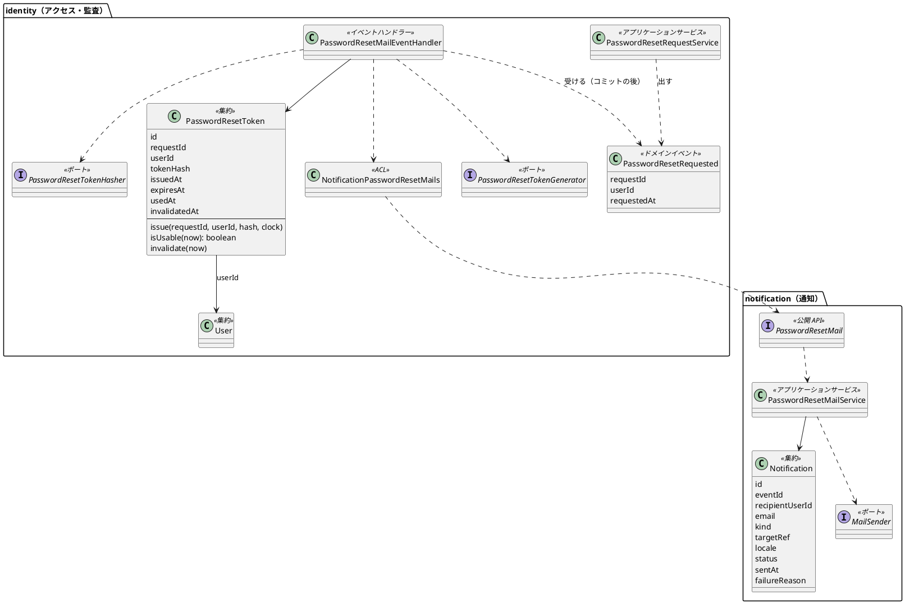
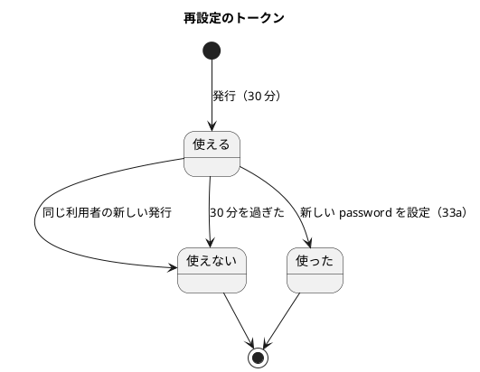
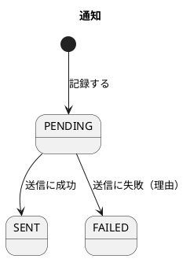
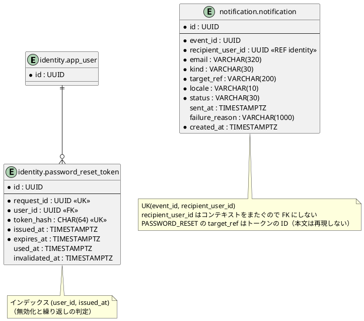
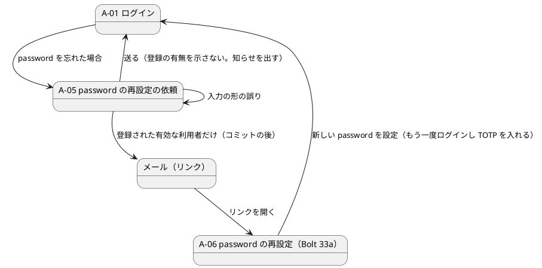

# Bolt 33 計画 - 通知モジュールの新設と password の再設定の依頼（US-18 AC8 の前半）

## 基本情報

| 項目 | 内容 |
| :--- | :--- |
| Bolt | 第 33 回（W5 の 15 本目。US-18 の残りの 12 本目） |
| 予定 | W5（2026-11-02 の週。前倒しで着手できる）。作業は約 4.75 時間（承認ゲートの待ち時間を除く。開始準備の決定で分けずに進め、5 時間を超えると見えたら止めて諮る。「時間の配分と打ち切り」） |
| 対象 | 新しい `notification` モジュール（公開 API、通知の集約と表、送信のポートと SMTP・ログの送信アダプター）、`identity`（再設定のトークンの集約と表、依頼のサービス、トークンを発行して送るイベントのハンドラー、通知の ACL、A-05 の画面、A-01 のリンク、監査の種類）、`SecurityConfiguration`（公開の URL）、アーキテクチャのテストとスキーマの一覧、設計文書と ADR-017、ユーザーマニュアル |
| SP | 0（US-18 の SP は #13 をクローズする Bolt 33b で数える） |
| GitHub | [#13](https://github.com/k2works/practical-domain-driven-design-in-enterpris-application/issues/13)（US-18、R1.0）。この Bolt では閉じない |
| 承認ゲート | **ステップごとに止める**（W4 の締めの決定。W5 の表の 33 の行: セキュリティ、外部連携、モジュールの境界、スキーマ）。確認必須（新しいモジュール・新しい表・外部連携（SMTP）・依存の追加・セキュリティ・新しいファイル）は計画の承認の場で確認ポイントとして判断を受ける |
| アプローチ | インサイドアウト（開発戦略の表: 新しい集約とスキーマを作る Bolt。W5 の既定と表の 33 の行どおり）。開発戦略の手順どおり、各ステップの先頭に Flyway の表を置き、リポジトリ → ドメイン → アプリケーションサービスの順に外へ広げる。認証の入口に触る部分（公開の URL）はセキュリティの統合テストで外側から確かめる |
| 前の Bolt | [Bolt 32f 終了報告](bolt_32f_report.md) |

## Bolt ゴール

password を忘れた利用者が、A-01 の「password を忘れた場合」から A-05 で登録メールアドレスを入れて送ると、登録された有効な利用者なら 1 回だけ使える 30 分の再設定のリンクがそのアドレスへ届く。画面は登録の有無にかかわらず同じ応答を返し、依頼は監査に残る。トークンの発行と送信は依頼の応答から切り離し、モジュールのイベント（`@ApplicationModuleListener`、ADR-003）で行う。メールは新しい通知モジュールの公開 API を通して送り、送信の記録（本文とリンクは保存しない）を通知モジュールに残す。

この Bolt では、リンクを開いて新しい password を設定する画面（A-06）は作らない（Bolt 33a）。届いたリンクは 33a まで「見つからない」画面になる（確認ポイント 11）。

### 確かめたい仮説

| # | 仮説 | この Bolt で分かること |
| :--- | :--- | :--- |
| H1 | 送信の公開 API を `notification.interfaces.api` に置き、`identity` から `application.internal.outboundservices.acl` 経由で呼べば、通知の部品を `identity` に持たずに、モジュールと層の規則（ModularityTest・LayerArchitectureTest・PublicApiArchitectureTest・AT-07）を例外なしで守れる | アーキテクチャのテストが緑のまま、統合テストで Mailpit にメールが届く |
| H2 | 依頼の応答では利用者の判定と監査の記録だけを行い、トークンの発行と送信をモジュールのイベントのハンドラーに移せば、登録の有無で応答の内容がそろい、応答は発行も送信も待たない。イベントには依頼の ID と利用者の ID だけを載せるので、発行記録（`platform.event_publication`）に平文のトークンも URL も残らない | 登録あり・なし・止められた利用者で応答が同じこと、送信アダプターを遅くしても応答が待たないこと、発行記録の JSON にトークンも URL もないことを統合テストで確かめる |

### 開始準備で確かめたこと（T-114）

- **通知モジュール**: `notification` パッケージはまだない。`identity` の `allowedDependencies` は `{"shared", "quotation :: events", "platform :: web"}`（`identity/package-info.java:6-8`）。公開 API の前例は `booking.interfaces.api.TrackingStartNotification`（結果は `Completed`・`AlreadyCompleted`・`NotCompleted`）とアダプター `booking.interfaces.api.internal.TrackingStartNotificationAdapter`、`@NamedInterface("api")` は `booking/interfaces/api/package-info.java:5`。呼ぶ側の ACL は `tracking.application.internal.outboundservices.acl.BookingTrackingStarts`（上流の名前 + 名詞）、組み立ては `TrackingConfiguration:33-34`。`identity` にはまだ `outboundservices.acl` がない
- **層の規則**: 他のコンテキストの `*.interfaces.api` を参照してよいのは `application.internal.outboundservices.acl..` と `infrastructure.config..` だけ（`LayerArchitectureTest:82-84`）。application は web・jdbc・mybatis・servlet に依存しない（:193-203。mail はまだない）。公開 API は `java..`・`shared.domain..`・`*.interfaces.api` だけに依存し、インターフェースか record（`PublicApiArchitectureTest:21-32`）。イベントのハンドラーは `application.internal.eventhandlers` の `*EventHandler`。identity の合成ルートの `@Bean` の戻り値は AT-07 の範囲（architecture_backend.md:277、test_strategy.md:290）
- **非同期の仕組み**: 設計は `@TransactionalEventListener` を使わず `@ApplicationModuleListener` と発行記録を使う（ADR-003、architecture_backend.md:45・:321。前例 `KpiObservationEventHandler:34`）。発行記録はイベントを JSON で `platform.event_publication` に残す（data_model.md:1104）ので、イベントに秘密を載せない
- **認証の入口**: 既定は全 URL に password と TOTP の 2 つの要素を求める（`@EnableMultiFactorAuthentication`。`SecurityConfiguration:79-80`）。公開の URL は `PUBLIC_PATHS`（:93-95）で、`SessionRevalidationFilter` の確かめ（:234）と 32e の要求を覚える動き（`ExpiredSessionRequestSaver`）の対象外になる。A-01 のテンプレートには「password を忘れた場合（A-05）は W5 で足す」のコメントだけがある（`identity/login.html:4`）
- **利用者と判定**: `User` は password を変えるメソッドを持たず、`UserRepository` に更新がない（33a で足す）。有効かどうかの判定は `User#authenticationRejection(company)` と `UserStandingRepository`（Bolt 32c）、メールアドレスの正規化は `EmailAddress` にある
- **監査**: `AuditAction` に再設定の値はない。`AuditRecord` は操作ごとの静的ファクトリー（`loginFailed(user, company, reason, at)` など）で、理由は `AuthenticationRejection` の `name()`。`audit_record.action` に CHECK 制約はない（data_model.md:925）。存在しないメールアドレスは操作者を空にし、アドレスを残さない（ADR-012:83）。`audit_record` には対象の列がまだない（AUD-02）
- **乱数とハッシュの前例**: 回復コードはドメインのポート（`RecoveryCodeGenerator`・`RecoveryCodeHasher`）と実装（`identity.infrastructure.crypto`）に分かれている（architecture_backend.md:276-277）
- **スキーマの一覧**: 新しいスキーマは `afterMigrate__grant_app_user.sql` の `GRANT USAGE ON SCHEMA`（:25-27。漏れるとアプリが権限不足で落ちる）、`MapperSchemaArchitectureTest.SCHEMAS`（:29）、`SchemaCommentIntegrationTest.BUSINESS_SCHEMAS`（:28。`tracking` も入っていない）に足す
- **依存とコンテナ**: `spring-boot-starter-mail` はない。メールのコンテナ（Mailpit など）は compose にも Testcontainers にもない。統合テストの Testcontainers は `TestcontainersConfiguration`（PostgreSQL）に集まっている
- **デモ環境と dev だけの部品**: Heroku は dev プロファイルのまま動く（ADR-013、`deploy_demo.js`）。`DevLoginGuard` は「dev かつ staging・prod と併用しない」をマイグレーションの前に確かめる（:26-38）。#48（K-03）がステージング・本番で dev を拒否する確認を扱う
- **設計文書の欠け**（2 つの整合性検証で確かめた。ステップ 1 で反映する）: 再設定のトークンの概念・不変条件と用語集（domain_model.md）、表・インデックス・ドメインモデルとの対応（data_model.md）がない。通知の用語（:206）と節の冒頭（:1063。「宛先をアクセス・監査の公開 API で解決する」は今回の依存と循環する）、種類の表（:1075-1082）、リポジトリの行（:1270）が荷主への通知だけを前提にしている。コンテキストマップに identity → 通知の行がない（architecture_backend.md:126-147）。A-05・A-06 の URL・画面イメージ・文言、再設定のメールの件名・本文がなく、A-01 の行（:179）と :504 が「W5 まで出さない」のまま（ui_design.md）。ADR-011:298 は A-06 を password の要素だけの例外に挙げ、:337 は再設定の流れを未確認に置いている。ADR-012 の公開の URL（:42）と監査（:83）に再設定がない。tech_stack.md のメール送信の行（:60）と Testcontainers の行（:88・:100）にメールのコンテナがなく、「ローカルではメールを受けるだけのコンテナ」は dev はログに出す決定と合わない。AUD-01 に再設定の依頼がなく、トークンと送信の記録の保持の期間（RET）がない

## ふりかえりと前の Bolt からの引き継ぎ

| 入力 | 内容 | この Bolt での扱い |
| :--- | :--- | :--- |
| 開始準備の決定 1（2026-10-15、human:kakimomokuri） | (1) 33 と 33a に分ける。(2) dev はメールをログに出す送信アダプター（dev の外では起動を止める）。統合テストは Testcontainers の Mailpit。ステージング・本番は SES の SMTP（W10）。(3) A-06 で設定したら A-01 に戻してログインし直す（A-06 は password の要素を与えない）。(4) 通知モジュールに送信の記録（`notification` の表、種類 `PASSWORD_RESET`）を作る | 本計画の範囲と確認ポイント 1〜4 |
| 開始準備の決定 2（2026-10-15、human:kakimomokuri。整合性検証の要判断への回答） | (5) トークンの発行を `@ApplicationModuleListener` のハンドラーに移し、イベントには依頼の ID と利用者の ID だけを載せる（ADR-003 の例外は作らない）。(6) 「通知は identity に依存しない（宛先は呼ぶ側が渡す）」を制約として今決め、W9 の宛先の渡し方は W9 の開始準備で決める。(7) 新しい ADR（ADR-017 通知モジュールとメール送信）を作る。(8) `target_ref` はトークンの ID、Bolt は約 4.5 時間のまま進める | 設計の約束、確認ポイント 5・6・15・16 |
| W5 の決定（2026-10-11） | 通知モジュールを W5 で最小に作り、送信の公開 API を `notification.interfaces.api` に置く。`identity` の `allowedDependencies` に `notification :: api` を足す | 確認ポイント 1 |
| Bolt 32f の Try T-123 | 知らせ・案内の文言を決める前に、出る場面を表にし、すべての場面で事実と合うかを確かめる | A-01 の知らせ（登録あり・なし・止められた利用者・繰り返し・入力の誤り・ログイン済みで開いた場合）とメールの本文（依頼した本人・依頼していない本人）を、ステップ 1 で UI 設計に場面の表として書いてから決める |
| Bolt 32f の Try T-124 | 「この画面を経た」で振る舞いを変えるときは、画面に印を明示する | A-01 の知らせは query（`?reset-requested`）で明示する。印の有無の対をテストにする |
| Bolt 32e の Try T-121・T-122 | URL の判定は認可と同じ道具で。共通の部品を変える前に既存のテストとステップを探す | `PUBLIC_PATHS` に足すのは `/password-reset` だけ（既存の matcher で判定する）。`/password-reset/**` は 33a で URL と一緒に足す。ステップ 4 の Red の前に、`PUBLIC_PATHS`・`SessionRevalidationFilter` の除外・`ExpiredSessionRequestSaver`・A-01 の描画を確かめている既存のテストを検索し、変わる期待を Red に入れる |
| Bolt 32d・32b の Try T-117・T-119・T-106・T-107・T-113 | 規則のテストは、その規則を外したときだけ落ちる入力で。否定の確かめは先に肯定を確かめてから。共有の表の件数はそのテストの利用者で絞る | トークンの期限（29 分 59 秒と 30 分）、繰り返し（59 秒と 1 分）、登録なし・止められた利用者でメールが送られないこと（同じテストで登録ありなら届くことを先に確かめる）、監査の件数はそのテストの利用者で絞る |
| Bolt 31 の Try T-101・T-108 | 置き場所の決定が層の規則の例外を伴いそうなときは、骨組みのクラスを置いて ArchUnit を流す。枠組みに任せる約束は、どの部品がいつ呼ぶかを書き、呼ばれたことを確かめる | ステップ 2 の最初に骨組み（`notification` と `identity` の ACL）を置いてアーキテクチャのテストを流す。イベントのハンドラーが依頼のトランザクションのコミットの後に呼ばれ、ロールバックしたら呼ばれないことを確かめる |
| Bolt 30 の Try T-100 | 同時の更新のテストは、先のコミットを止め、後の操作が待っていることを確かめてから放す | 同じ利用者への同時の 2 つの発行（繰り返しの判定のすり抜け、無効化の競合）を、利用者ごとの行のロックで直列にし、T-100 の形で確かめる |
| Bolt 31d・31 の Try T-111・T-102 | 出力の取り込みは見張りたい操作の間だけ。認証の段の状態を足すときは、同じ session での利用者の切り替えを境界のテストに入れる | `LoggingMailSender` のログの確かめは送信の間だけ取り込む。A-05 をログイン済み・password の段の session で開いた場合を境界のテストに入れる（どちらも同じ A-05 を出し、依頼は入力したアドレスで扱う。session の利用者は変えない） |
| W1〜W4 の Try T-83・T-88・T-89 | 骨組みのまま流し、最初から通るテストは「見張り」と書く。後に回したものは Issue にする | ステップ 2 の骨組みの確かめを「見張り」と書く。後に回すもの（A-05 の WAF の規則、送信の再試行と OBS-11、発行と監査の書き込みによる時間の差、`SchemaCommentIntegrationTest` の `tracking` の漏れ、トークンと送信の記録の保持の期間）は、終了報告で Issue にするか既存の Issue（#48 など）に足す |
| Bolt 30〜32 の T-103・T-109・T-110・T-116・T-120 | 複数行の書き換えはスクリプトのファイル、設計文書を先に push、コミットは pathspec、SonarQube はテストとコードを書き換えていない間に、共通の部品を変えたら `check` を先に | ステップ計画の前提に書く |
| 32f から持ち越した既知の課題 | 要求の属性の名前の 3 組の重複は 33b | この Bolt では扱わない |

## スコープ

### 入れるもの・入れないもの

| 入れる | 入れない（後で） |
| :--- | :--- |
| `notification` モジュールの新設: `package-info`（`allowedDependencies = {"shared"}`）、公開 API（`notification.interfaces.api`。`@NamedInterface("api")`。password の再設定のメールを送る 1 つの操作と、要求・結果の record）、アダプター（`interfaces.api.internal`） | US-22 の業務イベントの購読と荷主への通知、宛先の渡し方（W9。制約だけ今決める） |
| 通知の集約（宛先の利用者・アドレス・種類・対象・言語・状態・送信時刻・失敗の理由）とリポジトリ、`notification` スキーマの `notification` の表（data_model.md:932-960。種類は `PASSWORD_RESET` だけを使う）。本文とリンクは保存しない | 送信の再試行・バウンスと苦情の記録（OBS-11。W9・W10） |
| 送信のポートと 2 つのアダプター: SMTP（`spring-boot-starter-mail` の `JavaMailSender`）と、dev のログに出す送信 | SES の SMTP の設定と送信元の認証（SPF・DKIM。W10 の運用準備） |
| 統合テストのメールのコンテナ（Testcontainers の Mailpit） | ローカルの起動での Mailpit（dev はログに出す） |
| `identity`: 再設定のトークンの集約とリポジトリ、`identity.password_reset_token` の表、トークンの生成とハッシュのポート（実装は `identity.infrastructure.crypto`） | トークンを使う・password を変える・期限切れと使用済みの画面（A-06。Bolt 33a） |
| 依頼のサービス（判定と監査とイベント）と、イベントのハンドラー（繰り返しの判定、前のトークンの無効化、発行、通知の ACL で送る） | 送信元ごとの流量の制限（WAF。W10。SEC-20 に A-05 の URL を足す） |
| 監査の種類 `PASSWORD_RESET_REQUESTED` と `AuditRecord` のファクトリー | `PASSWORD_RESET_COMPLETED`（33a）、監査と送信の記録を結ぶ対象の列（AUD-02。使う Bolt で足す） |
| 画面: A-01 に「password を忘れた場合」のリンク、A-05（`GET`・`POST /password-reset`。テンプレート `identity/password-reset.html`）、送信の後は A-01 に戻して知らせる（登録の有無を示さない） | A-06 の URL と `/password-reset/**` の公開（33a） |
| リンクの URL は設定の公開の base URL から組み立てる（Host ヘッダーから組み立てない） | — |
| 画面の層の受入シナリオ（`login_ui.feature` に AC8 の前半）、セキュリティの統合テスト、アーキテクチャのテストとスキーマの一覧の更新 | デモの動画（再設定の流れを通して録れる 33a で撮る） |
| 設計文書と ADR-017（「ステップ計画」のステップ 1）、ユーザーマニュアル（2 章に「password を忘れた場合」の依頼までと A-05 のキャプチャ、A-01 の撮り直し、付録 B） | マニュアルの A-06 の手順（33a） |

### 設計の約束（Try T-1）

- **通知の公開 API**（`notification.interfaces.api`）: インターフェース `PasswordResetMail` の `send(PasswordResetMailRequest)` が `PasswordResetMailReceipt`（`Sent`・`AlreadySent`・`Failed`）を返す。要求の record は依頼の ID（UUID。通知の `event_id`）、トークンの ID（UUID。`target_ref`）、宛先の利用者の ID（UUID）、アドレス、再設定の URL、期限（`UtcInstant`）、言語。戻り値は Java の標準・共有カーネルの型と文字列だけ（architecture_backend.md:141）。名前はステップ 1 の ADR-017 と用語集で確定する
- **通知の中**: アダプターが通知のアプリケーションサービス（`notification.application.internal.commandservices.PasswordResetMailService`）を呼ぶ。サービスは通知を PENDING で記録してから送信のポートを呼び、SENT か FAILED（理由）にする（状態の更新は `status = 'PENDING'` を条件にした更新。版の列は持たない例外として data_model に書く）。同じ `event_id` と宛先の通知が既にあれば送らず `AlreadySent` を返す（UK(event_id, recipient_user_id)。N-INV-02）。件名と本文は通知モジュールのテンプレート（Thymeleaf のテキストのテンプレート）で組み立て、本文に料金などを書かない（N-INV-01）
- **通知の依存の制約**（開始準備の決定 6）: 通知は `identity` に依存しない（`allowedDependencies = {"shared"}`）。宛先（利用者の ID とアドレス）は呼ぶ側が渡す。domain_model.md:1063 の「宛先をアクセス・監査の公開 API で解決する」を直し、W9 の渡し方は W9 の開始準備で決める
- **送信のポート**: 通知の `application.internal.outboundservices`（ポート `MailSender`）と `notification.infrastructure.mail`（`SmtpMailSender`、`LoggingMailSender`）。application は `org.springframework.mail..`・`jakarta.mail..` に依存しない（LayerArchitectureTest の禁止に足す）。`LoggingMailSender` は dev のプロファイルでだけ Bean になる。守り（`notification.infrastructure.config`）は `DevLoginGuard` と同じ式（dev かつ staging・prod と併用しない）で、外れたら起動を止める。ステージング・本番で SMTP の設定がないときも起動を止める（W10 の SES の設定まで、dev 以外では SMTP の設定を求める）
- **再設定のトークン**（`identity.domain.model.aggregates.PasswordResetToken`。IA-INV-12）: ドメインのポート `PasswordResetTokenGenerator`（32 バイトの乱数を URL 安全な Base64）と `PasswordResetTokenHasher`（SHA-256）を置き、実装は `identity.infrastructure.crypto`。表にはハッシュだけを置く。期限は発行から 30 分（`Clock` から）。不変条件: 1 回だけ使える、期限を過ぎたら使えない、同じ利用者の新しい発行で前の未使用のトークンは使えなくなる（`invalidated_at`）。この Bolt では発行と無効化、使う側は 33a。状態の更新は条件付きの更新（`used_at IS NULL AND invalidated_at IS NULL`）で、版の列は持たない例外として data_model に書く
- **依頼のサービス**（`identity.application.internal.commandservices.PasswordResetRequestService`）: 入力を `EmailAddress` で正規化し、利用者を探し、`User#authenticationRejection(company)` と `UserStandingRepository` で有効かを判定する。監査を同じトランザクションで書き（IA-INV-08）、有効なら依頼の ID を採番してドメインのイベント `PasswordResetRequested`（`identity.domain.events`。依頼の ID・利用者の ID・依頼の時刻だけ）を出す。応答はどの場合も同じ
- **イベントのハンドラー**（`identity.application.internal.eventhandlers.PasswordResetMailEventHandler`、`@ApplicationModuleListener`。コミットの後に別のスレッドと別のトランザクションで動く）: 利用者の行をロックし（`SELECT … FOR UPDATE`。同時の発行を直列にする）、同じ依頼の ID のトークンが既にあれば何もしない（再配信で 2 通送らない。トークンの表の `request_id` に一意制約）。前の発行から 1 分以内なら発行も送信もしない（繰り返し）。そうでなければ前の未使用のトークンを無効にし、トークンを発行してハッシュを保存し、公開の base URL からリンクを組み立て、ACL `NotificationPasswordResetMails` で送る。送信が `Failed` でも例外にせず完了にする（再配信で新しいトークンを作らない。利用者が依頼し直す）。平文のトークンと URL は、このメソッドの中の変数と送信の要求だけにあり、発行記録・ログ・表に残らない
- **監査**（`AuditRecord.passwordResetRequested(...)`、`AuditAction.PASSWORD_RESET_REQUESTED`）: 有効な利用者は SUCCESS（理由なし）、止められた利用者は FAILURE・`SUSPENDED`、所属企業の無効は FAILURE・`COMPANY_INACTIVE`、登録なしは FAILURE・`UNKNOWN_USER`（操作者を空にし、アドレスを残さない）。理由は既存の `AuthenticationRejection` の値を使う。繰り返しで送らなかったことはハンドラーが記録せず、送信の記録がないことで分かる（依頼の監査は SUCCESS のまま）
- **画面**: `identity.interfaces.web.PasswordResetController`。`GET /password-reset` で A-05（`layout/public`、ナビゲーションの対象外）、`POST /password-reset` は入力の形の誤り（空・形式）だけ A-05 で示し、それ以外は `/login?reset-requested` に PRG で戻す。A-01 は `reset-requested` のとき知らせを出す（文言は T-123 の場面の表で決める）。`/password-reset` を `PUBLIC_PATHS` に足す（既存の matcher）。CSRF は既定のまま。ログイン済みや password の段の session で開いても同じ A-05 を出し、session の利用者は変えない
- **組み立て**: `identity.infrastructure.config` で ACL に公開 API を渡す。公開の base URL（`cargotracker.public-base-url`）は設定の record で受ける。`@Bean` の戻り値の型は AT-07 の範囲（`identity.application.internal..`・`org.springframework..`）に収める（収まらなければ例外として諮る）。`identity/package-info.java` の `allowedDependencies` に `"notification :: api"` を足す。ModularityTest のモジュール一覧に通知を足す

## 設計（この Bolt の範囲）

4 図のうち、ドメインモデル図・状態遷移図・ER 図・画面遷移図を、この Bolt の範囲に絞って置く（ステップ 1 で設計文書に反映する）。

### ドメインモデル

### 状態遷移

### ER 図

列のコメント・追記専用の印・版の列を持たない例外・afterMigrate のコールバックはステップ 1 で data_model.md の規約（:146-153、:1111 以降）に合わせて書く。

### 画面遷移

A-05 は公開の画面で、ナビゲーションの対象外。

## ステップ計画

状態の記号: `[ ]` 未着手、`[-]` 進行中、`[?]` 承認待ち、`[x]` 完了。各ステップの終わりに `check` が緑であることと、計画からの変更を設計文書に反映したこと（T-53）を確かめ、push して CI を確かめる（T-26、T-65、T-118）。コミットは pathspec で作る（T-84、T-110）。複数行の書き換えはスクリプトのファイルにする（T-103）。ステップ 1 を push してからコードのステップを push する（T-109）。共通の部品を変えたら `check` を先に流す（T-120）。

- [x] **1. 設計文書と ADR-017** 【承認ゲート: 設計文書】
  - ADR-017（新規。通知モジュールとメール送信）: 公開 API と `identity` からの同期の呼び出し、通知は `identity` に依存しない制約（W9 の宛先の渡し方は W9 の開始準備）、SMTP と dev のログに出す送信と守り、統合テストの Mailpit、送信を依頼の応答から切り離す形（`@ApplicationModuleListener` にトークンの発行を移し、イベントに秘密を載せない）、送信の記録と `target_ref`
  - domain_model.md: `identity` に再設定のトークン（概念・IA-INV-12）、`PasswordResetRequested`、用語集（`PasswordResetToken`・`PasswordResetRequestService`・`PasswordResetMailEventHandler`・ポート 2 つ・`PASSWORD_RESET_REQUESTED`。:201）。通知の用語（:206。利用者全般へのメール）、節の冒頭（:1063。依存の制約）、集約の表の「含むもの」（event_id・失敗の理由）、種類の表に password の再設定、公開 API と送信のサービスと `MailSender` の用語、リポジトリの行（:1270）、一般の領域の行（:74）
  - data_model.md: `identity.password_reset_token` の表（列・制約・コメント・インデックス）、`notification` の表をこの Bolt で作ること・`PASSWORD_RESET` の `target_ref` と「本文を再現しない」例外、2 つの表が版の列を持たない例外（:152-153。tracking_record の書き方（:759）に倣う）、audit_record の action の範囲（:925）、インデックスの付表とドメインモデルとの対応の表（:1145-1176）
  - architecture_backend.md: モジュールの一覧の通知の行（:71）、コンテキストマップの表に identity → 通知（公開 API）の行（:126-147）、公開 API の箇条、`allowedDependencies`（:285）、通知の合成ルートと送信アダプターの組み立て、application の mail への依存の禁止
  - tech_stack.md: メール送信の行（:60。dev はログに出す、統合テストは Mailpit。「ローカルでは受けるだけのコンテナ」を直す）、Testcontainers の行（:88・:100）に Mailpit とその版
  - ui_design.md: 画面の URL の表に A-05（A-06 は「33a で決める」）、A-01 の行（:179）と :504 をリンクを出す形に、A-05 の画面イメージ（salt）と文言、A-01 の知らせとメールの本文の場面の表（T-123）、画面遷移の A-06 → A-01（:256）と A-05 がナビゲーションの対象外であること、再設定のメールの件名と本文、:1039 の公開の画面の列挙に A-05
  - non_functional.md: SEC-08 の詳細（ハッシュ、新しい発行で前を無効、繰り返し、登録の有無を示さない、応答から切り離す）、SEC-20 に A-05 の URL（W10）、AUD-01 に再設定の依頼、トークンと送信の記録の保持の期間（W10 に送ると明記）
  - ADR-011: :298 の A-06 の例外を消し、:337 の未確認の「password の再設定の流れ」を解いた側へ移す。改訂の経緯
  - ADR-012: 公開の URL（:42）に `/password-reset`、監査（:83）に再設定の依頼。改訂の経緯
  - ADR-013: デモ環境では再設定のメールがログに出ること（#48 の範囲に dev のメールの守りを足す）
  - test_strategy.md: 認証・通知の行、不変条件の表（:257）に IA-INV-12、受入条件の照合の表に AC8 の前半
  - user_story.md（:501 付近の分担）、release_plan.md（W5 の 33 の行、デモ項目、ユーザーマニュアルの段落、W5 の状態）
  - 完了の判定: `okf:check` ERROR 0、`documentationTest` 緑
- [ ] **2. 通知モジュール（インサイドアウト）** 【承認ゲート: モジュールの境界、スキーマ、外部連携】
  - 骨組み: `notification/package-info.java`、`notification/interfaces/api/package-info.java`（`@NamedInterface("api")`）、公開 API のインターフェースと record、アダプターの空の実装、`identity` の ACL と組み立て。ModularityTest（モジュール一覧）・LayerArchitectureTest（mail の禁止）・PublicApiArchitectureTest を流す（T-101。最初から通るものは「見張り」と書く。T-83・T-88）
  - マイグレーション（`notification` スキーマと表、日本語のコメント）と、スキーマの一覧 3 か所（`afterMigrate__grant_app_user.sql`、`MapperSchemaArchitectureTest.SCHEMAS`、`SchemaCommentIntegrationTest.BUSINESS_SCHEMAS`）→ リポジトリの統合テスト（条件付きの更新、一意制約）→ 通知の集約の単体テスト（状態の遷移、失敗の理由の長さ）→ 送信のサービス（重複は `AlreadySent`、PENDING → SENT・FAILED）→ SMTP の送信アダプター（Testcontainers の Mailpit で件名・本文・宛先を確かめる）→ `LoggingMailSender`（ログの取り込みは送信の間だけ。T-111）と dev の守り
  - 依存の追加: `spring-boot-starter-mail`（Boot 管理）、Mailpit のコンテナのイメージ（版を固定。2 週間以上前の版）
  - 完了の判定: `check` 緑。アーキテクチャのテストに例外を足していない
- [ ] **3. 再設定のトークンと依頼（インサイドアウト）** 【承認ゲート: セキュリティ、スキーマ】
  - マイグレーション（`identity.password_reset_token`、インデックス）→ リポジトリの統合テスト（ハッシュで探す、新しい発行で前を無効、`request_id` の一意）→ トークンの集約の単体テスト（期限の 29 分 59 秒と 30 分、無効化、ハッシュだけを持つ）→ 生成とハッシュの実装（`identity.infrastructure.crypto`）→ 依頼のサービス（有効・登録なし・止められた利用者・所属企業の無効の監査の結果と理由。T-113 で件数を絞る）→ イベントのハンドラー（繰り返しの 59 秒と 1 分、同じ依頼の ID の再配信で 2 通送らない、送信の `Failed` で完了にする、ロールバックしたら呼ばれない（T-108）、同時の 2 つの発行の直列（T-100））
  - 発行記録（`platform.event_publication`）・トークンの表・ログに平文のトークンと URL がないことを確かめる
  - 完了の判定: `check` 緑。登録なしでメールが送られないことを、同じテストで登録ありなら届くことと対で確かめる（T-119）
- [ ] **4. 画面（A-01 のリンク、A-05）** 【承認ゲート: 画面、セキュリティ】
  - Red の前に、`PUBLIC_PATHS`・`SessionRevalidationFilter` の除外・`ExpiredSessionRequestSaver`・A-01 の描画を確かめている既存のテストとステップを検索し、変わる期待を Red に入れる（T-122）
  - セキュリティの統合テスト: `/password-reset` が未認証で開ける（`/password-reset/x` は公開しない）、CSRF のトークンがない送信は 403、送信の後は `/login?reset-requested` に戻り、登録の有無で応答（リダイレクト先・本文）が同じ、応答がハンドラーを待たない（送信アダプターを遅くする）、ログイン済み・password の段の session で開いた場合（T-102）
  - 画面の層の受入シナリオ（`login_ui.feature`、`@US-18`）: A-01 から A-05 を開いて送ると A-01 に知らせが出て、登録された利用者にはリンクを含むメールが届く（届いたかは Mailpit の API で確かめる）。登録のないアドレスでも同じ知らせが出てメールは届かない（先に登録ありで届くことを確かめる）。知らせの印（`reset-requested`）がなければ出ない（T-124）。axe の違反 0
  - `PasswordResetController`、テンプレート `identity/password-reset.html`（`layout/public`）、A-01 のリンクと知らせ、`PUBLIC_PATHS`
  - 完了の判定: `check` を先に（T-120）、続けて `uiTest` が緑。発行と送信を依頼のトランザクションの中に戻す違反で、応答が送信を待つテストが落ちることを確かめる（T-112）
- [ ] **5. マニュアル** 【承認ゲート: マニュアル】
  - 2 章に「password を忘れた場合」（A-01 のリンク、A-05 で送る、届くまでの目安とメールが届かないとき、リンクは 30 分・1 回だけ・新しい依頼で前のリンクは使えない・1 分以内の依頼し直しでは送られない）。A-06 の手順は 33a で足す（33a までリンクの先がないので、マニュアルの公開とデモ環境での案内は 33a と同じ日にする前提を終了報告に書く）。付録 B に「再設定のメールが届かない」。A-05 のキャプチャ（`manual_screenshots.feature`）と A-01 の撮り直し（リンクが増える）
  - 完了の判定: `manual:build` が通る。`okf:check` ERROR 0
- [ ] **6. SonarQube と開発レビューと終了報告** 【承認ゲート: 終了報告】
  - SonarQube（テストとコードを書き換えていない間に。T-116）
  - 開発レビュー（プログラマー、アーキテクト（モジュールの境界、公開 API、イベントのハンドラー、循環の制約、AT-07）、テスター、テクニカルライター（A-05・A-01 の知らせ・メールの本文・マニュアル。T-90）、セキュリティの観点（列挙、トークン、平文が残らないこと、Host ヘッダー、ログに出す送信））
  - `bolt_33_report.md`。release_plan の W5 の 33 の行、開発の索引。#13 に進み具合をコメントする。後に回すものを Issue にするか既存の Issue に足す（T-89）

### 時間の配分と打ち切り

| # | 目安 | 打ち切り |
| :--- | :--- | :--- |
| 1 | 60 分 | — |
| 2 | 75 分 | Mailpit のコンテナで詰まったら、SMTP の確かめを組み込みの SMTP サーバー（GreenMail など）に替えるかを諮る |
| 3 | 65 分 | 同時の発行の直列（T-100）が書けなければ、`request_id` の一意と繰り返しの判定だけにし、同時の 2 通を既知の課題にする |
| 4 | 45 分 | — |
| 5 | 20 分 | — |
| 6 | 30 分（SonarQube の待ちを除く） | — |

合計 295 分（約 4.9 時間）。開始準備の決定で分けずに進める。5 時間を超えると見えたら止めて諮る（候補: 送信の記録の FAILED の経路とマニュアルを 33a に送る）。

## 確認ポイント（計画の承認の場でまとめて確認する。Try T-6）

| # | 確認すること | ステップ | 推奨 |
| :--- | :--- | :--- | :--- |
| 1 | **新しいモジュール**（構造の変更。W5 と開始準備で決めた） | 1・2 | `notification` を新設し、公開 API を `notification.interfaces.api`、アダプターを `interfaces.api.internal` に置く。`notification` の `allowedDependencies` は `shared` だけ。`identity` に `notification :: api` を足し、`identity.application.internal.outboundservices.acl` から呼ぶ。層の規則に例外を足さない |
| 2 | **dev のメール**（開始準備で決めた） | 2 | dev はログに出す送信アダプター（宛先・件名・本文。リンクを含む）。守りは `DevLoginGuard` と同じ式。デモ環境（Heroku）でもログに出る（デモの利用者のアドレスだけ。ADR-013 と #48 に書く） |
| 3 | **A-06 の後**（開始準備で決めた。セキュリティ） | 1 | A-06 は password の要素を与えない。設定したら A-01 に戻し、新しい password と TOTP でログインし直す。ADR-011:298 の A-06 の例外を消し、UI 設計の遷移を A-06 → A-01 に直す（作るのは 33a） |
| 4 | **送信の記録**（開始準備で決めた。スキーマ） | 1・2 | data_model の `notification` の表をこの Bolt で作る（`status VARCHAR(30)`、`target_ref` は必須でトークンの ID、時刻は TIMESTAMPTZ）。本文とリンクは保存しない（この種類は本文を再現しない例外）。`recipient_user_id` は FK にしない。版の列は持たず条件付きの更新 |
| 5 | **送信の切り離し**（開始準備で決めた。セキュリティ） | 1・3 | 依頼の応答は判定・監査・イベントだけ。`@ApplicationModuleListener` のハンドラーがトークンを発行して送る。イベントは依頼の ID・利用者の ID・時刻だけ（発行記録に平文が残らない）。再配信では同じ依頼の ID のトークンがあれば何もしない（送れなかった依頼は利用者が依頼し直す）。ADR-003 の例外は作らない |
| 6 | **通知の依存の制約**（開始準備で決めた） | 1 | 通知は `identity` に依存しない（宛先は呼ぶ側が渡す）。domain_model.md:1063 を直す。W9 の宛先の渡し方は W9 の開始準備で決める |
| 7 | **外部連携と依存**（外部ライブラリの導入） | 2 | `spring-boot-starter-mail`（Boot 管理の版）を足す。統合テストは Testcontainers の Mailpit（`GenericContainer`、版を固定）。ステージング・本番の SES の SMTP の設定は W10 |
| 8 | **再設定のトークン**（セキュリティ・スキーマ） | 1・3 | 32 バイトの乱数を URL 安全な Base64 でリンクに入れ、表には SHA-256 のハッシュだけを置く。期限 30 分。同じ利用者の新しい発行で前の未使用のトークンは使えなくなる（`invalidated_at`）。`request_id` に一意制約。生成とハッシュはドメインのポートと `identity.infrastructure.crypto` の実装。`identity.password_reset_token` の表を足す |
| 9 | **繰り返しと同時の依頼**（セキュリティ） | 3 | ハンドラーで、同じ利用者に前の発行から 1 分以内なら発行も送信もしない（メールの爆撃と、発行による前のリンクの無効化の悪用を抑える）。利用者の行のロックで同時の発行を直列にする。応答は同じ。送信元ごとの流量は W10 の WAF（SEC-20 に A-05 の URL を足す） |
| 10 | **登録の有無を示さない**（セキュリティ） | 3・4 | 登録あり・なし・止められた利用者・所属企業の無効で、画面の応答（リダイレクト先と知らせ）を同じにする。応答はトークンの発行も送信も待たない。利用者の検索と監査の書き込みの時間の差は残る（既知の課題。W10 の WAF とあわせて Issue にする） |
| 11 | **A-06 ができるまでのリンク** | 4・6 | 33a までリンクの先は「見つからない」。デモ環境への配備は CI で自動なので、33 と 33a の間にデモ環境で再設定を依頼すると、使えないリンクがログに出る（デモの利用者だけ。受け入れる）。本番は W10 まで出ない |
| 12 | **リンクの URL**（セキュリティ） | 2・3 | 設定の公開の base URL（`cargotracker.public-base-url`）から組み立て、request の Host ヘッダーから組み立てない。dev の既定は `http://localhost:8080`、デモ環境は Heroku の URL を Config Vars に足す（運用手順書のタスクで） |
| 13 | **監査**（セキュリティ） | 3 | `PASSWORD_RESET_REQUESTED` と `AuditRecord.passwordResetRequested(...)` を足す。有効は SUCCESS、止められた利用者は FAILURE・`SUSPENDED`、所属企業の無効は FAILURE・`COMPANY_INACTIVE`、登録なしは FAILURE・`UNKNOWN_USER`（操作者を空にしアドレスを残さない）。監査と送信の記録は結ばない（AUD-02 の対象の列は使う Bolt で足す。既知の課題） |
| 14 | **公開の URL**（セキュリティ） | 4 | `/password-reset` だけを `PUBLIC_PATHS` に足す（既存の matcher）。`/password-reset/**` は 33a |
| 15 | **ADR-017**（新しいファイル。開始準備で決めた） | 1 | 新しく作る。ADR-011・ADR-012・ADR-013 は改訂の経緯で直す |
| 16 | **長さ**（開始準備で決めた） | 全体 | 約 4.9 時間のまま 1 本で進め、5 時間を超えると見えたら止めて諮る |
| 17 | **新しいファイル** | 2〜4 | 通知モジュールのクラス一式、`identity` のトークン・ポート・サービス・ハンドラー・ACL・コントローラー、テンプレート `identity/password-reset.html` と通知のメールのテンプレート、マイグレーション 2 つ、テスト |
| 18 | **マニュアル** | 5 | 入れる。2 章に依頼までの手順と A-05 のキャプチャ、A-01 の撮り直し、付録 B。A-06 の手順とデモの動画は 33a |
| 19 | **アプローチと承認ゲート** | 全体 | インサイドアウト（W5 の既定と表の 33 の行どおり。各ステップの先頭に表）。ステップごとに止める。ステップ 2 はモジュールの境界・スキーマ・外部連携、3 はセキュリティ・スキーマ、4 は画面・セキュリティ |

## 完了条件

- [ ] A-01 の「password を忘れた場合」から A-05 で送ると、登録された有効な利用者には 30 分・1 回だけのリンクを含むメールが届き、登録の有無にかかわらず同じ知らせが A-01 に出る
- [ ] トークンは表にハッシュだけがあり、新しい発行で前のトークンが使えなくなる。繰り返しの依頼では送らず、同時の依頼でも 2 通送らない。発行記録・ログに平文のトークンと URL が残らない
- [ ] 依頼が監査に記録される（登録なしは操作者を空にし、アドレスを残さない）
- [ ] 通知モジュールが公開 API で送信を受け、送信の記録（本文とリンクなし）を残す。dev はログに出し、守りの式が外れたら起動を止める
- [ ] アーキテクチャのテストに例外を足さずに緑。新しい集約に注釈（`@AggregateRoot` など）があり、JIG の用語集に載る
- [ ] ADR-017 を作り、設計文書（domain_model・data_model・architecture_backend・tech_stack・ui_design・non_functional・ADR-011・ADR-012・ADR-013・test_strategy・user_story・release_plan）を更新した
- [ ] ユーザーマニュアル（2 章・付録 B）とキャプチャを更新した
- [ ] `check` と `uiTest` が緑。push して CI を確かめた。SonarQube の Quality Gate が PASS、`okf:check` ERROR 0
- [ ] 開発レビュー、終了報告。#13 に進み具合をコメントした。後に回すものを Issue にした（T-89）

## 更新履歴

| 日付 | 更新内容 | 更新者 |
| :--- | :--- | :--- |
| 2026-10-15 | `/goal Bolt33` を受けた。承認ゲートでは止めずに進め、止めなかったゲートごとに根拠を書いて終了報告の承認の議題に置く（T-36）。途中で層の規則の例外が要るとき、5 時間を超えると見えたときは止めて諮る | anthropic/claude-opus-5-5、指示 human:kakimomokuri |
| 2026-10-15 | 承認（確認ポイント 1〜19 は推奨のまま）。ステップごとの承認ゲートで止めて進める | human:kakimomokuri |
| 2026-10-15 | 詳細整合性検証（20 件）と横断整合性検証（21 件）の指摘を反映し、human:kakimomokuri の決定（トークンの発行を `@ApplicationModuleListener` のハンドラーに移しイベントに秘密を載せない、通知は identity に依存しない制約を今決め W9 の渡し方は W9 に、ADR-017 を作る、`target_ref` はトークンの ID、約 4.5 時間のまま）を受けた。ER 図の型を data_model に合わせた（TIMESTAMPTZ、`status VARCHAR(30)`、`target_ref` 必須、`request_id`）。版の列を持たない例外、スキーマの一覧 3 か所、`@NamedInterface`、mail の禁止のパッケージ、`DevLoginGuard` と同じ守り、生成とハッシュのポートと `identity.infrastructure.crypto`、監査のファクトリーと理由の値、公開 API の `AlreadySent`、公開の URL を `/password-reset` だけに、テンプレート名を `identity/password-reset.html` に、IA-INV-12、AT-07 を足した。ステップ 1 の反映先に ADR-012・ADR-013・ADR-011:337・用語集・コンテキストマップ・Testcontainers の行・ui_design の :179・:504・AUD-01・保持の期間・付表・test_strategy の表を足した。T-83・T-88・T-89・T-100・T-102・T-111・T-121・T-122 を足し、各ステップの先頭に表を置いた。時間を約 4.9 時間に見直した | anthropic/claude-opus-5-5 |
| 2026-10-15 | 初版作成（承認待ち）。開始準備で、`notification` がないこと、公開 API と ACL の前例、認証の入口の公開の URL、`User` と監査の種類、依存とコンテナ、デモ環境を調べ、human:kakimomokuri の決定（33 と 33a に分ける、dev はログに出す送信と統合テストの Mailpit、A-06 の後は A-01 に戻す、送信の記録を作る）を反映した | anthropic/claude-opus-5-5 |

## 関連ドキュメント

- [リリース計画](release_plan.md)（W5）
- [Bolt 32f 終了報告](bolt_32f_report.md)
- [ユーザーストーリー](../../requirements/cargo-tracker/user_story.md)（US-18 AC8）
- [ドメインモデル](../../design/cargo-tracker/domain_model.md)（アクセス・監査、通知）、[データモデル](../../design/cargo-tracker/data_model.md)（`notification`、`identity`）、[バックエンドのアーキテクチャ](../../design/cargo-tracker/architecture_backend.md)、[技術スタック](../../design/cargo-tracker/tech_stack.md)
- [UI 設計](../../design/cargo-tracker/ui_design.md)（A-01・A-05・A-06）、[非機能要件](../../design/cargo-tracker/non_functional.md)（SEC-08、SEC-20、AUD-01）、[テスト戦略](../../design/cargo-tracker/test_strategy.md)
- [ADR-003](../../adr/cargo-tracker/003-inter-context-integration.md)、[ADR-011](../../adr/cargo-tracker/011-mfa-totp.md)、[ADR-012](../../adr/cargo-tracker/012-authentication-principal-and-session.md)、[ADR-013](../../adr/cargo-tracker/013-heroku-demo-environment.md)
