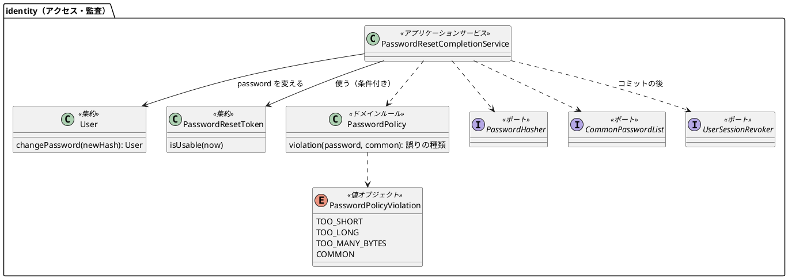
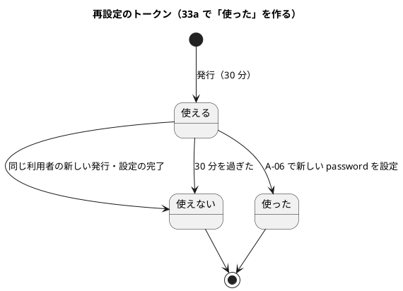
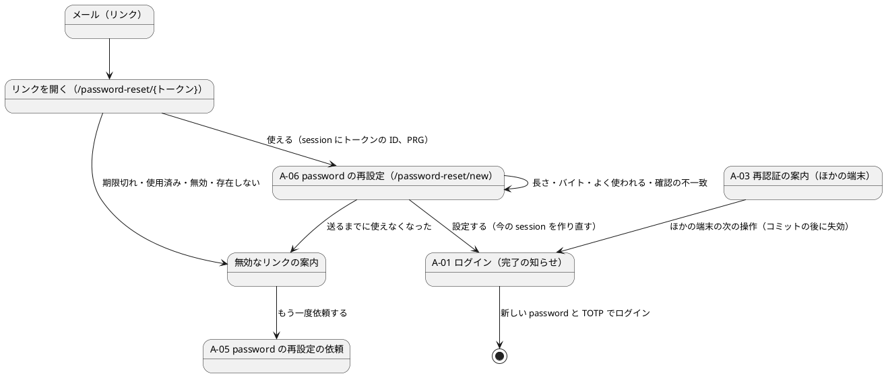

# Bolt 33a 計画 - password の再設定（A-06。US-18 AC8 の後半）

## 基本情報

| 項目 | 内容 |
| :--- | :--- |
| Bolt | 第 33a 回（W5 の 16 本目。US-18 の残りの 13 本目） |
| 予定 | W5（2026-11-02 の週。前倒しで着手できる）。作業は約 4.75 時間（承認ゲートの待ち時間を除く。「時間の配分と打ち切り」） |
| 対象 | `identity`（再設定のトークンを使う、利用者の password の変更、password の方針とハッシュとよく使われる password の一覧、利用者の session の失効、A-06 の画面、A-01 の完了の知らせ、監査の種類）、設計文書、ユーザーマニュアル、デモの動画 |
| SP | 0（US-18 の SP は #13 をクローズする Bolt 33b で数える） |
| GitHub | [#13](https://github.com/k2works/practical-domain-driven-design-in-enterpris-application/issues/13)（US-18、R1.0）。この Bolt では閉じない |
| 承認ゲート | **ステップごとに止める**（W5 の表の 33a の行。セキュリティ。スキーマは変えないので、ステップ 1 で表の行から外す）。確認必須（セキュリティ・新しいファイル・外部の資料の同梱）は計画の承認の場で確認ポイントとして判断を受ける。実装の途中で層・モジュールの規則に当たったら、`/goal` の下でも止めて諮る（T-125） |
| アプローチ | インサイドアウト（W5 の既定と表の 33a の行どおり）。開発戦略の表では、新しい集約も表も作らない Bolt はアウトサイドインに当たる。表から外れる理由: 不確実性がドメインの規則（password の方針、トークンを使う条件）と、トランザクションの境界（同じトークンの同時の送信、コミットの後の session の失効）にあり、内側から固めるほうが早く確かめられる。画面と認証の入口に触る部分は、セキュリティの統合テストと画面の層のシナリオで外側から確かめる |
| 前の Bolt | [Bolt 33 終了報告](bolt_33_report.md) |

## Bolt ゴール

password を忘れた利用者が、メールのリンクから新しい password を設定できる。リンクを開くと、使えるトークンなら URL からトークンを消した A-06 が開く。12〜64 文字（UTF-8 で 72 バイト以下）でよく使われる password でない新しい password を設定すると、次のようになる。

- トークンは使えなくなる。
- 今のブラウザの session を作り直し、A-01 に「password を変更しました」と出る。
- コミットの後に、その利用者のほかの session（ほかの端末など）がすべて失効する。

利用者は、新しい password と TOTP でログインし直す（A-06 は password の要素を与えない）。期限切れ・使用済み・新しいリンクを送った後・存在しないリンクは、どれも同じ案内で依頼し直しを促す。再設定は監査に残る。

### 確かめたい仮説

| # | 仮説 | この Bolt で分かること |
| :--- | :--- | :--- |
| H1 | GET でトークンを確かめて session にトークンの ID だけを置き、トークンのない URL へ移せば（PRG）、平文のトークンは最初の 1 回の要求の URL にしか現れず、表・session・Referer・以後の URL に残らない（最初の要求の path はアクセスログに残る。30 分・1 回だけで抑え、受け入れる） | セキュリティの統合テストで、移った後の URL と session の表にトークンがないこと、応答に `Referrer-Policy: no-referrer` があることを確かめる |
| H2 | 方針を確かめてから、トークンを条件付きで使い、password を変え、前の未使用のトークンを無効にし、監査を書く、を 1 つのトランザクションにすれば、同じトークンの同時の 2 つの送信でも password の変更は 1 回だけになる。session の失効は Spring Session の自分のトランザクションで動くので、完了のコミットの後に行う | 条件付きの更新で 1 つだけが通ることを T-100 の形の統合テストで、コミットの後に失効することを統合テストで確かめる |

### 開始準備で確かめたこと（T-114。2 つの整合性検証で確かめた）

- **トークン**: `identity.password_reset_token` に `used_at` があり、Bolt 33 では使う側がない。`PasswordResetTokenRepository` は `findByTokenHash` だけで、ID で探す操作と使う条件付きの更新がない。リンクは `{公開の base URL}/password-reset/{トークン}`（43 文字の URL 安全な Base64）
- **仮の A-06**: `PasswordResetController` の `@GetMapping("/*")` が「準備中」を返す。`PUBLIC_PATHS` に `/password-reset/*` がある（1 段だけ）。全 URL の見張り（`AuthenticationSecurityIntegrationTest` の `AUTHENTICATION_SCREENS`）は path の型の文字列で一致を見る
- **層の規則**: interfaces はリポジトリに依存しない（`LayerArchitectureTest:160-166`）ので、リンクを開く処理と A-06 の GET もアプリケーションのサービスを通す。identity の合成ルートの `@Bean` は `domain` の型を返せない（AT-07）ので、`PasswordPolicy` はサービスの `@Bean` の中で `new` する（`LockPolicy` の前例）
- **password のハッシュ**: アプリケーションから使える password のハッシュのポートがない。前例は回復コードのハッシュ（ドメインのポート `RecoveryCodeHasher`、実装 `infrastructure.crypto.BcryptRecoveryCodeHasher`）。bcrypt（Spring Security 7.1.1）は 72 バイトを超える password で例外を投げる
- **利用者**: `User` は password を変えるメソッドを持たず、`UserRepository` に更新がない。`app_user` に `password_hash`・`version`・`updated_at` があるが、`User` と `UserRow` は版を写していない
- **session**: `platform.spring_session.principal_name` はログインのメールアドレス（`CargoUserDetails.getUsername()`。data_model.md:1125）。Spring Session JDBC は自分の TransactionTemplate（`REQUIRES_NEW`）で動くので、外側のトランザクションと別にコミットする。マッパーで `platform.spring_session` を直接消すことは AT-04 が禁じる。消した session の Cookie の次の要求は、`invalidSessionStrategy`（`ExpiredSessionRequestSaver`）で A-03 に移る。A-03 に移るときに要求を覚えるのは `/customer/**`・`/staff/**` の GET だけで、リンクの URL は覚えない
- **ロック**: `LoginFailure` は 2 要素がそろった成功でだけ 0 に戻る（SEC-02）
- **監査**: `AuditAction` に `PASSWORD_RESET_REQUESTED` がある。完了の値はない。`audit_record.action` に CHECK 制約はない（data_model.md:938）
- **SEC-05 の出典**: SecLists（MIT）の `Passwords/Common-Credentials/xato-net-10-million-passwords-1000000.txt`（元のデータは xato.net の Mark Burnett）。12 文字以上を抜き出すと約 4.6 万語
- **設計文書の欠け**（ステップ 1 で反映する）:
  - ui_design.md: A-06 の URL・画面イメージ・文言・誤りの文言、無効なリンクの案内、A-01 の完了の知らせ（:181 は「Bolt 33a で決める」）、:180 と :1193 の仮の A-06 の記述、A-03 の文言と再設定による失効の場面
  - domain_model.md: password の方針・ハッシュ・トークンを使う
  - data_model.md: `PASSWORD_RESET_COMPLETED`（:938）、`app_user` の password の更新、session を主体の名前で消す（:1125）
  - non_functional.md: SEC-02（再設定でロックを解かない）、SEC-04（72 バイト）、SEC-05（同梱の一覧と出典）、SEC-08（session の失効、アクセスログ）
  - architecture_backend.md: ポート 3 つと実装の置き場所
  - ADR-011（33a で解いたもの）、ADR-012（決定 2 の公開の URL、session の失効）、ADR-017（仮の A-06 の置き換え）

## ふりかえりと前の Bolt からの引き継ぎ

| 入力 | 内容 | この Bolt での扱い |
| :--- | :--- | :--- |
| 開始準備の決定 1（2026-10-15、human:kakimomokuri） | (1) GET でトークンを確かめ、session にトークンの ID だけを移して、トークンのない URL（`/password-reset/new`）へ PRG。`Referrer-Policy: no-referrer`。(2) SEC-05 は、公開のよく使われる password の一覧を同梱して照合する。漏えい済みの照合（HIBP の k-anonymity API など。外部連携）は W10（#49 に足す）。(3) 再設定したら、その利用者の session をすべて失効させる。(4) ロックと失敗の数は変えない（SEC-02） | 確認ポイント 1〜4 |
| 開始準備の決定 2（2026-10-15、human:kakimomokuri。整合性検証の要判断への回答） | (5) password の方針に「UTF-8 で 72 バイト以下」を足す（SEC-04 に書く）。(6) session の失効は完了のコミットの後に行い、消せなかったら警告のログにとどめる。今の要求は、完了の前に今の認証を捨てて新しい session を作り、`/login?reset-completed` へ移す（ログイン中のブラウザでも知らせが出る）。(7) よく使われる一覧の実装は `identity.infrastructure.crypto`、session の失効の実装は `identity.infrastructure.security` に置く（新しいパッケージは作らない）。password の方針は純粋に保ち、一覧を引くのはサービス。(8) 一覧は上位 100 万語から 12 文字以上を抜き出す（約 4.6 万語） | 確認ポイント 5〜8、設計の約束 |
| Bolt 33 の決定 | A-06 は password の要素を与えず、設定したら A-01 に戻す（ADR-011）。リンクの path は `/password-reset/{トークン}`。仮の A-06 を本物に置き換える | 確認ポイント 9 |
| Bolt 33 の Try T-125・T-126・T-127 | 規則に当たったら止めて諮る。名前の一覧を grep で探し、push の後に MkDocs の配備も確かめる。非同期のハンドラーのテストは DB を読む前に発行記録の完了を待つ | 承認ゲートの欄。各ステップの push の後に 2 つの CI を確かめる。画面の層のシナリオとデモで依頼から設定まで通すときは、メールの到着の後に発行記録の完了を待ってからリンクを開く |
| Bolt 32f・32e・32d・32c・31 の Try T-123・T-122・T-121・T-119・T-117・T-115・T-113・T-112・T-111・T-107・T-106・T-102・T-100 | 文言は場面の表から決める。共通の部品の期待を先に探す。URL の判定は matcher で。否定は先に肯定を確かめてから。規則を外したときだけ落ちる入力。条件が成り立つ場面で確かめる。共有の表は利用者で絞る。見張りの違反を入れて確かめる。ログの取り込みは操作の間だけ。「ないこと」は対象があることを先に確かめる。同じ session での利用者の切り替え。同時の更新は先を止めて後を待たせる | A-06 の誤り・無効なリンクの案内・A-01 の完了の知らせ・A-03 を場面の表で決める。長さとバイトの境界（11・12・64・65 文字、72・73 バイト）、一覧の 1 語と大文字小文字の違いと 1 文字違い、同じトークンの同時の 2 つの送信、ログイン中・password の段・別の利用者のブラウザでリンクを開く場合 |
| Bolt 33 の既知の課題 | トークンの露出（33a で扱う）、at-least-once（ハンドラーがやり直すと先のリンクが無効になる）、リンクの path の 2 か所、`findByEventIdAndRecipient`、`SchemaCommentIntegrationTest` の `tracking` | 露出は H1。at-least-once は無効なリンクの場面の 1 つとして場面の表に入れる。path は `PasswordResetController` の定数に寄せる（ハンドラーの接頭辞も合成ルートがその定数から組む）。ほかの 2 つは扱わない |
| Bolt 33 の議題 6 | デモ環境の Config Vars（`CARGOTRACKER_PUBLICBASEURL`）の反映は人の作業 | ステップ 5 のデモの前に、デモ環境のリンクが公開の base URL を指すかを確かめる。反映されていなければ終了報告の議題にする |

## スコープ

### 入れるもの・入れないもの

| 入れる | 入れない（後で） |
| :--- | :--- |
| `GET /password-reset/{トークン}`: サービスでハッシュにして探し、使えれば session にトークンの ID を置いて `/password-reset/new` へ。使えなければ無効なリンクの案内（どれも同じ）。どちらも `Referrer-Policy: no-referrer` | 漏えい済みの password の照合（外部連携。W10。#49 に足す） |
| A-06（`GET`・`POST /password-reset/new`）: 新しい password と確認の 2 つの欄。誤りは欄の下（A-05 と同じ形）。文言の数値は方針の定数から描く | 再設定の後に、本人へ「password を変えた」ことを知らせるメール（W9 の通知とあわせて決める） |
| 完了: 方針を確かめ、トークンを条件付きで使い、password を変え、前の未使用のトークンを無効にし、監査を書く（1 つのトランザクション）。今の session を作り直して `/login?reset-completed` に PRG。コミットの後にその利用者の session をすべて失効 | Unicode の正規化（ログインの照合と同時に直す必要があるので、扱うなら別の Bolt） |
| password の方針（`identity.domain.model.rules.PasswordPolicy`、純粋）: 12〜64 文字（code point）、UTF-8 で 72 バイト以下、一覧に載っていない（照合の結果をサービスから受ける）。誤りの種類は `valueobjects` の enum | 一覧の定期の更新の自動化 |
| よく使われる password の一覧（`src/main/resources/security/common-passwords.txt`）と、出典・ライセンス・抜き出し方・取得したコミット | ロックの解除（SEC-02 のまま） |
| password のハッシュのポートと bcrypt の実装、一覧のポートと実装、session の失効のポートと実装 | 失効した session の Cookie を持ってリンクを開くと A-03 に移りトークンの URL が失われる（もう一度リンクを開けば通る。既知の課題） |
| `User` の password の変更と `UserRepository` の更新（`version = version + 1`。同時の変更はトークンの条件付きの使用で直列になるので、版を条件にしない） | 利用者の管理（US-16。Bolt 34） |
| 監査 `PASSWORD_RESET_COMPLETED`（成功だけ）。A-01 の完了の知らせ、A-03 の文言（場面の表で再設定による失効が事実と合うか）、仮の A-06 の置き換え（テンプレートを消す） | — |
| 設計文書、マニュアル 2.6 と付録 B、A-06 と完了の知らせのキャプチャ、デモの動画（依頼から設定まで） | — |

### 設計の約束（Try T-1）

- **リンクを開く**（`PasswordResetController` の `GET /{token}`）: `PasswordResetCompletionService.open(token)` がハッシュにして探し、使えればトークンの ID を返す。コントローラーは session の属性（`PasswordResetSession.TOKEN_ID`。`interfaces.web` に置き、属性を読み書きするのは画面の層だけ）に ID を置き、`redirect:/password-reset/new`。使えなければ無効なリンクの案内（`identity/password-reset-invalid`）。トークンの値はログ・モデル・session に置かない
- **A-06**（`GET /password-reset/new`）: session のトークンの ID で `isUsable(tokenId)` を聞き、使えればフォーム（`identity/password-reset-new`）、使えなければ ID を消して案内。`POST` は確認の不一致だけを画面で見て、`complete(tokenId, newPassword)` の結果（完了・方針の誤り（種類）・無効）で分ける
- **完了のサービス**（`identity.application.internal.commandservices.PasswordResetCompletionService`）: トランザクションの中で、方針を確かめる（一覧の照合の結果を渡す）→ トークンを条件付きで使う（`used_at IS NULL AND invalidated_at IS NULL AND expires_at > now`。0 件なら無効）→ 利用者を読み、利用停止・企業の無効なら無効（示さない。監査なし。トランザクションを戻す）→ ハッシュを作って password を変える → 同じ利用者の未使用のトークンを無効にする → 監査 `PASSWORD_RESET_COMPLETED`。コミットの後に `UserSessionRevoker.revokeAll(メールアドレス)` を呼び、失敗は警告のログ（password は変わっている）
- **今の session**: コントローラーは完了を呼ぶ前に、今の認証を捨て、今の session を捨てて新しい session を作る（トークンの ID は引数で渡し、新しい session には移さない）。新しい session は主体がないので失効の対象にならない
- **ポートと実装**（CLAUDE.md の規則、開始準備の決定 7）: `PasswordHasher`（実装 `infrastructure.crypto.BcryptPasswordHasher`。`PasswordEncoder` を包む）、`CommonPasswordList`（実装 `infrastructure.crypto.BundledCommonPasswordList`。起動のときに資源を読み、小文字の集合にする。読めない・空なら起動を止める）、`UserSessionRevoker`（実装 `infrastructure.security.SpringSessionUserSessionRevoker`。`FindByIndexNameSessionRepository` で主体の名前の session を探して消す）。ポートは `identity.domain.model.aggregates`
- **トークンを使う条件**: ドメインの `isUsable(now)` と SQL の条件を、`LockPolicy` の前例に倣って契約テストで両方確かめる（IA-INV-12）。リポジトリに `findById` と `markUsed(id, at)`（条件付き）を足す
- **公開の URL**: `/password-reset/*` のまま（`/password-reset/new` も 1 段で含まれる。`new` はトークン（43 文字）と重ならない）。判定は `PathPatternRequestMatcher` のまま（T-121）。全 URL の見張りに `/password-reset/new` と `/password-reset/{token}` を足す
- **監査**: `AuditRecord.passwordResetCompleted(user, company, at)`、成功だけを記録する

## 設計（この Bolt の範囲）

4 図のうち、ドメインモデル図・状態遷移図・画面遷移図を置く。ER 図は、新しい表も列もない（`password_reset_token.used_at` と `app_user.password_hash`・`version` を更新するだけ）ので省く。

### ドメインモデル

### 状態遷移

### 画面遷移

## ステップ計画

状態の記号: `[ ]` 未着手、`[-]` 進行中、`[?]` 承認待ち、`[x]` 完了。各ステップの終わりに `check` が緑であることと、計画からの変更を設計文書に反映したこと（T-53）を確かめ、push してアプリの CI と MkDocs の配備を確かめる（T-26、T-118、T-126）。コミットは pathspec で作る（T-110）。複数行の書き換えはスクリプトのファイルにする（T-103）。共通の部品を変えたら `check` を先に流す（T-120）。

- [ ] **1. 設計文書** 【承認ゲート: 設計文書】
  - ui_design.md: A-06 の URL・画面イメージ（新しい password・確認・「password を設定する」）と文言、誤りの文言（方針の定数から描く）、無効なリンクの案内、A-01 の完了の知らせ、A-03 の文言（場面の表に「再設定でほかの端末の session を消した」を足し、事実と合わなければ文言を直す）、:180・:181・:182・:1193 の仮の A-06 の記述、画面遷移。場面の表（T-123）には、ロック中の利用者・at-least-once で先のリンクが無効になった場合・失効した Cookie でリンクを開いた場合を入れる
  - domain_model.md: password の方針（SEC-04・SEC-05、72 バイト）、`PasswordPolicyViolation`、`User` の password の変更、トークンを使う（IA-INV-12 の「使った」と SQL との契約）、ポート 3 つ、用語集、`PASSWORD_RESET_COMPLETED`
  - data_model.md: audit_record の action の範囲（:938）、`app_user` の password の更新（版を上げるが条件にしない理由）、session を主体の名前で消す（:1125）
  - non_functional.md: SEC-02（再設定でロックを解かない）、SEC-04（72 バイト）、SEC-05（同梱の一覧、出典、抜き出し方、更新の手順、漏えいの照合は W10）、SEC-08（コミットの後の session の失効、アクセスログには最初の 1 回の path が残る）
  - architecture_backend.md: ポート 3 つと実装の置き場所（crypto・security）、Spring Session の部品を使う失効
  - ADR-011（33a で解いたもの: A-06、password の要素を与えない）、ADR-012（決定 2 の公開の URL を `/password-reset/*` と確定し `**` を採らない理由、再設定による session の失効）、ADR-017（仮の A-06 を置き換えた）
  - test_strategy.md、user_story.md（AC8 の後半）、release_plan.md（W5 の 33a の行の承認ゲートからスキーマを外す、W5 の本数を 19 本に、Bolt の順序に 33a、マニュアルの段落の「33a と同じ日」の文を消す、デモ項目）
  - 完了の判定: `okf:check` ERROR 0、`documentationTest` 緑
- [ ] **2. ドメインと永続化とポート（インサイドアウト）** 【承認ゲート: セキュリティ】
  - 最初に骨組み（ポート 3 つと実装、`PasswordPolicy`、サービスの空の形）を置いて ArchUnit を流す（T-101）
  - `PasswordPolicy` の単体テスト（11・12・64・65 文字、72・73 バイト、空白と全角、一覧の結果）→ 一覧の資源と `BundledCommonPasswordList`（大文字小文字、1 文字違い、読めないときに起動を止める）→ `BcryptPasswordHasher` → `User.changePassword` → `UserRepository` の更新の統合テスト → トークンの `findById`・`markUsed` の統合テストと、`isUsable` との契約テスト（使える・期限ちょうど・使用済み・無効）→ `SpringSessionUserSessionRevoker` の統合テスト（その利用者の session だけが消え、ほかの利用者と主体のない session は残る）
  - 完了の判定: `check` 緑。層の規則に例外を足していない
- [ ] **3. 完了のサービス（インサイドアウト）** 【承認ゲート: セキュリティ】
  - `open`・`isUsable`・`complete`: 完了・無効（期限切れ・使用済み・無効化・存在しない）・方針の誤り（トークンを使わない）・利用停止と企業の無効（無効、監査なし）、前の未使用のトークンの無効化、監査（利用者で絞る。T-113）、ロックと失敗の数が変わらないこと、コミットの後の失効（ロールバックしたら失効しない）、失効が失敗しても完了する、同じトークンの同時の 2 つの送信で 1 回だけ（T-100）
  - 完了の判定: `check` 緑。トークンを使う条件を外すと同時の送信のテストが落ちることを確かめる（T-112）
- [ ] **4. 画面（リンクを開く、A-06、無効なリンクの案内、A-01 の完了の知らせ）** 【承認ゲート: 画面、セキュリティ】
  - Red の前に、仮の A-06・`PUBLIC_PATHS`・全 URL の見張り（`AUTHENTICATION_SCREENS` に `/password-reset/new` と `/password-reset/{token}` を足す）・A-01 の描画・A-03 の文言を確かめている既存のテストを検索し、変わる期待を Red に入れる（T-122）
  - セキュリティの統合テスト: リンクを開くと `/password-reset/new` に移り、移った先の URL・session の表にトークンがない（session があることを先に確かめる。T-107）。`Referrer-Policy`。無効なトークンは同じ案内。session にトークンの ID がなければ A-06 は案内。CSRF。完了の後に、ほかの端末の session で業務の画面を開くと A-03。新しい password と TOTP でログインできる、古い password ではログインできない。ログイン中・password の段・別の利用者のブラウザでリンクを開いて設定しても、完了の知らせが出る（T-102）。失効した Cookie でリンクを開いた場合の session の表にトークンがない
  - 画面の層の受入シナリオ（`login_ui.feature`、`@US-18-AC8`）: 依頼 → メール → リンクを開く → A-06 で設定 → A-01 の完了の知らせ → 新しい password と TOTP でログイン（`@demo @demo-bolt-33a/reset`）。期限切れのリンクで案内が出る（表の `expires_at` を書き換えるテストの補助を足す）。よく使われる password で誤りが出る。axe の違反 0
  - 仮の A-06 のテンプレートを消す
  - 完了の判定: `check` を先に（T-120）、続けて `uiTest` が緑
- [ ] **5. マニュアルとデモ** 【承認ゲート: マニュアル】
  - マニュアル 2.6 に A-06 の手順（リンクを開く、新しい password と確認、長さ・全角・よく使われる password、設定の後は新しい password と TOTP でログインし直す、ほかの端末は次の操作で「もう一度ログインしてください」になる、ロック中は 15 分たってから、リンクが使えないとき）、2.4（A-03 の場面）、付録 B の Q1-6 と早見表、A-06 と完了の知らせのキャプチャ
  - デモ環境のリンクが公開の base URL を指すかを確かめる（Bolt 33 の議題 6）
  - デモの動画（`./gradlew demoVideo`。`@demo-bolt-33a/reset`）を録画する（レビューの直しで文言が変わらないと確かめてから。T-105）
  - 完了の判定: `manual:build` が通る。`okf:check` ERROR 0
- [ ] **6. SonarQube と開発レビューと終了報告** 【承認ゲート: 終了報告】
  - SonarQube（T-116）。開発レビュー（プログラマー、テスター、アーキテクト、セキュリティ、テクニカルライター）
  - #49 に、漏えい済みの password の照合（SEC-05 の残り）を足すコメントをする
  - `bolt_33a_report.md`。release_plan の W5 の 33a の行、開発の索引。#13 に進み具合をコメントする。終了報告の承認の後に、デモの動画を #13 に添付し、添付の対応表に bolt-33a を足す

### 時間の配分と打ち切り

| # | 目安 | 打ち切り |
| :--- | :--- | :--- |
| 1 | 45 分 | — |
| 2 | 70 分 | `FindByIndexNameSessionRepository` で利用者の session を探して消せないと分かったら、失効のやり方を諮る |
| 3 | 45 分 | — |
| 4 | 60 分 | — |
| 5 | 35 分 | — |
| 6 | 30 分（SonarQube の待ちを除く） | — |

合計 285 分（約 4.75 時間）。5 時間を超えると見えたら止めて諮る（候補: デモの動画を 33b に送る）。

## 確認ポイント（計画の承認の場でまとめて確認する。Try T-6）

| # | 確認すること | ステップ | 推奨 |
| :--- | :--- | :--- | :--- |
| 1 | **トークンの扱い**（開始準備で決めた。セキュリティ） | 4 | GET で確かめて session にトークンの ID だけを置き、`/password-reset/new` へ PRG。`Referrer-Policy: no-referrer`。トークンの値はログ・モデル・session に置かない。アクセスログには最初の 1 回の path が残る（受け入れる。SEC-08） |
| 2 | **SEC-05 の一覧**（開始準備で決めた。外部の資料の同梱） | 2 | SecLists（MIT）の `xato-net-10-million-passwords-1000000.txt` から 12 文字以上を抜き出して（約 4.6 万語）同梱する。出典・取得したコミット・MIT の著作権表示・抜き出し方を資源の隣の説明と non_functional に書く。読めない・空なら起動を止める。漏えいの照合は W10（#49 に足す） |
| 3 | **session の失効**（開始準備で決めた。セキュリティ） | 2・3・4 | 完了のコミットの後に、その利用者（主体の名前＝メールアドレス）の session をすべて消す。消せなかったら警告のログ（password は変わっている）。今の要求は完了の前に今の認証を捨てて新しい session を作る。ほかの端末は次の操作で A-03 |
| 4 | **ロック**（開始準備で決めた） | 3 | 変えない（SEC-02）。完了の知らせにロックの有無を示さない |
| 5 | **72 バイト**（開始準備で決めた） | 1・2 | 12〜64 文字に加えて UTF-8 で 72 バイト以下。誤りの文言は場面の表で決める（全角の数え方を示す） |
| 6 | **置き場所**（開始準備で決めた） | 2 | ポート 3 つは `identity.domain.model.aggregates`。password のハッシュと一覧の実装は `identity.infrastructure.crypto`、session の失効は `identity.infrastructure.security`。`PasswordPolicy` は純粋で、サービスの `@Bean` の中で `new` する |
| 7 | **無効なリンクの案内** | 1・4 | 期限切れ・使用済み・新しいリンクを送った後・存在しない・利用停止をどれも同じ案内にし、A-05 へのリンクを出す（どれかを示さない） |
| 8 | **password の方針の細部** | 2 | 文字数は code point で数える。空白と全角を許す。一覧とは大文字小文字を区別せずに比べる。正規化はしない（ログインの照合と合わせて扱う。既知の課題）。方針の誤りではトークンを使わない |
| 9 | **A-03 の文言** | 1・4 | 再設定でほかの端末の session を消した場面が事実と合うかを場面の表で確かめ、合わなければ「password を再設定したため」を足す（止めたことは示さないまま） |
| 10 | **監査** | 3 | `PASSWORD_RESET_COMPLETED`（成功）を利用者・企業で記録する。方針の誤り・無効なリンクは記録しない（依頼は 33 で記録済み） |
| 11 | **利用者の更新** | 2 | `version = version + 1` で更新し、版を条件にしない（同時の変更はトークンの条件付きの使用で直列になる）。`User` に版を写さない |
| 12 | **新しいファイル** | 2〜4 | `PasswordPolicy`・`PasswordPolicyViolation`、ポート 3 つと実装 3 つ、`PasswordResetCompletionService`、`PasswordResetSession`、テンプレート（`identity/password-reset-new`・`identity/password-reset-invalid`）、一覧の資源と説明、テストの補助、テスト。仮の A-06 のテンプレートは消す |
| 13 | **マニュアル・デモ** | 5 | 入れる。2.4・2.6 と付録 B、A-06 と完了の知らせのキャプチャ、デモの動画（依頼から設定まで） |
| 14 | **アプローチと承認ゲート** | 全体 | インサイドアウト（表から外れる理由は基本情報）。ステップごとに止める（2・3 はセキュリティ、4 は画面とセキュリティ）。スキーマは変えない |

## 完了条件

- [ ] メールのリンクを開くとトークンのない URL の A-06 が開き、12〜64 文字・72 バイト以下でよく使われる password でない新しい password を設定できる。トークンは 1 回だけ使え、移った後の URL・session・表に平文が残らない
- [ ] 期限切れ・使用済み・無効のリンクは同じ案内になる
- [ ] 設定すると、前の未使用のトークンが使えなくなり、今のブラウザの session は作り直され、コミットの後にその利用者のほかの session がすべて失効し、ロックは変わらず、監査に記録される。A-01 に完了の知らせが出て、新しい password と TOTP でログインできる
- [ ] 設計文書（ui_design・domain_model・data_model・non_functional・architecture_backend・ADR-011・ADR-012・ADR-017・test_strategy・user_story・release_plan）を更新した
- [ ] ユーザーマニュアル（2.4・2.6・付録 B）とキャプチャを更新し、デモの動画を録画した（#13 への添付は終了報告の承認の後）
- [ ] `check` と `uiTest` が緑。push してアプリの CI と MkDocs の配備を確かめた。SonarQube の Quality Gate が PASS、`okf:check` ERROR 0
- [ ] 開発レビュー、終了報告。#13 に進み具合をコメントし、#49 に漏えいの照合を足した

## 更新履歴

| 日付 | 更新内容 | 更新者 |
| :--- | :--- | :--- |
| 2026-10-15 | 承認（確認ポイント 1〜14 は推奨のまま）。承認ゲートでは止めずに進め、止めなかったゲートごとに根拠を書いて終了報告の承認の議題に置く（T-36）。実装の途中で層・モジュールの規則に当たったときと、5 時間を超えると見えたときは止めて諮る | human:kakimomokuri |
| 2026-10-15 | 詳細整合性検証（21 件）と横断整合性検証（22 件）の指摘を反映し、human:kakimomokuri の決定（72 バイト以下を方針に足す、session の失効はコミットの後で今の session は作り直す、一覧は crypto・失効は security・方針は純粋、一覧は上位 100 万語から）を受けた。password のハッシュのポート、サービス経由のリンクを開く処理、方針の確認をトークンの消費の前に、`findById`・`markUsed` と契約テスト、主体の名前はメールアドレス（既知）、A-03 への移り方、ログイン中のブラウザの場面、利用停止の完了の扱い、版を条件にしない更新、出典のファイル名の訂正、アプローチが表から外れる理由、ステップ 1 の反映先（architecture_backend・ADR-011・ADR-012 の決定 2・ui_design の :180・:1193・data_model の :1125・SEC-02）、全 URL の見張り、期限切れのテストの補助、#49 に漏えいの照合、デモの Config Vars の確認を足した。時間を約 4.75 時間に見直した | anthropic/claude-opus-5-5 |
| 2026-10-15 | 初版作成（承認待ち）。開始準備で、トークンの表と仮の A-06、`User` と `UserRepository`、Spring Session の主体の名前の索引、ロック、監査を調べ、human:kakimomokuri の決定（トークンは session に移して PRG、よく使われる一覧を同梱、session をすべて失効、ロックはそのまま）を反映した | anthropic/claude-opus-5-5 |

## 関連ドキュメント

- [リリース計画](release_plan.md)（W5）
- [Bolt 33 計画](bolt_33_plan.md)、[Bolt 33 終了報告](bolt_33_report.md)
- [ユーザーストーリー](../../requirements/cargo-tracker/user_story.md)（US-18 AC8）
- [UI 設計](../../design/cargo-tracker/ui_design.md)（A-01・A-03・A-06）、[ドメインモデル](../../design/cargo-tracker/domain_model.md)、[データモデル](../../design/cargo-tracker/data_model.md)、[非機能要件](../../design/cargo-tracker/non_functional.md)（SEC-02・SEC-04・SEC-05・SEC-08）、[バックエンドのアーキテクチャ](../../design/cargo-tracker/architecture_backend.md)、[テスト戦略](../../design/cargo-tracker/test_strategy.md)
- [ADR-011](../../adr/cargo-tracker/011-mfa-totp.md)、[ADR-012](../../adr/cargo-tracker/012-authentication-principal-and-session.md)、[ADR-017](../../adr/cargo-tracker/017-notification-module-and-mail.md)
