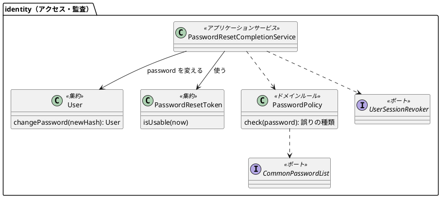
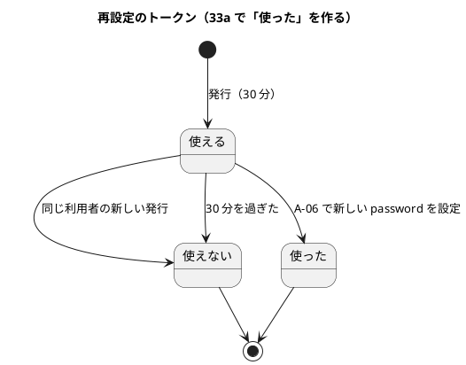
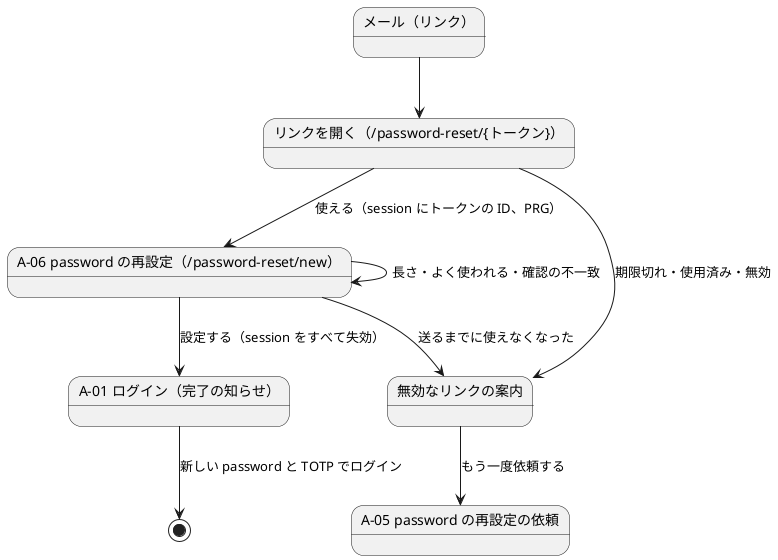

# Bolt 33a 計画 - password の再設定（A-06。US-18 AC8 の後半）

## 基本情報

| 項目 | 内容 |
| :--- | :--- |
| Bolt | 第 33a 回（W5 の 16 本目。US-18 の残りの 13 本目） |
| 予定 | W5（2026-11-02 の週。前倒しで着手できる）。作業は約 4.5 時間（承認ゲートの待ち時間を除く。「時間の配分と打ち切り」） |
| 対象 | `identity`（再設定のトークンを使う、利用者の password の変更、password の方針とよく使われる password の一覧、利用者の session の失効、A-06 の画面、A-01 の完了の知らせ、監査の種類）、設計文書、ユーザーマニュアル、デモの動画 |
| SP | 0（US-18 の SP は #13 をクローズする Bolt 33b で数える） |
| GitHub | [#13](https://github.com/k2works/practical-domain-driven-design-in-enterpris-application/issues/13)（US-18、R1.0）。この Bolt では閉じない |
| 承認ゲート | **ステップごとに止める**（W5 の表の 33a の行: セキュリティ、スキーマ）。確認必須（セキュリティ・新しいファイル・外部の資料の同梱）は計画の承認の場で確認ポイントとして判断を受ける。実装の途中で層・モジュールの規則に当たったら、`/goal` の下でも止めて諮る（T-125） |
| アプローチ | インサイドアウト（W5 の既定と表の 33a の行どおり）。ドメインの規則（password の方針、トークンを使う）と集約の変更から入り、リポジトリ・session の失効の統合テスト、サービス、画面の順に外へ広げる。認証の入口に触る部分（公開の URL、session）はセキュリティの統合テストで外側から確かめる |
| 前の Bolt | [Bolt 33 終了報告](bolt_33_report.md) |

## Bolt ゴール

password を忘れた利用者が、メールのリンクから新しい password を設定できる。リンクを開くと、使えるトークンなら URL からトークンを消した A-06 が開き、12〜64 文字でよく使われる password でない新しい password を設定すると、トークンは使えなくなり、その利用者の session はすべて失効し、A-01 に「password を変更しました」と出る。新しい password と TOTP でログインし直す（A-06 は password の要素を与えない）。期限切れ・使用済み・新しいリンクを送った後のリンクは、どれも同じ案内で依頼し直しを促す。再設定は監査に残る。

### 確かめたい仮説

| # | 仮説 | この Bolt で分かること |
| :--- | :--- | :--- |
| H1 | GET でトークンを確かめて session にトークンの ID だけを置き、トークンのない URL へ移せば（PRG）、平文のトークンは最初の 1 回の要求の URL にしか現れず、表・session・Referer・以後の URL に残らない | セキュリティの統合テストで、移った後の URL と session の表にトークンがないこと、応答に `Referrer-Policy: no-referrer` があることを確かめる |
| H2 | トークンを使う・password を変える・前の未使用のトークンを無効にする・session を失効させる・監査を書く、を 1 つのトランザクションにすれば、同じトークンの同時の 2 つの送信でも password の変更は 1 回だけになる | 条件付きの更新で 1 つだけが通ることを、T-100 の形の統合テストで確かめる |

### 開始準備で確かめたこと（T-114）

- **トークン**: `identity.password_reset_token` に `used_at` があり、Bolt 33 では使う側がない。`PasswordResetTokenRepository.findByTokenHash` は 33a のために置いてある。リンクは `{公開の base URL}/password-reset/{トークン}`（43 文字の URL 安全な Base64）
- **仮の A-06**: `PasswordResetController` の `@GetMapping("/*")` が「準備中」を返す。`PUBLIC_PATHS` に `/password-reset/*` がある（1 段だけ）。全 URL の見張り（`AuthenticationSecurityIntegrationTest` の `AUTHENTICATION_SCREENS`）も `/password-reset/*` を除いている
- **利用者**: `User` は password を変えるメソッドを持たず、`UserRepository` に更新がない。`app_user` に `password_hash`・`version`・`updated_at` がある。password は `DelegatingPasswordEncoder`（bcrypt。SEC-07）
- **session**: Spring Session JDBC の `platform.spring_session` に `principal_name` の索引がある。主体の名前に何が入るか（メールアドレスか利用者の ID か）は、開始準備で特性テストの形にして確かめる（T-114。ステップ 2 の最初）
- **ロック**: `LoginFailure` は 2 要素がそろった成功でだけ 0 に戻る（SEC-02）
- **監査**: `AuditAction` に `PASSWORD_RESET_REQUESTED` がある。完了の値はない
- **設計文書の欠け**（ステップ 1 で反映する）: A-06 の URL・画面イメージ・文言・誤りの文言、無効なリンクの案内、A-01 の完了の知らせ（ui_design.md の :181 は「Bolt 33a で決める」）。password の方針の概念（domain_model.md）。`PASSWORD_RESET_COMPLETED`（data_model.md の :925）。SEC-05 の一覧の出典と更新の手順（non_functional.md）。session の失効（ADR-012）

## ふりかえりと前の Bolt からの引き継ぎ

| 入力 | 内容 | この Bolt での扱い |
| :--- | :--- | :--- |
| 開始準備の決定（2026-10-15、human:kakimomokuri） | (1) GET でトークンを確かめ、session にトークンの ID だけを移して、トークンのない URL（`/password-reset/new`）へ PRG。`Referrer-Policy: no-referrer`。(2) SEC-05 は、公開のよく使われる password の一覧（12 文字以上に絞る）を同梱して照合する。漏えい済みの照合（HIBP の k-anonymity API など。外部連携）は W10（#49）。(3) 再設定したら、その利用者の session をすべて失効させる。(4) ロックと失敗の数は変えない（SEC-02） | 本計画の範囲と確認ポイント 1〜4 |
| Bolt 33 の決定 | A-06 は password の要素を与えず、設定したら A-01 に戻す（ADR-011）。リンクの path は `/password-reset/{トークン}`。仮の A-06 を本物に置き換える | 確認ポイント 5 |
| Bolt 33 の Try T-125 | 実装の途中で層・モジュールの規則に当たったら、置き場所を動かす前に止めて諮る | 承認ゲートの欄。session の失効のポートは、外部の技術のポートの規則（CLAUDE.md、ADR-017）どおり `identity.domain.model.aggregates` に置き、実装を `identity.infrastructure` に置く |
| Bolt 33 の Try T-126 | 新しいスキーマ・モジュールを足すときは名前の一覧を grep で探す。push の後は MkDocs の配備の結果も確かめる | この Bolt は新しいスキーマを作らない。各ステップの push の後に 2 つの CI を確かめる |
| Bolt 33 の Try T-127 | 非同期のハンドラーのテストは、DB を読む前に発行記録の完了を待つ | デモと画面の層のシナリオで依頼から設定まで通すときに使う（メールの到着の後に発行記録の完了を待ってからリンクを開く） |
| Bolt 32f・32b の Try T-123・T-119・T-117・T-113・T-100・T-112 | 文言は場面の表から決める。否定は先に肯定を確かめてから。規則を外したときだけ落ちる入力。共有の表は利用者で絞る。同時の更新は先を止めて後を待たせる。見張りの違反を入れて確かめる | A-06 の誤り・無効なリンクの案内・A-01 の完了の知らせを場面の表で決める。長さの境界（11・12・64・65 文字）、一覧の 1 語とその 1 文字違い、同じトークンの同時の 2 つの送信 |
| Bolt 33 の既知の課題 | トークンの露出（33a で扱う）、`findByEventIdAndRecipient` が本番から呼ばれない、`SchemaCommentIntegrationTest` に `tracking` がない | 露出はこの Bolt の H1。ほかの 2 つは扱わない |

## スコープ

### 入れるもの・入れないもの

| 入れる | 入れない（後で） |
| :--- | :--- |
| `GET /password-reset/{トークン}`: ハッシュで探し、使えれば session にトークンの ID を置いて `/password-reset/new` へ。使えなければ無効なリンクの案内（どれも同じ）。どちらも `Referrer-Policy: no-referrer` | 漏えい済みの password の照合（外部連携。W10、#49） |
| A-06（`GET`・`POST /password-reset/new`）: 新しい password と確認の 2 つの欄。誤りは欄の下（A-05 と同じ形）。送ると、トークンを使い・password を変え・前の未使用のトークンを無効にし・利用者の session をすべて失効させ・監査を書く（1 つのトランザクション）。`/login?reset-completed` に PRG | 再設定の後に、本人へ「password を変えた」ことを知らせるメール（W9 の通知とあわせて決める） |
| password の方針（`identity.domain.model.rules.PasswordPolicy`）: 12〜64 文字（code point で数える。空白と全角を許す）、よく使われる password の一覧に載っていない（大文字小文字を区別せずに比べる） | Unicode の正規化（ログインの照合と同時に直す必要があるので、扱うなら別の Bolt） |
| よく使われる password の一覧（`src/main/resources/security/common-passwords.txt`。公開の一覧から 12 文字以上に絞ったもの）と、出典・ライセンス・更新の手順 | 一覧の定期の更新の自動化 |
| `User` の password の変更（新しいハッシュ。版を上げる）と `UserRepository` の更新（版を条件にした更新） | 利用者の管理（US-16。Bolt 34） |
| 利用者の session の失効のポート（`UserSessionRevoker`。`identity.domain.model.aggregates`）と実装（Spring Session の主体の名前の索引） | ロックの解除（SEC-02 のまま） |
| 監査の種類 `PASSWORD_RESET_COMPLETED`（成功。失敗は記録しない） | — |
| A-01 の完了の知らせ（`/login?reset-completed`）、仮の A-06 の置き換え（テンプレートを消す） | — |
| 設計文書、マニュアル 2.6 と付録 B、A-06 と完了の知らせのキャプチャ、デモの動画（依頼から設定まで） | — |

### 設計の約束（Try T-1）

- **リンクを開く**（`PasswordResetController` の `GET /{トークン}`）: トークンを `PasswordResetTokenHasher` でハッシュにして探す。`isUsable(now)` なら session に `PasswordResetSession.TOKEN_ID`（トークンの ID）を置き、`redirect:/password-reset/new`。使えなければ無効なリンクの案内（`identity/password-reset-invalid`）。トークンの値はログ・モデル・session に置かない
- **A-06**（`GET /password-reset/new`）: session のトークンの ID でトークンを読み、使えればフォーム、使えなければ無効なリンクの案内（session の ID を消す）。`POST /password-reset/new` は方針の誤り・確認の不一致だけ A-06 で示し、通れば `PasswordResetCompletionService.complete(tokenId, newPassword)`
- **完了のサービス**（`identity.application.internal.commandservices.PasswordResetCompletionService`）: 1 つのトランザクションで、トークンを条件付きで使う（`used_at IS NULL AND invalidated_at IS NULL AND expires_at > now`。0 件なら無効）→ 利用者を読み、方針を確かめ、password を変えて保存（版を条件に）→ 同じ利用者の未使用のトークンを無効にする → `UserSessionRevoker.revokeAll(userId)` → 監査 `PASSWORD_RESET_COMPLETED`。結果は完了か無効（無効なら画面は案内）
- **password の方針**（`PasswordPolicy`、`@DomainRule`）: `check(String)` が誤りの種類（短い・長い・よく使われる）か空を返す。一覧はドメインのポート `CommonPasswordList`（`contains`）で受け、実装（`identity.infrastructure.security` か `crypto`。ステップ 2 で前例に合わせて決める）が起動のときに資源を読む
- **session の失効**（`UserSessionRevoker`、ドメインのポート）: 実装は Spring Session の `FindByIndexNameSessionRepository` で利用者の主体の名前の session を探して消す。今の要求の session（未認証）は主体がないので消えず、トークンの ID の属性を消す
- **公開の URL**: `/password-reset/*` のまま（`/password-reset/new` も 1 段で含まれる）。`new` はトークン（43 文字）と重ならない
- **監査**: `AuditRecord.passwordResetCompleted(user, company, at)`、成功だけを記録する

## 設計（この Bolt の範囲）

4 図のうち、ドメインモデル図・状態遷移図・画面遷移図を置く。ER 図は、新しい表も列もない（`password_reset_token.used_at` と `app_user.password_hash` を更新するだけ）ので省く。

### ドメインモデル

### 状態遷移

### 画面遷移

## ステップ計画

状態の記号: `[ ]` 未着手、`[-]` 進行中、`[?]` 承認待ち、`[x]` 完了。各ステップの終わりに `check` が緑であることと、計画からの変更を設計文書に反映したこと（T-53）を確かめ、push してアプリの CI と MkDocs の配備を確かめる（T-26、T-118、T-126）。コミットは pathspec で作る（T-110）。複数行の書き換えはスクリプトのファイルにする（T-103）。共通の部品を変えたら `check` を先に流す（T-120）。

- [ ] **1. 設計文書** 【承認ゲート: 設計文書】
  - ui_design.md: A-06 の URL・画面イメージ（新しい password・確認・「password を設定する」）と文言、誤りの文言、無効なリンクの案内、A-01 の完了の知らせ（場面の表。T-123）、仮の A-06 の行を消す、画面遷移
  - domain_model.md: password の方針（SEC-04・SEC-05）、`User` の password の変更、トークンを使う（IA-INV-12 の「使った」）、ポート 2 つ、用語集、`PASSWORD_RESET_COMPLETED`
  - data_model.md: audit_record の action の範囲、`app_user` の password の更新（版）
  - non_functional.md: SEC-04・SEC-05（同梱の一覧、出典、更新の手順、漏えいの照合は W10）、SEC-08（session の失効、ロックはそのまま、トークンの露出の扱い）
  - ADR-012: 再設定で利用者の session をすべて失効させる。ADR-017: 仮の A-06 を置き換えた
  - test_strategy.md、user_story.md（AC8 の後半）、release_plan.md（W5 の 33a の行、デモ項目、マニュアルの段落）
  - 完了の判定: `okf:check` ERROR 0、`documentationTest` 緑
- [ ] **2. ドメインと永続化と session の失効（インサイドアウト）** 【承認ゲート: セキュリティ】
  - 最初に、session の主体の名前に何が入るかを特性テストで確かめる（T-114）
  - `PasswordPolicy` の単体テスト（11・12・64・65 文字、空白と全角、一覧の 1 語と大文字小文字の違いと 1 文字違い）→ 一覧の資源と実装 → `User.changePassword` の単体テスト → `UserRepository` の更新（版の条件）の統合テスト → トークンを使う条件付きの更新の統合テスト（使える・期限切れ・使用済み・無効）→ `UserSessionRevoker` の統合テスト（その利用者の session だけが消える）
  - 完了の判定: `check` 緑。層の規則に例外を足していない
- [ ] **3. 完了のサービス（インサイドアウト）** 【承認ゲート: セキュリティ】
  - 完了・無効（期限切れ・使用済み・無効化）・方針の誤り、前の未使用のトークンの無効化、session の失効、監査（利用者で絞る。T-113）、ロックと失敗の数が変わらないこと、同じトークンの同時の 2 つの送信で 1 回だけ（T-100）
  - 完了の判定: `check` 緑。トークンを使う条件を外すと同時の送信のテストが落ちることを確かめる（T-112）
- [ ] **4. 画面（リンクを開く、A-06、無効なリンクの案内、A-01 の完了の知らせ）** 【承認ゲート: 画面、セキュリティ】
  - Red の前に、仮の A-06・`PUBLIC_PATHS`・全 URL の見張り・A-01 の描画を確かめている既存のテストを検索し、変わる期待を Red に入れる（T-122）
  - セキュリティの統合テスト: リンクを開くと `/password-reset/new` に移り、移った先の URL・session の表にトークンがない。`Referrer-Policy`。無効なトークンは同じ案内。session にトークンの ID がなければ A-06 は案内。CSRF。完了の後に、ほかの端末の session で業務の画面を開くと A-01（失効）。新しい password と TOTP でログインできる、古い password ではログインできない
  - 画面の層の受入シナリオ（`login_ui.feature`、`@US-18-AC8`）: 依頼 → メール → リンクを開く → A-06 で設定 → A-01 の完了の知らせ → 新しい password と TOTP でログイン（`@demo @demo-bolt-33a/reset`）。期限切れのリンクで案内が出る。よく使われる password で誤りが出る。axe の違反 0
  - 仮の A-06 のテンプレートを消す
  - 完了の判定: `check` を先に（T-120）、続けて `uiTest` が緑
- [ ] **5. マニュアルとデモ** 【承認ゲート: マニュアル】
  - マニュアル 2.6 に A-06 の手順（リンクを開く、新しい password と確認、長さとよく使われる password、設定の後は新しい password と TOTP でログインし直す、ほかの端末はログアウトする、リンクが使えないとき）、付録 B の Q1-6 と早見表、A-06 と完了の知らせのキャプチャ
  - デモの動画（`./gradlew demoVideo`。`@demo-bolt-33a/reset`）を録画する（レビューの直しで文言が変わらないと確かめてから。T-105）
  - 完了の判定: `manual:build` が通る。`okf:check` ERROR 0
- [ ] **6. SonarQube と開発レビューと終了報告** 【承認ゲート: 終了報告】
  - SonarQube（T-116）。開発レビュー（プログラマー、テスター、アーキテクト、セキュリティ、テクニカルライター）
  - `bolt_33a_report.md`。release_plan の W5 の 33a の行、開発の索引。#13 に進み具合をコメントする。終了報告の承認の後に、デモの動画を #13 に添付し、添付の対応表に bolt-33a を足す

### 時間の配分と打ち切り

| # | 目安 | 打ち切り |
| :--- | :--- | :--- |
| 1 | 40 分 | — |
| 2 | 60 分 | session の主体の名前で利用者を探せないと分かったら、失効のやり方（利用者の ID を属性に置いて探す、など）を諮る |
| 3 | 45 分 | — |
| 4 | 60 分 | — |
| 5 | 35 分 | — |
| 6 | 30 分（SonarQube の待ちを除く） | — |

合計 270 分（約 4.5 時間）。5 時間を超えると見えたら止めて諮る（候補: デモの動画を 33b に送る）。

## 確認ポイント（計画の承認の場でまとめて確認する。Try T-6）

| # | 確認すること | ステップ | 推奨 |
| :--- | :--- | :--- | :--- |
| 1 | **トークンの扱い**（開始準備で決めた。セキュリティ） | 4 | GET で確かめて session にトークンの ID だけを置き、`/password-reset/new` へ PRG。`Referrer-Policy: no-referrer`。トークンの値はログ・モデル・session に置かない |
| 2 | **SEC-05 の一覧**（開始準備で決めた。外部の資料の同梱） | 2 | 公開のよく使われる password の一覧（SecLists の `10-million-password-list-top-100000.txt`。MIT ライセンス）から 12 文字以上を抜き出して同梱し、出典・ライセンス・抜き出し方を同じ置き場所の説明と non_functional に書く。漏えいの照合は W10（#49） |
| 3 | **session の失効**（開始準備で決めた。セキュリティ） | 2・3 | 完了と同じトランザクションで、その利用者の session をすべて消す。ポートはドメイン、実装は Spring Session の主体の名前の索引 |
| 4 | **ロック**（開始準備で決めた） | 3 | 変えない（SEC-02）。完了の知らせにロックの有無を示さない |
| 5 | **無効なリンクの案内** | 1・4 | 期限切れ・使用済み・新しいリンクを送った後・存在しない、をどれも同じ案内にし、A-05 へのリンクを出す（どれかを示さない） |
| 6 | **password の方針** | 2 | 12〜64 文字を code point で数える。空白と全角を許す。一覧とは大文字小文字を区別せずに比べる。正規化はしない（ログインの照合と合わせて扱う。既知の課題） |
| 7 | **監査** | 3 | `PASSWORD_RESET_COMPLETED`（成功）を利用者・企業で記録する。方針の誤り・無効なリンクは記録しない（依頼は 33 で記録済み） |
| 8 | **新しいファイル** | 2〜4 | `PasswordPolicy`、`CommonPasswordList` と実装、`UserSessionRevoker` と実装、`PasswordResetCompletionService`、テンプレート（A-06、無効なリンクの案内）、一覧の資源、テスト。仮の A-06 のテンプレートは消す |
| 9 | **マニュアル・デモ** | 5 | 入れる。2.6 と付録 B、A-06 と完了の知らせのキャプチャ、デモの動画（依頼から設定まで） |
| 10 | **アプローチと承認ゲート** | 全体 | インサイドアウト。ステップごとに止める（2・3 はセキュリティ、4 は画面とセキュリティ） |

## 完了条件

- [ ] メールのリンクを開くとトークンのない URL の A-06 が開き、12〜64 文字でよく使われる password でない新しい password を設定できる。トークンは 1 回だけ使え、URL・session・表に平文が残らない
- [ ] 期限切れ・使用済み・無効のリンクは同じ案内になる
- [ ] 設定すると、前の未使用のトークンが使えなくなり、その利用者の session がすべて失効し、ロックは変わらず、監査に記録される。A-01 に完了の知らせが出て、新しい password と TOTP でログインできる
- [ ] 設計文書（ui_design・domain_model・data_model・non_functional・ADR-012・ADR-017・test_strategy・user_story・release_plan）を更新した
- [ ] ユーザーマニュアル（2.6・付録 B）とキャプチャを更新し、デモの動画を録画した（#13 への添付は終了報告の承認の後）
- [ ] `check` と `uiTest` が緑。push してアプリの CI と MkDocs の配備を確かめた。SonarQube の Quality Gate が PASS、`okf:check` ERROR 0
- [ ] 開発レビュー、終了報告。#13 に進み具合をコメントした

## 更新履歴

| 日付 | 更新内容 | 更新者 |
| :--- | :--- | :--- |
| 2026-10-15 | 初版作成（承認待ち）。開始準備で、トークンの表と仮の A-06、`User` と `UserRepository`、Spring Session の主体の名前の索引、ロック、監査を調べ、human:kakimomokuri の決定（トークンは session に移して PRG、よく使われる一覧を同梱、session をすべて失効、ロックはそのまま）を反映した | anthropic/claude-opus-5-5 |

## 関連ドキュメント

- [リリース計画](release_plan.md)（W5）
- [Bolt 33 計画](bolt_33_plan.md)、[Bolt 33 終了報告](bolt_33_report.md)
- [ユーザーストーリー](../../requirements/cargo-tracker/user_story.md)（US-18 AC8）
- [UI 設計](../../design/cargo-tracker/ui_design.md)（A-01・A-06）、[ドメインモデル](../../design/cargo-tracker/domain_model.md)、[データモデル](../../design/cargo-tracker/data_model.md)、[非機能要件](../../design/cargo-tracker/non_functional.md)（SEC-02・SEC-04・SEC-05・SEC-08）、[テスト戦略](../../design/cargo-tracker/test_strategy.md)
- [ADR-011](../../adr/cargo-tracker/011-mfa-totp.md)、[ADR-012](../../adr/cargo-tracker/012-authentication-principal-and-session.md)、[ADR-017](../../adr/cargo-tracker/017-notification-module-and-mail.md)
