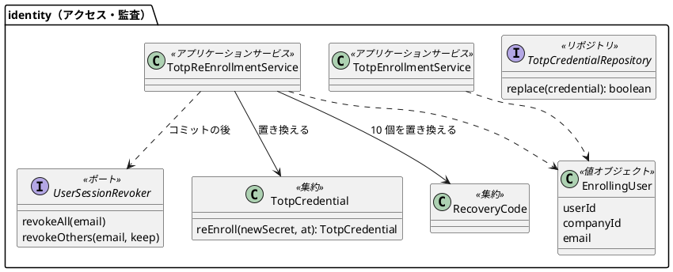
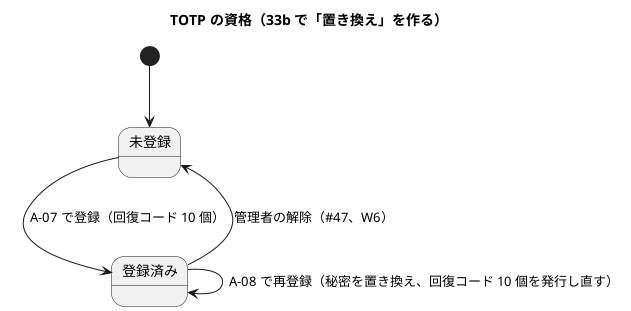
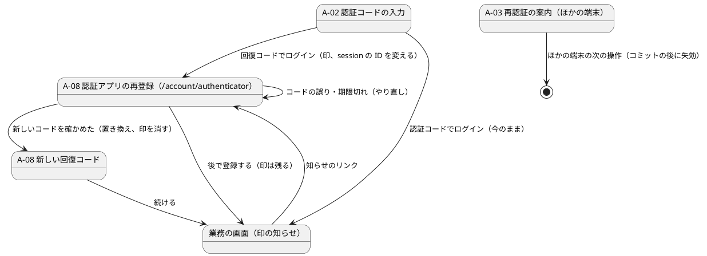

# Bolt 33b 計画 - 回復コードによる TOTP の再登録（US-18 AC9）と #13 のクローズ

## 基本情報

| 項目 | 内容 |
| :--- | :--- |
| Bolt | 第 33b 回（W5 の 17 本目。US-18 の残りの 14 本目、最後） |
| 予定 | W5（2026-11-02 の週。前倒しで着手できる）。作業は約 5 時間（承認ゲートの待ち時間を除く。「時間の配分と打ち切り」） |
| 対象 | `identity`（回復コードでログインした印、認証アプリの再登録のサービスと画面 A-08、TOTP の資格の置き換え、回復コードの発行し直し、ほかの session の失効、監査の種類、`TotpEnrollmentService` の引数の型）、設計文書、ユーザーマニュアル（2.1 の書き直しと再登録の手順）、デモの動画 |
| SP | 2（US-18。#13 をこの Bolt でクローズする） |
| GitHub | [#13](https://github.com/k2works/practical-domain-driven-design-in-enterpris-application/issues/13)（US-18、R1.0）。この Bolt でクローズする（AC9 の管理者の別経路と本人への通知は [#47](https://github.com/k2works/practical-domain-driven-design-in-enterpris-application/issues/47)） |
| 承認ゲート | **ステップごとに止める**（W5 の表の 33b の行。セキュリティ）。スキーマは変えない（`totp_credential` の行を UPDATE し、監査の action は CHECK 制約がない）。確認必須（セキュリティ・新しいファイル・構造）は計画の承認の場で確認ポイントとして判断を受ける。実装の途中で層・モジュールの規則に当たったら、`/goal` の下でも止めて諮る（T-125） |
| アプローチ | インサイドアウト（W5 の既定と表の 33b の行どおり）。不確実性は資格の置き換えのトランザクション（同時の TOTP のログインと再登録、回復コードの発行し直し、コミットの後の失効）にあり、内側から固める。画面と認証の入口はセキュリティの統合テストと画面の層のシナリオで外側から確かめる |
| 前の Bolt | [Bolt 33a 終了報告](bolt_33a_report.md) |

## ふりかえりと前の Bolt からの引き継ぎ

| 入力 | 内容 | この Bolt での扱い |
| :--- | :--- | :--- |
| 開始準備の決定 1（2026-10-15、human:kakimomokuri） | (1) 33b と 33c に分ける。33b は AC9 の再登録とそれが触る部品（`TotpEnrollmentService` の引数の型、`instanceof` の `switch` 化）とマニュアル。振る舞いの変わらない直しは 33c。#13 は 33b でクローズする。(2) 回復コードでログインしたら再登録の画面へ導き、「後で登録する」で業務の画面へ進める。印がある間は業務の画面に知らせを出す。入口はこの流れだけ（設定の画面は作らない）。(3) 新しいコードを確かめた時点で古い秘密を置き換え（それまでは古い秘密が有効）、回復コードを 10 個発行し直して 1 回だけ示し、監査に `TOTP_RE_ENROLLED` を足す。(4) コミットの後に、その利用者のほかの session を失効させる（今の session は残す）。本人へのメールの通知は #47（W6） | 確認ポイント 1〜4 |
| Bolt 33a の議題 7 と Try T-128 | 画面の層のテストで Playwright の正規表現に渡す文字列は共通の補助でエスケープする。見張りの形をこの開始準備で決める | 確認ポイント 11。ステップ 4 で共通の補助（`PlaywrightText.literal` など）に寄せ、`ui` パッケージで `Pattern.quote` を使わない ArchUnit の規則を足す |
| Bolt 33a の Try T-129・T-130 | 決定に「前・後」の順序があるものは、実装のステップの終わりに決定と実装の順を突き合わせる。公開の URL・session に権限を置く変更は session の ID を変えるかを確認ポイントに入れる | ステップ 3・4 の終わりに確認ポイント 3・4 の順（置き換えは確かめた後、失効はコミットの後）と実装を突き合わせる。確認ポイント 5（印を置くときの session の ID） |
| Bolt 33a の #49 | W10 に送ったもの（資格情報の版による再確認など） | 扱わない。再登録でもほかの session の失効が失敗すると残りうる（33a と同じく警告のログ。#49 の資格情報の版で閉じる） |
| Bolt 31c の議題 4・31d のレビュー | `TotpEnrollmentService` が password の段の型（`PasswordVerifiedUser`）を受けるので、2 つの要素がそろった session から呼べない。`instanceof` の `switch` 化 | ステップ 2 で段に中立な値（`EnrollingUser`。利用者・企業・メールアドレス）で受け、画面が詰め替える |
| Bolt 32 の既知の課題（マニュアル） | 2.1 を 2 段階（A-02・A-07・回復コード）に書き直し、ロックされたら 15 分たってからログインし直すこと、誤りの数は password・認証コード・回復コードを合わせて数えることを書く。付録 B の Q1-1 に「5 回続けて誤った」の行 | ステップ 5 |
| 33b の行の残り（33c に送る） | TOTP の桁数・周期・アルゴリズムの定数、SVG の組み立て、属性の名前と期間を 2 つの定数で持つ 4 組（登録を始めた時刻・途中の秘密・8 時間の残り・戻り先）と 15 分の期間、A-01 の「5 回」「15 分」と `LockPolicy`、回復コードの形の知識の 2 か所、`normalize` の戻り値の型、空の復号の境界のテスト | 33c（ステップ 1 で release_plan に行を足す）。置き場所の案（`identity.domain.model.rules.SessionPolicy` に期間と属性の名前を置く）は 33c の開始準備で諮る |
| Bolt 33a・33・32f の Try T-127・T-126・T-125・T-123・T-122・T-121・T-113・T-112・T-107・T-102・T-100 | 非同期の完了を待つ。名前の一覧を grep する、push の後に MkDocs も見る。規則に当たったら止める。文言は場面の表から。共通の部品の期待を先に探す。URL の判定は matcher。共有の表は利用者で絞る。規則を外したときだけ落ちる入力。「ないこと」は対象があることを先に確かめる。同じ session での利用者の切り替え。同時の更新は先を止めて後を待たせる | 再登録の画面・知らせ・A-02 を場面の表で決める。同時の TOTP のログイン（`last_used_step` の更新）と再登録の置き換え、印のない session で A-08 を開く、password の段の session で A-08 を開く |

## スコープ

### 入れるもの・入れないもの

| 入れる | 入れない（後で） |
| :--- | :--- |
| 回復コードでログインしたら、session に印（`RecoveryLogin.MARK`。画面の層が読む）を置き、session の ID を変え、保存した要求ではなく A-08 に移す | 管理者の別経路による解除と本人への通知（#47、W6） |
| A-08 認証アプリの再登録（`GET`・`POST /account/authenticator`）: QR と秘密、新しいコードの確認、完了したら新しい回復コード 10 個を 1 回だけ示す。「後で登録する」（`POST /account/authenticator/later`）で保存した要求か役割のホームへ | 認証アプリの設定の画面・ヘッダーの導線（印のない利用者は再登録できない） |
| 印がある間、業務の画面（`layout/customer`・`layout/staff`）に「認証アプリを登録し直してください」の知らせと A-08 へのリンク | 残りの回復コードが少ないときの案内（印の知らせで足りるかを場面の表で確かめ、足りなければ #47 に送る） |
| 再登録のサービス（`TotpReEnrollmentService`）: 開始で新しい秘密を発行（session に暗号文。A-07 と同じ）、完了で新しいコードを確かめ、利用者の行を占有して TOTP の秘密を置き換え（`last_used_step` を戻す）、回復コードを 10 個置き換え、監査 `TOTP_RE_ENROLLED`。コミットの後にほかの session を失効 | 本人へのメールの通知（#47） |
| `TotpCredentialRepository.replace`（UPDATE。資格がなければ 0 件）、`UserSessionRevoker.revokeOthers(メールアドレス, 残す session の ID)` | 33c の直し（上の表） |
| `TotpEnrollmentService` を段に中立な値（`EnrollingUser`）で受け、`instanceof` を `switch` にする。A-07 と A-08 で秘密の発行と QR を共用する | 再登録の失敗の監査（成功だけを記録する。失敗の試行の監査は #49 と同じ扱い） |
| マニュアル 2.1 の書き直し（2 段階のログイン、A-02、A-07、回復コード、ロックの 15 分、誤りの数え方）と再登録の節（2.7）、付録 B（Q1-1 の 5 回の行、認証アプリを失った場合）。A-02・A-08 と知らせのキャプチャ、デモの動画（回復コードでログインして再登録する） | — |
| #13 のクローズ、US-18 の SP 2 の計上、release_plan の 33c の行 | — |

### 設計の約束（Try T-1）

- **印**: `RecoveryCodeAuthenticationProvider` が通したとき、成功のハンドラー（`FirstTotpSuccessHandler` の分岐）が session に `RecoveryLogin.MARK`（`interfaces.web` に置く。T-128 の 33c で置き場所を見直す 4 組とは別に、画面の層だけが読み書きする）を置き、`changeSessionId()` で session の ID を変え、`/account/authenticator` に移す。保存した要求は残し、「後で登録する」で戻る
- **A-08 の入口**: 2 つの要素がそろった主体（`AuthenticatedActor`）で、印があるときだけ開ける。印がなければ役割のホームへ移す（403 にしない。利用者の手順を止めない）。password の段の主体は A-02 へ（今の認可のまま）
- **再登録のサービス**（`identity.application.internal.commandservices.TotpReEnrollmentService`）: `begin(EnrollingUser)` は新しい秘密を発行して暗号文と QR を返す（資格の有無を問わない）。`complete(EnrollingUser, 暗号文, コード, 始めた時刻)` は 15 分の上限（A-07 と同じ）とコードを確かめ、トランザクションの中で利用者の行を占有し、`replace`（0 件なら資格がない＝失敗）・回復コードの `replaceAll`・監査を書く。コミットの後に `revokeOthers` を呼び、失敗は警告のログ。外側のトランザクションの中では呼べない（33a と同じガード）。結果は 完了（回復コード）・コードの誤り・期限切れ
- **置き換えの順**: 新しいコードを確かめる → 置き換える。確かめる前に古い秘密を消さない。置き換えの後、古い秘密のコードは通らない。同時に古い秘密で A-02 を通る要求は、利用者の行の占有で直列にする（`useStep` が条件付きの更新なら置き換えの後は 0 件になることを統合テストで確かめる）
- **ほかの session の失効**: `revokeOthers(email, 今の session の ID)` は主体の名前の索引で探し、今の session を除いて消す（実装 `SpringSessionUserSessionRevoker`）。ほかの端末は次の操作で A-03（文言は場面の表で確かめる）
- **監査**: `AuditAction.TOTP_RE_ENROLLED`、`AuditRecord.totpReEnrolled(user, company, at)`。成功だけ
- **完了の後**: 印を消し、新しい回復コードを A-08 の完了の画面に 1 回だけ示す（A-07 の回復コードの画面と同じ形。PRG で再表示しない）。「続ける」で保存した要求か役割のホーム

## 設計（この Bolt の範囲）

4 図のうち、ドメインモデル図・状態遷移図・画面遷移図を置く。ER 図は、新しい表も列もない（`totp_credential` の `secret_encrypted`・`last_used_step`・`enrolled_at` を更新し、`recovery_code` を置き換えるだけ）ので省く。

### ドメインモデル

### 状態遷移

### 画面遷移

## ステップ計画

状態の記号: `[ ]` 未着手、`[-]` 進行中、`[?]` 承認待ち、`[x]` 完了。各ステップの終わりに `check` が緑であることと、計画からの変更を設計文書に反映したこと（T-53）を確かめ、push してアプリの CI と MkDocs の配備を確かめる（T-26、T-118、T-126）。コミットは pathspec で作る（T-110）。複数行の書き換えはスクリプトのファイルにする（T-103）。共通の部品を変えたら `check` を先に流す（T-120）。

- [ ] **1. 設計文書** 【承認ゲート: 設計文書】
  - ui_design.md: 画面一覧に A-08、URL の表（`/account/authenticator`・`/later`）、画面イメージと文言（QR・秘密・コード・新しい回復コード・後で登録する）、印の知らせ、場面の表（T-123。印のない session・password の段・15 分を過ぎた・コードの誤り・ほかの端末の A-03・回復コードの残りが少ない）、画面遷移、A-07 との共用
  - domain_model.md: `EnrollingUser`、資格の置き換え（IA-INV-10 の 1 人 1 つのまま置き換える）、IA-INV-11 の発行し直し、`TOTP_RE_ENROLLED`、用語集（「認証アプリの再登録」「回復コードでログインした印」）
  - data_model.md: `totp_credential` の更新（秘密・`last_used_step` を戻す・`enrolled_at`）、`audit_record.action` の範囲
  - non_functional.md: SEC-10 を「提案」から確定し流れを書く。SEC-09 の発行し直し
  - ADR-011（33b で決めた再登録、ADR-011:220・247・341 の宿題を閉じる）、ADR-012（ほかの session の失効の 2 つ目の場面、印を置くときの session の ID）、architecture_backend（`revokeOthers`、A-08 の置き場所）
  - test_strategy.md、user_story.md（AC9 の回復コードの経路を満たしたこと）、release_plan.md（33c の行を足し W5 の本数を 20 本に、33b の行の範囲を決定 1 に合わせる、デモ項目）
  - 完了の判定: `okf:check` ERROR 0、`documentationTest` 緑
- [ ] **2. 部品の付け替えと資格の置き換え（インサイドアウト）** 【承認ゲート: セキュリティ、構造】
  - 最初に骨組み（`EnrollingUser`、`TotpReEnrollmentService` の空の形、`replace`・`revokeOthers` のポート）を置いて ArchUnit を流す（T-101）。`AuthenticationArchitectureTest:178-193`（password の段の主体を受ける画面の規則）に当たったら止めて諮る（T-125）
  - `TotpEnrollmentService` を `EnrollingUser` で受け、`instanceof` を `switch` にする（既存のテストが緑のまま）→ `TotpCredential.reEnroll` → `replace` の統合テスト（置き換え・0 件・`last_used_step` が戻る・置き換えの後に古い秘密の step で `useStep` が通らない）→ `revokeOthers` の統合テスト（今の session が残り、同じ利用者のほかの session が消え、ほかの利用者の session は残る）
  - 完了の判定: `check` 緑。層の規則に例外を足していない
- [ ] **3. 再登録のサービス（インサイドアウト）** 【承認ゲート: セキュリティ】
  - `begin`・`complete`: 完了（秘密の置き換え・回復コード 10 個・監査・コミットの後の失効）、コードの誤り（置き換えない）、15 分を過ぎた、資格がない（失敗）、外側のトランザクションの中では呼べない、失効の失敗でも完了、監査を書けなければ失効しない、同時に古い秘密で A-02 を通る要求との直列（T-100）
  - 完了の判定: `check` 緑。置き換えの条件（占有）を外すと同時のテストが落ちることを確かめる（T-112）。決定の順（確かめた後に置き換え、コミットの後に失効）と実装を突き合わせる（T-129）
- [ ] **4. 画面（印、A-08、知らせ）** 【承認ゲート: 画面、セキュリティ】
  - Red の前に、成功のハンドラー・A-02・A-07・`AUTHENTICATION_SCREENS`（全 URL の見張り）・業務の画面のレイアウトを確かめている既存のテストを検索し、変わる期待を Red に入れる（T-122）
  - セキュリティの統合テスト: 回復コードでログインすると A-08 に移り session の ID が変わる、認証コードでログインすると今のまま、印のない session・password の段で A-08 を開く、CSRF、再登録の後に新しいコードでログインでき古いコードと古い回復コードは通らない、ほかの端末は A-03、今の session は残る
  - 画面の層の受入シナリオ（`login_ui.feature` か `totp_ui.feature`、`@US-18-AC9`）: 回復コードでログイン → A-08 → QR の秘密から作ったコードで再登録 → 新しい回復コード → 続ける → 業務の画面（`@demo @demo-bolt-33b/re-enroll`）。後で登録する → 知らせ → リンクから A-08。axe の違反 0
  - Playwright の正規表現の共通の補助と ArchUnit の規則（T-128）
  - 完了の判定: `check` を先に（T-120）、続けて `uiTest` が緑。決定の順と実装を突き合わせる（T-129）
- [ ] **5. マニュアルとデモ** 【承認ゲート: マニュアル】
  - マニュアル 2.1 を 2 段階のログインに書き直す（A-02 の認証コード、初回の A-07 と回復コードの保存、回復コードでのログイン、誤りは password・認証コード・回復コードを合わせて 5 回でロック、15 分たってからログインし直す）。2.7 認証アプリの再登録（回復コードでログインした後、後で登録する、知らせ、新しい回復コード、ほかの端末はログアウト）。付録 B（Q1-1 の 5 回の行、認証アプリを失った・機種を変えた、回復コードを使い切りそう）。A-02・A-08・新しい回復コード・知らせのキャプチャ
  - デモの動画（`./gradlew demoVideo`。`@demo-bolt-33b/re-enroll`）は、レビューの直しで文言が変わらないと確かめてから録画する（T-105）。フレームを切り出して中身を確かめる
  - 完了の判定: `manual:build` が通る。`okf:check` ERROR 0
- [ ] **6. SonarQube と開発レビューと終了報告、#13 のクローズ** 【承認ゲート: 終了報告】
  - SonarQube（T-116）。開発レビュー（プログラマー、テスター、アーキテクト、セキュリティ、テクニカルライター）
  - `bolt_33b_report.md`。release_plan の W5 の 33b の行、US-18 の SP 2 の計上、開発の索引。終了報告の承認の後に、デモの動画を #13 に添付し、添付の対応表に bolt-33b を足し、#13 をクローズする（AC9 の管理者経路は #47 と書く）

### 時間の配分と打ち切り

| # | 目安 | 打ち切り |
| :--- | :--- | :--- |
| 1 | 45 分 | — |
| 2 | 60 分 | password の段の主体を受ける画面の規則に当たったら止めて諮る |
| 3 | 45 分 | — |
| 4 | 75 分 | — |
| 5 | 50 分 | — |
| 6 | 30 分（SonarQube の待ちを除く） | — |

合計 305 分（約 5 時間）。5.5 時間を超えると見えたら止めて諮る（候補: 付録 B の追加の行を 33c に送る）。

## 確認ポイント（計画の承認の場でまとめて確認する。Try T-6）

| # | 確認すること | ステップ | 推奨 |
| :--- | :--- | :--- | :--- |
| 1 | **分け方**（開始準備で決めた） | 全体 | 33b は AC9 の再登録とそれが触る部品とマニュアル。振る舞いの変わらない直し（属性の名前と期間の 4 組、TOTP の定数、SVG、A-01 の 5 回・15 分、回復コードの形の知識、`normalize` の型、復号の境界のテスト）は 33c。#13 は 33b でクローズする |
| 2 | **入口**（開始準備で決めた） | 1・4 | 回復コードでログインしたら印を置いて A-08 へ。「後で登録する」で進め、印がある間は業務の画面に知らせ。印がない session では A-08 を開けない（役割のホームへ）。設定の画面は作らない |
| 3 | **資格の扱い**（開始準備で決めた。セキュリティ） | 2・3 | 新しいコードを確かめた時点で置き換え（それまでは古い秘密が有効）、`last_used_step` を戻す。回復コードを 10 個発行し直して 1 回だけ示す。監査 `TOTP_RE_ENROLLED`（成功だけ） |
| 4 | **ほかの session**（開始準備で決めた。セキュリティ） | 2・3 | コミットの後に、その利用者のほかの session を失効させ、今の session は残す（`revokeOthers`）。失敗は警告のログ。本人へのメールの通知は #47 |
| 5 | **印を置くときの session の ID**（T-130。セキュリティ） | 4 | 回復コードでログインしたときは、成功のハンドラーで session の ID を変える（2 つの要素がそろう認証の成功なので、既存の session 固定化の対策が効いているかを先に確かめ、効いていれば足さない） |
| 6 | **URL と画面の ID** | 1・4 | A-08 認証アプリの再登録、`/account/authenticator`（`anyRequest().authenticated()` の範囲。役割を問わない）。A-07（`/login/totp/enroll`）とは分ける（A-07 は password の段、A-08 は 2 つの要素がそろった主体） |
| 7 | **再認証** | 1・3 | 再登録の前に password を求め直さない（回復コードでログインした同じ session の印が前提。印は再登録の完了で消え、ログアウトで消える）。15 分の上限は開始から（A-07 と同じ） |
| 8 | **`TotpEnrollmentService` の引数** | 2 | 段に中立な値 `EnrollingUser`（利用者・企業・メールアドレス。`identity.domain.model.valueobjects`）で受け、画面が主体から詰め替える。ArchUnit の規則は変えない |
| 9 | **資格の置き換えの操作** | 2 | `TotpCredentialRepository.replace`（UPDATE、0 件なら false）を足す。スキーマは変えない。同時の A-02 との直列は利用者の行の占有で行う |
| 10 | **`UserSessionRevoker` の引数** | 2 | `revokeOthers(EmailAddress, String keepSessionId)` を足す（33a の `revokeAll` と同じく主体の名前の索引。ポートの引数を `UserId` にする直しは #49 のまま） |
| 11 | **T-128 の見張りの形**（33a の議題 7） | 4 | 画面の層のテストに正規表現のエスケープの共通の補助を置き、既存の 2 か所（`BookingUiSteps.literal`・`PasswordResetUiSteps`）を寄せる。`com.example.cargotracker.ui` で `Pattern.quote` を呼ばない ArchUnit の規則を足す |
| 12 | **新しいファイル** | 2〜5 | `EnrollingUser`、`TotpReEnrollmentService` と結果の型、`TotpReEnrollmentController`、`RecoveryLogin`、テンプレート（`identity/account-authenticator`・`identity/account-authenticator-codes`、知らせの断片）、正規表現の補助、テスト、feature（既存に足すなら不要）、キャプチャ |
| 13 | **マニュアル・デモ・#13** | 5・6 | 入れる。2.1 の書き直し、2.7、付録 B、キャプチャ、デモの動画。#13 は終了報告の承認の後にクローズし、US-18 の SP 2 を数える |
| 14 | **アプローチと承認ゲート** | 全体 | インサイドアウト。ステップごとに止める（2 はセキュリティと構造、3 はセキュリティ、4 は画面とセキュリティ）。スキーマは変えない |

## 完了条件

- [ ] 回復コードでログインすると A-08 が開き、認証アプリの新しいコードで再登録できる。古い秘密のコードと古い回復コードは使えなくなり、新しい回復コード 10 個が 1 回だけ示される。「後で登録する」で業務の画面へ進め、印がある間は知らせが出る。印のない session では A-08 を開けない
- [ ] 再登録はコードを確かめてから置き換え、監査 `TOTP_RE_ENROLLED` に残り、コミットの後にほかの session が失効し、今の session は残る
- [ ] `TotpEnrollmentService` は段に中立な値で受け、A-07 の振る舞いは変わらない
- [ ] 設計文書（ui_design・domain_model・data_model・non_functional・ADR-011・ADR-012・architecture_backend・test_strategy・user_story・release_plan）を更新し、33c の行を足した
- [ ] ユーザーマニュアル（2.1・2.7・付録 B）とキャプチャを更新し、デモの動画を録画して中身を確かめた（#13 への添付は終了報告の承認の後）
- [ ] `check` と `uiTest` が緑。push してアプリの CI と MkDocs の配備を確かめた。SonarQube の Quality Gate が PASS、`okf:check` ERROR 0
- [ ] 開発レビュー、終了報告。終了報告の承認の後に #13 をクローズし、US-18 の SP 2 を数えた

## 更新履歴

| 日付 | 更新内容 | 更新者 |
| :--- | :--- | :--- |
| 2026-10-15 | 初版作成（承認待ち）。開始準備で、回復コードでのログイン・初回の登録・資格と回復コードのリポジトリ・監査・33b に送られた直しの所在を調べ、human:kakimomokuri の決定（33b と 33c に分ける、回復コードでログインしたら A-08 へ導き後にもできる、確かめた時点で置き換えて回復コードを発行し直す、ほかの session を失効させ通知は #47）を反映した | anthropic/claude-opus-5-5 |

## 関連ドキュメント

- [リリース計画](release_plan.md)（W5）
- [Bolt 33a 計画](bolt_33a_plan.md)、[Bolt 33a 終了報告](bolt_33a_report.md)
- [ユーザーストーリー](../../requirements/cargo-tracker/user_story.md)（US-18 AC9）
- [UI 設計](../../design/cargo-tracker/ui_design.md)（A-02・A-07）、[ドメインモデル](../../design/cargo-tracker/domain_model.md)、[データモデル](../../design/cargo-tracker/data_model.md)、[非機能要件](../../design/cargo-tracker/non_functional.md)（SEC-09・SEC-10）、[バックエンドのアーキテクチャ](../../design/cargo-tracker/architecture_backend.md)、[テスト戦略](../../design/cargo-tracker/test_strategy.md)
- [ADR-011](../../adr/cargo-tracker/011-mfa-totp.md)、[ADR-012](../../adr/cargo-tracker/012-authentication-principal-and-session.md)
