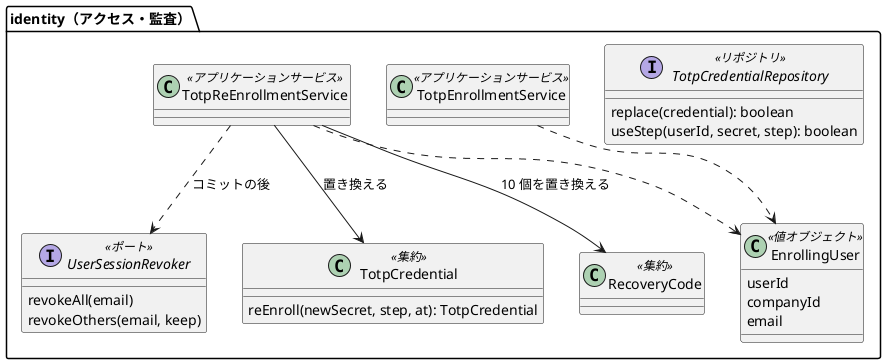
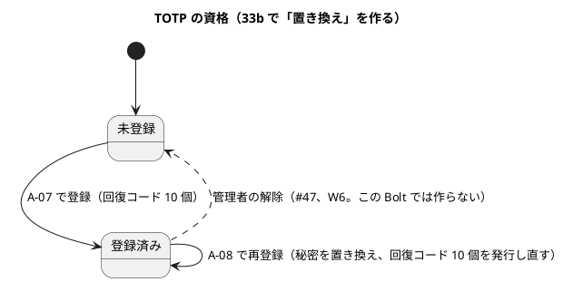
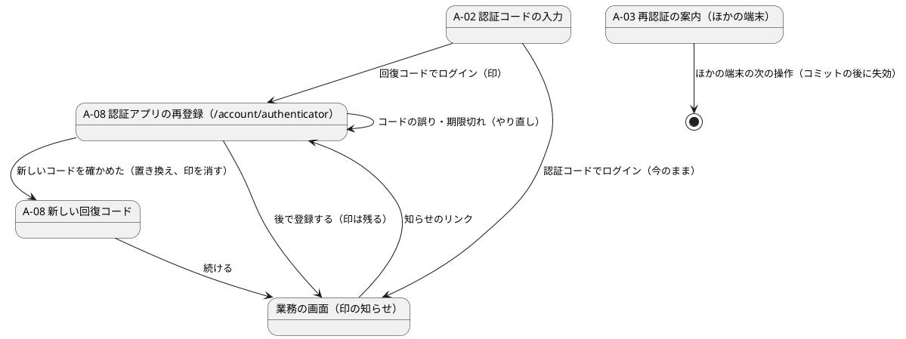

# Bolt 33b 計画 - 回復コードによる TOTP の再登録（US-18 AC9）と #13 のクローズ

## 基本情報

| 項目 | 内容 |
| :--- | :--- |
| Bolt | 第 33b 回（W5 の 17 本目。US-18 の残りの 14 本目、最後） |
| 予定 | W5（2026-11-02 の週。前倒しで着手できる）。作業は約 5.4 時間（承認ゲートの待ち時間を除く。「時間の配分と打ち切り」） |
| 対象 | `identity`（回復コードでログインした印、認証アプリの再登録のサービスと画面 A-08、TOTP の資格の置き換えと刻みの使用の条件、回復コードの発行し直し、ほかの session の失効、監査の種類、`TotpEnrollmentService` の引数の型）、設計文書、ユーザーマニュアル（2.1 の書き直し、2.4、再登録の手順、付録 B、用語集）、デモの動画 |
| SP | 表の 33b の行は 2（Bolt の目安）。#13 のクローズで US-18 の残りの SP 6 を数える（release_plan の W5 の注） |
| GitHub | [#13](https://github.com/k2works/practical-domain-driven-design-in-enterpris-application/issues/13)（US-18、R1.0）。この Bolt でクローズする（AC9 の管理者の別経路と本人への通知は [#47](https://github.com/k2works/practical-domain-driven-design-in-enterpris-application/issues/47)） |
| 承認ゲート | **ステップごとに止める**（W5 の表の 33b の行。セキュリティ）。スキーマは変えない（`totp_credential` の行を UPDATE し、監査の action は CHECK 制約がない）。確認必須（セキュリティ・新しいファイル・構造）は計画の承認の場で確認ポイントとして判断を受ける。実装の途中で層・モジュールの規則（`LayerArchitectureTest`・`AuthenticationArchitectureTest`）に当たったら、`/goal` の下でも止めて諮る（T-125） |
| アプローチ | インサイドアウト（W5 の既定と表の 33b の行どおり）。不確実性は資格の置き換えと A-02 の照合の競合、回復コードの発行し直しの競合、コミットの後の失効にあり、内側から固める。画面と認証の入口はセキュリティの統合テストと画面の層のシナリオで外側から確かめる |
| 前の Bolt | [Bolt 33a 終了報告](bolt_33a_report.md) |

## ふりかえりと前の Bolt からの引き継ぎ

| 入力 | 内容 | この Bolt での扱い |
| :--- | :--- | :--- |
| 開始準備の決定 1（2026-10-15、human:kakimomokuri） | (1) 33b と 33c に分ける。33b は AC9 の再登録とそれが触る部品（`TotpEnrollmentService` の引数の型、`instanceof` の `switch` 化）とマニュアル。振る舞いの変わらない直しは 33c。#13 は 33b でクローズする。(2) 回復コードでログインしたら再登録の画面へ導き、「後で登録する」で業務の画面へ進める。印がある間は業務の画面に知らせを出す。入口はこの流れだけ（設定の画面は作らない）。(3) 新しいコードを確かめた時点で古い秘密を置き換え（それまでは古い秘密が有効）、回復コードを 10 個発行し直して 1 回だけ示し、監査に `TOTP_RE_ENROLLED` を足す。(4) コミットの後に、その利用者のほかの session を失効させる（今の session は残す）。本人へのメールの通知は #47（W6） | 確認ポイント 1〜4 |
| 開始準備の決定 2（2026-10-15、human:kakimomokuri。整合性検証の要判断への回答） | (5) 刻みの使用（`useStep`）の条件に、照合で読んだ秘密の暗号文との一致を足す。置き換えでは `last_used_step` を古い値と新しいコードの刻みの大きい方にする（IA-INV-10 の単調性を保つ）。(6) 印の属性の名前は、前例（`PENDING_SECRET`）に倣い、認証の入口（`SessionLifetime`）と画面に同じ値の定数を置いてテストで守る（33c で 4 組と一緒に置き場所を直す）。印には利用者の ID を持たせ、password の段の成功で消す。(7) メールアドレスと企業は、再登録のサービスが利用者の ID で `User` を読んで得る（主体の型は変えない）。(8) #13 のクローズで US-18 の残りの SP 6 を数える | 確認ポイント 5〜8、設計の約束 |
| Bolt 33a の Try T-129・T-130 | 決定に「前・後」の順序があるものは、実装のステップの終わりに決定と実装の順を突き合わせる。公開の URL・session に権限を置く変更は session の ID を変えるかを確認ポイントに入れる | ステップ 3・4 の終わりに、確認ポイント 3・4 の順（置き換えは確かめた後、失効はコミットの後）と実装を突き合わせる。session の ID は、回復コードのログインでも認証の入口の `ChangeSessionIdAuthenticationStrategy` がすでに変えている（`RecoveryCodeLoginSecurityIntegrationTest` が確かめている）ので足さない（確認ポイント 9） |
| Bolt 33a の議題 7・Try T-128 | Playwright の正規表現に渡す文字列の共通の補助と、`Pattern.quote` の見張り | 33c に送る（振る舞いの変わらない直し。見張りはテストのクラスを読む ArchUnit の規則にし、対象が空でないことと違反を入れて落ちることを確かめる。T-107・T-112）。33b の新しいシナリオでは `BookingUiSteps.literal` と同じエスケープを使う |
| Bolt 33a の既知の課題 | #49 に送ったもの、無効なリンクの案内のキャプチャがない、`SchemaCommentIntegrationTest` に `tracking` がない | #49 は扱わない（再登録でもほかの session の失効が失敗すると残りうる。33a と同じく警告のログ）。無効なリンクの案内のキャプチャはステップ 5 で撮る。`tracking` は 33c |
| Bolt 31b の既知の課題（bolt_31b_report.md:141、ADR-011:220） | 回復コードの発行し直しの競合を 33b で確かめる | ステップ 3: 再登録の完了 2 つの同時、発行し直しと回復コードによるログインの同時 |
| Bolt 31c・31d の送り | `TotpEnrollmentService` が password の段の型（`PasswordVerifiedUser`）を受ける（31c の議題 4）。`instanceof` の `switch` 化。マニュアルに回復コードの書き方・誤ったときの戻り方・問い合わせ先（bolt_31c_report.md:142） | ステップ 2 で段に中立な値（`EnrollingUser`）で受ける。ステップ 5 のマニュアル |
| Bolt 32・32c の既知の課題（マニュアル） | 2.1 を 2 段階（A-02・A-07・回復コード）に書き直し、ロックされたら 15 分たってからログインし直す、誤りは password・認証コード・回復コードを合わせて数える。付録 B の Q1-1 に「5 回続けて誤った」の行。2.4 の最初の箇条に「ログインの手続きを時間内に終えなかった」（bolt_32c_report.md:147） | ステップ 5 |
| 33b の行の残り（33c に送る） | TOTP の桁数・周期・アルゴリズムの定数、SVG の組み立て、属性の名前と期間を 2 つの定数で持つ組（登録を始めた時刻・途中の秘密・8 時間の残り・戻り先、33b の印で 5 組目）と 15 分の期間、A-01 の「5 回」「15 分」と `LockPolicy`、回復コードの形の知識の 2 か所、`normalize` の戻り値の型、空の復号の境界のテスト、T-128 | 33c（ステップ 1 で release_plan に行を足す）。置き場所の案（`identity.domain.model.rules.SessionPolicy`）は 33c の開始準備で諮る |
| Bolt 33a・33・32f の Try T-127・T-126・T-125・T-123・T-122・T-121・T-113・T-112・T-107・T-102・T-100 | 非同期の完了を待つ。名前の一覧を grep する、push の後に MkDocs も見る。規則に当たったら止める。文言は場面の表から。共通の部品の期待を先に探す。URL の判定は matcher。共有の表は利用者で絞る。規則を外したときだけ落ちる入力。「ないこと」は対象があることを先に確かめる。同じ session での利用者の切り替え。同時の更新は先を止めて後を待たせる | A-08・知らせ・A-02 を場面の表で決める。古い秘密で照合した要求と置き換えの競合、発行し直しの競合、印のない session・password の段・別の利用者に切り替えた session で A-08 を開く |

## スコープ

### 入れるもの・入れないもの

| 入れる | 入れない（後で） |
| :--- | :--- |
| 回復コードでログインしたら、session に印（利用者の ID）を置き、保存した要求ではなく A-08 に移す（認証の入口の `recoveryCode` の欄の分岐で見分ける） | 管理者の別経路による解除と本人への通知（#47、W6） |
| A-08 認証アプリの再登録（`GET`・`POST /account/authenticator`。ログインした画面のレイアウト。ナビゲーションの対象外）: QR と秘密、新しいコードの確認、完了したら新しい回復コード 10 個を 1 回だけ示す。「後で登録する」（`POST /account/authenticator/later`）で保存した要求か役割のホームへ | 認証アプリの設定の画面・ヘッダーの導線（印のない利用者は再登録できない） |
| 印がある間、業務の画面（`layout/customer`・`layout/staff`）に「認証アプリを登録し直してください」の知らせと A-08 へのリンク（共通の部品） | 残りの回復コードが少ないときの案内（#47 に送る。印の知らせで再登録を促す） |
| 再登録のサービス（`TotpReEnrollmentService`）: 利用者を読み（利用停止・企業の無効は失敗）、開始で新しい秘密を発行（途中の暗号文を受けて再読み込みで鍵を変えない。A-07 と同じ）、完了で 15 分の上限と新しいコードを確かめ、利用者の行を占有して TOTP の秘密を置き換え、回復コードを 10 個置き換え、監査 `TOTP_RE_ENROLLED`。コミットの後にほかの session を失効 | 本人へのメールの通知（#47） |
| `TotpCredentialRepository.replace`（UPDATE。資格がなければ 0 件）、刻みの使用の条件に秘密の一致を足す（`useStep` の引数）、`UserSessionRevoker.revokeOthers(メールアドレス, 残す session の ID)`（`@FunctionalInterface` を外す） | 33c の直し（上の表） |
| `TotpEnrollmentService` を段に中立な値（`EnrollingUser`）で受け、`instanceof` を `switch` にする。A-07 と A-08 で秘密の発行と QR を共用する | 再登録の失敗の監査（成功だけを記録する。失敗の試行の監査は #49 と同じ扱い） |
| マニュアル 2.1 の書き直し（2 段階のログイン、A-02、A-07、回復コードの書き方、ロックの 15 分、誤りの数え方、誤ったときの戻り方、問い合わせ先）、2.4 の最初の箇条、再登録の節（2.7）、付録 B（Q1-1 の 5 回の行、認証アプリを失った・機種を変えた）、マニュアルの用語集（回復コード・認証アプリ）。A-02・A-08・新しい回復コード・知らせ・無効なリンクの案内のキャプチャ、デモの動画（回復コードでログインして再登録する） | — |
| #13 のクローズ、US-18 の残りの SP 6 の計上、release_plan の 33c の行 | — |

### 設計の約束（Try T-1）

- **印**: 認証の入口（`TotpAuthenticationFilter`）が `recoveryCode` の欄で回復コードの経路を選んだときに、成功のハンドラー（`FirstTotpSuccessHandler`）へ伝え、ハンドラーが session に印（属性の値は利用者の ID）を置いて `/account/authenticator` に移す。属性の名前は `SessionLifetime`（`infrastructure.security`）と画面（`interfaces.web`）に同じ値の定数を置き、一致をテストで守る（決定 6。33c で置き場所を直す）。password の段の成功（`LoginSuccessHandler`）で印を消す（同じ session での利用者の切り替え。T-102）。画面は印の利用者の ID が今の主体と同じときだけ印として扱う
- **session の ID**: 回復コードのログインでも認証の入口の `ChangeSessionIdAuthenticationStrategy` が変えている。足さない（確認ポイント 9。ステップ 4 の Red の前に既存のテストで確かめる）
- **A-08 の入口**: 2 つの要素がそろった主体（`AuthenticatedActor`）で、印があるときだけ開ける。印がなければ役割のホームへ移す（403 にしない）。password の段の主体は A-02 へ（今の認可と全 URL の見張りのまま）
- **再登録のサービス**（`identity.application.internal.commandservices.TotpReEnrollmentService`）: 引数は利用者の ID と企業の ID。利用者を読んでメールアドレスを得る（決定 7。利用停止・企業の無効は失敗）。`begin(…, 途中の暗号文)` は途中の暗号文が読めればそれを使い、なければ新しい秘密を発行して暗号文と QR を返す（資格の有無を問わない）。`complete(…, 暗号文, コード, 始めた時刻)` はサービスで 15 分の上限を判定し（2 つの要素がそろった session では `SessionLifetimeFilter` の上限が効かないため）、コードを確かめ、トランザクションの中で利用者の行を占有して `replace`（0 件なら資格がない＝失敗）・回復コードの `replaceAll`・監査を書く。コミットの後に `revokeOthers` を呼び、失敗は警告のログ。外側のトランザクションの中では呼べない（33a と同じガード）。結果は 完了（回復コード）・コードの誤り・期限切れ・秘密が読めない・利用できない
- **置き換えと照合の競合**（決定 5）: `useStep(userId, 読んだ暗号文, step)` は `secret_encrypted = 読んだ暗号文 AND last_used_step < step` のときだけ更新する。置き換えは `last_used_step = GREATEST(last_used_step, 新しいコードの刻み)`。古い秘密で照合を終えた要求は、置き換えの後は 0 件で通らない（テストは「古い秘密を読む → 置き換えを確定 → useStep は 0 件」の順）。IA-INV-10 の「最後に使った刻みは単調に増える」は置き換えでも保つ
- **ほかの session の失効**: `revokeOthers(email, 今の session の ID)` は主体の名前の索引で探し、今の session を除いて消す（実装 `SpringSessionUserSessionRevoker`）。ほかの端末は次の操作で A-03（文言は場面の表で確かめる）
- **監査**: `AuditAction.TOTP_RE_ENROLLED`、`AuditRecord.totpReEnrolled(user, company, at)`。成功だけ
- **完了の後**: 印と途中の属性を消し、新しい回復コードを A-08 の完了の画面に 1 回だけ示す（A-07 の回復コードの画面と同じ形。PRG で再表示しない）。「続ける」で保存した要求か役割のホーム

## 設計（この Bolt の範囲）

4 図のうち、ドメインモデル図・状態遷移図・画面遷移図を置く。ER 図は、新しい表も列もない（`totp_credential` の `secret_encrypted`・`last_used_step`・`enrolled_at` を更新し、`recovery_code` を置き換えるだけ）ので省く。

### ドメインモデル

### 状態遷移

### 画面遷移

## ステップ計画

状態の記号: `[ ]` 未着手、`[-]` 進行中、`[?]` 承認待ち、`[x]` 完了。各ステップの終わりに `check` が緑であることと、計画からの変更を設計文書に反映したこと（T-53）を確かめ、push してアプリの CI と MkDocs の配備を確かめる（T-26、T-118、T-126）。コミットは pathspec で作る（T-110）。複数行の書き換えはスクリプトのファイルにする（T-103）。共通の部品を変えたら `check` を先に流す（T-120）。

- [ ] **1. 設計文書** 【承認ゲート: 設計文書】
  - ui_design.md: 画面一覧に A-08（ナビゲーションの対象外）、URL の表（`/account/authenticator`・`/later`）、画面イメージと文言（QR・秘密・コード・新しい回復コード・後で登録する）、印の知らせ（共通の部品の節）、場面の表（T-123。印のない session・password の段・別の利用者に切り替えた session・15 分を過ぎた・コードの誤り・ほかの端末の A-03）、画面遷移、A-07 との共用。:183・:294 の「回復コードで通ると元の URL か役割のホーム」を A-08 に直す
  - domain_model.md: `EnrollingUser`、`TotpReEnrollmentService` と結果の型、`TotpCredential.reEnroll`、`replace`・`useStep` の条件、IA-INV-10（1 人 1 つのまま置き換える。最後に使った刻みは置き換えでも戻さない）、IA-INV-11 の発行し直し、`UserSessionRevoker` の定義（:214）に `revokeOthers`、`AuditAction`（:201）に `TOTP_RE_ENROLLED`、identity のクラス図（:1040 付近）、用語集（「認証アプリの再登録」「回復コードでログインした印」）
  - data_model.md: `totp_credential` の更新（秘密・`last_used_step` を大きい方に・`enrolled_at`）と刻みの使用の条件、`audit_record.action` の範囲
  - non_functional.md: SEC-10 を回復コードの経路について確定し流れを書く（本人への通知と管理者の経路は #47 と分けて書く）。SEC-09 の発行し直し
  - ADR-011（33b で決めた再登録。:220・:247・:341 の宿題を閉じ、残りが少ないときの案内は #47 と書く）、ADR-012（ほかの session の失効の 2 つ目の場面、印と同じ session での利用者の切り替え）、architecture_backend（`revokeOthers`、A-08 の置き場所、印の 2 つの定数）
  - test_strategy.md、user_story.md（AC9 の回復コードの経路を満たしたこと）
  - release_plan.md: 33b の行（A-07 を A-08 に、範囲を決定 1 に合わせる）、33c の行（SP 0、振る舞いの変わらない直し、承認ゲートは構造、範囲は上の表）、US-18 の Bolt の順序の文（:602）に 33b → 33c、局面とアプローチの段落（:556）に 33c の理由、W5 の実績の表（:770）の本数を 20 本に、W5 の注（:600）の SP 6 の数え方、デモ項目
  - 完了の判定: `okf:check` ERROR 0、`documentationTest` 緑
- [ ] **2. 部品の付け替えと資格の置き換え（インサイドアウト）** 【承認ゲート: セキュリティ、構造】
  - 最初に骨組み（`EnrollingUser`、`TotpReEnrollmentService` の空の形、`replace`・`revokeOthers` のポート、印の 2 つの定数）を置いて ArchUnit を流す（T-101）。`LayerArchitectureTest`・`AuthenticationArchitectureTest:178-193` に当たったら止めて諮る（T-125）
  - `TotpEnrollmentService` を `EnrollingUser` で受け、`instanceof` を `switch` にする（既存のテストが緑のまま）→ `TotpCredential.reEnroll` → `useStep` の秘密の条件（今の照合の経路が読んだ暗号文を渡す）→ `replace` の統合テスト（置き換え・0 件・`last_used_step` が大きい方・古い秘密を読んでから置き換えると `useStep` が 0 件）→ `revokeOthers` の統合テスト（今の session が残り、同じ利用者のほかの session が消え、ほかの利用者の session は残る）
  - 完了の判定: `check` 緑。層の規則に例外を足していない。秘密の条件を外すと競合のテストが落ちることを確かめる（T-112）
- [ ] **3. 再登録のサービス（インサイドアウト）** 【承認ゲート: セキュリティ】
  - `begin`・`complete`: 完了（秘密の置き換え・回復コード 10 個・監査・コミットの後の失効）、コードの誤り（置き換えない）、15 分を過ぎた、秘密が読めない、資格がない、利用停止・企業の無効、外側のトランザクションの中では呼べない、失効の失敗でも完了、監査を書けなければ失効しない（33a と同じ単体テスト）、再登録の完了 2 つの同時（1 つだけ）、発行し直しと回復コードによるログインの同時（古い回復コードは置き換えの後に通らない。T-100）
  - 完了の判定: `check` 緑。占有を外すと同時のテストが落ちることを確かめる（T-112）。決定の順（確かめた後に置き換え、コミットの後に失効）と実装を突き合わせる（T-129）
- [ ] **4. 画面（印、A-08、知らせ）** 【承認ゲート: 画面、セキュリティ】
  - Red の前に、成功のハンドラー・A-02・A-07・`AUTHENTICATION_SCREENS`（全 URL の見張り）・業務の画面のレイアウト・`RecoveryCodeLoginSecurityIntegrationTest`（回復コードのログインの移り先が業務の画面から A-08 に変わる）を確かめている既存のテストを検索し、変わる期待を Red に入れる（T-122）
  - セキュリティの統合テスト: 回復コードでログインすると A-08 に移り（session の ID が変わることは既存のテストのまま）、認証コードでログインすると今のまま、印のない session・password の段・同じ session で別の利用者に切り替えた後に A-08 を開く、CSRF、再登録の後に新しいコードでログインでき古いコードと古い回復コードは通らない、ほかの端末は A-03、今の session は残る、後で登録すると知らせが出る
  - 画面の層の受入シナリオ（`login_ui.feature`、`@US-18-AC9`）: 回復コードでログイン → A-08 → QR の秘密から作ったコードで再登録 → 新しい回復コード → 続ける → 業務の画面（`@demo @demo-bolt-33b/re-enroll`）。後で登録する → 知らせ → リンクから A-08。axe の違反 0。正規表現は `BookingUiSteps.literal` と同じエスケープ
  - 完了の判定: `check` を先に（T-120）、続けて `uiTest` が緑。決定の順と実装を突き合わせる（T-129）
- [ ] **5. マニュアルとデモ** 【承認ゲート: マニュアル】
  - マニュアル 2.1 を 2 段階のログインに書き直す（A-02 の認証コード、初回の A-07 と回復コードの保存、回復コードでのログインと書き方、誤りは password・認証コード・回復コードを合わせて 5 回でロック、15 分たってからログインし直す、誤ったときの戻り方、問い合わせ先）。2.4 の最初の箇条に「ログインの手続きを時間内に終えなかった」。2.7 認証アプリの再登録（回復コードでログインした後、後で登録する、知らせ、新しい回復コード、ほかの端末はログアウト）。付録 B（Q1-1 の 5 回の行、認証アプリを失った・機種を変えた）。マニュアルの用語集（回復コード・認証アプリ）
  - キャプチャ（`manual_screenshots.feature` に足す）: A-02、A-08、新しい回復コード、知らせ、無効なリンクの案内（33a の既知の課題）
  - デモの動画（`./gradlew demoVideo`。`@demo-bolt-33b/re-enroll`）は、レビューの直しで文言が変わらないと確かめてから録画する（T-105）。フレームを切り出して中身を確かめる
  - 完了の判定: `manual:build` が通る。`okf:check` ERROR 0
- [ ] **6. SonarQube と開発レビューと終了報告、#13 のクローズ** 【承認ゲート: 終了報告】
  - SonarQube（T-116）。開発レビュー（プログラマー、テスター、アーキテクト、セキュリティ、テクニカルライター）
  - `bolt_33b_report.md`。release_plan の W5 の 33b の行、US-18 の SP 6 の計上、開発の索引。終了報告の承認の後に、デモの動画を #13 に添付し、添付の対応表に bolt-33b を足し、#13 をクローズする（AC9 の管理者経路は #47 と書く）

### 時間の配分と打ち切り

| # | 目安 | 打ち切り |
| :--- | :--- | :--- |
| 1 | 50 分 | — |
| 2 | 70 分 | 層の規則に当たったら止めて諮る |
| 3 | 55 分 | — |
| 4 | 75 分 | — |
| 5 | 55 分 | — |
| 6 | 30 分（SonarQube の待ちを除く） | — |

合計 335 分（約 5.6 時間）。半日に近いので、6 時間を超えると見えたら止めて諮る（候補: 付録 B の追加の行とマニュアルの用語集を 33c に送る）。

## 確認ポイント（計画の承認の場でまとめて確認する。Try T-6）

| # | 確認すること | ステップ | 推奨 |
| :--- | :--- | :--- | :--- |
| 1 | **分け方**（開始準備で決めた） | 全体 | 33b は AC9 の再登録とそれが触る部品とマニュアル。振る舞いの変わらない直し（属性の名前と期間の 5 組、TOTP の定数、SVG、A-01 の 5 回・15 分、回復コードの形の知識、`normalize` の型、復号の境界のテスト、T-128、`tracking`）は 33c。#13 は 33b でクローズする |
| 2 | **入口**（開始準備で決めた） | 1・4 | 回復コードでログインしたら印を置いて A-08 へ。「後で登録する」で進め、印がある間は業務の画面に知らせ。印がない session では A-08 を開けない（役割のホームへ）。設定の画面は作らない |
| 3 | **資格の扱い**（開始準備で決めた。セキュリティ） | 2・3 | 新しいコードを確かめた時点で置き換え（それまでは古い秘密が有効）。回復コードを 10 個発行し直して 1 回だけ示す。監査 `TOTP_RE_ENROLLED`（成功だけ） |
| 4 | **ほかの session**（開始準備で決めた。セキュリティ） | 2・3 | コミットの後に、その利用者のほかの session を失効させ、今の session は残す（`revokeOthers`）。失敗は警告のログ。本人へのメールの通知は #47 |
| 5 | **置き換えと照合の競合**（開始準備で決めた。セキュリティ） | 2 | `useStep` に読んだ暗号文との一致を足す（引数が変わる）。置き換えは `last_used_step` を大きい方に。古い秘密で照合した要求は置き換えの後に通らない |
| 6 | **印の置き場所**（開始準備で決めた。構造） | 2・4 | 認証の入口と画面に同じ値の定数を置いてテストで守る（前例 `PENDING_SECRET`。33c で置き場所を直す）。印は利用者の ID を持ち、password の段の成功で消す |
| 7 | **メールアドレス**（開始準備で決めた） | 3 | 再登録のサービスが利用者の ID で `User` を読む。主体の型（ADR-012）は変えない |
| 8 | **SP**（開始準備で決めた） | 6 | #13 のクローズで US-18 の残りの SP 6 を数える。表の 33b の行の 2 は Bolt の目安 |
| 9 | **session の ID**（T-130） | 4 | 足さない。回復コードのログインも認証の入口の `ChangeSessionIdAuthenticationStrategy` が変えている（既存のテストで確かめる） |
| 10 | **URL と画面の ID** | 1・4 | A-08 認証アプリの再登録、`/account/authenticator`（`anyRequest().authenticated()` の範囲で 2 つの要素を求める。役割を問わない。ログインした画面のレイアウト）。A-07（`/login/totp/enroll`、password の段）とは分ける |
| 11 | **再認証と上限** | 1・3 | 再登録の前に password を求め直さない（回復コードでログインした同じ session の印が前提。印は再登録の完了・ログアウト・password の段の成功で消える）。15 分の上限は開始からで、サービスが判定する（期限切れはやり直し） |
| 12 | **`TotpEnrollmentService` の引数** | 2 | 段に中立な値 `EnrollingUser`（利用者・企業・メールアドレス。`identity.domain.model.valueobjects`）で受け、A-07 の画面が主体から詰め替える。ArchUnit の規則は変えない |
| 13 | **残りが少ないときの案内**（ADR-011:247 の宿題） | 1 | 33b では作らず #47 に送る（印の知らせで再登録を促す）。ADR-011 に決定として書く |
| 14 | **新しいファイル** | 2〜5 | `EnrollingUser`、`TotpReEnrollmentService` と結果の型、`TotpReEnrollmentController`、印の定数を置く画面のクラス、テンプレート（`identity/account-authenticator`・`identity/account-authenticator-codes`、知らせの断片）、テスト、キャプチャ |
| 15 | **マニュアル・デモ・#13** | 5・6 | 入れる。2.1 の書き直し、2.4、2.7、付録 B、用語集、キャプチャ 5 枚、デモの動画。#13 は終了報告の承認の後にクローズする |
| 16 | **アプローチと承認ゲートと時間** | 全体 | インサイドアウト。ステップごとに止める（2 はセキュリティと構造、3 はセキュリティ、4 は画面とセキュリティ）。スキーマは変えない。約 5.6 時間（6 時間を超えると見えたら止めて諮る） |

## 完了条件

- [ ] 回復コードでログインすると A-08 が開き、認証アプリの新しいコードで再登録できる。古い秘密のコードと古い回復コードは使えなくなり、新しい回復コード 10 個が 1 回だけ示される。「後で登録する」で業務の画面へ進め、印がある間は知らせが出る。印のない session・別の利用者に切り替えた session では A-08 を開けない
- [ ] 再登録はコードを確かめてから置き換え、古い秘密で照合した要求は置き換えの後に通らず、監査 `TOTP_RE_ENROLLED` に残り、コミットの後にほかの session が失効し、今の session は残る
- [ ] `TotpEnrollmentService` は段に中立な値で受け、A-07 の振る舞いは変わらない
- [ ] 設計文書（ui_design・domain_model・data_model・non_functional・ADR-011・ADR-012・architecture_backend・test_strategy・user_story・release_plan）を更新し、33c の行を足した
- [ ] ユーザーマニュアル（2.1・2.4・2.7・付録 B・用語集）とキャプチャを更新し、デモの動画を録画して中身を確かめた（#13 への添付は終了報告の承認の後）
- [ ] `check` と `uiTest` が緑。push してアプリの CI と MkDocs の配備を確かめた。SonarQube の Quality Gate が PASS、`okf:check` ERROR 0
- [ ] 開発レビュー、終了報告。終了報告の承認の後に #13 をクローズし、US-18 の残りの SP 6 を数えた

## 更新履歴

| 日付 | 更新内容 | 更新者 |
| :--- | :--- | :--- |
| 2026-10-15 | 詳細整合性検証（13 件）と横断整合性検証（13 件）の指摘を反映し、human:kakimomokuri の決定（`useStep` に秘密の一致を足す、印は 2 つの定数とテストで守る、メールアドレスはサービスが利用者を読む、SP は 6）を受けた。印に利用者の ID を持たせ password の段で消す、session の ID は足さない、15 分の上限はサービスで判定、途中の暗号文を受ける、競合のテスト 2 つ（31b の宿題）、`@FunctionalInterface` を外す、T-128 と `tracking` を 33c に、マニュアルの 2.4・用語集・31c の宿題・無効なリンクの案内のキャプチャ、ステップ 1 の反映先（ui_design の :183・:294、domain_model の要素と IA-INV-10、release_plan の 4 か所、SEC-10 と通知の分け方、残りが少ないときの案内を #47 に）を足した。時間を約 5.6 時間に見直した | anthropic/claude-opus-5-5 |
| 2026-10-15 | 初版作成（承認待ち）。開始準備で、回復コードでのログイン・初回の登録・資格と回復コードのリポジトリ・監査・33b に送られた直しの所在を調べ、human:kakimomokuri の決定（33b と 33c に分ける、回復コードでログインしたら A-08 へ導き後にもできる、確かめた時点で置き換えて回復コードを発行し直す、ほかの session を失効させ通知は #47）を反映した | anthropic/claude-opus-5-5 |

## 関連ドキュメント

- [リリース計画](release_plan.md)（W5）
- [Bolt 33a 計画](bolt_33a_plan.md)、[Bolt 33a 終了報告](bolt_33a_report.md)、[Bolt 31b 終了報告](bolt_31b_report.md)、[Bolt 31c 終了報告](bolt_31c_report.md)
- [ユーザーストーリー](../../requirements/cargo-tracker/user_story.md)（US-18 AC9）
- [UI 設計](../../design/cargo-tracker/ui_design.md)（A-02・A-07）、[ドメインモデル](../../design/cargo-tracker/domain_model.md)、[データモデル](../../design/cargo-tracker/data_model.md)、[非機能要件](../../design/cargo-tracker/non_functional.md)（SEC-09・SEC-10）、[バックエンドのアーキテクチャ](../../design/cargo-tracker/architecture_backend.md)、[テスト戦略](../../design/cargo-tracker/test_strategy.md)
- [ADR-011](../../adr/cargo-tracker/011-mfa-totp.md)、[ADR-012](../../adr/cargo-tracker/012-authentication-principal-and-session.md)
