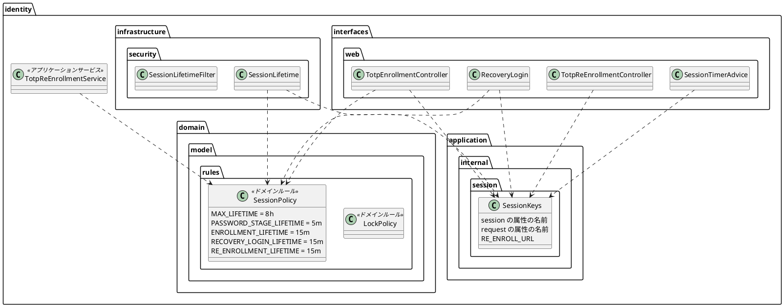

# Bolt 33c 計画 - session の属性の名前と期間の置き場所の整理（振る舞いの変わらない直し）

## 基本情報

| 項目 | 内容 |
| :--- | :--- |
| Bolt | 第 33c 回（W5 の 18 本目） |
| 予定 | W5（2026-11-02 の週。前倒しで着手できる）。作業は約 4.5 時間（承認ゲートの待ち時間を除く） |
| 対象 | `identity`（session・request の属性の名前と URL、ログインの期間、覚えた要求、A-01 の文言の数値、空の復号の境界）、画面の層のテストの補助と ArchUnit の規則、`SchemaCommentIntegrationTest`、設計文書（architecture_backend・architecture_frontend・domain_model・data_model・ui_design・ADR-011・ADR-012・test_strategy・release_plan） |
| SP | 0（技術タスク） |
| GitHub | なし（#13 は 33b でクローズ済み） |
| 承認ゲート | **ステップごとに止める**（W5 の表の 33c の行。構造）。スキーマは変えない。層の規則の例外は開始準備で決めた（確認ポイント 2）。それ以外の規則に当たったら、`/goal` の下でも止めて諮る（T-125） |
| アプローチ | リファクタリング（インサイドアウト）。振る舞いを変えないので、既存のテスト（とくに 2 つの定数の一致を守るテストと、全 URL の見張り）を緑のまま、置き場所を移す。移した後は、一致を守るテストを「同じ定数を参照する」ことで不要にする |
| マニュアル・デモ | 対象外（画面の振る舞いと文言を変えない。A-01 の文言は数値を定数から描くだけで、表示は同じ） |
| 前の Bolt | [Bolt 33b 終了報告](bolt_33b_report.md) |

## ふりかえりと前の Bolt からの引き継ぎ

| 入力 | 内容 | この Bolt での扱い |
| :--- | :--- | :--- |
| 開始準備の決定（2026-10-15、human:kakimomokuri） | (1) 33c と 33d に分ける。33c は置き場所の決定を伴う直し（属性の名前・期間・URL・覚えた要求）と小さな直し（A-01 の文言、T-128、`tracking`、空の復号の境界）。33d は TOTP の部品の整理（TOTP の定数、SVG、回復コードの形、`normalize` の型、A-07 と A-08 の重複、認証の結果に経路、session の ID の値オブジェクト）。(2) 期間は domain の `identity.domain.model.rules.SessionPolicy`（`LockPolicy` と並べる）、session・request の属性の名前と A-08 の URL は application 層の `identity.application.internal.session.SessionKeys`。(3) 認証の入口（`identity.infrastructure.security`）が application 層で参照してよい範囲に `application.internal.session` を足す（規則「認証の入口はidentityのコマンドサービスだけに依存してよい」の例外。理由を規則の because と ADR-012 に書く） | 確認ポイント 1〜3 |
| 開始準備の決定 2（2026-10-15、human:kakimomokuri。整合性検証の要判断への回答） | (4) 覚えた要求の `RequestCache` は 1 つの Bean にし、失効の部品・A-08 の画面・回復コードの成功のハンドラーの 3 つで共有する。Spring Security の既定（未認証の入口）には渡さない（振る舞いを変えない）。(5) `SessionKeys` に寄せるのは、層をまたいで共有する名前と URL だけ。画面だけが使う名前（A-08 の途中の 2 つ）は画面に残す。テストの URL の写しは仕様として文字列のまま残す。(6) 33b で「33c で扱う」とした「始めたときの秘密を置き換えの条件にする」は振る舞いが変わる直しなので、#49（W10）に送る | 確認ポイント 6・13、スコープ |
| Bolt 33b の Try T-131・T-132・T-133 | 変異の確かめは控えのファイルで戻す。振る舞いを変えるときの既存のテストの検索は URL・引数の名前・期待の値で全体を grep する。再認証なしの経路の有効な時間 | T-131: 変異の確かめ（T-128 の規則に違反を入れて落ちることを確かめる）は控えから戻す。T-132: 定数を移すときと A-01 の数値を描くときは、値の文字列（`cargotracker.session.`・`cargotracker.request.`・`/account/authenticator`・`/session-expired`・「5 回」「15 分」）でテスト・テンプレート・マニュアルを含む全体を grep する。T-133 は該当しない |
| Bolt 33a の議題 7・Try T-128 | Playwright の正規表現に渡す文字列の共通の補助と、`Pattern.quote` の見張り | ステップ 5 |
| Bolt 33a の既知の課題 | `SchemaCommentIntegrationTest.BUSINESS_SCHEMAS` に `tracking` がない | ステップ 4（`tracking` の 3 つの表はすべての表と列にコメントがあり、マイグレーションは要らないことを開始準備で確かめた） |
| Bolt 33b の既知の課題 | A-02 に password の段の 5 分の期限を示していない（マニュアルで補った） | 対象外（文言が変わる）。release_plan の W10 の返済の候補に書く |
| Bolt 31d の送り | 空の復号の結果（実質は直っている。境界の長さのテストがない） | ステップ 4 |
| Bolt 32 の既知の課題 | A-01 の「5 回」「15 分」の文言と `LockPolicy` の重複 | ステップ 4 |
| Bolt 33b の開発レビュー | A-08 の URL の組、`HttpSessionRequestCache` の一本化 | ステップ 2・3 |
| Bolt 31c のレビュー 14、Bolt 32b の確認ポイント 5、Bolt 32e・33b | 属性の名前を 2 つの定数で持つ組 | ステップ 2 |

## スコープ

### 入れるもの・入れないもの

| 入れる | 入れない（33d） |
| :--- | :--- |
| `SessionKeys`（application 層）に、層をまたいで共有する session の属性の名前 6 つ（ログインの時刻、password を確かめた時刻、登録を始めた時刻、登録の途中の秘密、回復コードでログインした印の利用者と時刻）、request の属性の名前 2 つ（8 時間の残り、戻り先）、A-08 の URL、A-03 の URL（`/session-expired`）を置く。参照する側は `SessionLifetime`（属性の名前と `EXPIRED_URL` は `SessionKeys` を指す）・`SessionLifetimeFilter`・`TotpAuthenticationFilter`・`LoginSuccessHandler`・`ExpiredSessionRequestSaver`・`TotpEnrollmentController`・`LoginController`・`SessionTimerAdvice`・`RecoveryLogin`・`TotpReEnrollmentController`。テンプレートの直書き（`layout/customer.html`・`layout/staff.html`・`account-authenticator.html`・`account-authenticator-codes.html` の A-08 の URL と下の path、`session-warning.html` の A-03 の URL）は式で参照する。A-08 の途中の 2 つ（`reEnrollmentPendingSecret`・`reEnrollmentStartedAt`）は画面だけが使うので画面に残す。テストの URL の写しは仕様として残す | TOTP の桁数・周期・アルゴリズムの定数 |
| `SessionPolicy`（domain、`@DomainRule`）に、2 つの要素がそろった session の 8 時間、password の段の 5 分、登録の途中の 15 分、回復コードでログインした印の 15 分、再登録の 15 分を置く（同じ値を別々に持っていた `SessionLifetime` の 3 つ・`TotpEnrollmentController.ENROLLMENT_LIFETIME`・`RecoveryLogin.LIFETIME`・`TotpReEnrollmentService.LIMIT` をまとめる） | SVG の組み立ての分離 |
| 規則「認証の入口はidentityのコマンドサービスだけに依存してよい」の許可に `application.internal.session` を足す | 回復コードの形の知識の 2 か所、`normalize` の戻り値の型 |
| 2 つの定数の一致を守るテスト（`SessionLifetimeFilterTest` の 4 本。:114・:122・:282・:342）を消す（同じ定数を参照するので要らない）。値を固定するテスト（:108）は `SessionKeysTest` に移し、すべての名前に広げる（動いている session の属性が読めなくならないことを守る） | A-07 と A-08 の、途中の暗号文の扱いと回復コードの発行の重複 |
| 覚えた要求の `RequestCache` を identity の合成ルートで 1 つの Bean にし（今の `ExpiredSessionRequestSaver` の設定。戻れる業務の画面の matcher と属性の名前 `SAVED_REQUEST`）、`ExpiredSessionRequestSaver`・`TotpReEnrollmentController`・`FirstTotpSuccessHandler`（`setRequestCache`）の 3 つで共有する。Spring Security の既定（未認証の入口の `ExceptionTranslationFilter`）には渡さない。読み出し（`getRequest`・`removeRequest`）は matcher を使わないので、共有しても振る舞いは変わらない | 認証の結果のトークンに経路（要素の種類）、`revokeOthers` の session の ID の値オブジェクト |
| A-01 の「5 回」「15 分」（`login.html` の :15・:20・:27）を `LockPolicy` の定数（`MAX_CONSECUTIVE_FAILURES`・`LOCK_DURATION`）から描く（`LoginController` がモデルに入れる。表示は変えない）。:27（再設定の完了の知らせ）の文言を確かめるテストを先に足す | 始めたときの秘密を置き換えの条件にする（振る舞いが変わる。#49） |
| T-128: 画面の層のテストに正規表現のエスケープの共通の補助を置き、エスケープしている 2 か所（`BookingUiSteps.java:121-122`・`PasswordResetUiSteps.java:222`）と、エスケープせずに連結している 3 か所（`SubmitTransportRequestUiSteps.java:227,252`・`ReviewTransportRequestUiSteps.java:131`）をその補助に寄せる。テストのクラスを読む ArchUnit の規則（前例 `AcceptanceStepArchitectureTest`）で `com.example.cargotracker.ui` から `java.util.regex.Pattern.quote` を呼ばないことを見張る（`documentation` の正しい使い方は対象外。対象が空でないことと、違反を入れて落ちることを確かめる。T-107・T-112・T-131） | — |
| `SchemaCommentIntegrationTest.BUSINESS_SCHEMAS` に `tracking` を足す（コメントが欠けていれば足す。マイグレーションが要るならスキーマの変更なので止めて諮る） | — |
| `AesGcmSecretCipherTest` に、テスト用の鍵と AAD で空の平文を JDK の暗号で暗号化した暗号文（IV とタグちょうどの長さ）が `UnreadableCredentialException`（「短すぎる」）になるテストを足す（前例 :49。乱数のバイト列ではタグの不一致でも同じ例外になり境界を確かめられない） | — |

### 設計の約束（Try T-1）

- **`SessionKeys`**（`identity.application.internal.session`）: `public final class` に `public static final String` の名前と URL を置く。値は今の文字列を変えない（既存の session の属性が読めなくならない）。ふるまいは持たない。`session/package-info.java` を足し、`application/internal/package-info.java` の「インフラストラクチャ層の設定からだけ使う」の文を直す。パッケージは開発ガイドライン第 3 章の置き場所にないので、人の決定として architecture_backend のパッケージの図と ADR-012 に書く
- **`SessionPolicy`**（`identity.domain.model.rules`、`@DomainRule`）: `public static final Duration` の期間を置く。ふるまいは持たない定数のクラスにする（期限の判定は今の置き場所のまま。`LockPolicy` は判定のふるまいを持つが、ここでは期間だけを寄せる）。`Duration` は `java..` なのでドメインの規則に当たらない
- **規則の例外**: `LayerArchitectureTest` の「認証の入口はidentityのコマンドサービスだけに依存してよい」の許可を `commandservices..` と `session..` にし、because に「session の属性の名前を認証の入口と画面で共有するため（Bolt 33c）」を足す。ADR-012 の決定 6（D-5 の認証の例外）と改訂の経緯に書く（決定 6 の「例外を queryservices に広げない」と矛盾しない理由: `SessionKeys` はふるまいを持たない名前だけで、業務の判断を入口に持ち込まない）
- **`RequestCache`**: identity の合成ルートに `@Bean RequestCache`（今の `ExpiredSessionRequestSaver` の設定と同じ）を置き、`ExpiredSessionRequestSaver`・`TotpReEnrollmentController`・`FirstTotpSuccessHandler` に注入する。Spring Security の `http.requestCache` には渡さない（決定 4）
- **A-01**: `LoginController` が `LockPolicy.MAX_CONSECUTIVE_FAILURES` と `LockPolicy.LOCK_DURATION.toMinutes()` をモデルに入れ、`login.html` の 3 か所は `th:text` で描く。表示の文字列は変えない（画面の単体テストで同じ文字列を確かめる）

## 設計（この Bolt の範囲）

4 図のうち、ドメインモデル図だけを置く。状態遷移図は新しい状態がないので、ER 図は表を変えないので、画面遷移図は画面を変えないので省く。

## ステップ計画

状態の記号: `[ ]` 未着手、`[-]` 進行中、`[?]` 承認待ち、`[x]` 完了。各ステップの終わりに `check` が緑であることを確かめ、push してアプリの CI と MkDocs の配備を確かめる（T-26、T-126）。コミットは pathspec で作る（T-110）。複数行の書き換えはスクリプトのファイルにする（T-103）。

- [ ] **1. 設計文書** 【承認ゲート: 設計文書】
  - architecture_backend.md（パッケージの図 :229-235 に `application.internal.session`、:288・:292 の「2 つの定数」「33c で直す」、規則の例外）、architecture_frontend.md（:129）、ADR-012（決定 3 と決定 6、:61・:90-94・:108-114、改訂の経緯）、ADR-011（:72・:333・:335・:342 の「2 つの定数の組」「33c」。33d に送るものは「33d」に）、ui_design.md（:789・:1363）、domain_model.md（`SessionPolicy` をドメインルールとして載せる表を決め、用語集に「session の方針」、:195・:198・:1061 の「2 つの定数」「33c」）、data_model.md（:974 の `BUSINESS_SCHEMAS`）、test_strategy.md（Bolt 33c の行。T-128 の見張り）
  - release_plan.md: 33c の行（:597。決定に合わせ、TOTP の項目を外し、範囲を 8 時間・5 分・A-03 の URL に広げたことを書く）、33d の行を足す（SP 0、リファクタリング、承認ゲート「構造」、範囲は上の表の右の列）、局面とアプローチの段落（:557）、US-18 の Bolt の順序の文（:603 に → 33d）、W5 の注（:601 に 33d も SP 0）、状態の行（:553）、実績の表（:771 を 21 本に。33c の開始準備で 33d を足した）、W10 の返済の候補（A-02 の 5 分の期限の表示）、更新履歴
  - 33b の終了報告の開発レビュー 10 の「始めたときの秘密…33c で扱う」を「#49 に送った（33c の開始準備の決定 6）」に直し、#49 にコメントする
  - 完了の判定: `okf:check` ERROR 0、`documentationTest` 緑
- [ ] **2. 属性の名前・URL・期間の置き場所** 【承認ゲート: 構造】
  - 値の文字列（`cargotracker.session.`・`cargotracker.request.`・`/account/authenticator`・`/session-expired`）でテストとテンプレートを含む全体を grep し、参照の一覧を作る（T-132）
  - `SessionKeysTest`（すべての名前の値を固定する。:108 を移す）を先に書く → `SessionKeys` と `SessionPolicy` を足し、規則の例外を足して ArchUnit を流す → 参照を 1 つずつ移す → 一致を守るテスト 4 本を消す → テンプレートの直書きを式にする
  - 完了の判定: `check` 緑、`uiTest` 緑（属性の名前を変えていないので、既存のシナリオがそのまま通る）
- [ ] **3. 覚えた要求の一本化** 【承認ゲート: 構造】
  - `RequestCache` の Bean と 3 つの部品への注入（Spring Security の既定には渡さない）。覚えた要求に戻るテスト（`ReturnAfterExpirySecurityIntegrationTest`、33b の「後で登録する」「続ける」、未認証で開いた画面に戻るテスト）が緑のまま
- [ ] **4. 小さな直し**
  - A-01: 「5 回」「15 分」で全体を grep し（T-132）、:27 の文言を確かめるテスト（`AuthenticationSecurityIntegrationTest` の完了の知らせ）を足してから、数値を `LockPolicy` から描く（既存の `LoginLockSecurityIntegrationTest:65` と `login_ui.feature:44` も緑のまま）
  - 空の復号の境界のテスト（本物の暗号文）、`tracking` のコメントのテスト
- [ ] **5. T-128 の見張り**
  - 共通の補助（`com.example.cargotracker.ui.PlaywrightText.literal`）と 5 か所の置き換え（エスケープの 2 か所、エスケープしていない連結の 3 か所）、テストのクラスを読む ArchUnit の規則（対象が空でない。違反を控えのファイルに入れて落ちることを確かめ、控えから戻す。T-131）
  - 完了の判定: `check`・`uiTest` 緑
- [ ] **6. SonarQube と開発レビューと終了報告** 【承認ゲート: 終了報告】
  - SonarQube（T-116）。開発レビュー（プログラマー、テスター、アーキテクト）。振る舞いを変えないのでセキュリティとテクニカルライターは省く（規則の例外はアーキテクトが見る）
  - `bolt_33c_report.md`。release_plan の W5 の 33c の行、開発の索引

### 時間の配分と打ち切り

| # | 目安 | 打ち切り |
| :--- | :--- | :--- |
| 1 | 30 分 | — |
| 2 | 90 分 | 決めた例外のほかの規則に当たったら止めて諮る |
| 3 | 30 分 | Spring Security の `requestCache` に Bean を渡すと既存の戻り先が変わるなら、止めて諮る |
| 4 | 45 分 | — |
| 5 | 40 分 | — |
| 6 | 30 分（SonarQube の待ちを除く） | — |

合計 265 分（約 4.5 時間）。5 時間を超えると見えたら止めて諮る（候補: T-128 を 33d に送る）。

## 確認ポイント（計画の承認の場でまとめて確認する。Try T-6）

| # | 確認すること | ステップ | 推奨 |
| :--- | :--- | :--- | :--- |
| 1 | **分け方**（開始準備で決めた） | 全体 | 33c は置き場所の決定を伴う直しと小さな直し。TOTP の部品の整理は 33d |
| 2 | **置き場所**（開始準備で決めた。構造） | 2 | 期間は `identity.domain.model.rules.SessionPolicy`、名前と URL は `identity.application.internal.session.SessionKeys` |
| 3 | **規則の例外**（開始準備で決めた。構造） | 2 | 認証の入口が参照してよい application 層に `application.internal.session` を足す。because と ADR-012 に理由 |
| 4 | **属性の名前の値** | 2 | 今の文字列を変えない（動いている session の属性が読めなくならない） |
| 5 | **一致を守るテスト** | 2 | 同じ定数を参照するので消す。全 URL の見張りと既存のシナリオで振る舞いを守る |
| 6 | **`RequestCache`**（開始準備で決めた） | 3 | 1 つの Bean にし、失効の部品・A-08・回復コードの成功のハンドラーで共有する。Spring Security の既定には渡さない |
| 7 | **A-01 の文言** | 4 | 数値を `LockPolicy` から描き、表示は変えない |
| 8 | **`tracking` のコメント** | 4 | テストに足す（コメントはそろっていて、マイグレーションは要らない） |
| 9 | **T-128 の見張りの形** | 5 | 共通の補助と、テストのクラスを読む ArchUnit の規則（`ui` から `Pattern.quote` を呼ばない） |
| 10 | **新しいファイル** | 2〜5 | `SessionKeys`・`session/package-info.java`、`SessionPolicy`、`PlaywrightText`、ArchUnit の規則（既存のクラスに足せるなら足す）、`SessionKeysTest` などのテスト |
| 13 | **範囲**（開始準備で決めた） | 2 | `SessionKeys` には層をまたいで共有する名前と URL だけを寄せる。画面だけが使う名前は画面に残し、テストの URL の写しは仕様として残す。「始めたときの秘密を置き換えの条件にする」は #49 |
| 11 | **マニュアル・デモ** | — | 対象外（画面の振る舞いと文言を変えない） |
| 12 | **アプローチと承認ゲートと時間** | 全体 | リファクタリング（インサイドアウト）。ステップごとに止める（構造）。約 4 時間 |

## 完了条件

- [ ] 層をまたいで共有する session・request の属性の名前と A-08・A-03 の URL が `SessionKeys` だけにあり（テンプレートも式で参照する。画面だけの名前とテストの写しは除く）、期間が `SessionPolicy` だけにある。2 つの定数の一致を守るテストがなく、値を固定するテストがすべての名前にある。層の規則の例外は決めた 1 つだけ
- [ ] 覚えた要求の `RequestCache` が 1 つの Bean で、3 つの部品が共有し、Spring Security の既定の振る舞いは変わらない
- [ ] A-01 の数値が `LockPolicy` から描かれ、表示が変わらない
- [ ] T-128 の見張りが違反で落ちることを確かめた。`tracking` のコメントと空の復号の境界のテストがある
- [ ] 設計文書（architecture_backend・architecture_frontend・ADR-011・ADR-012・ui_design・domain_model・data_model・test_strategy・release_plan）を更新し、33d の行を足した。33b の報告の約束を #49 に送った
- [ ] `check` と `uiTest` が緑。push してアプリの CI と MkDocs の配備を確かめた。SonarQube の Quality Gate が PASS、`okf:check` ERROR 0
- [ ] 開発レビュー、終了報告

## 更新履歴

| 日付 | 更新内容 | 更新者 |
| :--- | :--- | :--- |
| 2026-10-15 | 承認（human:kakimomokuri。検証の指摘の反映の前に受けた承認を、決定 2 の回答とあわせて記録する）。`/goal Bolt33c` を受け、承認ゲートでは止めずに進める | human:kakimomokuri |
| 2026-10-15 | 詳細整合性検証（10 件）と横断整合性検証（9 件）の指摘を反映し、human:kakimomokuri の決定 2（RequestCache は 3 つの部品で共有し既定には渡さない、SessionKeys は層をまたぐものだけ、始めたときの秘密の条件は #49）を受けた。参照する側の一覧、A-03 の URL とテンプレートの直書き、値を固定するテストの移し先、一致を守るテストの数（4 本）、`@DomainRule`、package-info、A-01 の :27 のテスト、空の復号を本物の暗号文で、T-128 の 5 か所と規則の範囲、ステップ 1 の反映先（ADR-011・ui_design・architecture_frontend・data_model・domain_model の箇所、ADR-012 の決定 6、release_plan の 8 か所、33b の報告）を足した。`tracking` はマイグレーションが要らないことを確かめた。時間を約 4.5 時間に見直した | anthropic/claude-opus-5-5 |
| 2026-10-15 | 初版作成（承認待ち）。開始準備で、33c の範囲（15 項目、約 6〜7 時間）と層の規則を調べ、human:kakimomokuri の決定（33c と 33d に分ける、期間は domain の `SessionPolicy`・名前と URL は application の `SessionKeys`、認証の入口の規則に `application.internal.session` の例外を足す）を反映した | anthropic/claude-opus-5-5 |

## 関連ドキュメント

- [リリース計画](release_plan.md)（W5）
- [Bolt 33b 計画](bolt_33b_plan.md)、[Bolt 33b 終了報告](bolt_33b_report.md)
- [バックエンドのアーキテクチャ](../../design/cargo-tracker/architecture_backend.md)、[ドメインモデル](../../design/cargo-tracker/domain_model.md)、[テスト戦略](../../design/cargo-tracker/test_strategy.md)
- [ADR-012](../../adr/cargo-tracker/012-authentication-principal-and-session.md)
