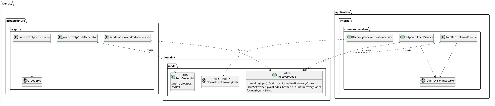

# Bolt 33d 計画 - TOTP と回復コードの部品の整理（振る舞いの変わらない直し）

## 基本情報

| 項目 | 内容 |
| :--- | :--- |
| Bolt | 第 33d 回（W5 の 19 本目） |
| 予定 | W5（2026-11-02 の週。前倒しで着手できる）。作業は約 3.5 時間（承認ゲートの待ち時間を除く） |
| 対象 | `identity`（TOTP の秘密の発行とコードの生成、QR コードの SVG、回復コード、登録と再登録のサービス、A-02・A-07・A-08 のコードの欄の桁数）、設計文書（domain_model・architecture_backend・ADR-011・test_strategy・release_plan） |
| SP | 0（技術タスク） |
| GitHub | なし |
| 承認ゲート | **ステップごとに止める**（W5 の表の 33d の行。構造）。スキーマは変えない。層・モジュールの規則に当たったら、`/goal` の下でも止めて諮る（T-125） |
| アプローチ | リファクタリング（インサイドアウト）。既存のテスト（登録・再登録・回復コードのログインの単体・統合・画面の層）を緑のまま、部品を切り出して寄せる。移す前に、振る舞いを固定するテストが足りないところだけ先に足す |
| マニュアル・デモ | 対象外（画面の振る舞いと文言を変えない。コードの欄の桁数を定数から描くだけで、表示は同じ） |
| 前の Bolt | [Bolt 33c 終了報告](bolt_33c_report.md) |

## ふりかえりと前の Bolt からの引き継ぎ

| 入力 | 内容 | この Bolt での扱い |
| :--- | :--- | :--- |
| 開始準備の決定（2026-10-16、human:kakimomokuri） | (1) 33d と 33e に分ける。33d は TOTP と回復コードの部品（TOTP の定数、SVG の分離、回復コードの形の知識、`normalize` の戻り値の型、A-07 と A-08 の重複）。33e は認証の入口と期限（認証の結果に経路、session の ID の値オブジェクト、期限の境界の判定を `SessionPolicy` に、テンプレートの「15 分」「8 時間」を `SessionPolicy` から描く）。(2) A-07 と A-08 の重複は小さな部品に切り出す: 回復コード 10 個の発行（生成 → ハッシュ → そろいの確かめ）を `RecoveryCode` の工場メソッドに、途中の暗号文を使い続ける処理を `commandservices` の小さな部品に寄せ、2 つのサービスは残す | 確認ポイント 1・2 |
| Bolt 33c の Try T-134・T-135 | フレームワークの部品を Bean にする前に、その型を Bean で探す仕組みを確かめる。層の規則に例外を足すときは、根拠を見張る規則を同じステップで足す | 新しい部品は Bean にしない（サービスの中で組み立てる）か、Bean にするなら型で探されないことを確かめる。規則の例外は足さない予定（当たったら止めて諮る） |
| Bolt 33b の Try T-131・T-132 | 変異の確かめは控えのファイルで戻す。既存のテストの検索は値で全体を grep する | 変異の確かめ（回復コードの形、`normalize`）は控えから戻す。`6`・`HmacSHA1`・`SHA1`・`[0-9]{6}` でテンプレート・テストを含む全体を grep する |
| Bolt 31d・31c・33b の送り | TOTP の桁数・周期・アルゴリズムの定数、SVG の組み立て、回復コードの形の知識の 2 か所、`normalize` の戻り値の型（31d）。A-07 と A-08 の重複（33b の開発レビュー） | ステップ 2〜4 |
| 33c の行から 33e に送るもの | 認証の結果のトークンに経路、`revokeOthers` の session の ID の値オブジェクト、期限の境界の判定、テンプレートの期間の数値 | 33e（ステップ 1 で release_plan に行を足す） |

## スコープ

### 入れるもの・入れないもの

| 入れる | 入れない（33e・後で） |
| :--- | :--- |
| TOTP の桁数を `TotpCredential.DIGITS`（周期の `STEP_DURATION` と並べる）に、アルゴリズム（HMAC の名前と otpauth の URI の名前）を `infrastructure.crypto` の 1 か所に置き、`JavaOtpTotpCodeGenerator`・`RandomTotpSecretIssuer` が使う。A-02・A-07・A-08 のコードの欄の `pattern`・`maxlength`・説明の「6 桁」を、画面がモデルで渡す桁数から描く（表示は変えない） | 認証の結果のトークンに経路（33e） |
| QR コードの SVG の組み立て（`RandomTotpSecretIssuer.qrSvg`）を `infrastructure.crypto` の部品（例 `QrCodeSvg`）に分け、単体テストを移す | `revokeOthers` の session の ID の値オブジェクト（33e） |
| 回復コードの形（16 進 8 文字を 4 文字ずつハイフンで区切る）の知識を `RecoveryCode` に寄せる（形を作る static の関数か定数）。`RandomRecoveryCodeGenerator` はそれを使う。生成した値が `normalize` を通ることのテストを足す | 期限の境界の判定、テンプレートの期間の数値（33e） |
| `RecoveryCode.normalize` の戻り値を値オブジェクト（例 `NormalizedRecoveryCode`、`valueobjects`）にし、`matches` と `RecoveryCodeVerificationService` がそれを受ける | 全画面に効く Advice のまとめ、`SessionKeys` の命名（33c の既知の課題） |
| 回復コード 10 個の発行（生成 → ハッシュ → `requireIssuedSet`）を `RecoveryCode` の工場メソッド（例 `RecoveryCode.issueSet`）に、途中の暗号文を使い続けて表示の値を作る処理（`begin` と `provisioningOf`）を `commandservices` の小さな部品（例 `TotpProvisioningStarter`）に寄せ、`TotpEnrollmentService`・`TotpReEnrollmentService` が使う | — |

### 設計の約束（Try T-1）

- **桁数**: `TotpCredential.DIGITS = 6`（ドメイン。`match` の形の確かめにも使えるなら使う）。アルゴリズムは技術の知識なので `infrastructure.crypto` に置く（ドメインに出さない）。画面は `TotpCredential.DIGITS` をモデルに入れ、テンプレートは `pattern="[0-9]{n}"` などを式で描く（Thymeleaf の式で静的なクラスを参照しない。33c で分かった制限）
- **SVG**: `QrCodeSvg`（`infrastructure.crypto`、package-private か public）は QR コードの行列から SVG の文字列を作るだけ。秘密を知らない。ZXing の依存は今の規則の範囲（crypto の中）
- **回復コードの形**: `RecoveryCode` に形の正規表現と「8 文字の 16 進を 4 文字ずつ区切る」関数を置き、生成器は乱数のバイトをその関数に渡す。`normalize` は同じ知識を使う
- **`NormalizedRecoveryCode`**: record（`valueobjects`、`@ValueObject`）。作れるのは `normalize` だけ（コンストラクターで形を確かめる）。用語集に足す（documentationTest。Javadoc の最初の文と用語集の名前をそろえる）
- **重複の部品**: `RecoveryCode.issueSet(owner, plainCodes, hasher, at)` は 10 個の発行とそろいの確かめを 1 つにする（今の `requireIssuedSet` を中に使う）。`TotpProvisioningStarter`（`commandservices`）は `start(owner, pending, accountName)` で、途中の暗号文が同じ利用者のものとして読めれば使い続け、読めなければ新しく発行する。サービスが `new` で組み立てる（Bean にしない。T-134）か、合成ルートで Bean にするなら型で探されないことを確かめる

## 設計（この Bolt の範囲）

4 図のうち、ドメインモデル図だけを置く。状態遷移図は新しい状態がないので、ER 図は表を変えないので、画面遷移図は画面を変えないので省く。

## ステップ計画

状態の記号: `[ ]` 未着手、`[-]` 進行中、`[?]` 承認待ち、`[x]` 完了。各ステップの終わりに `check` が緑であることを確かめ、push してアプリの CI と MkDocs の配備を確かめる（T-26、T-126）。コミットは pathspec で作る（T-110）。複数行の書き換えはスクリプトのファイルにする（T-103）。

- [ ] **1. 設計文書** 【承認ゲート: 設計文書】
  - domain_model.md（`TotpCredential.DIGITS`、`RecoveryCode` の形と `issueSet`、`NormalizedRecoveryCode` を要素表と用語集に、`TotpProvisioningStarter`）、architecture_backend.md（crypto の部品 `QrCodeSvg`、アルゴリズムの置き場所、重複の寄せ方）、ADR-011（33d で寄せたこと。「33d」と書いた箇所を閉じる）、test_strategy.md（Bolt 33d の行）、release_plan.md（33d の行を決定に合わせ、33e の行を足して W5 を 22 本に。US-18 の Bolt の順序の文、局面とアプローチの段落、W5 の注、状態の行、実績の表、更新履歴）
  - 完了の判定: `okf:check` ERROR 0、`documentationTest` 緑
- [ ] **2. TOTP の定数と SVG**
  - `6`・`HmacSHA1`・`SHA1`・`[0-9]{6}`・「6 桁」で全体を grep する（T-132）。桁数とアルゴリズムの定数、生成器と発行の付け替え、画面のコードの欄を桁数から描く（画面の単体テスト・セキュリティの統合テストで表示が同じことを確かめる）。`QrCodeSvg` を分け、SVG の単体テストを移す
- [ ] **3. 回復コードの形と `normalize` の型**
  - 生成した値が `normalize` を通る（形が 1 か所にある）テストを先に足す → 形の知識を `RecoveryCode` に寄せる → `NormalizedRecoveryCode` を足し、`matches`・照合のサービスを付け替える。変異の確かめ（形の区切りを変えると落ちる。控えから戻す。T-131）
- [ ] **4. A-07 と A-08 の重複**
  - `RecoveryCode.issueSet` と `TotpProvisioningStarter` を足し、2 つのサービスを付け替える。登録・再登録の単体・統合テスト（同時の登録・再登録、二度押し、途中の暗号文の使い続け）が緑のまま
  - 完了の判定: `check` 緑、`uiTest` 緑
- [ ] **5. SonarQube と開発レビューと終了報告** 【承認ゲート: 終了報告】
  - SonarQube（T-116）。開発レビュー（プログラマー・テスター、アーキテクト）。振る舞いを変えないのでセキュリティとテクニカルライターは省く
  - `bolt_33d_report.md`。release_plan の W5 の 33d の行、開発の索引

### 時間の配分と打ち切り

| # | 目安 | 打ち切り |
| :--- | :--- | :--- |
| 1 | 30 分 | — |
| 2 | 50 分 | — |
| 3 | 45 分 | — |
| 4 | 50 分 | 層・モジュールの規則に当たったら止めて諮る |
| 5 | 30 分（SonarQube の待ちを除く） | — |

合計 205 分（約 3.5 時間）。4.5 時間を超えると見えたら止めて諮る（候補: 画面のコードの欄の桁数を 33e に送る）。

## 確認ポイント（計画の承認の場でまとめて確認する。Try T-6）

| # | 確認すること | ステップ | 推奨 |
| :--- | :--- | :--- | :--- |
| 1 | **分け方**（開始準備で決めた） | 全体 | 33d は TOTP と回復コードの部品。認証の入口と期限は 33e |
| 2 | **重複の寄せ方**（開始準備で決めた） | 4 | 回復コード 10 個の発行を `RecoveryCode.issueSet` に、途中の暗号文の処理を `TotpProvisioningStarter` に切り出し、2 つのサービスは残す |
| 3 | **定数の置き場所** | 2 | 桁数はドメインの `TotpCredential.DIGITS`（周期と並べる）。アルゴリズムは技術の知識なので `infrastructure.crypto` |
| 4 | **画面のコードの欄** | 2 | 桁数を画面がモデルで渡し、テンプレートは式で描く（表示は変えない） |
| 5 | **`NormalizedRecoveryCode`** | 3 | `valueobjects` の record。`normalize` だけが作る |
| 6 | **新しいファイル** | 2〜4 | `QrCodeSvg`、`NormalizedRecoveryCode`、`TotpProvisioningStarter`、テスト（既存のテストのクラスに足せるなら足す） |
| 7 | **マニュアル・デモ** | — | 対象外（画面の振る舞いと文言を変えない） |
| 8 | **アプローチと承認ゲートと時間** | 全体 | リファクタリング（インサイドアウト）。ステップごとに止める（構造）。約 3.5 時間 |

## 完了条件

- [ ] TOTP の桁数とアルゴリズムが 1 か所ずつにあり、画面のコードの欄もその桁数から描かれる（表示は同じ）。QR コードの SVG の組み立てが秘密の発行から分かれている
- [ ] 回復コードの形の知識が `RecoveryCode` だけにあり、`normalize` が `NormalizedRecoveryCode` を返す。変異の確かめで落ちることを確かめた
- [ ] A-07 と A-08 が回復コード 10 個の発行と途中の暗号文の処理を共有し、登録・再登録の振る舞いが変わらない
- [ ] 設計文書（domain_model・architecture_backend・ADR-011・test_strategy・release_plan）を更新し、33e の行を足した
- [ ] `check` と `uiTest` が緑。push してアプリの CI と MkDocs の配備を確かめた。SonarQube の Quality Gate が PASS、`okf:check` ERROR 0
- [ ] 開発レビュー、終了報告

## 更新履歴

| 日付 | 更新内容 | 更新者 |
| :--- | :--- | :--- |
| 2026-10-16 | 初版作成（承認待ち）。開始準備で、33d の範囲（9 項目、約 6 時間）を見積もり、human:kakimomokuri の決定（33d と 33e に分ける、A-07 と A-08 の重複は小さな部品に切り出す）を反映した | anthropic/claude-opus-5-5 |

## 関連ドキュメント

- [リリース計画](release_plan.md)（W5）
- [Bolt 33c 計画](bolt_33c_plan.md)、[Bolt 33c 終了報告](bolt_33c_report.md)、[Bolt 33b 終了報告](bolt_33b_report.md)
- [ドメインモデル](../../design/cargo-tracker/domain_model.md)、[バックエンドのアーキテクチャ](../../design/cargo-tracker/architecture_backend.md)、[テスト戦略](../../design/cargo-tracker/test_strategy.md)
- [ADR-011](../../adr/cargo-tracker/011-mfa-totp.md)
