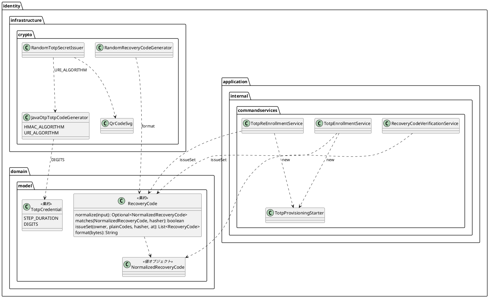

# Bolt 33d 計画 - TOTP と回復コードの部品の整理（振る舞いの変わらない直し）

## 基本情報

| 項目 | 内容 |
| :--- | :--- |
| Bolt | 第 33d 回（W5 の 19 本目） |
| 予定 | W5（2026-11-02 の週。前倒しで着手できる）。作業は約 3.5 時間（承認ゲートの待ち時間を除く） |
| 対象 | `identity`（TOTP の秘密の発行とコードの生成、QR コードの SVG、回復コード、登録と再登録のサービス、A-02・A-07・A-08 のコードの欄の属性）、設計文書（domain_model・architecture_backend・ui_design・ADR-011・test_strategy・release_plan）、過去の報告（33b・33c）の行き先の書き添え |
| SP | 0（技術タスク） |
| GitHub | なし |
| 承認ゲート | **ステップごとに止める**（W5 の表の 33d の行。構造）。スキーマは変えない。層・モジュールの規則に当たったら、`/goal` の下でも止めて諮る（T-125） |
| アプローチ | リファクタリング（インサイドアウト）。既存のテスト（登録・再登録・回復コードのログインの単体・統合・画面の層）を緑のまま、部品を切り出して寄せる。移す前に、振る舞いを固定するテストが足りないところ（画面のコードの欄の属性、生成した回復コードの形）だけ先に足す。開発戦略の表では技術タスクのテストの入口は「検証の手段」だが、この Bolt の検証の手段は既存の単体・統合のテストで、直す対象が内側（定数・値オブジェクト・ドメインの工場メソッド）にあるので、内側から外へ順に寄せる（Bolt 31d と同じ扱い） |
| マニュアル・デモ | 対象外（画面の振る舞いと文言を変えない。コードの欄の `pattern`・`maxlength` を定数から描くだけで、表示は同じ） |
| 前の Bolt | [Bolt 33c 終了報告](bolt_33c_report.md) |

## ふりかえりと前の Bolt からの引き継ぎ

| 入力 | 内容 | この Bolt での扱い |
| :--- | :--- | :--- |
| 開始準備の決定（2026-10-16、human:kakimomokuri） | (1) 33d と 33e に分ける。33d は TOTP と回復コードの部品（TOTP の定数、SVG の分離、回復コードの形の知識、`normalize` の戻り値の型、A-07 と A-08 の重複）。33e は認証の入口と期限（認証の結果に経路、session の ID の値オブジェクト、期限の境界の判定を `SessionPolicy` に、テンプレートの「15 分」「8 時間」を `SessionPolicy` から描く）。(2) A-07 と A-08 の重複は小さな部品に切り出し、2 つのサービスは残す | 確認ポイント 1・2 |
| 検証の後の決定（2026-10-16、human:kakimomokuri） | (3) 33c の議題 4 (b)（`SessionKeys` の URL を意図した負債として ADR-012 に書くか）は 33e で扱う。(4) `matches` は `NormalizedRecoveryCode` だけで受け、16 進でない平文を使うテストのデータを正しい形に直す。(5) 「6 桁」を定数から描くのはコードの欄の `pattern`・`maxlength` だけにし、見出し・前文・説明の文言は残す。(6) 過去の報告（33b・33c）で行き先を 33c・33d と書いた経路と session の ID などに「→ 33e」を書き添える | 確認ポイント 3〜6 |
| Bolt 33c の Try T-134・T-135 | フレームワークの部品を Bean にする前に、その型を Bean で探す仕組みを確かめる。層の規則に例外を足すときは、根拠を見張る規則を同じステップで足す | `TotpProvisioningStarter` は Bean にせず、2 つのサービスがコンストラクターで `new` する（T-134 の確かめが要らない形）。規則の例外は足さない（当たったら止めて諮る） |
| Bolt 33b の Try T-131・T-132 | 変異の確かめは控えのファイルで戻す。既存のテストの検索は値で全体を grep する | 変異の確かめ（回復コードの形、欄の属性）は控えから戻す。`6`・`HmacSHA1`・`SHA1`・`[0-9]{6}`・`maxlength` でテンプレート・テストを含む全体を grep する |
| Bolt 31d・31c・33b の送り | TOTP の桁数・周期・アルゴリズムの定数、SVG の組み立て、回復コードの形の知識の 2 か所、`normalize` の戻り値の型（31d）。A-07 と A-08 の重複（33b の開発レビュー） | ステップ 2〜4 |
| Bolt 33c の既知の課題・議題 4 | (b) URL の負債、(c) 期限の境界の判定、画面だけが使う属性の名前 2 つに値を固定するテスト、`SessionKeys` の命名 | すべて 33e（`SessionKeys`・`SessionPolicy` に触る Bolt）。全画面に効く Advice 4 つのまとめは後で検討（行き先は変えない） |

## スコープ

### 入れるもの・入れないもの

| 入れる | 33e に送る | 後で（変えない） |
| :--- | :--- | :--- |
| TOTP の桁数を `TotpCredential.DIGITS`（周期の `STEP_DURATION` と並べる）にし、`JavaOtpTotpCodeGenerator`（`this(cipher, 6)`）と `RandomTotpSecretIssuer`（URI の `digits=6`）が使う。アルゴリズムは `JavaOtpTotpCodeGenerator` の package-private の定数 2 つ（HMAC の名前 `HmacSHA1` と otpauth の URI の名前 `SHA1`）にし、`RandomTotpSecretIssuer` が URI の名前を使う（新しいファイルは作らない）。A-02・A-07・A-08 のコードの欄の `pattern`・`maxlength` を、画面がモデルで渡す桁数から描く | 認証の結果のトークンに経路（要素の種類） | 全画面に効く `@ControllerAdvice` 4 つのまとめ |
| QR コードの組み立て（ZXing の Encoder の呼び出しと SVG の文字列）を `infrastructure.crypto.QrCodeSvg` に分け、SVG の単体テストを移す。秘密の発行の側に URI を読み戻すテストを 1 本残す | `revokeOthers` の session の ID の値オブジェクト | テストの中の 6 桁の写し（偽の生成器の `%06d`、誤りのコードの補助、`[0-9]{6}`、URI の文字列）は仕様を固定する値として文字列のまま残す |
| 回復コードの形（16 進 8 文字を 4 文字ずつハイフンで区切る）の知識を `RecoveryCode` に寄せる（形の正規表現と、乱数のバイトから形を作る static の関数）。`RandomRecoveryCodeGenerator` はそれを使い、`RandomRecoveryCodeGeneratorTest` の正規表現の写しを「生成した値が `normalize` を通る」テストに置き換える | 期限の境界の判定（4 か所）を `SessionPolicy` に、テンプレートの「15 分」「8 時間」を `SessionPolicy` から描く | `TotpCredential.match` で桁数を確かめること（結果は今と同じ `Mismatch` で、変わるのは生成器を呼ぶかどうかだけなので足さない） |
| `RecoveryCode.normalize` の戻り値を `Optional<NormalizedRecoveryCode>`（`valueobjects` の record）にし、`matches` は `NormalizedRecoveryCode` だけを受ける。`RecoveryCodeVerificationService` を付け替え、16 進でない平文を使うテスト（`RecoveryCodeTest`、`AuthenticationFactorRepositoriesContract`）のデータを正しい形に直す | 33c の議題 4 (b)（URL の負債を ADR-012 に書くか）、画面だけが使う属性の名前 2 つの値のテスト、`SessionKeys` の命名 | — |
| 回復コード 10 個の発行（平文の一覧 → ハッシュ → `requireIssuedSet`）を `RecoveryCode.issueSet` に、途中の暗号文を使い続けて表示の値を作る処理（`begin` と `provisioningOf`）を `commandservices.TotpProvisioningStarter` に寄せ、`TotpEnrollmentService`・`TotpReEnrollmentService` が使う | — | — |

### 設計の約束（Try T-1）

- **桁数**: `TotpCredential.DIGITS = 6`（ドメイン。周期と同じく TOTP の資格の決まり）。アルゴリズムは技術の知識なので `infrastructure.crypto` の `JavaOtpTotpCodeGenerator` に置く（ドメインに出さない）。画面は `TotpCredential.DIGITS` をモデル（例 `codeDigits`）に入れ、テンプレートは `th:attr` で `pattern="[0-9]{n}"`・`maxlength` を描く（Thymeleaf の式で静的なクラスを参照しない。33c で分かった制限）。モデルに入れるのは `LoginController.totp`・`TotpEnrollmentController.start`・`TotpReEnrollmentController.start` の 3 か所
- **欄の見張り**: 移す前に、3 画面のコードの欄の `pattern="[0-9]{6}"`・`maxlength="6"` と、見出し・前文の「6 桁」を確かめるテストをセキュリティの統合テストに足す（今は `autocomplete="one-time-code"` しか確かめていない）。属性を消す変異で落ちることを確かめる
- **SVG**: `QrCodeSvg`（`infrastructure.crypto`、package-private）は URI から QR コードの行列を作り SVG の文字列にするだけで、秘密を知らない。AuthenticationArchitectureTest の「秘密の発行の実装は QR のライブラリを使う」の対象を `QrCodeSvg` に替え、「暗号の部品は crypto にある」の一覧と architecture_backend の crypto の部品の一覧に足す（規則の例外ではなく見張りの対象の付け替え）
- **回復コードの形**: `RecoveryCode` に形の正規表現（今の `NORMALIZED`）と「4 バイトを 16 進 8 文字にして 4 文字ずつ区切る」static の関数（例 `RecoveryCode.format(byte[])`）を置く。生成器は乱数のバイトをその関数に渡す。`normalize` は同じ知識を使う
- **`NormalizedRecoveryCode`**: record（`valueobjects`、`@ValueObject`）。コンストラクターで形（`RecoveryCode` の正規表現）を確かめるので、だれが作っても形は守られる（record の標準のコンストラクターは別のパッケージから呼べるので、「`normalize` だけが作る」とはしない）。用語集に `| 正規化した回復コード | NormalizedRecoveryCode | … | identity |` の行を足し、Javadoc の最初の文を「正規化した回復コード。」にする（LivingGlossaryConsistencyTest）。`normalize(..)` の結果を文字列で比べるテスト（`RecoveryCodeTest`）は `value()` で比べる
- **`RecoveryCode.issueSet(owner, plainCodes, hasher, at)`**: 平文の一覧（10 個）をハッシュにして `RecoveryCode` の一覧を作り、今の `requireIssuedSet` でそろいを確かめて返す。平文の一覧は今のとおり呼び出し側（サービス）が生成器から受けて画面に返す
- **`TotpProvisioningStarter`**（`commandservices`、Bean にしない）: `start(owner, pending, accountName)` で、途中の暗号文が同じ利用者のものとして復号できれば使い続け、できなければ新しく発行し、入れ子の record（暗号文と表示の値）を返す。2 つのサービスはそれを `EnrollmentStart`・`ReEnrollmentStart` に詰め替える。名前が `*Service` でないので `@Service` の規則に当たらない

## 設計（この Bolt の範囲）

4 図のうち、ドメインモデル図だけを置く。状態遷移図は新しい状態がないので、ER 図は表を変えないので、画面遷移図は画面を変えないので省く。

## ステップ計画

状態の記号: `[ ]` 未着手、`[-]` 進行中、`[?]` 承認待ち、`[x]` 完了。各ステップの終わりに `check` が緑であることを確かめ、push してアプリの CI と MkDocs の配備を確かめる（T-26、T-126）。コミットは pathspec で作る（T-110）。複数行の書き換えはスクリプトのファイルにする（T-103）。

- [x] **1. 設計文書** 【承認ゲート: 設計文書】
  - domain_model.md: `TotpCredential.DIGITS`、`RecoveryCode` の形・`format`・`issueSet`、`NormalizedRecoveryCode` を要素表と用語集（89 行目の表）に、`TotpProvisioningStarter`、identity の図。「Bolt 33d で寄せる」（196・1062 行目）を閉じ、IA-INV-11（1169 行目の `normalize`）を直す
  - architecture_backend.md: crypto の部品の一覧（284 行目の「6 つ」）に `QrCodeSvg` を足して数え直し、アルゴリズムの置き場所と重複の寄せ方を書く
  - ui_design.md: 789 行目の「Bolt 33d で寄せる」を閉じ、コードの欄の属性を桁数から描くことを書く
  - ADR-011: 72 行目を閉じ、79 行目を 33d（閉じる）と 33e（経路・session の ID）に分け、253 行目の正規化の行に戻り値の型を、273 行目の crypto の部品の数に `QrCodeSvg` を足す
  - test_strategy.md: Bolt 33d の行
  - release_plan.md: 598 行目の 33d の行（経路・session の ID・期限の境界・期間の数値を外し、計画へのリンク）、33e の行を足す、557 行目の局面とアプローチ、602 行目の W5 の注（33c・33d・33e は SP 0）、604 行目の順序（→ 33d → 33e）と本数（22 本）と 33e の理由、621 行目（33c・33d・33e に入れない）、553 行目の状態、774 行目の実績の表、更新履歴
  - 過去の報告: bolt_33b_report.md（96・106・141 行目）と bolt_33c_report.md（22・109・116 行目）の経路・session の ID・期限の境界・議題 4 (b) の行き先に「→ 33e」を書き添え、更新履歴に 1 行足す（決定 6）
  - 完了の判定: `okf:check` ERROR 0、`documentationTest` 緑
- [ ] **2. TOTP の定数と SVG**
  - `6`・`HmacSHA1`・`SHA1`・`[0-9]{6}`・`maxlength`・「6 桁」で全体を grep する（T-132）
  - 先に 3 画面の欄の見張りのテストを足す（緑。属性を消す変異で落ちることを確かめ、控えから戻す。T-131）
  - `TotpCredential.DIGITS` とアルゴリズムの定数を足し、生成器と発行を付け替える。3 つの画面のハンドラーがモデルで桁数を渡し、テンプレートの欄の属性を描く
  - `QrCodeSvg` を分け、SVG の単体テストを移す。AuthenticationArchitectureTest の QR のライブラリの規則の対象を `QrCodeSvg` に替え、crypto の一覧に足す
- [ ] **3. 回復コードの形と `normalize` の型**
  - 生成した値が `normalize` を通るテストを先に足し、`RandomRecoveryCodeGeneratorTest` の正規表現の写しを置き換える → 形の知識と `format` を `RecoveryCode` に寄せる → `NormalizedRecoveryCode` を足し、`normalize`・`matches`・`RecoveryCodeVerificationService` を付け替え、テストのデータ（`RecoveryCodeTest` の 49・50・60 行目、`AuthenticationFactorRepositoriesContract` の 215・216・229 行目）と `normalize(..)` の比べ方（`RecoveryCodeTest` の 121〜141 行目）を直す
  - 変異の確かめ（`format` の区切りを変えると落ちる。控えから戻す。T-131）
- [ ] **4. A-07 と A-08 の重複**
  - `RecoveryCode.issueSet`（`RecoveryCodeTest` に足す）と `TotpProvisioningStarter`（単体テストを足す）を作り、2 つのサービスを付け替える（`TotpEnrollmentService` の 85〜102・140〜145 行目、`TotpReEnrollmentService` の 106〜114・164〜169・209〜216 行目）。登録・再登録の単体・統合テスト（同時の登録・再登録、二度押し、途中の暗号文の使い続け）が緑のまま
  - 完了の判定: `check` 緑、`uiTest` 緑
- [ ] **5. SonarQube と開発レビューと終了報告** 【承認ゲート: 終了報告】
  - SonarQube（T-116）。開発レビュー（プログラマー・テスター、アーキテクト）。振る舞いを変えないのでセキュリティとテクニカルライターは省く
  - `bolt_33d_report.md`。release_plan の W5 の 33d の行、開発の索引

### 時間の配分と打ち切り

| # | 目安 | 打ち切り |
| :--- | :--- | :--- |
| 1 | 35 分 | — |
| 2 | 55 分 | — |
| 3 | 45 分 | — |
| 4 | 45 分 | 層・モジュールの規則に当たったら止めて諮る |
| 5 | 30 分（SonarQube の待ちを除く） | — |

合計 210 分（約 3.5 時間）。4.5 時間を超えると見えたら止めて諮る（候補: 画面のコードの欄の属性を 33e に送る）。

## 確認ポイント（計画の承認の場でまとめて確認する。Try T-6）

| # | 確認すること | ステップ | 推奨・決定 |
| :--- | :--- | :--- | :--- |
| 1 | **分け方** | 全体 | 決定済み（1）: 33d は TOTP と回復コードの部品。認証の入口と期限は 33e |
| 2 | **重複の寄せ方** | 4 | 決定済み（2）: `RecoveryCode.issueSet` と `TotpProvisioningStarter`（Bean にせず `new`）。2 つのサービスは残す |
| 3 | **33c の議題 4 (b) と既知の課題** | — | 決定済み（3）: 33e で扱う |
| 4 | **`matches` の受け方** | 3 | 決定済み（4）: `NormalizedRecoveryCode` だけで受け、テストのデータを直す |
| 5 | **画面の「6 桁」の範囲** | 2 | 決定済み（5）: 欄の `pattern`・`maxlength` だけ。見出し・前文の文言は残し、見張りのテストで固定する |
| 6 | **過去の報告** | 1 | 決定済み（6）: 「→ 33e」を書き添える |
| 7 | **定数の置き場所** | 2 | 桁数はドメインの `TotpCredential.DIGITS`。アルゴリズムは `JavaOtpTotpCodeGenerator` の package-private の定数（新しいファイルは作らない） |
| 8 | **見張りの付け替え** | 2 | AuthenticationArchitectureTest の QR のライブラリの規則の対象を `QrCodeSvg` に替え、crypto の一覧に足す（例外ではない） |
| 9 | **新しいファイル** | 2〜4 | `QrCodeSvg`、`NormalizedRecoveryCode`、`TotpProvisioningStarter` と、その単体テスト（`QrCodeSvgTest`、`TotpProvisioningStarterTest`）。ほかのテストは既存のクラスに足す |
| 10 | **変えないもの** | — | `TotpCredential.match` に桁数の確かめを足さない。テストの中の 6 桁の写しは文字列のまま残す |
| 11 | **マニュアル・デモ** | — | 対象外（画面の振る舞いと文言を変えない） |
| 12 | **アプローチと承認ゲートと時間** | 全体 | リファクタリング（インサイドアウト）。ステップごとに止める（構造）。約 3.5 時間 |

## 完了条件

- [ ] TOTP の桁数とアルゴリズムが 1 か所ずつにあり、画面のコードの欄の属性もその桁数から描かれる（見張りのテストで表示が同じことを確かめた）。QR コードの SVG の組み立てが秘密の発行から分かれ、見張りの規則が `QrCodeSvg` を対象にしている
- [ ] 回復コードの形の知識が `RecoveryCode` だけにあり、`normalize` が `NormalizedRecoveryCode` を返し、`matches` はそれだけを受ける。変異の確かめで落ちることを確かめた
- [ ] A-07 と A-08 が回復コード 10 個の発行と途中の暗号文の処理を共有し、登録・再登録の振る舞いが変わらない
- [ ] 設計文書（domain_model・architecture_backend・ui_design・ADR-011・test_strategy・release_plan）を更新し、33e の行を足した。過去の報告に「→ 33e」を書き添えた
- [ ] `check` と `uiTest` が緑。push してアプリの CI と MkDocs の配備を確かめた。SonarQube の Quality Gate が PASS、`okf:check` ERROR 0
- [ ] 開発レビュー、終了報告

## 更新履歴

| 日付 | 更新内容 | 更新者 |
| :--- | :--- | :--- |
| 2026-10-16 | 初版作成（承認待ち）。開始準備で、33d の範囲（9 項目、約 6 時間）を見積もり、human:kakimomokuri の決定（33d と 33e に分ける、A-07 と A-08 の重複は小さな部品に切り出す）を反映した | anthropic/claude-opus-5-5 |
| 2026-10-16 | 詳細整合性検証（12 件）と横断整合性検証（11 件）の指摘を反映した。QR のライブラリの見張りの付け替え、アルゴリズムの定数の置き場所、欄の見張りのテスト、record のコンストラクターの公開範囲、`TotpProvisioningStarter` の戻り値と Bean にしないこと、設計文書と release_plan の行、変えないもの。human:kakimomokuri の決定（33c の議題 4 (b) は 33e、`matches` は値オブジェクトだけで受ける、欄の属性だけを描く、過去の報告に「→ 33e」を書き添える）を反映した | anthropic/claude-opus-5-5 |
| 2026-10-16 | 計画を承認した（`/goal Bolt33d`） | anthropic/claude-opus-5-5、承認 human:kakimomokuri |

## 関連ドキュメント

- [リリース計画](release_plan.md)（W5）
- [Bolt 33c 計画](bolt_33c_plan.md)、[Bolt 33c 終了報告](bolt_33c_report.md)、[Bolt 33b 終了報告](bolt_33b_report.md)
- [ドメインモデル](../../design/cargo-tracker/domain_model.md)、[バックエンドのアーキテクチャ](../../design/cargo-tracker/architecture_backend.md)、[UI 設計](../../design/cargo-tracker/ui_design.md)、[テスト戦略](../../design/cargo-tracker/test_strategy.md)
- [ADR-011](../../adr/cargo-tracker/011-mfa-totp.md)
