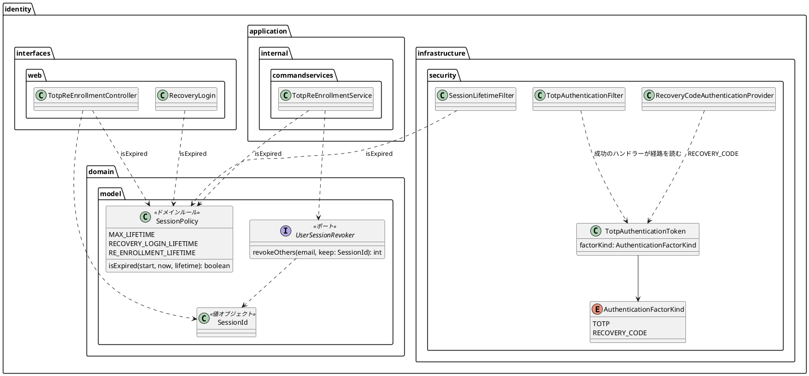

# Bolt 33e 計画 - 認証の入口と session の型と期限の整理（振る舞いの変わらない直し）

## 基本情報

| 項目 | 内容 |
| :--- | :--- |
| Bolt | 第 33e 回（W5 の 20 本目） |
| 予定 | W5（2026-11-02 の週。前倒しで着手できる）。作業は約 3.5 時間（承認ゲートの待ち時間を除く） |
| 対象 | `identity`（TOTP の認証のトークン・回復コードの provider・TOTP のフィルターと成功のハンドラー、`UserSessionRevoker` と実装・再登録のサービスと画面、`SessionPolicy` と期限を判定する 4 か所、画面だけが使う属性の名前）、設計文書（domain_model・architecture_backend・ADR-011・ADR-012・test_strategy・release_plan） |
| SP | 0（技術タスク） |
| GitHub | なし |
| 承認ゲート | **ステップごとに止める**（W5 の表の 33e の行。構造）。スキーマは変えない。層・モジュールの規則に当たったら、`/goal` の下でも止めて諮る（T-125） |
| アプローチ | リファクタリング（インサイドアウト）。内側（`SessionPolicy` の判定、session の ID の値オブジェクト）から外側（認証の入口のトークン）へ寄せる。既存のテスト（session の上限・回復コードの印・再登録・回復コードのログインの単体・統合・画面の層）を緑のまま移し、移す前に足りない守り（期限のちょうどの時刻、画面だけが使う属性の名前の値、経路の取り違え）を先に足す。開発戦略の表では技術タスクのテストの入口は「検証の手段」だが、検証の手段が既存の単体・統合のテストで、直す対象が内側にあるので内側から寄せる（Bolt 31d・33d と同じ扱い） |
| マニュアル・デモ | 対象外（画面の振る舞いと文言を変えない。テンプレートは触らない） |
| 前の Bolt | [Bolt 33d 終了報告](bolt_33d_report.md) |

## ふりかえりと前の Bolt からの引き継ぎ

| 入力 | 内容 | この Bolt での扱い |
| :--- | :--- | :--- |
| 開始準備の決定（2026-10-16、human:kakimomokuri） | (1) 33e の行の 7 項目（約 5.75 時間）を 33e と 33f に分ける。33e は認証の入口と session の型と期限（経路、session の ID の値オブジェクト、期限の境界の判定、画面だけが使う属性の名前の値のテスト）。33f は画面と回復コードと文書（テンプレートの「15 分」「8 時間」を `SessionPolicy` から描く、回復コードの生成のポートと `issueSet` を `NormalizedRecoveryCode` で受ける、ADR-012 の URL の記述）。(2) 期限の境界の判定は `SessionPolicy` に足す（ADR-012 の決定 3 の「ふるまいは持たず」の文言を直す）。(3) 回復コードの生成のポートの型は 33f で直す（33d の議題 4） | 確認ポイント 1〜3 |
| Bolt 33d の Try T-136・T-137 | 定数から描くように変えるときは、描く仕組みを外す変異で守りを確かめる。スクラッチパッドのスクリプトは Bolt の接頭辞を付けた新しい名前で作り、書き込みの成功を確かめてから実行する | T-136 は 33f（テンプレート）で使う。33e では、寄せた判定を外す変異（`SessionPolicy` を呼ばずに `isBefore` に戻すなど）で守りを確かめる。T-137 はスクリプトを `b33e_` で始める |
| Bolt 33c の Try T-134・T-135 | フレームワークの部品を Bean にする前に型で探す仕組みを確かめる。層の規則に例外を足すときは根拠を見張る規則を同じステップで足す | 新しい部品は Bean にしない。規則の例外は足さない（当たったら止めて諮る） |
| Bolt 33b の Try T-131・T-132 | 変異の確かめは控えのファイルで戻す。既存のテストの検索は値で全体を grep する | 変異は控えから戻す。`RECOVERY_ATTEMPT`・`isBefore(`・`plus(SessionPolicy`・`revokeOthers`・`reEnrollmentPendingSecret` で全体を grep する |
| Bolt 33b の開発レビュー | 認証の結果のトークンでは経路を区別できないので、回復コードの経路を認証の入口が request の属性で成功のハンドラーに伝えている。`revokeOthers` の残す session の ID が文字列 | ステップ 3・4 |
| Bolt 33c の開発レビューと既知の課題 | 期限の境界の判定が 4 か所。画面だけが使う属性の名前 2 つに値を固定するテストがない | ステップ 2・5 |

## スコープ

### 入れるもの・入れないもの

| 入れる | 33f に送る | 後で（変えない） |
| :--- | :--- | :--- |
| `SessionPolicy` に期限の判定（例 `isExpired(始めた時刻, 今, 期間)`。ちょうどの時刻は期限切れ）を足し、`SessionLifetimeFilter`・`RecoveryLogin`・`TotpReEnrollmentService`・`TotpReEnrollmentController` の 4 か所が使う | テンプレートの「15 分」「8 時間」（A-07・A-08・A-03・印の知らせ・session の警告）を `SessionPolicy` から描く（uiTest・マニュアルの文言に触る） | `PasswordResetToken`・`LoginFailure` の期限の判定（それぞれの集約の中の規則で、session の方針ではない） |
| `revokeOthers` の残す session の ID を値オブジェクト（例 `SessionId`、`valueobjects`。`toString` は伏せる）にし、ポート・実装・再登録のサービスと画面を付け替える | 回復コードの生成のポート（`RecoveryCodeGenerator`）と `RecoveryCode.issueSet` を `NormalizedRecoveryCode` で受ける | 全画面に効く `@ControllerAdvice` 4 つと `codeDigits` の `@ModelAttribute` 3 つのまとめ |
| 認証の結果のトークン（`TotpAuthenticationToken`）に経路（例 enum `AuthenticationFactorKind` の TOTP・回復コード）を持たせ、回復コードの provider が回復コードの経路で作る。成功のハンドラーはトークンの経路を読み、request の属性（`RECOVERY_ATTEMPT`）での受け渡しをやめる。`toBuilder()` でも経路を引き継ぐ | ADR-012 に、URL を application 層の `SessionKeys` に置いたことの扱いを書く（33c の議題 4 (b)） | — |
| 画面だけが使う属性の名前 2 つ（`TotpReEnrollmentController` の `PENDING_SECRET`・`STARTED_AT`）の値をテストで固定する（動いている session の属性が読めなくならない） | — | — |

### 設計の約束（Try T-1）

- **期限の判定**: `SessionPolicy.isExpired(Instant start, Instant now, Duration lifetime)` は `!now.isBefore(start.plus(lifetime))`（ちょうどの時刻は期限切れ）。純粋な関数で、時計を持たない。`RecoveryLogin` の有効の判定（`now.isBefore(...)`）は `!isExpired(...)` に直す。ADR-012 の決定 3 の「ふるまいは持たず」を「期間と期限の判定（純粋な関数）を持つ」に直す（決定 2）。`application.internal.session` の例外の根拠（`SessionKeys` はふるまいを持たない）とは別のクラスなので、見張りの規則は変わらない
- **`SessionId`**: record（`identity.domain.model.valueobjects`、`@ValueObject`）。空を拒み、`toString` は値を伏せる（session の ID はログに出さない）。用語集に足す（LivingGlossaryConsistencyTest）。`TotpReEnrollmentServiceTest` の `anyString()` は `any(SessionId.class)` に直す
- **経路**: `TotpAuthenticationToken` に経路の欄を足す。トークンは Spring Session JDBC に直列化されるので、欄は直列化できる enum にし、`serialVersionUID` は変えない（欄を足すのは直列化の互換の範囲で、古い session の経路は null になる。経路を読むのは成功のハンドラーだけで、成功のハンドラーは作ったばかりのトークンしか見ないので、古い session には影響しない）。経路の enum は `identity.infrastructure.security` に置く（トークンと同じく入口の中に閉じる。AuthenticationArchitectureTest の閉じ込めの規則の範囲）
- **属性の名前の値**: `TotpReEnrollmentController` の 2 つの定数（package-private）の値を、同じパッケージのテストで文字列として固定する（`SessionKeysTest` と同じ形）

## 設計（この Bolt の範囲）

4 図のうち、ドメインモデル図だけを置く。状態遷移図は新しい状態がないので、ER 図は表を変えないので、画面遷移図は画面を変えないので省く。

## ステップ計画

状態の記号: `[ ]` 未着手、`[-]` 進行中、`[?]` 承認待ち、`[x]` 完了。各ステップの終わりに `check` が緑であることを確かめ、push してアプリの CI と MkDocs の配備を確かめる（T-26、T-126）。コミットは pathspec で作る（T-110）。複数行の書き換えはスクリプトのファイル（`b33e_` で始める）にし、書き込みの成功を確かめてから実行する（T-103、T-137）。

- [ ] **1. 設計文書** 【承認ゲート: 設計文書】
  - domain_model.md（`SessionPolicy` の判定、`SessionId` を要素表と用語集に、`UserSessionRevoker` の引数）、architecture_backend.md（認証の結果のトークンの経路、成功のハンドラーが読むもの、session の方針の判定）、ADR-012 の決定 3（「ふるまいは持たず」を直す）、ADR-011（33e と 33f の分け方）、test_strategy.md（Bolt 33e の行）、release_plan.md（33e の行を決定に合わせ、33f の行を足して W5 を 23 本に。状態の行、局面とアプローチ、W5 の注、順序と本数、W10 への返済の候補の段落、実績の表、更新履歴）、33d の報告の既知の課題に「→ 33e・33f」を書き添える
  - 完了の判定: `okf:check` ERROR 0、`documentationTest` 緑
- [ ] **2. 期限の判定を `SessionPolicy` に**
  - 4 か所のちょうどの時刻のテストがそろっているかを確かめ、足りなければ先に足す（`SessionLifetimeFilterTest`、`RecoveryLoginTest`、`TotpReEnrollmentServiceTest`、`TotpReEnrollmentController` の統合テスト）。`SessionPolicyTest` を足し（ちょうど・1 ナノ秒前・後）、4 か所を付け替える。変異: `isExpired` を `isAfter` に変えると落ちる（控えから戻す）
- [ ] **3. session の ID の値オブジェクト**
  - `SessionId` を足し、ポート・実装・再登録のサービスと画面とテストを付け替える
- [ ] **4. 認証の結果のトークンに経路**
  - 先に、回復コードでログインすると A-08 に、認証コードでログインすると役割のホームに移るテスト（既存の `RecoveryCodeLoginSecurityIntegrationTest`）と、provider が回復コードの経路のトークンを返す単体テストを確かめる・足す。トークンに経路を足し、provider・成功のハンドラー・`toBuilder()` を付け替え、request の属性をやめる。変異: 成功のハンドラーで経路を読まない（常に TOTP）と落ちる
- [ ] **5. 画面だけが使う属性の名前の値**
  - 2 つの定数の値を固定するテストを足す。変異: 値を変えると落ちる
  - 完了の判定: `check` 緑、`uiTest` 緑
- [ ] **6. SonarQube と開発レビューと終了報告** 【承認ゲート: 終了報告】
  - SonarQube（T-116）。開発レビュー（プログラマー・テスター、アーキテクト、セキュリティ。認証の入口のトークンと session の失効に触るのでセキュリティを入れる）
  - `bolt_33e_report.md`。release_plan の W5 の 33e の行、開発の索引

### 時間の配分と打ち切り

| # | 目安 | 打ち切り |
| :--- | :--- | :--- |
| 1 | 30 分 | — |
| 2 | 55 分 | — |
| 3 | 45 分 | — |
| 4 | 70 分 | トークンの直列化で既存の session が読めなくなる兆し、または層・モジュールの規則に当たったら止めて諮る |
| 5 | 15 分 | — |
| 6 | 30 分（SonarQube の待ちを除く） | — |

合計 245 分（約 4 時間）。4.5 時間を超えると見えたら止めて諮る（候補: ステップ 4 を 33f に送る）。

## 確認ポイント（計画の承認の場でまとめて確認する。Try T-6）

| # | 確認すること | ステップ | 推奨・決定 |
| :--- | :--- | :--- | :--- |
| 1 | **分け方** | 全体 | 決定済み（1）: 33e は認証の入口と session の型と期限。画面と回復コードと文書は 33f |
| 2 | **期限の判定の置き場所** | 2 | 決定済み（2）: `SessionPolicy.isExpired`。ADR-012 の決定 3 の文言を直す |
| 3 | **回復コードの生成のポートの型** | — | 決定済み（3）: 33f |
| 4 | **経路の持たせ方** | 4 | `TotpAuthenticationToken` に enum の欄を足す（`serialVersionUID` は変えない。古い session の経路は null で、読むのは成功のハンドラーだけ） |
| 5 | **`SessionId`** | 3 | `valueobjects` の record。`toString` は伏せる |
| 6 | **入れないもの** | — | `PasswordResetToken`・`LoginFailure` の期限の判定（集約の中の規則） |
| 7 | **新しいファイル** | 2〜5 | `SessionId`、`AuthenticationFactorKind`、`SessionPolicyTest`、属性の名前の値のテスト |
| 8 | **マニュアル・デモ** | — | 対象外（画面の振る舞いと文言を変えない） |
| 9 | **開発レビュー** | 6 | プログラマー・テスター、アーキテクト、セキュリティ（認証の入口と session の失効に触る） |
| 10 | **アプローチと承認ゲートと時間** | 全体 | リファクタリング（インサイドアウト）。ステップごとに止める（構造）。約 4 時間 |

## 完了条件

- [ ] 「ちょうどの時刻は期限切れ」の判定が `SessionPolicy` の 1 か所にあり、4 か所がそれを使う。変異で落ちることを確かめた
- [ ] `revokeOthers` が `SessionId` を受ける
- [ ] 回復コードの経路を認証の結果のトークンが持ち、request の属性での受け渡しがない。変異で落ちることを確かめた
- [ ] 画面だけが使う属性の名前 2 つの値をテストで固定した
- [ ] 設計文書（domain_model・architecture_backend・ADR-011・ADR-012・test_strategy・release_plan）を更新し、33f の行を足した
- [ ] `check` と `uiTest` が緑。push してアプリの CI と MkDocs の配備を確かめた。SonarQube の Quality Gate が PASS、`okf:check` ERROR 0
- [ ] 開発レビュー、終了報告

## 更新履歴

| 日付 | 更新内容 | 更新者 |
| :--- | :--- | :--- |
| 2026-10-16 | 初版作成（承認待ち）。開始準備で、33e の行の 7 項目（約 5.75 時間）を見積もり、human:kakimomokuri の決定（33e と 33f に分ける、期限の判定は `SessionPolicy` に足す、回復コードの生成のポートの型は 33f）を反映した | anthropic/claude-opus-5-5 |

## 関連ドキュメント

- [リリース計画](release_plan.md)（W5）
- [Bolt 33d 計画](bolt_33d_plan.md)、[Bolt 33d 終了報告](bolt_33d_report.md)、[Bolt 33c 終了報告](bolt_33c_report.md)、[Bolt 33b 終了報告](bolt_33b_report.md)
- [ドメインモデル](../../design/cargo-tracker/domain_model.md)、[バックエンドのアーキテクチャ](../../design/cargo-tracker/architecture_backend.md)、[テスト戦略](../../design/cargo-tracker/test_strategy.md)
- [ADR-011](../../adr/cargo-tracker/011-mfa-totp.md)、[ADR-012](../../adr/cargo-tracker/012-authentication-principal-and-session.md)
