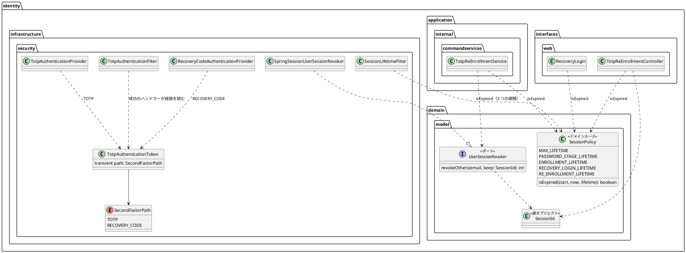

# Bolt 33e 計画 - 認証の入口と session の型と期限の整理（振る舞いの変わらない直し）

## 基本情報

| 項目 | 内容 |
| :--- | :--- |
| Bolt | 第 33e 回（W5 の 20 本目） |
| 予定 | W5（2026-11-02 の週。前倒しで着手できる）。作業は約 4 時間（承認ゲートの待ち時間を除く） |
| 対象 | `identity`（TOTP の認証のトークン・2 つの provider・TOTP のフィルターと成功のハンドラー、`UserSessionRevoker` と実装・再登録のサービスと画面、`SessionPolicy` と期限を判定する 4 か所、画面だけが使う属性の名前）、設計文書（domain_model・architecture_backend・ADR-011・ADR-012・test_strategy・release_plan）、33c・33d の報告の行き先の書き添え |
| SP | 0（技術タスク） |
| GitHub | なし |
| 承認ゲート | **ステップごとに止める**（W5 の表の 33e の行。構造）。スキーマは変えない。層・モジュールの規則に当たったら、`/goal` の下でも止めて諮る（T-125） |
| アプローチ | リファクタリング（インサイドアウト）。内側（`SessionPolicy` の判定、session の ID の値オブジェクト）から外側（認証の入口のトークン）へ寄せる。既存のテスト（session の上限・回復コードの印・再登録・回復コードのログインの単体・統合・画面の層）を緑のまま移し、移す前に足りない守り（A-08 の画面の期限の分岐、画面だけが使う属性の名前の値、トークンの経路）を先に足す。開発戦略の表では技術タスクのテストの入口は「検証の手段」だが、検証の手段が既存の単体・統合のテストで、直す対象が内側にあるので内側から寄せる（Bolt 31d・33d と同じ扱い） |
| マニュアル・デモ | 対象外（画面の振る舞いと文言を変えない。テンプレートは触らない） |
| 前の Bolt | [Bolt 33d 終了報告](bolt_33d_report.md) |

## ふりかえりと前の Bolt からの引き継ぎ

| 入力 | 内容 | この Bolt での扱い |
| :--- | :--- | :--- |
| 開始準備の決定（2026-10-16、human:kakimomokuri） | (1) 33e の行の 7 項目（約 5.75 時間）を 33e と 33f に分ける。33e は認証の入口と session の型と期限（経路、session の ID の値オブジェクト、期限の境界の判定、画面だけが使う属性の名前の値のテスト）。33f は画面と回復コードと文書（テンプレートの「15 分」「8 時間」を `SessionPolicy` から描く、回復コードの生成のポートと `issueSet` を `NormalizedRecoveryCode` で受ける、ADR-012 の URL の記述）。(2) 期限の境界の判定は `SessionPolicy` に足す（ADR-012 の決定 3 の「ふるまいは持たず」の文言を直す）。(3) 回復コードの生成のポートの型は 33f で直す（33d の議題 4） | 確認ポイント 1〜3 |
| 検証の後の決定（2026-10-16、human:kakimomokuri） | (4) トークンの経路の欄は `transient` にする（Spring Session JDBC の直列化の形を変えず、ローリング配備の間に古い版が新しい版の session を読めなくなることを避ける）。(5) A-08 の画面の期限の分岐は、統合テストを足してから付け替える。(6) `SessionKeys` の命名（URL も持つ）は 33f で ADR-012 の URL の記述と一緒に扱う。(7) 33f はリファクタリング（インサイドアウト）、承認ゲートは構造、マニュアルの文言との一致を完了条件に入れる | 確認ポイント 4〜7 |
| Bolt 33d の Try T-136・T-137 | 定数から描くように変えるときは、描く仕組みを外す変異で守りを確かめる。スクラッチパッドのスクリプトは Bolt の接頭辞を付けた新しい名前で作り、書き込みの成功を確かめてから実行する | T-136 は 33f（テンプレート）で使う。33e では、寄せた判定や経路を外す変異（`SessionPolicy` を呼ばずに式に戻す、Builder が経路を写さない）で守りを確かめる。T-137 はスクリプトを `b33e_` で始める |
| Bolt 33c の Try T-134・T-135 | フレームワークの部品を Bean にする前に型で探す仕組みを確かめる。層の規則に例外を足すときは根拠を見張る規則を同じステップで足す | 新しい部品は Bean にしない。規則の例外は足さない（当たったら止めて諮る） |
| Bolt 33b の Try T-131・T-132 | 変異の確かめは控えのファイルで戻す。既存のテストの検索は値で全体を grep する | 変異は控えから戻す。`RECOVERY_ATTEMPT`・`isBefore(`・`plus(SessionPolicy`・`revokeOthers`・`anyString()`・`reEnrollmentPendingSecret` で全体を grep する |
| Bolt 33b の開発レビュー | 認証の結果のトークンでは経路を区別できないので、回復コードの経路を TOTP のフィルターが request の属性で成功のハンドラーに伝えている。`revokeOthers` の残す session の ID が文字列 | ステップ 3・4 |
| Bolt 33c の開発レビューと既知の課題 | 期限の境界の判定が 4 か所。画面だけが使う属性の名前 2 つに値を固定するテストがない | ステップ 2・5 |

## スコープ

### 入れるもの・入れないもの

| 入れる | 33f に送る | 後で（変えない） |
| :--- | :--- | :--- |
| `SessionPolicy` に期限の判定 `isExpired(始めた時刻, 今, 期間)`（ちょうどの時刻は期限切れ）を足し、`SessionLifetimeFilter`（1 つの式で 3 つの期間）・`RecoveryLogin`・`TotpReEnrollmentService`・`TotpReEnrollmentController` の 4 か所が使う。`SessionPolicy` の Javadoc を直す | テンプレートの「15 分」「8 時間」（A-07・A-08・A-03・印の知らせ・session の警告）を `SessionPolicy` から描く（uiTest・マニュアルの文言に触る） | `PasswordResetToken`・`LoginFailure` の期限の判定（それぞれの集約の中の規則で、session の方針ではない） |
| `revokeOthers` の残す session の ID を値オブジェクト `SessionId`（`valueobjects`。`toString` は伏せる）にし、ポート・実装・再登録のサービスと画面とテストを付け替える | 回復コードの生成のポート（`RecoveryCodeGenerator`）と `RecoveryCode.issueSet` を `NormalizedRecoveryCode` で受ける | 全画面に効く `@ControllerAdvice` 4 つと `codeDigits` の `@ModelAttribute` 3 つのまとめ |
| 認証の結果のトークン（`TotpAuthenticationToken`）に経路（enum `SecondFactorPath` の TOTP・回復コード。`transient`）を持たせ、2 つの provider が経路を付けて作る。成功のハンドラーはトークンの経路を読み、TOTP のフィルターの request の属性（`RECOVERY_ATTEMPT_ATTRIBUTE`）をやめる。`Builder`・`toBuilder()` でも経路を写す | ADR-012 に、URL を application 層の `SessionKeys` に置いたことの扱いを書く（33c の議題 4 (b)）と、`SessionKeys` の命名（33c の既知の課題。決定 6） | 期限の時刻を求める `start.plus(期間)`（`SessionLifetimeFilter`・`TotpEnrollmentController`・`TotpReEnrollmentController`。画面に示す時刻で、判定ではない。33f のテンプレートの期間の数値と一緒に見る） |
| 画面だけが使う属性の名前 2 つ（`TotpReEnrollmentController` の `PENDING_SECRET`・`STARTED_AT`）の値をテストで固定する（動いている session の属性が読めなくならない） | — | — |

### 設計の約束（Try T-1）

- **期限の判定**: `SessionPolicy.isExpired(UtcInstant start, UtcInstant now, Duration lifetime)` は `!now.isBefore(start.plus(lifetime))`（ちょうどの時刻は期限切れ）。純粋な関数で、時計を持たない（引数の型はドメインの前例 `LockPolicy` に合わせて `UtcInstant`）。`RecoveryLogin` の有効の判定（`now.isBefore(...)`）は `!isExpired(...)` に直す。ADR-012 の決定 3 の「ふるまいは持たず、期限の判定は今の置き場所のまま」を「期間と期限の判定（純粋な関数）を持つ」に直す（決定 2）。`application.internal.session` の例外の根拠（`SessionKeys` はふるまいを持たない）とは別のクラスなので、見張りの規則（LayerArchitectureTest）は変わらない
- **A-08 の画面の期限の分岐**: 今はテストがない（回復コードでログインした印の 15 分が先に切れるので、通常の流れでは届きにくい守り）。session の行で A-08 を開いた時刻だけを前にずらす統合テストを `RecoveryCodeLoginSecurityIntegrationTest` に足し、ちょうどの時刻で期限切れになることを確かめてから付け替える（決定 5）
- **`SessionId`**: record（`identity.domain.model.valueobjects`、`@ValueObject`）。空を拒み、`toString` は値を伏せる（session の ID はログに出さない）。用語集に足す（LivingGlossaryConsistencyTest）。`SessionIdTest` を足す。実装 `SpringSessionUserSessionRevoker` の `id.equals(keep)` は、文字列と `SessionId` を比べてもコンパイルが通り常に偽になる（今の session まで消える）ので、`keep.value()` と比べる。`SpringSessionUserSessionRevokerIntegrationTest` が今の session を残すことを守るので、変異でも確かめる
- **経路**: `TotpAuthenticationToken` に `transient` の欄 `SecondFactorPath` を足す（決定 4）。トークンは Spring Session JDBC に直列化されるが、`transient` なので直列化の形と `serialVersionUID` は変わらない。session から読み直したトークンの経路は null で、経路を読むのは同じ request の中の成功のハンドラーだけなので影響しない。`Builder` と `toBuilder()` は経路を写す（mfa の権限の合成と `SessionRevalidationFilter` も `toBuilder()` を通る。どちらも経路を読まない）。enum は `identity.infrastructure.security` に置く（トークンと同じく入口の中に閉じる。AuthenticationArchitectureTest と FactorAuthorityReferenceTest の範囲。定数名は `FACTOR_` で始めない）。名前は同じパッケージの `AuthenticationFactors` と紛らわしくないよう `SecondFactorPath` にする
- **属性の名前の値**: `TotpReEnrollmentController` の 2 つの定数（package-private）の値を、同じパッケージのテスト（`identity.interfaces.web`）で文字列として固定する（`SessionKeysTest` と同じ形）

## 設計（この Bolt の範囲）

4 図のうち、ドメインモデル図だけを置く。状態遷移図は新しい状態がないので、ER 図は表を変えないので、画面遷移図は画面を変えないので省く。

## ステップ計画

状態の記号: `[ ]` 未着手、`[-]` 進行中、`[?]` 承認待ち、`[x]` 完了。各ステップの終わりに `check` が緑であることを確かめ、push してアプリの CI と MkDocs の配備を確かめる（T-26、T-126）。コミットは pathspec で作る（T-110）。複数行の書き換えはスクリプトのファイル（`b33e_` で始める）にし、書き込みの成功を確かめてから実行する（T-103、T-137）。

- [x] **1. 設計文書** 【承認ゲート: 設計文書】
  - domain_model.md: `SessionPolicy` の行（184 行目）と session の方針の段落（1130 行目）の「期間だけを持つ」を直す、`SessionId` を要素表と用語集に、`TotpAuthenticationToken` の行（205 行目）に経路と `SecondFactorPath`、再登録のサービスの `complete`（1067 行目）と `revokeOthers`（1094 行目）を `SessionId` に
  - architecture_backend.md: session の方針の判定（298 行目）、認証の結果のトークンの経路と成功のハンドラーが読むもの（`transient` の理由）
  - ADR-012: 決定 3（97 行目）の「ふるまいは持たず」を直す
  - ADR-011: 72・79 行目（33e と 33f の分け方）、決定 7 の結果の型（250 行目）と決定 10 の入口と印（339 行目）に、経路をトークンが持つこと
  - test_strategy.md: 321 行目の後に Bolt 33e の行
  - release_plan.md: 553 行目の状態、557 行目の局面とアプローチ、599 行目の 33e の行（33f に送るものを外し、計画へのリンク）と 33f の行（リファクタリング（インサイドアウト）、構造、マニュアルの文言との一致を完了条件に。決定 7）、603 行目の W5 の注（33c〜33f は SP 0）、605 行目の順序（→ 33f）と本数（23 本）、622 行目（33c〜33f に入れない）、775 行目の実績の表、更新履歴
  - 過去の報告: bolt_33c_report.md（22・109・116・123 行目）の議題 4 (b) とテンプレートの期間の行き先に「→ 33f」、bolt_33d_report.md の既知の課題に「→ 33e・33f」を書き添え、更新履歴に 1 行ずつ足す
  - 完了の判定: `okf:check` ERROR 0、`documentationTest` 緑
- [x] **2. 期限の判定を `SessionPolicy` に**
  - 先に A-08 の画面の期限の分岐の統合テストを `RecoveryCodeLoginSecurityIntegrationTest` に足す（決定 5）。ほかの 3 か所のちょうどの時刻のテストはある（`SessionLifetimeFilterTest` の 8 時間・登録の途中の 15 分・5 分、`RecoveryLoginTest`、`TotpReEnrollmentServiceTest`）
  - `SessionPolicyTest` を足し（ちょうど・1 ナノ秒前・後）、4 か所と Javadoc を付け替える。変異: `isExpired` の境界を変えると（`isAfter` に）落ちる（控えから戻す）
- [x] **3. session の ID の値オブジェクト**
  - `SessionId` と `SessionIdTest` を足し、ポート（`UserSessionRevoker`）・実装（`SpringSessionUserSessionRevoker` の比較を `keep.value()` に）・再登録のサービス（`complete` の引数）・画面（`session.getId()` を包む）を付け替える。テスト: `TotpReEnrollmentServiceTest` の `anyString()` 5 か所と定数 `CURRENT_SESSION`、`TotpReEnrollmentRollbackIntegrationTest`、`SpringSessionUserSessionRevokerIntegrationTest`、`PasswordResetCompletionServiceTest`（mock）
  - 変異: 実装の比較を `id.equals(keep)` に戻すと、今の session を残すテストが落ちる
- [ ] **4. 認証の結果のトークンに経路**
  - 先に、`RecoveryCodeAuthenticationProviderTest` に経路の確かめを足す（今は権限だけ）。既存の `RecoveryCodeLoginSecurityIntegrationTest`（回復コードでログインすると A-08、認証コードでログインすると役割のホーム）が外側を守る
  - トークンに `transient` の経路を足し、2 つの provider・成功のハンドラー・`Builder`・`toBuilder()` を付け替え、request の属性をやめる。影響するテスト: `SpringSecurityCharacterizationTest`、`AuthenticationAuditListenerTest`
  - 変異: 成功のハンドラーで経路を読まない（常に TOTP）、`Builder` が経路を写さない、の 2 つで落ちる
- [ ] **5. 画面だけが使う属性の名前の値**
  - 2 つの定数の値を固定するテストを足す。変異: 値を変えると落ちる
  - 完了の判定: `check` 緑、`uiTest` 緑
- [ ] **6. SonarQube と開発レビューと終了報告** 【承認ゲート: 終了報告】
  - SonarQube（T-116）。開発レビュー（プログラマー・テスター、アーキテクト、セキュリティ）
  - `bolt_33e_report.md`。release_plan の W5 の 33e の行、開発の索引

### 時間の配分と打ち切り

| # | 目安 | 打ち切り |
| :--- | :--- | :--- |
| 1 | 35 分 | — |
| 2 | 60 分 | A-08 の画面の期限の分岐の統合テストが作れない（session の行をずらしても届かない）なら止めて諮る |
| 3 | 45 分 | — |
| 4 | 70 分 | 層・モジュールの規則に当たったら止めて諮る |
| 5 | 15 分 | — |
| 6 | 30 分（SonarQube の待ちを除く） | — |

合計 255 分（約 4 時間）。4.5 時間を超えると見えたら止めて諮る（候補: ステップ 4 を 33f に送る）。

## 確認ポイント（計画の承認の場でまとめて確認する。Try T-6）

| # | 確認すること | ステップ | 推奨・決定 |
| :--- | :--- | :--- | :--- |
| 1 | **分け方** | 全体 | 決定済み（1）: 33e は認証の入口と session の型と期限。画面と回復コードと文書は 33f |
| 2 | **期限の判定の置き場所** | 2 | 決定済み（2）: `SessionPolicy.isExpired`。ADR-012 の決定 3 の文言を直す |
| 3 | **回復コードの生成のポートの型** | — | 決定済み（3）: 33f |
| 4 | **経路の持たせ方** | 4 | 決定済み（4）: `TotpAuthenticationToken` に `transient` の enum の欄（直列化の形を変えない） |
| 5 | **A-08 の画面の期限の分岐** | 2 | 決定済み（5）: 統合テストを足してから付け替える |
| 6 | **`SessionKeys` の命名** | — | 決定済み（6）: 33f |
| 7 | **33f の進め方** | — | 決定済み（7）: リファクタリング（インサイドアウト）、構造、マニュアルの文言との一致を完了条件に。細部は 33f の開始準備で見直す |
| 8 | **`isExpired` の引数の型** | 2 | `UtcInstant`（ドメインの前例 `LockPolicy` に合わせる） |
| 9 | **`SessionId`** | 3 | `valueobjects` の record。`toString` は伏せる |
| 10 | **入れないもの** | — | `PasswordResetToken`・`LoginFailure` の期限の判定（集約の中の規則）、期限の時刻を求める `start.plus(期間)`（画面に示す時刻） |
| 11 | **新しいファイル** | 2〜5 | `SessionId`、`SecondFactorPath`、`SessionPolicyTest`、`SessionIdTest`、属性の名前の値のテスト |
| 12 | **マニュアル・デモ** | — | 対象外（画面の振る舞いと文言を変えない） |
| 13 | **開発レビュー** | 6 | プログラマー・テスター、アーキテクト、セキュリティ（33c・33d では振る舞いを変えないので外したが、33e は直列化するトークンと session の失効に触るので入れる） |
| 14 | **アプローチと承認ゲートと時間** | 全体 | リファクタリング（インサイドアウト）。ステップごとに止める（構造）。約 4 時間 |

## 完了条件

- [ ] 「ちょうどの時刻は期限切れ」の判定が `SessionPolicy` の 1 か所にあり、4 か所がそれを使う。A-08 の画面の期限の分岐にテストがある。変異で落ちることを確かめた
- [ ] `revokeOthers` が `SessionId` を受け、今の session を残す。変異で落ちることを確かめた
- [ ] 回復コードの経路を認証の結果のトークンが `transient` の欄で持ち、request の属性での受け渡しがない。変異（2 つ）で落ちることを確かめた
- [ ] 画面だけが使う属性の名前 2 つの値をテストで固定した
- [ ] 設計文書（domain_model・architecture_backend・ADR-011・ADR-012・test_strategy・release_plan）を更新し、33f の行を足した。33c・33d の報告に行き先を書き添えた
- [ ] `check` と `uiTest` が緑。push してアプリの CI と MkDocs の配備を確かめた。SonarQube の Quality Gate が PASS、`okf:check` ERROR 0
- [ ] 開発レビュー、終了報告

## 更新履歴

| 日付 | 更新内容 | 更新者 |
| :--- | :--- | :--- |
| 2026-10-16 | 初版作成（承認待ち）。開始準備で、33e の行の 7 項目（約 5.75 時間）を見積もり、human:kakimomokuri の決定（33e と 33f に分ける、期限の判定は `SessionPolicy` に足す、回復コードの生成のポートの型は 33f）を反映した | anthropic/claude-opus-5-5 |
| 2026-10-16 | 詳細整合性検証（9 件）と横断整合性検証（9 件）の指摘を反映した。直列化の互換（ローリング配備で古い版が読めない）、A-08 の画面の期限の分岐にテストがない、`SessionId` の比較の取り違え、付け替えるテストの列挙、`Builder` の変異、設計文書と release_plan の行、時間の食い違い。human:kakimomokuri の決定（経路は `transient`、A-08 の分岐は統合テストを足してから、`SessionKeys` の命名は 33f、33f の進め方）を反映した | anthropic/claude-opus-5-5 |
| 2026-10-16 | 計画を承認した（`/goal Bolt33e`） | anthropic/claude-opus-5-5、承認 human:kakimomokuri |

## 関連ドキュメント

- [リリース計画](release_plan.md)（W5）
- [Bolt 33d 計画](bolt_33d_plan.md)、[Bolt 33d 終了報告](bolt_33d_report.md)、[Bolt 33c 終了報告](bolt_33c_report.md)、[Bolt 33b 終了報告](bolt_33b_report.md)
- [ドメインモデル](../../design/cargo-tracker/domain_model.md)、[バックエンドのアーキテクチャ](../../design/cargo-tracker/architecture_backend.md)、[テスト戦略](../../design/cargo-tracker/test_strategy.md)
- [ADR-011](../../adr/cargo-tracker/011-mfa-totp.md)、[ADR-012](../../adr/cargo-tracker/012-authentication-principal-and-session.md)
