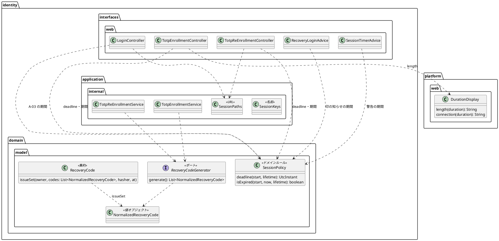

# Bolt 33f 計画 - 期間の表示と回復コードの型と session の URL の整理（振る舞いの変わらない直し）

## 基本情報

| 項目 | 内容 |
| :--- | :--- |
| Bolt | 第 33f 回（W5 の 21 本目） |
| 予定 | W5（2026-11-02 の週。前倒しで着手できる）。作業は約 4.5 時間（承認ゲートの待ち時間を除く。1 本のまま進め、打ち切りの条件で備える。決定 4） |
| 対象 | `identity`（`SessionPolicy` と期限の時刻を求める 3 か所、A-07・A-08・A-03・印の知らせ・session の警告のテンプレートと画面のモデル・Advice、回復コードの生成のポート・実装・`RecoveryCode.issueSet`・登録と再登録のサービス、`SessionKeys` と URL の参照）、`platform.web.DurationDisplay`、設計文書（domain_model・architecture_backend・ui_design・ADR-011・ADR-012・test_strategy・release_plan）、マニュアルの文言の確かめ |
| SP | 0（技術タスク） |
| GitHub | なし |
| 承認ゲート | **ステップごとに止める**（W5 の表の 33f の行。構造）。スキーマは変えない。層・モジュールの規則に当たったら、`/goal` の下でも止めて諮る（T-125） |
| アプローチ | リファクタリング（インサイドアウト）。内側（`SessionPolicy.deadline`、期間の書式）から外側（テンプレートの期間、URL の置き場所）へ寄せ、回復コードの型は最後に置く（打ち切りの候補）。既存のテストを緑のまま移し、移す前に足りない守り（A-07・A-08・A-03 の期間の文言、session の警告の属性の値）を先に足す。表示は変えない。開発戦略の表では技術タスクのテストの入口は「検証の手段」だが、検証の手段が既存の単体・統合・画面の層のテストで、直す対象が内側から外側に並ぶので内側から寄せる（Bolt 33d・33e と同じ扱い。33e の開始準備の決定 7） |
| マニュアル・デモ | マニュアルは文言が変わらないことを確かめる（完了条件。33e の開始準備の決定 7）。画面の表示を変えないので、画面キャプチャの撮り直しとデモの動画は対象外 |
| 前の Bolt | [Bolt 33e 終了報告](bolt_33e_report.md) |

## ふりかえりと前の Bolt からの引き継ぎ

| 入力 | 内容 | この Bolt での扱い |
| :--- | :--- | :--- |
| 開始準備の決定（2026-10-16、human:kakimomokuri） | (1) `SessionKeys` から URL 2 つ（A-08・A-03）を同じパッケージ（`identity.application.internal.session`）の定数だけの別のクラスに分け、ADR-012 の決定 3・6 の文言を直す（33c の既知の課題「命名」）。(2) 回復コードの生成のポートと `RecoveryCode.issueSet` は `NormalizedRecoveryCode` で受け、画面に平文を渡す結果の型（`EnrollmentResult.Enrolled`・`ReEnrollmentResult.ReEnrolled` の `List<String>`）は文字列のまま残す（`NormalizedRecoveryCode` の `toString` は伏せるので、テンプレートまで値を渡すと平文が表示されなくなる危険を避ける）。(3) 期限の時刻は `SessionPolicy.deadline(始めた時刻, 期間)` に寄せ、`isExpired` もそれを使う（33e の議題 4） | 確認ポイント 1〜3 |
| 検証の後の決定（2026-10-16、human:kakimomokuri） | (4) 約 4.5 時間でも 1 本のまま進め、打ち切りの条件で備える（超えそうなら回復コードの型を後の Bolt に送る）。(5) 共有カーネルの `UtcInstant` は変えず、`deadline` の中で `new UtcInstant(start.instant().plus(lifetime))` と包む。(6) 期間の書式は、`DurationDisplay` に汎用の名前の関数（例 `length`）を足し、経路設計の `connection` はそれを使う（経路設計の表示は変わらない）。(7) 33c の議題 4 (b)（Web の経路の関心を application 層に置いたこと）は、ADR-012 の決定 3 に理由として書く（認証の入口（infrastructure）と画面の層の両方が参照できるのは application 層だけで、`interfaces` はどの層からも参照されない。名前と URL をクラスで分けたので関心はクラスで見分けられる） | 確認ポイント 4〜7 |
| Bolt 33e の開始準備の決定 7 | 33f はリファクタリング（インサイドアウト）、承認ゲートは構造、マニュアルの文言との一致を完了条件に入れる | 基本情報 |
| Bolt 33e の Try T-138・T-139 | 直列化の形に関わる決定は、直列化して読み直すテストを同じステップで足す。テストのラムダの中では値オブジェクトを作らない | T-138 は 33f では直列化に触らないので対象外（触ることになったら止めて見直す）。T-139 は回復コードのテストのデータで守る |
| Bolt 33d の Try T-136・T-137 | 定数から描くように変えるときは、描く仕組みを外す変異で守りを確かめる。スクラッチパッドのスクリプトは Bolt の接頭辞を付けた新しい名前で作る | T-136 はステップ 3 で、テンプレートに静的な値を残さず、式を外す変異で確かめる。T-137 はスクリプトを `b33f_` で始める |
| Bolt 33b の Try T-131・T-132 | 変異の確かめは控えのファイルで戻す。既存のテストの検索は値で全体を grep する | 変異は控えから戻す。`15 分`・`8 時間`・`RE_ENROLL_URL`・`EXPIRED_URL`・`generate()`・`issueSet(` で全体を grep する |
| Bolt 33e の CI | `6159a5577` の CI で、画面の層の受入シナリオ「CSRF のトークンが合わず拒まれた送信でも見積依頼の一覧の案内から入力を戻せる」（Bolt 32f）が 1 回だけ落ち、流し直すと通った（ローカルの `uiTest` は緑） | 33f では直さない。もう一度落ちたら揺れの原因を調べる Bolt を立てる（既知の課題に記録する） |
| Bolt 33c〜33e の既知の課題 | 全画面に効く `@ControllerAdvice` が 4 つ、`codeDigits` の `@ModelAttribute` が 3 つの controller にある | 33f で期間を渡す `@ModelAttribute` が増える。まとめるかは後で検討のまま引き継ぐ（入れないものの欄） |

## スコープ

### 入れるもの・入れないもの

| 入れる | 入れない（後で・変えない） |
| :--- | :--- |
| `SessionPolicy.deadline(UtcInstant 始めた時刻, Duration 期間)` を足し、`isExpired` もそれを使う。`SessionLifetimeFilter`（8 時間の残りの秒数）・`TotpEnrollmentController`・`TotpReEnrollmentController`（画面に示す期限の時刻）の 3 か所を付け替える（`Instant` を `UtcInstant` で包んで渡し、`.instant()` で戻す。`isExpired` を使う 4 か所の呼び方は変わらない） | 判定が再び散るのを見張るソースの走査（決定 3 で `deadline` だけにした）。共有カーネルの `UtcInstant` の変更（決定 5） |
| `DurationDisplay` に期間を「15 分」「8 時間」と書く汎用の関数を足し、`connection` はそれを使う（決定 6） | ロックの「15 分」（A-01。Bolt 33c で `LockPolicy` から描いた） |
| テンプレートに直書きした期間（A-08 の「開いてから 15 分」、A-07 の「始めてから 15 分」、A-03 の「ログインから 8 時間」、印の知らせの「回復コードでログインしてから 15 分」、session の警告の `data-lifetime-message` の「ログインから 8 時間」）を、画面がモデルで渡す `SessionPolicy` の期間の文字列から描く | 全画面に効く `@ControllerAdvice` と `@ModelAttribute` のまとめ（33c〜33e の既知の課題を引き継ぐ） |
| 回復コードの生成のポート `RecoveryCodeGenerator` が `List<NormalizedRecoveryCode>` を返し、`RecoveryCode.issueSet` が `List<NormalizedRecoveryCode>` を受ける。登録と再登録のサービスは、画面に返す結果に `value()` の文字列を詰める（打ち切りの候補） | 画面に平文を渡す結果の型（決定 2）。`RecoveryCode.issue(…, String, …)`（画面の層のテストの利用者の用意 `UiUsers` が使う） |
| `SessionKeys` から URL 2 つを、同じパッケージの定数だけのクラス（例 `SessionPaths`）に分け、参照（本体 8 ファイル・テスト 2 ファイル）と Javadoc（`package-info`・`SessionKeys`）を付け替える。ADR-012 の決定 3・6・コンプライアンスと改訂の経緯、ADR-011 の改訂の経緯、`SessionKeysTest`（URL の値の固定を新しいクラスのテストに移す）を直す | `SessionUrlsAdvice`（画面の層の部品。名前と中の record `SessionUrls` は変えない） |

### 設計の約束（Try T-1）

- **`deadline`**: `SessionPolicy.deadline(UtcInstant start, Duration lifetime)` は `new UtcInstant(start.instant().plus(lifetime))` を返す純粋な関数（決定 5）。`isExpired(start, now, lifetime)` は `!now.instant().isBefore(deadline(start, lifetime).instant())` にする（ちょうどの時刻は期限切れのまま）
- **期間の書式**: `DurationDisplay`（`platform.web`）に汎用の関数（例 `length(Duration)`。「15 分」「8 時間」。半角の空白）を足し、`connection` はそれを使う（決定 6）。出力はテンプレートの今の文字列と一字一句同じ
- **期間の表示**: 画面と Advice は期間の文字列をモデルに入れる（ハンドラーと Advice に `@ModelAttribute` のメソッドを 1 つずつ足す。A-07・A-08 は各 controller、A-03 は `LoginController`、印の知らせは `RecoveryLoginAdvice`、session の警告は `SessionTimerAdvice`。record `SessionTimer` に足すと組み立てているテストに触るので、別の `@ModelAttribute` にする）。テンプレートは文の途中をタグを出さずに描く（`[[${…}]]` か中身が空の `<th:block th:text>`。`` で包むと、文を `containsString` で探す既存の統合テストが落ちる）。session の警告は属性の値なので `th:data-lifetime-message` のリテラル置換（`|ログインから ${…}になるため、あと {minutes}で…|`）で描く（JavaScript が `{minutes}` を置き換える形は変えない）。テンプレートに静的な「15 分」「8 時間」を残さない（T-136）
- **期間の文言の見張り**: 移す前に足す。A-07・A-08・A-03 の期間の文言（統合テスト。今はない）、session の警告の `data-lifetime-message` の値（`SessionTimerSecurityIntegrationTest`。今は uiTest だけが守り `check` では守っていない）。印の知らせは既存の `RecoveryCodeLoginSecurityIntegrationTest` が文で守っている。式を外す変異で落ちることを確かめる
- **回復コードの型**: ポートの実装 `RandomRecoveryCodeGenerator` は `fromBytes` の値をそのまま返す（重複を除く `Set` は record の等しさで動く）。`issueSet` は値の `value()` でハッシュにする。テストの偽物とデータ（`aaaa-`・`bbbb-`・`1a2b-` の形）はそのまま値にできる。テストのラムダの中では値を作らない（T-139）。画面に平文が出ることは、統合テストの正規表現（`TotpEnrollmentSecurityIntegrationTest`・`RecoveryCodeLoginSecurityIntegrationTest`）が守る（uiTest は個数だけを見る）
- **URL のクラス**: `identity.application.internal.session` に、`SessionKeys` と同じく `final` で `private` のコンストラクターだけを持つ定数のクラスとして置く（record にしない。accessor が「ふるまいを持たない」の見張りに当たるため）。名前は画面の層の `SessionUrlsAdvice` の中の record `SessionUrls` と重ならないもの（例 `SessionPaths`）。層の規則の例外と見張りはパッケージ単位なので、新しいクラスにもかかる（`LayerArchitectureTest`）。ADR-012 の決定 3 に、application 層に置く理由を書く（決定 7）

## 設計（この Bolt の範囲）

4 図のうち、ドメインモデル図だけを置く。状態遷移図は新しい状態がないので、ER 図は表を変えないので、画面遷移図は画面と URL を変えないので省く。

## ステップ計画

状態の記号: `[ ]` 未着手、`[-]` 進行中、`[?]` 承認待ち、`[x]` 完了。各ステップの終わりに `check` が緑であることを確かめ、push してアプリの CI と MkDocs の配備を確かめる（T-26、T-126）。コミットは pathspec で作る（T-110）。複数行の書き換えはスクリプトのファイル（`b33f_` で始める）にし、書き込みの成功を確かめてから実行する（T-103、T-137）。

- [x] **1. 設計文書** 【承認ゲート: 設計文書】
  - domain_model.md: `RecoveryCode` の行（180 行目の `issueSet`）、`SessionPolicy` の行（184 行目）、`TotpEnrollmentService` の行（196 行目）、再登録の段落と図（1105〜1106・1131・1141〜1149 行目。図に `isExpired` と `deadline`）
  - architecture_backend.md: 268・297〜299 行目（期限の時刻、URL のクラスと application 層に置く理由、期間の表示）
  - ui_design.md: 730・743・799・1315・1363・1368 行目（期間を `SessionPolicy` から描く）
  - ADR-012: 決定 3（95〜97 行目。URL のクラスと、application 層に置く理由。決定 7）、決定 6（119〜121 行目）、コンプライアンス（195 行目の `SessionKeysTest`）、改訂の経緯
  - ADR-011: 決定 6（229・232 行目。回復コードの生成のポートの型）、改訂の経緯（A-08 の URL のクラス）
  - test_strategy.md: 322 行目の後に Bolt 33f の行
  - release_plan.md: 33f の行（600 行目。決定 1〜7 と約 4.5 時間、計画へのリンク）、状態の行（553 行目）、局面とアプローチ（557 行目。33f の範囲に `deadline`）、実績の表（776 行目）、更新履歴
  - 完了の判定: `okf:check` ERROR 0、`documentationTest` 緑
- [x] **2. 期限の時刻と期間の書式**
  - `SessionPolicyTest` に `deadline` を足し、`isExpired` を `deadline` で書き直し、3 か所を付け替える。既存のテスト（`SessionLifetimeFilterTest` の残りの秒数、`SessionTimerSecurityIntegrationTest`、A-07・A-08 の期限の表示）を緑のまま
  - `DurationDisplay` の汎用の関数とテストを足し、`connection` をそれで書き直す（経路設計の表示のテストが緑のまま）
- [x] **3. テンプレートの期間を `SessionPolicy` から描く**
  - `15 分`・`8 時間` で全体を grep する（T-132）。先に A-07・A-08・A-03 の期間の文言の統合テストと、session の警告の `data-lifetime-message` の値の統合テストを足す（緑）
  - 画面と Advice が `@ModelAttribute` で期間の文字列を渡し、テンプレートの 6 か所を描く（文の途中はタグを出さない形、警告は `th:data-lifetime-message`。静的な値を残さない）。変異: 式を外すと落ちる（T-136）。uiTest の session の警告と、印の知らせの統合テストが緑のまま
- [x] **4. URL を別のクラスに**
  - URL 2 つを `SessionPaths`（仮）に分け、参照（本体 8 ファイル: `SecurityConfiguration`・`ExpiredSessionRequestSaver`・`SessionLifetimeFilter`・`SessionRevalidationFilter`・`TotpAuthenticationFilter`・`LoginController`・`SessionUrlsAdvice`・`TotpReEnrollmentController`。テスト 2 ファイル: `SessionKeysTest`・`SessionLifetimeFilterTest`）と Javadoc（`package-info`・`SessionKeys`）を付け替え、URL の値を固定するテストを移す
- [x] **5. 回復コードの生成のポートの型**（打ち切りの候補）
  - ポート・実装・`issueSet`・登録と再登録のサービス（結果は `value()` の文字列）を付け替える。テスト: `TotpEnrollmentServiceTest`・`TotpReEnrollmentServiceTest`・`RecoveryCodeTest`・`RandomRecoveryCodeGeneratorTest`・`TotpReEnrollmentServiceIntegrationTest`（本物の生成器の値を `issue(String)`・`verify(String)` に渡す箇所は `value()`）。画面に平文が出ることは、統合テストの正規表現が守る
  - マニュアル（02 章の 2.1・2.4・2.5・2.7、付録 B）の期間の文言と回復コードの例が、画面と一致することを確かめる
  - 完了の判定: `check` 緑、`uiTest` 緑
- [ ] **6. SonarQube と開発レビューと終了報告** 【承認ゲート: 終了報告】
  - SonarQube（T-116）。開発レビュー（プログラマー・テスター、アーキテクト、テクニカルライター。画面の文言とマニュアルに触るのでテクニカルライターを入れる。セキュリティは省く: 認証の入口（`SessionLifetimeFilter`・`SecurityConfiguration`）と回復コードのハッシュにも触るが、振る舞いと公開の URL の値を変えず、既存のセキュリティの統合テスト（URL の値の固定を含む）が守るため。33c・33d と同じ扱い）
  - `bolt_33f_report.md`。release_plan の W5 の 33f の行、開発の索引

### 時間の配分と打ち切り

| # | 目安 | 打ち切り |
| :--- | :--- | :--- |
| 1 | 35 分 | — |
| 2 | 40 分 | — |
| 3 | 90 分 | 画面の表示が変わる（文言・空白）と見えたら止めて諮る |
| 4 | 40 分 | 層・モジュールの規則に当たったら止めて諮る |
| 5 | 60 分 | 画面に平文が出なくなる兆しがあれば止める。ステップ 4 を終えた時点で 3.5 時間を超えていたら、ステップ 5 を後の Bolt に送る（決定 4） |
| 6 | 30 分（SonarQube の待ちを除く） | — |

合計 295 分（約 5 時間）のうち、ステップ 1 と 6 の文書を除く作業は約 4 時間。4.5 時間を超えると見えたら止めて諮る（候補: ステップ 5 を後の Bolt に送る）。

## 確認ポイント（計画の承認の場でまとめて確認する。Try T-6）

| # | 確認すること | ステップ | 推奨・決定 |
| :--- | :--- | :--- | :--- |
| 1 | **URL の置き場所** | 4 | 決定済み（1）: 同じパッケージの定数だけの別のクラス。ADR-012 の決定 3・6 の文言を直す |
| 2 | **回復コードの結果の型** | 5 | 決定済み（2）: ポートと `issueSet` だけを値にし、画面に渡す結果は文字列のまま |
| 3 | **期限の時刻** | 2 | 決定済み（3）: `SessionPolicy.deadline` を足し、`isExpired` もそれを使う |
| 4 | **分け方** | 全体 | 決定済み（4）: 1 本のまま、打ち切りの条件で備える（ステップ 5 が候補） |
| 5 | **`UtcInstant`** | 2 | 決定済み（5）: 共有カーネルは変えず、`deadline` の中で包む |
| 6 | **期間の書式** | 2 | 決定済み（6）: `DurationDisplay` に汎用の関数を足し、`connection` はそれを使う |
| 7 | **URL を application 層に置く理由** | 1 | 決定済み（7）: ADR-012 の決定 3 に理由として書く |
| 8 | **新しいファイル** | 3〜4 | URL のクラス（例 `SessionPaths`）とその値のテスト。期間の文言の統合テストは既存のテストのクラスに足す |
| 9 | **マニュアル・デモ** | 5 | マニュアルは文言が変わらないことを確かめるだけ。キャプチャとデモは対象外 |
| 10 | **開発レビュー** | 6 | プログラマー・テスター、アーキテクト、テクニカルライター（セキュリティは省く理由をステップ 6 に書いた） |
| 11 | **アプローチと承認ゲートと時間** | 全体 | リファクタリング（インサイドアウト）。ステップごとに止める（構造）。約 4.5 時間 |

## 完了条件

- [ ] 期限の時刻が `SessionPolicy.deadline` にあり、3 か所と `isExpired` がそれを使う
- [ ] 期間の書式が `DurationDisplay` の汎用の関数にあり、経路設計の表示は変わらない
- [ ] テンプレートの期間（6 か所）が `SessionPolicy` から描かれ、テンプレートに静的な「15 分」「8 時間」が残らない。期間の文言と警告の属性の値の統合テストがあり、式を外す変異で落ちることを確かめた。表示は同じ
- [ ] URL 2 つが `SessionKeys` から別のクラスに分かれ、ADR-012 に application 層に置く理由を書いた
- [ ] 回復コードの生成のポートと `issueSet` が `NormalizedRecoveryCode` を受け、画面には今のとおり平文が出る（打ち切りで後に送ったら、その旨と行き先を書く）
- [ ] マニュアルの期間の文言と回復コードの例が、画面と一致することを確かめた
- [ ] 設計文書（domain_model・architecture_backend・ui_design・ADR-011・ADR-012・test_strategy・release_plan）を更新した
- [ ] `check` と `uiTest` が緑。push してアプリの CI と MkDocs の配備を確かめた。SonarQube の Quality Gate が PASS、`okf:check` ERROR 0
- [ ] 開発レビュー、終了報告

## 更新履歴

| 日付 | 更新内容 | 更新者 |
| :--- | :--- | :--- |
| 2026-10-16 | 初版作成（承認待ち）。開始準備で 33f の行の 4 項目（約 3〜4 時間）を見積もり、human:kakimomokuri の決定（URL を同じパッケージの別のクラスに分ける、回復コードの結果の型は文字列のまま、期限の時刻は `SessionPolicy.deadline`）を反映した | anthropic/claude-opus-5-5 |
| 2026-10-16 | 詳細整合性検証（9 件）と横断整合性検証（9 件）の指摘を反映した。タグで包むと既存の統合テストが落ちること、session の警告は属性の値であること、今の守りの事実、Advice とハンドラーの渡し方、`UtcInstant` に `plus` がないこと、付け替える箇所の列挙、設計文書とマニュアル（2.1）の直し先、release_plan の直す箇所、セキュリティを省く理由。human:kakimomokuri の決定（1 本のまま打ち切りで備える、`UtcInstant` は変えない、期間の書式は汎用の関数、URL を application 層に置く理由を ADR-012 に書く）を反映した | anthropic/claude-opus-5-5 |
| 2026-10-16 | 計画を承認した（`/goal Bolt33f`） | anthropic/claude-opus-5-5、承認 human:kakimomokuri |

## 関連ドキュメント

- [リリース計画](release_plan.md)（W5）
- [Bolt 33e 計画](bolt_33e_plan.md)、[Bolt 33e 終了報告](bolt_33e_report.md)、[Bolt 33d 終了報告](bolt_33d_report.md)、[Bolt 33c 終了報告](bolt_33c_report.md)
- [ドメインモデル](../../design/cargo-tracker/domain_model.md)、[バックエンドのアーキテクチャ](../../design/cargo-tracker/architecture_backend.md)、[UI 設計](../../design/cargo-tracker/ui_design.md)、[テスト戦略](../../design/cargo-tracker/test_strategy.md)
- [ADR-011](../../adr/cargo-tracker/011-mfa-totp.md)、[ADR-012](../../adr/cargo-tracker/012-authentication-principal-and-session.md)
- [ユーザーマニュアル 第 2 章](../../manual/02-ログインと共通の画面.md)
