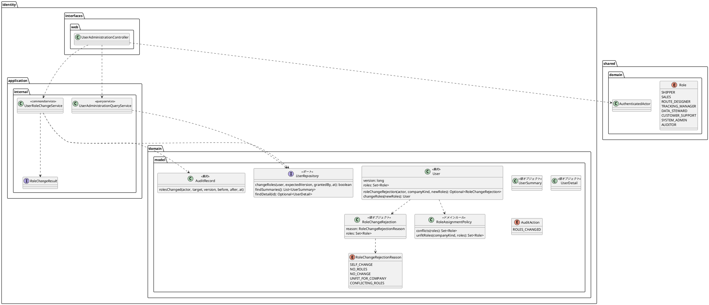
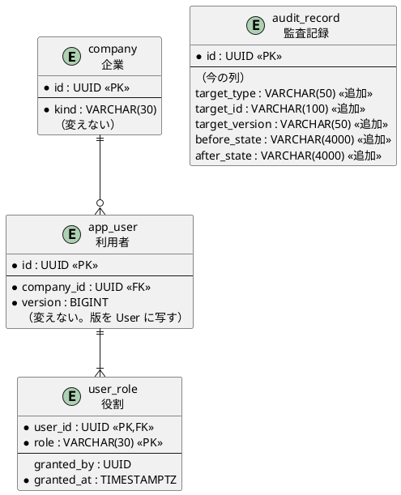
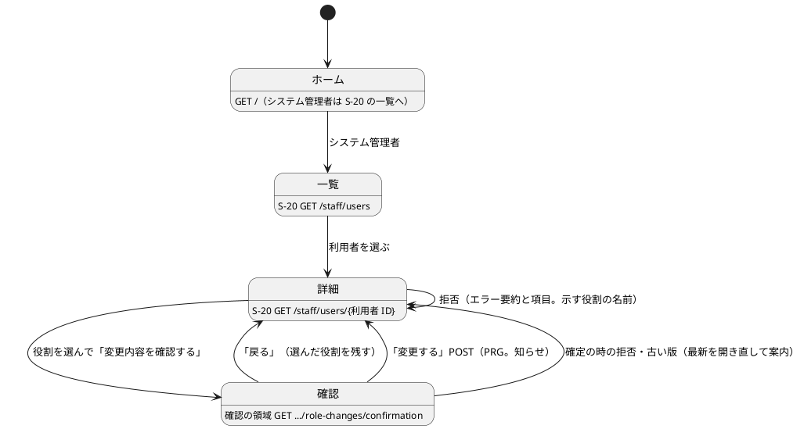

# Bolt 34 計画 - 固定役割の付与と取消しと職務分離（US-16 の一部）

## 基本情報

| 項目 | 内容 |
| :--- | :--- |
| Bolt | 第 34 回（W5 の 22 本目） |
| 予定 | W5（2026-11-02 の週。前倒しで着手できる）。作業は約 5 時間（承認ゲートの待ち時間を除く。文書を除くと約 4 時間。打ち切りの条件で備える） |
| 対象 | `identity`（職務分離と企業の種類の規則、利用者の版と役割の変更、役割の変更のサービス、利用者の管理の読み出し、S-20 の画面、認可の規則、ホームの行き先、監査記録の操作と対象・変更前後の列）、スキーマ（`audit_record` の列の追加）、dev-data（システム管理者の利用者）、設計文書（domain_model・data_model・ui_design・architecture_backend・non_functional・test_strategy・ADR-011・release_plan）、ユーザーマニュアル（新しい章「11 利用者の管理」） |
| SP | 0（US-16 の SP 5 は #14 をクローズする W6 で数える。この Bolt で作る一部の目安の SP 2 も W6 で数える） |
| GitHub | [#14](https://github.com/k2works/practical-domain-driven-design-in-enterpris-application/issues/14)（US-16。クローズは W6） |
| 承認ゲート | **ステップごとに止める**（W5 の表の 34 の行。認可とスキーマを含む）。層・モジュールの規則に当たったら、`/goal` の下でも止めて諮る（T-125） |
| アプローチ | インサイドアウト（W5 の表の 34 の行）。`User` は既存の集約で、スキーマの変更も列の追加だけなので、開発戦略の表ではアウトサイドインに当たる。表から外れる理由: 不確実性が、役割の組合せの規則（職務分離・企業の種類・自分の変更）と、版の条件・役割の差分・監査記録を 1 つのトランザクションで書くことにあり、内側から固めるほうが早く確かめられる。認可と画面の流れはセキュリティの統合テストと画面の層の受入シナリオで外側から確かめる |
| マニュアル・デモ | ユーザーマニュアルに新しい章「11 利用者の管理」（一覧・詳細・役割の変更の手順と、拒まれる場合）を足し、S-20 の一覧・詳細・確認の領域のキャプチャを撮る。デモの動画は 34b の終わり（利用停止まで）で撮る（`@US-16`） |
| 前の Bolt | [Bolt 33f 終了報告](bolt_33f_report.md) |

## Bolt ゴール

システム管理者が S-20 で利用者の一覧と詳細を開き、BR-15 の固定役割を、確認の領域で対象・今の役割・変更の内容・影響・実行者を確かめてから付与・取り消せる。変えた役割は相手の次の操作から効き、変更は監査記録に対象と変更前後として残る。

- 業務データを変更できる役割とシステム管理者・監査担当者の併用は拒まれ、競合する役割が名前で示される（AC3）。
- 企業の種類に合わない役割（荷主企業の利用者に社内の役割、A 社の利用者に荷主担当者）は拒まれる（UC-16 の主シナリオ 4 の企業間分離）。
- 自分の役割は変えられない。ほかの更新が先に入った利用者への変更は拒まれ、最新の内容を開き直す（UC-16 の 4b）。

### 確かめたい仮説

| # | 仮説 | この Bolt で分かること |
| :--- | :--- | :--- |
| H1 | 役割の組合せの規則（職務分離・企業の種類・自分の変更・役割なし・変更なし）を 1 つの判定にまとめ、確認の領域を開く時と確定の時の両方で同じ判定を通せば、画面を経ない送信でも拒める | 規則の単体テストと、確定の POST を直接送るセキュリティの統合テスト |
| H2 | `app_user.version` を条件にした更新、`user_role` の差分、監査記録を 1 つのトランザクションにすれば、同時の 2 つの変更で 1 つだけが通り、監査の追記が失敗したら役割も戻る | PostgreSQL の統合テスト（同時の変更、監査の失敗） |
| H3 | 役割の変更は Bolt 32c の request ごとの確かめで、相手の次の request から効く（session を捨てなくてよい） | 相手の session で、外した役割の URL が A-04、足した役割の画面が開くこと |

### 開始準備で確かめたこと（T-114。2 つの整合性検証で確かめた）

- **利用者**: `User` は役割を 1 つ以上持つ不変条件がある（`User.java:45`）。版を持たず、`UserRow`・`IdentityMapper.xml` の `userColumns` も版を写していない（data_model.md:936 の Bolt 33a の判断「`User` には版を写さない」）。`User.roles()` は `Set.copyOf` で順序がない。役割の読み出し `selectUserRoles` は `ORDER BY role`（アルファベット順）
- **版**: password の再設定（Bolt 33a）も `app_user.version` を条件なしで上げる（`IdentityMapper.xml:77-84`）。34b の利用停止も上げる。古い版の文言は「誰が変えたか」を言わない
- **企業の種類**: `CompanyKind`（`SHIPPER`・`CONSIGNEE`・`OPERATOR`）がある。役割を企業の種類で制限する規則はどこにもない。`/staff/**` は営業担当者に開くので、荷主企業の利用者に営業担当者を付けると社内の画面が開けてしまう
- **認可**: `/customer/**` は荷主担当者、`/staff/routing-cases/**` は経路設計者、`/staff/tracking-records/**` は追跡管理者、`/staff/**` は営業担当者（`SecurityConfiguration.java:211-220`）。システム管理者は今どの業務の画面も開けず、ホーム（`GET /`）は 403（`HomeController.java:21-25`）
- **確認の領域**: S-07 は `GET …/confirmation?candidate=` で確認の画面を開き、`POST …/confirmation` で確定する（ui_design.md:175、`RoutingCaseController.java:122・145`）。Bolt 23b から画面そのものが確認の領域（ui_design.md:1073）。共通の確認の領域の部品には回復手段の行がある（ui_design.md:1083-1089）
- **組み立て**: 部品の探索は application を除く（`CargoTrackerApplication.java:22-28`）。`*Service` には `@Service` が要り（`LayerArchitectureTest:228`）、`IdentityConfiguration` に `@Bean` を足す（二重の定義の解消は 34c）。`domain.model.rules` には `@DomainRule` が要る（`DddAnnotationArchitectureTest:20`）。application は永続化に依存できない（`LayerArchitectureTest:237`）ので、読み出しはドメインのポートと `valueobjects` の射影で受ける（前例 `StaffQuotationQueryService` と `*Summary`）
- **監査**: `audit_record` は対象と変更前後の列を持たない（設計 data_model.md:859-863 にはある）。`audit_record.action` に CHECK 制約はない。設計にある `(target_type, target_id, occurred_at)` のインデックス（data_model.md:1170）は、監査の照会（US-17）で足す
- **役割**: `Role.displayName()` がある（共有カーネル。変えない）。`user_role.granted_by` は NULL を許す（設計 data_model.md:826 は NOT NULL。dev-data の既存の行は NULL）
- **dev-data**: TOTP の秘密の暗号文は利用者 ID を AAD にした形（`V20261013134400`）。平文の秘密は `application-dev.properties` の `dev-login.accounts[n]`。`DevTotpCredentialsDevProfileTest` が件数（5）を固定している
- **ナビゲーション**: 社内のレイアウト `staff.html` は `hasRole` で項目を出し分ける。ui_design.md:226 の項目名は「利用者」
- **設計文書の欠け**（ステップ 1 で反映する）: S-20 の URL・ワイヤーフレーム・文言、A-04 の行、ホームの行き先、`ROLES_CHANGED`・規則・サービス・読み出しの要素表の行、data_model の Bolt 33a の「版を写さない」と `granted_by` の NULL、ADR-011 の「ロックの解除は Bolt 34」（W6 へ）、release_plan の 34 の行・W6 の行・マニュアルの方針（「節」→「11 章」）

## ふりかえりと前の Bolt からの引き継ぎ

| 入力 | 内容 | この Bolt での扱い |
| :--- | :--- | :--- |
| 開始準備の決定（2026-10-16、human:kakimomokuri） | (1) 34 の行を 3 つに分ける。34: S-20 の一覧・詳細、役割の付与と取消し、職務分離（AC3）、同時の更新の拒否（UC-16 の 4b）、変更履歴（AC1 の役割の分）。34b: 管理範囲外の拒否と試行の記録（AC2、IA-INV-08）、利用停止と再開（AC5 の利用停止の分）。34c: 振る舞いの変わらない直し（ログインの監査の書き込みの経路、`@Service` と `@Bean` の二重の定義、回復コードのログインの IA-INV-08 の範囲とロックと IA-INV-04 の関係の文書化、「暗号の部品は crypto にある」の規則、見張り）。担当案件（AC1 の担当案件・AC4）、利用者の登録と初回の password の渡し方、ロックの解除、TOTP の解除（#47）は W6。(2) 変更履歴は監査記録で代える（データモデルの設計どおり `audit_record` に `target_type`・`target_id`・`target_version`・`before_state`・`after_state` を足す。`user_role` は今の値だけを持つ）。(3) 管理範囲は担当範囲の表 `user_assignment`（`scope_kind = COMPANY`）で割り当てる（34b で作る）。(4) システム管理者が自分の役割を変えることは拒否する | 確認ポイント 1〜4 |
| release_plan の 34 の行の確認ポイント（W5 の開始準備） | US-16 AC1 の「担当案件の関係と変更履歴」に対し、`user_assignment` はまだなく、`user_role` は履歴を持てない。履歴の持ち方と担当案件の扱いを Bolt 34 の確認ポイントにする | 決定 (1)・(2) で決めた。担当案件は W6 |
| ADR-011 の「ロックの解除は Bolt 34」（:301） | ロックの解除の操作（システム管理者）は利用者の管理で作る | 決定 (1) で W6 に送る。ステップ 1 で ADR-011 と release_plan の W6 の行を直す |
| Bolt 32c の議題 6・既知の課題 | ロックと IA-INV-04 の明文化、`password_hash` を request ごとに読むこと（bolt_32c_report.md:144）、管理者向けのマニュアル（利用を止めると次の操作で効く） | 明文化は 34c。`password_hash` の射影は W10 の性能の評価に送る（この Bolt の読み出しは `password_hash` を読まない射影にする）。管理者向けの利用停止のマニュアルは 34b。この Bolt の章には「役割の変更は相手の次の操作から効く」を書く |
| Bolt 32 の既知の課題（bolt_32_report.md:159） | `login_failure` の表の注釈（COMMENT）を次に表を変えるときに直す | この Bolt は `login_failure` を変えないので 34c に送る |
| Bolt 33f の Try T-140・T-141 | 層の規則を根拠にする理由は、規則が実際にその依存を見るかを確かめてから書く。同じ部品を複数のレイアウトに写しているときは、変異の確かめを写しの数だけ行う | T-140: 置き場所の理由を設計文書に書くときは、`LayerArchitectureTest` が見る依存かを確かめる。T-141: S-20 は社内のレイアウト（`staff.html`）だけで描くので写しは 1 つ。ナビゲーションの項目は社内のレイアウトだけかを確かめ、変異は 1 か所で行う |
| Bolt 33e・33d の Try T-136〜T-139 | 描く仕組みを外す変異、スクリプトの接頭辞、直列化の形、テストのラムダの中で値を作らない | T-136: 役割の名前を `Role` の表示名から描き、ナビゲーションの出し分けとともに式を外す変異で確かめる。T-137: スクリプトを `b34_` で始める。T-138: session に置く値を足さない（足すことになったら止めて見直す）。T-139: テストのデータで守る |
| Bolt 33b の Try T-131・T-132 | 変異は控えから戻す。既存のテストの検索は値で全体を grep する | `SYSTEM_ADMIN`・`hasRole`・`/staff/**`・`audit_record`・`userColumns`・`User.of` で全体を grep する |
| Bolt 33c〜33f の既知の課題 | 全画面に効く `@ControllerAdvice` が 4 つ。印の知らせが 2 つのレイアウトに写してある。`new UtcInstant(x)` で包む箇所が 3 か所。Bolt 32f の画面の層の受入シナリオの揺れ（CI で 1 回）。#49 | この Bolt では触らない（入れないものの欄）。S-20 の画面に要る値はハンドラーのモデルで渡し、全画面の `@ControllerAdvice` を増やさない |
| Bolt 31b の受け入れたリスク（ADR-011） | 初回の password の渡し方は利用者の管理で決める | 利用者の登録は W6 なので、W6 で決める（入れないものの欄） |

## スコープ

### 入れるもの・入れないもの

| 入れる | 入れない（後で・変えない） |
| :--- | :--- |
| 職務分離の規則（IA-INV-01）: システム管理者・監査担当者と、業務データを変更できる 6 つの役割（荷主担当者・営業担当者・経路設計者・追跡管理者・データ責任者・カスタマーサポート）の併用を拒み、競合する役割を返す（AC3） | 管理範囲外の企業の拒否と試行の記録（AC2、IA-INV-08）、`user_assignment` の表（34b） |
| 企業の種類の規則（UC-16 の主シナリオ 4 の企業間分離。確認ポイント 5）: 荷主担当者は荷主企業の利用者だけ、ほかの 7 役割は A 社の利用者だけ。荷受人の企業の利用者には BR-15 の役割を付けない（荷受人は参照許可。US-19） | 利用停止と再開（AC5 の利用停止の分。34b）。利用者の登録と初回の password の渡し方、ロックの解除、TOTP の解除（#47）（W6） |
| 利用者の役割の変更: 自分の役割の変更を拒む（決定 4）。役割を 1 つも持たない変更を拒む（`User` の今の不変条件）。変更のない送信を拒む。古い版からの変更を拒み、最新を開き直す（UC-16 の 4b） | 担当案件（AC1 の担当案件・AC4。W6） |
| 役割の変更のサービス（`identity.application.internal.commandservices`）: `app_user.version` を条件にした更新、`user_role` の差分（外した役割を消し、足した役割を `granted_by`・`granted_at` 付きで入れる）、監査記録 `ROLES_CHANGED`（対象・版・変更前後）を 1 つのトランザクションで書く | ログインの監査の書き込みの経路の見直し、`@Service` と `@Bean` の二重の定義の解消、IA-INV-08 の範囲とロックと IA-INV-04 の文書化、crypto の規則、見張り、`login_failure` の COMMENT（34c） |
| 監査記録の列の追加（`target_type`・`target_id`・`target_version`・`before_state`・`after_state`。データモデルの設計どおりの型）と、`AuditRecord` の対象と変更前後 | `approval_ref`・`source_ref` の列と `(target_type, target_id, occurred_at)` のインデックス（使う Bolt。インデックスは US-17）、`reason` の長さ（今の 100 のまま） |
| 利用者の管理の読み出し（`identity.application.internal.queryservices`）: 一覧（企業名・表示名・メールアドレス・利用状態・役割）と詳細（企業の種類・版を含む）。`password_hash` を読まない射影 | 一覧の絞り込み・ページ送り（利用者の数が少ないパイロットでは要らない。後で）。request ごとの確かめの `password_hash` の射影（W10） |
| S-20 の一覧（`GET /staff/users`）・詳細（`GET /staff/users/{利用者 ID}`）・役割の変更の確認の領域（`GET /staff/users/{利用者 ID}/role-changes/confirmation?roles=…&version=…`）と確定（`POST` 同じパス。PRG）。拒否はエラー要約と項目で示す（競合する役割を名前で示す）。完了は詳細に知らせを出す | 監査記録の照会の画面（S-21、US-17） |
| 認可: `/staff/users/**` はシステム管理者だけ（`/staff/**` より先に書く）。ホーム（`GET /`）の行き先にシステム管理者の S-20 を足す。社内のレイアウトのナビゲーションに「利用者」をシステム管理者にだけ出す | 全画面に効く `@ControllerAdvice` のまとめ（33c〜33f の既知の課題を引き継ぐ） |
| dev-data: A 社のシステム管理者の利用者（TOTP の資格つき）と、役割の変更を試す相手の利用者 | デモの動画（34b の終わり） |
| ユーザーマニュアル「11 利用者の管理」とキャプチャ。用語集に「システム管理者」「職務分離」 | — |

### 設計の約束（Try T-1）

- **役割の組合せの規則**: `identity.domain.model.rules` に純粋な規則 `RoleAssignmentPolicy`（`@DomainRule`）を置く。`conflicts(Set<Role>)` が職務分離で競合する役割の集合を返し、`unfitRoles(CompanyKind, Set<Role>)` が企業の種類に合わない役割の集合を返す。業務データを変更できる役割の集合と、企業の種類ごとに付けられる役割は規則の中に持つ（共有カーネルの `Role` は変えない。BR-15 は `identity` の規則なので）。システム管理者と監査担当者の併用は、BR-15 の文言（「業務データを変更できない」）どおり拒まない（確認ポイント 6）
- **拒否の値**: `identity.domain.model.valueobjects` に `RoleChangeRejection`（record。理由 `RoleChangeRejectionReason` と、示す役割の集合）を置く。理由は `SELF_CHANGE`（自分の役割）・`NO_ROLES`（役割なし）・`NO_CHANGE`（変更なし）・`UNFIT_FOR_COMPANY`（企業の種類に合わない）・`CONFLICTING_ROLES`（職務分離）。判定の順はこの順
- **利用者の版と役割の変更**: `User` に版（`version`）を持たせる（data_model.md:936 の Bolt 33a の判断を改める。`UserRow`・`userColumns`・`User.of` とその呼び出し元を直す）。`User#roleChangeRejection(UserId 操作者, CompanyKind 所属企業の種類, Set<Role> 新しい役割)` が `Optional<RoleChangeRejection>` を返し、`User#changeRoles(Set<Role>)` が役割を変えた新しい `User` を返す。同時の更新は条件付きの更新の件数で判定する（ドメインでは判定しない。期待する版は画面から送る）
- **サービス**: `UserRoleChangeService`（`commandservices`。`@Service` を付け、`IdentityConfiguration` に `@Bean` を足す。`TransactionTemplate` と `Clock` を受ける形は `TotpReEnrollmentService` に倣う）は、操作者（`AuthenticatedActor`）・対象の利用者 ID・期待する版・新しい役割の集合を受け、結果 `RoleChangeResult`（sealed interface と record。`Changed`・`Rejected(RoleChangeRejection)`・`Stale`・`NotFound`）を返す。1 つのトランザクションで、`UPDATE app_user SET version = version + 1, updated_at = ? WHERE id = ? AND version = ?`（0 件なら `Stale` としてロールバック）、`user_role` の差分、監査記録を書く。監査の追記が失敗したら全体を戻す（IA-INV-08 の同期の書き方に倣う）。拒否と古い版は監査に書かない（確認ポイント 7）。確認の領域を開く時は、同じ判定だけを通す（`UserRoleChangeService` の判定のメソッドか、読み出しのサービスで同じ規則を使う。書かない）
- **監査記録**: 操作 `ROLES_CHANGED`、結果 `SUCCESS`、`target_type` は `USER`、`target_id` は利用者 ID、`target_version` は更新した後の版、`before_state`・`after_state` は役割の名前を `EnumSet` で `Role` の宣言の順に並べてカンマでつないだ文字列（例 `SALES,ROUTE_DESIGNER`）。`AuditRecord.rolesChanged(…)` を足し、今の記録（ログインなど）は対象と変更前後を空のまま
- **読み出し**: `UserAdministrationQueryService`（`queryservices`。`@Service` と `@Bean`）は、ドメインのポート（`UserRepository` に一覧と詳細の読み出しを足す。`aggregates`）と、`valueobjects` の射影（`UserSummary`・`UserDetail`。前例 `*Summary`）で受ける。`password_hash` を読まない。一覧は企業名・表示名の順
- **画面**: 一覧 → 詳細（今の役割と、8 つの役割のチェックボックス。企業の種類に合わない役割は選べない旨を示す。版を隠し項目で持つ）→「変更内容を確認する」で確認の領域（`GET …/role-changes/confirmation?roles=…&version=…`。画面そのものが確認の領域。対象の利用者・今の役割・足す役割・外す役割・影響（相手の次の操作から効く）・実行者・回復手段（「元に戻すには、もう一度役割を変更してください」）を示す。共通の横断受入条件）→「変更する」（`POST` 同じパス。PRG で詳細に戻し、知らせを出す）。「戻る」は選んだ役割を残して詳細に戻す。拒否は確認の領域を開く時（判定の規則）と確定の時（同じ判定と古い版）に示す。古い版は「この利用者の情報が先に更新されました。最新の内容を確かめてから、もう一度変更してください。」の形で詳細を開き直す（誰が変えたかを言わない）。利用者がいないときは 404 の画面
- **認可**: `SecurityConfiguration` の `/staff/users/**` を `hasRole(SYSTEM_ADMIN)` にし、`/staff/**` より先に書く。システム管理者がほかの `/staff/**`・`/customer/**` を開くと A-04。ほかの役割が `/staff/users/**` を開くと A-04。サービスは操作者（`AuthenticatedActor`）を受け、システム管理者でなければ拒む（URL の規則だけに頼らない）
- **新しいファイル**: 規則・拒否の値と理由・サービス・結果の型・読み出しのサービスと射影・controller・テンプレート（一覧・詳細・確認の領域）・マイグレーション（common と dev-data）・マニュアルの章と、それぞれのテスト。`package-info` は既存のパッケージに置くので足さない

## 設計（この Bolt の範囲）

4 図のうち、ドメインモデル図・ER 図・画面遷移図を置く。状態遷移図は、役割の変更が状態を持たない（利用者の利用状態の遷移は 34b）ので省く。

### ドメインモデル図

### ER 図（この Bolt で変える表）

`audit_record` の列はどれも NULL を許す（今の記録は対象を持たない）。追記だけの表なので、列の追加は既存の行を変えない。列の追加は common に 1 列ずつ書く（既存の `V20261002100000` の流儀）。`user_role.granted_by` は今の NULL を許す形のまま（dev-data の既存の行は NULL。この Bolt の付与は操作者の ID を入れる）。

### 画面遷移図（S-20 の役割の分）

注（設計への反映が必要）: ui_design.md の S-20 には URL・ワイヤーフレーム・文言がない。ステップ 1 で、URL と、一覧・詳細・確認の領域のワイヤーフレームと文言（拒否の理由ごと・古い版・完了の知らせ・回復手段）、A-04 の行、ホームの行き先を足す。data_model.md に `audit_record` の列の追加（Bolt 34）と変更履歴を監査記録で代えること、`User` に版を写すこと、`granted_by` の NULL を、domain_model.md に規則・拒否の値・`ROLES_CHANGED`・`AuditRecord` の対象と変更前後・サービスと読み出し・射影の行を足す。

## ステップ計画

状態の記号: `[ ]` 未着手、`[-]` 進行中、`[?]` 承認待ち、`[x]` 完了。各ステップの終わりに `check` が緑であることを確かめ、push してアプリの CI と MkDocs の配備を確かめる（T-26、T-126）。コミットは pathspec で作る（T-110）。複数行の書き換えはスクリプトのファイル（`b34_` で始める）にし、書き込みの成功を確かめてから実行する（T-103、T-137）。

- [x] **1. 設計文書** 【承認ゲート: 設計文書】
  - ui_design.md: S-20 の URL、一覧・詳細・確認の領域のワイヤーフレームと文言、A-04 の行（システム管理者のほかの `/staff/**`・`/customer/**`、ほかの役割の `/staff/users/**`）、ホームの行き先（:190）、ナビゲーションの表（:226 の「利用者」はシステム管理者）、画面遷移図の S-20
  - domain_model.md: `RoleAssignmentPolicy`、`RoleChangeRejection` と理由、`User` の版と役割の変更、`ROLES_CHANGED`（`AuditAction` の行）と `AuditRecord` の対象と変更前後、`UserRoleChangeService`・`RoleChangeResult`・`UserAdministrationQueryService`・`UserSummary`・`UserDetail` の行、IA-INV-01 の行（Bolt 34 で実現。企業の種類の規則を足すなら同じ行か新しい行）
  - data_model.md: `audit_record` の列の追加（Bolt 34）と変更履歴を監査記録で代えること（決定 2）、`User` に版を写すこと（:936 の Bolt 33a の判断を改める）、`user_role.granted_by` は NULL を許す（:826）、`(target_type, target_id, occurred_at)` のインデックスは US-17
  - architecture_backend.md: 利用者の管理の置き場所（`rules`・`commandservices`・`queryservices`・`interfaces.web`。T-140 で規則が見る依存を確かめて書く）
  - non_functional.md: SEC-12 の行（Bolt 34 で役割の付与と取消し、管理範囲は 34b、担当案件は W6）
  - ADR-011: :301 の「ロックの解除は Bolt 34」を W6 に
  - test_strategy.md: Bolt 34 の行
  - release_plan.md: 34 の行の続き（開始準備のステップ 6 で 34・34b・34c に分けた）、W6 の行（:649。ロックの解除・利用者の登録・担当案件）、マニュアルの方針（:629 の「節」→「11 章」）、状態の行・局面とアプローチ（:557）・実績の表・更新履歴
  - 完了の判定: `okf:check` ERROR 0、`documentationTest` 緑
- [x] **2. スキーマと dev-data** 【承認ゲート: データベース】
  - common のマイグレーションで `audit_record` に 5 列を 1 列ずつ足し、列のコメントを付ける（PostgreSQL と H2 の両方で流れること）。dev-data にシステム管理者（A 社）と相手の利用者（A 社）を足す。TOTP の資格は利用者 ID を AAD にした暗号文で作り、平文の秘密を `application-dev.properties` の `dev-login.accounts` に足し、`DevTotpCredentialsDevProfileTest` の件数を直す
  - マッパーの契約テスト（`AuditRecordRow` の新しい列の読み書き）
- [x] **3. 役割の組合せの規則と利用者の版**（ドメイン）【承認ゲート: Red・Green】
  - `RoleAssignmentPolicyTest`（8 役割の組合せ。システム管理者・監査担当者 × 6 つの業務の役割の競合、両者の併用は通る、業務の役割どうしは通る。企業の種類 3 つ × 役割の合う・合わない）。`User` の判定のテスト（自分の変更・役割なし・変更なし・企業の種類・競合の順）と `changeRoles`
- [x] **4. 役割の変更のサービスと永続化** 【承認ゲート: セキュリティ・データベース】
  - `UserRoleChangeService` の単体テスト（偽物のリポジトリ。`Changed`・`Rejected`・`Stale`・`NotFound`、システム管理者でない操作者）と統合テスト（PostgreSQL。版の条件・`user_role` の差分と `granted_by`・監査記録の 1 行と変更前後の並び・監査の追記の失敗で全体が戻る・同時の 2 つの変更で 1 つだけ通る）
  - `User` の版（`UserRow`・`userColumns`・`User.of` の呼び出し元とリポジトリの復元）、`UserRepository` の役割の変更と読み出し、`AuditRecord.rolesChanged`、マッパー、`IdentityConfiguration` の `@Bean`
- [x] **5. 認可と S-20 の一覧・詳細** 【承認ゲート: セキュリティ】
  - セキュリティの統合テストを先に（システム管理者は `/staff/users` を開け、ほかの `/staff/**`・`/customer/**` は A-04、ほかの 6 役割と監査担当者の役割の利用者は `/staff/users/**` が A-04、ホームの行き先、詳細の利用者がいないと 404）
  - `UserAdministrationQueryService`・controller の一覧と詳細・テンプレート・ナビゲーション（社内のレイアウトだけ。システム管理者にだけ「利用者」が出ることを Web のテストで確かめ、`hasRole` の式を外す変異で確かめる。T-141）
- [ ] **6. 役割の変更の確認の領域と確定** 【承認ゲート: 画面・セキュリティ】
  - 画面の層の受入シナリオ（`@US-16`）の Red から入る: 役割を足して確定すると詳細に知らせと新しい役割が出る、競合する役割は拒まれ名前が示される、企業の種類に合わない役割は拒まれる、自分の役割は変えられない、古い版は拒まれ最新を開き直す、「戻る」で選んだ役割が残る
  - controller の確認（GET）と確定（POST。PRG・CSRF）、確認の領域（対象・今の役割・足す・外す・影響・実行者・回復手段）、エラー要約。確定の POST を画面を経ずに送っても同じ判定で拒まれることをセキュリティの統合テストで確かめる（H1）。役割の名前を `Role` の表示名から描き、式を外す変異で確かめる（T-136）
  - 役割の変更の後に相手の次の request で役割が効くことを統合テストで確かめる（H3。外した役割の URL が A-04、足した役割の画面が開く）
- [ ] **7. マニュアル** 【承認ゲート: マニュアル】
  - `docs/manual/11-利用者の管理.md`（この画面でできること・画面の開き方・画面の説明・操作手順・注意・補足。役割は相手の次の操作から効く、職務分離と企業の種類で拒まれる組合せ、自分の役割は変えられない、先に更新されていたとき、元に戻す方法）、マニュアルの索引と mkdocs のナビゲーション、用語集、キャプチャ（一覧・詳細・確認の領域）
  - 完了の判定: `check` 緑、`uiTest` 緑
- [ ] **8. SonarQube と開発レビューと終了報告** 【承認ゲート: 終了報告】
  - SonarQube（T-116）。開発レビュー（プログラマー・テスター、アーキテクト、セキュリティ（認可と監査記録）、テクニカルライター（新しい画面とマニュアル））
  - `bolt_34_report.md`。release_plan の W5 の 34 の行、開発の索引

### 時間の配分と打ち切り

| # | 目安 | 打ち切り |
| :--- | :--- | :--- |
| 1 | 40 分 | — |
| 2 | 35 分 | H2 と PostgreSQL で列の追加の書き方が分かれると見えたら止めて諮る |
| 3 | 25 分 | — |
| 4 | 55 分 | 層・モジュールの規則に当たったら止めて諮る |
| 5 | 35 分 | — |
| 6 | 60 分 | 確認の領域の部品が既存の形に合わないと見えたら止めて諮る |
| 7 | 30 分 | — |
| 8 | 30 分（SonarQube の待ちを除く） | — |

合計 310 分（約 5 時間）のうち、ステップ 1 と 8 の文書を除く作業は約 4 時間。ステップ 5 を終えた時点で 3.5 時間を超えていたら止めて諮る（候補: マニュアルのキャプチャを 34b の動画と一緒に撮る）。

## 確認ポイント（計画の承認の場でまとめて確認する。Try T-6）

| # | 確認すること | ステップ | 推奨・決定 |
| :--- | :--- | :--- | :--- |
| 1 | **分け方** | 全体 | 決定済み（1）: 34・34b・34c の 3 つ。担当案件・利用者の登録・ロックの解除・TOTP の解除は W6 |
| 2 | **変更履歴の持ち方** | 2・4 | 決定済み（2）: 監査記録で代える（`audit_record` に 5 列を足す） |
| 3 | **管理範囲** | — | 決定済み（3・承認）: `user_assignment`（`COMPANY`）で割り当てる（34b）。**34 と 34b の間は、システム管理者がすべての企業の利用者の役割を変えられる**。ステージング・本番に業務の利用者はまだいないので受け入れ、W5 の中で 34b で閉じる |
| 4 | **自分の役割** | 3 | 決定済み（4）: 拒否する |
| 5 | **企業の種類と役割（企業間分離）**（整合性検証の指摘） | 3 | UC-16 の主シナリオ 4 は企業間分離の検証を求めるが、今は規則がない。荷主企業の利用者に営業担当者を付けると社内の画面が開けてしまう。この Bolt に入れ、荷主担当者は荷主企業、ほかの 7 役割は A 社、荷受人の企業には BR-15 の役割を付けない。決定済み（計画の承認）: この Bolt に入れる（約 15 分増える） |
| 6 | **システム管理者と監査担当者の併用** | 3 | BR-15 の文言は「業務データを変更できる役割」との併用だけを禁じるので、拒まない。決定済み（計画の承認） |
| 7 | **拒否と古い版を監査に書くか** | 4 | 決定済み（計画の承認）: 書かない。AC2 の「試行の記録」は管理範囲外の企業への操作で、34b で書く。職務分離の拒否は付与が起きていない |
| 8 | **`User` に版を写す** | 4 | Bolt 33a の判断（「`User` には版を写さない」）を改め、期待する版を画面から送る（UC-16 の 4b に要る）。決定済み（計画の承認） |
| 9 | **URL** | 1・5・6 | `/staff/users`・`/staff/users/{利用者 ID}`・`…/role-changes/confirmation`（GET で確認、POST で確定。S-07 の形） |
| 10 | **新しいファイル** | 2〜7 | 設計の約束の「新しいファイル」のとおり。マニュアルは新しい章（11 章） |
| 11 | **dev-data** | 2 | A 社のシステム管理者 1 人と相手の利用者 1 人を足す（dev のときだけの場所。TOTP の資格つき） |
| 12 | **開発レビュー** | 8 | プログラマー・テスター、アーキテクト、セキュリティ、テクニカルライター |
| 13 | **アプローチと承認ゲートと時間** | 全体 | インサイドアウト（表から外れる理由は基本情報）。ステップごとに止める（認可・スキーマ）。約 5 時間（文書を除き約 4 時間） |

## 完了条件

- [ ] 職務分離の規則があり、システム管理者・監査担当者と業務の役割の併用は拒まれ、競合する役割が画面に示される（AC3）
- [ ] 企業の種類に合わない役割は拒まれる（UC-16 の主シナリオ 4 の企業間分離。確認ポイント 5）
- [ ] システム管理者が S-20 で利用者の役割を確認の領域を経て付与・取り消せ、`user_role` と監査記録（対象・版・変更前後）が 1 つのトランザクションで書かれる（AC1 の役割の分）
- [ ] 自分の役割の変更、役割なし、変更なしは拒まれ、古い版からの変更は拒まれて最新を開き直す（UC-16 の 4b）
- [ ] `/staff/users/**` はシステム管理者だけが開け、システム管理者のホームは S-20。変えた役割は相手の次の request から効く
- [ ] 設計文書（ui_design・domain_model・data_model・architecture_backend・non_functional・test_strategy・ADR-011・release_plan）を更新した
- [ ] マニュアル「11 利用者の管理」とキャプチャ、用語集を足した
- [ ] `check` と `uiTest` が緑。push してアプリの CI と MkDocs の配備を確かめた。SonarQube の Quality Gate が PASS、`okf:check` ERROR 0
- [ ] 開発レビュー、終了報告

## 更新履歴

| 日付 | 更新内容 | 更新者 |
| :--- | :--- | :--- |
| 2026-10-16 | 初版作成（承認待ち）。開始準備で 34 の行の 8 項目を見積もり、human:kakimomokuri の決定（3 つに分ける、変更履歴は監査記録で代える、管理範囲は `user_assignment`、自分の役割の変更は拒む）を反映した | anthropic/claude-opus-5-5 |
| 2026-10-16 | 詳細整合性検証（11 件）と横断整合性検証（11 件）の指摘を反映した。企業の種類と役割の規則（確認ポイント 5）、確認の領域の URL を S-07 の形（GET で確認、POST で確定）に、古い版の文言、回復手段、dev-data の AAD と件数、`User` の版と Bolt 33a の判断（確認ポイント 8）、変更前後の並び、組み立て（`@Service`・`@Bean`・`@DomainRule`）、読み出しのポートと射影、結果の型、承認ゲートの印、インサイドアウトの根拠、前の Bolt からの送り（ロックの解除・`password_hash`・`login_failure` の COMMENT）、Bolt ゴール・仮説・開始準備で確かめたこと | anthropic/claude-opus-5-5 |
| 2026-10-16 | 計画を承認した。企業の種類と役割の規則をこの Bolt に入れ、システム管理者と監査担当者の併用は拒まない（確認ポイント 5・6）。確認ポイント 3・7・8 ほか残りを承認した | anthropic/claude-opus-5-5、承認 human:kakimomokuri |

## 関連ドキュメント

- [リリース計画](release_plan.md)（W5）
- [Bolt 33f 終了報告](bolt_33f_report.md)、[Bolt 32c 終了報告](bolt_32c_report.md)、[Bolt 33a 計画](bolt_33a_plan.md)
- [ユーザーストーリー US-16](../../requirements/cargo-tracker/user_story.md)、[システムユースケース UC-16](../../requirements/cargo-tracker/system_usecase.md)
- [ドメインモデル](../../design/cargo-tracker/domain_model.md)、[データモデル](../../design/cargo-tracker/data_model.md)、[UI 設計](../../design/cargo-tracker/ui_design.md)、[バックエンドのアーキテクチャ](../../design/cargo-tracker/architecture_backend.md)、[テスト戦略](../../design/cargo-tracker/test_strategy.md)
- [ADR-011](../../adr/cargo-tracker/011-mfa-totp.md)、[ADR-012](../../adr/cargo-tracker/012-authentication-principal-and-session.md)
