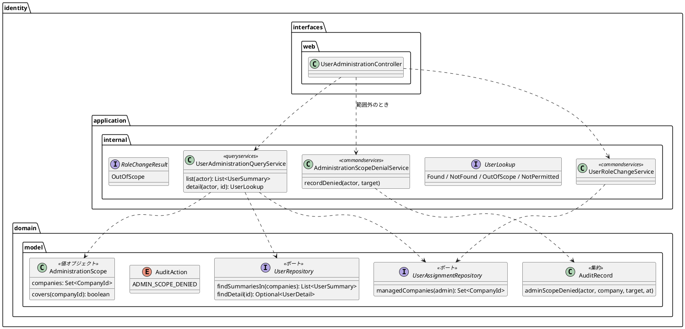
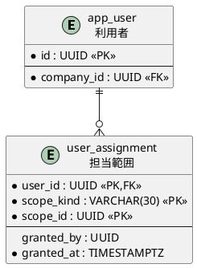

# Bolt 34b 計画 - システム管理者の管理範囲と範囲外の試行の記録（US-16 の一部）

## 基本情報

| 項目 | 内容 |
| :--- | :--- |
| Bolt | 第 34b 回（W5 の 23 本目） |
| 予定 | W5（2026-11-02 の週。前倒しで着手できる）。作業は約 4.5 時間（承認ゲートの待ち時間を除く。文書を除くと約 3.5 時間） |
| 対象 | `identity`（担当範囲の表とポート、管理範囲の値、照会のサービスの絞り込み、役割の変更のサービスの範囲の判定、範囲外の試行の記録のサービス、S-20 の controller）、共通の 404 の画面、スキーマ（`user_assignment` を作る）、dev-data（開発用のシステム管理者の管理範囲）、既存のテストの利用者の用意、設計文書（domain_model・data_model・ui_design・architecture_backend・non_functional・test_strategy・release_plan）、マニュアル 11 章 |
| SP | 0（US-16 の SP 5 は #14 をクローズする W6 で数える） |
| GitHub | [#14](https://github.com/k2works/practical-domain-driven-design-in-enterpris-application/issues/14)（クローズは W6） |
| 承認ゲート | **ステップごとに止める**（W5 の表の 34b の行。認可とスキーマ）。層・モジュールの規則に当たったら、`/goal` の下でも止めて諮る（T-125） |
| アプローチ | インサイドアウト（W5 の表の 34b の行。新しい表と値を作る）。表とポート → 管理範囲の値 → サービスの絞り込みと試行の記録 → 画面の順に外へ向かう。認可と範囲の流れはセキュリティの統合テストと画面の層の受入シナリオで外側から確かめる |
| マニュアル・デモ | マニュアル 11 章に「管理範囲の企業の利用者だけが並ぶ」「範囲外の利用者は見つからない」と、2 章に共通の 404 の画面（見つからない）を足す。キャプチャは撮り直さない（一覧の見た目は変わらない）。デモの動画は 34d の終わり（利用停止まで）で撮る |
| 前の Bolt | [Bolt 34 終了報告](bolt_34_report.md) |

## Bolt ゴール

システム管理者は、運用の手順で割り当てられた管理範囲の企業の利用者だけを一覧し、詳細を開き、役割を変えられる。範囲外の企業の利用者は、一覧に出ず、URL を直接開いても存在しない利用者と同じ 404 になり、その試行が監査記録に残る（US-16 AC2、UC-16 の 2a、IA-INV-08）。管理範囲を割り当てられていないシステム管理者には、だれも出ない。

- これで「34 から 34b までは全企業の利用者の役割を変えられる」窓が閉じ、本番への配備のゲート（Bolt 34 の議題 4）が外れる。

### 確かめたい仮説

| # | 仮説 | この Bolt で分かること |
| :--- | :--- | :--- |
| H1 | 管理範囲の判定を照会と役割の変更の両方のサービスで行えば、画面を経ない送信（確認の GET・確定の POST）でも範囲外を拒める | セキュリティの統合テスト（範囲外の詳細・確認・確定がどれも 404 で、役割も版も変わらない） |
| H2 | 範囲外の試行は、書き手を controller の 1 か所にし、役割の変更のトランザクションの外で単独のトランザクションで書けば、1 回の request につき 1 行だけ残る | セキュリティの統合テスト（詳細・確認・確定でそれぞれ `ADMIN_SCOPE_DENIED` が 1 行） |
| H3 | 一覧を SQL で管理範囲に絞れば、範囲外の利用者の存在（メールアドレス）を漏らさない | リポジトリとセキュリティの統合テスト |

### 開始準備で確かめたこと（T-114。2 つの整合性検証で確かめた）

- **担当範囲の表**: `user_assignment` はデータモデルに設計がある（`user_id`・`scope_kind`・`scope_id`・`granted_by`・`granted_at`、主キーは 3 列、`scope_kind` IN（`COMPANY`・`BOOKING`）。data_model.md:828・919）。まだ作っていない（data_model.md:939）。data_model.md:919 はこの表を IA-INV-02（業務担当者の担当範囲）に結び付けている
- **照会**: `UserAdministrationQueryService` は操作者を受けず、全企業の利用者を返す（Bolt 34 の既知の課題）。`UserRepository.findSummaries`・`findDetail` は企業で絞らない
- **役割の変更**: `UserRoleChangeService.judge` は、操作者がシステム管理者か → 利用者と企業があるか → 規則 → 版、の順に見る。controller はシステム管理者でない結果を 403 にする（`UserAdministrationController`）
- **監査**: `AuditRecord` は対象と変更前後を持てる（Bolt 34）。理由は文字列で持ち、今の理由の値は `AuthenticationRejection` の名前。範囲外の試行は IA-INV-08 の「権限外のアクセス試行」。IA-INV-08 の前例では、監査の追記が失敗したら 500 にする
- **トランザクション**: 監査を別の伝播（`REQUIRES_NEW`）で書く前例は、identity のアプリケーション層にはない（採番の `MyBatis*NumberIssuer` は infrastructure、`LoginAttemptService` は作成だけを `NOT_SUPPORTED` で外に出す。ADR-011:292 は「入れ子にしないので接続を 2 本持たない」を理由にしている。ADR-007 は伝播を書いていない）
- **404**: 共通の 404 の画面はない（`templates/error/` は 403・413 だけ。ほかの 404 は既定のエラーページのまま。bolt_27_report.md:119、ui_design.md:165）。他社のデータは存在しない番号と同じ 404（ui_design.md の A-04 の行）
- **既存のテスト**: 管理範囲を足すと、システム管理者で S-20 を開く既存のテストが落ちる。`UserAdministrationSecurityIntegrationTest`（A 社・荷主・荷受人の利用者）、`UserRoleChangeIntegrationTest`・`UserRoleChangeRollbackIntegrationTest`、`UserRoleChangeServiceTest`（構成子が変わる）、画面の層（`UiUsers` は役割ごとに別の企業を作る。自分の詳細のシナリオも、自分の企業を割り当てないと 404 になる）、`IdentityConfiguration` の組み立て
- **dev-data**: 開発用の企業は 荷主 A（`…0001`）・荷主 B（`…0002`）・A 社（`…0003`）。システム管理者は `…0304`
- **デモ環境**: develop の CI が Heroku のデモ環境（dev プロファイル）へ自動で配備する。デモ環境の利用者は dev-data だけで、本番の利用者はいない

## ふりかえりと前の Bolt からの引き継ぎ

| 入力 | 内容 | この Bolt での扱い |
| :--- | :--- | :--- |
| 開始準備の決定（2026-10-16、human:kakimomokuri） | (1) 34b を 2 つに分ける。34b: 管理範囲（`user_assignment`）と範囲外の拒否・試行の記録（AC2）。34d: 利用停止と再開（AC5）、管理者向けのマニュアル、デモの動画。(2) 管理範囲は運用の手順で割り当てる（この Bolt では割り当ての画面を作らない。開発は dev-data。割り当ての画面は W6 の担当範囲と一緒）。(3) 範囲外は 404（存在を示さない。一覧には範囲内の利用者だけ）。(4) 利用停止では、自分と監督の役割を持つ利用者は画面で止めない（34d） | 確認ポイント 1〜4 |
| Bolt 34 の議題 4 | 34b を終えるまで本番へ配備しない | この Bolt で窓を閉じ、SEC-12 と release_plan のゲートの記述を「34b で外れた」に直す |
| Bolt 34 の既知の課題 | 照会のサービスが操作者を確かめない、照会の射影を集約のポートで受けている、`User.changeRoles` が判定を通さずに呼べる、`RoleChangeResult` の共用、SpotBugs の除外の列挙 | 照会のサービスは操作者を受けて絞る（この Bolt）。ほかは 34c・34d・W10 のまま |
| Bolt 34 の Try T-142・T-143 | 権限を変える機能では操作者と対象が同じ役割の組を確認ポイントに挙げる。新しい画面の部品は既存の形を写す | T-142: 確認ポイント 5（システム管理者どうし・自分の企業）。「最後の 1 人」はこの Bolt に当たらない（役割も利用状態も範囲で変えない。監督の役割は画面で変えない。34d の利用停止も監督の役割の利用者を止めない）。T-143: 共通の 404 の画面は A-04（`error/403.html`）の形を写す |
| Bolt 33b〜34 の Try（T-131・T-132・T-136・T-137・T-141） | 控えから戻す、値で grep、描く仕組みを外す変異、スクリプトの接頭辞、写しの数だけ変異 | 変異は控えから戻す。`findSummaries`・`findDetail`・`UserAdministrationQueryService`・`SYSTEM_ADMIN` で全体を grep する。スクリプトは `b34b_` で始める。一覧の絞り込みは SQL の条件を外す変異で確かめる |
| 33c〜34 の既知の課題 | `@ControllerAdvice`、印の知らせの写し、`new UtcInstant(x)`、Bolt 32f の揺れ、#49 | 触らない |

## スコープ

### 入れるもの・入れないもの

| 入れる | 入れない（後で・変えない） |
| :--- | :--- |
| `identity.user_assignment` を設計どおり作る（common のマイグレーション。主キー 3 列、`scope_kind` の CHECK、`user_id` の外部キー、コメント） | `BOOKING`（案件）の担当範囲と、業務担当者の担当範囲の判定（AC1 の担当案件・AC4、IA-INV-02。W6） |
| 管理範囲の判定（IA-INV-14）: システム管理者は、`COMPANY` として割り当てられた企業の利用者だけを扱う | 管理範囲の割り当ての画面（W6。運用の手順で入れる。決定 2） |
| 照会のサービスが操作者を受け、一覧は管理範囲の企業の利用者だけ（SQL で絞る。管理範囲で絞らない `findSummaries` は消す）、詳細は範囲外を範囲外として返す | 利用停止と再開（34d） |
| 役割の変更のサービスが、操作者の確認の次に範囲を判定し、範囲外は `OutOfScope` を返す（書かない） | 監査記録の照会（S-21、US-17） |
| 範囲外の試行の監査記録 `ADMIN_SCOPE_DENIED`（結果 `FAILURE`、理由 `OUT_OF_SCOPE`、対象 `USER`・利用者 ID）。書き手は controller だけ（下の表）。役割の変更のトランザクションの外で、単独のトランザクションで書く。追記が失敗したら 500 | 範囲内での規則の拒否と古い版の監査（Bolt 34 の確認ポイント 7 のまま書かない） |
| 共通の 404 の画面 `error/404.html`（A-04 の形を写す。「お探しの画面は見つかりません。」と「ホームへ戻る」。確認ポイント 8） | ステージング・本番の割り当ての運用タスク（本番の配備の前に用意する。確認ポイント 6） |
| dev-data: 開発用のシステム管理者に A 社と荷主 A を割り当てる（荷主 B は範囲外のまま。範囲外を試せる） | — |
| 既存のテストの利用者の用意（統合テストの割り当ての補助、`UiUsers` でシステム管理者にシナリオの企業を割り当てる） | — |
| マニュアル 11 章と 2 章の補足、設計文書、release_plan（34d の行を足し、利用停止を 34b としている箇所を 34d に、配備のゲートを外す） | — |

### 範囲外の試行の書き手（指摘の 4 への答え）

| URL | 範囲の判定 | 書き手 |
| :--- | :--- | :--- |
| `GET /staff/users/{id}`（詳細） | 照会のサービスの `detail(actor, id)` が `OutOfScope` | controller が記録のサービスを呼んで 404 |
| `GET …/role-changes/confirmation`（確認） | 先に照会の `detail` を呼ぶので同じ | 同上（役割の変更のサービスまで進まない） |
| `POST …/role-changes/confirmation`（確定） | 先に照会の `detail` を呼ぶ（Bolt 34 は POST で直接サービスを呼んでいた。照会を先に通す形に直す） | 同上。役割の変更のサービスも範囲を判定するが、`OutOfScope` を返すだけで書かない（照会の後に範囲から外れたときの守り。controller はこのときも記録して 404） |

### 設計の約束（Try T-1）

- **表**: `identity.user_assignment`（`user_id` UUID・`scope_kind` VARCHAR(30)・`scope_id` UUID・`granted_by` UUID・`granted_at` TIMESTAMPTZ。主キー（`user_id`・`scope_kind`・`scope_id`）、`ck_user_assignment_scope_kind`、`fk_user_assignment_user`）。`granted_by` は NULL を許す（dev-data と運用の手順で入れる行。`user_role` と同じ）。`scope_id` に企業への外部キーは張らない（`BOOKING` の行は予約 ID を持つ。既存の表の企業 ID に外部キーを張らない方針とも同じ）
- **ポートと値**: `identity.domain.model.aggregates` に `UserAssignmentRepository`（`Set<CompanyId> managedCompanies(UserId 管理者)`）。値 `AdministrationScope`（`valueobjects`、`@ValueObject`。用語集の名前は「管理範囲」。Javadoc は「管理範囲。」で始める。`covers(CompanyId)`・`companies()`）。データモデルの「担当範囲」（表の名前）と区別する
- **照会**: `UserAdministrationQueryService`（`queryservices`）は `UserAssignmentRepository` から管理範囲を作り、`list(AuthenticatedActor)` は管理範囲の企業の利用者だけ（`UserRepository.findSummariesIn(Set<CompanyId>)`。空なら SQL を流さず空）、`detail(AuthenticatedActor, UserId)` は `UserLookup`（`queryservices` の sealed: `Found(UserDetail)`・`NotFound`・`OutOfScope`・`NotPermitted`）を返す。照会のサービスは書かない。システム管理者でない操作者は `NotPermitted`（controller は 403。役割の変更の `NotPermitted` と同じ応答にそろえる）
- **試行の記録**: アプリケーションのサービス `AdministrationScopeDenialService`（`commandservices`、`@Service` と `IdentityConfiguration` の `@Bean`。名前は `…Service` の規則に合わせる）の `recordDenied(AuthenticatedActor, UserId 対象)` が、`TransactionTemplate` の既定の伝播で監査記録を書く。controller は役割の変更のトランザクションの外で呼ぶので入れ子にしない（`REQUIRES_NEW` は使わない）
- **役割の変更**: `UserRoleChangeService.judge` の順を、操作者 → 利用者と企業があるか → **管理範囲** → 規則 → 版 にする。結果 `RoleChangeResult.OutOfScope` を足す。管理範囲は `UserAssignmentRepository` から作る
- **監査**: `AuditAction.ADMIN_SCOPE_DENIED`、`AuditRecord.adminScopeDenied(actor, actorCompany, target, at)`（結果 `FAILURE`、理由は定数の文字列 `OUT_OF_SCOPE`（`AuditRecord` の中の定数。理由の enum は足さない）、対象 `USER`・利用者 ID、版と変更前後なし）
- **画面**: 範囲外は共通の 404 の画面。一覧が空のときは「管理する企業の利用者はいません。」（今の「利用者はまだいません。」を直す）
- **新しいファイル**: マイグレーション（common と dev-data）、`UserAssignmentRepository` と MyBatis の実装（`MyBatisUserAssignmentRepository`。マッパーは既存の `IdentityMapper` に足し、Row は作らない（`UUID` の一覧で読む））、`AdministrationScope`・`UserLookup`・`AdministrationScopeDenialService`、`error/404.html`、テストの割り当ての補助（`AdministrationFixtures`）と、それぞれのテスト。SpotBugs の `EI_EXPOSE_REP2` の除外に新しいサービスを足す見込み（前例どおり。列挙が増える既知の課題は 34c）

## 設計（この Bolt の範囲）

4 図のうち、ドメインモデル図と ER 図を置く。状態遷移図は状態を足さないので、画面遷移図は画面と URL を変えない（範囲外は共通の 404）ので省く。

### ドメインモデル図

### ER 図（この Bolt で作る表）

注（設計への反映が必要。ステップ 1 で直す行）:

- data_model.md: `user_assignment` を作ったこと（Bolt 34b）と `granted_by` の NULL、:919 の行に IA-INV-14、:938 の操作の列挙に `ADMIN_SCOPE_DENIED`・`ROLES_CHANGED`、:939 の「使う Bolt で作る」から `user_assignment` を外す
- domain_model.md: 要素表に `UserAssignmentRepository`・`AdministrationScope`（管理範囲）・`UserLookup`・`AdministrationScopeDenialService`・`ADMIN_SCOPE_DENIED`・`RoleChangeResult.OutOfScope`、不変条件に IA-INV-14（システム管理者は管理範囲の企業の利用者だけを扱う。IA-INV-02 の管理者版）、IA-INV-08 に範囲外の試行は役割の変更のトランザクションの外で単独に書くこと、:1025 の「管理範囲と利用停止は Bolt 34b」を「管理範囲は 34b、利用停止は 34d」に
- ui_design.md: :145 の S-20 の行（利用停止は 34d）、:180 付近の S-20 の URL の行（範囲内だけ、範囲外は 404、照会を先に通す）、:192 の A-04 の行（管理範囲外は 404。34b）、共通の 404 の画面
- non_functional.md: :179 の SEC-12（利用停止は 34d、配備のゲートは 34b で外れた）
- architecture_backend.md: 範囲外の試行の書き手と、照会のサービスが管理範囲のポートを読むこと
- test_strategy.md: Bolt 34b の行
- release_plan.md: 34b の行、34d の行を足す（範囲・アプローチ（インサイドアウト）・承認ゲート（ステップごと。認可とスキーマ））、:557 の「Bolt 30〜34b」を「Bolt 30〜34d」、:631 のマニュアルの方針（利用停止は 34d）、:641 のチェックリスト、:602 の配備のゲート、状態の行・実績の表・更新履歴

## ステップ計画

状態の記号: `[ ]` 未着手、`[-]` 進行中、`[?]` 承認待ち、`[x]` 完了。各ステップの終わりに `check` が緑であることを確かめ、push してアプリの CI と MkDocs の配備を確かめる（T-26、T-126）。コミットは pathspec で作る（T-110）。複数行の書き換えはスクリプトのファイル（`b34b_` で始める）にし、書き込みの成功を確かめてから実行する（T-103、T-137）。

- [x] **1. 設計文書** 【承認ゲート: 設計文書】
  - 上の注の行を直す
  - 完了の判定: `okf:check` ERROR 0、`documentationTest` 緑
- [x] **2. 表と dev-data とポート** 【承認ゲート: データベース】
  - マイグレーション（common）と dev-data（システム管理者に A 社と荷主 A）。`UserAssignmentRepository` の実装とマッパー、`UserRepository.findSummariesIn`（`findSummaries` を消す）。統合テスト（表の制約、割り当ての読み出し、一覧の絞り込み・空の集合）。テストの割り当ての補助 `AdministrationFixtures`
- [x] **3. 管理範囲と試行の記録** 【承認ゲート: Red・Green、セキュリティ】
  - `AdministrationScope` の単体テスト、`AuditRecord.adminScopeDenied`、`AdministrationScopeDenialService` の単体テストと統合テスト（追記の失敗は例外）
- [ ] **4. 照会と役割の変更のサービス** 【承認ゲート: セキュリティ】
  - `UserAdministrationQueryService` の `list(actor)`・`detail(actor, id)`、`UserRoleChangeService` の範囲の判定と `OutOfScope`。単体テストと統合テスト（範囲外の確定で役割と版は変わらない）。既存の `UserRoleChangeServiceTest`・`UserRoleChangeIntegrationTest`・`UserRoleChangeRollbackIntegrationTest` に割り当てを足す
- [ ] **5. 画面と受入シナリオ** 【承認ゲート: 画面・セキュリティ】
  - セキュリティの統合テストを先に（範囲外の詳細・確認・確定が 404 で `ADMIN_SCOPE_DENIED` が 1 行ずつ、役割も版も変わらない、一覧に範囲外の利用者が出ない、割り当てのないシステム管理者には空、監査の追記の失敗で 500）。既存の `UserAdministrationSecurityIntegrationTest` に割り当てを足す
  - controller（POST も照会を先に通す、範囲外は記録して 404）、共通の 404 の画面、一覧の空の文言
  - 画面の層: `UiUsers` でシステム管理者にシナリオの企業（自分の企業を含む）を割り当てる。受入シナリオ（`@US-16-AC2`）: 範囲外の利用者は一覧に出ず、URL を開くと見つからない（共通の 404 の画面でアクセシビリティの検査も通す）。Bolt 34 のシナリオが緑のまま
  - マニュアル 11 章と 2 章の補足。完了の判定: `check` 緑、`uiTest` 緑
- [ ] **6. SonarQube と開発レビューと終了報告** 【承認ゲート: 終了報告】
  - SonarQube（T-116）。開発レビュー（プログラマー・テスター、アーキテクト、セキュリティ、テクニカルライター）。`bolt_34b_report.md`、release_plan、開発の索引

### 時間の配分と打ち切り

| # | 目安 | 打ち切り |
| :--- | :--- | :--- |
| 1 | 35 分 | — |
| 2 | 40 分 | — |
| 3 | 30 分 | — |
| 4 | 45 分 | 層・モジュールの規則に当たったら止めて諮る |
| 5 | 75 分 | 画面の層の利用者の用意が Bolt 34 のほかのシナリオに波及すると見えたら止めて諮る |
| 6 | 30 分（SonarQube の待ちを除く） | — |

合計 255 分（約 4.5 時間）。ステップ 4 を終えた時点で 3 時間を超えていたら止めて諮る（候補: 共通の 404 の画面を後に送り、既定のエラーページのままにする）。

## 確認ポイント（計画の承認の場でまとめて確認する。Try T-6）

| # | 確認すること | ステップ | 推奨・決定 |
| :--- | :--- | :--- | :--- |
| 1 | **分け方** | 全体 | 決定済み（1）: 34b（管理範囲と範囲外の試行の記録）と 34d（利用停止と再開、管理者向けのマニュアル、デモの動画） |
| 2 | **管理範囲の割り当て** | 2 | 決定済み（2）: 運用の手順で割り当てる。この Bolt では画面を作らない |
| 3 | **範囲外の応答** | 5 | 決定済み（3）: 404（存在を示さない）。一覧には範囲内だけ |
| 4 | **利用停止で止める相手** | — | 決定済み（4）: 自分と監督の役割を持つ利用者は画面で止めない（34d で作る） |
| 5 | **システム管理者どうし・自分の企業**（T-142） | 3・4 | 管理範囲の判定は対象の所属企業だけで見る。自分の企業（A 社）を範囲に持つシステム管理者は、ほかのシステム管理者の詳細も開ける（役割の変更は監督の役割の決定で拒まれる）。自分の企業を範囲に持たないシステム管理者は、自分の詳細も 404（範囲の判定に例外を作らない）。決定済み（計画の承認） |
| 6 | **ステージング・本番の割り当て** | — | 本番の配備の前に、割り当ての運用タスク（`operating-script` で正式に足し、手順書に書く）か W6 の割り当ての画面を用意する。この Bolt では dev-data だけ。割り当てのないシステム管理者はだれも扱えない（安全側）。決定済み（計画の承認） |
| 7 | **試行の記録の範囲と書き方** | 3〜5 | 範囲外の詳細・確認・確定のどれも 1 回の request につき 1 行。一覧は SQL で絞るので試行にならない。書き手は controller だけ（上の表）。役割の変更のトランザクションの外で単独に書き、`REQUIRES_NEW` は使わない（入れ子にせず接続を 2 本持たない。ADR-011:292 と同じ考え）。追記が失敗したら 500。決定済み（計画の承認） |
| 8 | **共通の 404 の画面** | 5 | 決定済み（計画の承認）: 新しい `error/404.html` を A-04 の形で作る。今は既定のエラーページで、範囲外の案内とアクセシビリティの検査に向かない。アプリ全体の 404 の見た目が変わる（文言は「お探しの画面は見つかりません。」と「ホームへ戻る」。業務データを出さない）。作らないなら既定のエラーページのまま |
| 9 | **配備のゲート** | 1 | この Bolt で全企業の窓が閉じるので、SEC-12 と release_plan の「34b を終えるまで本番へ配備しない」を「34b で外れた」に直す。決定済み（計画の承認） |
| 10 | **新しいファイル** | 2〜5 | 設計の約束の「新しいファイル」のとおり |
| 11 | **開発レビュー** | 6 | プログラマー・テスター、アーキテクト、セキュリティ、テクニカルライター |
| 12 | **アプローチと承認ゲートと時間** | 全体 | インサイドアウト。ステップごとに止める（認可・スキーマ）。約 4.5 時間 |

## 完了条件

- [ ] `user_assignment` があり、システム管理者の管理範囲（`COMPANY`）を読める
- [ ] 一覧は管理範囲の企業の利用者だけを示し、割り当てのないシステム管理者には空
- [ ] 範囲外の利用者の詳細・確認・確定は 404 で、役割も版も変わらず、試行が `ADMIN_SCOPE_DENIED` として 1 回の request につき 1 行、監査記録に残る（AC2、IA-INV-08、IA-INV-14）
- [ ] 設計文書（data_model・domain_model・ui_design・architecture_backend・non_functional・test_strategy・release_plan）とマニュアル 11 章・2 章を更新した
- [ ] `check` と `uiTest` が緑。push してアプリの CI と MkDocs の配備を確かめた。SonarQube の Quality Gate が PASS、`okf:check` ERROR 0
- [ ] 開発レビュー、終了報告

## 更新履歴

| 日付 | 更新内容 | 更新者 |
| :--- | :--- | :--- |
| 2026-10-16 | 初版作成（承認待ち）。human:kakimomokuri の決定（34b と 34d に分ける、管理範囲は運用の手順で割り当てる、範囲外は 404、利用停止で自分と監督の役割の利用者は止めない）を反映した | anthropic/claude-opus-5-5 |
| 2026-10-16 | 詳細整合性検証（9 件）と横断整合性検証（10 件）の指摘を反映した。共通の 404 の画面がないこと（確認ポイント 8）、落ちる既存のテスト、`REQUIRES_NEW` の前例の誤り（使わず、書き手を controller の 1 か所にして単独のトランザクションで書く）、試行の書き手の表、追記の失敗は 500、システム管理者でない操作者は 403 にそろえる、`findSummaries` を消す、理由の型、照会がコマンドサービスに依存しないこと、記録のサービスの名前、管理範囲の日本語名と IA-INV-02 との関係、34d への移し漏れと直す行の列挙、SpotBugs、「最後の 1 人」 | anthropic/claude-opus-5-5 |
| 2026-10-16 | 計画を承認した。共通の 404 の画面を作り、管理範囲の判定に自分の詳細の例外を作らない（確認ポイント 5・8）。確認ポイント 6・7・9 ほか残りを承認した | anthropic/claude-opus-5-5、承認 human:kakimomokuri |

## 関連ドキュメント

- [リリース計画](release_plan.md)（W5）
- [Bolt 34 計画](bolt_34_plan.md)、[Bolt 34 終了報告](bolt_34_report.md)
- [ユーザーストーリー US-16](../../requirements/cargo-tracker/user_story.md)、[システムユースケース UC-16](../../requirements/cargo-tracker/system_usecase.md)
- [ドメインモデル](../../design/cargo-tracker/domain_model.md)、[データモデル](../../design/cargo-tracker/data_model.md)、[UI 設計](../../design/cargo-tracker/ui_design.md)、[非機能要件](../../design/cargo-tracker/non_functional.md)
