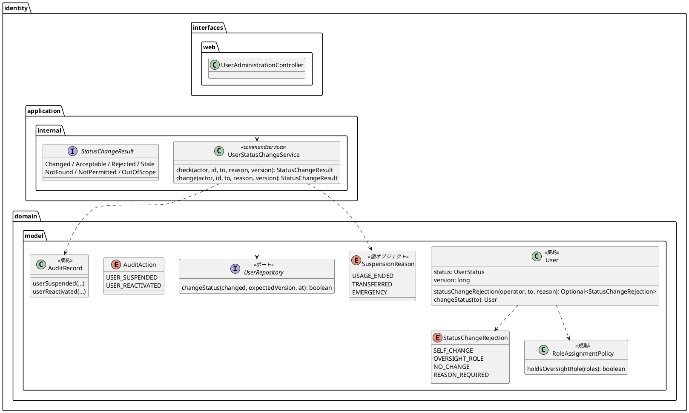
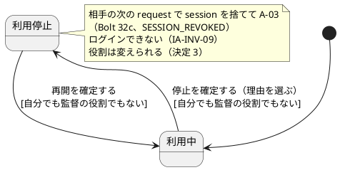
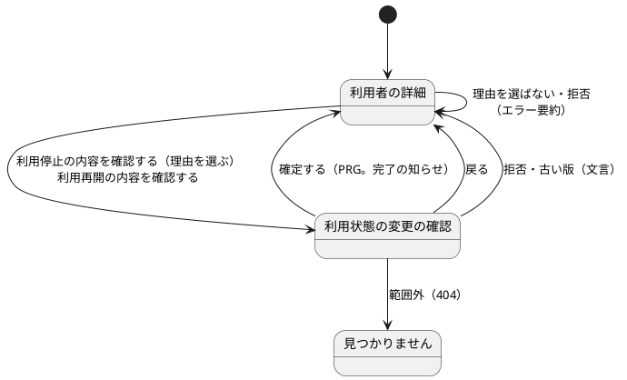

# Bolt 34d 計画 - 利用者の利用停止と再開（US-16 の一部）

## 基本情報

| 項目 | 内容 |
| :--- | :--- |
| Bolt | 第 34d 回（W5 の 24 本目） |
| 予定 | W5（2026-11-02 の週。前倒しで着手できる）。作業は約 4 時間（承認ゲートの待ち時間を除く。文書を除くと約 3 時間） |
| 対象 | `identity`（利用者の集約の状態の判定と変更、監督の役割の判定の公開、停止の理由の値、状態の変更のサービスと結果の型、監査の操作 2 つ、リポジトリの版を条件にした状態の更新、S-20 の controller と詳細・確認の画面）、設計文書（domain_model・data_model・ui_design・architecture_backend・non_functional・test_strategy・user_story・release_plan）、マニュアル 11 章・2 章、デモの動画 |
| SP | 0（US-16 の SP 5 は #14 をクローズする W6 で数える） |
| GitHub | [#14](https://github.com/k2works/practical-domain-driven-design-in-enterpris-application/issues/14)（クローズは W6） |
| 承認ゲート | **ステップごとに止める**（W5 の表の 34d の行。認可）。スキーマは変えない（`ck_app_user_status` は `ACTIVE`・`SUSPENDED` を既に持ち、`audit_record.action` に CHECK はない）。層・モジュールの規則に当たったら、`/goal` の下でも止めて諮る（T-125） |
| アプローチ | インサイドアウト（W5 の表の 34d の行）。集約の判定と変更 → サービス → 画面の順に外へ向かう。停止が次の request から効くことは、セキュリティの統合テストと画面の層の受入シナリオで外側から確かめる |
| マニュアル・デモ | マニュアル 11 章に新しい節「利用状態の変更の確認」を足し、11.1・11.2 と章の冒頭の表を直す。キャプチャは詳細（撮り直し）と確認の領域（新しく）。2 章の冒頭の表・2.4・付録 B の「利用を止められたとき」を管理者の操作と照らす。デモの動画は `@demo-bolt-34d/suspend-and-reactivate` を撮る（`demoVideo` は全部を撮り直すので、未録画の `@demo-bolt-34/change-roles` もここで撮れる） |
| 前の Bolt | [Bolt 34b 終了報告](bolt_34b_report.md)（開発レビューの指摘は終了報告の表にある） |

## Bolt ゴール

システム管理者は、管理範囲の企業の利用者の詳細から、理由を選んで利用を停止し、停止中の利用者を再開できる。確認の領域で対象・現在の状態・変更内容・影響・回復手段・実行者を確かめてから確定し、確定の後は相手の次の request から拒否され（Bolt 32c の確かめ）、相手の過去の操作の記録は残る（US-16 AC5、UC-16 の 5a、BR-14、IA-INV-04）。自分と監督の役割（システム管理者・監査担当者）を持つ利用者は、画面で止めも再開もしない。

### 確かめたい仮説

| # | 仮説 | この Bolt で分かること |
| :--- | :--- | :--- |
| H1 | 停止は `app_user.status` を版の条件付きで書き換えるだけで、Bolt 32c の `SessionRevalidationService` が相手の次の request で session を捨てる（新しい失効の仕組みは要らない） | セキュリティの統合テスト（停止の確定の後、相手の既存の session の次の request が A-03 で、`SESSION_REVOKED`／`SUSPENDED` が 1 行） |
| H2 | 状態の変更と役割の変更が同じ版を共有すれば、片方の確認の間にもう片方が確定したときに古い版として拒める | 統合テスト（役割の変更の後の停止の確定が古い版で拒まれ、状態も版も変わらない） |
| H3 | 役割の変更の判定の形（操作者 → 存在 → 管理範囲 → 規則 → 版）を写せば、状態の変更でも画面を経ない送信を拒める | セキュリティの統合テスト（自分・監督の役割・範囲外・同じ状態への変更・理由のない停止の確定がどれも拒まれ、書かれない） |

### 開始準備で確かめたこと（T-114。2 つの整合性検証で確かめた）

- **要件**: US-16 AC5「利用終了または権限取消し、アクセス変更を確定する → 次の request から拒否され過去の操作履歴は保持される」（user_story.md:574）。権限の取消しは Bolt 34 で済み、この Bolt は利用終了（停止）の分。UC-16 のトリガー（system_usecase.md:337。異動を含む）と 5a（:566）、BR-14（requirements_definition.md:734）。US-16 にはまだ Bolt ごとの決定の節がない。US-18 AC4・AC6（user_story.md:489・491）は、この Bolt で初めて画面の停止の操作で満たされる
- **集約**: `User` は `UserStatus status`（`ACTIVE`・`SUSPENDED`）と `version` を持つが、停止・再開のメソッドはない（`User.java:31・33`）。`authenticationRejection` は `SUSPENDED` を先に返す（:89-100）。`User` は役割が 0 件だと例外を投げる（:51-53）。役割の変更の判定の順は 自分 → 役割なし → 変更なし → 監督の役割（:122-134）
- **監督の役割**: `RoleAssignmentPolicy.OVERSIGHT_ROLES = {SYSTEM_ADMIN, AUDITOR}` は `private static final` の可変の `EnumSet`（`RoleAssignmentPolicy.java:33`）。外から呼べるのは `conflicts`・`unfitRoles`・`oversightChanges`・`businessRolesOf`・`assignableRoles`（:44-82）
- **反映の仕組み**: `SessionRevalidationService.revalidate` は認証済みの request ごとに `selectUserStanding`（`IdentityMapper.xml:165-174`）で `u.status` を読み、止められた利用者は `SESSION_REVOKED`（理由 `SUSPENDED`）を単独のトランザクションで書いて session を捨て A-03（`/session-expired`）に送る（Bolt 32c）。既存のテストは DB を直接 UPDATE して停止を作っている（`SessionRevalidationSecurityIntegrationTest.java:120`）
- **役割の変更の形**: `UserRoleChangeService` の `check`（確認の GET。書かない）と `change`（確定の POST。`TransactionTemplate`、`Changed` 以外は巻き戻す）、`judge` の順（:109-131）、`updateUserVersion` の版の条件と `updated_at`（`IdentityMapper.xml:108-114`）、controller の `detail(id, actor, true)` で確定の POST だけ範囲外を記録（Bolt 34b）、知らない役割の名前は 400（`UserAdministrationController.java:252-262`）、古い版の文言 `STALE_MESSAGE`「この利用者の情報が先に更新されました。最新の内容を確かめてから、もう一度変更してください。」（:52。誰が変えたかは言わない。ui_design.md:1145）
- **監査**: `AuditAction` は 13 値。`AuditRecord.rolesChanged` は対象 `USER`・ID・版・変更前後を書く。`audit_record.reason` は DB では `VARCHAR(100)`（ER の 4000 と食い違う。data_model.md:864）。data_model.md:938 は `reason` を「失敗の理由」としている
- **画面**: 一覧は利用状態の列を持つ（`list.html:30`）。詳細の見出しとエラー要約は役割の変更に固定（`detail.html:16`「役割を変更できませんでした」）。確認の画面は役割の変更だけ（`confirmation.html`）。共通の確認の領域は「実行者」を持ち、ボタンは「戻る」（ui_design.md:1130・1160-1167）
- **テストの依存**: 画面の層のステップ（`UserAdministrationUiSteps.java:124・133・142`）とセキュリティの統合テスト（`UserAdministrationSecurityIntegrationTest.java:238・311`）がボタンの名前「変更内容を確認する」に依存する（Playwright の名前は部分一致）。`AuthenticationAuditListenerTest.java:204` は `UserRepository` を匿名クラスで実装している
- **dev-data**: 停止された利用者はいない。システム管理者 `…0304` の管理範囲は A 社と荷主 A
- **デモ**: `demoVideo`（`build.gradle:152-175`）は `@demo` を全部撮り直し、`docs/assets/demo/<Bolt>/<名前>.webm` に置く。`@demo-bolt-34/change-roles` は feature にあるが未録画。添付先の表 `BOLT_ISSUES`（`issue_demo.js`）は bolt-33b で終わる

## ふりかえりと前の Bolt からの引き継ぎ

| 入力 | 内容 | この Bolt での扱い |
| :--- | :--- | :--- |
| 開始準備の決定（2026-10-17、human:kakimomokuri） | (1) 停止の理由は選ぶ形（利用終了・異動・緊急停止）で監査の `reason` に残す。スキーマは変えない。(2) session は次の request の確かめ（Bolt 32c）に任せ、確定の後にすぐ消さない。(3) 停止中の利用者の役割の変更は許す（判定を増やさない）。(4) 自分と監督の役割を持つ利用者は、停止だけでなく再開も画面で扱わない | 確認ポイント 1〜4 |
| Bolt 34b の開始準備の決定 (4) | 利用停止では、自分と監督の役割を持つ利用者は画面で止めない | 決定 (4) で再開にも広げた。release_plan の 34d の行も直す |
| Bolt 34b の Try T-144 | 監査の記録を足す計画では、記録する操作が CSRF で守られているか（GET か）と、記録の有無で応答の時間が変わるかを確認する | 確認ポイント 7。状態の変更の監査と範囲外の試行は確定の POST でだけ書く。確認の GET は書かない。範囲外の POST だけ記録が増える時間の差は Bolt 34b の既知の課題と同じ（CSRF で守られた管理者の操作に限る） |
| Bolt 34b の Try T-145 | エラー画面の本文を比べるテストは画面の層で書き、MockMvc では状態コードと副作用だけ見る | セキュリティの統合テストは状態コード・状態・版・監査の行だけを見る。文言は画面の層のシナリオで確かめる |
| Bolt 34 の Try T-142 | 権限を変える機能では、操作者と対象が同じ役割の組（自分・同じ役割どうし・最後の 1 人）を確認ポイントに挙げる | 自分と監督の役割どうしは決定 (4)。最後の 1 人（企業の最後の利用中の利用者を止める）は確認ポイント 12 |
| Bolt 34 の Try T-143 | 新しい画面の部品は既存の形を写す | 確認の画面は `confirmation.html`、エラー要約と知らせは `detail.html` の部品を写す。古い版の文言は `STALE_MESSAGE` をそのまま使う |
| Bolt 32c の Try T-115 | 「〜では書かない」は、書く条件が成り立つ場面で確かめる | 確認の GET で書かないことは、POST なら書く条件（受け付けられる停止、範囲外の利用者）の GET で確かめる |
| Bolt 34 の既知の課題（bolt_34_report.md:104・105） | `User.changeRoles` が判定を通さずに呼べる（34b の利用停止で同じ形が増えるときに検討する）。`RoleChangeResult` を確かめる呼び出しと変える呼び出しで共用し、届かない枝を例外で埋めている | 状態の変更は新しい結果の型 `StatusChangeResult` にし、`RoleChangeResult` を広げない。判定を通さずに呼べる形をこの Bolt で直すか送るかは確認ポイント 8（推奨: 同じ形にそろえ、2 つをまとめて 34c で直す。34c の行に足す） |
| Bolt 34 の計画（bolt_34_plan.md:46） | 34b（今は 34d）の利用停止も版を上げる | 版を条件に上げる（確認ポイント 6） |
| Bolt 33b〜34b の Try（T-131・T-132・T-136・T-137・T-141） | 控えから戻す、値で grep、描く仕組みを外す変異、スクリプトの接頭辞、写しの数だけ変異 | 変異は控えから戻す。`SUSPENDED`・`UserStatus`・`変更内容を確認する`・`RoleChangeResult`・`OVERSIGHT_ROLES` で全体を grep する。スクリプトは `b34d_` で始める。判定の分岐と版の条件の SQL を外す変異で確かめる |
| 34b の既知の課題 | テストの割り当ての暗黙の準備、`list` と `detail` の非管理者の扱いの違い、SpotBugs の除外の列挙、範囲外の POST の時間の差 | 触らない（34c・W10） |

## スコープ

### 入れるもの・入れないもの

| 入れる | 入れない（後で・変えない） |
| :--- | :--- |
| 停止と再開の判定（IA-INV-01 と IA-INV-14 の広げ）: 自分・監督の役割を持つ利用者・同じ状態への変更・理由のない停止を拒む | 利用者の登録、担当案件（AC1・AC4）、ロックの解除、管理範囲の割り当ての画面（W6） |
| 監督の役割の判定の公開 `RoleAssignmentPolicy.holdsOversightRole(Set<Role>)`（集合そのものは公開しない） | 理由の自由な文、`app_user` への列の追加（決定 1） |
| 停止の理由の値 `SuspensionReason`（利用終了 `USAGE_ENDED`・異動 `TRANSFERRED`・緊急停止 `EMERGENCY`）。再開は理由を持たない | 確定の後の session の即時の失効（決定 2。`UserSessionRevoker` は呼ばない） |
| `User` の状態の変更、版を条件にした状態の更新（`UserRepository` と SQL） | 停止中の利用者の役割の変更の拒否（決定 3。今のまま許す） |
| アプリケーションのサービス `UserStatusChangeService`（確認の `check` と確定の `change`）と結果の型 `StatusChangeResult` | 監督の役割の利用者の停止・再開（運用の手順。決定 4） |
| 監査 `USER_SUSPENDED`（理由は `SuspensionReason` の名前。最長 11 文字で `VARCHAR(100)` に収まる）・`USER_REACTIVATED`（対象 `USER`・ID・新しい版、変更前後 `ACTIVE`／`SUSPENDED`）。拒否と古い版は書かない。範囲外の確定の試行は既存の `ADMIN_SCOPE_DENIED` | 監査記録の照会（S-21、US-17） |
| S-20 の詳細に利用状態の領域（停止は理由を選んで「利用停止の内容を確認する」、再開は「利用再開の内容を確認する」）、確認の領域、完了の知らせ、拒否と古い版の文言。知らない状態・理由の名前、再開に理由を付けた送信は 400 | PRV-06（non_functional.md:212）の「利用終了から保持期間」の起点に停止を使うこと |
| 受入シナリオ `@US-16-AC5`（停止 → 相手がログインできない → 再開 → ログインできる）、デモの動画 | 役割が 0 件の利用者（データの不整合。`User` が例外を投げる今の扱いのまま） |
| マニュアル 11 章・2 章、設計文書、release_plan、開発の索引のデモの表、`BOLT_ISSUES` | `audit_record.reason` の ER と DB の食い違いの解消（data_model に記すだけ） |

### 状態の変更の書き手

| URL | 判定 | 書き手 |
| :--- | :--- | :--- |
| `GET /staff/users/{id}/status-changes/confirmation?status=&reason=&version=`（確認） | 照会の `detail` → `UserStatusChangeService.check` | なし（書かない。T-144） |
| `POST` 同じ URL（確定） | 照会の `detail`（範囲外なら記録して 404）→ `change` | `change` が状態の更新と `USER_SUSPENDED`／`USER_REACTIVATED` を 1 つのトランザクションで書く。範囲外は controller が `AdministrationScopeDenialService` で記録（Bolt 34b と同じ） |

### 設計の約束（Try T-1）

- **値**: `SuspensionReason`（`identity.domain.model.valueobjects` の enum、`@ValueObject`。前例は `PasswordPolicyViolation`。用語集の名前は「停止の理由」、Javadoc は「停止の理由。」で始める。値の日本語は利用終了・異動・緊急停止。「利用終了」は要件の語（user_story.md:574））
- **拒否**: `StatusChangeRejection`（`valueobjects` の enum、`@ValueObject` なし。画面に示す付随の値がないので、`RoleChangeRejection`（record）と `RoleChangeRejectionReason`（enum）の組にしない。前例は `AuthenticationRejection`）。値は `SELF_CHANGE` → `OVERSIGHT_ROLE` → `NO_CHANGE` → `REASON_REQUIRED` の順。監督の役割を状態より先に見るのは、決定 (4) で監督の役割の利用者は状態にかかわらず画面で扱わないため（役割の変更は変更なしを先に見るが、状態の変更では監督の役割の利用者の状態を拒否の種類で区別しない）
- **規則**: `RoleAssignmentPolicy.holdsOversightRole(Set<Role>)` を足す（`OVERSIGHT_ROLES` は公開しない）。`User.statusChangeRejection(UserId operator, UserStatus to, Optional<SuspensionReason> reason)` がこれを使う
- **変更**: `User.changeStatus(UserStatus to)` は新しい `User` を返す（`changeRoles` と同じ形）。`UserRepository.changeStatus(User changed, long expectedVersion, UtcInstant at)` は `UPDATE … SET status, version = version + 1, updated_at = #{now} WHERE id AND version = #{expectedVersion}`。0 件なら古い版
- **サービス**: `UserStatusChangeService`（`commandservices`、`@Service` と `IdentityConfiguration` の `@Bean`）。`judge` の順は 操作者（システム管理者か）→ 利用者と企業 → 管理範囲 → 規則 → 版
- **結果**: `StatusChangeResult`（sealed: `Changed(version)`・`Acceptable`・`Rejected(StatusChangeRejection)`・`Stale`・`NotFound`・`NotPermitted`・`OutOfScope`）
- **監査**: `AuditRecord.userSuspended(actor, actorCompany, target, version, reason, at)`・`userReactivated(actor, actorCompany, target, version, at)`。結果 `SUCCESS`。`USER_SUSPENDED` は `reason` を持つ最初の成功の行になる
- **画面**: 詳細に「利用状態」の領域（自分と監督の役割の利用者には操作を出さず、理由を一文で示す。荷受人の企業の利用者にも出す）。ボタンの名前は「変更内容を確認する」を含まない「利用停止の内容を確認する」「利用再開の内容を確認する」。確認の領域の項目は既存の名前にそろえる: 対象・現在の状態・変更内容（停止なら理由も）・影響（停止「相手の次の操作から使えなくなります」、再開「相手は次のログインから使えます」）・回復手段（停止「再開できます」、再開「もう一度停止できます」）・実行者。ボタンは「確定する」と「戻る」。完了の知らせは「利用を停止しました。」「利用を再開しました。」。エラー要約の見出しは操作ごと（「利用状態を変更できませんでした」）にし、役割の変更の見出しは変えない。古い版は `STALE_MESSAGE` をそのまま使う
- **新しいファイル**: `SuspensionReason`・`StatusChangeRejection`・`UserStatusChangeService`・`StatusChangeResult`、テンプレート `identity/users/status-confirmation.html`、それぞれのテスト、受入シナリオ（`manage_user_status_ui.feature`）とステップ。既存のファイルの変更: `RoleAssignmentPolicy`（とテスト）、`User`、`UserRepository` と MyBatis の実装・マッパー、`AuditAction`・`AuditRecord`、controller、`detail.html`、`AuthenticationAuditListenerTest` の匿名クラス（`changeStatus` の override）。SpotBugs の `EI_EXPOSE_REP2` の除外に新しいサービスを足す見込み（前例どおり）

## 設計（この Bolt の範囲）

4 図のうち、ドメインモデル図・状態遷移図・画面遷移図を置く。ER 図は表と列を変えないので省く。

### ドメインモデル図

### 状態遷移図（利用者の利用状態）

### 画面遷移図（この Bolt の範囲）

注（設計への反映が必要。ステップ 1 で直す行）:

- domain_model.md: 要素表に `UserStatus`（利用状態。今は行がない）・`SuspensionReason`（停止の理由）・`StatusChangeRejection`・`UserStatusChangeService`・`StatusChangeResult`、:208 の `AuditAction` に `USER_SUSPENDED`・`USER_REACTIVATED`、:209 の `AuditTarget` に状態の変更、:217 の `RoleAssignmentPolicy` に `holdsOversightRole`、:175 の User の行、:1029 の「利用停止は Bolt 34d で足す」、:1174 の責務、IA-INV-01（監督の役割の利用者は画面で止めも再開もしない）、IA-INV-14（利用停止・再開できる）、IA-INV-04（画面の停止の確定から反映）、IA-INV-08（状態の変更の監査は同じトランザクション）、利用状態の状態遷移図
- data_model.md: :936（`status` の更新は版を条件に上げる）、:938 の action の列挙と `reason` の意味（成功の停止の理由も入る。値は `USAGE_ENDED`・`TRANSFERRED`・`EMERGENCY`）、:944 の対象の使い方（状態の変更）、DB のコメント（`V20261016100000…:13-15` の「役割の変更では」）はスキーマを変えないので残すこと、:864 の `reason` の ER と DB の食い違い
- ui_design.md: :145 の S-20 の行、:180-182 の URL の行（状態の変更の確認）、:1079-1149 の S-20 の画面イメージ（利用状態の領域・確認の領域・文言の表・知らせ）、:91 の A-03 の行と :503 の遷移は「利用停止」を既に含むので、出どころが S-20 の停止であることだけを書き足す
- non_functional.md: :179 の SEC-12（利用停止は 34d で実現）
- architecture_backend.md: :296-297 付近に状態の変更のサービスの置き場所
- test_strategy.md: Bolt 34d の行
- user_story.md: US-16 に Bolt ごとの決定の節を作り、34d の決定 (1)〜(4) を書く（34・34b の決定はそれぞれの計画へのリンクで示す）。US-18 の Bolt 32c の決定（:519「US-16（Bolt 34）で作る」）を 34d に直す
- release_plan.md: 34d の行（再開も画面で扱わない、承認ゲートは認可だけ。スキーマは変えない）、34c の行（`changeRoles`・`changeStatus` が判定を通さずに呼べることと `RoleChangeResult` の共用。確認ポイント 8 で送ると決めたとき）、チェックリスト、状態の行・実績・更新履歴
- コードとテストの古い記述（ステップ 2〜4 で直す）: `User.java:19-21`、`UserStatus.java:4`、`AuditTarget.java:9-11`、`UiUsers.java:139-140`、`SessionRevalidationSecurityIntegrationTest.java:59`
- マニュアル 2 章: 冒頭の表（`02-ログインと共通の画面.md:21`）・2.4（:187・:195・:215・:219・:224）・付録 B（:22・:33・:63）の「利用を止められたとき」の文が、管理者の操作で止まることと食い違わないか確かめる

## ステップ計画

状態の記号: `[ ]` 未着手、`[-]` 進行中、`[?]` 承認待ち、`[x]` 完了。各ステップの終わりに `check` が緑であることを確かめ、push してアプリの CI と MkDocs の配備を確かめる（T-26、T-126）。コミットは pathspec で作る（T-110）。複数行の書き換えはスクリプトのファイル（`b34d_` で始める）にし、書き込みの成功を確かめてから実行する（T-103、T-137）。

- [x] **1. 設計文書** 【承認ゲート: 設計文書】
  - 上の注の行を直す
  - 完了の判定: `okf:check` ERROR 0、`documentationTest` 緑
- [x] **2. 集約の判定と変更** 【承認ゲート: Red・Green、セキュリティ】
  - `RoleAssignmentPolicy.holdsOversightRole`、`SuspensionReason`・`StatusChangeRejection`、`User.statusChangeRejection`（自分・監督の役割・同じ状態・理由。順の境界）と `changeStatus`、`AuditRecord.userSuspended`・`userReactivated` の単体テスト。`User.java`・`UserStatus.java`・`AuditTarget.java` の古い Javadoc
- [x] **3. リポジトリとサービス** 【承認ゲート: セキュリティ】
  - `UserRepository.changeStatus` と SQL（版の条件、`updated_at`）、`AuthenticationAuditListenerTest` の匿名クラス、`UserStatusChangeService` の `check`・`change`。単体テストと統合テスト（確定で状態と版と監査が 1 つのトランザクションで変わる、古い版で何も変わらない、役割の変更の後の停止は古い版、範囲外は `OutOfScope`、追記の失敗で巻き戻る）
- [x] **4. 画面と受入シナリオ** 【承認ゲート: 画面・セキュリティ】
  - セキュリティの統合テストを先に（自分・監督の役割・範囲外・同じ状態・理由のない停止の確定が拒まれ書かれない、知らない状態・理由の名前と再開に理由を付けた送信は 400、範囲外の確定で `ADMIN_SCOPE_DENIED` が 1 行、停止の確定の後に相手の既存の session の次の request が A-03 で `SESSION_REVOKED` が 1 行、相手の過去の監査の行が残る、確認の GET は受け付けられる停止と範囲外の利用者のどちらでも書かない（T-115））
  - controller（確認の GET・確定の POST、PRG）、詳細の利用状態の領域、確認の画面、知らせと文言
  - 画面の層: 受入シナリオ `@US-16-AC5 @demo @demo-bolt-34d/suspend-and-reactivate`（停止 → 相手がログインできない → 再開 → ログインできる）、自分と監督の役割の利用者に操作が出ないこと、確認の画面のアクセシビリティの検査と幅 320 px。Bolt 34・34b のシナリオが緑のまま（ボタンの名前に依存する `UserAdministrationUiSteps`・`UserAdministrationSecurityIntegrationTest` を含む）。`UiUsers.java`・`SessionRevalidationSecurityIntegrationTest.java` の古いコメント
  - 完了の判定: `check` 緑、`uiTest` 緑
- [x] **5. マニュアルとデモの動画** 【承認ゲート: 文書】
  - マニュアル 11 章（冒頭の表、11.1 の注意、11.2 の利用状態の領域、新しい節「利用状態の変更の確認」）、キャプチャ（`manualScreenshots`）、2 章の照合
  - デモの動画（`demoVideo`。開発レビューの直しの後に撮り直す。T-105）、開発の索引のデモの表、`BOLT_ISSUES` に bolt-34・bolt-34d → #14
- [x] **6. SonarQube と開発レビューと終了報告** 【承認ゲート: 終了報告】
  - SonarQube（T-116）。開発レビュー（プログラマー・テスター、アーキテクト、セキュリティ、テクニカルライター）。`bolt_34d_report.md`、release_plan、開発の索引

### 時間の配分と打ち切り

| # | 目安 | 打ち切り |
| :--- | :--- | :--- |
| 1 | 35 分 | — |
| 2 | 30 分 | — |
| 3 | 40 分 | 層・モジュールの規則に当たったら止めて諮る |
| 4 | 75 分 | 詳細の画面の変更が Bolt 34・34b のシナリオに波及すると見えたら止めて諮る |
| 5 | 30 分 | — |
| 6 | 30 分（SonarQube の待ちを除く） | — |

合計 240 分（約 4 時間）。ステップ 4 を終えた時点で 3 時間を超えていたら止めて諮る（候補: デモの動画を 34c の後に送る）。

## 確認ポイント（計画の承認の場でまとめて確認する。Try T-6）

| # | 確認すること | ステップ | 推奨・決定 |
| :--- | :--- | :--- | :--- |
| 1 | **停止の理由** | 2・3 | 決定済み（1）: 選ぶ形（利用終了・異動・緊急停止）で `USER_SUSPENDED` の `reason` に名前を書く。スキーマは変えない |
| 2 | **session** | 4 | 決定済み（2）: 次の request の確かめ（Bolt 32c）に任せる。相手の次の request で `SESSION_REVOKED` が残る |
| 3 | **停止中の役割の変更** | — | 決定済み（3）: 許す。役割の変更の判定は変えない |
| 4 | **止めない・再開しない相手** | 2 | 決定済み（4）: 自分と監督の役割を持つ利用者は、停止も再開も画面で扱わない（運用の手順で扱う）。判定の順は 自分 → 監督の役割 → 同じ状態 → 理由 |
| 5 | **監査の操作の名前** | 2 | `USER_SUSPENDED`・`USER_REACTIVATED` の 2 つ（`TOTP_ENROLLED`・`TOTP_RE_ENROLLED` のように操作ごとに分け、`ACCOUNT_LOCKED`・`ROLES_CHANGED` のように対象と過去分詞にする前例に合わせる）。変更前後は `ACTIVE`／`SUSPENDED`。決定済み（計画の承認） |
| 6 | **版** | 3 | 状態の変更も `app_user.version` を条件に上げ、役割の変更と版を共有する（片方の確定の後のもう片方は古い版）。古い版の文言は `STALE_MESSAGE` をそのまま使う（誰が変えたかは言わない）。決定済み（計画の承認） |
| 7 | **記録する操作**（T-144） | 3・4 | 状態の変更の監査と範囲外の試行は確定の POST でだけ書く。確認の GET は書かない。決定済み（計画の承認） |
| 8 | **判定を通さずに呼べる形と結果の型の共用**（Bolt 34 の既知の課題。この Bolt が同じ形の 2 つ目） | 2・3 | 推奨: 状態の変更は新しい `StatusChangeResult` にして `RoleChangeResult` を広げない。`changeStatus` は `changeRoles` と同じ形にそろえ、判定の結果を引数に取る形への直しは 2 つまとめて 34c で行う（34c の行に足す）。この Bolt で直すなら、ステップ 2 に約 30 分足す。決定済み（計画の承認） |
| 9 | **荷受人の企業の利用者** | 4 | 停止・再開できる（状態は業務の役割と関係しない）。役割の領域と別に、利用状態の領域を出す。役割が 0 件の利用者はデータの不整合で対象外。決定済み（計画の承認） |
| 10 | **URL と確認の画面** | 4 | `/staff/users/{id}/status-changes/confirmation`（役割の変更の確認と並べる）。テンプレートは `confirmation.html` を写して新しく作る（役割の変更の確認は変えない）。認可は既存の `/staff/users/**` の規則で効く。知らない状態・理由の名前は 400（役割の前例どおり）。決定済み（計画の承認） |
| 11 | **dev-data** | — | 停止された利用者は足さない（シナリオの中で停止してから再開する。既存のシナリオの一覧の前提を変えない）。決定済み（計画の承認） |
| 12 | **最後の 1 人**（T-142） | 2 | 企業の最後の利用中の利用者も止められる（利用終了・緊急停止で企業ごと止める場面がある。企業の無効化は別の操作）。拒否の判定を足さない。決定済み（計画の承認） |
| 13 | **再設定のトークン** | — | 停止の前に発行した password の再設定のトークンは、使う時点の利用状態で確かめるので停止中は使えない。30 分以内に再開すると再び使える（IA-INV-12。Bolt 33a）。再開は管理者の意図した操作なので受け入れ、停止のときにトークンを無効にしない。決定済み（計画の承認）→ 開発レビューの後に改めた（停止で無効にする。2026-10-17、human:kakimomokuri） |
| 14 | **デモの動画** | 5 | `@demo-bolt-34d/suspend-and-reactivate` を撮る。`demoVideo` は全部を撮り直すので、`@demo-bolt-34/change-roles` も撮れ、ほかの Bolt の動画も新しくなる。決定済み（計画の承認） |
| 15 | **新しいファイル** | 2〜5 | 設計の約束の「新しいファイル」のとおり。決定済み（計画の承認） |
| 16 | **開発レビュー** | 6 | プログラマー・テスター、アーキテクト、セキュリティ、テクニカルライター。決定済み（計画の承認） |
| 17 | **アプローチと承認ゲートと時間** | 全体 | インサイドアウト。ステップごとに止める（認可）。約 4 時間。決定済み（計画の承認） |

## 完了条件

- [x] システム管理者は、管理範囲の企業の利用者を理由を選んで停止し、停止中の利用者を再開できる。確認の領域を経て、版を条件に状態が変わり、`USER_SUSPENDED`／`USER_REACTIVATED` が 1 行残る
- [x] 停止の確定の後、相手の次の request は A-03 になり、相手はログインできず、相手の過去の監査の行は残る（AC5、IA-INV-04、IA-INV-09）
- [x] 自分・監督の役割を持つ利用者・同じ状態への変更・理由のない停止・範囲外・古い版の確定は拒まれ、状態も版も変わらない（範囲外は 404 で `ADMIN_SCOPE_DENIED` が 1 行）
- [x] 設計文書（domain_model・data_model・ui_design・architecture_backend・non_functional・test_strategy・user_story・release_plan）とマニュアル 11 章・2 章を更新し、デモの動画を撮った
- [x] `check` と `uiTest` が緑。push してアプリの CI と MkDocs の配備を確かめた。SonarQube の Quality Gate が PASS、`okf:check` ERROR 0
- [x] 開発レビュー、終了報告

## 更新履歴

| 日付 | 更新内容 | 更新者 |
| :--- | :--- | :--- |
| 2026-10-17 | 初版作成（承認待ち）。human:kakimomokuri の決定（停止の理由は選ぶ形で監査に残す、session は次の request の確かめに任せる、停止中の役割の変更は許す、自分と監督の役割の利用者は再開も画面で扱わない）を反映した | anthropic/claude-opus-5-5 |
| 2026-10-17 | 詳細整合性検証（18 件）と横断整合性検証（13 件）の指摘を反映した。古い版の文言を `STALE_MESSAGE` に、監督の役割の判定の公開（`holdsOversightRole`）、理由のない停止の拒否 `REASON_REQUIRED` と知らない名前の 400、判定の順の理由、匿名クラスのテスト、ボタンの名前、確認の領域の項目（実行者・戻る）、`USAGE_ENDED`、役割が 0 件の利用者、T-142・T-143・T-115、既知の課題の送り先（確認ポイント 8）、最後の 1 人と再設定のトークン（確認ポイント 12・13）、直す行の具体化 | anthropic/claude-opus-5-5 |
| 2026-10-17 | 計画を承認した。確認ポイント 5〜17 を推奨のとおりに決めた（確認ポイント 8 は 34c に送る）。`/goal` の下で、ステップごとの承認ゲートでは止めずに進め、層・モジュールの規則と打ち切りの条件に当たったときだけ止めて諮る | anthropic/claude-opus-5-5、承認 human:kakimomokuri |
| 2026-10-17 | 開発レビューの後: (5) 停止の確定で、同じトランザクションで相手の未使用の password の再設定のトークンを無効にする（`PasswordResetTokenRepository#invalidateUnused`。確認ポイント 13 を改めた）、(6) 再開の確定の後に相手の session をすべて消す（`UserSessionRevoker#revokeAll`。消せなくても再開は戻さない。停止では今までどおり消さない）（human:kakimomokuri が決定）。確認の領域のボタンの名前を「確定する」から「停止する」「再開する」に変えた（役割の変更の確認の「変更する」に合わせた） | anthropic/claude-opus-5-5、決定 human:kakimomokuri |
| 2026-10-17 | ステップ 6 を終え、[終了報告](bolt_34d_report.md)を作った（承認待ち）。打ち切りの条件には当たらなかった | anthropic/claude-opus-5-5 |

## 関連ドキュメント

- [リリース計画](release_plan.md)（W5）
- [Bolt 34b 計画](bolt_34b_plan.md)、[Bolt 34b 終了報告](bolt_34b_report.md)、[Bolt 34 終了報告](bolt_34_report.md)、[Bolt 32c 終了報告](bolt_32c_report.md)
- [ユーザーストーリー US-16](../../requirements/cargo-tracker/user_story.md)、[システムユースケース UC-16](../../requirements/cargo-tracker/system_usecase.md)
- [ドメインモデル](../../design/cargo-tracker/domain_model.md)、[データモデル](../../design/cargo-tracker/data_model.md)、[UI 設計](../../design/cargo-tracker/ui_design.md)、[非機能要件](../../design/cargo-tracker/non_functional.md)
- [ユーザーマニュアル 11 章 利用者の管理](../../manual/11-利用者の管理.md)
