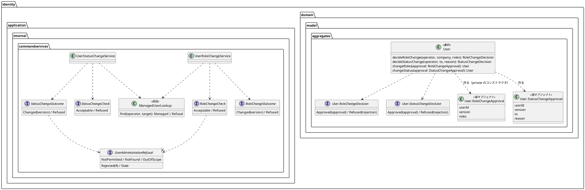

# Bolt 34e 計画 - 利用者の管理のドメインとサービス（振る舞いの変わらない直し）

## 基本情報

| 項目 | 内容 |
| :--- | :--- |
| Bolt | 第 34e 回（W5 の 26 本目） |
| 予定 | W5（2026-11-02 の週。前倒しで着手できる）。作業は約 3.8 時間（承認ゲートの待ち時間と、`check`・uiTest・SonarQube の待ちを除く） |
| 対象 | `identity`（`User` の判定と変更の形、承認の値、役割と利用状態の変更のサービスと結果の型、判定の前半の部品、S-20 の controller の結果の扱い）、テスト（単体・統合・セキュリティの統合、login の共通の補助）、設計文書（domain_model・architecture_backend・test_strategy・release_plan） |
| SP | 0（技術タスク） |
| GitHub | なし（release_plan の W5 の表で扱う技術タスク） |
| 承認ゲート | **ステップごとに止める**（W5 の表の 34e の行。構造。認可の判定に触れる）。スキーマは変えない（表と列を変えない）。層・モジュールの規則に当たったら、`/goal` の下でも止めて諮る（T-125） |
| アプローチ | リファクタリング（インサイドアウト。W5 の表の 34e の行）。開発戦略の表では技術タスクのテストの入口は「検証の手段」だが、検証の手段が既存の単体・統合・セキュリティの統合のテストで、直す対象が内側（集約とサービス）にあるので内側から寄せる（Bolt 31d・33d と同じ扱い）。移す前に足す守りは、承認の取り違えの例外のテスト（ステップ 2）だけ。集約の形 → サービスと結果の型 → controller → テストの補助の順に外へ向かう。本体の振る舞い（URL・応答・文言・監査・判定の順）を変えない。各ステップで `check` の件数が減らず失敗 0、`uiTest` はステップ 5 で前後の件数を比べる |
| マニュアル・デモ | 画面を変えないので、マニュアルの更新とデモの動画はない |
| 前の Bolt | [Bolt 34c 終了報告](bolt_34c_report.md) |

## Bolt ゴール

`User` の役割と利用状態は、判定が通ったときに `User` だけが作れる承認の値を渡さなければ変えられない。役割と利用状態の変更のサービスは、確かめる呼び出しが「受け付けられる・拒否」、変える呼び出しが「変えた・拒否」だけを返し、controller に届かない枝がない。2 つのサービスの認可の判定の前半は 1 つの部品にあり、管理範囲の規則が変わっても 1 か所を直せば済む。セキュリティの統合テストの同じ形のログインの手順は 1 つの補助にある。

### 確かめたい仮説

| # | 仮説 | この Bolt で分かること |
| :--- | :--- | :--- |
| H1 | 承認の値を `User` の入れ子のクラスにしてコンストラクタを private にすれば、`User` の外（同じパッケージを含む）からは作れず、判定を通さずに変える呼び出しはコンパイルできない | 承認の値の作り口が `User` の判定だけであることを、コンパイラが守る（ArchUnit の見張りは要らない） |
| H2 | 結果の型を確かめる呼び出しと変える呼び出しで分ければ、controller の `switch` から届かない枝（`IllegalStateException`）が消え、網羅をコンパイラが確かめる | controller の 2 つの `switch` に `IllegalStateException` の枝がない |
| H3 | 判定の前半を部品にしても、判定の順（操作者 → 利用者 → 企業 → 管理範囲 → 規則 → 版）は変わらない | 既存の単体・統合・セキュリティの統合テストが、件数が減らずに緑のまま |

### 開始準備で確かめたこと（34c の開始準備の調べと 2 つの整合性検証）

- **判定を通さずに呼べる形**: `User.changeRoles(Set<Role>)`（User.java:150-152）と `changeStatus(UserStatus)`（:184-186）は public で、判定（`roleChangeRejection` :121、`statusChangeRejection` :163）は「呼ぶ側が先に通す」約束だけ。本体の呼び出し元は `UserRoleChangeService:97` と `UserStatusChangeService:142` の 2 つ。テストは `UserTest`（32 本。判定の呼び出しが約 25 か所）
- **版の扱い**: 今は判定に使った利用者（`before`）をそのまま変え、`before.version()` を更新の期待する版と監査の新しい版に使う（「版の出どころを 1 つにする」。UserRoleChangeService.java:94-99、Bolt 34 の開発レビュー 5）。古い版は画面の版との比較（:127・:197）と更新が 0 件のとき（:97-98・:142-143）に出る。domain_model.md:1033 は「同時の更新は更新の件数で判定し、ドメインでは判定しない」
- **結果の型**: `RoleChangeResult`・`StatusChangeResult`（各 7 種）は `check` と `change` の両方の戻り値。`check` は `Changed` を、`change` は `Acceptable` を返さないので、controller が届かない枝を例外で埋める（UserAdministrationController.java:203-204・:298-299）。拒否の 5 種（`Rejected`・`Stale`・`NotFound`・`NotPermitted`・`OutOfScope`）はどれも `check` と `change` の両方で起きる（判定は共用）
- **判定の前半**: `UserRoleChangeService:109-131` と `UserStatusChangeService:176-201` で同じ順（`NotPermitted` → 利用者 → 企業 `NotFound` → `OutOfScope`）。役割の変更は `Company` の値を規則に渡し、利用状態の変更は企業があるかだけを見る。照会のサービス（`UserAdministrationQueryService:43-56`）は管理範囲を先に読んでから利用者を読む（応答の時間をそろえる守り。Bolt 34b の開発レビュー）。サービスは `IdentityConfiguration`（別のパッケージ）の `@Bean` で組み立てる。package-private の部品の前例は `TotpProvisioningStarter`（各サービスのコンストラクタの中で作る。TotpEnrollmentService.java:64）
- **login の写し**: 下の「login の補助に寄せるもの」の表。刻みを戻す扱いは 3 通り（TOTP を送る前に戻す: AuthenticationSecurity・ReturnAfterExpiry・SessionTimer、後に戻す: UserStatusChange、戻さない: UserAdministration・SessionRevalidation・RecoveryCodeLogin）。`userIdOf` はリポジトリで探す写しが 4 つあり、`SessionRevalidation:293-300` と `AuthenticationErrorHandling:128` は spy の `users.findByEmail` の呼び出しを確かめる・例外にするので、共通の補助は JDBC で探す必要がある
- **層の規則と SpotBugs**: `LayerArchitectureTest` の `@Service` の規則（:255-266）は名前が `Service` で終わるクラスだけ。範囲外の記録の規則は :327-335。SpotBugs の除外は `application.internal` と `infrastructure` のパッケージだけで、`aggregates` は入っていない（承認の値が `Set<Role>` を持つなら防御の複製が要る）
- **用語集**: `LivingGlossaryConsistencyTest:35-37` は、`@ValueObject` などを付けたクラスに、domain_model の用語集の表の行（`| 日本語 | English |`）と、複数行の Javadoc の最初の語の一致を求める。入れ子の型にも対応している（:101）

## ふりかえりと前の Bolt からの引き継ぎ

| 入力 | 内容 | この Bolt での扱い |
| :--- | :--- | :--- |
| 開始準備の決定（2026-10-17、human:kakimomokuri） | (1) `changeRoles`・`changeStatus` は、判定が通ったときに `User` だけが作れる承認の値を引数に取る。(2) 結果の型は、拒否の種類を共通の型にし、確かめる呼び出しは「受け付けられる・拒否」、変える呼び出しは「変えた・拒否」を返す。(3) 判定の前半の部品は 2 つのコマンドサービスだけに使い、照会のサービスは含めない | 確認ポイント 1〜3 |
| Bolt 34c の Try T-148 | 「〜だけ」と書く不変条件や確認ポイントは、該当するコードを全体で grep してから文言にする | `changeRoles`・`changeStatus`・`RoleChangeResult`・`StatusChangeResult`・`login(`・`currentCode`・`userIdOf`・`sessionOf` を全体で grep した（下の表）。直す前にもう一度 grep する |
| Bolt 34c の Try T-149 | 見張りの規則を足すときは、捕まえる変更・捕まえない変更を書き、変異で確かめる | 承認の値の作り口はコンパイラが守るので規則を足さない（確認ポイント 4）。捕まえない変更（リフレクション、変えた後の利用者に同じ承認をもう一度渡すこと）は Javadoc に書く |
| Bolt 34d の Try T-147 | SonarQube はほかの Gradle の実行が終わってから | ステップ 5。レビューのエージェントにテストを流させない |
| Bolt 34 の既知の課題（bolt_34_report.md:104・105） | `changeRoles` が判定を通さずに呼べる、`RoleChangeResult` の共用 | 決定 (1)(2) |
| Bolt 34d の開発レビュー（bolt_34d_report.md:105 の → 34e） | 判定の前半の写し、login の写し | 決定 (3)、ステップ 4 |
| Bolt 34c の議題 4 | `application.internal` の record は SpotBugs の抑止のパッケージに入るので、compact constructor で防御の複製をとる規約で守る | 新しい record と承認の値は、`Set` を `Set.copyOf`（または `EnumSet.copyOf`）で受け、取り出しも複製にする |
| Bolt 33b〜34c の Try（T-112・T-117・T-131・T-137・T-141） | 見張りの理由の書き方で確かめる、規則ごとに確かめる、控えから戻す、スクリプトの接頭辞、写しの数だけ変異 | 変異は控えから戻す。スクリプトは `b34e_` で始める。判定の順の変異（範囲と規則の入れ替え）で落ちることを確かめる |

## スコープ

### 入れるもの・入れないもの

| 入れる | 入れない（34f・後で） |
| :--- | :--- |
| `User` の判定が承認の値を返す形（役割と利用状態）。`changeRoles`・`changeStatus` は承認の値だけを受ける | 判定の順・拒否の種類・文言の変更 |
| 結果の型を、共通の拒否の型と、確かめる結果・変える結果に分ける | 照会のサービスの結果の型（`UserLookup`） |
| 2 つのコマンドサービスの判定の前半を部品にする | 照会のサービスを同じ部品に通すこと（決定 3） |
| controller の 2 つの `switch` を新しい型に合わせる（届かない枝を消す） | controller の分割、詳細の描画の部品化、利用状態の画面の名前、役割の領域の見出し（34f） |
| セキュリティの統合テストの同じ形の login・`loginWithPassword`・`currentCode`・`userIdOf`・`sessionOf(MvcResult)` の写しを共通の補助にまとめる。使った刻みを戻す扱いを「TOTP を送る前に戻す」にそろえる | 形の違う写し（下の表の「残す」）、`sessionOf(String principal)` の 2 クラス（`PasswordResetCompletionIntegrationTest`・`SpringSessionUserSessionRevokerIntegrationTest`）、`DevLoginPrefillDevProfileTest`、spy の組の変更 |
| 設計文書（domain_model・architecture_backend・test_strategy・release_plan） | 回復コードのログインの監査の失敗の扱いの変更（Bolt 34c の議題 2。後の議題） |

### 設計の約束（Try T-1）

- **承認の値**: `User` の入れ子の `public static final class RoleChangeApproval` と `StatusChangeApproval`。コンストラクタは private で、`User` の判定だけが作る（コンパイラが守る。同じパッケージからも作れない）。持つのは対象の利用者 ID・判定に使った版・変更後の値（役割の集合は `EnumSet.copyOf` で受け、取り出しは `Set.copyOf`）。`@ValueObject` を付け、用語集に「役割の変更の承認」「利用状態の変更の承認」の行を足す（定義には「判定を通った印で、業務の承認の手続き（荷主承認・社内承認）ではない」と書く）。Javadoc は複数行で「役割の変更の承認。」から始める。入れ子なので置き場所は集約の中で、`valueobjects` に置かない理由（作り手を集約に限るため）を Javadoc と architecture_backend に書く
- **判定**: `User.decideRoleChange(operator, company, newRoles)` と `User.decideStatusChange(operator, to, reason)` が、承認か拒否を返す（`User` の入れ子の sealed `RoleChangeDecision`／`StatusChangeDecision`: `Approved(approval)`・`Refused(rejection)`）。今の `roleChangeRejection`・`statusChangeRejection` は新しい判定に置き換えて消す（判定の入口を 1 つにする。判定の順の単体テストは新しい判定で書き直す）
- **変更**: `User.changeRoles(RoleChangeApproval)`・`changeStatus(StatusChangeApproval)`。承認が別の利用者のもの、または判定に使った版と違うものなら `IllegalArgumentException`（取り違えの守り。同時の更新の判定ではなく、古い版は今のままリポジトリの更新の件数で決める）。版の出どころは承認の値の 1 つにし、サービスはリポジトリの期待する版と監査の新しい版を `approval.version()` から取る（今の `before.version()` と同じ値）。画面の版との比較（`Stale`）は判定の後の今の位置のまま（規則 → 版の順を変えない）。変えた後の利用者に同じ承認をもう一度渡すことは捕まえない（`changeRoles` は版を変えない。Javadoc に書く）
- **結果の型**: `application.internal.commandservices` に共通の拒否 `UserAdministrationRefusal<R>`（sealed。record ごとに型の引数を持つ: `NotPermitted<R>()`・`NotFound<R>()`・`OutOfScope<R>()`・`Rejected<R>(R rejection)`・`Stale<R>()`）と、役割の変更の `RoleChangeCheck`（`Acceptable`・`Refused(UserAdministrationRefusal<RoleChangeRejection>)`）と `RoleChangeOutcome`（`Changed(version)`・`Refused(…)`）、利用状態の変更の `StatusChangeCheck`・`StatusChangeOutcome`。`switch` は record のパターン（`Rejected(var r)`、`Stale<?> _` など）で書き、raw の型を使わない（SonarQube の S3740）。record は compact constructor で `null` を拒み、`Set` を持つなら複製する
- **判定の前半**: `commandservices` の package-private の final class `ManagedUserLookup`。各サービスが今のコンストラクタの引数（`UserRepository`・`CompanyRepository`・`UserAssignmentRepository`）から作る（組み立ての `@Bean` は変えない。`@Service` は付けない。名前が `Service` で終わらないので `@Service` の規則に当たらない）。`find(operator, target)` は、管理する利用者と所属企業（`Managed(User, Company)`）か、型の引数のない拒否（`Refusal`: `NOT_PERMITTED`・`NOT_FOUND`・`OUT_OF_SCOPE`）を返し、各サービスが共通の拒否の型に写す。読み出しの順（操作者 → 利用者 → 企業 → 管理範囲）は今と同じ
- **login の補助**: test/identity/ に `IdentityLogins`（spy を持たない。`MockMvc`・`JdbcTemplate`・`TotpCredentialRepository`・`TotpCodeGenerator`・`Clock` を受ける）。`login(email)`（password → TOTP。TOTP を送る前に使った刻みを `AuthenticationFactorFixtures.resetTotpStep` で戻す。Bolt 31 の確認ポイント 7 と多数派の形）・`loginWithPassword(email)`・`currentCode(email)`・`userIdOf(email)`（JDBC で探す。spy の `users` に触れない）・`sessionOf(MvcResult)`。TOTP の後の確かめは `error` と `expired` の両方を見る形にそろえる
- **新しいファイル**: 共通の拒否の型と確かめる・変える結果の型（4〜5 ファイル）、`ManagedUserLookup`、`IdentityLogins`。承認の値と判定の結果は `User` の入れ子なので新しいファイルにならない。新しい型の単体テストは既存のテスト（`UserTest`・各 `*ServiceTest`）に足す

### login の補助に寄せるもの（T-148 で grep した結果）

| クラス | 寄せる | 残す（形が違う） |
| :--- | :--- | :--- |
| `AuthenticationSecurityIntegrationTest` | `login`・`loginWithPassword(email)`・`currentCode`・`sessionOf` | `loginWithPassword(email, password)`・`submitTotp`（再利用の拒否のテストが使う）、`userIdOf`（リポジトリで探し `strip` する） |
| `SessionRevalidationSecurityIntegrationTest` | `login(email)`・`currentCode`・`userIdOf`・`sessionOf` | 今の Cookie を受ける `login` の overload |
| `UserAdministrationSecurityIntegrationTest` | `login`・`currentCode`・`userIdOf`・`sessionOf` | — |
| `UserStatusChangeSecurityIntegrationTest` | `login`・`currentCode`・`userIdOf`・`sessionOf` | — |
| `ReturnAfterExpirySecurityIntegrationTest` | `currentCode` | 今の Cookie を引き継ぐ login（`sessionOr`） |
| `SessionTimerSecurityIntegrationTest` | — | 引数のない login（フィールドの email） |
| `LoginLockSecurityIntegrationTest`・`AuthenticationErrorHandlingIntegrationTest`・`TotpEnrollmentSecurityIntegrationTest` | `loginWithPassword`（Cookie の null を確かめる形にそろえる） | `userIdOf`（リポジトリで探すもの） |
| `RecoveryCodeLoginSecurityIntegrationTest` | `loginWithPassword`・`currentCode` | `loginWithTotp`（`redirectedUrl("/")` で確かめる）、`nextStep()` |

## 設計（この Bolt の範囲）

4 図のうち、ドメインモデル図を置く。状態遷移図は状態を変えないので、ER 図は表と列を変えないので、画面遷移図は画面と URL を変えないので省く。

### ドメインモデル図（この Bolt で変える型）

注（設計への反映が必要。ステップ 1 で直す行）:

- domain_model.md: 用語集の表の User の行（:175。判定と変更の形）、承認の値 2 つの行（判定の結果の型は承認の値の行で述べる）、`UserRoleChangeService`・`UserStatusChangeService` の行（:222・:223。新しい結果の型。結果の型 5 つは今の前例どおりサービスの行で述べ、独立の行は作らない）、`ManagedUserLookup` の行（`TotpProvisioningStarter` の行の前例）、:1033（Bolt 34 の段落。承認の版は取り違えの守りで、同時の更新の判定ではない）、:1035（Bolt 34b の段落の `RoleChangeResult.OutOfScope`）、:1037 付近の「`changeRoles`・`changeStatus` … Bolt 34e で直す」を実現の記述に、Bolt 34d の段落の判定と変更の書き方
- architecture_backend.md: S-20 の controller とサービスの記述（結果の型、判定の前半の部品）、:311・:313 の置き場所の段落に、承認の値と判定の結果を `User` の入れ子に置く理由（作り手を集約に限る）
- test_strategy.md: :327・:329 の判定と変更の名前（`decide…` と承認の値）、セキュリティの統合テストのログインの補助（`IdentityLogins`）
- release_plan.md: 34e の行の「判定の結果を引数に取る形」を決定 (1) の「承認の値を引数に取る形」に、計画へのリンク、チェックリスト、W5 の状態の行・週の表・更新履歴

## ステップ計画

状態の記号: `[ ]` 未着手、`[-]` 進行中、`[?]` 承認待ち、`[x]` 完了。各ステップの終わりに `check` が緑で件数が減っていないことを確かめ、push してアプリの CI と MkDocs の配備を確かめる（T-26、T-126）。コミットは pathspec で作る（T-110）。

- [x] **1. 設計文書** 【承認ゲート: 設計文書】
  - 上の注の行を直す。完了の判定: `okf:check` ERROR 0、`documentationTest` 緑
- [x] **2. 集約の判定と承認の値** 【承認ゲート: 構造】
  - 先に、承認が別の利用者・別の版なら例外になるテストを書く（Red）。承認の値と判定の結果の型、`changeRoles`・`changeStatus` の引数を承認の値に、`roleChangeRejection`・`statusChangeRejection` を `decide…` に置き換える。`UserTest` を新しい形に（判定の順の境界のテストは中身を変えずに通す）。サービスの呼び出し元を合わせ、版を `approval.version()` から取る（この時点では結果の型は変えない）
- [x] **3. 結果の型と判定の前半の部品** 【承認ゲート: 構造・認可の判定】
  - 共通の拒否の型と確かめる・変える結果の型、`ManagedUserLookup`。2 つのサービスと controller の 2 つの `switch`（届かない枝を消す）。直すテスト: `UserRoleChangeServiceTest`・`UserStatusChangeServiceTest`・`UserRoleChangeIntegrationTest`・`UserStatusChangeIntegrationTest`。巻き戻しのテストと `UserStatusErrorMessageTest` は結果の型を参照しないので、コンパイルが通ることだけを確かめる。判定の順の変異（範囲と規則の入れ替え）で落ちることを確かめる（控えから戻す）
- [x] **4. login の共通の補助** 【承認ゲート: 構造】
  - `IdentityLogins` と、上の表の「寄せる」の置き換え。件数と失敗 0 を前後で比べる。刻みを戻す扱いを変えるクラス（UserAdministration・SessionRevalidation・UserStatusChange）で、再利用や刻みの状態を確かめるテストが補助に頼っていないことを確かめる
- [x] **5. uiTest と SonarQube と開発レビューと終了報告** 【承認ゲート: 終了報告】
  - `uiTest`（件数を前後で比べる）、SonarQube（ほかの Gradle の後。T-147）。開発レビュー（アーキテクト、テスター。読むだけ）。`bolt_34e_report.md`、release_plan、開発の索引

### 時間の配分と打ち切り

| # | 目安 | 打ち切り |
| :--- | :--- | :--- |
| 1 | 25 分 | — |
| 2 | 50 分 | 入れ子の承認の値が用語集の規則や JIG の読みで扱えないと見えたら止めて諮る |
| 3 | 70 分 | 層・モジュールの規則に当たったら止めて諮る |
| 4 | 50 分 | 表の「寄せる」の半分以上が形の違いで寄せられないと見えたら止めて諮る |
| 5 | 35 分（uiTest と SonarQube の待ちを除く） | — |

合計 230 分（約 3.8 時間。`check` の待ちを除く）。ステップ 3 を終えた時点で 2.5 時間を超えていたら止めて諮る（候補: ステップ 4 の login の補助を 34f に送る）。

## 確認ポイント（計画の承認の場でまとめて確認する。Try T-6）

| # | 確認すること | ステップ | 推奨・決定 |
| :--- | :--- | :--- | :--- |
| 1 | **判定を通さずに呼べない形** | 2 | 決定済み（1）: 承認の値を引数に取る |
| 2 | **結果の型** | 3 | 決定済み（2）: 共通の拒否の型と、確かめる結果・変える結果に分ける |
| 3 | **判定の前半の部品の範囲** | 3 | 決定済み（3）: 2 つのコマンドサービスだけ |
| 4 | **承認の値の置き場所と作り口** | 2 | `User` の入れ子の final class にし、コンストラクタを private にする（コンパイラが作り手を `User` に限る。ArchUnit の見張りは足さない）。`valueobjects` に置かない（第 3 章のガイドラインでは値オブジェクトは `valueobjects` だが、作り手を集約に限るため集約の中に置く。理由を Javadoc と architecture_backend に書く）。代わりの案: `aggregates` の別のクラスにして package-private のコンストラクタと ArchUnit で見張る（同じパッケージのテストからの生成は見張れない）。決定済み（計画の承認） |
| 5 | **型の名前** | 2・3 | 承認の値は `RoleChangeApproval`・`StatusChangeApproval`（用語集の名前は「役割の変更の承認」「利用状態の変更の承認」）。判定の結果は `RoleChangeDecision`・`StatusChangeDecision`。共通の拒否は `UserAdministrationRefusal<R>`、確かめる・変える結果は `RoleChangeCheck`・`RoleChangeOutcome`・`StatusChangeCheck`・`StatusChangeOutcome`。決定済み（計画の承認） |
| 6 | **版の出どころ** | 2 | 承認の値の版の 1 つにし、リポジトリの期待する版と監査の新しい版を `approval.version()` から取る。承認の版の不一致の例外は取り違えの守りで、同時の更新の判定はリポジトリの件数のまま。決定済み（計画の承認） |
| 7 | **今の判定のメソッド** | 2 | `roleChangeRejection`・`statusChangeRejection` は消し、新しい判定に置き換える。決定済み（計画の承認） |
| 8 | **login の補助に寄せる範囲と刻み** | 4 | 上の表の「寄せる」だけ。使った刻みは TOTP を送る前に戻す形にそろえる。`userIdOf` は JDBC で探す。決定済み（計画の承認） |
| 9 | **新しいファイル** | 3・4 | 設計の約束の「新しいファイル」のとおり。決定済み（計画の承認） |
| 10 | **開発レビュー** | 5 | アーキテクト、テスター（読むだけ）。決定済み（計画の承認） |
| 11 | **アプローチと承認ゲートと時間** | 全体 | リファクタリング（インサイドアウト）。ステップごとに止める（構造・認可の判定）。約 3.8 時間。決定済み（計画の承認） |

## 完了条件

- [x] `changeRoles`・`changeStatus` は承認の値だけを受け、承認の値は `User` の判定だけが作る（コンストラクタが private）
- [x] 役割と利用状態の変更のサービスの確かめる・変える呼び出しが、それぞれの結果の型だけを返し、controller に届かない枝がない
- [x] 2 つのサービスの判定の前半が 1 つの部品にあり、判定の順は変わっていない
- [x] セキュリティの統合テストの同じ形の login の写しが共通の補助にまとまっている
- [x] `check` と `uiTest` が緑で、件数が減っていない（足したテストの分だけ増える）。push してアプリの CI と MkDocs の配備を確かめた。SonarQube の Quality Gate が PASS、`okf:check` ERROR 0
- [x] 開発レビュー、終了報告

## 更新履歴

| 日付 | 更新内容 | 更新者 |
| :--- | :--- | :--- |
| 2026-10-17 | 初版作成（承認待ち）。human:kakimomokuri の決定（承認の値を引数に取る、結果の型を拒否と受付に分ける、判定の前半の部品は 2 つのコマンドサービスだけ）を反映した | anthropic/claude-opus-5-5 |
| 2026-10-17 | 詳細整合性検証（15 件）と横断整合性検証（16 件）の指摘を反映した。承認の値を `User` の入れ子にして private のコンストラクタにする（ArchUnit の見張りと置き場所の例外を要らなくした。確認ポイント 4）、版の出どころ（確認ポイント 6）、ジェネリクスの書き方と部品の拒否の写し方、`ManagedUserLookup` の作り方、login の補助に寄せるものの表と刻みを戻す時点と `userIdOf` の探し方、防御の複製、アプローチの理由、注の行（domain_model:1033・1035、architecture_backend:311・313、test_strategy:327・329、release_plan の 34e の行）、行番号、H1・H3 の言い方 | anthropic/claude-opus-5-5 |
| 2026-10-17 | 計画を承認した。確認ポイント 4〜11 を推奨のとおりに決めた。`/goal` の下で、ステップごとの承認ゲートでは止めずに進め、層・モジュールの規則と打ち切りの条件に当たったときだけ止めて諮る | anthropic/claude-opus-5-5、承認 human:kakimomokuri |
| 2026-10-18 | ステップ 5 を終え、[終了報告](bolt_34e_report.md)を作った（承認待ち）。打ち切りの条件には当たらなかった | anthropic/claude-opus-5-5 |

## 関連ドキュメント

- [リリース計画](release_plan.md)（W5）
- [Bolt 34c 終了報告](bolt_34c_report.md)、[Bolt 34d 終了報告](bolt_34d_report.md)、[Bolt 34 終了報告](bolt_34_report.md)
- [ドメインモデル](../../design/cargo-tracker/domain_model.md)、[バックエンドのアーキテクチャ](../../design/cargo-tracker/architecture_backend.md)、[テスト戦略](../../design/cargo-tracker/test_strategy.md)
