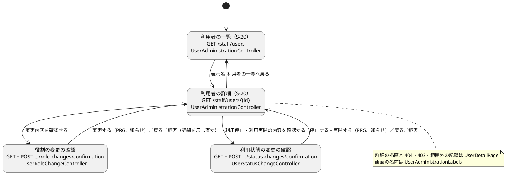

# Bolt 34f 計画 - S-20 の画面の構造（振る舞いの変わらない直し）

## 基本情報

| 項目 | 内容 |
| :--- | :--- |
| Bolt | 第 34f 回（W5 の 27 本目） |
| 予定 | W5（2026-11-02 の週。前倒しで着手できる）。作業は約 4.5 時間（承認ゲートの待ち時間と、`check`・uiTest・SonarQube の待ちを除く） |
| 対象 | `identity.interfaces.web`（S-20 の controller の分割、詳細の描画と拒否の扱いの部品、画面の名前の部品）、S-20 のテンプレート（一覧・詳細）、`identity.application.internal.commandservices`（2 つのサービスの判定の書き方）、テスト（controller の WebMvc のテスト、セキュリティの統合テストの定数の写し、画面の層のテスト）、設計文書（ui_design・architecture_backend・test_strategy・release_plan）、マニュアル 11 章 |
| SP | 0（技術タスク） |
| GitHub | なし（release_plan の W5 の表で扱う技術タスク） |
| 承認ゲート | **ステップごとに止める**（W5 の表の 34f の行。構造・画面。ステップ 5 は認可の判定のコードに触れる）。スキーマは変えない。層・モジュールの規則に当たったら、`/goal` の下でも止めて諮る（T-125） |
| アプローチ | リファクタリング（アウトサイドイン。W5 の表の 34f の行）。開発戦略の表では技術タスクのテストの入口は「検証の手段」だが、検証の手段が既存の画面の層のテストと先に足す WebMvc のテストで、直す対象が画面の構造なので、外側の応答の守りから入る（Bolt 31d・33d・34e と同じく、表から外れる理由をここに書く）。外側（controller の応答）に WebMvc のテストの守りを先に足し、その守りの下で画面の名前 → controller の分割 → サービスの書き方の順に内へ向かう。本体の振る舞い（URL・応答の状態・文言・監査・範囲外の記録・判定の順）を変えない。画面の見た目を変えるのは、役割の領域の見出しと legend の 2 点だけ（ステップ 6） |
| マニュアル・デモ | マニュアル 11.2 の説明と、詳細を撮るキャプチャ 2 枚（`11-user-detail.png`・`11-role-change-rejected.png`）を撮り直す（ステップ 6。memory の「Bolt の完了条件にマニュアル」）。デモの動画は作らない（操作の流れが変わらない） |
| 前の Bolt | [Bolt 34e 終了報告](bolt_34e_report.md) |

## Bolt ゴール

S-20 の画面は、一覧と詳細、役割の変更、利用状態の変更の 3 つの controller に分かれ、詳細の描画と、404・403・範囲外の試行の記録の扱いは 1 つの部品にある。W6 の 3 つ目の操作（利用者の登録・TOTP の解除）は、4 つ目の controller として既存の controller を太らせずに足せる。利用状態・停止の理由・企業の種類の画面の名前は 1 か所にあり、controller の拒否の枝（確定の範囲外は記録して 404、確かめる範囲外は記録せず 404、権限なしは 403）は WebMvc のテストが守る。詳細の役割の領域は、利用状態の領域と同じ形の見出しを持つ。

### 確かめたい仮説

| # | 仮説 | この Bolt で分かること |
| :--- | :--- | :--- |
| H1 | 詳細の描画と拒否の扱いを部品にすれば、3 つの controller はそれぞれ 150 行前後に収まり、W6 の操作を足すときに既存の controller を開かずに済む | 分けた後の各 controller の行数と、部品の公開の口の数 |
| H2 | WebMvc のテストを分割の前に足せば、分割で範囲外の記録の書き方を取り違えても落ちる | 変異（確定の範囲外の記録を外す、確かめる範囲外で記録する）で WebMvc のテストが落ちる |
| H3 | 画面の名前を画面の層の部品に寄せても、一覧・詳細・確認の表示は変わらない | 画面の層のテスト（uiTest）が件数を減らさずに緑 |

### 開始準備で確かめたこと

- **controller の大きさ**: `UserAdministrationController` は 629 行。ハンドラーは 6 つ（一覧・詳細の GET、役割の変更の確認の GET・確定の POST、利用状態の変更の確認の GET・確定の POST）。拒否の画面（`showRefusal` :167-212、`showStatusRefusal` :260-307）は同じ形の 5 つの枝の写し。詳細の描画（`showDetail` :326-352）と詳細の読み出し（`detail` :391-404。範囲外は確定のときだけ記録する）を役割と利用状態の両方が使う
- **範囲外の記録の規則**: `LayerArchitectureTest` の `範囲外の試行の記録は画面の層からだけ呼ぶ`（:328-335）は `identity.interfaces.web` と `identity.infrastructure.config` のパッケージを許す。controller を分けても同じパッケージなので規則に当たらない
- **画面の名前の写し**: 利用状態の名前は `UserAdministrationController.statusName`（:492-494）、`list.html:30`、`detail.html:29` の 3 か所（T-148 で `利用中` を全体で grep した。ほかはマイグレーションの注釈と enum の Javadoc）。停止の理由（`reasonName` :483）と企業の種類（`companyKindName` :497）は controller の 1 か所だけ。画面の層の名前の部品の前例は `quotation.interfaces.web.TransportRequestLabels`（package-private の final class と static のメソッド）
- **役割の領域の見出し**: 利用状態の領域は `<section aria-labelledby="status-title">` と `<h2 class="h5">利用状態</h2>`（detail.html:59-60）。役割の領域は見出しがなく、fieldset の `<legend class="h5">役割</legend>`（:41）だけ。自分の詳細と荷受人の企業の利用者の案内（:33-35）は領域の外にある。UI 設計 S-20 のワイヤーフレームは「役割」を見出しとして示す。画面の層のテストは h1 だけを見出しで探し、legend を名前で探していない（`UserAdministrationUiSteps`・`UserStatusUiSteps` を grep した）
- **WebMvc のテスト**: S-20 の controller の WebMvc のテストはない（文言の単体テスト `UserStatusErrorMessageTest` だけ）。前例は `KpiObservationControllerTest`（`@WebMvcTest(controllers = …)`・`@AutoConfigureMockMvc(addFilters = false)`・`@MockitoBean`）と `RoutingCaseControllerTest`（`@WithAuthenticatedActor`）
- **定数の写し**: `identity.infrastructure.security` の 10 クラスに写しがある（`PASSWORD` 10 クラス、`TOTP_URL` 8 クラス、`SESSION_COOKIE` 7 クラス。T-148 で grep した）。`IdentityLogins` に public の定数がある。範囲の外の写し（`DevLoginPrefillDevProfileTest` の `"SESSION"`、画面の層のテストの `UiUsers.PASSWORD`）は寄せない
- **送られた値の解釈と案内の文言の共有**: `parseRoles`（詳細の GET :124、役割の確認・確定 :137・:155）と `parseReason`（詳細の GET :126、`StatusRequest.parse` :566）は、分けた後に 2 つの controller が使う。案内の `SELF_STATUS_NOTE`・`OVERSIGHT_STATUS_NOTE` は詳細の描画（`statusNote` :465-473）と利用状態の拒否の文言（:621-622）の両方が使う
- **範囲外の記録の書き手の記述**: domain_model.md:233・:1038・:1040、architecture_backend.md:311-313、`AdministrationScopeDenialService` の Javadoc（:15）、controller の注釈（:153・:244）が「controller が書く」と言う。分けた後に書くのは `UserDetailPage`
- **判定の書き方**: 2 つのサービスの `judge` は、`switch` の文で局所変数に代入してから次の判定に進む（`UserRoleChangeService:112-132`・`UserStatusChangeService:176-200`）
- **WebMvc のスライス**: `@WebMvcTest(controllers = …)` はただの `@Component` を読み込まないので、部品は `@Import` で本物を読む（モックにすると範囲外の記録の守りが消える）。操作者は `@WithAuthenticatedActor(Role.SYSTEM_ADMIN)`（`TestActors.STAFF_USER`。引数の解決は `IdentityWebConfiguration` がスライスにも載せる）
- **画面の層のテストとキャプチャ**: 見出しは h1 だけを探し、legend にも見出しの構造にも依存しない。`11-role-change-rejected.png` も詳細の画面を丸ごと撮る（`manual_screenshots.feature:153-156`。マニュアル 11.2 の :102）

## ふりかえりと前の Bolt からの引き継ぎ

| 入力 | 内容 | この Bolt での扱い |
| :--- | :--- | :--- |
| 開始準備の決定（2026-10-18、human:kakimomokuri） | (1) controller は操作ごとに 3 つに分け、詳細の描画と拒否の扱いを package-private の部品 1 つに寄せる。(2) 画面の名前（利用状態・停止の理由・企業の種類）は画面の層の部品に寄せ、ドメインに画面の言葉を入れない。(3) 役割の領域に h2「役割」の section を付け、fieldset の legend を「付ける役割」にする | 確認ポイント 1〜3 |
| Bolt 34e の開発レビュー（bolt_34e_report.md:74 の → 34f） | 各テストのクラスの `PASSWORD`・`TOTP_URL` の写し、controller の WebMvc のテスト（確定の範囲外は記録して 404、確かめる範囲外は記録せず 404、`NotPermitted` は 403）、2 つのサービスの `Judgement` と局所変数への代入の書き方 | ステップ 2・5 |
| Bolt 34d の開発レビュー 10（bolt_34d_report.md:79・:105 の → 34f） | controller の分割と詳細の描画の部品化（W6 の 3 つ目の操作の前に）、`DetailForm` の引数、利用状態の名前の写し、役割の領域の見出し | ステップ 3・4・6 |
| Bolt 34d の Try T-146 | 状態を戻せる操作を足す計画では、往復の後に残るものを確認ポイントに挙げる | 戻せる操作を足さない。当たらない |
| Bolt 34e の Try T-150 | 判定を通さずに呼べない形を作るときは、承認と判定した対象の結び付きを確認ポイントに挙げる | この Bolt は判定の形を変えない（サービスの書き方だけ）。当たらない |
| Bolt 34e の Try T-151 | テストの件数は `check` が終わった後に数え、同じ数え方で比べる | 各ステップで `check` の後に数える。サブエージェントにもそう指示する |
| Bolt 34c の Try T-148 | 「〜だけ」と書く前に全体を grep する | `利用中`・`statusName`・`reasonName`・`companyKindName`・`UserAdministrationController`・`PASSWORD = ` を grep した（上）。直す前にもう一度 grep する |
| Bolt 34c の Try T-149 | 見張りの規則は捕まえる変更を書き、変異で確かめる | 規則は足さない。WebMvc のテストを変異で確かめる（H2） |
| Bolt 34d の Try T-147 | SonarQube はほかの Gradle の実行が終わってから | ステップ 7。レビューのエージェントにテストを流させない |
| Bolt 33b〜34c の Try（T-112・T-117・T-131・T-137・T-141） | 控えから戻す、スクリプトの接頭辞 | 変異は控えから戻す。スクリプトは `b34f_` で始める |
| `manualScreenshots`・`demoVideo` の扱い（Bolt 34d） | 撮り直すと関係のない画像と動画も変わる | この Bolt の画像（`11-user-detail.png`・`11-role-change-rejected.png`）以外の差分は戻す |

## スコープ

### 入れるもの・入れないもの

| 入れる | 入れない（後で） |
| :--- | :--- |
| S-20 の controller を 3 つに分け、詳細の描画と拒否の扱いを部品にする | URL・応答・文言・判定の順の変更 |
| 画面の名前（利用状態・停止の理由・企業の種類）の部品と、一覧・詳細のテンプレートの写しの置き換え | 役割の表示名（`Role.displayName()`。共有カーネルにあり、今の形のまま） |
| controller の WebMvc のテスト（拒否の 5 つの枝と範囲外の記録） | 詳細に停止の理由・停止した人・時刻を示すこと（Bolt 34d の既知の課題） |
| 役割の領域の h2 と legend、UI 設計とマニュアル 11.2 とキャプチャ | 一覧のキャプチャに停止の例を入れること（Bolt 34d の既知の課題） |
| 2 つのサービスの判定の書き方（`switch` の式に） | 判定の前半の部品（`ManagedUserLookup`）の形 |
| セキュリティの統合テストの `PASSWORD`・`SESSION_COOKIE`・`TOTP_URL` の写しを `IdentityLogins` の定数に寄せる | 形の違う login の写し（Bolt 34e の計画の「残す」）、`identity.infrastructure.security` の外の写し |

### 設計の約束（Try T-1）

- **controller の分け方**: `identity.interfaces.web` に次の 3 つ。URL の定数は今のまま（`USERS_URL` は一覧・詳細の controller、確認の URL はそれぞれの controller）
  - `UserAdministrationController`: 一覧と詳細の GET
  - `UserRoleChangeController`: 役割の変更の確認の GET・確定の POST と完了の知らせ
  - `UserStatusChangeController`: 利用状態の変更の確認の GET・確定の POST と完了の知らせ（確定は値の解釈を範囲の判定の後にする今の順のまま）
- **部品**: package-private の final class `UserDetailPage`（`@Component`。controller が受ける。package-private の bean は本体で初めて。`@Bean` にしないのは合成ルートの `@Bean` の戻り値の型の規則（AT-07）に当たるため）。公開の口は 3 つ: `find(id, actor, recordDenial)`（今の `detail`。いなければ 404、範囲外は確定のときだけ記録して 404、システム管理者でなければ 403）、`render(DetailForm, actor, model)`（今の `showDetail`）、`refuse(id, actor, refusal, change, onRejected)` の形で拒否の共通の枝（`Stale` は最新の内容で詳細を示し直す、`NotFound`・`OutOfScope`・`NotPermitted`）を 1 か所にし、`Rejected` だけを各 controller が描く。`DetailForm` は役割の誤りと利用状態の誤りを 1 つの「誤り」と要約の種類（役割・利用状態）にまとめて引数を減らす（Bolt 34d の開発レビュー 10）。形はステップ 4 で決め、分けた後の公開の口が 3 つを超えたら止めて諮る
- **文言と誤りの型**: 知らせの定数と拒否の文言は、使う側に合わせて置き直す（役割の文言は役割の controller、利用状態の文言は利用状態の controller）。詳細の描画が使うもの（要約、古い版の文言、自分と監督の役割の案内 `SELF_STATUS_NOTE`・`OVERSIGHT_STATUS_NOTE`、`ErrorMessage`・`ErrorSummary`）は部品に置き、利用状態の controller は部品の案内を参照する（部品が controller に依存しない向き）。`UserStatusErrorMessageTest` は置き場所に合わせて参照を直す（中身は変えない）
- **送られた値の解釈**: package-private の final class `UserAdministrationParameters`（static の `userId`・`roles`・`suspensionReason`・`version`。知らない値は 400、ID の誤りは 404 の今の扱いのまま）。役割・利用状態の controller と一覧・詳細の controller が使う。部品の公開の口に数えない（状態を持たない関数）
- **画面の名前の部品**: package-private の final class `UserAdministrationLabels`（`TransportRequestLabels` の前例。static のメソッド `status(UserStatus)`・`suspensionReason(SuspensionReason)`・`companyKind(CompanyKind)`・`roles(Set<Role>)`（今の `names`））。package-private の static のメソッドはテンプレートの `T(...)` から見えないので、前例（`TransportRequestController.java:145-146`）と同じく controller がモデルに名前を渡す（詳細は `statusName`、一覧は利用状態から名前への表 `statusNames`）
- **役割の領域**: `<section class="mt-4" aria-labelledby="roles-title">` と `<h2 id="roles-title" class="h5">役割</h2>` の中に、自分の詳細と荷受人の企業の案内と役割のフォームを入れる。fieldset の legend は「付ける役割」（`class="h6"`。停止の理由の legend と同じ）。エラー要約のリンク先（`#roles`）は fieldset のまま
- **判定の書き方**: `judge` を段ごとの小さな private のメソッドに分け、各段を `switch` の式で返す（`return switch (lookup.find(…)) { case Refusal r -> …; case Managed m -> decide(m, …); }`）。局所変数への代入と `switch` の文をなくす。判定の順と結果は変えない
- **SpotBugs・JIG・用語集**: SpotBugs の除外は足さない（指摘が出たら止めて諮る）。用語集のテスト（`LivingGlossaryConsistencyTest`）は `@AggregateRoot`・`@Entity`・`@ValueObject` だけを見るので対象外
- **新しいファイル**: `UserRoleChangeController`、`UserStatusChangeController`、`UserDetailPage`、`UserAdministrationLabels`、`UserAdministrationParameters`、WebMvc のテスト（`UserAdministrationControllerTest` ほか分けた controller ごと。分ける前の 1 クラスで書き、ステップ 4 で分ける）、名前の単体テスト `UserAdministrationLabelsTest`

## 設計（この Bolt の範囲）

4 図のうち、画面遷移図を置く（画面と URL は変えず、受け持つ controller を示す）。ドメインモデル図はドメインの型を変えないので、状態遷移図は状態を変えないので、ER 図は表と列を変えないので省く。

### 画面遷移図（受け持つ controller）

注（設計への反映が必要。ステップ 1 で直す行）:

- ui_design.md: S-20 の詳細のワイヤーフレーム（:1107 の `<b>役割` の下に「付ける役割」の欄）、:1136 の「項目は「役割」」を「項目は「付ける役割」」に、:181 の画面一覧の詳細の行に役割の領域の見出し、利用状態の領域と同じ形であることを本文に
- architecture_backend.md: :311-313 の S-20 の controller の記述（3 つの controller と `UserDetailPage`・`UserAdministrationLabels`・`UserAdministrationParameters`。範囲外の試行の記録の書き手は `UserDetailPage` の 1 か所。W6 の操作は 4 つ目の controller として足す）
- domain_model.md: :233・:1038・:1040 の範囲外の記録の書き手（「S-20 の controller」を「S-20 の画面の層（詳細の部品）」に）
- test_strategy.md: S-20 の controller の WebMvc のテスト（拒否の枝と範囲外の記録を controller の単体で守る。認証・認可・CSRF はセキュリティの統合テスト）。:74 の Web の行の「URL ごとの認可」を前例（`addFilters = false`）に合わせて直す
- release_plan.md: 34f の行に開始準備の決定 (1)〜(3) と計画へのリンク、チェックリスト、W5 の状態の行、更新履歴

## ステップ計画

状態の記号: `[ ]` 未着手、`[-]` 進行中、`[?]` 承認待ち、`[x]` 完了。各ステップの終わりに `check` が緑で件数が減っていないことを確かめ（T-151）、push してアプリの CI と MkDocs の配備を確かめる（T-26、T-126）。コミットは pathspec で作る（T-110）。

- [ ] **1. 設計文書** 【承認ゲート: 設計文書】
  - 上の注の行を直す。完了の判定: `okf:check` ERROR 0、`documentationTest` 緑
- [ ] **2. controller の WebMvc のテスト（守り）** 【承認ゲート: 構造】
  - 今の `UserAdministrationController` に対して、サービスを `@MockitoBean` にした WebMvc のテストを足す。役割と利用状態のそれぞれで: 確定の範囲外は記録して 404（詳細の読み出しの範囲外と、判定の範囲外の 2 つ）、確かめる範囲外は記録せず 404、`NotPermitted` は 403、`NotFound` は 404、`Stale` は最新の版で詳細を示し直す、`Rejected` は選んだまま文言を示す、変えたら知らせとともに詳細へ移す。今のコードで緑になる（特性のテスト）ことを確かめ、変異（確定の範囲外の記録を外す、確かめる範囲外で記録する）で落ちることを確かめる（控えから戻す）
- [ ] **3. 画面の名前の部品** 【承認ゲート: 構造】
  - `UserAdministrationLabels` と、一覧・詳細のテンプレートの写しの置き換え。名前の単体テスト `UserAdministrationLabelsTest` を `UserStatusErrorMessageTest` の形（`@CsvSource` で enum と名前を並べる）で新しく足す。表示は変えない
- [ ] **4. controller の分割と詳細の描画の部品** 【承認ゲート: 構造】
  - `UserDetailPage`・`UserAdministrationParameters` と 3 つの controller。ステップ 2 の WebMvc のテストを controller ごとに分け、中身を変えずに通す（各テストは `@Import(UserDetailPage.class)` で部品を本物にし、照会・変更・記録のサービスだけを `@MockitoBean` にする）。`AdministrationScopeDenialService` の Javadoc と controller の注釈の「書き手」を直す。`UserStatusErrorMessageTest` の参照を直す。範囲外の記録の規則（`LayerArchitectureTest`）が緑のままであることを確かめる
- [ ] **5. サービスの判定の書き方とテストの定数** 【承認ゲート: 構造・認可の判定のコード】
  - 2 つのサービスの `judge` を `switch` の式に。判定の順の変異（範囲と規則の入れ替え）で既存のテストが落ちることを確かめる（控えから戻す）。10 クラスの `PASSWORD`・`SESSION_COOKIE`・`TOTP_URL` の写しを `IdentityLogins` の定数に寄せる（件数を前後で比べる）
- [ ] **6. 役割の領域の見出しとマニュアル** 【承認ゲート: 画面】
  - 先に、詳細に見出し「役割」（h2）があり、役割の欄の名前が「付ける役割」であることを確かめる画面の層のテストを足す（Red）。テンプレートを直す。マニュアル 11.2 の説明（③ の項目、操作手順の「役割」の欄の名前、:102 付近の誤りの説明）と `11-user-detail.png`・`11-role-change-rejected.png` を撮り直す（`manualScreenshots`。ほかの画像の差分は戻す）
- [ ] **7. uiTest と SonarQube と開発レビューと終了報告** 【承認ゲート: 終了報告】
  - `uiTest`（件数を前後で比べる）、SonarQube（ほかの Gradle の後。T-147）。開発レビュー（アーキテクト、テスター、インタラクションデザイナー。読むだけ）。`bolt_34f_report.md`、release_plan、開発の索引

### 時間の配分と打ち切り

| # | 目安 | 打ち切り |
| :--- | :--- | :--- |
| 1 | 20 分 | — |
| 2 | 50 分 | WebMvc のテストで `AuthenticatedActor` を渡せない、または範囲外の記録を controller の単体で確かめられないと見えたら止めて諮る |
| 3 | 30 分 | — |
| 4 | 70 分 | 層・モジュールの規則、または SpotBugs に当たったら止めて諮る。部品の公開の口が 3 つを超えたら止めて諮る |
| 5 | 35 分 | — |
| 6 | 35 分 | — |
| 7 | 30 分（uiTest と SonarQube の待ちを除く） | — |

合計 270 分（約 4.5 時間。`check` の待ちを除く）。目安の 4 時間を超えるが、半日は超えない。ステップ 5・6（各 35 分）はどちらも 34f に送られた課題で、分けると Bolt の準備と終わりの手間（整合性検証・uiTest・SonarQube・報告）が増えるので分けない。ステップ 4 を終えた時点で 3.0 時間を超えていたら止めて諮る（候補: ステップ 5 を後の Bolt に送る）。

## 確認ポイント（計画の承認の場でまとめて確認する。Try T-6）

| # | 確認すること | ステップ | 推奨・決定 |
| :--- | :--- | :--- | :--- |
| 1 | **controller の分け方** | 4 | 決定済み（1）: 操作ごとに 3 つと、詳細の描画と拒否の扱いの部品 1 つ |
| 2 | **画面の名前の置き場所** | 3 | 決定済み（2）: 画面の層の部品 |
| 3 | **役割の領域の見出し** | 6 | 決定済み（3）: h2「役割」の section、legend「付ける役割」 |
| 4 | **部品の形** | 4 | package-private の `@Component` の `UserDetailPage`（package-private の bean は本体で初めて）。公開の口は 3 つ（読み出し・描画・拒否の共通の枝）。`DetailForm` の誤りを 1 つにまとめる。詳細の描画が使う案内の文言は部品に置き、送られた値の解釈は `UserAdministrationParameters` の static に置く。代わりの案: static のメソッドだけの部品（サービスを引数で渡す。controller の引数が増える） |
| 5 | **WebMvc のテストを先に足す** | 2 | 分割の前に今の controller で特性のテストとして足し、分割で中身を変えずに分ける。変異で範囲外の記録の 2 つの向きを確かめる |
| 6 | **判定の書き方を 34f に入れるか** | 5 | 34f に入れ、ステップ 5 を独立のコミットと承認ゲート（認可の判定のコード）にする。段ごとの private のメソッドと `switch` の式で、判定の順の変異で落ちることを確かめる。34c・34e・34f を分けた理由（認可の判定の直しと画面の構造の直しを 1 つの差分に重ねない）には、ステップとコミットを分けることで応える。代わりの案: ステップ 5 を後の Bolt に送る |
| 7 | **マニュアルとデモ** | 6 | 11.2 の説明と、詳細を撮るキャプチャ 2 枚だけ撮り直す。デモの動画は作らない（操作の流れが変わらない） |
| 8 | **新しいファイル** | 2〜4 | 設計の約束の「新しいファイル」のとおり |
| 9 | **開発レビュー** | 7 | アーキテクト、テスター、インタラクションデザイナー（見出しと legend。読むだけ） |
| 10 | **アプローチと承認ゲートと時間** | 全体 | リファクタリング（アウトサイドイン）。ステップごとに止める（構造・画面）。約 4.5 時間 |

## 完了条件

- [ ] S-20 の controller が 3 つに分かれ、詳細の描画と拒否の扱いが 1 つの部品にある。URL・応答・文言は変わっていない
- [ ] 利用状態・停止の理由・企業の種類の画面の名前が 1 か所にあり、テンプレートに写しがない
- [ ] controller の拒否の枝と範囲外の記録の 2 つの向きを WebMvc のテストが守り、変異で落ちることを確かめた
- [ ] 2 つのサービスの判定が `switch` の式で書かれ、セキュリティの統合テストに定数の写しがない
- [ ] 詳細の役割の領域に h2「役割」があり、legend が「付ける役割」。UI 設計、マニュアル 11.2、詳細を撮るキャプチャ 2 枚が合っている
- [ ] `check` と `uiTest` が緑で、件数が減っていない（足したテストの分だけ増える）。push してアプリの CI と MkDocs の配備を確かめた。SonarQube の Quality Gate が PASS、`okf:check` ERROR 0
- [ ] 開発レビュー、終了報告

## 更新履歴

| 日付 | 更新内容 | 更新者 |
| :--- | :--- | :--- |
| 2026-10-18 | 初版作成（承認待ち）。human:kakimomokuri の決定（controller を操作ごとに 3 つに分ける、画面の名前は画面の層の部品に寄せる、役割の領域に h2「役割」と legend「付ける役割」）を反映した | anthropic/claude-opus-5-5 |
| 2026-10-18 | 詳細整合性検証（12 件）と横断整合性検証（13 件）の指摘を反映した。撮り直すキャプチャを 2 枚に、範囲外の記録の書き手の注（domain_model・architecture_backend・Javadoc）、送られた値の解釈の置き場所（`UserAdministrationParameters`）と案内の文言の向き、WebMvc のテストの `@Import`、定数の写しの数（10 クラス）、ハンドラーの数、ui_design と test_strategy の注の行、名前の単体テスト、アプローチが表から外れる理由、ステップ 5 のゲート（認可の判定のコード）と確認ポイント 6、打ち切りを 3.0 時間に、T-146、SpotBugs と用語集の扱い、OKF のフロントマター | anthropic/claude-opus-5-5 |

## 関連ドキュメント

- [リリース計画](release_plan.md)（W5）
- [Bolt 34e 終了報告](bolt_34e_report.md)、[Bolt 34d 終了報告](bolt_34d_report.md)
- [UI 設計](../../design/cargo-tracker/ui_design.md)（S-20）、[バックエンドのアーキテクチャ](../../design/cargo-tracker/architecture_backend.md)、[テスト戦略](../../design/cargo-tracker/test_strategy.md)
- [マニュアル 11 章 利用者の管理](../../manual/11-利用者の管理.md)
