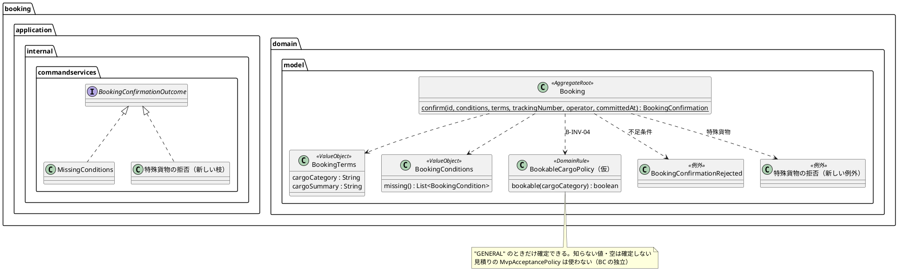
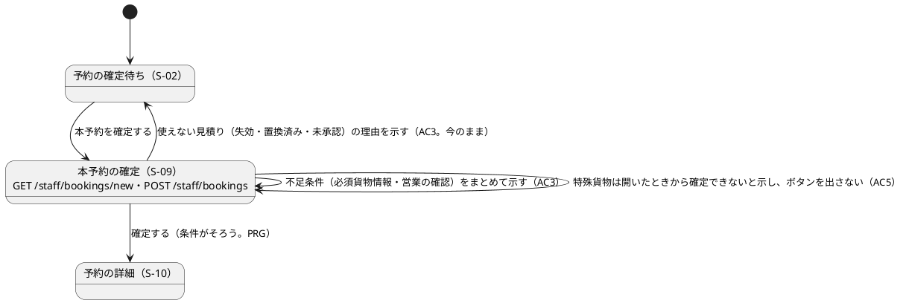

# Bolt 35 計画 - 本予約の確定の不足条件と特殊貨物（US-04 AC3・AC5）

## 基本情報

| 項目 | 内容 |
| :--- | :--- |
| Bolt | 第 35 回（W5 の 28 本目） |
| 予定 | W5（2026-11-02 の週。前倒しで着手できる）。作業は約 4.4 時間（承認ゲートの待ちと、`check`・uiTest・SonarQube の待ちを除く） |
| 対象 | `booking`（集約の確定、新しい規則、確定の結果の型、確定のサービス、S-09 の controller・画面の文言・テンプレート）、`quotation.acceptance`（特殊貨物の見積りを置くステップ）、受入シナリオ（業務ルール層・画面の層。`BookingUiSteps`）、設計文書（user_story・domain_model・architecture_backend・ui_design・test_strategy・release_plan・development_strategy）、マニュアル 7.2 |
| GitHub | [#43](https://github.com/k2works/practical-domain-driven-design-in-enterpris-application/issues/43)（US-04 予約を確定する。R1.0 の AC3・AC5） |
| SP | 3（#43 をクローズして数える。US-04 の残り） |
| 承認ゲート | 計画と終了報告（W5 の表の 35 の行）。スキーマは変えない。層・モジュールの規則（AT-05、`ModularityTest`）に当たったら止めて諮る（T-125） |
| アプローチ | アウトサイドイン（W5 の表の 35 の行、開発戦略 :107 の中盤の例外・:116 の「既存の集約に受入条件を足す」の行。既存の予約の集約を広げる）。業務ルール層の受入シナリオの Red → サービスの単体テストの Red（判定の順）→ 結果の型 → 集約 → 規則の順に内へ進め、画面は WebMvc のテストと画面の層の受入シナリオで外から確かめる |
| マニュアル・デモ | マニュアル 7.2 の注意・補足（不足条件をまとめて示すこと、特殊貨物は確定できず手動の窓口で扱うこと）。エラーの状態はキャプチャを撮っていない（`manual_screenshots.feature:78-85`）ので撮り直しはない。`manualScreenshots` を流して差分がないことを確かめる。デモの動画は作らない（AC5 は通常の画面の流れで届かない。W5 のデモで AC5 は受入シナリオと WebMvc のテストで見せる。開発戦略 :183 に書く） |
| 前の Bolt | [Bolt 34f 終了報告](bolt_34f_report.md) |

## Bolt ゴール

営業担当者が本予約を確定するとき、確定条件の不足（S-09 で示す必須貨物情報・営業担当者の確認）は 1 回の送信でまとめてエラー要約に示され、確定に使えない見積り（失効・置換済み・未承認）は今のとおり受付一覧に戻して理由が示される（AC3）。危険物・冷凍貨物・その他特殊貨物を含む見積りは、予約の判定で確定を拒まれ、S-09 を開いたときから MVP の対象外であることと手動の窓口が示されて確定のボタンが出ない（AC5、B-INV-04）。#43 をクローズし、US-04 を完了する。

### 確かめたい仮説

| # | 仮説 | この Bolt で分かること |
| :--- | :--- | :--- |
| H1 | 提出の段階の拒否（US-01 AC4）に加えて予約の判定でも特殊貨物を拒めば、見積りの側の規則が変わっても予約は特殊貨物を確定しない（二重の守り） | 見積りの提出の規則を通らずに置いた特殊貨物の見積りでも、予約の受入シナリオが確定の拒否を確かめられる |
| H2 | 不足条件の示し方を「S-09 で示す不足は S-09、使えない見積りは S-02」の今の分担のまま AC3 にできる | AC3 の受入シナリオが今の行き先（UI 設計 S-09。ADR-016 の照会の結果）を変えずに書ける |

### 開始準備で確かめたこと

- **受入条件**: US-04（user_story.md:181-203）。AC3「Given 確定条件のいずれかが不足、When 確定する、Then 予約は確定されず不足条件が示される」、AC5「Given 危険物・冷凍貨物・その他特殊貨物を含む輸送要求、When 本予約を確定する、Then 確定は拒否され MVP 対象外であることと手動窓口が示される」。#10 で AC1・AC2・AC4 をクローズ済み。#43 は OPEN（2026-10-17 に再オープン）。#43 の完了の定義に「画面を変えたなら `@ui` のシナリオと axe-core の検査が通り、支援技術による手動確認を記録した」がある
- **今の不足条件**: `BookingCondition` は 5 つ（VALID_QUOTATION・REQUIRED_CARGO・SHIPPER_APPROVAL・APPROVED_ROUTE・STAFF_CONFIRMATION）。`BookingCommandService.confirm`（:89-90）は見積り・承認・経路を常に true にする（使えない見積りはその前に `Expired`・`QuotationUnavailable` で返り、S-02 に戻す。UI 設計 S-09 と `BookingController`）。S-09 で返り得る不足は REQUIRED_CARGO と STAFF_CONFIRMATION の 2 つで、`BookingViews`（:73-91）とエラー要約（`new.html:14-20`）はこの 2 つを示す。必須貨物情報の不足は「見積依頼の貨物を確かめてください」で、S-09 では直せない（欄もリンクもない。`new.html:17`・`:37`）。S-09 で直せるのは営業の確認だけ。貨物の要約は `CargoDisplayNames.summary` が常に空でない文字列を作る（`BookableQuotationQueryService:84`）ので、通常の流れでは必須貨物情報の不足は起きない。2 つの不足を順に返すことは値オブジェクトのテスト（`BookingConditionsTest:17-23`）にあるが、サービスと画面の層にはない
- **確定の判定の順**: `BookingCommandService` は役割（B-INV-10）→ 処理済みコマンド（B-INV-03）→ 同じ見積りの予約（B-INV-11。`alreadySettled`）→ 見積りの照会（B-INV-02・05）→ 確定条件（B-INV-01）→ 追跡番号の発行（domain_model.md:827、サービスの Javadoc :35）。`Booking.confirm` は `BookingConfirmationRejected(missing)` だけを投げ（Booking.java:81-83）、サービスはそれを `MissingConditions` に写す（:101-103）
- **特殊貨物**: 予約の側に B-INV-04（domain_model.md:813「特殊貨物を含む輸送要求は確定しない」）の実装はない。`BookingTerms.cargoCategory` は見積りの公開 API から写した `CargoCategory.name()` の文字列（GENERAL・DANGEROUS・REEFER・OTHER_SPECIAL。`BookableQuotationQueryService:83`、`BookableQuotationResult:25`）で、予約は日本語名を持たない。`booking_version.cargo_category` は VARCHAR(30) で CHECK がない（`V20261008150000__create_booking.sql:44`）。`BookingTerms` の Javadoc と列の注釈は「貨物区分」で、用語集の「貨物種別」と違う（BookingTerms.java:21、create_booking.sql:99、domain_model.md:107）。見積りの側は `MvpAcceptancePolicy`（`category == GENERAL`）で提出を拒む（`ShipmentTermsInput:60`、受入テストの組み立て `AcceptanceTestConfiguration:211-212`・`:387`）
- **BC の独立**: 予約の `allowedDependencies` は `shared`・`quotation :: api`・`platform :: web` だけで（booking/package-info.java、AT-03）、`ModularityTest` が検証する。`DomainArchitectureTest` は「他のコンテキストのドメイン層への依存はこの規則では止めない」と書き、`PublicApiArchitectureTest` は公開 API の形を見るだけ（T-140）。受入テストのステップは AT-05（`AcceptanceStepArchitectureTest:91-101`）が `booking.acceptance` から見積りの内部（`quotation.acceptance` のメモリの部品、`CargoCategory`）への依存を拒む。`BookingSteps` が持つのは予約とサガのメモリのリポジトリだけで、見積りは本物の公開 API を通る（BookingSteps.java:44-48）
- **規則の置き場所**: `booking.domain.model.rules` のパッケージはまだない。identity・quotation・routing・tracking の rules はどれも `package-info.java` と `@DomainRule`（`DddAnnotationArchitectureTest:19-29` が強制）を持つ。用語集のテスト（`LivingGlossaryConsistencyTest:69-71`）は集約ルート・エンティティ・値オブジェクトだけを見るので、規則は対象外（domain_model の要素表と用語集に手で足す。前例 :541 `MvpAcceptancePolicy`、:105・:187・:221）
- **確定の結果の型を使う箇所**（T-57、Bolt 24 の前例）: `BookingConfirmationOutcome` を使うのは `BookingController`・`BookingSteps`・`BookingCommandServiceTest`・`BookingControllerTest`・`BookingConfirmationConcurrentIntegrationTest`・`DevSampleDataSmokeTest`・`RouteConfirmedAssignmentIntegrationTest`（grep した）
- **受入シナリオ**: `booking/confirm_booking.feature` に `@US-04-AC3`・`@US-04-AC5` はない。AC3 の中身に当たる 2 本（:68-73 未承認、:75-82 営業の確認なし）が `@US-04-AC1` のタグである。画面の層の `BookingUiSteps` に「確認せずに確定する」ステップはない（:88 は確認して確定するものだけ）。`confirm_booking_ui.feature:12-13` は「画面の層では主成功と画面に固有の表示だけ」と書く
- **古い言い方**（T-148。「W6」と「AC1・AC2」で grep した）: 「W6」は `confirm_booking.feature:8`、`BookingConfirmationOutcome.MissingConditions` の Javadoc、`BookingConfirmationRejected:7` の 3 か所。範囲の書き方「AC1・AC2・AC4」「AC1・AC2）」は `BookingCommandService`（:31・:68）、`BookingConfirmationOutcome`（:10）、`BookingController`（:28）、`new.html`（:12）、`ConfirmBookingCommand`（:9）、`BookingSteps`（:31）、`BookingCommandServiceTest`（:47）、`BookingControllerTest`（:51）、ui_design.md:167。user_story.md:203 は前倒しを書いているので直さない
- **画面**: S-09 の POST は `/staff/bookings`、GET は `/staff/bookings/new`（BookingController.java:34・:68・:79）。特殊貨物の見積りで S-09 を開くと、今は普通に開いて確定のボタンが出る（:126-145）。UI 設計 S-09（ui_design.md:167）と節（:1050 以下の salt の図と説明）に不足条件の一覧と特殊貨物の記述はない。:441 の自己遷移「不足条件・失効を表示」の失効は S-02 に戻すので今は事実と違い、:438-440 の「予約確定の確認」は Bolt 23b でやめた 2 段の形の名残
- **テスト戦略**: test_strategy.md:241 は B-INV-04〜05 をまとめた 1 行（列は不変条件・ユニット・受入シナリオ・統合・Web・E2E。:226）。:534-537 の照合の表は US-04 が AC1・AC2・AC4・B-INV-11 だけ。照合の表に行を足すと `AcceptanceCriteriaCoverageTest`（:29-37）が `@wip` でないシナリオを求めるので、行はシナリオを足すステップで足す
- **マニュアル**: 7.2 の注意・補足（07-本予約の確定と予約一覧.md:83-89）に営業の確認のエラーの説明がある
- **スキーマ**: 変えない。DB の列の注釈「貨物区分」はスキーマに当たるので触らず、既知の差として記録する
- **D-85 の位置の誤り**: release_plan.md:563 の「domain_model.md:480」は今は輸送要求の状態遷移の行。「再見積りできない」の記述は :552・:554、状態遷移の図は :505・:510。この Bolt の release_plan の直しで直す

## ふりかえりと前の Bolt からの引き継ぎ

| 入力 | 内容 | この Bolt での扱い |
| :--- | :--- | :--- |
| 開始準備の決定（2026-10-19、human:kakimomokuri） | (1) Bolt 35 を 35（AC3・AC5）と 35b（D-85）に分ける。(2) AC3 は今の分担のまま。S-09 は不足条件をすべて示し、使えない見積りは S-02 に戻して理由を示す。(3) AC5 は予約の判定に B-INV-04 を足して S-09 で示し、画面の層のシナリオは作らない。(4) 業務ルール層の特殊貨物の見積りは、見積りの側のステップで提出の規則を通さずに置く。(5) AC3 の 2 つ同時の不足は、サービスの単体テストと WebMvc のテストで確かめる。(6) 特殊貨物は不足条件に足さず新しい拒否にし、文言に種別名を出さない（知らない値も確定しない側）。(7) 特殊貨物の見積りは S-09 を開いたときに示し、確定のボタンを出さない | 確認ポイント 1〜7 |
| Bolt 34f の Try T-152 | テストのクラスを分けたら、使わない private のメソッドと定数を grep で確かめる | テストのクラスは分けない。足したテストの補助は `check` の前に使われているかを確かめる |
| Bolt 34f の Try T-153 | 「〜だけが呼ぶ」と書くときは、守る規則の範囲を確認ポイントに挙げる | 予約が見積りの規則の型を使わないことを守るのは `ModularityTest`（AT-03、allowedDependencies）。宣言の書き換えで通る規則なので、型の規則を足すかを確認ポイント 8 に挙げる |
| Bolt 34c の Try T-149 | 見張りの規則は捕まえる変更を書き、変異で確かめる | 確認ポイント 8 で型の規則を足すなら、見積りのドメインの型への依存の変異で落ちることを確かめる |
| Bolt 34e の Try T-150 | 判定を通さずに呼べない形を作るときは、承認と判定した対象の結び付きを確認ポイントに挙げる | `Booking.confirm` は規則を通さずに特殊貨物を確定できない（集約の中で規則を呼ぶ）。サービスの判定と集約の判定が同じ規則を使うことを単体テストで確かめる |
| Bolt 34e の Try T-151 | テストの件数は `check` が終わった後に数え、同じ数え方で比べる | 各ステップの `check` の後に数える |
| Bolt 34d の Try T-147 | SonarQube はほかの Gradle の実行が終わってから | ステップ 6。レビューのエージェントにテストを流させない |
| Bolt 34d の Try T-146 | 状態を戻せる操作を足す計画では、往復の後に残るものを確認ポイントに挙げる | 戻せる操作を足さない。当たらない |
| Bolt 34c の Try T-148 | 「〜だけ」と書く前に全体を grep する | 「W6」と範囲の書き方「AC1・AC2」で grep した（上）。直す前にもう一度 grep する |
| Bolt 34b の Try T-145 | MockMvc で見るのは状態コードと副作用だけ | S-09 は通常のビューなので WebMvc のテストで文言とボタンの有無を見る（前例 `BookingControllerTest` の不足条件のエラー要約）。当たらない |
| Bolt 34b の Try T-143 | 既存のエラー要約の形を写す | 特殊貨物の拒否は S-09 のエラー要約の形（見出し「本予約を確定できませんでした」）に合わせ、リンクにしない（直す欄がない） |
| Bolt 34 の Try T-140 | 規則がその依存を実際に見るかを確かめてから根拠にする | 上の「BC の独立」で確かめた |
| Bolt 20 の Try T-57 | 値を足したらそれを見る判定をすべて洗い出す | 確定の結果の型を使う 7 か所（上）をステップ 3 で直す |
| Bolt 33b〜34c の Try（T-112・T-117・T-131・T-137・T-141） | 控えから戻す、スクリプトの接頭辞 | 変異は控えから戻す。スクリプトは `b35_` で始める |
| Bolt 34f の既知の課題 | S-20 のエラー要約の形とフォーカスなど | この Bolt の範囲外（W6 の S-20 の Bolt の前に計画する） |
| `manualScreenshots`・`demoVideo` の扱い（Bolt 34d） | 撮り直すと関係のない画像も変わる | 差分が出たら戻す（この Bolt で撮り直す画像はない） |

## スコープ

### 入れるもの・入れないもの

| 入れる | 入れない（後で） |
| :--- | :--- |
| AC3: 不足条件をまとめてエラー要約に示すこと（2 つ同時の不足を単体と WebMvc で）、受入シナリオのタグ、画面の層の営業の確認なしのシナリオ | 確定条件の表の 5 行に「満たす・不足」を出すこと、使えない見積りを S-09 で示すこと（決定 (2)） |
| AC5: 新しい規則、集約の不変条件と拒否、確定の結果の型の特殊貨物の拒否、S-09 の GET と POST の表示 | 特殊貨物の予約の受け付け（MVP の対象外）、窓口の連絡先の画面 |
| 受入シナリオの注と型の注の古い言い方（「W6」「AC1・AC2」）の直し、`BookingTerms` の Javadoc の「貨物種別」 | DB の列の注釈「貨物区分」（スキーマ。既知の差） |
| 設計文書とマニュアル 7.2 | D-85 の再見積り（35b。W5 に置く）、予約サガの有人確認要（W8。#43 の引き継ぎ） |

### 設計の約束（Try T-1）

- **判定の順**: 役割（B-INV-10）→ 処理済みコマンド（B-INV-03）→ 同じ見積りの予約（B-INV-11）→ 見積りの照会（B-INV-02・05）→ **特殊貨物（B-INV-04）** → 確定条件（B-INV-01）→ 追跡番号の発行。特殊貨物は直せないので確定条件より先に返し、追跡番号を発行しない（Bolt 23 レビュー L-1 と同じ理由）
- **規則**: `booking.domain.model.rules` に `@DomainRule` の規則を 1 つ置く（名前はステップ 3 で決める。候補 `BookableCargoPolicy`）。写した貨物種別の名前が `"GENERAL"` のときだけ確定できるとし、知らない値・空の値は確定しない側に倒す。見積りの `MvpAcceptancePolicy` は使わない（BC の独立。予約は写した値だけで判定する）。パッケージは新しいので `package-info.java` を足す
- **集約**: `Booking.confirm` は規則で特殊貨物を判定し、特殊貨物なら新しい例外を投げる（規則を通さずに確定できない。T-150）。今の `BookingConfirmationRejected` は不足条件だけを持つので、特殊貨物には使わない（使うと不足条件として返る）
- **結果の型**: `BookingConfirmationOutcome` に特殊貨物の拒否の枝を 1 つ足す（Bolt 24 の `AlreadyBooked`・`CommandConflict` と、`Expired` を分けた前例）。サービスは集約の前に規則で判定して返し、集約の例外も同じ枝に写す。使う 7 か所（T-57）を直す
- **画面**: S-09 を開いた（GET）とき、見積りが特殊貨物なら確定のボタンを出さず、エラー要約の形で拒否の文言を示す（使えない見積りの「開いても送っても」理由を示す前例。UI 設計 S-09）。確定の POST は特殊貨物の拒否の枝で S-09 を出し直す。GET の判定は、確定のときと同じ見積りの照会の結果の貨物種別を、同じ規則で見る
- **文言**: 「危険物・冷凍貨物・その他特殊貨物を含む見積りは、MVP の対象外のため本予約を確定できません。手動の窓口で扱ってください。」（AC の言葉にそろえる。種別名は出さない。リンクにしない）。UI 設計 S-09 に書いてから作る
- **受入シナリオ**: 業務ルール層に `@US-04-AC5 @B-INV-04` のシナリオを足す。特殊貨物の見積りは、`quotation.acceptance` のステップで「提出の規則を通らずに受け付けた特殊貨物の承認済みの見積り」を復元（`reconstitute`）してメモリのリポジトリに置き、予約は本物の公開 API を通る（AT-05 に当たらない）。AC3 は既存の 2 本（未承認、営業の確認なし）に `@US-04-AC3` を足し（AC1 のタグは残す）、2 つ同時の不足はサービスの単体テストと WebMvc のテストで確かめる。画面の層には、営業の確認を入れずに確定するとエラー要約に不足条件が示され予約が作られないシナリオを `@US-04-AC3` で足す（`BookingUiSteps` にステップを足し、feature の説明 :12-13 に「エラー要約は画面に固有の表示」と書き足す）
- **SpotBugs・用語集**: SpotBugs の除外は足さない。規則は用語集のテストの対象外なので、domain_model の予約の要素表（:823 以下）と用語集に手で足し、:827 の判定の順に特殊貨物を足す
- **新しいファイル**: 規則のクラス、その単体テスト、`booking.domain.model.rules` の `package-info.java`、集約の新しい例外の 4 つ。ほかは既存のファイルを広げる（`quotation.acceptance` のステップは既存のクラスに足す）

## 設計（この Bolt の範囲）

4 図のうち、ドメインモデル図と画面遷移図を置く。状態遷移図は予約の状態を変えないので、ER 図は表と列を変えないので省く。

### ドメインモデル図（予約の確定の範囲）

### 画面遷移図（S-09 の確定の結果）

注（設計への反映が必要。ステップ 1 で直す行）:

- user_story.md: US-04 の決定に、開始準備の決定 (2)(3)(6)(7)（不足条件の示し方の分担、特殊貨物は予約の判定でも拒む二重の守り、手動の窓口の案内、開いたときに示す）
- domain_model.md: B-INV-04（:813）の守り手（予約の集約と規則）、:827 の確定の判定の順に特殊貨物、予約の要素表（:823 以下）と用語集に規則
- architecture_backend.md: 予約の規則の置き場所（`booking.domain.model.rules`、`@DomainRule`、`MvpAcceptancePolicy` を使わない理由と、それを守る `ModularityTest`）
- ui_design.md: S-09 の行（:167。不足条件をまとめて示すこと、特殊貨物の拒否の文言、開いたときに示してボタンを出さないこと、範囲の書き方「AC1・AC2」）と S-09 の節（:1050 以下の説明。エラー要約の図を描くかはステップ 1 で決める）、:441 の自己遷移を「不足条件・特殊貨物を表示」にし失効は S-02 へ。:438-440 の「予約確定の確認」の名残は直す
- test_strategy.md: :241 の B-INV-04〜05 の行を分け、B-INV-04 の Web の列に WebMvc を書く。:534-537 の照合の表の AC3・AC5・B-INV-04 の行はシナリオを足すステップ 2・3 で足す（`AcceptanceCriteriaCoverageTest` が落ちないため）
- release_plan.md: 35 の行を 35 と 35b に分け（35b を W5 に置き、SP 0）、開始準備の決定 (1)〜(7)、チェックリスト、:563 の「domain_model.md:480」の位置の誤り、:722 の D-85 の台帳の「Bolt 35 で作る」を 35b に、:786 の W5 の「Bolt 29〜35（28 本」を 35b を足して 29 本に、:557 の局面とアプローチに 35b（D-85 は見積りの集約の状態遷移を変えるので開発戦略 :107 の中盤の例外の範囲に入らない。アプローチは 35b の開始準備で決める）
- development_strategy.md: :183 の W5 のデモに、AC5 は受入シナリオと WebMvc のテストで見せること。:107 の中盤の例外に 35b が入らないこと（35b の開始準備で直す）
- 受入シナリオと型の注の古い言い方（「W6」「AC1・AC2」）と `BookingTerms` の Javadoc はステップ 2・3 で直す

## ステップ計画

状態の記号: `[ ]` 未着手、`[-]` 進行中、`[?]` 承認待ち、`[x]` 完了。各ステップの終わりに `check` が緑で件数が減っていないことを確かめ（T-151）、push してアプリの CI と MkDocs の配備を確かめる（T-26、T-126）。コミットは pathspec で作る（T-110）。

- [ ] **1. 設計文書**
  - 上の注の行を直す（test_strategy の照合の表の行は除く）。完了の判定: `okf:check` ERROR 0、`documentationTest` 緑
- [ ] **2. AC3 の受入シナリオ**
  - 業務ルール層の既存の 2 本に `@US-04-AC3` を足し、照合の表に AC3 の行を足す。画面の層に営業の確認なしのシナリオとステップを足す（今のコードで緑の見込み。特性のシナリオとして残し、Red にならないことを報告に書く）。サービスの単体テストに 2 つ同時の不足（`MissingConditions` に 2 つ、追跡番号の発行は 0 回）を足す。feature の注の「W6」と範囲の書き方を直す
- [ ] **3. AC5 の判定（B-INV-04）**
  - 先に業務ルール層の `@US-04-AC5 @B-INV-04` のシナリオと `quotation.acceptance` のステップを足して Red を確かめる。サービスの単体テストの Red（特殊貨物は特殊貨物の拒否、特殊貨物で営業の確認なしでも特殊貨物の拒否、追跡番号の発行は 0 回）→ 結果の型の枝 → 集約の不変条件と例外 → 規則と単体テスト（一般・危険物・冷凍・その他特殊・知らない値・空）。使う 7 か所を直す。判定の順の変異（特殊貨物を確定条件の後に見る、サービスの判定を外して集約だけにする、集約の判定を外す）でテストが落ちることを確かめる（控えから戻す）。照合の表に AC5・B-INV-04 の行を足す。型の注の古い言い方と `BookingTerms` の Javadoc を直す。確認ポイント 8 で型の規則を足すと決めたら、ここで足して変異で確かめる
- [ ] **4. S-09 の表示**
  - WebMvc のテストを先に足す（GET で特殊貨物なら拒否の文言があり確定のボタンがない、POST の特殊貨物の拒否で S-09 にエラー要約、不足条件 2 つの同時の表示）。controller と画面の文言とテンプレートを直す。axe の検査は画面の層の AC3 のシナリオが通す。特殊貨物の表示は画面の層のシナリオがないので、支援技術による手動確認（スクリーンリーダーでエラー要約が読まれること）を、開発環境で特殊貨物の見積りを作れない場合はできないと書いて報告で扱う（確認ポイント 9）
- [ ] **5. マニュアル**
  - 7.2 の注意・補足に、不足条件をまとめて示すことと、特殊貨物は確定できず手動の窓口で扱うことを書く。`manualScreenshots` を流して差分がないことを確かめる（出たら戻す）
- [ ] **6. uiTest と SonarQube と開発レビューと終了報告**
  - `uiTest`（件数を前後で比べる）、SonarQube（ほかの Gradle の後。T-147）。開発レビュー（アーキテクト、テスター。読むだけ）。`bolt_35_report.md`、#43 の受入条件のチェックとクローズ（人の承認の後）、release_plan（US-04 の SP 3）、開発の索引

### 時間の配分と打ち切り

| # | 目安 | 打ち切り |
| :--- | :--- | :--- |
| 1 | 35 分 | — |
| 2 | 30 分 | — |
| 3 | 90 分 | 規則の置き場所や受入テストのステップが層・モジュールの規則（AT-05、`ModularityTest`）に当たったら止めて諮る |
| 4 | 50 分 | — |
| 5 | 20 分 | — |
| 6 | 40 分（uiTest と SonarQube の待ちを除く） | — |

合計 265 分（約 4.4 時間）。目安の 4 時間を少し超えるが、半日は超えない。AC3 と AC5 はどちらも #43 の受入条件で、分けると #43 のクローズと SP の数え方が 2 つの Bolt にまたがるので分けない。ステップ 3 を終えた時点で 3.0 時間を超えていたら止めて諮る（候補: S-09 の GET の表示を後の Bolt に送る）。

## 確認ポイント（計画の承認の場でまとめて確認する。Try T-6）

| # | 確認すること | ステップ | 推奨・決定 |
| :--- | :--- | :--- | :--- |
| 1 | **Bolt の分け方** | 全体 | 決定済み（1）: 35（AC3・AC5、SP 3、#43）と 35b（D-85、SP 0、W5） |
| 2 | **AC3 の示し方** | 2・4 | 決定済み（2）: 今の分担のまま。S-09 は不足条件をすべて示し、使えない見積りは S-02 に戻す |
| 3 | **AC5 の作り方** | 3・4 | 決定済み（3）: 予約の判定に足して S-09 で示す。画面の層のシナリオは作らない |
| 4 | **特殊貨物の見積りの用意** | 3 | 決定済み（4）: 見積りの側のステップで、提出の規則を通さずに復元して置く。予約は本物の公開 API を通る |
| 5 | **AC3 の 2 つ同時の不足** | 2・4 | 決定済み（5）: サービスの単体テストと WebMvc のテスト |
| 6 | **拒否の型と文言** | 3・4 | 決定済み（6）: 新しい例外と結果の型の新しい枝。文言は AC の言葉で種別名を出さない。知らない値も確定しない |
| 7 | **S-09 を開いたとき** | 4 | 決定済み（7）: 開いたときに示し、確定のボタンを出さない |
| 8 | **BC の独立の見張り** | 3 | 今は `ModularityTest`（allowedDependencies）だけが守る。宣言の書き換えで通る規則なので、「予約は見積りの公開 API のほかの型に依存しない」の型の規則を足すか。推奨: 足さない（`ModularityTest` の前例の型の規則が既に予約を含むかをステップ 3 で確かめ、含まなければ報告の課題にする）。代わりの案: 足して変異で確かめる（T-149） |
| 9 | **支援技術による手動確認** | 4・6 | #43 の完了の定義にある。AC3 の画面の層のシナリオの画面（営業の確認なし）は手動で確かめて報告に書く。特殊貨物の表示は開発環境で作れないので、WebMvc のテストのテンプレートの断言で代え、完了の定義との差として報告に書く |
| 10 | **新しいファイル** | 3 | 規則のクラス、その単体テスト、`package-info.java`、集約の新しい例外の 4 つ |
| 11 | **AC3 の Red** | 2 | 既存の 2 本へのタグと画面の層の営業の確認なしのシナリオは、今のコードで緑の見込み（特性のシナリオ）。TDD の Red はステップ 3 の AC5 と、ステップ 4 の S-09 の GET で回す |
| 12 | **開発レビュー** | 6 | アーキテクト、テスター（読むだけ）。画面は文言とボタンの出し分けだけなのでインタラクションデザイナーは入れない |
| 13 | **アプローチと承認ゲートと時間** | 全体 | アウトサイドイン（中盤の例外）。承認ゲートは計画と終了報告（W5 の表どおり）。約 4.4 時間 |

## 完了条件

- [ ] `@US-04-AC3`・`@US-04-AC5` のシナリオがあり、すべて通る（`@wip` なし）。照合の表に AC3・AC5・B-INV-04 がある
- [ ] 予約の判定が特殊貨物を拒み（B-INV-04）、判定の順の境界と変異で確かめた
- [ ] S-09 が不足条件をまとめて示し、特殊貨物の見積りは開いたときから拒否と手動の窓口を示して確定のボタンを出さない。UI 設計・マニュアル 7.2 が合っている
- [ ] `check` と `uiTest` が緑で、件数が減っていない。push してアプリの CI と MkDocs の配備を確かめた。SonarQube の Quality Gate が PASS、`okf:check` ERROR 0
- [ ] 支援技術による手動確認を記録した（確認ポイント 9 の範囲）
- [ ] 開発レビュー、終了報告、#43 のクローズ（人の承認の後）、US-04 の SP 3 を数えた

## 更新履歴

| 日付 | 更新内容 | 更新者 |
| :--- | :--- | :--- |
| 2026-10-19 | 初版作成（承認待ち）。human:kakimomokuri の決定（35 と 35b に分ける、AC3 は今の分担のまま、AC5 は予約の判定に足して S-09 で示す）を反映した | anthropic/claude-opus-5-5 |
| 2026-10-19 | 詳細整合性検証（20 件）と横断整合性検証（16 件）の指摘を反映した。human:kakimomokuri の決定 (4)〜(7)（特殊貨物の見積りは見積りの側のステップで置く、2 つ同時の不足は単体と WebMvc、新しい拒否で種別名なし、開いたときに示す）。判定の順に B-INV-11、BC の独立を守る規則を `ModularityTest` に、ドメインモデル図、新しいファイルの数、使う 7 か所（T-57）、POST の URL、注の行（architecture_backend・ui_design の節・release_plan の 3 か所・開発戦略）、照合の表の行を足すステップ、完了の定義の手動確認、当たらない Try の行、ステップ 3 の並び | anthropic/claude-opus-5-5 |

## 関連ドキュメント

- [リリース計画](release_plan.md)（W5）、[開発戦略](development_strategy.md)
- [Bolt 34f 終了報告](bolt_34f_report.md)
- [ユーザーストーリー](../../requirements/cargo-tracker/user_story.md)（US-04）、[ドメインモデル](../../design/cargo-tracker/domain_model.md)（B-INV-04）、[UI 設計](../../design/cargo-tracker/ui_design.md)（S-09）、[テスト戦略](../../design/cargo-tracker/test_strategy.md)
- [ADR-016 予約は commit 時刻を渡して見積りの公開 API で確定に使えるかを確かめる](../../adr/cargo-tracker/016-booking-checks-quotation-at-commit-time.md)
- [マニュアル 7 章 本予約の確定と予約一覧](../../manual/07-本予約の確定と予約一覧.md)
