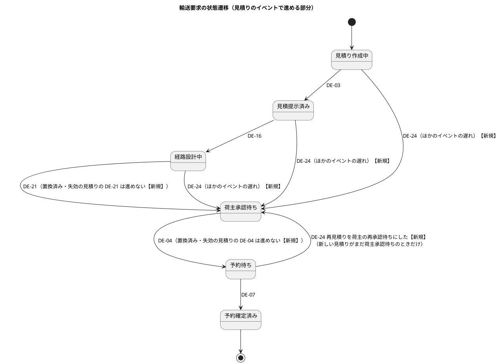
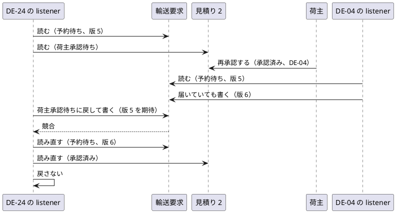
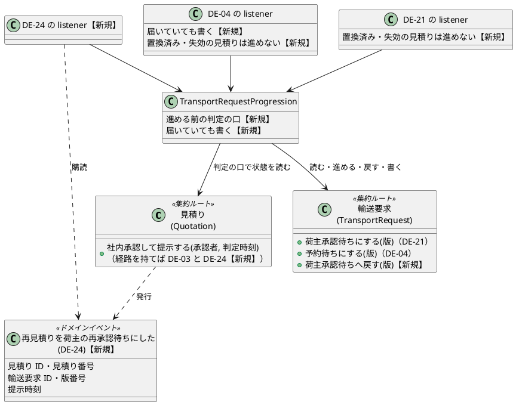

# Bolt 35b2 計画 - 再見積りの提示で輸送要求を荷主承認待ちへ戻す（D-85。DE-24 と順序の守り）

## 基本情報

| 項目 | 内容 |
| :--- | :--- |
| Bolt | 第 35b2 回（W5 の 30 本目） |
| 予定 | W5（2026-11-02 の週。前倒しで着手できる）。作業は約 4.8 時間（承認ゲートの待ちと、`check`・uiTest・SonarQube の待ちを除く） |
| 対象 | `quotation`（`Quotation.presentInternally` の DE-24 の発行、新しいイベント（`quotation.domain.events`）、`TransportRequest` の荷主承認待ちへ戻す操作、DE-24 の listener（`quotation.application.internal.eventhandlers`）、`TransportRequestProgression` の「届いていても書く」と「進める前の見積りの判定」、DE-21・DE-04 の listener、組み立て（`QuotationConfiguration`・`AcceptanceTestConfiguration`））、受入シナリオ（業務ルール層）、設計文書、ADR |
| GitHub | なし（D-85 は US に属さない決定事項の実装。release_plan の W5 の表と業務責任者に確かめる事項の台帳で扱う） |
| SP | 0 |
| 承認ゲート | 計画と終了報告（W5 の表の 35b2 の行）。表は「順序の守りでスキーマを変えるならデータベースの承認ゲート」としていたが、決定 (1) で楽観ロックを使うのでスキーマは変えない。新しい ADR（ADR-018）を作る（新規ファイル。確認ポイント 7）。層・モジュールの規則に当たったら止めて諮る（T-125） |
| アプローチ | アウトサイドイン（release_plan の 35b2 の行。開発戦略 :119「既存の集約に受入条件を足す」）。業務ルール層の受入シナリオ（輸送要求の状態）から入る。:119 の順（受入シナリオ → アプリケーション → ドメイン）から外し、集約（DE-24 の発行・輸送要求の戻す操作）を listener より先に作る。理由: listener の差し込むテストは、戻す操作と DE-24 の型ができていないと書けず、どちらも既存の操作（`markAwaitingApproval`）と同じ形の小さな足し算で不確実性がない。不確実性は届く順の入れ替わり（listener）にあるので、そこに時間を取る |
| マニュアル・デモ | 画面の操作は変えない。再見積りの操作は 35c まで画面に出さない（S-04 の GET は今の判定）ので、この Bolt の振る舞いは画面から届かない。マニュアルの更新とキャプチャの撮り直しはない（画面とマニュアルは 35c。D-85 の再見積りの操作と、その後の輸送要求の表示はまとめて 35c で書く）。デモの動画は作らない |
| 前の Bolt | [Bolt 35b 終了報告](bolt_35b_report.md) |

## Bolt ゴール

荷主の承認の後に失効した見積りを再見積りし、新しい見積りを社内承認して提示したら、輸送要求が予約待ちから荷主承認待ちへ戻る。荷主が新しい見積りを再承認すると予約待ちへ進む。再承認・旧版のイベントと戻しのイベントが届く順が入れ替わっても、輸送要求の状態は新しい見積りの状態に合う（承認済みなら予約待ち、荷主承認待ちなら荷主承認待ち）。再見積りで置換済み・失効になった旧版の経路版の割当て（DE-21）と荷主の承認（DE-04）が遅れて届いても、輸送要求を進めない。

### 確かめたい仮説

| # | 仮説 | この Bolt で分かること |
| :--- | :--- | :--- |
| H1 | DE-04 と DE-24 の listener が、進めなかったときも輸送要求を書けば（版が上がる）、互いと旧版の DE-04 の listener と楽観ロックでぶつかる。読み直した側が見積りの今の状態を見るので、スキーマもロックも足さずに順序を守れる | 競合を差し込むテスト（下の 4 つの順）で、輸送要求の最後の状態が新しい見積りの状態に合う |
| H2 | 輸送要求に「どの見積りのための状態か」を持たせなくても、listener がイベントの見積りの状態（置換済み・失効の記録）を見れば、旧版の遅れたイベントを見分けられる | 旧版の DE-21・DE-04 を戻しの後に届けるテストで、輸送要求が荷主承認待ちのまま |

### 開始準備で確かめたこと

- **輸送要求の遷移**（TransportRequest.java:169-245）: `markQuotationPresented`・`markRoutingRequested`・`markAwaitingApproval`・`markReadyToBook`・`markBooked` は、見積りのイベントで進める状態の並び（`QUOTATION_PROGRESSION`。見積り作成中 → 見積提示済み → 経路設計中 → 荷主承認待ち → 予約待ち → 予約確定済み）で、手前の状態ならどれからでも先へ進め、同じ版のときだけ変える。戻す操作はない（「先へだけ進め、戻さない」。Bolt 12 レビュー R-04、`isBefore` の Javadoc）。`hasReached` は再配信を受け流す判定
- **listener**: DE-03・DE-16・DE-21・DE-04 の listener と、DE-07 を受ける公開 API の実装 `BookingNotificationService`（commandservices）は、どれも `TransportRequestProgression`（application/internal）に進める操作を渡す（進める操作の呼び手はこの 5 つだけ。grep した）。`advanceOnce`（:75-99）は読み込み → 進めたら保存 → 進めなければ `hasReached` で ALREADY_REACHED（保存しない）か NOT_ADVANCED（警告のログ）。楽観ロックの競合（`ConcurrentTransportRequestUpdateException`）は 3 回まで読み直す（:63-73）。読み直しが安全な根拠は「先へだけ進める冪等な操作」（Bolt 22 計画 :167、architecture_backend.md :367）。listener は輸送要求のリポジトリだけを受け、見積りを読まない。組み立ては `QuotationConfiguration`（:149-159）と `AcceptanceTestConfiguration`（listener :288-297、メモリの見積りのリポジトリ :124、イベントの振り分け `eventSubscriptions` :300-335。知らないイベントは `default` で黙って捨てる）
- **楽観ロック**: `TransportRequestMapper.updateTransportRequest`（:44-48）は `version = version + 1 ... WHERE version = #{expectedVersion}` で、状態が変わらなくても版を上げる。メモリのリポジトリ（`InMemoryTransportRequestRepository.update`）も同じく競合を投げる。`TransportRequestEventHandlersConflictTest` の `InterleavingRepository`（:142-161）は輸送要求の最初の `findById` の後に差し込む。見積りの読み込みの後に差し込む部品はない（ステップ 4 で `QuotationRepository` の包みを作る）。メモリの見積りのリポジトリは写しを返す（`InMemoryQuotationRepository`:67-69）
- **見積りの提示**: `Quotation.presentInternally`（:197-218）は経路を持つ（引き継いだ）見積りを荷主承認待ちにし、DE-03 だけを出す（Bolt 35b）。DE-24 の行は予約済み（domain_model.md:1436。listener は `quotation.application.internal.eventhandlers` に置き、`TransportRequestProgression` と別のクラス）。イベントは `quotation.domain.events` の `@DomainEvent` の record で、Java の標準と共有カーネルの型だけを持つ（DomainEventArchitectureTest）。listener は `…EventHandler` の名前で `@Service` を付ける（LayerArchitectureTest）
- **ロック**: SQL の方言（`SELECT ... FOR UPDATE`）を使わない注は、見積りのコンテキストの業務番号の採番の mapper にある（TransportRequestNumberCounterMapper.xml:5）。決定 (1) でロックを使わない
- **受入テストのステップ**: 輸送要求の状態は「輸送要求は {string} になる」（TransportRequestReviewSteps:139。荷主承認待ち・予約待ちの名前は :59-60）。配信は「発行されたドメインイベントが購読するコンテキストに配信される」（ためたイベントをすべて届ける。`DeferredEventDelivery.deliverAll`）。`redeliverLast` は直前の束だけを届けるので、戻した後に旧版の DE-04 を届けるには、`history()` から見積り 1 の DE-04 を再配信する新しいステップが要る
- **置換済み・失効の記録**: 見積りの状態に失効（EXPIRED）・置換済み（REPLACED）を書くのは `retire` だけで、呼ぶのは再見積り（`requoteInto`・`replaceWith`）だけ（grep した）。期限による失効は状態を書き換えない。このため今のコードでは「置換済み・失効の記録がある」は「再見積りで旧版になった」と同じ意味になる（辞退（US-24 AC2）を作るとこの前提は変わる。ADR-018 に書く）
- **S-02 の表**（QuotationMapper.xml の `selectRoutingRequested` :170-177）: 経路設計中の表は輸送要求が経路設計中・荷主承認待ちで、見積りが詳細設計依頼済み・荷主承認待ちのものを出す。戻した後は新しい見積りがこの表に出る（35b の一時的な見え方が直る）。画面の層のシナリオは 35c
- **文書のずれ**（35b2 の前から）: domain_model.md の DE-21（:1434）・DE-04（:1435）の行は「経路設計中かつ同じ版のときだけ」「荷主承認待ちかつ同じ版のときだけ」と書くが、コードは手前の状態ならどれからでも進める。:1435 には「Bolt 35b の間は輸送要求が予約待ちのままなので状態を変えない」、:559 には「荷主の承認の後の再見積りの提示でも、輸送要求は予約待ちなので変えず」がある

## ふりかえりと前の Bolt からの引き継ぎ

| 入力 | 内容 | この Bolt での扱い |
| :--- | :--- | :--- |
| 開始準備の決定（2026-10-19、human:kakimomokuri） | (1) 順序の守りは、DE-04 の listener が進めなくても輸送要求を書く形にする（楽観ロックでぶつける。スキーマもロックも足さない）。(2) 旧版の DE-21・DE-04 が再見積りの後に届いても進めない守りを 35b2 で作る（listener が見積りを読み、置換済み・失効の記録があれば進めず警告のログ） | 確認ポイント 1・2。検証で見つかった穴（確認ポイント 3）は決定 (1) と同じ形で塞ぐ |
| Bolt 35b の決定（release_plan の 35b の行） | (2) 輸送要求は承認待ちへ戻す、(5) 戻しは新しい DE-24 と順序の守り、(10) DE-03 に属性を足さない。35b は単独で出さず 35b2・35c と一緒に出す | DE-24 を別のイベントにする。DE-03 は変えない |
| Bolt 35b の既知の課題 | 旧版の DE-21・DE-04 の遅れ（ADR の候補） | 決定 (2)。ADR-018 に DE-24 の守りと合わせて書く |
| Bolt 12 レビュー R-04、Bolt 22 計画 :167 | 輸送要求は先の状態へだけ進め、戻さない。競合の後の読み直しが安全なのは、先へだけ進める冪等な操作だから | DE-24 はこの前提を初めて破る。代わりの安全の根拠（H1。進めなくても書く・読む順・READ COMMITTED で読み直す）を ADR-018 と architecture_backend.md :367 に書き、`isBefore`・`hasReached`・`TransportRequestProgression` の Javadoc を直す |
| Bolt 23 レビュー A-9 | `TransportRequestProgression` がロガーとイベント名を受ける。サブパッケージへの移動は、輸送要求を進める処理が増えたときに | 確認ポイント 6。推奨: 移動はまた送る（この Bolt は部品の形を変えるので、移動は振る舞いを変えない直しとして分ける） |
| Bolt 35b の Try T-156 | 値を写す操作は、写す値・入力から入る値の表を書く | 当たらない（値を写さない）。戻しで輸送要求に残るものを T-146 の形で確かめる（確認ポイント 5） |
| Bolt 35b の Try T-157 | サービスが集約の判定と変更を順に呼ぶ形になったら、1 つの操作にまとめられないか確認ポイントに挙げる | listener は「輸送要求を読む → 見積りを読む → 判定して進める・戻す」の順に依存する（決定 (1) の守りが成り立つ条件）。2 つの集約にまたがるので集約の 1 つの操作にはできない。順を `TransportRequestProgression` の中に閉じ込め（やり直しのたびに見積りを読み直す）、Javadoc と ADR-018 に書いて、差し込むテストと変異で守る（確認ポイント 4） |
| Bolt 35 の Try T-154 | 「作れない」「できない」と書く前に作る手段を確かめる | 輸送要求の読み込みの後の差し込みは既存の `InterleavingRepository` で作れる。見積りの読み込みの後の差し込みは、同じ形の `QuotationRepository` の包みを作れば作れる（ステップ 4） |
| Bolt 34d の Try T-146 | 状態を戻せる操作では、往復の後に残るものを確認ポイントに挙げる | 輸送要求は予約待ち → 荷主承認待ち → 予約待ちと往復する（確認ポイント 5） |
| Bolt 34e の Try T-150 | 判定を通さずに呼べない形は、承認と判定した対象の結び付きを確認ポイントに挙げる | 戻しは DE-24 の見積り ID の見積りが荷主承認待ちのときだけ（listener が読む）。輸送要求の戻す操作そのものは見積りを知らない（確認ポイント 4） |
| Bolt 34e の Try T-151 | テストの件数は `check` が終わった後に数え、同じ数え方で比べる | 各ステップの `check` の後に、test の結果だけを数える（Bolt 35b と同じ。documentationTest は別に数える） |
| Bolt 34d の Try T-147 | SonarQube はほかの Gradle の実行が終わってから | ステップ 7。レビューのエージェントにテストを流させない |
| Bolt 34c の Try T-148・T-149 | 「〜だけ」と書く前に grep する。見張りの規則は変異で確かめる | listener と `TransportRequestProgression` の呼び手、`mark*` の呼び手、`retire` の呼び手を grep した（上）。守りは変異で確かめる |
| Bolt 33b〜34c の Try（T-112・T-117・T-131・T-137・T-141） | 控えから戻す、スクリプトの接頭辞 | 変異は控えから戻す。スクリプトは `b35b2_` で始める |
| Bolt 35 の既知の課題 | 特殊貨物の画面の axe、CI の揺らぎ、予約から見積りのドメインへの型の規則 | この Bolt の範囲外（W5 の締め） |

## スコープ

### 入れるもの・入れないもの

| 入れる | 入れない |
| :--- | :--- |
| 経路を持つ見積りの提示で DE-24 を出す（DE-03 と一緒に） | DE-03 の属性の変更（Bolt 35b の決定 (10)） |
| 輸送要求を荷主承認待ちへ戻す操作（予約待ちから戻す。それより手前なら荷主承認待ちへ進める。予約確定済みは変えない） | 予約確定済みの輸送要求の扱い（D-87。US-05） |
| DE-24 の listener（輸送要求を読む → 見積りを読む → 見積りがまだ荷主承認待ちのときだけ戻すか、荷主承認待ちに届いていても書く） | 見積りや輸送要求への列の追加（スキーマは変えない） |
| DE-04 の listener が、進めなかったが予約待ちに届いていたときも輸送要求を書く（決定 (1)） | DE-03・DE-16・DE-07 の振る舞いの変更（部品の形が変わっても、今のまま進める） |
| DE-21・DE-04 の listener が、見積りに置換済み・失効の記録があれば進めない（決定 (2)） | 旧版の DE-03・DE-16 の遅れ（確認ポイント 8） |
| ADR-018、設計文書（ステップ 1 の一覧） | 画面、マニュアル、画面の層のシナリオ（35c）。`TransportRequestProgression` のサブパッケージへの移動（A-9。確認ポイント 6） |

### 設計の約束

- **DE-24 の発行**: `presentInternally` が経路を持つ見積りを荷主承認待ちにしたときだけ、DE-03 の後に DE-24 を出す。型は `quotation.domain.events` の `@DomainEvent` の record。名前は起きたことを表す過去分詞にする（候補 `QuotationPresentedForReapproval`。確認ポイント 9）。属性は見積り ID・見積り番号・輸送要求 ID・版番号・提示時刻
- **輸送要求の操作**: `returnToAwaitingApproval(int quotedVersionNo)`（仮）。同じ版で、予約待ちなら荷主承認待ちに戻し、荷主承認待ちより手前（見積り作成中・見積提示済み・経路設計中）なら荷主承認待ちに進める（DE-03・DE-16・DE-21・DE-04 の遅れ。ほかの進める操作の `isBefore` と同じ）。荷主承認待ちなら変えない（冪等）。予約確定済み・並びの外・別の版は変えない。この操作は見積りを知らない（守りは listener）
- **`TransportRequestProgression` の形**: 2 つを足す。(a) 進める前の判定の口（輸送要求を読んだ後、進める前に呼ぶ。見積りを読んで「進めてよい・進めない（理由）」を返す。やり直しのたびに呼び直す）。(b) 「届いていても書く」の指定（ALREADY_REACHED のときも保存して版を上げる）。指定のない呼び手（DE-03・DE-16・`BookingNotificationService`）は今のまま。今の呼び手の振る舞いが変わらないことは既存のテストで確かめる
- **読む順**: どの listener も、輸送要求を読む → 見積りを読む → 判定して進める・戻す → 保存（楽観ロック）。輸送要求を先に読むことが守りの条件（後に読むと、ほかの listener が書いた後の版を読んでぶつからない）。順は `TransportRequestProgression` の中に閉じる
- **DE-24 の listener**: 見積りが荷主承認待ちなら、戻す操作を呼び、輸送要求が荷主承認待ちに届いていても書く（旧版の DE-04 の listener とぶつけるため。確認ポイント 3）。見積りが承認済みなら状態を変えず書かない（新しい見積りの DE-04 が進める）。見積りが見つからない・置換済み・失効なら警告のログ。輸送要求が予約確定済みなら変えずに警告のログ（D-87）
- **DE-04 の listener の書き込み**: 進めなかったが予約待ちに届いていた（ALREADY_REACHED）ときも、輸送要求を保存して版を上げる（決定 (1)）
- **旧版の守り**: DE-21・DE-04 の listener は、輸送要求を読んだ後にイベントの見積りを読み、置換済み・失効の記録があれば進めずに警告のログを残す（NOT_ADVANCED と同じ扱い。DE-04 の書き込みもしない）
- **ADR-018**: DE-24 と順序の守り（「先へだけ進める」の前提を変えること、代わりの安全の根拠、読む順、進めなくても書く 2 つの listener、旧版の守り、辞退を作るまでの前提）と、選ばなかった形（見積りの行のロック、輸送要求にどの見積りかを持たせる列、隙間を受け入れて台帳に載せる）を書く

### 差し込みの順（ステップ 4・5 で確かめる）

| # | 順 | 期待 |
| :--- | :--- | :--- |
| 1 | DE-24 が輸送要求（予約待ち）と見積り 2（荷主承認待ち）を読む → 荷主が再承認し、DE-04（見積り 2）が輸送要求を書く → DE-24 が書く | DE-24 がぶつかり、読み直すと見積り 2 は承認済みで戻さない。予約待ち |
| 2 | DE-04（見積り 2）が輸送要求を読む → DE-24 が戻して書く → DE-04 が書く | DE-24 の listener には承認の前に読んだ見積り 2 の写し（荷主承認待ち）を返す。DE-04 がぶつかり、読み直すと荷主承認待ちなので予約待ちへ進める。予約待ち |
| 3 | 旧版の DE-04（見積り 1）が輸送要求（荷主承認待ち）と見積り 1（承認済みで、まだ置換されていない写し）を読む → 再見積り・見積り 2 の提示・DE-24 が終わる（DE-24 は荷主承認待ちに届いていても書く） → 旧版の DE-04 が書く | 旧版の DE-04 がぶつかり、読み直すと見積り 1 は失効の記録があるので進めない。荷主承認待ち（検証で見つかった穴。確認ポイント 3） |
| 4 | 旧版の DE-04（見積り 1）が DE-24 の戻しの後に届く | 見積り 1 の失効の記録で進めない。荷主承認待ち（受入シナリオでも確かめる） |

## 設計（この Bolt の範囲）

ER 図: スキーマを変えないので省く。画面遷移図: 画面を変えないので省く。

### 状態遷移図（輸送要求。この Bolt で足す遷移に【新規】を付ける）

### シーケンス図（差し込みの順 1。決定 (1)）

### ドメインモデル図（この Bolt の範囲）

## ステップ計画

各ステップの終わりに `check` を流し、test の結果の件数を数える（T-151）。コミットは pathspec で行い（T-110）、push してアプリの CI と MkDocs の配備を確かめる（T-26・T-126）。変異は控えから戻す。

- [ ] **1. 設計文書と ADR**（完了の判定: `okf:check` ERROR 0、`documentationTest` が緑）
  - domain_model: 輸送要求の状態遷移の図（:464-490）に DE-24 の 4 本の遷移と旧版の DE-21・DE-04 の注、:492「見積りが期限で失効しても輸送要求はその状態のまま」に再見積りの戻しを、:559 の「輸送要求は予約待ちなので変えず」を 35b2 の戻しに、:563 の DE-24 の文、輸送要求の操作、イベントの表の DE-24（:1436。属性・listener・予約待ちより手前から進める場合）・DE-21（:1434）・DE-04（:1435。「Bolt 35b の間は状態を変えない」を消し、届いていても書く・旧版の守り。「〜かつ同じ版のときだけ」をコードに合わせ手前の状態からも進めると直す）。R-INV-11 は経路の割当ての規則なので、旧版の DE-21 は輸送要求を進めないことを 1 行足す
  - architecture_backend.md :367「購読側の楽観ロックの競合」: 進めなくても書く 2 つの listener、戻す DE-24、読む順、ADR-018 への参照
  - data_model.md :163（`transport_request` のヘッダは「状態の変化のたびに UPDATE する」）: 状態が変わらなくても版だけ上げる書き込みがあることを足す
  - ADR-018（新規）、ADR の index（`docs/adr/cargo-tracker/index.md`）、`mkdocs.yml` の nav、`docs/log.md`（apply-okf）
  - user_story（US-24 の D-85 の決定に 35b2 の決定 (1)・(2)）、test_strategy（:230 の Q-INV-05〜07 の行に 35b2 の差し込むテストを足す）
  - release_plan（35b2 の行の承認ゲートの列と決定 (1)・(2)、:563 の D-85 の注、:728 の台帳の D-85 の今の扱い、W5 の Bolt の本数の古い記述 :614）
- [ ] **2. 業務ルール層の受入シナリオ（Red）**: `requote_after_approval.feature` に、再見積りを提示して配信すると輸送要求が「荷主承認待ち」になり、再承認して配信すると「予約待ち」になる確かめを足す（1・2 本目）。feature の説明の「輸送要求は予約待ちのまま」（:7-8）を直す。今のコードで落ちることを確かめる（DE-24 がないので輸送要求は予約待ちのまま）
- [ ] **3. 集約（DE-24 の発行と輸送要求の戻す操作）**: 見積りの単体テスト（経路を持つ見積りの提示で DE-03 と DE-24、経路を持たない見積りは DE-03 だけ）、輸送要求の単体テスト（予約待ち → 荷主承認待ち、それより手前から進める、荷主承認待ちは変えない、予約確定済み・別の版・並びの外は変えない）から作る。輸送要求のフィールドを読み、往復で残るものがないことを確かめる（確認ポイント 5）
- [ ] **4. `TransportRequestProgression` と DE-24 の listener と DE-04 の書き込み**: `TransportRequestProgression` の単体テスト（判定の口がやり直しのたびに呼ばれる、届いていても書く、指定のない呼び手は今のまま）、DE-24 の listener の単体テスト（戻す・荷主承認待ちに届いていても書く・承認済みなら書かない・見積りが見つからない・置換済み・失効・予約確定済み）、差し込みの順 1・2 のテスト（輸送要求の包み `InterleavingRepository` と、新しく作る見積りの読み込みの後に差し込む `QuotationRepository` の包み）から作る。組み立て（`QuotationConfiguration`、`AcceptanceTestConfiguration` の listener と `eventSubscriptions` の振り分け）を直す。ステップ 2 のシナリオが緑になる
- [ ] **5. 旧版の守り**: DE-21・DE-04 の listener の単体テスト（置換済み・失効の見積りのイベントは進めず警告。今の見積りのイベントは今のまま進める）、差し込みの順 3 のテスト、受入シナリオ（戻した後に旧版の DE-04 が届いても荷主承認待ちのまま。`history()` から見積り 1 の DE-04 を再配信する新しいステップを足す）から作る
- [ ] **6. 変異**: DE-24 の戻す条件（見積りの状態）、読む順（見積りを先に読む）、判定の口のやり直しのたびの呼び直し、DE-04・DE-24 の届いていても書く、旧版の守り（DE-21・DE-04 それぞれ）、輸送要求の戻す操作の分岐に変異を当てる
- [ ] **7. uiTest と SonarQube と開発レビューと終了報告**

### 時間の配分と打ち切り

| # | 目安 | 打ち切り |
| :--- | :--- | :--- |
| 1 | 50 分 | — |
| 2 | 20 分 | — |
| 3 | 30 分 | — |
| 4 | 80 分 | 楽観ロックでぶつける形で、差し込みの順 1・2 のどちらかが予約待ちで終わらないと分かったら止めて諮る（決定 (1) の前提が崩れる） |
| 5 | 45 分 | 差し込みの順 3 が荷主承認待ちで終わらないと分かったら止めて諮る |
| 6 | 25 分 | — |
| 7 | 35 分（uiTest と SonarQube の待ちを除く） | — |

合計 285 分（約 4.8 時間）。目安の 4 時間を超えるが、半日は超えない。旧版の守り（決定 (2)）と、検証で見つかった差し込みの順 3 で増えた。ステップ 4 を終えた時点で 3.0 時間を超えていたら止めて諮る（候補: 旧版の守りを別の Bolt に送る）。

## 確認ポイント（計画の承認の場でまとめて確認する。Try T-6）

| # | 確認すること | 場所 | 推奨・決定 |
| :--- | :--- | :--- | :--- |
| 1 | **順序の守りの形** | ステップ 4 | 決定済み（1）: DE-04 の listener が進めなくても書く。スキーマもロックも足さない。再配信のたびに輸送要求の書き込みが 1 回増える |
| 2 | **旧版のイベントの守り** | ステップ 5 | 決定済み（2）: 35b2 で作る。DE-21・DE-04 の listener が見積りを読み、置換済み・失効の記録があれば進めず警告のログ |
| 3 | **DE-24 の listener も届いていても書く**（検証で見つかった穴） | 設計の約束、差し込みの順 3 | 推奨: 書く。旧版の DE-04 の listener が輸送要求（荷主承認待ち）と見積り 1（まだ置換されていない）を読んだ後に、再見積り・提示・DE-24 がすべて終わると、DE-24 は輸送要求が荷主承認待ちなので何も書かず、旧版の DE-04 がぶつからずに予約待ちへ進める（見積り 2 は荷主承認待ちのまま）。DE-24 の listener も、見積りが荷主承認待ちなら届いていても書けば、旧版の DE-04 がぶつかって読み直し、失効の記録で止まる。決定 (1) と同じ形 |
| 4 | **読む順と結び付き**（T-150・T-157） | 設計の約束 | 推奨: どの listener も輸送要求を先に読み、次に見積りを読む。順は `TransportRequestProgression` の中に閉じ、判定の口をやり直しのたびに呼び直す。輸送要求の戻す操作は見積りを知らず、守りは listener が持つ。Javadoc と ADR-018 に書き、差し込むテストと変異で守る |
| 5 | **往復の後に残るもの**（T-146） | ステップ 3 | 推奨: 輸送要求が予約待ちで持つのは状態だけ（版・審査記録・書類は変えない）。予約待ち → 荷主承認待ち → 予約待ちで残るものはない。ステップ 3 で集約のフィールドを読んで確かめる |
| 6 | **`TransportRequestProgression` のサブパッケージへの移動（Bolt 23 レビュー A-9）** | スコープ | 推奨: また送る。この Bolt は部品の形（判定の口・書く指定）を変えるので、置き場所の移動は振る舞いを変えない直しとして分ける |
| 7 | **ADR-018 を作る** | ステップ 1 | 推奨: 作る（新規ファイル。DE-24 と順序の守り、「先へだけ進める」の前提を変えること、旧版の守り、選ばなかった形）。35b のレビューで「ADR の候補」とした |
| 8 | **旧版の DE-03・DE-16 の遅れ** | スコープ | 推奨: 守らない。どちらも手前の状態だけを進める操作（`markQuotationPresented`・`markRoutingRequested`）なので、戻した後（荷主承認待ち）に届いても輸送要求を変えない。戻す前に届いても先へ進めるだけで、後の DE-24 が荷主承認待ちへ合わせる |
| 9 | **DE-24 の名前と属性** | ステップ 1 | 推奨: `QuotationPresentedForReapproval`（今あるイベントと同じく起きたことを表す過去分詞）。属性は見積り ID・見積り番号・輸送要求 ID・版番号・提示時刻。経路版は足さない（DE-21 と重ねない） |
| 10 | **DE-24 を受けた輸送要求が予約確定済みのとき** | ステップ 3・4 | 推奨: 変えず、警告のログ（D-87 の隙間。US-05 で扱う） |
| 11 | **アプローチと承認ゲートと時間** | 全体 | アウトサイドイン（:119。集約を listener より先にする理由は基本情報に書いた）。承認ゲートは計画と終了報告。スキーマを変えないのでデータベースの承認ゲートには当たらない。約 4.8 時間 |

## 完了条件

- [ ] 再見積りした見積りを提示して配信すると輸送要求が荷主承認待ちになり、再承認して配信すると予約待ちになる（業務ルール層のシナリオ）
- [ ] 差し込みの順 1〜4 で、輸送要求の最後の状態が期待どおり（差し込むテスト・受入シナリオ）
- [ ] 守りの条件（見積りの状態・読む順・判定の呼び直し・届いていても書く・旧版の守り）を変異で確かめた。スキーマを変えていない
- [ ] `check` と `uiTest` が緑で、件数が減っていない。push してアプリの CI と MkDocs の配備を確かめた。SonarQube の Quality Gate が PASS、`okf:check` ERROR 0
- [ ] 設計文書（ステップ 1 の一覧）と ADR-018 が合っている
- [ ] 開発レビュー、終了報告

## 更新履歴

| 日付 | 更新内容 | 更新者 |
| :--- | :--- | :--- |
| 2026-10-19 | 計画を承認した（確認ポイント 3〜11 を推奨のとおり） | anthropic/claude-opus-5-5、承認 human:kakimomokuri |
| 2026-10-19 | 詳細整合性検証（15 件）と横断整合性検証（14 件）の指摘を反映した。旧版の DE-04 との差し込みの順で輸送要求が予約待ちに進む穴を、DE-24 の listener も届いていても書く形で塞ぐ（確認ポイント 3）。判定の口と書く指定を `TransportRequestProgression` に閉じ、読む順を設計の約束に、差し込みの順 4 つを表にした。見積りの読み込みの後に差し込む包みを作ること、受入テストの再配信のステップ、組み立ての振り分け、設計文書の反映先（状態遷移の 4 本、:492・:559、DE-21・DE-04 の行の直し、architecture_backend :367、data_model :163、test_strategy :230、ADR の nav と log、release_plan の注と台帳）、R-04・Bolt 22 :167・A-9 の引き継ぎ、アプローチの理由、「荷主承認待ち」と「置換済み・失効の記録」の言葉、DE-24 の名前の候補、旧版の DE-16 の理由、行番号を直した | anthropic/claude-opus-5-5 |
| 2026-10-19 | 初版作成（承認待ち）。human:kakimomokuri の決定 (1)（DE-04 の listener が進めなくても書く）・(2)（旧版の DE-21・DE-04 の守りを 35b2 で作る）を反映した | anthropic/claude-opus-5-5 |

## 関連ドキュメント

- [リリース計画](release_plan.md)（W5、D-85）、[開発戦略](development_strategy.md)
- [Bolt 35b 計画](bolt_35b_plan.md)、[Bolt 35b 終了報告](bolt_35b_report.md)（既知の課題）、[Bolt 22 計画](bolt_22_plan.md)（競合のやり直し）、[Bolt 23 終了報告](bolt_23_report.md)（A-9）
- [ユーザーストーリー](../../requirements/cargo-tracker/user_story.md)（US-24）、[ドメインモデル](../../design/cargo-tracker/domain_model.md)（輸送要求の状態遷移、イベントの表）、[バックエンドアーキテクチャ](../../design/cargo-tracker/architecture_backend.md)（購読側の楽観ロックの競合）、[データモデル](../../design/cargo-tracker/data_model.md)、[テスト戦略](../../design/cargo-tracker/test_strategy.md)
- [ADR-014](../../adr/cargo-tracker/014-downstream-to-upstream-notification.md)（listener と再配信）
