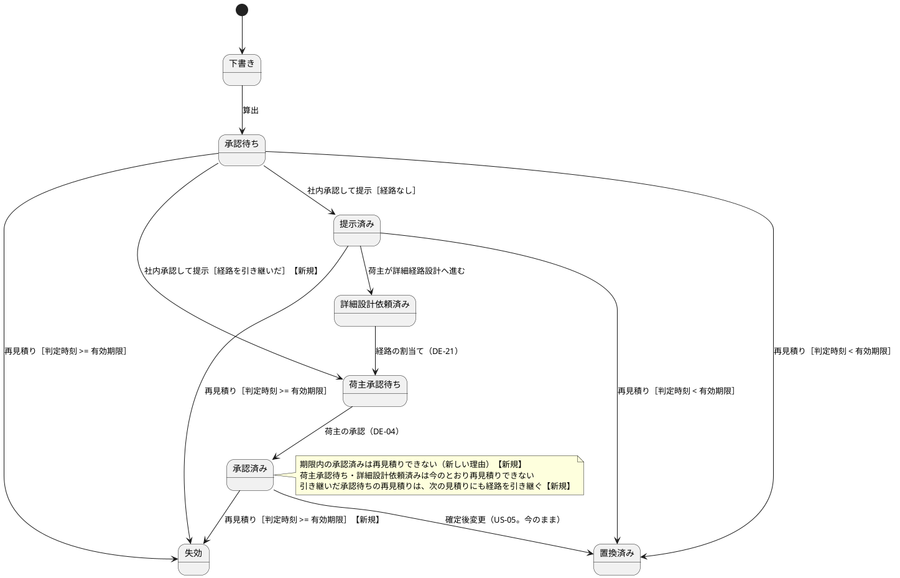
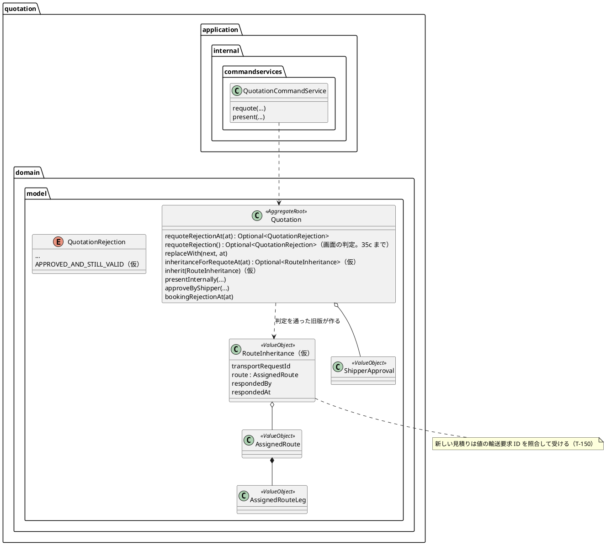

# Bolt 35b 計画 - 承認の後に失効した見積りの再見積り（D-85。ドメインと業務ルール層）

## 基本情報

| 項目 | 内容 |
| :--- | :--- |
| Bolt | 第 35b 回（W5 の 29 本目） |
| 予定 | W5（2026-11-02 の週。前倒しで着手できる）。作業は約 4.5 時間（承認ゲートの待ちと、`check`・uiTest・SonarQube の待ちを除く） |
| 対象 | `quotation`（`Quotation` 集約の再見積りの判定・`replaceWith`・経路の引き継ぎ・提示の分岐、引き継ぎの値、`QuotationRejection`、`QuotationCommandService.requote`、`MyBatisQuotationRepository.save`）、S-04 と C-05 の拒否の文言の switch（新しい理由の仮の文言）、受入シナリオ（業務ルール層）、PostgreSQL の統合テスト、設計文書（domain_model・user_story・data_model・test_strategy・release_plan・development_strategy） |
| GitHub | なし（D-85 は US に属さない決定事項の実装。release_plan の W5 の表と業務責任者に確かめる事項の台帳で扱う） |
| SP | 0 |
| 承認ゲート | 計画と終了報告（W5 の表の 35b の行。Release 1.0 の既定 release_plan.md:105）。スキーマは変えない。層・モジュールの規則に当たったら止めて諮る（T-125） |
| アプローチ | アウトサイドイン。中盤の既定（インサイドアウト）でも :107 の中盤の例外でもなく、開発戦略 :114 の「局面の既定より Bolt の対象で決める」規則で :119「既存の集約に受入条件を足す」に当たる。不確実性は承認・予約・DB の制約との結合（H1・H2）にあり、外から確かめるほうが早いので :122 の外れる理由にも当たらない。順は受入シナリオの Red → サービスの単体テストの Red → 集約 → リポジトリ（データ） |
| マニュアル・デモ | 画面の操作は変えない（S-04 の再見積りの GET の出し分けは今のまま）ので、マニュアルの更新とキャプチャの撮り直しはない（画面とマニュアルは 35c）。デモの動画は作らない（W5 のデモの D-85 は 35c を待つ） |
| 前の Bolt | [Bolt 35 終了報告](bolt_35_report.md) |

## Bolt ゴール

荷主の承認の後に有効期限を過ぎた見積り（承認済み）を、営業担当者が再見積りできる。新しい見積りは承認済みの経路版（案件番号・経路版・確定の時刻・区間）と荷主の詳細経路設計の回答を引き継ぎ、料金と有効期限だけを出し直す。社内承認して提示すると、荷主の回答を経ずに荷主承認待ちになり、荷主が再承認すれば新しい見積りで本予約を確定できる。提示の前にもう一度再見積りしても経路を引き継ぐ。経路設計者の作業は繰り返さない。期限内の承認済みの見積りは再見積りできない。

### 確かめたい仮説

| # | 仮説 | この Bolt で分かること |
| :--- | :--- | :--- |
| H1 | 経路と回答を引き継げば、今の荷主の承認（`approveByShipper`）と予約の照会（`bookingRejectionAt`、`BookableQuotationQueryService`）を変えずに、新しい見積りで再承認と予約ができる | 業務ルール層のシナリオが、承認と予約のステップを変えずに通る |
| H2 | 引き継いだ見積りは今の DB の制約（経路の 3 列・回答の列・荷主承認の列・部分一意インデックス）の中で保存できる | PostgreSQL の統合テストがスキーマを変えずに通る |

### 開始準備で確かめたこと

- **D-85 の決定**（release_plan.md:563・:724。2026-10-11、human:kakimomokuri）: 承認済みの経路版を引き継ぎ、料金と有効期限だけを出し直す。荷主の再承認が要る
- **今の規則**: 承認済みの見積りは有効期限を過ぎても状態は APPROVED のままで、`Quotation.isExpiredAt` が時刻で失効と判定する（`QuotationStatus.expiresByTime` に APPROVED が入る）。状態に EXPIRED を書くのは `replaceWith` だけ。`requoteRejection()`（Quotation.java:425-430）は時刻を受けず、`isRoutingStarted()`（ROUTING_REQUESTED・AWAITING_SHIPPER_APPROVAL・APPROVED）なら ROUTING_REQUESTED で拒む。`QuotationRejection` に「承認済みで期限内」の値はない（名前の近い `ALREADY_APPROVED` は荷主の承認の拒否）
- **`requoteRejection()` を呼ぶ箇所**（T-148 で grep した）: 集約の `replaceWith`（Quotation.java:230）、サービスの `requote`、画面の `QuotationViews:100`（ボタンの出し分け）と `StaffQuotationController:189`（GET の判定）。**`replaceWith` が今の判定を呼ぶので、そのままでは承認済みの旧版は ROUTING_REQUESTED で拒まれ EXPIRED にならない。サービスは `replaceWith` の戻り値を見ない（QuotationCommandService.java:165）ので、旧版は APPROVED のまま `update` され、新しい見積りの `save` が `ux_quotation_active` に当たる**
- **再見積りのサービス**: `QuotationCommandService.requote`（:129-175）は `REQUOTABLE = {QUOTING, QUOTED}`（:40-41。Javadoc :39）で、ほかの状態は TRANSPORT_REQUEST_NOT_QUOTING で拒む。新しい見積りを作って算出し、旧版の `replaceWith` → 旧版を先に `update` → 新しい見積りを `save`。イベントは出さず、新しい見積りは PENDING_APPROVAL で止まる。社内承認と提示は `present`（:98-121。`presentInternally` で PRESENTED、DE-03）。S-04 の再見積りの POST（StaffQuotationController.java:203-245）は集約の判定を通さずにサービスを呼ぶので、35b から POST では承認済みで失効した見積りを受け付け、新しい理由の文言も POST で出る（GET とボタンは今の判定のまま。決定 (7)）
- **集約の遷移**: `presentInternally`（:195-215）は PENDING_APPROVAL → PRESENTED。`assignRoute`（:307-334）は ROUTING_REQUESTED のときだけ AWAITING_SHIPPER_APPROVAL にし、承認待ちなら NOT_ROUTING_REQUESTED、荷主承認待ちで同じ経路版なら ALREADY_ASSIGNED（冪等）、別の版なら ANOTHER_ROUTE_VERSION_ASSIGNED（:311-318）。`approveByShipper`（:343-361）は AWAITING_SHIPPER_APPROVAL → APPROVED で DE-04。`bookingRejectionAt`（:448-461）は退役済み → 期限切れ → APPROVED でない。`AssignedRoute` は区間が空だと例外（:31-33）。前例の `replaceWith` は ID を受ける（:227）
- **輸送要求**: 先へだけ進める（`QUOTATION_PROGRESSION`、`isBefore`。Bolt 12 レビュー R-04）。再承認の DE-04 の listener の `markReadyToBook` は READY_TO_BOOK なら ALREADY_REACHED で何もしない。予約の照会は輸送要求の状態を見ない（見積りの状態・期限・版だけ）。このため 35b だけで新しい見積りの再承認と予約が通る見込み（H1）。輸送要求は再見積りの間も READY_TO_BOOK のままで、承認待ちへ戻すのは 35b2。DE-21 と DE-04 がどちらも遅れると輸送要求は ROUTING のまま（予約の確定待ちの表は ROUTING も含める。QuotationMapper.xml:190-197）
- **イベント**: DE-03 を購読するのは `QuotationPresentedEventHandler` と KPI の `KpiObservationEventHandler` だけ（grep した）。`markQuotationPresented` は READY_TO_BOOK では ALREADY_REACHED、KPI は最初の提示時刻を変えない（KPI-INV-01）。DE-04 を購読するのは `QuotationApprovedByShipperEventHandler` だけ。DE-21 は出さない（経路設計の割当てではないので）
- **データ**: `ck_quotation_route_assigned` は経路の列を荷主承認待ち・承認済みでだけ必須にし、承認待ち・提示済みで持つことも許す。`ck_quotation_responded` は回答の列を ROUTING_REQUESTED でだけ必須にする。`ck_quotation_shipper_approved` は EXPIRED の旧版が承認の列を持つことを許す。`ck_quotation_replaced` は EXPIRED で置換先なしを許す。`ux_quotation_active` は DRAFT〜APPROVED を数えるので、旧版を先に EXPIRED に `update` すれば保存できる。`insertQuotation` は経路・回答・荷主承認の列をすべて書き、`shipper_response` は `respondedBy` から作る（MyBatisQuotationRepository.java:204）。**`save`（:61-80）は `assigned_route_leg` を書かない**（区間は `update` で区間がまだないときだけ書く）。読み出しは経路の列があって区間が 0 件だと例外になるので、`save` で区間を書く直しが要る（SQL はある `insertAssignedRouteLeg` を使い、スキーマは変えない）
- **画面が前提にすること**: S-02 の経路設計中の表（`RoutingRequestedSummary`）と S-04（`StaffQuotationController:368`）は荷主承認待ちの見積りに回答時刻がある前提。決定 (6) で回答を引き継ぐので落ちない。引き継いだ承認待ちの見積りには S-04 と見積りの断片で回答時刻と経路が出る（QuotationViews.java:107-108、quotation.html:40）。POST で再見積りした輸送要求は、35b2 までの間（輸送要求は予約待ち、見積りは承認待ちか荷主承認待ち）S-02 のどの表にも出ない（QuotationMapper.xml:174・:197）。35b2 と 35c で直す一時的な見え方として報告に書く
- **既存のテストで名前や Javadoc が新しい規則と食い違うもの**: `QuotationShipperApprovalTest:191`（荷主承認待ちと承認済みは再見積りできない。今の判定のテストとして残し、名前を「画面の判定（35c まで）」にする）・`:197`・`:201`、`QuotationTest:341`、`QuotationCommandServiceTest:273`（見積り作成中でも提示済みでもない見積依頼は再見積りできない）、`REQUOTABLE` の Javadoc（:39）と `TRANSPORT_REQUEST_NOT_QUOTING` の意味
- **`QuotationRejection` を写す網羅の switch**: `StaffQuotationController.rejection`（:322-336）と `QuotationResponseController.rejection`（:124-138）。値を足すとコンパイルが捕まえるので、この Bolt で仮の文言が要る（T-57）
- **受入シナリオ**: 背景は `booking/confirm_booking.feature` の背景（提出 → 審査 → 見積り → 詳細経路設計 → 候補の確定 → 配信）を写せる。ステップは `QuotationSteps`（再見積り :186、社内承認して提示 :166、状態 :234。`STATUSES` に承認待ち・荷主承認待ち・承認済み・失効がある。`REJECTIONS`（:42-46）には「承認済みで有効期限内」を足す）、`ShipperApprovalSteps`（承認 :70。割当ての確認 :91 は状態が荷主承認待ちであることも確かめるので、引き継ぎは提示の後に確かめる）、`BookingSteps`（確定 :67、結果 :103）。`InMemoryQuotationRepository` は集約の写しを持つので、`save` の区間の変異は業務ルール層では捕まらない（PostgreSQL の統合テストで捕まえる）
- **文書の行**: domain_model.md の用語集「割り当てた経路」:116、集約の操作の一覧 :405-421、見積りの状態遷移の図 :493-514（:506「承認済み --> 失効」、:510「承認済み --> 置換済み : 確定後変更」）、Q-INV-18 :530、Q-INV-07 :532、:551 の Bolt 11 の DE-03、「再見積りできない」:553・:555、R-INV-11 :695、イベントの表の DE-03 :1422・DE-21 :1426・DE-04 :1427、DE-03 の通知 :1310・:1460。data_model.md:359。user_story.md の US-03 の再見積りの決定 :142、US-24 の Bolt 12 の決定 :169、Bolt 20 の決定 :171・:173-177。test_strategy.md:230（Q-INV-05〜07 の統合の列）。release_plan.md:563 の注の行番号（:552・:554・:505 は今の :553・:555・:506）

## ふりかえりと前の Bolt からの引き継ぎ

| 入力 | 内容 | この Bolt での扱い |
| :--- | :--- | :--- |
| 開始準備の決定（2026-10-19、human:kakimomokuri） | (1) D-85 を 35b（ドメインと業務ルール層）・35b2（輸送要求を承認待ちへ戻す）・35c（画面とマニュアル）に分ける。(2) 輸送要求は承認待ちへ戻す（35b2）。(3) 新しい見積りは旧版の経路を写し、提示したら荷主承認待ちに直行する。(4) 引き継ぎ元の列は足さない。(5) 戻しは新しい DE-24 と順序の守り（35b2）。(6) 荷主の回答者と回答時刻は旧版から写す。(7) 画面の出し分けは 35c まで今の判定のまま。(8) 引き継いだ見積りを提示の前にもう一度再見積りしても経路を引き継ぐ。(9) 引き継ぎは判定を通ったときだけ旧版が作る値で渡す。(10) DE-03 に属性を足さず、W9 の通知は見積りの状態を問い合わせて行き先を決める。(11) 予約に使った見積りを DE-07 の遅れの間に再見積りできる隙間は受け入れて台帳に載せる | 確認ポイント 1〜10 |
| Bolt 35 の Try T-154 | 「作れない」「できない」と書く前に作る手段を探して確かめる | 「再見積りできない」の今の記述を、コードと制約で確かめた（上） |
| Bolt 35 の Try T-155 | 開いたときと送ったときで同じ表示の画面は、判定した結果を画面に渡す | S-04 の再見積りの POST の分に当たる（GET と POST の判定が 35c まで分かれる）。POST の拒否は新しい理由の結果をそのまま文言にする。GET を合わせるのは 35c |
| Bolt 34f の Try T-152 | テストのクラスを分けたら使わない private のメソッドと定数を grep する | テストのクラスは分けない。足した補助が使われていることを `check` の前に確かめる |
| Bolt 34f の Try T-153 | 「〜だけが呼ぶ」と書くときは守る規則の範囲を挙げる | 新しい判定を使うのはサービスと `replaceWith` の 2 つ、今の判定を使うのは画面の 2 つ。サービスの単体テスト（承認済みで失効した旧版を受け付ける）と集約のテスト（`replaceWith` で EXPIRED）で守る |
| Bolt 34e の Try T-150 | 判定を通さずに呼べない形は、承認と判定した対象の結び付きを確認ポイントに挙げる | 決定 (9)。旧版が再見積りの判定を通ったときだけ引き継ぎの値を作り、新しい見積りは値の輸送要求 ID を照合する |
| Bolt 34e の Try T-151 | テストの件数は `check` が終わった後に数え、同じ数え方で比べる | 各ステップの `check` の後に数える |
| Bolt 34d の Try T-147 | SonarQube はほかの Gradle の実行が終わってから | ステップ 6。レビューのエージェントにテストを流させない |
| Bolt 34d の Try T-146 | 状態を戻せる操作を足す計画では、往復の後に残るものを確認ポイントに挙げる | 輸送要求の戻しは 35b2。この Bolt は見積りを戻さない（旧版は EXPIRED で終端）。当たらない |
| Bolt 34c の Try T-148 | 「〜だけ」と書く前に全体を grep する | `requoteRejection`・`REQUOTABLE`・`isRoutingStarted`・「再見積りできない」・`QuotationRejection` の switch を grep した（上） |
| Bolt 34c の Try T-149 | 見張りの規則は捕まえる変更を書き、変異で確かめる | 規則は足さない。判定の境界と引き継ぎの結び付きを変異で確かめる |
| Bolt 20 の Try T-57 | 値を足したらそれを見る判定をすべて洗い出す | `QuotationRejection` の 2 つの switch に仮の文言を入れる（確認ポイント 14） |
| Bolt 33b〜34c の Try（T-112・T-117・T-131・T-137・T-141） | 控えから戻す、スクリプトの接頭辞 | 変異は控えから戻す。スクリプトは `b35b_` で始める |
| Bolt 35 の既知の課題 | 特殊貨物の画面の axe、CI の揺らぎ、予約から見積りのドメインへの型の規則 | この Bolt の範囲外（W5 の締め） |

## スコープ

### 入れるもの・入れないもの

| 入れる | 入れない（後で） |
| :--- | :--- |
| 承認済みで失効した見積りの再見積り（集約の判定、`replaceWith`、サービス、旧版は EXPIRED） | 輸送要求を予約待ちから承認待ちへ戻すこと、DE-24 と listener（35b2） |
| 引き継ぎの値（判定を通った旧版が作る）と、新しい見積りへの経路と荷主の回答の引き継ぎ、提示で荷主承認待ちへ直行。引き継いだ承認待ちの見積りをもう一度再見積りしても引き継ぐ | S-02・S-04（GET とボタン）・C-04・C-17 の画面と文言、暫定の案内の撤去、マニュアル 4・6・7 章（35c） |
| 期限内の承認済みの再見積りの拒否（新しい理由の値と、S-04・C-05 の switch の仮の文言） | 再見積りした見積りが荷主承認待ちで再承認の前にまた失効したとき（今の規則で再見積りできない。台帳 D-86） |
| リポジトリの `save` で区間を書く直しと PostgreSQL の統合テスト | 引き継ぎ元の見積りの列（決定 (4)） |
| 受入シナリオ（再見積り → 提示 → 再承認 → 予約、提示の前の再々見積り、期限内の拒否、旧版で予約できない） | 予約に使った見積りを DE-07 の遅れの間に再見積りできる隙間（決定 (11)。台帳 D-87。US-05 の W11 で扱う） |
| 文書（状態遷移・操作・用語・不変条件・イベントの表・US の決定・台帳） | 経路設計の案件が旧版の見積り ID を持ち続けること（W6 の Q-INV-10 の再設計要・旧版の判定と W13 の US-08 の開始準備の入力） |

### 設計の約束（Try T-1）

- **再見積りの判定**: 集約に時刻を受ける新しい判定 `requoteRejectionAt(at)` を足す（`presentRejectionAt`・`bookingRejectionAt` の前例の名前）。退役済み（置換済み・EXPIRED）なら今の理由、詳細設計依頼済みと荷主承認待ちなら今のとおり ROUTING_REQUESTED、**承認済みで期限内なら新しい理由**（`ALREADY_APPROVED` と見分けられる名前にする。候補 `APPROVED_AND_STILL_VALID`）、承認済みで期限切れ（判定時刻 >= 有効期限）なら受け付ける。承認待ち・提示済みは今のとおり受け付ける。今の `requoteRejection()` は画面のために 35c まで残す（Javadoc に「画面の判定。35c で新しい判定に替える」と書く）
- **`replaceWith`**: 中の守りを今の判定から `requoteRejectionAt(at)` に替える。承認済みで期限切れの旧版は EXPIRED にする（置換先を持たない。今の失効の置換と同じ）。荷主の承認の記録は旧版に残す。サービスが戻り値を捨てているので、`replaceWith` が拒んだのに保存へ進む形にならないよう、サービスが判定を先に呼ぶ今の順を残し、その順をテストで守る
- **引き継ぎの値**（決定 (9)）: 旧版は、再見積りの判定を通ったときだけ、引き継ぎの値（輸送要求 ID、`AssignedRoute`、回答者・回答時刻。名前はステップ 3 で決める。候補 `RouteInheritance`）を作る（例 `inheritanceForRequoteAt(at)`。経路を持たない旧版は空）。経路を持つのは、承認済みで失効した旧版と、引き継いだ承認待ち・提示の前の旧版（決定 (8)。荷主承認待ちは今の規則で再見積りできない）。新しい見積りは算出の後・提示の前にその値だけを受け、値の輸送要求 ID が自分の輸送要求と同じかを照合する（違えば例外。呼び手の誤り）。値は `quotation.domain.model.valueobjects` に置く record（新しいファイル）。料金明細・通貨・経路方針の初期値は今の再見積りのまま（US-03 の Bolt 11 の決定）、有効期限は空
- **提示**: `presentInternally` は、経路を引き継いだ見積りなら PRESENTED を経ずに荷主承認待ち（AWAITING_SHIPPER_APPROVAL）にする。DE-03 は今のとおり出す（KPI の最初の提示時刻は変わらない。属性は足さない。決定 (10)）。DE-21 は出さない。引き継いだ見積りの荷主の回答（`requestRouteDesign`）は今の規則で拒まれ、経路の割当て（`assignRoute`）の結果は承認待ちなら NOT_ROUTING_REQUESTED、荷主承認待ちで同じ経路版なら ALREADY_ASSIGNED、別の版なら ANOTHER_ROUTE_VERSION_ASSIGNED（今のまま）になることをテストで確かめる
- **サービス**: `requote` は `requoteRejectionAt(now)` を使い、`REQUOTABLE` に ROUTING・AWAITING_APPROVAL・READY_TO_BOOK を足す（ROUTING と AWAITING_APPROVAL は DE-21・DE-04 の配信の遅れで旧版が承認済みでも輸送要求が残っているとき。経路設計の途中の旧版は集約の判定が ROUTING_REQUESTED で拒むので、輸送要求の状態を広げても途中の見積りは再見積りできない）。BOOKED は足さない。旧版から引き継ぎの値を受けて新しい見積りに渡す。書く順（旧版を先に `update`）は今のまま。`REQUOTABLE` の Javadoc と `TRANSPORT_REQUEST_NOT_QUOTING` の意味（見積り作成中・提示済み・経路設計中・荷主承認待ち・予約待ちのどれでもない）を直す
- **リポジトリ**: `save` は経路があれば `assigned_route_leg` も書く（SQL・スキーマは変えない）。PostgreSQL の統合テスト（既存の `MyBatisQuotationIntegrationTest` に足す）で、引き継いだ見積りの保存・読み出し・提示の更新・荷主の承認、旧版の EXPIRED と承認の列、部分一意インデックスを確かめる
- **文言**: 新しい理由の画面の文言は、S-04（`StaffQuotationController.rejection`）と C-05（`QuotationResponseController.rejection`）の switch に仮の文言を入れる（S-04: 「荷主が承認済みで、まだ有効期限内です。本予約の確定へ進んでください。」、C-05: 荷主の回答では起きないので「この見積りには回答できません。」の既定の形）。UI 設計への記載と見直しは 35c。受入シナリオの拒否の名前は「承認済みで有効期限内」
- **SpotBugs・用語集**: SpotBugs の除外は足さない。引き継ぎの値は `@ValueObject` を付けるので、用語集のテスト（`LivingGlossaryConsistencyTest`）の対象になる。domain_model の用語集と見積りの要素表に足し、Javadoc を用語集の日本語名で始める
- **新しいファイル**: 引き継ぎの値の record 1 つと、受入シナリオの feature 1 つ（`quotation/requote_after_approval.feature`）の 2 つ。単体テストは既存の `QuotationTest`・`QuotationShipperApprovalTest`・`QuotationCommandServiceTest` に、統合テストは `MyBatisQuotationIntegrationTest` に足す

## 設計（この Bolt の範囲）

4 図のうち、状態遷移図とドメインモデル図を置く。ER 図は表と列を変えないので、画面遷移図は画面の遷移を変えないので省く。

### 状態遷移図（見積り。この Bolt で足す遷移に【新規】を付ける）

### ドメインモデル図（再見積りの範囲）

注（設計への反映が必要。ステップ 1 で直す行）:

- domain_model.md: 用語集の「割り当てた経路」（:116）に「または再見積りで承認済みの旧版から写す。D-85」と引き継ぎの値の用語、集約の操作の一覧（:405-421。「+ 再見積りできない理由(判定時刻)」「+ 引き継ぐ値(判定時刻)」「+ 経路を引き継ぐ(…)」）、見積りの状態遷移の図（:493-514。上の【新規】の遷移。:510 の確定後変更は今のまま）、Q-INV-18（:530）・Q-INV-07（:532）の再見積りの範囲、:551 の DE-03（再見積りの提示でも KPI を変えない）、:553・:555 の「再見積りできない」を D-85 の範囲に、R-INV-11（:695）に再見積りの写し、イベントの表の DE-03（:1422。経路を引き継いだ再見積りの提示でも発行し、行き先は荷主承認待ち。属性は足さず、W9 の通知は見積りの状態を問い合わせる。決定 (10)）・DE-21（:1426。引き継いだ見積りでは出さない）・DE-04（:1427。35b の間は再承認でも輸送要求の状態を変えない）、DE-24（35b2 で作る。予約として行を置く。発行元は旧版の承認済みからの再見積りの提示、listener は `quotation.application.internal.eventhandlers` で `TransportRequestProgression` と別のクラス）
- user_story.md: US-24 の決定に D-85（35b・35b2・35c の分け方、経路と回答の引き継ぎ、再承認、提示の前の再々見積り）、US-03 の Bolt 11 の決定（:142）に承認済みで失効した見積りからも始められること、US-24 の Bolt 12 の決定（:169）の「それまでは再見積りできない」の範囲
- data_model.md: :359 の末尾（区間はリポジトリが `save` でも書く）、引き継いだ見積りは承認待ち・荷主承認待ちで経路の列と回答の列を持つこと（制約の範囲内）、`assigned_route_leg` は新しい見積りの ID で区間の写しを持つこと、引き継ぎ元を記録しないこと（決定 (4)）
- test_strategy.md: :230 の Q-INV-05〜07 の統合の列に PostgreSQL の統合テスト（引き継いだ見積りの保存）
- release_plan.md: 35b の行を 35b・35b2・35c に分ける（どれも SP 0。35b2 は輸送要求の集約を広げるのでアウトサイドイン、順序の守りでスキーマを変える見込みがあることを承認ゲートの列に。35c は画面からのアウトサイドイン）、開始準備の決定 (1)〜(11)、チェックリスト、:553 の W5 の状態（次は Bolt 35b）、:557 の局面とアプローチ（35b・35b2・35c）、:563 の注（行番号の直しと 35b・35b2・35c）、:608 の 35b の行のアプローチの列、:724 の D-85 の台帳、:788 の W5 の本数（31 本）と次の Bolt、台帳に D-86（再見積りした見積りが荷主承認待ちで再承認の前に失効したとき）と D-87（予約に使った見積りを DE-07 の遅れの間に再見積りできる隙間。決定 (11)）、経路設計の案件が旧版の見積り ID を持ち続けることを W6 と W13 の開始準備の入力に
- development_strategy.md: :344 の W5 の行に「D-85（35b・35b2・35c）はアウトサイドイン（:119）」、:183 の W5 のデモを「承認の後に失効した見積りの再見積り（D-85。Bolt 35b〜35c、画面は 35c）」

## ステップ計画

状態の記号: `[ ]` 未着手、`[-]` 進行中、`[?]` 承認待ち、`[x]` 完了。各ステップの終わりに `check` が緑で件数が減っていないことを確かめ（T-151）、push してアプリの CI と MkDocs の配備を確かめる（T-26、T-126）。コミットは pathspec で作る（T-110）。

- [ ] **1. 設計文書**
  - 上の注の行を直す。完了の判定: `okf:check` ERROR 0、`documentationTest` 緑
- [ ] **2. 業務ルール層の受入シナリオ（Red）**
  - 新しい feature（`@US-24 @must`、シナリオに `@D-85 @Q-INV-07`）。承認済みの見積りが失効した後に再見積りすると、見積り 1 は失効、見積り 2 は承認待ち。見積り 2 を社内承認して提示すると荷主承認待ちになり、経路版と区間を引き継いでいる（`ShipperApprovalSteps` :91 で確かめる）。荷主が見積り 2 を承認すると承認済みになり、見積り 2 で本予約を確定できる。見積り 1 では本予約を確定できない（失効）。見積り 2 を提示の前にもう一度再見積りすると、見積り 3 も提示で荷主承認待ちになる。期限内の承認済みは「承認済みで有効期限内」で拒む（`QuotationSteps.REJECTIONS` に足す）。輸送要求の状態（予約待ちのまま）はシナリオで確かめず、35b2 で変わると feature の説明に書く。今のコードで落ちることを確かめる
- [ ] **3. サービスと集約（再見積りの判定、`replaceWith`、引き継ぎ、提示の分岐）**
  - サービスの単体テストの Red（READY_TO_BOOK・AWAITING_APPROVAL・ROUTING で再見積りできる、`requoteRejectionAt` を使う、旧版が承認済みで失効なら引き継ぐ、期限内の承認済みは新しい理由で拒む、拒んだら何も保存しない）→ 集約の単体テスト: `requoteRejectionAt` の境界（有効期限の 1 分前・同時刻・1 分後）と状態ごとの理由、`replaceWith` で承認済みで失効した旧版が EXPIRED になり承認の記録が残る、引き継ぎの値は判定を通ったときだけ作られ経路のない旧版では空、引き継ぎは輸送要求 ID が違えば例外、引き継いだ承認待ちの旧版からも値が作られる、引き継いだ見積りの提示は荷主承認待ちで DE-03 を出し DE-21 を出さない、荷主の回答は拒まれ経路の割当ては状態ごとの結果、荷主の承認で承認済みになる → 実装。今の `requoteRejection()` のテストは名前を「画面の判定」に直して残す。`QuotationRejection` の 2 つの switch に仮の文言を入れる
- [ ] **4. リポジトリ**
  - PostgreSQL の統合テストを先に足し（引き継いだ見積りの保存・読み出し・提示・承認、旧版の EXPIRED、部分一意インデックス）、`MyBatisQuotationRepository.save` で区間を書く
- [ ] **5. 受入シナリオの Green と変異**
  - ステップ 2 のシナリオが通る。変異（期限の判定を `>` にする、承認済みの期限内を受け付ける、`replaceWith` の守りを今の判定に戻す、引き継ぎの輸送要求 ID の照合を外す、提示の分岐を外す、`save` の区間を外す）で落ちることを確かめる（控えから戻す。`save` の区間は統合テストで捕まえる）
- [ ] **6. uiTest と SonarQube と開発レビューと終了報告**
  - `uiTest`（画面の層の件数が変わらない。S-04 の POST の拒否の文言が変わるので、再見積りのシナリオが通ることを確かめる）、SonarQube（ほかの Gradle の後。T-147）。開発レビュー（アーキテクト、テスター。読むだけ）。`bolt_35b_report.md`、release_plan、開発の索引

### 時間の配分と打ち切り

| # | 目安 | 打ち切り |
| :--- | :--- | :--- |
| 1 | 45 分 | — |
| 2 | 35 分 | — |
| 3 | 85 分 | 集約の遷移が今の不変条件（Q-INV-07・Q-INV-18）と食い違うと見えたら止めて諮る |
| 4 | 35 分 | スキーマの変更が要ると見えたら止めて諮る |
| 5 | 20 分 | — |
| 6 | 50 分（uiTest と SonarQube の待ちを除く） | — |

合計 270 分（約 4.5 時間）。目安の 4 時間を超えるが、半日は超えない。提示の前の再々見積りの引き継ぎ（決定 (8)）と引き継ぎの値（決定 (9)）で初版より 20 分増えた。ステップ 3 を終えた時点で 2.8 時間を超えていたら止めて諮る（候補: 再々見積りのシナリオを 35b2 に送る）。

## 確認ポイント（計画の承認の場でまとめて確認する。Try T-6）

| # | 確認すること | ステップ | 推奨・決定 |
| :--- | :--- | :--- | :--- |
| 1 | **Bolt の分け方** | 全体 | 決定済み（1）: 35b（ドメインと業務ルール層）・35b2（戻し）・35c（画面とマニュアル）。すべて SP 0、W5 |
| 2 | **輸送要求の状態** | — | 決定済み（2）・（5）: 承認待ちへ戻す。35b2 で DE-24 と順序の守りで作る。35b の間は予約待ちのまま（再承認と予約は通る） |
| 3 | **見積りの経路** | 3 | 決定済み（3）: 旧版の経路を写し、提示で荷主承認待ちに直行する |
| 4 | **引き継ぎ元の記録** | — | 決定済み（4）: 列を足さない。同じ輸送要求で同じ案件番号・経路版を持つことから辿る |
| 5 | **荷主の回答** | 3 | 決定済み（6）: 回答者と回答時刻を旧版から写す |
| 6 | **画面の判定** | 3 | 決定済み（7）: GET とボタンは 35c まで今の `requoteRejection()`。POST はサービスの判定で、35b から承認済みで失効した見積りを受け付ける |
| 7 | **提示の前の再々見積り** | 3 | 決定済み（8）: 引き継いだ承認待ちの見積りの再見積りでも経路を引き継ぐ |
| 8 | **引き継ぎの形** | 3 | 決定済み（9）: 判定を通った旧版が作る値で渡し、新しい見積りは輸送要求 ID を照合する |
| 9 | **DE-03 の属性** | 1 | 決定済み（10）: 足さない。W9 の通知は見積りの状態を問い合わせて行き先を決める |
| 10 | **予約に使った見積りの隙間** | 1 | 決定済み（11）: 受け入れて台帳 D-87 に載せる（US-05、W11） |
| 11 | **再見積りを始められる輸送要求の状態** | 3 | QUOTING・QUOTED に ROUTING・AWAITING_APPROVAL・READY_TO_BOOK を足す（ROUTING・AWAITING_APPROVAL は配信の遅れのとき。経路設計の途中の見積りは集約が拒む）。BOOKED は足さない。決定済み（計画の承認） |
| 12 | **2 つの判定が並ぶこと** | 3 | 35c で今の判定を消すまで並ぶ。新しい判定を使うのはサービスと `replaceWith`、今の判定を使うのは画面の 2 つ。推奨: このまま。決定済み（計画の承認） |
| 13 | **再承認の前にまた失効したとき** | — | 荷主承認待ちは今の規則で再見積りできないので行き詰まる。範囲外とし、台帳 D-86 に載せる（期限は W5 の締めで決める）。決定済み（計画の承認） |
| 14 | **新しい理由の値と仮の文言** | 3 | `ALREADY_APPROVED` と見分けられる名前（候補 `APPROVED_AND_STILL_VALID`）。S-04 の仮の文言「荷主が承認済みで、まだ有効期限内です。本予約の確定へ進んでください。」、C-05 は既定の形。UI 設計への記載は 35c。決定済み（計画の承認） |
| 15 | **新しいファイル** | 2・3 | 引き継ぎの値の record と、受入シナリオの feature の 2 つ。決定済み（計画の承認） |
| 16 | **開発レビュー** | 6 | アーキテクト、テスター（読むだけ）。画面の操作を変えないのでインタラクションデザイナーは入れない。決定済み（計画の承認） |
| 17 | **アプローチと承認ゲートと時間** | 全体 | アウトサイドイン（:119）。承認ゲートは計画と終了報告（W5 の表どおり）。約 4.5 時間。決定済み（計画の承認） |

## 完了条件

- [ ] 承認済みで失効した見積りを再見積りでき、新しい見積りが経路と荷主の回答を引き継いで、提示で荷主承認待ちになる。再承認すれば新しい見積りで本予約を確定できる。提示の前にもう一度再見積りしても引き継ぐ
- [ ] 期限内の承認済みは再見積りできない。旧版（失効）では予約できない
- [ ] 集約の境界（期限の直前・同時刻・直後）と引き継ぎの結び付きを単体テストと変異で確かめた。PostgreSQL の統合テストがスキーマを変えずに通る
- [ ] `check` と `uiTest` が緑で、件数が減っていない。push してアプリの CI と MkDocs の配備を確かめた。SonarQube の Quality Gate が PASS、`okf:check` ERROR 0
- [ ] 設計文書（状態遷移・操作・用語・不変条件・イベントの表・US の決定・台帳）が合っている
- [ ] 開発レビュー、終了報告

## 更新履歴

| 日付 | 更新内容 | 更新者 |
| :--- | :--- | :--- |
| 2026-10-19 | 初版作成（承認待ち）。human:kakimomokuri の決定 (1)〜(7)（35b・35b2・35c に分ける、輸送要求は承認待ちへ戻す、経路を写して荷主承認待ちに直行、引き継ぎ元の列を足さない、DE-24 と順序の守り、回答を旧版から写す、画面は 35c まで今の判定）を反映した | anthropic/claude-opus-5-5 |
| 2026-10-19 | 詳細整合性検証（16 件）と横断整合性検証（17 件）の指摘を反映した。human:kakimomokuri の決定 (8)〜(11)（再々見積りでも引き継ぐ、判定を通った値で渡す、DE-03 に属性を足さない、予約に使った見積りの隙間は台帳へ）。`replaceWith` の守りを新しい判定に替えること、S-04 の POST の振る舞いと 2 つの switch の仮の文言、ROUTING を再見積りできる状態に、アプローチの根拠（:114・:119・:122）とステップの順、注の行（用語集・R-INV-11・イベントの表・DE-24 の予約・data_model :359・test_strategy :230・release_plan の 6 か所・開発戦略 :183・:344）、行番号の誤り、Try T-152、状態遷移図の【新規】、feature のタグ、新しいファイルの数、既存のテストの名前と Javadoc | anthropic/claude-opus-5-5 |
| 2026-10-19 | 計画を承認した。確認ポイント 11〜17 を推奨のとおりに決めた | anthropic/claude-opus-5-5、承認 human:kakimomokuri |

## 関連ドキュメント

- [リリース計画](release_plan.md)（W5、D-85）、[開発戦略](development_strategy.md)
- [Bolt 35 終了報告](bolt_35_report.md)、[Bolt 23b 終了報告](bolt_23b_report.md)（議題 5）、[Bolt 24 計画](bolt_24_plan.md)（確認ポイント 14）、[Bolt 11 計画](bolt_11_plan.md)（再見積りと置換）
- [ユーザーストーリー](../../requirements/cargo-tracker/user_story.md)（US-03・US-24）、[ドメインモデル](../../design/cargo-tracker/domain_model.md)（見積りの状態遷移）、[データモデル](../../design/cargo-tracker/data_model.md)、[テスト戦略](../../design/cargo-tracker/test_strategy.md)
