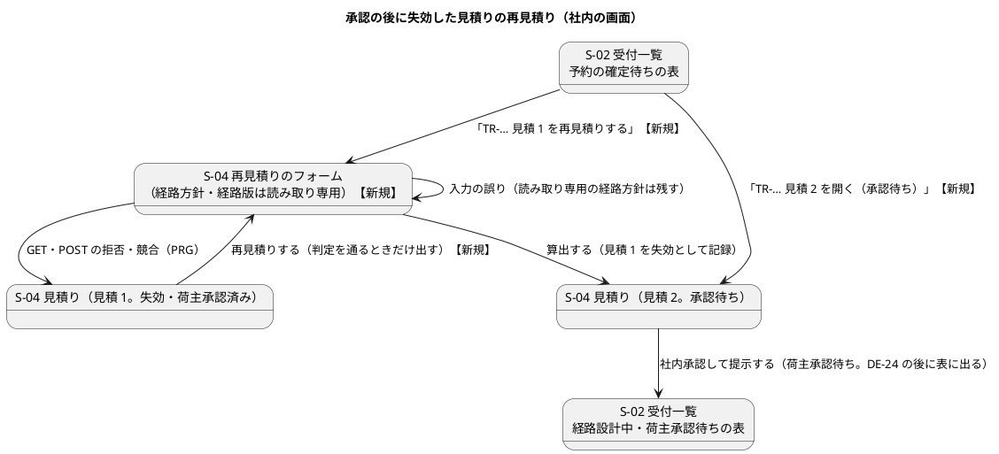

# Bolt 35c 計画 - 承認の後に失効した見積りの再見積りを社内の画面から操作する（D-85。S-02・S-04）

## 基本情報

| 項目 | 内容 |
| :--- | :--- |
| Bolt | 第 35c 回（W5 の 31 本目） |
| 予定 | W5（2026-11-02 の週。前倒しで着手できる）。作業は約 5.1 時間（承認ゲートの待ちと、`check`・uiTest・SonarQube・`manualScreenshots` の待ちを除く。確認ポイント 13） |
| 対象 | `quotation`: 再見積りできるかの判定（`StaffQuotationQueryService` に照会を足し、`QuotationCommandService.requote` も使う）、`Quotation.requoteRejection()` の削除、`QuotationRejection`（予約確定済みの理由）、`StaffQuotationController`（S-04 の再見積りの GET・POST、案内と拒否の文言、経路方針の扱い）、`QuotationViews`、S-04 のテンプレート（`staff/quotations/show.html`・`new.html`、`fragments/assigned-route.html` の読み込み）、S-02（`TransportRequestReviewController`・`staff/transport-requests/list.html`）、予約の確定待ちの読み取りモデル（`AwaitingBookingSummary`・`AwaitingBookingSummaryRow`・`QuotationMapper.xml` の `selectAwaitingBooking`・`MyBatisQuotationRepository.findAwaitingBookingSummaries`・`QuotationRepository` の Javadoc）、画面の層の受入シナリオとステップ、UI 設計、マニュアル 6・7 章・付録 B とキャプチャ |
| GitHub | なし（D-85 は US に属さない決定事項の実装。release_plan の W5 の表と業務責任者に確かめる事項の台帳で扱う） |
| SP | 0 |
| 承認ゲート | 計画と終了報告（W5 の表の 35c の行）。スキーマは変えない（読み取りモデルの SQL だけ）。開発データは 35d（決定 (5)）。層・モジュールの規則に当たったら止めて諮る（T-125） |
| アプローチ | アウトサイドイン（画面から。release_plan の 35c の行、開発戦略 :119）。画面の層の受入シナリオ（Red）→ WebMvc のテスト → controller・画面のモデル → 照会のサービス → 読み取りモデルの SQL の順 |
| マニュアル・デモ | 6 章（受付一覧と審査と見積り）・7 章（本予約の確定と予約一覧）・付録 B を直し、S-02 の失効した行と S-04 の再見積りのフォームのキャプチャを足す（完了条件。後の Bolt に送らない）。マニュアル 4 章（荷主の再承認）は 35d。35c の新しい feature に `@demo` は付けず、W5 のデモの動画は 35d で再承認から本予約までをつないで撮る（開発戦略 :140 の例外。決定 (1)）。35b・35b2・35c は単独で出さず、35d と一緒に出す |
| 前の Bolt | [Bolt 35b2 終了報告](bolt_35b2_report.md) |

## Bolt ゴール

営業担当者が、荷主の承認の後に有効期限を過ぎた見積りを受付一覧（S-02）の予約の確定待ちの表から再見積りできる。再見積りのフォームは、引き継ぐ経路方針と経路版を読み取り専用で示し、料金と有効期限だけを入れさせる。算出した見積り 2 は、社内承認して提示するまで確定待ちの表の同じ行から開ける。提示すると荷主承認待ちになり（Bolt 35b2 の DE-24 で輸送要求も荷主承認待ちへ戻る）、経路設計中・荷主承認待ちの表に移る。期限内の承認済みの見積りと予約確定済みの見積りには再見積りの操作を出さず、ボタン・GET・POST が同じ理由を示す。

### 確かめたい仮説

| # | 仮説 | この Bolt で分かること |
| :--- | :--- | :--- |
| H1 | 再見積りできるかの判定（輸送要求の状態・版・見積りの判定時刻の判定）を照会のサービスの 1 か所にまとめれば、ボタン・GET・POST が同じ理由を示し、承認済みの見積りの扱いが画面と業務の規則で食い違わない | WebMvc のテストで、期限内の承認済み・期限を過ぎた承認済み・予約確定済みのそれぞれでボタン・GET・POST の出し分けが一致する |
| H2 | 経路方針を画面から受けず、旧版の値をサーバーで入力に入れれば、今の入力の検証（`QuotationInput.validate`）を変えずに読み取り専用にできる | WebMvc のテストで、経路方針の欄がなくても算出でき、料金の誤りで描き直しても読み取り専用の経路方針と経路版が残る |

### 開始準備で確かめたこと

（事実集めのエージェントと 2 つの整合性検証の報告から。行番号は 2026-10-19 の develop の `0959a5892`）

- **画面の判定**: `Quotation.requoteRejection()`（Quotation.java:486-491。承認済みなら常に `ROUTING_REQUESTED`）を呼ぶのは、S-04 の再見積りの GET（StaffQuotationController.java:189）と再見積りのボタンの出し分け `QuotationViews.View.requotable`（QuotationViews.java:100。テンプレートで使うのは `staff/quotations/show.html:40-42` だけ）の 2 か所だけ（grep した）。判定時刻の判定 `requoteRejectionAt(at)`（:502-508）はサービス（POST）と集約の中だけが使う。画面の判定を直接確かめるテストは QuotationShipperApprovalTest.java:206-210・:294-296、QuotationTest.java:156・158・346
- **予約確定済みの見積り**: 予約確定済み（`BOOKED`）の輸送要求の見積りも状態は承認済み（`APPROVED`）のまま残り、期限を過ぎると `requoteRejectionAt` は空を返す（Quotation.java:504-506）。輸送要求の状態の確かめ（`REQUOTABLE`。BOOKED を含まない。QuotationCommandService.java:44-49。private）は POST だけが行う（:153-158）。GET（StaffQuotationController.java:180-197）とボタンは見ない。見積りの判定時刻の判定だけに替えると、予約済みの見積りの S-04 に再見積りのボタンが出る
- **S-04 の案内**: 失効の案内 `expiredNotice` は、承認済みでも `isRoutingStarted()` の枝（:360-362）に入り「荷主が詳細経路設計を依頼済みのため、再見積りはできません。…」と示す。再見積りの案内 `requotationNotice`（:286-287）は「…置き換えます（有効期限を過ぎていれば失効として記録します）」。経路を引き継いだ承認待ちの見積り 2 を提示の前にもう一度再見積りすると、見積り 2 は期限内なので置換済みになる（US-24 の決定 user_story.md:182）。POST の拒否の仮の文言 `approvalStageRejection`（:336-343。:337 に「UI 設計への記載と見直しは Bolt 35c」）
- **S-04 のフォーム**（`staff/quotations/new.html`）: 経路方針の欄（:93-116）は入れられるままで、:95 に「詳細な経路は、経路設計者の承認後に確定します。」。経路を持つ旧版からの再見積りでは、入れた経路方針は `requoteInto` で旧版の値に上書きされる（Quotation.java:280-285）。入力の検証は経路方針も見る（QuotationCommandService.java:171）。旧版の経路方針は DB の CHECK（`ck_quotation_route_policy_dates`）を通っているので、そのまま入れても検証に落ちない。`showRequotationForm(request, quotationNo, model)` は旧版を受け取らず、POST の形式の誤りと Invalid の再表示もこれを通る
- **S-04 の見積りの画面**（`show.html`）は割り当てた経路の断片（`templates/quotation/fragments/assigned-route.html` の `route(route, headingLevel)`。先頭のコメントは「荷主の C-04 と C-17 で共通」）を読み込まない。S-04 には最新の見積りへのリンク（`latest`）がある
- **S-02 の暫定の案内**: `staff/transport-requests/list.html:165`（`anyAwaitingExpired`。`TransportRequestReviewController.java:117`、行の作りは `awaitingBookingRow` :371-387。:373・:380 で `QuotationStatus.APPROVED` を決め打ち、失効した行は S-04 の見積りの画面へ「…の見積りを開く」）。テストは TransportRequestReviewControllerTest.java:266・:273-275。画面の層のステップ `BookingUiSteps.java:186-199`（`subject(n) + " の見積りを開く"`）を `confirm_booking_ui.feature:101` が使う。マニュアルは 07 章 :52・:87、付録 B :132。UI 設計は ui_design.md:166（「承認済みの見積りは再見積りできないドメインの規則のため」のまま。S-02 の節はない）
- **S-02 の予約の確定待ちの表**（QuotationMapper.xml の `selectAwaitingBooking` :192-200）: 輸送要求が経路設計中・荷主承認待ち・予約待ちで、見積りが承認済み（`q.status = 'APPROVED'`）のものを出す（見積りの承認済みを正にし、DE-04 の配信を待たない。Bolt 23b）。再見積りで旧版が失効（EXPIRED）になると行が消え、見積り 2（経路を引き継いだ承認待ち）もどの表にも出ない。DE-04 が届く前に再見積りすると、DE-04 の listener は旧版の失効で輸送要求を進めない（`QuotationGate.notRetired`。Bolt 35b2）ので、輸送要求は荷主承認待ちか経路設計中のまま残る。`AwaitingBookingSummary` は荷主の承認時刻を必須にし（:29）、`MyBatisQuotationRepository.findAwaitingBookingSummaries` は null を守っていない（:150）。承認待ちの見積りは部分一意インデックスで輸送要求ごとに 1 件だけ。提示の後、DE-24 の listener（非同期）が輸送要求を戻すまで、見積り 2 は経路設計中・荷主承認待ちの表（:170-177）に出ない
- **画面の言葉**: 承認待ちの見積りの状態の表示名は「承認待ち」（`QuotationViews` の status、ui_design :1016）。「社内承認待ち」という語はどこにもない（grep した）。S-02 のリンクの名前は業務番号から始まる（「TR-… 見積 n の本予約の確定へ」「…の見積りを開く」）。経路設計中の表は荷主の承認の欄が空のとき「—」と見えない文字と凡例を使う（list.html:128・:134）
- **UI 設計**（ui_design.md）に D-85 の記述はない。S-04（:172、節 :989-1018。salt の画面イメージは作成の画面の 1 枚で経路方針を入れる形）と社内の画面遷移図（:406-446。受付一覧から S-04 への遷移がない）は承認済みの見積りの再見積りを書いていない
- **設計文書のほかの行**: domain_model の用語「再見積り」（:126）は承認済みで失効したものを含まない。操作の一覧 :423 に画面の判定。S-02 の読み取りモデルの注（:565-571）に `AwaitingBookingSummary` がない。US-03 の補足（user_story.md:142）は「旧版の…経路方針を初期値にし」。architecture_backend :145 は照会を queryservices、操作を commandservices に分け、Bolt 34b（:313）は照会のサービスがコマンドのサービスに依存しないと決め、Bolt 35 は S-09 の判定の置き場所を :150 に書いた。test_strategy :230（Q-INV-05〜07）の画面の層の列は「—」
- **マニュアル**: 6 章 :136 が再見積りの唯一の記述（承認待ちの文脈）。7 章 :44 は「本予約の確定へ」だけ。キャプチャは `manualScreenshots`（build.gradle:137-150）が `features/ui/manual_screenshots.feature`（`@ui @manual`。主成功の 1 本で、承認の後に 7 章の本予約の確定を撮る :76-85）を動かして撮る。同じシナリオで見積り 1 を失効させると 7 章のキャプチャが撮れない
- **画面の層のステップ**: 「見積り {int} の有効期限が過ぎている」（QuotationUiSteps.java:118-129。JDBC で有効期限を書き換える。承認済みにも使える）。再見積りのステップ（:137-153）・承認のステップ（ShipperApprovalUiSteps.java:66-83）・予約のステップ（BookingUiSteps.java:135-146）は見積り番号 1・2 を決め打ちしている。行が出るまで開き直す前例は `RouteDesignUiSteps.経路設計中から開く`（:96-110）。承認の後に失効した状態を作る前例は `confirm_booking_ui.feature:96-101`。画面の層はアプリを実際の時計で動かす

## ふりかえりと前の Bolt からの引き継ぎ

| 入力 | 内容 | この Bolt での扱い |
| :--- | :--- | :--- |
| 開始準備の決定（2026-10-19、human:kakimomokuri） | (1) 35c（社内の画面 S-02・S-04、マニュアル 6・7 章・付録 B とキャプチャ）と 35d（荷主の画面 C-04・C-17、マニュアル 4 章とキャプチャ、再承認から本予約までの画面の層のシナリオ、W5 のデモの動画）に分ける。(2) 再見積りのフォームの経路方針は読み取り専用で示す。(3) 提示の前の見積り 2 は予約の確定待ちの表の行に残す（読み取りモデルの SQL を変える。スキーマは変えない）。(4) 開発データに承認の後に失効した見積りのサンプルを足す（最初の回答「足さない」を「見積もりサンプルは足して」に改めた）。(5) 検証の後に、そのサンプルは 35d で足すと決めた（35c が半日を超えないよう。データベースの承認ゲートは 35d の計画で通す）。(6) 再見積りできるかの判定は照会のサービスに置く | 確認ポイント 1〜5 |
| Bolt 35b の既知の課題・決定 | 画面の判定は 35c で判定時刻の判定に替える。35b・35b2 は単独で出さない | H1。35d と一緒に出す |
| Bolt 35b の Try T-156 | 値を写す操作は、写す値・入力から入る値の表を書く | 再見積りのフォーム: 写す（読み取り専用で示す）= 経路方針・経路版、入れる = 料金明細・通貨・有効期限（設計の約束） |
| Bolt 35b の Try T-157 | サービスが判定と変更を順に呼ぶ形になったら、1 つの操作にまとめられないか確かめる | 画面（ボタン・GET）とコマンド（POST）の判定を、照会のサービスの 1 つの照会にまとめる（決定 (6)） |
| Bolt 35 の Try T-155 | 開いたときと送ったときで同じ表示を出す画面では、送ったときは判定した結果を画面に渡す | ボタン・GET・POST が同じ照会の同じ理由を示す（H1） |
| Bolt 35b2 の Try T-158・T-159 | 差し込みのテストの前提と証拠の断言。新しいテストのクラスは実装の前に流して Red を確かめる、計画のステップのテストを一覧と突き合わせる | T-158 は当たらない（差し込みのテストはない）。画面の層のシナリオは実装の前に流して落ちることを確かめ、ステップを閉じる前に下の「テストの一覧」と突き合わせる |
| Bolt 35 の Try T-154 | 「作れない」と書く前に作る手段を確かめる | 承認の後に失効した状態は JDBC のステップで作れる（確かめた） |
| Bolt 34e の Try T-151、Bolt 34d の Try T-147 | テストの件数は `check` の後に数える。SonarQube はほかの Gradle の実行が終わってから | ステップ 7 |
| Bolt 35 の既知の課題 | 特殊貨物の S-09 の axe と支援技術による手動確認、CI の画面の層のテストの揺らぎ | 範囲外（W5 の締め）。35c で変えた画面の axe は画面の層のシナリオで確かめ、支援技術による手動確認は終了報告の議題にする（確認ポイント 10） |

## スコープ

### 入れるもの・入れないもの

| 入れる | 入れない |
| :--- | :--- |
| 再見積りできるかの判定を照会のサービスにまとめ、ボタン・GET・POST が使う。`Quotation.requoteRejection()` とそのテストを消す | 荷主の画面（C-04・C-17）の文言と表示、マニュアル 4 章、W5 のデモの動画（35d） |
| 予約確定済みの見積りを再見積りの操作から外す（新しい拒否の理由と文言） | 開発データのサンプル（35d。決定 (5)） |
| S-04: 承認済みで失効した見積りの失効の案内と再見積りのボタン、再見積りの案内の文言、期限内の承認済みの拒否の文言（仮の文言を正式にする） | 再見積りの後・提示の前に旧版の DE-04 が書いた一時的なずれ（ADR-018。表示は今の規則のまま） |
| S-04 の再見積りのフォーム: 経路を持つ旧版からは経路方針と経路版を読み取り専用で示し、経路方針はサーバーで旧版の値を入れる | 台帳 D-86・D-88。D-87 は「35c で画面から届く」と台帳に書き足すだけ |
| S-04 の見積りの画面: 割り当てた経路を示す（引き継いだ承認待ちの見積りでも） | |
| S-02: 予約の確定待ちの表に、再見積りの後で提示の前の見積り 2 の行を出す（読み取りモデルの SQL と型）。失効した行のリンクを再見積りへ、暫定の案内を消す | |
| UI 設計（S-02・S-04・社内の画面遷移図）、マニュアル 6・7 章・付録 B とキャプチャ、画面の層の受入シナリオ | |

### 設計の約束

- **再見積りできるかの判定**（決定 (6)、H1）: `StaffQuotationQueryService` に照会「再見積りできない理由（業務番号、見積り番号、判定時刻）」を足す。順は今の POST と同じ（見つからない → 輸送要求の状態（`REQUOTABLE`）→ 版 → 見積りの判定時刻の判定 `requoteRejectionAt`）。`REQUOTABLE` はこの照会に移す。ボタン（`QuotationViews` に渡す値）・GET・POST（`QuotationCommandService.requote` がこの照会を使う。コマンドが照会に依存する向きで、照会はコマンドに依存しない Bolt 34b の規則に合う）が同じ理由を示す。architecture_backend に :150（S-09）と並べて書く
- **予約確定済みの理由**: 輸送要求が予約確定済みのときは新しい理由（仮に `TRANSPORT_REQUEST_BOOKED`）で拒み、「…は本予約を確定済みのため、再見積りできません」と示す。ほかの再見積りできない輸送要求の状態は今の `TRANSPORT_REQUEST_NOT_QUOTING` のまま。理由を足すと `QuotationRejection` の 2 つの網羅の switch（S-04・荷主の回答）に文言が要る（T-57）
- **`requoteRejection()` を消す**: 呼び手がなくなる。画面の判定のテスト（QuotationShipperApprovalTest.java:206-210、一致のテスト :294-296、QuotationTest.java:156・158・346）は判定時刻の判定のテストに寄せるか消す
- **写す値と入れる値**（T-156。決定 (2)、H2）: 経路を持つ旧版からの再見積りで、写す値は経路方針（経由地・概算の出発・到着）と経路版（案件番号・経路版・区間）で、フォームは読み取り専用の文字（入力欄でなく、送らない）で示す。入れる値は料金明細・通貨・有効期限。controller は GET・POST のどちらでも先に旧版を引き、経路を持つ旧版ならフォームの経路方針を捨てて旧版の値を入力に入れる。読み取り専用の表示は旧版の `RoutePolicy` と割り当てた経路から作り、POST の形式の誤りと Invalid の再表示でも残す。「詳細な経路は、経路設計者の承認後に確定します。」（new.html:95）は経路を持つ旧版では出さない。経路を持たない旧版からの再見積りは今のまま（経路方針を入れる）
- **S-04 の文言**（確認ポイント 6 で決める。初案）
  - 承認済みで失効した見積りの失効の案内: 「荷主の承認の後に有効期限（…）を過ぎました。承認済みの経路を引き継いで再見積りできます。荷主の再承認が要ります。」
  - 再見積りの案内（経路を持つ旧版）: 「承認済みの経路版と経路方針を引き継ぎ、料金と有効期限だけを出し直します。算出すると見積 n を新しい見積りに置き換えます（有効期限を過ぎていれば失効として記録します）。提示すると荷主の再承認を待ちます。」
  - 期限内の承認済みの拒否（ボタンを出さない・GET・POST）: 「…は荷主が承認済みで、まだ有効期限内です。本予約の確定へ進んでください」（Bolt 35b の仮の文言を正式にする）
  - 予約確定済み: 「…は本予約を確定済みのため、再見積りできません」
- **S-04 の見積りの画面**: 割り当てた経路を `fragments/assigned-route.html` の `route(route, 2)` で `th:if` で示す（断片のコメントに社内でも使うと書く）
- **S-02 の読み取りモデル**（決定 (3)）: `selectAwaitingBooking` は、承認済みの見積り（今のまま）に加えて、経路を持つ承認待ちの見積り（`q.status = 'PENDING_APPROVAL' AND q.routing_case_number IS NOT NULL`）を出す。輸送要求の状態の条件は今の 3 つ（経路設計中・荷主承認待ち・予約待ち）にそろえる（DE-04 の前に再見積りしても出る）。`IN`・`IS NOT NULL` だけで書き、H2 と PostgreSQL のどちらでも動かす。`AwaitingBookingSummary` に見積りの状態を持たせ、承認待ちの行は荷主の承認時刻を持たない（null を許し、行の型・resultMap・リポジトリ・Javadoc を直す）。domain_model の S-02 の読み取りモデルの注に、この表の 2 種類の行を書く
- **S-02 の行の表示**: 承認済みで期限内は「TR-… 見積 n の本予約の確定へ」（今のまま）、承認済みで失効は「TR-… 見積 n を再見積りする」（S-04 の再見積りの GET へ直接）、承認待ち（経路を引き継いだ再見積り）は「TR-… 見積 n を開く（承認待ち）」（S-04 の見積りの画面へ）。状態の欄は「承認待ち」（今の表示名。新しい語を作らない）、荷主の承認の欄は経路設計中の表と同じ「—」と見えない文字・凡例。暫定の案内は消す
- **画面の層のシナリオ**: 新しい feature `requote_after_approval_ui.feature`（`@ui @US-24 @must`、シナリオに `@D-85`。`@demo` は付けない）。承認まで（`confirm_booking_ui` の背景の形）→ 見積り 1 の有効期限が過ぎている（JDBC）→ S-02 の確定待ちの表に「TR-… 見積 1 を再見積りする」→ 再見積りのフォームで経路方針と経路版が読み取り専用 → 料金と有効期限を入れて算出 → S-02 の同じ表に「TR-… 見積 2 を開く（承認待ち）」→ 社内承認して提示 → 経路設計中・荷主承認待ちの表に見積り 2（DE-24 の後。行が出るまで開き直すステップ）。axe の検査を通す。ステップの見積り番号の決め打ちは引数にする（35d の再承認でも使う）。`BookingUiSteps` の「…の見積りを開く」のステップと `confirm_booking_ui.feature:101` も新しいリンクの名前に直す

### テストの一覧（T-159。ステップを閉じる前に突き合わせる）

| ステップ | テスト |
| :--- | :--- |
| 2 | 画面の層: `requote_after_approval_ui.feature`（上の 1 本）。`confirm_booking_ui.feature:101` の直し |
| 3 | 照会のサービスの単体: 見つからない・予約確定済み・審査中・古い版・期限内の承認済み・期限を過ぎた承認済み・承認待ち（順の確かめ）。サービスの単体（POST が照会と同じ理由を返す）。WebMvc（S-04）: 期限内の承認済み・期限を過ぎた承認済み・予約確定済みのそれぞれでボタン・GET・POST が一致、失効の案内・再見積りの案内の文言、経路方針の欄がなくても算出、料金の誤りで描き直しても読み取り専用の経路方針と経路版が残る、細工した要求で経路方針を送っても旧版の値になる、見積りの画面に割り当てた経路、経路を持たない旧版は今のまま |
| 4 | 読み取りモデルの統合（PostgreSQL）: 再見積りの後で提示の前の見積り 2 が承認待ちの行で出る（輸送要求が予約待ち・荷主承認待ちのとき）、提示の後は出ない、経路を持たない承認待ちは出ない、承認済みの行は今のまま。WebMvc（S-02）: 行の種類ごとのリンクの名前と行き先、承認待ちの行の荷主の承認の欄、暫定の案内がない（TransportRequestReviewControllerTest.java:266・:273-275 の直し） |

## 設計（この Bolt の範囲）

ドメインモデル図: 見積りの集約の操作から画面の判定（`requoteRejection()`）を消し、拒否の理由を 1 つ足すだけなので省く（domain_model.md の操作の一覧を直す）。状態遷移図: 状態は変えないので省く。ER 図: スキーマを変えないので省く（読み取りモデルの SQL だけ）。

### 画面遷移図（社内の画面。この Bolt で足す遷移に【新規】を付ける）

## ステップ計画

各ステップの終わりに `check` を流し、test の結果の件数を数える（T-151）。コミットは pathspec で行い（T-110）、push してアプリの CI と MkDocs の配備を確かめる（T-26・T-126）。変異は控えから戻す。

- [ ] **1. 設計文書**（完了の判定: `okf:check` ERROR 0、`documentationTest` が緑）
  - ui_design: S-02 の行 :166（暫定の案内と「ドメインの規則のため」を消し、確定待ちの表の 2 種類の行・リンクの名前と行き先・承認待ちの行の荷主の承認の欄）、S-04 の行 :172 と節 :989-1018（承認済みの見積りの再見積り、読み取り専用の経路方針と経路版、文言、予約確定済み、割り当てた経路、再見積りのフォームの salt）、社内の画面遷移図 :406-446（確定待ちの表から S-04 への 2 本）
  - domain_model: 用語「再見積り」:126 に承認済みで失効したもの、操作の一覧 :423 の画面の判定を消す、拒否の理由（予約確定済み）、S-02 の読み取りモデルの注 :565-571 に予約の確定待ちの表の 2 種類の行
  - architecture_backend: :150 と並べて再見積りできるかの判定の置き場所（照会のサービス、コマンドが照会に依存する向き）
  - test_strategy :230 の画面の層の列に新しい feature
  - user_story: US-03 の補足 :142（経路を持つ旧版からは経路方針を引き継ぎ読み取り専用）、US-24 の決定に 35c・35d の分け方と決定 (2)〜(6)
  - release_plan: 35c の行を 35c・35d に分ける（決定 (1)〜(6)）、:553 の状態、:557 の局面とアプローチ（35d は荷主の画面から）、:563 の D-85 の注（35d と、指す domain_model の行の位置）、:608 の 35b の行・:653 のタスク（35d と一緒に出す）、:654〜:655 のタスク一覧に 35d、:635 の W5 のデモ（35d で撮る）、:637 のマニュアルの段落（35 と 35c・35d）、:728 の台帳の D-85 の今の扱い、D-87 に「35c で画面から届く」、:795 の W5 の本数（32 本）
  - development_strategy: :183 の W5 のデモ（社内の画面は 35c、荷主の画面とデモは 35d）、:344 の W5 の行（35b・35b2・35c・35d）
- [ ] **2. 画面の層の受入シナリオ（Red）**: 新しい feature と、見積り番号を引数にしたステップ・行が出るまで開き直すステップ。`BookingUiSteps` の「…の見積りを開く」と `confirm_booking_ui.feature:101`。実装の前に流して落ちることを確かめる（T-159）
- [ ] **3. 判定と S-04**: テストの一覧の 3 から作る。照会のサービスに判定と `REQUOTABLE` を移し、サービスと controller が使う。`requoteRejection()` と画面の判定のテストを消す
- [ ] **4. S-02**: テストの一覧の 4 から作る。読み取りモデルの SQL・型・行の型・resultMap・リポジトリ・Javadoc、controller の行の作りとテンプレート。ステップ 2 のシナリオが緑になる
- [ ] **5. マニュアル**: 6 章（承認の後に失効した見積りの再見積りの手順と注意）、7 章（:52・:87 の暫定の案内を消し、確定待ちの表の行の種類と「再見積りする」「開く（承認待ち）」）、付録 B :132。`manual_screenshots.feature` に承認までの背景を写した別のシナリオを足し（S-02 の失効した行、S-04 の再見積りのフォーム）、`manualScreenshots` でキャプチャを撮る。この Bolt のものでない差分は戻す
- [ ] **6. 変異**: 照会の順（輸送要求の状態・予約確定済み・期限の判定）、ボタンが照会を使う、経路方針をサーバーで入れる、行の種類の出し分け、SQL の承認待ちの条件に当てる
- [ ] **7. uiTest と SonarQube と開発レビューと終了報告**

### 時間の配分と打ち切り

| # | 目安 | 打ち切り |
| :--- | :--- | :--- |
| 1 | 50 分 | — |
| 2 | 35 分 | — |
| 3 | 80 分 | 経路方針をサーバーで入れる形が入力の検証やフォームの組み立てと合わないと分かったら止めて諮る（H2） |
| 4 | 50 分 | 読み取りモデルの変更がスキーマの変更を要すると分かったら止めて諮る（データベースの承認ゲート） |
| 5 | 50 分（`manualScreenshots` の待ちを除く） | — |
| 6 | 15 分 | — |
| 7 | 25 分（uiTest と SonarQube の待ちを除く） | — |

合計 305 分（約 5.1 時間）。目安の 4 時間を超え、検証の指摘（予約確定済みの扱い、S-02 の型と既存のステップの直し、キャプチャの別のシナリオ）で開始準備の見込み（約 4.9 時間）より 0.2 時間増えた（確認ポイント 13）。ステップ 4 を終えた時点で 3.5 時間を超えていたら止めて諮る（候補: マニュアルのキャプチャの別のシナリオを 35d に送り、文章の直しだけを 35c に残す）。

## 確認ポイント（計画の承認の場でまとめて確認する。Try T-6）

| # | 確認すること | 場所 | 推奨・決定 |
| :--- | :--- | :--- | :--- |
| 1 | **分け方** | 全体 | 決定済み（1）: 35c（社内）・35d（荷主・開発データ・デモ）。どちらも SP 0、W5。35b・35b2・35c・35d は一緒に出す |
| 2 | **経路方針の欄** | ステップ 3 | 決定済み（2）: 読み取り専用の文字で示し、送らせない。経路方針はサーバーで旧版の値を入れる |
| 3 | **提示の前の見積り 2** | ステップ 4 | 決定済み（3）: 予約の確定待ちの表の行に「承認待ち」で残す。輸送要求の状態の条件は今の 3 つにそろえる。暫定の案内は消す |
| 4 | **開発データ** | 全体 | 決定済み（4）・（5）: 承認の後に失効した見積りのサンプルを足す。35d で足す（データベースの承認ゲートは 35d の計画で通す） |
| 5 | **判定の置き場所** | ステップ 3 | 決定済み（6）: 照会のサービス（`StaffQuotationQueryService`）。ボタン・GET・POST が同じ照会を使う |
| 6 | **S-04 の文言** | ステップ 3 | 推奨: 設計の約束の初案（失効の案内・再見積りの案内・期限内の拒否・予約確定済み）。再見積りの案内は、提示の前の再々見積り（置換済みになる）でも合うよう「置き換えます（有効期限を過ぎていれば失効として記録します）」の形を残す |
| 7 | **予約確定済みの理由を足す** | ステップ 3 | 推奨: 足す（`TRANSPORT_REQUEST_BOOKED`。今の `TRANSPORT_REQUEST_NOT_QUOTING` の「見積り作成中でないため、見積りを作れません」は予約済みに合わない）。荷主の回答の switch は既定の組に入れる |
| 8 | **見積りの画面に割り当てた経路を示す** | ステップ 3 | 推奨: 示す（社内の画面でも `route(route, 2)` を読み込む。経路を引き継いだ見積り 2 で、何を荷主に示すかを社内で確かめられる） |
| 9 | **`requoteRejection()` を消す** | ステップ 3 | 推奨: 消す（呼び手がなくなる。Bolt 35b で足した一致のテストと「画面の判定」のテストも消し、判定時刻の判定のテストに寄せる） |
| 10 | **支援技術による手動確認** | ステップ 7 | 推奨: 35c で変えた画面（S-02 の確定待ちの表、S-04 の再見積りのフォーム）は axe を画面の層のシナリオで通し、支援技術による手動確認は終了報告の議題にして人が行う（Bolt 35 と同じ） |
| 11 | **画面の層のシナリオの範囲** | ステップ 2 | 推奨: 提示まで（荷主承認待ちの表に移る）。再承認と本予約は 35d。背景は `confirm_booking_ui` の形を写す（3 つ目の写しになるので、ステップの上位のまとめは 35d で考える） |
| 12 | **S-02 のリンクの行き先と名前** | ステップ 4 | 推奨: 失効した行は S-04 の再見積りの GET へ直接（「TR-… 見積 n を再見積りする」）。承認待ちの行は S-04 の見積りの画面（「TR-… 見積 n を開く（承認待ち）」）。どちらも業務番号から始める |
| 13 | **アプローチと承認ゲートと時間** | 全体 | アウトサイドイン（:119）。承認ゲートは計画と終了報告。スキーマを変えないのでデータベースの承認ゲートには当たらない。約 5.1 時間で目安の 4 時間を超える（打ち切りの条件を置いた）。半日に収まらないと見えたら、キャプチャの別のシナリオを 35d に送る |

## 完了条件

- [ ] 営業担当者が、承認の後に失効した見積りを S-02 の確定待ちの表から再見積りし、引き継ぐ経路方針と経路版を読み取り専用で確かめ、算出した見積り 2 を同じ表から開いて社内承認して提示できる（画面の層のシナリオ。axe を通す）
- [ ] 期限内の承認済みと予約確定済みの見積りには再見積りの操作を出さず、ボタン・GET・POST が同じ理由で拒む。暫定の案内がない
- [ ] 照会の順・ボタンの判定・経路方針の扱い・行の種類・SQL の条件を変異で確かめた。スキーマを変えていない
- [ ] `check` と `uiTest` が緑で、件数が減っていない。push してアプリの CI と MkDocs の配備を確かめた。SonarQube の Quality Gate が PASS、`okf:check` ERROR 0
- [ ] UI 設計（S-02・S-04・社内の画面遷移図）と domain_model・architecture_backend・test_strategy・US-03・US-24 の決定・release_plan・開発戦略が合っている。マニュアル 6・7 章・付録 B を直し、キャプチャを撮った
- [ ] 開発レビュー、終了報告

## 更新履歴

| 日付 | 更新内容 | 更新者 |
| :--- | :--- | :--- |
| 2026-10-19 | 計画を承認した（確認ポイント 6〜13 を推奨のとおり） | anthropic/claude-opus-5-5、承認 human:kakimomokuri |
| 2026-10-19 | 詳細整合性検証（23 件）と横断整合性検証（19 件）の指摘を反映した。human:kakimomokuri の決定 (5)（開発データのサンプルは 35d）・(6)（判定は照会のサービス）。予約確定済みの見積りの扱いと新しい拒否の理由、ボタン・GET・POST の判定の 1 か所、経路方針の再表示と細工した要求、再々見積りの案内の文言、S-02 の SQL の輸送要求の条件と型・行の型・リポジトリ、リンクの名前と行き先、既存のステップとテストの直し、提示の後の非同期の待ち、キャプチャの別のシナリオ、設計文書の反映先（画面遷移図・用語・読み取りモデルの注・architecture_backend・test_strategy・US-03・release_plan・開発戦略）、言葉（承認待ち）、断片の名前、テストの一覧を直した | anthropic/claude-opus-5-5 |
| 2026-10-19 | 初版作成（承認待ち）。human:kakimomokuri の決定 (1)〜(4)（社内と荷主で 35c・35d に分ける、経路方針は読み取り専用、提示の前の見積り 2 は確定待ちの表の行に残す、開発データ。同日に (4) を「見積もりサンプルは足して」に改めた）を反映した | anthropic/claude-opus-5-5 |

## 関連ドキュメント

- [リリース計画](release_plan.md)（W5、D-85）、[開発戦略](development_strategy.md)
- [Bolt 35b 終了報告](bolt_35b_report.md)、[Bolt 35b2 終了報告](bolt_35b2_report.md)、[ADR-018](../../adr/cargo-tracker/018-requote-returns-transport-request-with-ordering-guard.md)
- [ユーザーストーリー](../../requirements/cargo-tracker/user_story.md)（US-03・US-24）、[UI 設計](../../design/cargo-tracker/ui_design.md)（S-02・S-04）、[ドメインモデル](../../design/cargo-tracker/domain_model.md)、[バックエンドアーキテクチャ](../../design/cargo-tracker/architecture_backend.md)
- [マニュアル 6 章](../../manual/06-受付一覧と審査と見積り.md)、[7 章](../../manual/07-本予約の確定と予約一覧.md)
