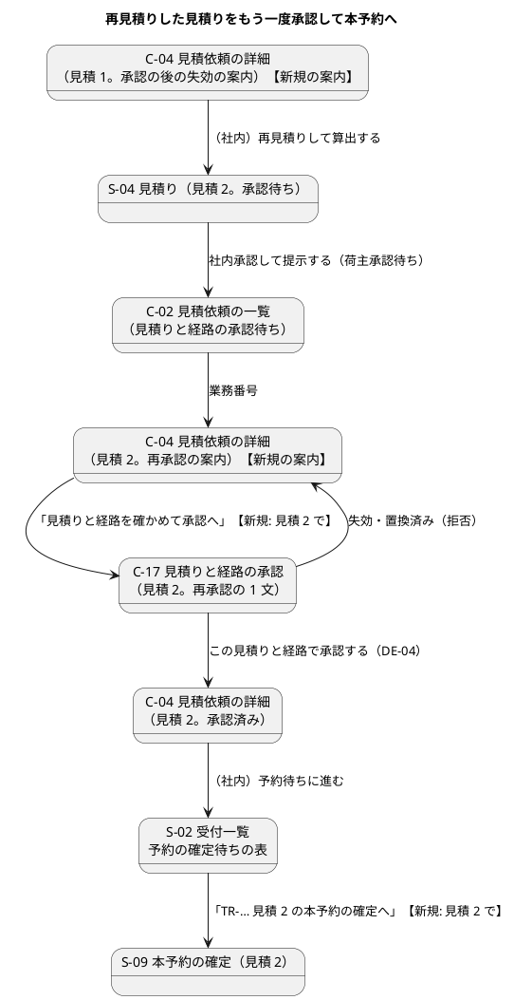

# Bolt 35d 計画 - 再見積りした見積りを荷主がもう一度承認し本予約へ進める（D-85。C-02・C-04・C-17、W5 のデモ）

## 基本情報

| 項目 | 内容 |
| :--- | :--- |
| Bolt | 第 35d 回（W5 の 32 本目） |
| 予定 | W5（2026-11-02 の週。前倒しで着手できる）。作業は約 4.5 時間（承認ゲートの待ちと、`check`・uiTest・SonarQube・`manualScreenshots`・`demoVideo` の待ちを除く。確認ポイント 12） |
| 対象 | `quotation`: 見積りの集約の問い合わせ「再承認の見積りか」（`Quotation.isPresentedForReapproval`）、`QuotationViews`（View に項目を足す。荷主・社内で共用）、荷主の画面の状態と案内の選び方（`TransportRequestLabels`）、C-02 の一覧の行（荷主に見える最新の見積りの読み取りモデルと SQL）、`TransportRequestController`（C-02・C-04）・`detail.html`、`QuotationApprovalController`・`approval.html`（C-17）、`StaffQuotationController.routingRequestedNotice`（S-04）。画面の層の受入シナリオ（`requote_after_approval_ui.feature` に `@demo` のシナリオ、`ShipperApprovalUiSteps` の見積り番号）、`manual_screenshots.feature` |
| GitHub | なし（D-85 は US に属さない決定事項の実装。release_plan の W5 の表と業務責任者に確かめる事項の台帳で扱う） |
| SP | 0 |
| 承認ゲート | 計画と終了報告。スキーマは変えない（読み取りモデルの SQL だけ）。開発データは Bolt 35e（決定 (6)。データベースの承認ゲートは 35e の計画で通す）。層・モジュールの規則に当たったら止めて諮る（T-125） |
| アプローチ | アウトサイドイン（荷主の画面から。release_plan の 35d の行、開発戦略 :344）。画面の層の受入シナリオ（Red）→ WebMvc のテスト → controller・画面のモデル → 読み取りモデル → 集約の問い合わせの順 |
| マニュアル・デモ | 4 章に「4.3 再見積りした見積りをもう一度承認する」を足し、C-04・C-17 のキャプチャを撮る。4.2 の注意・補足、6.4 の操作手順 4、7.1、マニュアルの索引と用語集をつなぐ（完了条件。後の Bolt に送らない）。W5 のデモの動画は、再見積りから本予約までの新しいシナリオ（`@demo @demo-bolt-35d/requote-and-reapprove`）を、開発レビューの直しの後に `demoVideo` で撮る（T-105） |
| 前の Bolt | [Bolt 35c 終了報告](bolt_35c_report.md) |

## Bolt ゴール

荷主が、再見積りされた見積り 2 を見積依頼の一覧（C-02）・詳細（C-04）・承認（C-17）で「承認いただいた経路版と経路方針のまま料金と有効期限を出し直した見積り」と分かる案内で確かめてもう一度承認し、営業担当者が見積り 2 で本予約を確定できる。輸送要求の状態が見積りに遅れる間（DE-24・DE-04 の受け取りの前）も、荷主の画面の状態と案内が見積りと食い違わない。社内の S-04 も再承認を待っている・再承認を受けたと示す。W5 のデモで再見積りから本予約までを見せられる。

### 確かめたい仮説

| # | 仮説 | この Bolt で分かること |
| :--- | :--- | :--- |
| H1 | 再承認の見積りは、列を足さずに 1 つの集約のデータで見分けられる。通常の流れは提示 → 回答（提示の後だけ）→ 経路の割当て（詳細設計依頼済みだけ）の順で、経路設計中は再見積りできないので、経路の確定の時刻は提示の時刻より後になる。経路の確定の時刻が提示の時刻より前なら、提示の時点で経路を持っていた（引き継いだ見積り）。DE-24 を出す条件（提示の時点で経路を持つ）と同じ事実を、時刻で代わりに見る | 集約の単体テストで、通常の流れの荷主承認待ち・承認済み・失効、引き継いだ荷主承認待ち・承認済み・失効、経路を持たない見積り、同時刻（偽）を分ける |
| H2 | 予約待ち・荷主承認待ちの見積依頼の荷主の画面の状態と案内を、荷主に見える最新の見積りから選べば、DE-24・DE-04 の受け取りの前後で同じ表示になり、一覧と詳細も同じになる | WebMvc のテストで、下の組み合わせの表の行ごとに、C-02 の状態と C-04 の状態・案内・見積りの案内を確かめる（T-161） |

### 開始準備で確かめたこと

（事実集めのエージェントと 2 つの整合性検証の報告から。行番号は 2026-10-20 の develop の `86d664019`）

- **C-04**（`TransportRequestController.java:135-172`、`templates/quotation/transport-requests/detail.html:43-79`）: 荷主に見える見積り（提示済み。見積り番号の降順）の先頭を「見積り」、残りを「以前の見積り（読み取り専用）」の `
` に出す。状態の表示名と案内は :145-146 で輸送要求の状態から先に決め（`TransportRequestLabels.customerStatus`・`customerGuidance` :43-70）、見積りは :160-171 で後から作る
  - :55「有効期限（…）を過ぎたため、この見積りは使えません（読み取り専用）。新しい見積りは担当営業にご依頼ください。」は `expired and !routingStarted`（EXPIRED は `isRoutingStarted` に入らない）。:60 の依頼の文は `routingStarted`（詳細設計依頼済み・荷主承認待ち・承認済み）。:67「承認の後に有効期限（…）を過ぎました。本予約の扱いは担当営業からご連絡します。」は `approvedAt != null and expired` だけで `booked` を見ない（予約確定済みの見積りは承認済みのまま残り、期限を過ぎると今でも :67 が出る）
  - 再見積りの後で提示の前は、見積り 1（失効を記録、荷主承認済み）に :55 と :67 が両方出る。提示の後は見積り 2（荷主承認待ち）に :60 が引き継いだ回答時刻で出る（見積り 2 で依頼した事実はない）。見積り 1 は「見積 1（失効）」で `
` に入る
  - 輸送要求の状態は DE-24（予約待ち → 荷主承認待ち）・DE-04（荷主承認待ち → 予約待ち）の受け取りまで見積りに遅れる（後者は通常の流れでも今あるずれ）
- **C-02**（`TransportRequestController.row` :315-321）: 一覧の状態は輸送要求の読み取りモデル `TransportRequestSummary`（`TransportRequestMapper.xml` の `selectSummariesByShipper` :175-179。社内の審査中・見積り作成中の一覧と共用）から `customerStatus` で出す。C-04 だけ見積りから選ぶと、一覧と詳細が食い違う
- **C-17**（`QuotationApprovalController.java`、`approval.html`）: 見積り番号に依らない作り。見積り 2 でもそのまま開けて承認できる（業務ルール層 `requote_after_approval.feature:54-70` で確かめ済み）。成功の文言は「…見積りと経路を承認しました。担当営業が本予約を確定します。」（:94）
- **S-04**（`StaffQuotationController.java:424-431` の `routingRequestedNotice`）: `isRoutingStarted` を条件にし承認済みも含む。引き継いだ見積り 2 の荷主承認待ち・承認済みに「荷主が {回答時刻}に詳細経路設計を依頼しました。この見積りは読み取り専用です。」と出す（35c の既知の課題）
- **再承認の判定の材料**: `Quotation.presentInternally`（:197-224）は提示の時点で経路を持つなら荷主承認待ちにして DE-24 を出す。回答は提示の後だけ（`responseRejectionAt`）、経路の割当ては詳細設計依頼済みだけ（`assignRoute`）、経路設計中は再見積りできない（`requoteRejectionAt`）。`AssignedRoute.confirmedAt` は経路設計の側の承認の commit の時刻で、`assignRoute` は提示の時刻との前後を検査しない。既存のテストの固定の時刻は通常の流れで提示 < 確定。`QuotationFixture.assignedRoute()` の確定の時刻は 2026-10-07T05:00 で、QuotationShipperApprovalTest :111・:412 は確定の時刻にも `now` を使う
- **UI 設計**（ui_design.md）: C-02 :104・:158、C-04 :105・:159・:920-936、C-17 :107・:160・:965-990（画面イメージは搬入締切・書類締切を含む最終形）、荷主の画面遷移図 :322-381（再見積り・再承認の遷移はない）、S-04 の振る舞いの表 :1020-1023、輸送要求の状態と荷主の画面の表示の対応表 :1618-1629。D-85 の記述は社内の画面だけ（:438-439、:1020-1023）
- **domain_model**: 見積りのクラス図（:405-425 付近）、ユビキタス言語の表（:76〜。:116「経路の引き継ぎ」・:117「割り当てた経路」）に「再承認の見積り」がない。:423 は 35c の後も「照会のサービスの判定」と書いたまま（`RequotePolicy` に合っていない）
- **マニュアル**: 4 章（`docs/manual/04-見積りへの回答と承認.md`）は 4.1 回答・4.2 承認。4.2 の注意・補足に再承認の記述はない。キャプチャは `manual_screenshots.feature` :49-56・:68-75（:71 は見積り 1 を決め打ち）、35c の別のシナリオ（:168-186）は S-02・S-04 まで。マニュアルの索引 :17 の 4 章の内容と用語集に再承認がない
- **デモの動画**: `build.gradle:152-175` の `demoVideo`（`doFirst` で `docs/assets/demo` を消し、`@demo` のすべてのシナリオを撮り直す。webm は毎回中身が変わるので全 Bolt の動画が差分になる）。印 `@demo-<Bolt>/<名前>` は `docs/assets/demo/<Bolt>/<名前>.webm` に置く。動画は終了報告のデモ項目の表と開発の索引の行からリンクする（開発戦略 :140、`{:target="_blank"}`）
- **画面の層のステップ**: `ShipperApprovalUiSteps.java` は見積り 1 を決め打ち（:71・:73・:87）。開き直すループは 10 か所（35c の報告の「9 か所」は数え違い）。「見積り {int} の有効期限が承認の後に過ぎている」（QuotationUiSteps :134）は荷主の承認の時刻だけを 2 時間前にし、経路の確定の時刻は数秒前のまま（キャプチャで承認が確定より前に見える。H1 には影響しない）。`requote_after_approval_ui.feature` の説明は「荷主の再承認から本予約までは Bolt 35d で確かめる」

## ふりかえりと前の Bolt からの引き継ぎ

| 入力 | 内容 | この Bolt での扱い |
| :--- | :--- | :--- |
| 開始準備の決定（2026-10-20、human:kakimomokuri） | (1) 荷主の画面で再見積りした見積り 2 は再承認の案内に替え、依頼の文は出さない（列は足さない）。(2) 再見積りの後で提示の前の見積り 1 は承認の後の失効の案内だけにする。(3) 社内の S-04 も再承認待ちの案内に替え、S-02 の経路設計中の表の並びは今のまま。(4) W5 のデモの動画は再見積りから本予約まで 1 本（サンプルは TR-2026-0908）。(5) 荷主の画面の状態と案内は最新の見積りから決める（C-02・C-04）。(6) 開発データのサンプルは Bolt 35e に分ける | 設計の約束、確認ポイント 1〜6 |
| Bolt 35c の既知の課題 | 引き継いだ回答時刻による S-04 の文言と S-02 の並び | 決定 (3) |
| Bolt 35c の既知の課題 | `transportRequestExists()` の前提、開き直すループの共通化 | 範囲外（振る舞いを変えない直し。確認ポイント 10）。この Bolt で足すシナリオは今のステップを使い、見積り番号の決め打ちだけを直す |
| Bolt 35c の議題 3 | スクリーンリーダーでの手動確認（S-02・S-04） | 人が行う。この Bolt で変える C-02・C-04・C-17 も終了報告の議題にする |
| Bolt 35c の Try T-160 | 判定・規則の置き場所を決めるときは、判定が読むものを書く | 下の「判定と選び方の置き場所」の表。再承認の見積りかは 1 つの集約の 2 つの時刻だけを読むので `Quotation` の問い合わせ。荷主の画面の状態と案内の選び方は、輸送要求の状態と最新の見積りの表示の値（状態・失効・承認の有無・再承認か）と予約確定済みかを読む表示の対応で、業務の規則を決めないので画面の層（`TransportRequestLabels`。今の表示名と案内の置き場所）。35b の決定の「同じ輸送要求で同じ案件番号・経路版を持つことから辿る」（複数の見積りを読む）から 1 つの集約の時刻に変えた（画面のモデルに判定を散らさない） |
| Bolt 35c の Try T-161 | 同じ画面の複数の表示の条件を変えたら、状態の組み合わせの表を書く | 下の「荷主の画面の組み合わせ」（輸送要求 × 最新の見積り。非同期の間の行を含む） |
| Bolt 31c の Try T-105 | デモの動画は開発レビューの直しの後に撮る | ステップ 7 の順 |
| Bolt 35b2 の Try T-159 | 新しいテストのクラスは実装の前に流して Red を確かめる。計画のステップのテストを一覧と突き合わせる | 画面の層のシナリオを実装の前に流す。「テストの一覧」を置く |
| Bolt 35b の Try T-156、T-157、Bolt 35b2 の Try T-158 | 写す値の表、判定と変更の 1 つの操作、差し込みのテストの断言 | 当たらない（値を写さない。表示だけ。差し込みのテストはない） |
| Bolt 34e の Try T-151、Bolt 34d の Try T-147 | テストの件数は `check` の後に数える。SonarQube はほかの Gradle の実行が終わってから | ステップ 7 |
| Bolt 35b2 の既知の課題 | H2（dev）のロックの待ちの時間切れ、`TransportRequestProgression` の部品の形（A-9） | 範囲外（後の Bolt） |
| Bolt 35 の既知の課題 | CI の画面の層のテストの揺らぎ | 範囲外。デモの動画を撮るシナリオが揺らいだら、そのシナリオだけを流し直し、終了報告に書く |
| 35b・35b2・35c の決定 | 単独で出さず 35d と一緒に出す | 35e（開発データ）と一緒に出す（決定 (6)）。D-86・D-87・D-88 は台帳のまま |

## スコープ

### 入れるもの・入れないもの

| 入れる | 入れない |
| :--- | :--- |
| 再承認の見積りかの集約の問い合わせ（列を足さない） | 開発データのサンプル TR-2026-0908（Bolt 35e。決定 (6)） |
| C-02・C-04: 予約待ち・荷主承認待ちの見積依頼の状態と案内を最新の見積りから選ぶ（読み取りモデルの SQL を足す） | 荷主の辞退（US-24 AC2）・相談（AC3）（W9） |
| C-04: 再承認の見積りの案内、承認の後に失効した見積りの案内を 1 つに、予約確定済みの後は承認の記録だけ、依頼の文は再承認の見積りに出さない | 再承認の前にまた失効したとき（D-86）。見積りの案内は今の規則（承認できない、新しい見積りは担当営業に）のまま |
| C-17: 再承認の見積りであることの 1 文 | S-02 の経路設計中の表の並び（決定 (3)。今のまま） |
| S-04: 再承認の見積りの荷主承認待ち・承認済みの案内 | 開き直すループの共通化と `transportRequestExists()` の名前（確認ポイント 10） |
| 画面の層の受入シナリオ（再見積りから本予約まで。`@demo`）、`demoVideo` | C-17 の画面イメージの搬入締切・書類締切（最終形。今のまま） |
| UI 設計（C-02・C-04・C-17・S-04・荷主の画面遷移図・対応表）、domain_model、test_strategy、マニュアル 4 章（4.3）と 4.2・6.4・7.1・索引・用語集、キャプチャ | |

### 判定と選び方の置き場所（T-160）

| 判定・選び方 | 読むもの | 置き場所 |
| :--- | :--- | :--- |
| 再承認の見積りか | 1 つの見積りの提示の時刻と経路の確定の時刻 | `Quotation.isPresentedForReapproval()`（ドメイン。リポジトリも以前の見積りも読まない） |
| 失効か・荷主の承認の有無 | 見積りと判定時刻 | 今のまま（`QuotationExpiry`、`shipperApproval`） |
| 荷主の画面の状態と案内 | 輸送要求の状態、最新の見積りの表示の値（状態・失効・荷主の承認の有無・再承認か）、予約確定済みか | `TransportRequestLabels`（画面の層。今の `customerStatus`・`customerGuidance` の置き場所。業務の規則を決めず、表示の対応だけ） |
| C-02 の行の最新の見積り | 自社の輸送要求ごとの、荷主に見える最新の見積り | 読み取りモデル（`quotation.domain.model.valueobjects` の新しい行の型と `QuotationMapper.xml` の SQL。集約を組み立てない。R-02） |

### 設計の約束

- **再承認の見積りか**（決定 (1)、H1）: `Quotation.isPresentedForReapproval()`。提示済みで（`presentedAt` あり）、割り当てた経路を持ち、経路の確定の時刻が提示の時刻より前なら真。同時刻は偽（通常の流れ）。列もイベントも足さない。domain_model に「通常の流れでは経路の確定は提示の後」を不変条件として書き、`assignRoute` には検査を足さない（経路設計の側の時刻を拒まない）。単体テストで、通常の流れの順を確かめる。W6 の再設計（US-08）で再承認の見積りに別の経路版を割り当てるときは、この問い合わせを見直す（台帳の D-88 の行に注を足す）。テストの準備では、再承認の見積りの提示を `QuotationFixture.assignedRoute()` の確定の時刻（2026-10-07T05:00）より後に置く
- **View**: `QuotationViews.View` に「再承認の見積りか」を足す（荷主・社内で共用）
- **荷主の画面の状態と案内**（決定 (5)、H2）: 輸送要求が予約待ち・荷主承認待ちのとき、荷主に見える最新の見積りから選ぶ（下の組み合わせの表）。それ以外の状態（予約確定済みを含む）は今のまま輸送要求から。表示名は今ある言葉だけを使う。C-02 と C-04 は同じ選び方を使う
- **C-02 の読み取りモデル**: 自社の輸送要求ごとに荷主に見える最新の見積り（提示済みで見積り番号の最大）の状態・有効期限・荷主の承認の時刻・提示の時刻・経路の確定の時刻を返す読み取りモデルを足し、controller が業務番号で行に合わせる（`TransportRequestSummary` は社内の一覧と共用なので変えない）。`IN`・`MAX` だけで書き、H2 と PostgreSQL のどちらでも動かす。スキーマは変えない
- **C-04 の見積りの案内**（決定 (1)・(2)。荷主の文にも経路方針を入れ、35c の言い方「承認済みの経路版と経路方針を引き継ぎ」に寄せる。画面の動詞は「もう一度承認」にそろえる）
  - 依頼の文（:60）は、詳細設計依頼済み・荷主承認待ち・承認済みで、再承認の見積りでなく、承認の後に失効していないときだけ出す
  - 再承認の見積りで荷主承認待ち・有効: 「この見積りは、承認いただいた経路版と経路方針のまま、料金と有効期限を出し直したものです。見積りと経路を確かめて、もう一度承認してください。」。承認の入口は今のまま
  - 荷主承認済みで失効（承認済みのまま時刻で失効、または再見積りで失効を記録）で、予約確定済みでない: 「承認の後に有効期限（…）を過ぎました。担当営業が、承認いただいた経路版と経路方針のまま新しい見積りを用意します。用意できたら、もう一度承認をお願いします。」の 1 文だけ（:55・:67 は出さない）
  - 予約確定済みで承認済み（期限を過ぎていても）: 承認の記録「…にこの見積りと経路を承認しました。」だけ（:67 を出さない。今の不具合を直す）
  - 以前の見積り（`
`）は今のまま
- **C-17**: 再承認の見積りなら、「この見積りと経路で承認しますか」の前に「承認いただいた経路版と経路方針のまま、料金と有効期限を出し直した見積りです。」を足す。成功の文言は今のまま
- **S-04**（決定 (3)）: `routingRequestedNotice` で、再承認の見積りの荷主承認待ち・有効は「荷主の再承認を待っています（承認済みの経路版と経路方針を引き継いだ見積りです）。この見積りは読み取り専用です。」、再承認の見積りの承認済みは「荷主が {承認時刻}に再承認しました（承認済みの経路版と経路方針を引き継いだ見積りです）。この見積りは読み取り専用です。」。通常の見積りは今のまま
- **画面の層のシナリオ**（決定 (4)）: `requote_after_approval_ui.feature` に 2 本目のシナリオを足し、`@demo @demo-bolt-35d/requote-and-reapprove`（`@D-85`）を付ける。機能の説明を直す。承認まで（今の背景）→ 見積り 1 の有効期限が承認の後に過ぎている → 荷主が C-04 で承認の後の失効の案内を確かめる → 予約の確定待ちから再見積り → 算出 → 承認待ちで開いて社内承認して提示 → 荷主が C-02・C-04 で再承認の案内を確かめて C-17 で見積り 2 を承認 → 営業担当者が予約の確定待ちから見積り 2 の本予約を確定。`ShipperApprovalUiSteps` の見積り番号を引数にする（今のステップの文は見積り 1 の形で残す）。axe を C-02・C-04・C-17 で通す
- **マニュアル**: 4 章に「4.3 再見積りした見積りをもう一度承認する」（この画面でできること・画面の開き方・画面の説明・操作手順・注意・補足。C-04 の再承認の案内と C-17 のキャプチャ）。4.2 の注意・補足に「承認の後に有効期限を過ぎたとき」を足す。6.4 の操作手順 4 と 7.1 の注意・補足から 4.3 へリンク。マニュアルの索引の 4 章の内容と用語集に「再承認」を足す

### 荷主の画面の組み合わせ（T-161。輸送要求が予約待ち・荷主承認待ちのときは状態と案内を最新の見積りから選ぶ）

| # | 輸送要求 | 最新の見積り | 状態（C-02・C-04） | 案内（C-04） | 見積りの案内（C-04） |
| :--- | :--- | :--- | :--- | :--- | :--- |
| 1 | 荷主承認待ち | 通常の荷主承認待ち・有効 | 見積りと経路の承認待ち（お客様の対応待ち） | 今のまま（経路が確定しました…） | 依頼の文（実際の回答時刻）、承認の入口 |
| 2 | 荷主承認待ち（DE-04 の前） | 承認済み・有効（通常・再承認） | 予約待ち（A 社の対応待ち）（新。見積りから） | 予約待ちの案内（承認いただきました…）（新。見積りから） | 通常は依頼の文と承認の文、再承認は承認の文だけ |
| 3 | 予約待ち | 承認済み・有効（通常） | 予約待ち（A 社の対応待ち） | 今のまま（承認いただきました…） | 依頼の文（実際の回答時刻）、承認の文 |
| 4 | 予約待ち | 承認済み・時刻で失効（再見積りの前） | 見積り作成中（A 社の対応待ち）（新。見積りから） | 「承認の後に見積りの有効期限を過ぎました。担当営業が新しい見積りを用意しています。」（新） | 承認の後の失効の 1 文（新） |
| 5 | 予約待ち | 失効を記録・荷主承認済み（再見積りの後、提示の前。見積り 2 は荷主に見えない） | 見積り作成中（A 社の対応待ち）（新） | 4 と同じ（新） | 承認の後の失効の 1 文（新） |
| 6 | 予約待ち（DE-24 の前） | 再承認の荷主承認待ち・有効 | 見積りと経路の承認待ち（お客様の対応待ち）（新。見積りから） | 「担当営業が、承認いただいた経路版と経路方針のまま、料金と有効期限を出し直しました。見積りと経路を確かめて、もう一度承認してください。」（新） | 再承認の文（新）、承認の入口 |
| 7 | 荷主承認待ち（DE-24 の後） | 再承認の荷主承認待ち・有効 | 見積りと経路の承認待ち（お客様の対応待ち） | 6 と同じ（新） | 再承認の文（新）、承認の入口 |
| 8 | 荷主承認待ち・予約待ち | 荷主承認待ち・失効（通常、または再承認で D-86） | 見積りと経路の承認待ち（お客様の対応待ち）（予約待ちでも見積りから） | 今のまま（荷主承認待ちの案内） | 今のまま（承認できません、担当営業にご依頼ください）。再承認の見積りなら依頼の文は出さない |
| 9 | 予約待ち | 再承認の承認済み・有効 | 予約待ち（A 社の対応待ち） | 今のまま（承認いただきました…） | 承認の文（依頼の文は出さない） |
| 10 | 予約確定済み | 承認済み（通常・再承認。期限の前後を問わない） | 今のまま（予約確定済み） | 今のまま | 承認の記録だけ（:67 を出さない。依頼の文は通常の見積りだけ） |

### テストの一覧（T-159。ステップを閉じる前に突き合わせる）

| ステップ | テスト |
| :--- | :--- |
| 2 | 画面の層: `requote_after_approval_ui.feature` の 2 本目（上の流れ。`@demo`）。実装の前に流して落ちることを確かめる |
| 3 | 集約の単体: 再承認の見積りか（通常の流れの荷主承認待ち・承認済み・失効、引き継いだ荷主承認待ち・承認済み・失効、経路を持たない提示済み・承認待ち、同時刻）。通常の流れで経路の確定が提示の後になること |
| 4 | WebMvc（C-04）: 組み合わせの表の行 1〜10（状態・案内・見積りの案内・依頼の文がない・承認の入口）。既存の「承認の後に失効した見積りは本予約の扱いを担当営業から連絡すると示す」（TransportRequestControllerTest :549 付近）を直す。WebMvc（C-02）: 行 2・4・6 の状態。読み取りモデルの統合（PostgreSQL）: 最新の見積り（提示済みで番号の最大）、提示の前の見積りは数えない、自社だけ。WebMvc（C-17）: 再承認の見積りの 1 文、通常の見積りには出ない。WebMvc（S-04）: 再承認の見積りの荷主承認待ち・承認済みの案内、通常の見積りは今のまま |

## 設計（この Bolt の範囲）

ドメインモデル図: 見積りの集約に問い合わせを 1 つ足すだけなので省く（domain_model.md のクラス図・用語の表に足す）。状態遷移図: 状態は変えないので省く。ER 図: スキーマを変えないので省く（読み取りモデルの SQL だけ）。

### 画面遷移図（荷主の画面と社内の本予約。この Bolt で足す遷移に【新規】を付ける）

## ステップ計画

各ステップの終わりに `check` を流し、test の結果の件数を数える（T-151）。コミットは pathspec で行い（T-110）、push してアプリの CI と MkDocs の配備を確かめる（T-26・T-126）。変異は控えから戻す。

- [ ] **1. 設計文書**（完了の判定: `okf:check` ERROR 0、`documentationTest` が緑）
  - ui_design: C-02 の行 :158、C-04 の行 :159（再承認の案内、承認の後の失効の 1 文、予約確定済みの後、依頼の文の条件、状態と案内を最新の見積りから選ぶ）、C-17 の行 :160 と画面イメージ :965-990（再承認の 1 文）、S-04 の行 :172 と振る舞いの表 :1020-1023、荷主の画面遷移図 :322-381、輸送要求の状態と荷主の画面の表示の対応表 :1618-1629
  - domain_model: 見積りのクラス図に問い合わせ、用語の表に「再承認の見積り」（判定のもとは提示の時刻と経路の確定の時刻）、通常の流れの時刻の順の不変条件、:423 の古い「照会のサービスの判定」を `RequotePolicy` に、:564 付近の再見積りの注に荷主の画面の扱い
  - test_strategy: :230 のユニットの列と画面の層の列、E2E の表（:356-368）に「再見積りから再承認・本予約まで（`@demo-bolt-35d/requote-and-reapprove`）」
  - user_story: US-24 の決定に 35d の決定 (1)〜(6)
  - release_plan: 35d の行 :611（決定。開発データを 35e に）と 35e の行（新規）、:553 の状態、:557、D-85 の行 :563 の注、:636 のデモ項目、:657 のタスク（35d・35e）、:730 の台帳の D-85 の今の扱い、D-88 の行に再承認の見積りの問い合わせの見直しの注、:797 の W5 の進捗（33 本）
  - development_strategy: :183 の W5 のデモ（再見積りから本予約まで）、:344 の W5 の行（35e）
- [ ] **2. 画面の層の受入シナリオ（Red）**: 2 本目のシナリオ、機能の説明、見積り番号を引数にした `ShipperApprovalUiSteps`、C-02・C-04 の再承認の案内と承認の後の失効の案内を確かめるステップ。実装の前に流して落ちることを確かめる（T-159）
- [ ] **3. 集約の問い合わせ**: テストの一覧の 3 から作る。View に項目を足す
- [ ] **4. C-02・C-04・C-17・S-04**: テストの一覧の 4 から作る。読み取りモデルの SQL・型・リポジトリ、`TransportRequestLabels` の選び方、controller、テンプレート。ステップ 2 のシナリオが緑になる
- [ ] **5. マニュアル**: 4 章 4.3 と 4.2 の注意・補足、6.4・7.1 のつなぎ、索引・用語集。`manual_screenshots.feature` の 35c のシナリオに続けて C-04（再承認の案内）・C-17 を撮り、`manualScreenshots` でキャプチャを撮る。この Bolt のものでない差分は戻す
- [ ] **6. 変異**: 問い合わせの比べ方（前・後・同時刻、経路なし、提示なし）、状態と案内の選び方（見積りから・輸送要求から、行 2・4・6・8）、依頼の文の条件、予約確定済みの後の承認の記録、C-17 の 1 文、S-04 の案内、読み取りモデルの最新の見積りの条件
- [ ] **7. uiTest と SonarQube と開発レビューとその直しと demoVideo と終了報告**: 開発レビューの直しの後に `demoVideo` を撮る（T-105）。`docs/assets/demo` のうち `bolt-35d` の外の差分は戻す。動画は終了報告のデモ項目の表と開発の索引の 35d の行からリンクする（`{:target="_blank"}`）

### 時間の配分と打ち切り

| # | 目安 | 打ち切り |
| :--- | :--- | :--- |
| 1 | 40 分 | — |
| 2 | 35 分 | — |
| 3 | 30 分 | 問い合わせが通常の流れのどこかで真になると分かったら止めて諮る（H1。列を足すかの判断になる） |
| 4 | 90 分 | C-02 の読み取りモデルにスキーマの変更が要ると分かったら止めて諮る（データベースの承認ゲート） |
| 5 | 40 分（`manualScreenshots` の待ちを除く） | — |
| 6 | 15 分 | — |
| 7 | 20 分（uiTest・SonarQube・`demoVideo` の待ちを除く） | — |

合計 270 分（約 4.5 時間）。目安の 4 時間を超える（確認ポイント 12）。ステップ 4 を終えた時点で 3.5 時間を超えていたら止めて諮る（候補: C-02 の一覧の状態を後の Bolt に送り、一覧と詳細のずれを受け入れる）。

## 確認ポイント（計画の承認の場でまとめて確認する。Try T-6）

| # | 確認すること | 場所 | 推奨・決定 |
| :--- | :--- | :--- | :--- |
| 1 | **荷主の画面の見積り 2** | ステップ 4 | 決定済み（1）: 再承認の案内に替え、依頼の文は出さない。列は足さない |
| 2 | **提示の前の見積り 1** | ステップ 4 | 決定済み（2）: 承認の後の失効の案内だけ。推奨: 再見積りの前（承認済みのまま時刻で失効）も同じ 1 文にそろえる（D-85 で扱いが決まったので「本予約の扱いは担当営業からご連絡します」を替える） |
| 3 | **社内の S-04 と S-02** | ステップ 4 | 決定済み（3）: S-04 は再承認待ち・再承認を受けた案内、S-02 の並びは今のまま |
| 4 | **デモ** | ステップ 2・7 | 決定済み（4）: 再見積りから本予約まで 1 本。開発レビューの直しの後に撮る（T-105） |
| 5 | **荷主の画面の状態と案内** | ステップ 4 | 決定済み（5）: 予約待ち・荷主承認待ちの見積依頼は最新の見積りから選び、C-02 と C-04 で同じにする。推奨: 組み合わせの表のとおり（行 4・5 の状態は今ある「見積り作成中（A 社の対応待ち）」を使う。輸送要求は予約待ちのままだが、A 社が新しい見積りを作っている段階を荷主に示す。新しい語を作らない） |
| 6 | **開発データ** | 全体 | 決定済み（6）: Bolt 35e に分ける。35e の行を release_plan に足し、データベースの承認ゲートは 35e の計画で通す |
| 7 | **再承認の見積りの見分け方** | ステップ 3 | 推奨: `Quotation.isPresentedForReapproval()`（経路の確定の時刻 < 提示の時刻。同時刻は偽）。35b の決定の辿り方（複数の見積りの案件番号・経路版）から変えた理由は、1 つの集約で決まり画面のモデルに判定が散らないため（T-160）。W6 の再設計で見直す |
| 8 | **選び方の置き場所** | ステップ 4 | 推奨: `TransportRequestLabels`（画面の層）。表示の対応だけで業務の規則を決めない。業務の判定（失効・再承認か）はドメインの値を使う |
| 9 | **C-02・C-04・C-17・S-04 の文言** | ステップ 4 | 推奨: 設計の約束と組み合わせの表の初案（経路版と経路方針、「もう一度承認」） |
| 10 | **開き直すループの共通化と `transportRequestExists()`** | 全体 | 推奨: この Bolt に入れない（振る舞いを変えない直し。10 か所にまたがり、デモの動画を撮る Bolt で画面の層のステップを広く変えると、揺らぎの原因を切り分けにくい）。W5 の締めで返済の枠を決める |
| 11 | **支援技術による手動確認** | ステップ 7 | 推奨: C-02・C-04・C-17 の変えた表示は画面の層のシナリオで axe を通し、スクリーンリーダーでの確認は終了報告の議題にして人が行う（35c の議題 3 と一緒に） |
| 12 | **アプローチと承認ゲートと時間** | 全体 | アウトサイドイン（荷主の画面から）。承認ゲートは計画と終了報告。スキーマを変えないのでデータベースの承認ゲートには当たらない。約 4.5 時間で目安の 4 時間を超える（打ち切りの条件を置いた） |

## 完了条件

- [ ] 荷主が、再見積りされた見積り 2 を C-02・C-04 で再承認の案内とともに確かめ、C-17 でもう一度承認し、営業担当者が見積り 2 で本予約を確定できる（画面の層のシナリオ。C-02・C-04・C-17 で axe を通す）
- [ ] 組み合わせの表の行 1〜10 で、C-02 と C-04 の状態が同じで、C-04 が食い違う案内を出さず、再承認の見積りに引き継いだ回答時刻で依頼の文を出さない。予約確定済みの後に再承認を求めない。S-04 が再承認待ち・再承認を受けたと示す
- [ ] 問い合わせの比べ方・選び方・依頼の文の条件・読み取りモデルの条件を変異で確かめた。スキーマを変えていない
- [ ] `check` と `uiTest` が緑で、件数が減っていない。開発レビューの直しの後に `demoVideo` で `docs/assets/demo/bolt-35d/requote-and-reapprove.webm` を撮り、終了報告と開発の索引からリンクした。push してアプリの CI と MkDocs の配備を確かめた。SonarQube の Quality Gate が PASS、`okf:check` ERROR 0
- [ ] UI 設計（C-02・C-04・C-17・S-04・荷主の画面遷移図・対応表）と domain_model・test_strategy・US-24 の決定・release_plan（35e の行を含む）・開発戦略が合っている。マニュアル 4 章（4.3）と 4.2・6.4・7.1・索引・用語集を直し、キャプチャを撮った
- [ ] 開発レビュー、終了報告

## 更新履歴

| 日付 | 更新内容 | 更新者 |
| :--- | :--- | :--- |
| 2026-10-20 | 計画を承認した（確認ポイント 2・5・7〜12 を推奨のとおり） | anthropic/claude-opus-5-5、承認 human:kakimomokuri |
| 2026-10-20 | 詳細整合性検証と横断整合性検証の指摘を反映した。human:kakimomokuri の決定 (5)（荷主の画面の状態と案内を最新の見積りから選び、C-02 と C-04 で同じにする）・(6)（開発データを Bolt 35e に分ける）。組み合わせの表（予約確定済みの後、非同期の間の 2 行、依頼の文の条件、状態の案内）、問い合わせの同時刻と時刻の順の不変条件とテストの時刻、S-04 の承認済み、判定と選び方の置き場所、C-02 の読み取りモデル、文言（経路版と経路方針、「もう一度承認」）、設計文書・マニュアルの反映先、デモの動画をレビューの直しの後に撮ることとリンク、引き継ぎの表、行番号を直した | anthropic/claude-opus-5-5 |
| 2026-10-20 | 初版作成（承認待ち）。human:kakimomokuri の決定 (1)〜(4)（荷主の画面の見積り 2 は再承認の案内、提示の前の見積り 1 は承認の後の失効の案内だけ、S-04 も再承認待ちの案内で S-02 の並びは今のまま、デモは再見積りから本予約まで 1 本でサンプルは TR-2026-0908）を反映した | anthropic/claude-opus-5-5 |

## 関連ドキュメント

- [Bolt 35c 終了報告](bolt_35c_report.md)、[Bolt 35b2 終了報告](bolt_35b2_report.md)、[Bolt 35b 終了報告](bolt_35b_report.md)
- [リリース計画](release_plan.md)（W5、D-85・D-86・D-87・D-88）、[開発戦略](development_strategy.md)
- [ユーザーストーリー](../../requirements/cargo-tracker/user_story.md)（US-24）、[UI 設計](../../design/cargo-tracker/ui_design.md)（C-02・C-04・C-17・S-04）、[ドメインモデル](../../design/cargo-tracker/domain_model.md)、[テスト戦略](../../design/cargo-tracker/test_strategy.md)
- [ユーザーマニュアル 4 章](../../manual/04-見積りへの回答と承認.md)・[6 章](../../manual/06-受付一覧と審査と見積り.md)・[7 章](../../manual/07-本予約の確定と予約一覧.md)
- [ADR-018](../../adr/cargo-tracker/018-requote-returns-transport-request-with-ordering-guard.md)
