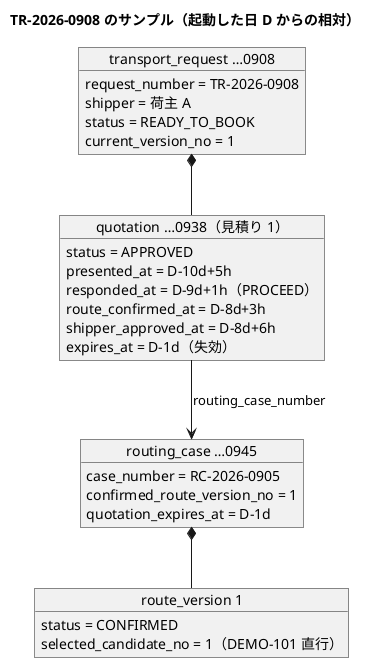

# Bolt 35e 計画 - 荷主の承認の後に失効した見積りの開発データのサンプル（D-85。TR-2026-0908）

## 基本情報

| 項目 | 内容 |
| :--- | :--- |
| Bolt | 第 35e 回（W5 の 33 本目） |
| 予定 | W5（2026-11-02 の週。前倒しで着手できる）。作業は約 2.75 時間（承認ゲートの待ちと、`check`・SonarQube・CI・デモ環境の配備の待ちを除く） |
| 対象 | `db/dev-data` に新しいマイグレーション 1 本（`V20261020150900__seed_dev_sample_expired_after_approval.sql`）、`DevSampleDataSmokeTest`、`apps/cargo-tracker/README.md` のサンプルの表と次に振る業務番号、`docs/operation/cargo-tracker/heroku_demo_setup.md` の 6 節のサンプルの表、release_plan・開発の索引・mkdocs のナビ・`docs/log.md`・US-24 の決定の注 |
| GitHub | なし（D-85 は US に属さない決定事項の実装。release_plan の W5 の表と業務責任者に確かめる事項の台帳で扱う） |
| SP | 0 |
| 承認ゲート | 計画（開発データのマイグレーションのデータベースの承認ゲートを、この計画の承認で通す。Bolt 35d の決定 (6)）と終了報告。スキーマは変えない。dev のときだけの場所に置き、共通・ベンダーの場所に置かない（`DevDataLocationTest`）。ステージング・本番のデータに触れない |
| アプローチ | 開発データだけで、開発戦略のアプローチの表に当たらない（release_plan の 35e の行、開発戦略 :344）。スモークテストの Red（サンプルがない）→ マイグレーション → 緑 → 変異の順で進める |
| マニュアル・デモ | 画面の振る舞いを変えないので、マニュアルとキャプチャは変えない（マニュアルはサンプルの業務番号を書いていない）。W5 のデモの動画は Bolt 35d で撮った（画面の層のシナリオは Testcontainers で動き、開発データを読まない）ので撮り直さない。デモ環境のサンプルの表（手順書・README）を直す |
| 前の Bolt | [Bolt 35d 終了報告](bolt_35d_report.md) |

## Bolt ゴール

デモ環境を起動した直後から、営業担当者が S-02 の予約の確定待ちで TR-2026-0908 の見積り 1（荷主が承認した後に有効期限を過ぎた）を見つけて再見積りし、提示し、荷主 A が C-04・C-17 でもう一度承認し、営業担当者が見積り 2 で本予約を確定できる。経路設計と荷主の承認を毎回画面で進める必要がない。

### 確かめたい仮説

| # | 仮説 | この Bolt で分かること |
| :--- | :--- | :--- |
| H1 | 事実を直接入れた開発データでも、集約が操作のときに守る時刻の順（提示 → 荷主の回答 → 経路の割当て → 荷主の承認）と有効期限をそろえれば、再見積り・提示・再承認・本予約の確定が集約の守りを通って進む。ただし直接入れた事実の順は読み込みで検査されない（`MyBatisQuotationRepository.toAggregate` に再構成の検査はない）ので、順はスモークテストが守る（T-162） | スモークテストで、読み込んだ見積り 1 の時刻の順を確かめ（行 2）、再見積り → 社内承認・提示 → 荷主の再承認 → 本予約の確定をサービスの経由で通す（行 8）。途中の拒否がないこと、見積り 2 が再承認の見積り（`isPresentedForReapproval`）になることを確かめる |

### 開始準備で確かめたこと

（事実集めと 2 つの整合性検証の報告から。行番号は 2026-10-20 の develop の `2c010c4ea`）

- **開発データの前例**: Bolt 24 の `V20261009110900__seed_dev_sample_awaiting_booking.sql` が TR-2026-0906・0907（荷主が承認した予約待ち、RC-2026-0903・0904 確定済み、直行の DEMO-101）を入れる。見出しのコメント（:1-7）に Bolt 番号・目的・サンプルの一覧・dev だけ（`DevDataLocationTest`）・イベント発行記録は入れない・日時は起動した日の 0 時（UTC）からの相対を書く。入れる表は `quotation.transport_request`・`transport_request_version`・`review_record`・`quotation`・`pricing_line`・`assigned_route_leg`、`identity.kpi_observation`、`routing.routing_case`・`route_version`・`route_candidate`・`candidate_leg`（確定は候補を入れた後の UPDATE）。採番の表を続きから振るよう更新する
- **スキーマ**: Bolt 24 の後に quotation・routing・KPI の列は足されていない（再見積りの引き継ぎ・再承認の列は Bolt 35b〜35d の決定どおりない）。前例と同じ表・列で足りる。見積りの CHECK（`ck_quotation_calculated`・`_responded`・`_route_assigned`・`_shipper_approved` など）に当たらない値にする。今のスキーマのマイグレーションの最後は `V20261017140000` で、`V20261020150900` はその後
- **ID と採番**: `…0908`（輸送要求）・`…0918`（審査）・`…0938`（見積り）・`…0945`（経路設計の案件）、TR-2026-0908・RC-2026-0905 はリポジトリのどこにも使われていない。採番は 907 → 908、904 → 905
- **失効の判定**: 状態を書き換えず判定時刻で決める（`QuotationStatus.isExpiredAt`）。承認済みで有効期限が起動の時刻より前なら、起動した時点で「承認の後に失効した見積り」になる。`@Scheduled` の処理はない
- **再見積りから本予約まで**: `RequotePolicy.rejection` は予約待ち・版 1・承認済みで失効なら拒まない。`requoteInto` が経路・回答・経路方針を引き継ぎ、旧版を失効にする。再見積りの入力は出発・到着がないと `QuotationInput.validate`（:62-69）が拒む（値は引き継ぎで上書きされる。画面では controller が入れる）。`presentInternally` は経路を持つので荷主承認待ちにし、`approveByShipper` を通る。本予約の確定（`bookingRejectionAt`・`BookableCargoPolicy`）は承認済みで期限内・一般貨物なら通る。DEMO-101 は D + 5 日出航・D + 23 日 + 9 時間到着（`V20261007100900` :22-23）
- **輸送要求の戻し**: DE-24・DE-04 の購読は `@ApplicationModuleListener`（commit の後・非同期）で、クラスごと `@Transactional` の `DevSampleDataSmokeTest`（:57）の中では動かない。荷主の承認と本予約の確定は輸送要求の状態を見ないので流れは拒まれないが、輸送要求の予約待ち → 荷主承認待ち → 予約待ちはこのテストで確かめられない（Bolt 35b2 の購読のテストと 35d の画面の層のシナリオが確かめ済み）
- **荷主の画面の選び方**: `TransportRequestLabels` と `customerStage`・`LatestQuotation` は package-private（`quotation/interfaces/web/TransportRequestLabels.java:19`・:81・:88）、読み取りモデルから `LatestQuotation` への変換は controller の private（`TransportRequestController.java:349-356`）。`com.example.cargotracker` のスモークテストからは呼べない。C-04 は読み取りモデルでなく集約から作る（:170-171・:341）
- **照会**: S-02 の予約の確定待ち（`QuotationMapper.xml:202` は `ROUTING`・`AWAITING_APPROVAL`・`READY_TO_BOOK` を通し、:205 は `ORDER BY q.expires_at, r.request_number`）で、0908（D − 1 日）が 0906・0907 より先に出る。経路設計の案件一覧も期限の近い順で、RC-2026-0905 は見積有効期限が過ぎて先頭に出る（DE-16 の時点の写しなので現実の流れと同じ）
- **デモ環境**: dev プロファイルの H2 のメモリ上の DB（`application-dev.properties:2`）。配備・再起動でマイグレーションを流し直すので、日時の相対は起動した日が基準になる。develop への push で CI の `deploy-demo` が配備し、データが初期状態に戻る（README :39）
- **スモークテスト**（`DevSampleDataSmokeTest`、251 行）: 予約の確定待ちを `containsExactly(906, 907)`（:210-212）と「すべての有効期限が先」（:213-215）で、経路設計の案件を `hasSize(4)`（:181）で、新しく振る番号を 907・904 より後（:244-245）で確かめる。サンプルを足すとこれらが落ちる（Red）。Javadoc（:49-54）は Bolt 18・24 まで
- **文書**: README :25 の「（Bolt 17・18。日時は起動した日からの相対なので、いつ起動しても期限は先にあります）」は 0908 で偽になる。:27-31 のサンプルの表は 0901〜0905 と RC-2026-0901・0902 だけ（0906・0907・RC-2026-0903・0904 は Bolt 24 からの書き漏れ）、:33 の「TR-2026-0906 から振られます」も Bolt 24 から古い。`heroku_demo_setup.md` :303-311 の表は 0901〜0907。release_plan :553 の状態の末尾は「次は Bolt 35d の実装」のまま（:799 は「次は Bolt 35e」）、:563 の D-85 の行の Bolt の列に 35e がない。US-24 の決定（`user_story.md:210`）は「サンプルは TR-2026-0908」で、35d の動画は開発データを使っていない
- **W5 のデモの動画**: Bolt 35d の `@demo-bolt-35d/requote-and-reapprove` は画面の層の背景で見積依頼を作る（`UiTestConfiguration`。Testcontainers）

## ふりかえりと前の Bolt からの引き継ぎ

| 入力 | 内容 | この Bolt での扱い |
| :--- | :--- | :--- |
| Bolt 35d の Try T-162 | 時刻の前後で事実を代わりに見る判定は、その順をだれが守るかを書く | 設計の約束の「順を守るもの」の列で、見積りの集約が操作のときに守る順と経路設計の時計を分ける。直接入れた事実の順は読み込みで検査されないので、スモークテストの行 2 で守る（H1） |
| Bolt 35d の Try T-163 | 状態の組み合わせの表を作ったら、行ごとに条件（輸送要求の状態を含む）をそろえたテストを 1 本ずつ置く | サンプルの表に輸送要求の状態の列を置き、行ごとにテストを 1 本ずつ置く。ステップ 3 の変異ごとに落ちる行を書く |
| Bolt 35d の決定 (4)・(6) | デモのサンプルは TR-2026-0908。開発データは 35e、データベースの承認ゲートは 35e の計画で通す | この計画の承認で通す。0908 はデモ環境のサンプルで、動画は画面の層の背景で作ったことを US-24 の決定に注で書く |
| 35b〜35d の決定 | 単独でステージング・本番に出さず、35e と一緒に出す | 35e を終えると一緒に出せる状態になる。ステージング・本番への配備はこの Bolt に入れない（確認ポイント 6） |
| Bolt 35d の終了報告の議題 | スクリーンリーダーでの確認（C-04 の 2 つの案内、35c の S-02・S-04） | 人の作業のまま。この Bolt の画面は変わらないので議題を引き継ぐだけ |
| Bolt 35d の既知の課題 | H2（dev）のロックの待ちの時間切れ、CI の画面の層の揺らぎ | 行 8 は 1 つのトランザクションの中で進み、イベントを待たないので H2 のロックの待ちに当たらない見込み。当たったら止めて諮る。画面の層のシナリオは変えない |

## スコープ

### 入れるもの・入れないもの

| 入れる | 入れない |
| :--- | :--- |
| TR-2026-0908（荷主 A、予約待ち、見積り 1 は荷主が承認した後に失効、RC-2026-0905 確定済み、直行の DEMO-101）のマイグレーション 1 本 | 荷主 B のサンプル（確認ポイント 2） |
| スモークテスト（事実・照会・再見積りから本予約まで） | 画面・ドメイン・スキーマの変更。荷主の画面の選び方の可視性を広げること |
| README と `heroku_demo_setup.md` のサンプルの表、次に振る業務番号、README の期限の文 | マニュアルとキャプチャ、デモの動画の撮り直し |
| push の後のデモ環境での確かめ（開くだけ。確認ポイント 4） | ステージング・本番への配備（確認ポイント 6） |

### 設計の約束（サンプルの値）

起動した日の 0 時（UTC）を D とする。表・列と料金・区間は Bolt 24 の 0906 と同じにし、提出から荷主の承認までの日時を過去へ置き、有効期限を D の前日にする。

| 項目 | 値 | 順を守るもの |
| :--- | :--- | :--- |
| 輸送要求 | 予約待ち（`READY_TO_BOOK`）、版 1。希望到着期限 D + 26 日、一般貨物・パレット 12・8400 kg・32.5 m³（0906 と同じ） | 輸送要求の集約 |
| 提出・審査 | D − 10 日 + 1 時間・+ 3 時間（審査は承認） | 輸送要求の集約 |
| 社内承認・提示 | D − 10 日 + 5 時間 | 見積りの集約（社内承認の後に提示） |
| 経路方針 | 経由 SGSIN、出発 D + 3 日、到着 D + 26 日（0906 と同じ。再見積りで見積り 2 に引き継がれ、S-04・C-17 に出る） | 見積りの集約 |
| 荷主の回答（詳細経路設計へ進む） | D − 9 日 + 1 時間 | 見積りの集約（回答は提示の後。`responseRejectionAt`） |
| 経路設計の依頼・案件の作成 | D − 9 日 + 1 時間 | 経路設計の時計 |
| 情報の取得・候補の算出 | D − 8 日 + 1 時間・+ 2 時間 | 経路設計の時計 |
| 経路の確定 | D − 8 日 + 3 時間（承認者は経路設計者） | 経路設計の時計（見積りの集約は確定の時刻と提示の時刻の前後を検査しない。T-162） |
| 荷主の承認 | D − 8 日 + 6 時間 | 見積りの集約（荷主承認待ちのときだけ） |
| 有効期限 | D − 1 日（起動した時点で失効。案件の見積有効期限の写しも同じ） | 見積りの集約の判定（判定時刻 ≧ 有効期限で失効） |
| 経路（区間） | DEMO-101、JPTYO → NLRTM、出航 D + 5 日、到着 D + 23 日 + 9 時間（0906 と同じ） | 経路設計の確定した候補 1 の写し（ADR-014） |
| 料金 | 海上運賃 2500.00 USD・港湾諸費用 500.00 USD（0906 と同じ） | — |
| KPI 計測記録 | 提出 D − 10 日 + 1 時間、最初の提示 D − 10 日 + 5 時間 | — |
| 採番 | 輸送要求 908、経路設計の案件 905 | — |

再見積りの後は、見積り 2 の提示の時刻（デモの操作の時刻）が引き継いだ回答の時刻（D − 9 日）より後になるので、見積り 2 は再承認の見積りになる（Bolt 35d の決定 (7)）。

### サンプルの表（T-163。行ごとにスモークテストを 1 本置く）

| # | 確かめる事実・照会 | 輸送要求の状態 | 期待 |
| :--- | :--- | :--- | :--- |
| 1 | 荷主 A の見積依頼の一覧（荷主 B には出ない） | 予約待ち・版 1 | 0908 が荷主 A だけに出て、輸送要求が予約待ち・版 1 |
| 2 | 読み込んだ見積り 1 の事実 | 予約待ち | 承認済み、提示 < 回答 < 荷主の承認 < 有効期限 < 今（経路の確定は回答と承認の間）、再承認の見積りでない（`isPresentedForReapproval` が偽） |
| 3 | 荷主に見える最新の見積り（C-02 の読み取りモデル `findLatestVisibleForShipper`） | 予約待ち | 0908 は見積り 1 で、荷主承認済み（`isShipperApproved`）かつ失効（`isExpiredAt`）、再承認の見積りでない。画面の選び方（「見積り作成中（A 社の対応待ち）」と `REQUOTING_AFTER_APPROVAL`）は既存の `TransportRequestLabelsCustomerStageTest` とデモ環境での確かめに任せる（確認ポイント 3） |
| 4 | S-02 の予約の確定待ち（`findAwaitingBookingSummaries`） | 予約待ち | 0908 の見積り 1 が先頭で、続いて 0906・0907（この 2 件の有効期限は先のまま） |
| 5 | 再見積りできるか（`RequotePolicy.rejection`） | 予約待ち | 拒否なし |
| 6 | 本予約に使えるか（`BookableQuotationQuery`） | 予約待ち | 見積り 1 は使えない（失効） |
| 7 | 経路設計の案件一覧 | — | RC-2026-0905 が確定済み（`CONFIRMED`）。見積有効期限は過ぎて見え、期限の近い順の先頭に出る（受け入れる） |
| 8 | 再見積り → 社内承認・提示 → 荷主の再承認 → 本予約の確定（H1） | 予約待ちのまま（DE-24・DE-04 の購読はテストの中で動かない） | 見積り 2 は提示で荷主承認待ちになり再承認の見積り、再承認で承認済み、見積り 2 で本予約を確定できる。輸送要求の戻しは確かめない（35b2・35d が確かめ済み） |
| 9 | 新しく振る番号 | — | 908・905 より後 |

### テストの一覧（ステップを閉じる前に突き合わせる）

- `DevSampleDataSmokeTest`: サンプルの表の行 1〜9。既存の :210-215（予約の確定待ち。0908 を先頭に足し、有効期限が先なのは 0906・0907 に絞る）・:181（案件の数を 5 に）・:244-245（採番を 908・905 に）を直す。Javadoc（:49-54）に Bolt 35e を足す
- `DevDataLocationTest`: 変えない（新しいファイルは `identity.kpi_observation` の行を含むので、共通・ベンダーの場所に置くと今の規則が拒む）

### 変異と落ちる行（ステップ 3）

| 変異（マイグレーションの値） | 落ちる行 |
| :--- | :--- |
| 有効期限を先にする（D + 5 日） | 3・4・5・6 |
| 回答の時刻を提示の前にする | 2 |
| 輸送要求を荷主承認待ちにする | 1 |
| 経路の確定を外す（`confirmed_route_version_no` を入れない） | 7 |
| 採番を戻す（907・904） | 9 |
| 荷主の承認を消す | マイグレーションが CHECK（`ck_quotation_shipper_approved`）で落ちる（テストでなく制約で落ちたと報告に書き分ける） |

## 設計（この Bolt の範囲）

ドメインモデル・状態遷移・ER・画面遷移は変えないので、4 図は省く（前例: Bolt 02・29 の「変えないので 4 図は省く」）。サンプルが前提にする設計は、見積りの状態遷移の「承認済み → 判定時刻で失効 → 再見積り」（domain_model.md、Bolt 35b で反映）、荷主の画面の表示の対応（ui_design.md :1642 付近、Bolt 35d で反映）、開発データの約束（data_model.md :942-943）にある。サンプルの行のつながりと時刻の順だけを示す。

## ステップ計画

各ステップの終わりに `check` を流し、test の結果の件数を数える（T-151）。コミットは pathspec で行い（T-110）、push してアプリの CI と MkDocs の配備を確かめる（T-26・T-126）。

- [ ] **1. スモークテスト（Red）**: サンプルの表の行 1〜9 を書き、既存の 3 か所と Javadoc を直す。マイグレーションの前に流して、0908 がないことで落ちることを確かめる（完了の判定: 行 1〜9 と直した 3 か所が落ち、ほかは緑）
- [ ] **2. マイグレーション（Green）【承認ゲート: データベース（dev の開発データだけ。この計画の承認で通過済み）】**: `db/dev-data` に `V20261020150900__seed_dev_sample_expired_after_approval.sql` を足す。設計の約束の値で、Bolt 24 の形（見出しのコメントの項目、表の順、確定の UPDATE、採番の更新）に合わせる（完了の判定: ステップ 1 が緑、`DevDataLocationTest` が緑）
- [ ] **3. 変異**: 上の表の変異を、控えを取って 1 つずつ入れ、落ちる行を確かめる。終えたら控えから戻し、控えを消す（完了の判定: 表のとおり落ちる。戻した後に緑）
- [ ] **4. 文書**（完了の判定: `okf:check` ERROR 0、`documentationTest` が緑）
  - README: :25 の文を「Bolt 17・18・24・35e。日時は起動した日からの相対。TR-2026-0908 だけは、荷主の承認の後に失効した見積りの見本なので、起動した時点で有効期限を過ぎています」の形に、:27-31 の表に 0906・0907・0908 と RC-2026-0903〜0905 を足し、:33 を「TR-2026-0909 から」に
  - `heroku_demo_setup.md` の 6 節の表に 0908 の行（デモで確かめられること: S-02 の予約の確定待ちから再見積りし、提示し、荷主 A がもう一度承認し、見積り 2 で本予約を確定する。マニュアル 4.3・6.4・7.1）
  - US-24 の決定（`user_story.md:210`）に注「TR-2026-0908 はデモ環境のサンプル（Bolt 35e）。W5 のデモの動画は画面の層の背景で作った」
- [ ] **5. SonarQube と開発レビューとその直しと終了報告**: push して CI の check・ui と `deploy-demo` が緑になった後、AI がデモ環境をブラウザーで開き、営業担当者で S-02（0908 の見積り 1 が予約の確定待ちの先頭にあり再見積りできる）、荷主 A で C-02・C-04（「見積り作成中（A 社の対応待ち）」と承認の後の失効の案内）を確かめる。操作はしない（確認ポイント 4）。終了報告で release_plan（:553・:563・:612・:659・:799）・開発の索引・mkdocs を完了に直す

### 時間の配分と打ち切り

| # | 目安 | 打ち切り |
| :--- | :--- | :--- |
| 1 | 45 分 | — |
| 2 | 30 分 | サンプルを入れるのにスキーマや本体の変更が要ると分かったら止めて諮る |
| 3 | 20 分 | — |
| 4 | 25 分 | — |
| 5 | 45 分（SonarQube・CI・配備の待ちを除く） | 行 8 の流れが集約の守りで拒まれ、サンプルの時刻の順では直せないと分かったら止めて諮る（H1）。H2 のロックの待ちに当たったら止めて諮る |

合計 165 分（約 2.75 時間）。

## 確認ポイント（計画の承認の場でまとめて確認する。Try T-6）

| # | 確認すること | 場所 | 推奨・決定 |
| :--- | :--- | :--- | :--- |
| 1 | **サンプルの値** | ステップ 2 | 推奨: 設計の約束のとおり（表・列と経路・料金は 0906 と同じ。提出から荷主の承認までを D − 10 日〜D − 8 日に置き、有効期限を起動した日の前日にする）。有効期限を前日にするのは、起動した直後から失効しており、デモの途中で状態が変わらないため |
| 2 | **サンプルの数** | ステップ 2 | 推奨: 荷主 A の 1 件だけ（決定 (4) のとおり）。もう一度試すときは `deploy:demo:restart` で戻す（再見積りの流れは 1 件で足りる） |
| 3 | **スモークテストの範囲** | ステップ 1 | 推奨: 事実（行 2）・照会（行 1・3〜7・9）に加え、再見積りから本予約までをサービスの経由で通す（行 8。直接入れた事実が集約の守りを通るかは照会だけでは分からない。H1・T-162）。荷主の画面の選び方は package-private なので、スモークテストは読み取りモデルの値までにし、選び方は既存の単体テストとデモ環境での確かめに任せる（可視性を広げない。MockMvc の荷主のログインはスモークテストに重い）。輸送要求の戻し（DE-24・DE-04）はテストの中で動かないので確かめない |
| 4 | **デモ環境での確かめ** | ステップ 5 | 推奨: push の後の自動の配備で、AI がブラウザーで開いて 0908 を確かめる（開発用の公開の利用者でログインし、操作しない）。データを変えないので `deploy:demo:restart` はしない |
| 5 | **文書の古い記述** | ステップ 4 | 推奨: README の期限の文（0908 だけは失効している）、表の書き漏れ（0906・0907、RC-2026-0903・0904）、「TR-2026-0909 から」を直す |
| 6 | **ステージング・本番への配備** | 全体 | 推奨: この Bolt に入れない。35b〜35e を一緒に出すかと時期は、35e の終了報告の議題にする（本番環境は確認必須）。開発データは dev のときだけの場所なので、ステージング・本番のデータは変わらない |
| 7 | **アプローチと承認ゲートと時間** | 全体 | 開発データだけでアプローチの表に当たらない（スモークテストの Red から）。データベースの承認ゲートはこの計画の承認で通す（スキーマは変えない）。マニュアルとデモの動画は変えない。約 2.75 時間 |

## 完了条件

- [ ] dev プロファイルで起動した直後から、TR-2026-0908 がサンプルの表の行 1〜7・9 のとおり事実と照会に出る
- [ ] サンプルから、再見積り → 社内承認・提示 → 荷主の再承認 → 見積り 2 での本予約の確定まで、集約の守りを通って進む（行 8）
- [ ] マイグレーションの値の変異で、表のとおりの行が落ちることを確かめた。スキーマを変えていない。`DevDataLocationTest` が緑
- [ ] `check` が緑で、件数が減っていない。push してアプリの CI（check・ui・deploy-demo）と MkDocs の配備を確かめた。デモ環境で 0908 を S-02・C-02・C-04 で確かめた。SonarQube の Quality Gate が PASS、`okf:check` ERROR 0
- [ ] README と `heroku_demo_setup.md` のサンプルの表、US-24 の決定の注、release_plan・開発の索引・mkdocs のナビが合っている
- [ ] 開発レビュー、終了報告

## 更新履歴

| 日付 | 更新内容 | 更新者 |
| :--- | :--- | :--- |
| 2026-10-20 | 計画を承認した（確認ポイント 1〜7 を推奨のとおり。開発データのマイグレーションのデータベースの承認ゲートを通した） | anthropic/claude-opus-5-5、承認 human:kakimomokuri |
| 2026-10-20 | 詳細整合性検証と横断整合性検証の指摘を反映した。サンプルの表に輸送要求の状態の列と見積り 1 の事実（時刻の順）の行を足し、行 3 を読み取りモデルの値までにした（荷主の画面の選び方は package-private）。行 8 で輸送要求の戻しを確かめないこと、変異と落ちる行の表、設計の約束の不足の値（経路方針・希望到着期限・情報の取得・KPI）、マイグレーションの名前、ステップの承認ゲートと完了の判定、README の期限の文と表の書き漏れ、US-24 の注、release_plan の直す行、デモ環境で確かめる人と restart をしないこと、4 図を省く前例、行番号を直した | anthropic/claude-opus-5-5 |
| 2026-10-20 | 初版作成（承認待ち） | anthropic/claude-opus-5-5 |

## 関連ドキュメント

- [リリース計画](release_plan.md)（35e の行、D-85）
- [Bolt 35d 計画](bolt_35d_plan.md)・[Bolt 35d 終了報告](bolt_35d_report.md)
- [Bolt 24 計画](bolt_24_plan.md)（予約の確定待ちの開発データの前例）
- [デモ環境の手順書](../../operation/cargo-tracker/heroku_demo_setup.md)
