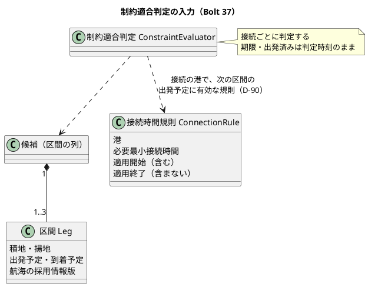

# Bolt 37 計画 - US-06 の境界の網羅（3 区間の候補・1 つだけ不足する接続・接続時間の規則の有効期間。D-90）

## 基本情報

| 項目 | 内容 |
| :--- | :--- |
| Bolt | 第 37 回（W6 の 2 本目） |
| 予定 | W6（2026-11-09 の週。前倒しで着手できる）。作業は約 3.5 時間（`check`・`uiTest`・CI の待ちを除く） |
| 対象 | 経路設計のドメイン: 候補探索 `RouteCandidateFinder`（区間の上限を 3 に）、制約適合判定 `ConstraintEvaluator`（規則を選ぶ時刻を接続の時刻に。D-90）、`ConnectionRule`、確定の判定し直し（`RoutingCase.confirm`）。受入シナリオ `features/routing/route_candidates.feature`・`confirm_route.feature` とステップ定義。S-07 の説明の文言（`confirmation.html:61`） |
| GitHub | [#15](https://github.com/k2works/practical-domain-driven-design-in-enterpris-application/issues/15)（US-06 の残り。閉じるのは Bolt 37f） |
| SP | 0（US-06 の 5 SP は Bolt 37f で数える） |
| 承認ゲート | 計画と終了報告（W5 の締めの決定）。スキーマ・認可・層の構造は変えない（S-07 の文言は確認ポイント 5） |
| アプローチ | アウトサイドイン（受入シナリオ → 集約の判定 → 候補探索と規則）。W6 節の局面とアプローチ（中盤の例外。序盤で作った経路設計案件を広げる） |
| マニュアル・デモ | マニュアル 8 章の 8.2（候補は積替え 2 回まで、接続時間の規則は積み替える時刻のもの、画面の判定時刻は規則を選ぶ時刻ではない）と 8.3（S-07 の文言、③ の説明、注意・補足）、S-07 のキャプチャ `08-confirmation.png` の撮り直し（生成の spec 経由）。開発データに 3 区間の組み合わせがないので、デモの動画は撮らない（確認ポイント 5） |
| 前の Bolt | [Bolt 36 終了報告](bolt_36_report.md)、W6 節（[リリース計画](release_plan.md)） |

## Bolt ゴール

経路設計者が、積替え 2 回（区間 3）までの候補を比べられ、接続が複数ある候補のうち 1 つだけ接続時間が足りないときも、どの港の接続で除外されたかが分かる。接続時間の規則は、実際に積み替える時刻（次の区間の出発予定）に有効なものを使う（D-90）。

### 確かめたい仮説

| # | 仮説 | この Bolt で分かること |
| :--- | :--- | :--- |
| H1 | 制約適合判定は接続ごとに判定するループ（`ConstraintEvaluator.java:30-63`）なので、区間が 3 でも直さずに動き、変えるのは規則を選ぶ時刻（:41）だけで済む | 3 区間の受入シナリオで、2 つの接続のうち 1 つだけが不足するとき理由が 1 つだけ出る（Green に判定の直しが要らない） |
| H2 | 規則を接続の時刻で選ぶと、確定の時刻を境界にしたテストは意味を失う。Red になるのは `RoutingCaseConfirmationTest:349`（確定の時刻の 1 分後に有効になる規則では判定しない。適用開始が接続の時刻より前なので除外になる）と `ConstraintEvaluatorTest:133`。`RoutingCaseConfirmationTest:169`・`:179`・`:337`・`:360` と `confirm_route.feature:54` は緑のままだが、確かめる理由が「算出の後に登録された規則を確定で読み直す」に変わる | ステップ 4 で Red の 2 本を次の区間の出発予定の境界に書き直し、緑のままの 5 本は名前と前提を新しい理由に合わせる。数え上げ（ステップ 1）でほかにないことを確かめる |

### 開始準備で確かめたこと

（行番号は 2026-10-21 の develop の `4ea1f1c24`。パスは `apps/cargo-tracker/src/` からの相対）

- **候補探索**（`main/java/.../routing/domain/model/rules/RouteCandidateFinder.java`）:
  - :16 に「R0.1 は直行と 1 回の積替え（区間 1〜2）まで（Bolt 17）」とある。`find` :32-47 は 1 区間目の揚地が目的地でも出発地でもなければ `transshipments` :50-58 を呼び、`transshipments` は 2 区間目で終わる（再帰しない）。
  - 同じ航海は 1 本目と 2 本目で除く（:53）。
  - 出発の判定 `departsAfter` :104-110 は、出発地では判定時刻より後（同時刻は出発済み）、積替えでは前の区間の到着以後。
  - 目的地を通り過ぎた先へは運ばない（D-60）のは 1 区間目だけで、2 区間目は `passing = null` で渡す（:54）。2 区間目は揚地が目的地のものだけを取るので、今は問題にならない。
  - 並びは到着予定の早い順、同時刻は航海番号をつないだ文字列の順（:25-29）。接続不足の候補は捨てない（:19-20）。
- **制約適合判定**（`rules/ConstraintEvaluator.java`）:
  - 接続ごとに判定する（:30-63）。規則は :41 の `requiredConnection(rules, port, judgedAt)` で選び、:65-71 で `rule.appliesTo(port, judgedAt)` を満たす規則のうち厳しい方を取る。今は判定時刻で選んでいる。
  - 規則がなければ `NOT_CONNECTABLE`（:42-44）。接続時間は前の区間の到着予定から次の区間の出発予定まで、負なら `CONNECTION_TOO_SHORT`（:52-54）。接続余裕はすべての接続の最小（:49）。理由は接続の順で、期限超過は最後（:57-61）。
  - 接続の理由の不適合の時刻は次の区間の出発予定、参照情報版は次の区間の航海の版（`valueobjects/ExclusionReason.java:48-68`）。
- **規則**（`aggregates/ConnectionRule.java`）: `appliesTo` :35-39 は開始を含み終わりを含まない（`validTo` が null なら終わりなし。:17-18）。`route_scope` は使わない（:12）。リポジトリは全件を返す。
- **候補の上限**: `RoutingCase.MAX_CANDIDATES = 20`（:40）。全候補を判定してから適合を先に並べて 20 件で切る（:176-195）。
- **判定時刻**: 候補の算出は `RoutingCaseCommandService.java:68` の `clock.instant()`、確定は commit の時刻（:100）で、`RoutingCase.confirm` :242 が同じ判定でやり直す。規則を選ぶ時刻を変えると、算出と確定の両方が同じ規則で動く。
- **既存のテスト**:
  - `RouteCandidateFinderTest` に 3 区間のテストはない（:31〜:146 の 10 本）。
  - `ConstraintEvaluatorTest` は区間 2 だけ。:133「判定時刻で有効でない規則は使わない」（`validTo = JUDGED_AT`、`validFrom = JUDGED_AT + 1 秒`）は D-90 で書き直す。
  - `ConnectionRuleTest:32` に有効期間の 5 点（開始の 1 秒前・同時刻・1 秒後、終わりの 1 秒前・同時刻）がある。規則そのものの境界はここで守られている。
  - `route_candidates.feature` は :23・:41・:54・:65・:70 の 5 シナリオで、3 区間・1 つだけ不足・有効期間の境界はない。背景 :19 で SGSIN の 8 時間を登録する。
  - ステップ定義 `RoutingSteps.java:64-72` は規則を `validFrom = 2026-01-01`、`validTo = null` で作る。`次の航海がある`（:74-86）は 1 行を寄港 2 つの航海にするので、3 区間は航海 3 本で書ける。有効期間の開始を指定するステップは `RouteConfirmationSteps.java:66` にあり、終わりを指定するステップはない。
- **画面**: S-06（`templates/routing/staff/routing-cases/show.html:82`）は区間を `th:each` で並べるので、3 区間でも直さずに示せる。S-07（`confirmation.html:61`）は「確定すると、確定の時刻の接続時間規則で候補を判定し直します。」と示し、D-90 と合わなくなる。
- **マニュアル 8 章**: :73 は「積替えがある候補は区間の航海ごとに並びます」で、区間の上限と規則の時刻は書いていない（:84 に同時刻・同値は適合）。:68 は画面の「判定時刻」を示す。8.3 の :106（③ 確定の時刻の規則で判定し直すこと）・:123（確定の時刻に規則に合わなくなっていると確定できない）は D-90 と合わなくなる。キャプチャ `08-confirmation.png` は `ui/manual_screenshots.feature:65` で撮る。
- **確定の時刻の規則を書いた写し**（検証で見つけた。ステップ 1 で全体を数え直す）: domain_model :714（判定時刻から）・:734（R-INV-03 の再検証「確定の時刻で有効な接続時間規則」「変わり得るのは接続時間規則の選び直しだけ」）、user_story :318（US-07 AC1 の決定）、Javadoc（`ConstraintEvaluator.java:18`・`:22-23`、`RoutingCase.java:199-200`、`RoutingCaseCommandService.java:80-81`、`ExclusionReason.java:59`、`RouteCandidateFinder.java:16`・`:18-20`）、`confirm_route.feature:5`・`route_candidates.feature:5-6` の説明、ステップ `RouteConfirmationSteps:66`（「〜から N 時間になる」は古い規則を終わらせず重ねる）。
- **要求**: BR-11（requirements_definition :731。2026-10-01 に human:kakimomokuri が承認）は「経路承認の commit 時点と参照した外部情報版で判定し」と書く。system_usecase :190 も同じ趣旨。
- **判定時刻の引数**: `ConstraintEvaluator.evaluate` の `judgedAt` は :41 の規則の選択にしか使わない（期限は希望到着期限と比べ、出発済みは `RouteCandidateFinder.departsAfter` と `RoutingCase.confirm` :238 が判定する）。D-90 の後は使われなくなる。呼び出し元は `RoutingCase.java:177`・`:242` と `ConstraintEvaluatorTest` の約 8 か所。
- **開発データ**（`db/dev-data/V20261007100900__seed_dev_voyages.sql`）: 航海 7 本はどれも寄港 2 つで、3 区間になる組み合わせはない。規則は SGSIN の 480 分だけ。
- **設計の文書**: domain_model :722（区間 1〜2、3 区間以上は R1.0）・:723（判定時刻で有効な規則）、user_story の US-06 の Bolt 17 の決定 :292-294、test_strategy :280（1 つだけ不足と有効期間の境界を網羅する）。台帳の D-90（release_plan :866）は仮。

## 設計の決定

| 事項 | 決定 | 反映 |
| :--- | :--- | :--- |
| D-90 接続時間の規則を選ぶ時刻 | **接続の時刻（次の区間の出発予定）に有効な規則で判定する**（2026-10-21、human:kakimomokuri。Bolt 37 の開始準備の質問への回答。選択肢の「決めずに先送り（業務責任者の確認を後の週に送る）」を選ばなかったので、決定として扱う。確認ポイント 1）。【前の決定の変更】(1) Bolt 17 の確認ポイント 9（判定時刻で選ぶ。2026-10-07、`/goal Bolt17` で AI が案のとおりに進め、Bolt 17 の終了報告の議題 2 で確かめを求めた）、(2) Bolt 19 の確認ポイント 3（確定の時刻で有効な規則で判定し直す。bolt_19_plan :312、domain_model :734、user_story :318）を変える。BR-11 の「commit 時点で判定」は、判定し直す時機（確定のとき、その時点の規則と情報版を読み直す）と読み、規則を選ぶ時刻は接続の時刻とする注を足す（確認ポイント 1） | 台帳の D-90 の状態（回答・日付・回答者・コミット）、W6 の確認ポイント 4 の決着、domain_model :714・:722-723・:734、user_story :292-294・:318、BR-11 の注（requirements_definition :731）、W6 節の D-65 の残り（:750）、マニュアル 8 章、S-07 の文言 |

## ふりかえりと前の Bolt からの引き継ぎ

| 入力 | 内容 | この Bolt での扱い |
| :--- | :--- | :--- |
| W6 の確認ポイント 4・5 | 規則を選ぶ時刻（D-90）、区間の上限は積替え 2 回 | 設計の決定と確認ポイント 1・2 |
| D-65 の残り（Bolt 17 の開発レビュー） | 規則を選ぶ時刻は Bolt 37。航海の照会の絞り込み・`Voyage` と `ConnectionRule` の class 化は W7 | この Bolt では規則の時刻だけ。探索の量は確認ポイント 3 |
| T-106・T-119 | 「ないこと」を確かめる前に、対象があり条件が成り立つことを確かめる | 4 区間の列・港に戻る列・同じ航海を 2 回使う列が航海の上で成り立つデータで「列挙しない」を確かめる。規則の境界は、背景の常に有効な規則に隠れない港と重ね方で書く（確認ポイント 6） |
| T-148・T-152 | 共通の部品と写しは全体を検索して数えてから変える | `appliesTo`・`evaluate` の `judgedAt`、規則を作るステップ、「確定の時刻の規則」「判定時刻で有効な規則」の写し（文書・画面・Javadoc・feature の説明）を数えてから変える（ステップ 1） |
| T-164・T-166 | 変異の道具は 1 つを手で照らす。差し込みが効いたことを出力で確かめてから結果を読む | 変異は 6 つ（確認ポイント 7）に当て、落ちたテストの名前を出力で確かめる |
| T-167 | 確かめた原因と確かめていない候補を分けて書く | H1・H2 の結果を報告で分けて書く |
| T-168 | 手で直した後は、コミットの前に `spotlessApply` をかけ直す | 各コミットの前 |
| T-125・T-104・T-147・T-139 | 規則に当たったら止める。SonarQube の時機。テストのラムダの中で値を作らない | 確認ポイント 7 |

## スコープ

### 入れるもの・入れないもの

| 入れる | 入れない |
| :--- | :--- |
| 積替え 2 回（区間 3）までの候補探索。同じ航海と同じ港を 2 回使う列、目的地を通り過ぎる区間は列挙しない | 区間 4 以上（W6 の確認ポイント 5） |
| 規則を接続の時刻で選ぶ（D-90）。算出と確定の両方。`evaluate` の使われなくなる判定時刻の引数を消す（構造の変更。別のコミット） | 規則の `route_scope`（経路の範囲で選ぶ規則。R0.1 から使っていない） |
| 受入シナリオ: 3 区間の候補、2 つの接続のうち 1 つだけ不足（前と後のそれぞれ）、規則の有効期間の開始・終わりの境界（接続の時刻の直前・同時刻・直後） | Golden dataset v0（Bolt 37f）、情報不足（Bolt 37b） |
| S-07 の説明の文言、マニュアル 8 章の本文、`08-confirmation.png` の撮り直し | 開発データの 3 区間のサンプル（確認ポイント 4）、画面の層の新しいシナリオ、デモの動画（確認ポイント 5）、規則の `validTo` の保存の往復（`MyBatisRoutingRepositoriesIntegrationTest:403` にある。test_strategy :279） |

### 設計の約束

- 候補探索は区間の上限を `RouteCandidateFinder` の private な名前のある定数（`MAX_LEGS = 3`）で持ち、1 区間目の後を同じ手順で繰り返す（再帰か反復）。訪れた港の集合（出発地を含む）と使った航海番号を持ち回り、列の中で同じ航海（続けて使う列と、間を空けて使う列の両方）と同じ港を 2 回使わない。途中の区間にも目的地を渡し、目的地を通り過ぎない（D-60）。`domain.model.rules` から使うのは `aggregates.Voyage` と `valueobjects` だけで、層の規則に当たらない
- 制約適合判定は、接続ごとに、次の区間の出発予定の時刻に `appliesTo` を満たす規則のうち厳しい方を使う。その時刻に有効な規則がなければ「接続できない」（失敗に倒す。Bolt 17 の T-42 のまま）。前の区間の到着の時刻では選ばない（接続の理由の不適合の時刻と同じ時刻にそろえる）
- 出発済みの判定は今のとおり候補探索（判定時刻より後に出発する区間）と確定（確定の時刻）が持つ。制約適合判定は判定時刻を使わなくなるので、`evaluate` の判定時刻の引数を消す（構造の変更。別のコミット）。`ConnectionRule.appliesTo` の引数の名前も判定時刻から「時刻」に改める
- 確定の判定し直しは、確定のときに規則と情報を読み直して同じ判定にかける（BR-11 の「commit 時点」）。算出の後に登録・変更された規則は確定で拾う

## 設計（この Bolt の範囲）

状態遷移・ER・画面遷移は変えないので省く（スキーマも画面の項目も変えない）。ドメインモデルは、制約適合判定の入力の関係だけを示す。

## ステップ計画

各ステップの終わりに対象のテストを流し、最後に `check` と `uiTest` を流して件数を数える（T-151）。コミットは pathspec で行い（T-110）、push してアプリの CI を確かめる（T-26）。

- [ ] **1. 設計の文書と数え上げ**: D-90 の決定を、台帳の D-90 の状態（回答・日付・回答者・反映したコミット。台帳の規則 release_plan :841）、W6 の確認ポイント 4 の決着、domain_model :714・:722-723・:734、user_story :292-294・:318、BR-11 の注、W6 節の D-65 の残り、W6 節のマニュアルの割り当て（8 章に 37 を足す）に書く。`appliesTo`・`evaluate` の `judgedAt`、規則を作るステップ（`RoutingSteps:64-72`・`RouteConfirmationSteps:66`）、「確定の時刻の規則」「判定時刻で有効な規則」の写し（開始準備で確かめたことの一覧と、ほかにないか）を全体で数える（T-148）（完了の判定: 文書の差分と、直す箇所の一覧）
- [ ] **2. 受入シナリオ（Red）**: `route_candidates.feature` に足す。
  - (a) 積替え 2 回の候補が適合で示される。4 区間でしか着かない列と、出発地に戻る列も航海の上で成り立つデータにし、列挙されないことも確かめる（同じ航海を 2 回使う列と途中の区間の D-60 は寄港 3 つ以上の航海が要るので、単体テスト（ステップ 3）だけで確かめる）
  - (b) 2 つの接続のうち後の接続だけが不足して理由が 1 つ（港・不適合の時刻・閾値・参照情報版）。前の接続だけが不足する例も。接続余裕は 2 つの接続の最小
  - (c) 接続の港の規則の境界（シナリオアウトライン）。規則は背景の常に有効な SGSIN の規則に隠れないよう、背景の規則のない 2 つ目の積替えの港に置き、適用開始の直前・同時刻は有効で直後は無効、適用終了の直前は有効で同時刻・直後は無効の 6 点を、次の区間の出発予定を基準に書く。境界の時刻は前の区間の到着予定と次の区間の出発予定の間に置く（到着の時刻で選ぶ変異を落とすため）。規則の終わりを指定するステップを足す（古い規則を終わらせて置き換える形。`RouteConfirmationSteps:66` の重ねる形と名前で分ける）
  - 落ちる理由が「候補がない」「規則が判定時刻で選ばれる」であることを確かめる（完了の判定: 足したシナリオが期待した理由で落ちる）
- [ ] **3. 候補探索（Green）**: `RouteCandidateFinderTest` に、3 区間、4 区間は列挙しない、同じ航海を続けて使う列（V1 A→B、V1 B→C）と間を空けて使う列（V1、V2、V1）を列挙しない、出発地に戻らない、途中の区間が目的地を通り過ぎない、並びのテストを足して Red を見てから、`RouteCandidateFinder` を区間 3 まで広げ、Javadoc（:16・:18-20）を直す。`RoutingCaseTest` で 3 区間の候補も 20 件の上限と見つけた数に入ることを確かめる（完了の判定: 単体テストと 2 (a) が緑）
- [ ] **4. 規則を選ぶ時刻（Green。D-90）**: `ConstraintEvaluatorTest` に、区間 3 で 1 つだけ不足（接続余裕が最小の接続の値であることも）、港ごとに違う規則、次の区間の出発予定で規則の開始・終わりの境界、判定時刻には有効でも接続の時刻には切れていて後継がなければ「接続できない」を足し、`RoutingCaseConfirmationTest` に「適用開始が確定の時刻より後で接続の時刻より前の規則は確定で使う」を足して Red を見てから、:41 を次の区間の出発予定に変える。H2 の Red の 2 本（`ConstraintEvaluatorTest:133`、`RoutingCaseConfirmationTest:349`）を次の区間の出発予定の境界に書き直し、緑のままの 5 本（`RoutingCaseConfirmationTest:169`・`:179`・`:337`・`:360`、`confirm_route.feature:54`）の名前と前提を「算出の後に登録された規則を確定で読み直す」に合わせる。Javadoc（`ConstraintEvaluator`・`RoutingCase`・`RoutingCaseCommandService`・`ExclusionReason`）と feature の説明を直す。その後、`evaluate` の判定時刻の引数を消し、`appliesTo` の引数の名前を改める（構造の変更。別のコミット）（完了の判定: 2 (b)(c) と経路設計の単体・受入テストが緑）
- [ ] **5. 画面の文言とマニュアル**: S-07 の説明（`confirmation.html:61`）を「確定すると、最新の接続時間規則（積み替える時刻に有効なもの）と出発の状況で候補を判定し直します。」の趣旨に直す（文言は画面の層のシナリオと manual_screenshots の期待を数えてから。T-148）。8 章 8.2 の比べ方に、候補は積替え 2 回までであること、接続時間の規則は積み替える時刻（次の区間の出発予定）に有効なものを使うこと、① の判定時刻は規則を選ぶ時刻ではないことを書く。8.3 の ③（:106）と注意・補足（:123）を直し、`08-confirmation.png` を `manual_screenshots.feature` で撮り直す（ほかのキャプチャの差分は戻す）（完了の判定: 本文とキャプチャの差分）
- [ ] **6. 品質ゲートと開発レビューと終了報告**: 変異 6 つ（確認ポイント 7）を当て、落ちたテストを出力で確かめる（T-164・T-166）。`check`・`uiTest`・SonarQube（ほかの Gradle が終わってから。T-147）、開発レビュー、push して CI と MkDocs の配備を確かめる（T-126）。#15 にコメントを残す。終了報告で release_plan（W6 の Bolt 37 の行と主なタスク）・開発の索引・mkdocs を完了に直す

### 時間の配分と打ち切り

| # | 目安 | 打ち切り |
| :--- | :--- | :--- |
| 1 | 20 分 | — |
| 2 | 40 分 | — |
| 3 | 40 分 | 区間 3 の探索で候補の数が 20 件の上限を超えて既存の受入シナリオの候補が押し出されるなら、止めて上限の扱いを諮る |
| 4 | 40 分 | H1 が外れ、判定のループの直しが要るなら、その範囲を報告に書いて続ける。直しが集約の守り（確定の判定し直し）に及ぶなら止めて諮る |
| 5 | 30 分（キャプチャの撮り直しを含む） | — |
| 6 | 35 分（`check`・`uiTest`・SonarQube・CI の待ちを除く） | — |

合計 205 分（約 3.5 時間）。半日に届かないので分けない。

## 確認ポイント（計画の承認の場でまとめて確認する。Try T-6）

| # | 確認すること | 場所 | 推奨 |
| :--- | :--- | :--- | :--- |
| 1 | **D-90 の決め方の細部と記録**【前の決定の変更】 | ステップ 1・4 | 規則は次の区間の出発予定の時刻で選ぶ（前の区間の到着の時刻ではない。接続の理由の不適合の時刻と同じ時刻にそろえる）。その時刻に有効な規則がなければ「接続できない」。出発済みは候補探索と確定が判定時刻・確定の時刻で判定するまま。確定の判定し直しも同じ判定を使うので、算出と確定で規則の選び方がそろう。Bolt 17 の確認ポイント 9 と Bolt 19 の確認ポイント 3 を変えることを domain_model と user_story に書く。BR-11 は変えず、「commit 時点」は判定し直す時機と読む注を足す。台帳の D-90 は「決定（2026-10-21、human:kakimomokuri）」にし、業務責任者の確認は残さない（先送りの選択肢を選ばなかったため）。`evaluate` の判定時刻の引数は使われなくなるので消す（残すと名前が動きと合わず、SonarQube の未使用の引数に当たる） |
| 2 | **区間の上限と、列挙しない列** | ステップ 3 | 区間 3（積替え 2 回）まで。列の中で同じ航海と同じ港（出発地を含む）を 2 回使わない（港を巡って戻る列は業務の経路にならない）。途中の区間も目的地を通り過ぎない（D-60） |
| 3 | **探索の量と 20 件の上限** | ステップ 3 | 20 件の上限と並び（適合を先に、到着予定の順）は変えない。探索は航海の数の 3 乗まで増えるが、航海は開発データの 7 本だけで、量が変わるのは外部原本の取込（W7）。航海の照会の絞り込みは D-65 の残りのとおり W7 の開始準備で扱う |
| 4 | **開発データの 3 区間のサンプル** | — | この Bolt では足さない（データベースの承認ゲートを増やさない）。開発データの航海の取得時刻を直す Bolt 37b のマイグレーションに、3 区間の組み合わせを足すかを 37b の計画の確認ポイントにする |
| 5 | **S-07 の文言とマニュアルと画面の層** | ステップ 5 | S-07 の「確定の時刻の接続時間規則で判定し直します」は D-90 と合わなくなるので、この Bolt で直す（W6 節は S-07 の文言を 37c に置くが、37c は情報版の照合の拒否の文言で、ここは今ある説明の誤り。振る舞いの変わる Bolt はマニュアルを後に送らない）。マニュアル 8 章の本文と `08-confirmation.png` を直す。S-06 は区間を並べるだけで項目は変わらないので、画面の層の新しいシナリオとデモの動画は足さない |
| 6 | **「ないこと」と境界の確かめ（T-106・T-119）** | ステップ 2・3 | 4 区間の列・港に戻る列・同じ航海を 2 回使う列が、航海の上では成り立つデータで「列挙しない」を確かめる（寄港 3 つ以上が要るものは単体テストで）。規則の境界は背景の常に有効な規則に隠れない港に置き、6 点の期待を書く |
| 7 | **規則と SonarQube と変異（T-125・T-104・T-147・T-139・T-164・T-166・T-168）** | ステップ 6 | 層の規則に当たったら止めて諮る。SonarQube は開発レビューの前に、ほかの Gradle が終わってから流す。テストのラムダの中で値を作らない。変異は 6 つ: 区間の上限を 2 にする、上限を 4 にする、規則を判定時刻で選ぶ、規則を前の区間の到着の時刻で選ぶ、`appliesTo` の終わりを含む比べ方にする、接続余裕を最初の接続だけで計る。落ちたテストを出力で確かめる。手で直した後は `spotlessApply` |
| 8 | **アプローチと承認ゲートと時間** | 全体 | アウトサイドイン（受入シナリオ → 集約 → 規則）。承認ゲートは計画と終了報告。スキーマ・認可・層の構造は変えない。約 3.5 時間 |

## 完了条件

- [ ] 積替え 2 回までの候補が示され、4 区間・港に戻る列・同じ航海を 2 回使う列は、成り立つデータで列挙されない
- [ ] 2 つの接続のうち 1 つだけが不足する候補で、その接続の理由だけが示される（前と後のそれぞれ）
- [ ] 接続時間の規則が次の区間の出発予定の時刻で選ばれ、適用開始と終わりの直前・同時刻・直後の境界が受入シナリオと単体テストで確かめられている（D-90）。確定の判定し直しも同じで、確定の時刻を境界にしたテストを新しい理由に書き直した
- [ ] D-90 の決定を台帳・domain_model・user_story・BR-11 の注・W6 節に書いた。確定の時刻の規則を書いた写し（画面・Javadoc・feature の説明）を直した。S-07 の文言、マニュアル 8 章の本文と `08-confirmation.png` を直した
- [ ] 変異 6 つで落ちるテストがある。`check` と `uiTest` が緑で件数が減っていない。SonarQube の Quality Gate が PASS、`okf:check` ERROR 0、CI が緑
- [ ] release_plan（W6 の Bolt 37 の行と主なタスク）・開発の索引・mkdocs のナビが合っている。MkDocs の配備を確かめた。#15 にコメントを残した
- [ ] 開発レビュー、終了報告

## 更新履歴

| 日付 | 更新内容 | 更新者 |
| :--- | :--- | :--- |
| 2026-10-21 | 計画を承認した（確認ポイント 1〜8 を推奨のとおり） | anthropic/claude-opus-5-5、承認 human:kakimomokuri |
| 2026-10-21 | 整合性検証の指摘を反映した（承認待ち）。確定の時刻を境界にしたテストの書き直し、確定の時刻の規則を書いた写し（S-07 の文言・マニュアル 8.3・domain_model :734・user_story :318・Javadoc）、Bolt 19 の確認ポイント 3 と BR-11 との関係、判定時刻の引数を消すこと、境界のシナリオが背景の規則に隠れないこと、同じ航海を 2 回使う列を単体テストで確かめること、変異を 6 つに、D-90 の記録の仕方を直した。約 3.5 時間にした | anthropic/claude-opus-5-5 |
| 2026-10-21 | 初版作成（承認待ち）。D-90 は human:kakimomokuri が接続の時刻で選ぶと決めた | anthropic/claude-opus-5-5、決定 human:kakimomokuri |

## 関連ドキュメント

- [リリース計画](release_plan.md)（W6 節、台帳の D-90）
- [Bolt 17 計画](bolt_17_plan.md)（確認ポイント 9）、[Bolt 17 終了報告](bolt_17_report.md)、[Bolt 19 計画](bolt_19_plan.md)（確認ポイント 3）
- [ドメインモデル](../../design/cargo-tracker/domain_model.md)、[テスト戦略](../../design/cargo-tracker/test_strategy.md)
- [ユーザーマニュアル 8 章](../../manual/08-経路設計.md)
