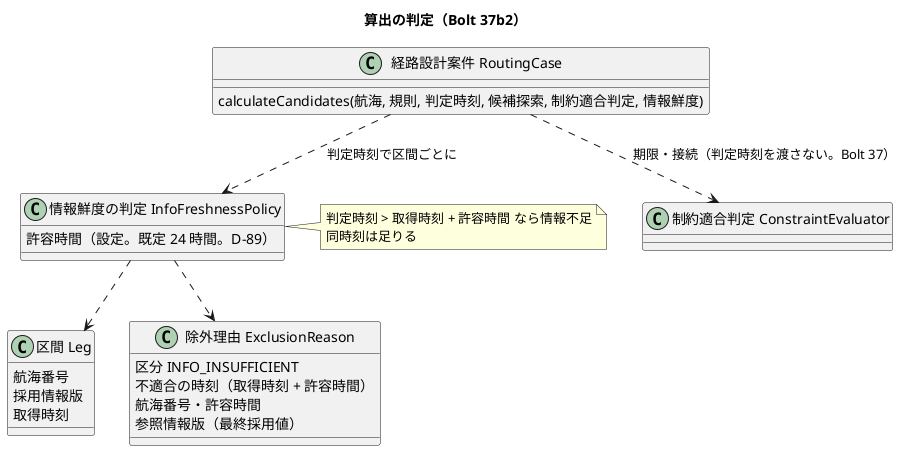

# Bolt 37b2 計画 - US-06 AC4 情報不足（算出のときに古い航海の情報を使う候補を除外する。D-89）

## 基本情報

| 項目 | 内容 |
| :--- | :--- |
| Bolt | 第 37b2 回（W6 の 4 本目） |
| 予定 | W6（2026-11-09 の週。前倒しで着手できる）。作業は約 4 時間（`check`・`uiTest`・SonarQube・CI の待ちを除く） |
| 対象 | 経路設計のドメイン: 新しい規則「情報鮮度の判定」（`domain.model.rules`）、除外理由 `ExclusionReason`、算出 `RoutingCase.calculateCandidates`、許容時間の設定（`RoutingConfiguration` が設定の値を受けて規則を作る）、保存 `MyBatisRoutingCaseRepository`（`threshold`・`info_insufficient`）、S-06 の理由の文言（`RoutingCaseViews.reason`）。受入シナリオ `features/routing/route_candidates.feature` とステップ定義、画面の層のシナリオ `features/ui/compare_route_candidates_ui.feature` |
| GitHub | [#15](https://github.com/k2works/practical-domain-driven-design-in-enterpris-application/issues/15)（US-06 の残り。閉じるのは Bolt 37f） |
| SP | 0（US-06 の 5 SP は Bolt 37f で数える） |
| 承認ゲート | 計画と終了報告（W6 節の 37b2 の行。W6 の確認ポイント 1・3）。新しいファイル（規則とそのテスト、設定の結合のテスト）を作る。スキーマ・認可・層の構造は変えない（設定のクラスを作らない。確認ポイント 3）。環境変数は足さない（設定は既定値を `application.properties` に置く） |
| アプローチ | アウトサイドイン（受入シナリオ → 規則と集約 → 設定と保存 → 画面）。W6 節の 37b2 の行のとおり |
| マニュアル・デモ | マニュアル 8 章の 8.2（除外の理由に「情報不足」、算出し直す案内、時間がたったら算出し直してから確定する注意）。キャプチャは足さない・撮り直さない（確認ポイント 6）。デモの動画 `@demo-bolt-37b2/info-insufficient` を画面の層のシナリオで撮る |
| 前の Bolt | [Bolt 37b 終了報告](bolt_37b_report.md)（承認済み）、[Bolt 37b 計画](bolt_37b_plan.md) の「Bolt 37b2 の開始準備に送る材料」、W6 節（[リリース計画](release_plan.md)） |

## Bolt ゴール

経路設計者が候補を算出したとき、最終取得から許容時間（24 時間。設定。D-89）を超えた航海の情報を使う候補は「情報不足」で除外され、どの航海の情報が古いか、その航海の最終採用値（採用情報版）と取得時刻が S-06 で分かる。確定のときの鮮度は Bolt 37c で扱う。

### 確かめたい仮説

| # | 仮説 | この Bolt で分かること |
| :--- | :--- | :--- |
| H1 | 鮮度の判定を算出の集約に入れ、除外理由を制約適合判定の理由の後ろに足すだけで、適合を先に並べる順・20 件の上限・接続余裕は変わらない（Bolt 37b で、既存のテストの取得時刻を判定時刻の近くへ動かした） | 既存の `check` と `uiTest` が、引数を足す直しのほかに期待値を変えずに緑のまま（件数は足した分だけ増える） |
| H2 | スキーマは変えずに済む（`exclusion_reason.threshold` は VARCHAR(100)、`reason_code` の CHECK は `INFO_INSUFFICIENT` を許し、`route_candidate.info_insufficient` は列がある） | 保存の往復の統合テストが、マイグレーションを足さずに緑になる |

### 開始準備で確かめたこと

（行番号は 2026-10-22 の develop の `edfd9e0d3`。パスは `apps/cargo-tracker/src/` からの相対）

- **要求**: US-06 AC4 は「Given 外部情報源が停止中、When 候補を算出する、Then 最終採用値と取得時刻が示され情報不足として識別される」（user_story :288）。W6 の確認ポイント 1 で「停止中」を「最終取得から 24 時間を判定時刻で比べて超えた航海」と決め（D-89。台帳 release_plan :866 は仮。値は設定）、確認ポイント 3 で「除外にする（理由 `INFO_INSUFFICIENT`、`info_insufficient` を立てる）。専門家の判断で通すことは作らない」と決めた。FRS-01（non_functional :123）は「経路候補に『情報が古い』と示し、R-INV-09 の情報不足として扱う」。R-INV-09（domain_model :708）は「外部情報が停止中のときは、最終採用値と取得時刻を示し、情報不足として識別する」。D-89 の注のとおり、港湾は判定しない（取込は W7、US-14）。
- **区間**（`main/java/.../routing/domain/model/valueobjects/Leg.java:21-28`）: 区間ごとに航海番号・採用情報版 `infoVersion`・取得時刻 `infoAcquiredAt` を持つ。候補の「最も古い情報の取得時刻」は `RouteCandidate.oldestInfoAcquiredAt()`（:35）。同じ航海を 2 回使う列は列挙しない（Bolt 37）ので、候補の中で航海番号は重ならない。
- **除外理由**（`valueobjects/ExclusionReason.java:22-28`）: 項目は区分・不適合の時刻・期限・港・必要最小接続時間・参照情報版。航海番号と許容時間の項目はない。`INFO_INSUFFICIENT` の作り方（static の生成）はない。`ExclusionReasonCode.java:4-5` の Javadoc は「情報不足は AC4（W6）で判定する」、:16 の値の説明は「情報不足（外部情報源の停止中）」。
- **算出**（`aggregates/RoutingCase.java:165-196`）: 引数は航海・規則・判定時刻・候補探索・制約適合判定の 5 つ。候補ごとに `evaluator.evaluate(specification, legs, rules)`（:177）をかけ、適合を先に、到着予定の順に並べて 20 件で切る。`ConstraintEvaluator.evaluate`（`rules/ConstraintEvaluator.java:31`）は判定時刻を受け取らない（Bolt 37 の決定）。確定（:208-262）は引数が 6 つで `@SuppressWarnings("java:S107")`（:207）。
- **入力ポート**（`application/internal/commandservices/RoutingCaseCommandService.java:38-39`）: 候補探索と制約適合判定を自分で作る。判定時刻は `clock.instant()`（:68）。組み立ては `RoutingConfiguration.java:58-67` と、受入テストの `acceptance/AcceptanceTestConfiguration.java:181`。
- **設定の前例**: `@ConfigurationProperties` は `cargotracker.dev-login`（identity）・`cargotracker.document-storage`（quotation、`QuotationConfiguration:42` が `@EnableConfigurationProperties`）・`cargotracker.provisional-consignees` の 3 つで、業務の閾値を設定にしたものはない。`CargoTrackerApplication:30` に `@ConfigurationPropertiesScan`。既定値は `application.properties`。設定のクラスは使う側のアダプターの隣に置かれ（`quotation.infrastructure.storage`・`identity.infrastructure.devlogin`・`quotation.interfaces.web`）、`..infrastructure.config..` には `@Configuration` のクラスしか置けない（`LayerArchitectureTest` の「合成ルートにはConfigurationのクラスだけを置く」:197-203。Bolt 37b の材料 4 の「`routing.infrastructure.config` に `@ConfigurationProperties`」はこの規則に当たる）。本体に `@Value` の前例はない。業務の期間の規則の前例は `identity.domain.model.rules.SessionPolicy`（`@DomainRule`、期間は定数）。
- **保存**（`infrastructure/persistence/MyBatisRoutingCaseRepository.java`）: 候補の `info_insufficient` に常に `false` を書く（:154）。`threshold`（:277-285）と `toReason`（:287-304）は `INFO_INSUFFICIENT` で例外を投げる。接続不足の閾値は「港 空白 期間」（区切りは :50 の空白。`toReason` は `split` で分ける）。港は 5 文字の UN/LOCODE だが、`voyage_number` は VARCHAR(30) で `Voyage` は空白を拒まない（外部原本の取込は W7）。data_model に `threshold` の区分ごとの形は書いていない。スキーマ（`db/migration/common/V20261007100000__create_routing.sql:54`・`:83-97`）は情報不足を受けられる。
- **画面**: S-06（`templates/routing/staff/routing-cases/show.html:77-78`）は候補ごとに「最も古い情報の取得時刻」を示し、理由は `RoutingCaseViews.reason`（:252-271）の文言を並べる（:90）。`INFO_INSUFFICIENT` は「情報不足、参照した航海情報の版 …」だけ（:270）。画面の語は「参照した航海情報の版」（ui_design :56、Bolt 29c。主要実績の「採用」と混ざるのを避けた。`RoutingCaseViews:31` の `INFO_VERSION`）。期間の表示 `DurationDisplay.connection` は 24 時間を「1 日」と出す。UI 設計の S-06（ui_design :1066-1069）は画面の上の「情報」の行に「1 航海の情報が古い」を示し、:1087 は「外部情報が停止中なら最終採用値と取得時刻を示し、『情報不足』と表示する」。
- **受入シナリオ**（`test/resources/features/routing/route_candidates.feature`）: 判定時刻は背景の最後の `2026-10-07T03:00:00Z`（:21）。航海は「次の航海がある」で入れ、取得時刻はステップ定義の定数 `2026-10-07T01:00:00Z`（`RoutingSteps.java:41`。Bolt 37b）。航海ごとに取得時刻を指定するステップはない。`REASONS`（:42）に「情報不足」はない。「除外された候補の理由」は理由 1 つを前提にし（:162-163 の `hasSize(1)`・`getFirst()`）、`threshold()`（:199）は区分の `default` で `port` を使う。
- **画面の層**: `compare_route_candidates_ui.feature` の航海は `RoutingUiSteps` が JVM の時計から 1 時間前を取得時刻にして入れる（Bolt 37b）。アプリの判定も JVM の時計。
- **開発データ**: Bolt 37b のマイグレーションで、航海と見本の候補の取得時刻は起動の時刻。デモ環境は 24 時間を超えて眠らずに動き続けたときだけ候補が情報不足になる（`heroku_demo_setup.md` に書いた）。
- **呼び出しの数**: `calculateCandidates(` は本体 3 か所（集約・入力ポート・画面）、テスト 9 ファイル 29 か所（`RoutingCaseTest` 8・`MyBatisRoutingRepositoriesIntegrationTest` 7・`RoutingCaseControllerTest` 5・`RoutingCaseConfirmationTest` 3・`RoutingCaseFixture` 2・`DevSampleDataSmokeTest`・`RouteConfirmedAssignmentIntegrationTest`・`RoutingSteps`・`RouteConfirmationSteps` 各 1）。集約の引数を足すのは、集約を直接呼ぶテストの 23 か所と本体の 1 か所（入力ポート経由と mock の 6 か所は変わらない）。
- **設計の文書の揺れ**（Bolt 37b の材料 5）: UC-06 2a の「情報不足を伴う候補として扱う」、FRS-01 の「情報が古い」、ui_design :1069・:1087、data_model :508、R-INV-02（除外の列挙に情報不足がない）・R-INV-09、domain_model のドメインルールの表（:712-715）・用語集（:138 の除外理由、:171 の「鮮度 Freshness」は文脈が「追跡、経路設計」）、`rules/package-info.java`、`ExclusionReasonCode.java:4-5`。Javadoc: `ConstraintEvaluation`（「期限・接続時間・貨物種別による」）、`ExclusionReason` のクラスの説明（閾値の区分）、`RoutingCase.calculateCandidates`、`RoutingCaseCommandService` :25・:54（「AC1〜AC3」）。`route_candidates.feature:6`（「AC4 は W6」）、`DevSampleDataSmokeTest:358` のコメント。
- **「情報鮮度」の語**: domain_model のクラス図（:642）と :725、US-06 AC1、`RouteCandidate.java:34` で、候補の値（使った航海の取得時刻のうち最も古いもの）の名前に使っている。追跡の規則は「鮮度の判定 FreshnessPolicy」（:1042）。
- **境界の前例**: 期限と接続は同時刻・同値を適合にする（R-INV-01）。追跡の FRS-02 は「36 時間以上」、見積りの失効（Q-INV-06）と `SessionPolicy.isExpired` はちょうどの時刻を期限切れにする。test_strategy の「Release 1.0 の受入条件（照合の表の前の対応）」（:550）に US-06 AC4 の行はない。

## 設計の決定

| 事項 | 決定（案） | 反映 |
| :--- | :--- | :--- |
| 情報不足の判定 | 算出の判定時刻が「航海の取得時刻 + 許容時間」より後なら、その航海は情報不足（同時刻は足りる）。候補の区間の航海ごとに判定し、情報不足の航海ごとに理由を 1 つ足す（確認ポイント 1） | US-06 の Bolt 37b2 の決定、domain_model の Bolt 37b2 で決めたこと、R-INV-09 の注 |
| 最終採用値 | AC4 の「最終採用値」を、その航海の採用情報版（`V-xxx@n`）と読む。画面とマニュアルでは今の語「参照した航海情報の版」で、取得時刻と並べて理由に示す（確認ポイント 2） | US-06 の決定 |
| 許容時間の置き場所 | 規則が許容時間を持つ。値は設定 `cargotracker.routing.info-freshness-tolerance`（既定 `PT24H`）で、`RoutingConfiguration` の `@Bean` の引数が `@Value` で受けて規則を作り、入力ポートに渡す（設定のクラスを作らない。確認ポイント 3） | domain_model の Bolt 37b2 で決めたこと（業務の閾値を設定にする前例として、置き場所と理由を書く） |

## ふりかえりと前の Bolt からの引き継ぎ

| 入力 | 内容 | この Bolt での扱い |
| :--- | :--- | :--- |
| Bolt 37b の材料 1〜7 | 規則の置き場所と名前、理由の項目と保存の形、境界とステップ、設定、受入条件の表、ゴールの範囲、開発レビューの指摘 (a)〜(f) | 設計の約束・ステップ・確認ポイントに入れた（材料ごとの扱いは下の表） |
| T-171（Bolt 37b） | 時刻に依るテストのデータは、判定に使う時計と同じ時計で作る。計画の設計の約束に、どの時計で判定し、どの時計で作るかを書く | 設計の約束の「時計」に層ごとに書いた |
| T-172（Bolt 37b） | 画面での確かめを省く前に、開発環境の入力済みの仕組み（開発用の利用者）で済むかを確かめる | ステップ 5 で、ローカルの dev で開発用の利用者で S-06 を開き、新しい候補が情報不足にならず理由の文言が崩れないことを確かめる。情報不足の表示そのものは開発データでは 24 時間待たないと出ないので、画面の層のシナリオで確かめる |
| T-148・T-152 | 共通の部品と写しは全体を検索して数えてから変える | `calculateCandidates` の呼び出し、`INFO_INSUFFICIENT` と「情報不足」「情報が古い」の写しを数えてから変える（ステップ 1） |
| T-106・T-119 | 「ないこと」を確かめる前に、対象があり条件が成り立つことを確かめる | 境界の 3 点で、同じ候補が「足りる」側では適合で示されることを確かめる（候補がないから理由がない、を通さない） |
| T-164・T-166・T-167・T-168 | 変異は差し込みが効いたことを出力で確かめる。確かめた原因と確かめていない候補を分ける。手で直した後は `spotlessApply` | 確認ポイント 8 |
| T-125・T-104・T-147・T-139 | 規則に当たったら止める。SonarQube の時機。テストのラムダの中で値を作らない | 確認ポイント 8 |

材料ごとの扱い:

| 材料 | 扱い |
| :--- | :--- |
| 1 規則の置き場所と引数 | 設計の約束の「規則」。`calculateCandidates` の 6 つ目の引数にし、確定と同じく `java:S107` を理由つきで抑える（確認ポイント 4） |
| 2 理由の項目と保存 | 設計の約束の「理由」「保存」 |
| 3 境界とステップ | ステップ 2 |
| 4 設定 | 確認ポイント 3、ステップ 4。`infrastructure.config` に `@ConfigurationProperties` を置く案は層の規則に当たるので、`@Value` にした |
| 5 受入条件の表と文書の揺れ | ステップ 1 |
| 6 ゴールの範囲と表示 | Bolt ゴール、確認ポイント 5・6、ステップ 5 |
| 7 (a) 判定を集約の外に置くなら 3 クラスを動かす | 判定は集約の中に置くので、`ConstraintEvaluatorTest`・`RouteCandidateFinderTest`・`RoutingCaseViewsTest` の 2026-10-01 は動かさない（それぞれ判定時刻と取得時刻を比べない） |
| 7 (b) 既定値が 2 つ | 新しいテストは取得時刻を判定時刻からの差で書き、既定の定数を写さない |
| 7 (c) min の変異 | 取得時刻の違う区間の候補で、「最も古い情報の取得時刻」と、古い航海だけに理由が出ることを確かめる（変異 4） |
| 7 (d) Gherkin の時刻の順 | 受入シナリオの取得時刻は、判定時刻（背景の最後 `2026-10-07T03:00:00Z`）より前に置く |
| 7 (e) 画面の層の時計 | 画面の層の古い航海は JVM の時計から 25 時間前で入れる（T-171） |
| 7 (f) キャプチャの時刻 | キャプチャは撮り直さない（確認ポイント 6） |
| 開始準備の 2 つの検証 | 設定の置き場所、規則の日本語名、画面の語、閾値の区切り、設定を読まない変異の確かめ方、境界の前例、確定のときの穴の案内、文書と Javadoc の漏れ、行番号を直した（更新履歴） |

## スコープ

### 入れるもの・入れないもの

| 入れる | 入れない |
| :--- | :--- |
| 算出のときに、許容時間を超えた航海を使う候補を情報不足で除外し、理由に航海番号・最終採用値・取得時刻・許容時間を示す | 確定のときの鮮度（算出の後に切れた候補の確定の拒否。Bolt 37c の確認ポイント） |
| 許容時間の設定（既定 24 時間）と、既定でない値での判定（設定から入力ポートまで） | 港湾の情報の鮮度（取込は W7、US-14）。専門家の判断で通すこと（W6 の確認ポイント 3） |
| `info_insufficient` と理由の保存の往復 | スキーマの変更、開発データの変更 |
| S-06 の理由の文言、マニュアル 8.2、画面の層のシナリオとデモの動画、axe | 画面の上の「情報」の行の警告（確認ポイント 5）、キャプチャの追加・撮り直し（確認ポイント 6）、Golden dataset v0（Bolt 37f） |

### 設計の約束

- **規則**: `domain.model.rules` に `@DomainRule` の規則 `InfoFreshnessPolicy`（日本語名「情報鮮度の判定」。「情報鮮度」は候補の値（最も古い取得時刻）の名前なので、前例の「鮮度の判定」「session の方針」にそろえて分ける）を置く。許容時間（正の `Duration`）を持ち、区間の列と判定時刻から、情報不足の区間の理由を区間の順に返す。状態を持たず、リポジトリと時計を持たない。追跡の「鮮度の判定」（FRS-02 の 36 時間）とは許容範囲と決定者が違うので共有しない（用語集の :171 に注を書く）
- **集約**: `calculateCandidates` が候補ごとに制約適合判定の後で情報鮮度の判定をかけ、理由を制約適合判定の理由の後ろに足す（接続の理由 → 期限超過 → 情報不足。区間の順）。適合は理由がないこと（今のまま）。並び・20 件の上限・接続余裕・見つけた数は変えない。`ConstraintEvaluator` は判定時刻を受け取らないまま（Bolt 37 の決定）
- **理由**: `ExclusionReason` に航海番号 `voyageNumber` と許容時間 `freshnessTolerance` を足し、`infoInsufficient(voyageNumber, acquiredAt, tolerance, infoVersion)` で作る。不適合の時刻は「取得時刻 + 許容時間」（情報が古くなった時刻）、参照情報版はその航海の採用情報版。取得時刻は不適合の時刻から許容時間を引いて出す（項目を増やさない）。ほかの区分では 2 つの項目は null
- **候補**: `ConstraintEvaluation` に情報不足かを返す `infoInsufficient()`（理由に情報不足がある）を足す（保存の `info_insufficient` はこれを写す）
- **保存**: `threshold` は「航海番号 空白 許容時間」（例 `V-301 PT24H`。接続不足の「港 空白 期間」にそろえる。最長でも 30 + 1 + 十数文字で VARCHAR(100) に収まる）。航海番号は空白を含み得るので、`toReason` は最後の空白で分けて読み戻す（空白を含む航海番号の往復を統合テストで確かめる。data_model に区分ごとの形を書く）。`info_insufficient` は `infoInsufficient()` を書く（読むときは理由から決まるので列を使わない）。貨物種別は今のまま例外にする
- **設定**: `RoutingConfiguration` に規則の `@Bean`（引数 `@Value("${cargotracker.routing.info-freshness-tolerance}") Duration`）を足し、`RoutingCaseCommandService` の組み立ての引数で渡す（候補探索と制約適合判定は今のまま自分で作る）。既定は `application.properties` の `PT24H`。設定がなければ起動で落ち（既定値を `@Value` に書かない）、0 以下は規則のコンストラクターが拒む（検査を 1 か所にする）。設定のクラスは作らない（層の規則。確認ポイント 3）。受入テストの組み立ては同じ既定値で作る
- **時計**（T-171）: 判定時刻は入力ポートの `Clock`。受入シナリオは `MutableClock`（背景の最後の時刻）で判定し、航海の取得時刻を Gherkin の表の絶対時刻で書く（判定時刻より前）。画面の層はアプリの JVM の時計で判定し、航海も JVM の時計からの差（25 時間前・1 時間前）で入れる。単体テストは判定時刻と取得時刻をテストの中で同じ基準の時刻から作る
- **画面**: S-06 の情報不足の理由は「情報不足（V-301 の情報は取得から 24 時間を過ぎている。取得 …）、参照した航海情報の版 V-301@3」の趣旨で示す（「最終採用値」の語は画面に出さない。ui_design :56）（文言は画面の層のシナリオとマニュアルを数えてから。T-148）。許容時間は時間で示す（「1 日」ではなく「24 時間」。確認ポイント 5）

## 設計（この Bolt の範囲）

状態遷移・ER・画面遷移は変えないので省く（スキーマ・状態・画面の項目と遷移を変えない。S-06 は理由の文言だけ）。ドメインモデルは、算出の判定の入力の関係だけを示す。

## ステップ計画

各ステップの終わりに対象のテストを流し、最後に `check` と `uiTest` を流して XML の結果から件数を数える（T-151）。コミットは pathspec で行い（T-110）、push してアプリの CI を確かめる（T-26）。

- [x] **1. 設計の文書と数え上げ**: US-06 に Bolt 37b2 の決定（判定と境界、最終採用値の読み方、除外にすること、港湾は W7、確定のときは 37c）を書く。domain_model のドメインルールの表に「情報鮮度の判定」の行とクラス図、Bolt 37b2 で決めたこと（許容時間を設定にする置き場所と理由）、R-INV-02 の除外の列挙と R-INV-09 の注、用語集（規則の行、:171 の「鮮度」は追跡と共有しない注）。UC-06 2a・FRS-01 の「情報が古い」と「情報不足」の関係の注（non_functional・system_usecase）、ui_design の S-06（画面イメージの「情報」の行と :1087）、data_model :508（`threshold` の区分ごとの形）。Javadoc: `rules/package-info.java`・`ExclusionReasonCode.java:4-5`・`ConstraintEvaluation`・`ExclusionReason`（クラスの説明と新しい項目の `@param`）・`RoutingCase.calculateCandidates`・`RoutingCaseCommandService` :25・:54。`route_candidates.feature:6` の説明、`DevSampleDataSmokeTest:358` のコメント。test_strategy :550 の表に US-06 AC4 の行（Bolt 37b2、`@US-06-AC4`（`route_candidates.feature`・`compare_route_candidates_ui.feature`）、単体・統合のテスト）。`calculateCandidates` の呼び出しと「情報不足」「情報が古い」の写しを全体で数える（T-148）（完了の判定: 文書の差分と、直す箇所の一覧）
- [x] **2. 受入シナリオ（Red）**: `route_candidates.feature` に `@US-06-AC4 @R-INV-09` のシナリオを足す。
  - (a) 境界のシナリオアウトライン: 積替えの 2 区間目の航海の取得時刻を、判定時刻の 24 時間前の 1 秒前・同時刻・1 秒後の 3 点にし、1 秒前（情報不足で除外）、同時刻と 1 秒後（適合）を書く。古い航海を 2 区間目に置く（最初の区間だけで判定する変異を落とす）。1 区間目の航海は新しい取得時刻にする
  - (b) 2 つの航海が古い候補で、理由が区間の順に 2 つ（航海・不適合の時刻・閾値 `V-xxx PT24H`・参照情報版）。候補の最も古い情報の取得時刻も確かめる
  - ステップ定義: 「次の航海がある」の表に省略できる「取得時刻」の列を足す（ない行は今の定数）。`REASONS` に「情報不足」、理由を候補ごとに並びで確かめる形（今の「除外された候補の理由」は理由 1 つが前提）、`threshold()` に情報不足の形
  - 落ちる理由が「情報不足の候補が適合で示される」であることを確かめる（完了の判定: 足したシナリオが期待した理由で落ちる）
- [x] **3. 規則と集約（Green）**: `InfoFreshnessPolicyTest` に、境界の 3 点、2 区間目だけ古い、2 つ古いと区間の順に 2 つ、許容時間が 0 以下なら作れない、を足して Red を見てから `InfoFreshnessPolicy` と `ExclusionReason.infoInsufficient` を作る。`RoutingCaseTest` に、情報不足の候補は除外で適合の後ろに並ぶ、理由は制約適合判定の理由の後ろ、取得時刻の違う区間で最も古い取得時刻と古い航海だけの理由、を足してから `calculateCandidates` に引数を足す。呼び出し（`RoutingCaseFixture`・各テスト・`DevSampleDataSmokeTest:344`）は既定の許容時間で直す（H1: 期待値を変えない）（完了の判定: 単体テストと 2 (a)(b) が緑）
- [x] **4. 設定と保存（Green）**: `RoutingConfiguration` の規則の `@Bean` と組み立て、`application.properties` の既定値、`AcceptanceTestConfiguration:181`。設定の結合のテストを `@SpringBootTest(properties = "cargotracker.routing.info-freshness-tolerance=PT48H")` で書き、入力ポートで算出すると 25 時間前の航海が適合になること（既定の 24 時間なら情報不足）を確かめる（規則の単体テストだけでは設定を読まない変異が残る）。`MyBatisRoutingRepositoriesIntegrationTest` に、情報不足の理由（空白を含む航海番号を含む）と `info_insufficient` の保存の往復を足して Red を見てから、`threshold`・`toReason`・`info_insufficient` を直す（H2: マイグレーションを足さない）（完了の判定: 統合テストと受入シナリオが緑）
- [x] **5. 画面とマニュアルとデモ**: `RoutingCaseViewsTest` に情報不足の文言を足して Red を見てから `RoutingCaseViews.reason` を直す。`compare_route_candidates_ui.feature` に、25 時間前に取得した航海を使う候補が「情報不足」の理由で除外として示されるシナリオ（`@US-06-AC4 @demo @demo-bolt-37b2/info-insufficient`）を足し、axe を当てる。マニュアル 8 章の 8.2 に、除外の理由の「情報不足」（どの航海が、いつ取得した情報か、許容 24 時間）と、データ責任者に取込を依頼して届いたら「候補を再算出」する案内を書く。注意・補足に「判定は判定時刻の情報による。時間がたったら『候補を再算出』してから確定する」を足す（確定のときの鮮度は 37c。確認ポイント 7）。ローカルの dev（ポート 8091）で開発用の利用者で S-06 を開き、見本の候補が情報不足にならないことを確かめる（T-172）。デモの動画を撮る（完了の判定: 画面の層のシナリオが緑、マニュアルの差分、動画）
- [x] **6. 品質ゲートと開発レビューと終了報告**: 変異 6 つ（確認ポイント 8）を当て、落ちたテストを出力で確かめる（T-164・T-166）。`check`・`uiTest`・SonarQube（ほかの Gradle が終わってから。T-147）、開発レビュー、push して CI と MkDocs とデモ環境の配備を確かめる（T-126）。#15 に、確定のときの鮮度の穴を 37c で閉じることを含めてコメントを残す。終了報告の残る課題にも同じことを書く。終了報告で release_plan（W6 の 37b2 の行と主なタスク）・開発の索引・mkdocs を完了に直す

### 時間の配分と打ち切り

| # | 目安 | 打ち切り |
| :--- | :--- | :--- |
| 1 | 35 分 | — |
| 2 | 40 分 | — |
| 3 | 45 分 | 引数を足す直しのほかに、既存のテストの期待値が変わるなら止めて扱いを諮る（H1 が外れる） |
| 4 | 35 分 | 保存にマイグレーションが要ると分かったら止める（H2 が外れる。データベースの承認ゲート） |
| 5 | 50 分（動画を含む） | ステップ 1〜4 が 3 時間を超えたら、ステップ 5 を別の Bolt に分けるかを諮る（振る舞いの変わる Bolt はマニュアルを後に送らないので、分けるなら 37b2 の中で画面とマニュアルを先にし、動画だけを送る） |
| 6 | 35 分（`check`・`uiTest`・SonarQube・CI の待ちを除く） | — |

合計 240 分（約 4 時間）。目安の 2〜4 時間の上限ちょうど（Bolt 37b の計画は、準備を含めた約 4 時間を「半日の上限を超える見込み」として分けた。準備を 37b に出したので、この Bolt は振る舞いの分だけ）。実績は見積りより短めなので分けず、ステップ 5 に打ち切りを置く。

## 確認ポイント（計画の承認の場でまとめて確認する。Try T-6）

| # | 確認すること | 場所 | 推奨 |
| :--- | :--- | :--- | :--- |
| 1 | **判定の境界と単位** | ステップ 2・3 | 判定時刻が「取得時刻 + 許容時間」より後なら情報不足、同時刻は足りる（W6 の確認ポイント 1 の「超えた」と、同じ候補の判定の期限・接続の「同時刻・同値は適合」（R-INV-01）にそろえる。前例が分かれる点: 追跡の FRS-02 は「36 時間以上」、見積りの失効（Q-INV-06）と `SessionPolicy.isExpired` はちょうどの時刻を期限切れにする。決定（2026-10-22、human:kakimomokuri）: 同時刻は足りる。取込の周期との余裕は D-89 の注のとおり責任者に問う）。候補の区間の航海ごとに判定し、古い航海ごとに理由を 1 つ（候補の最も古い取得時刻だけで 1 つにしない。どの航海を取り込み直せばよいかが分かるため） |
| 2 | **「最終採用値」の読み方と理由の中身** | ステップ 1・3 | 最終採用値は、その航海の採用情報版（`V-xxx@n`）と読み、US-06 の決定に書く。画面とマニュアルは今の語「参照した航海情報の版」のまま（ui_design :56）。理由は区分「情報不足」、不適合の時刻（取得時刻 + 許容時間）、閾値（航海番号と許容時間）、参照情報版（最終採用値）。理由の並びは接続 → 期限超過 → 情報不足 |
| 3 | **許容時間の置き場所（業務の閾値を設定にする初めての前例）** | ステップ 1・4 | 規則が値を持ち、値は `cargotracker.routing.info-freshness-tolerance`（既定 `PT24H`）。(a) `RoutingConfiguration` の `@Bean` の引数で `@Value` で受けて規則を作り、入力ポートに渡す（推奨。新しいクラスが要らず、層の規則に当たらない）。(b) `@ConfigurationProperties` のクラスを新しいパッケージ（例 `routing.infrastructure.settings`）に置く（構造の変更）。`infrastructure.config` に置く案は `LayerArchitectureTest` の「合成ルートにはConfigurationのクラスだけを置く」に当たるので採らない（規則の例外は作らない）。D-89 は仮で、追跡・データ責任者が値を差し替えるため設定にする（W6 の確認ポイント 1）。決定（2026-10-22、human:kakimomokuri）: (a)。置き場所と理由は ADR を足さず domain_model の Bolt 37b2 で決めたことに書く。環境変数は足さない（デモ環境は既定値） |
| 4 | **集約の引数（`java:S107`）** | ステップ 3 | `calculateCandidates` の 6 つ目の引数にし、確定（:207）と同じく理由つきで抑える。候補探索・制約適合判定・情報鮮度の判定を 1 つの値にまとめる案は、確定と形がずれ、集約を直接呼ぶ 23 か所の直しは変わらないので採らない。`ConstraintEvaluator` に鮮度を持たせる案は、Bolt 37 の決定（判定時刻を渡さない）を戻し、確定（:242）も同じ判定を使うので 37c の論点を暗に決めてしまうため採らない。37c で確定も許容時間を受けると引数が 7 つになり得るので、部品をまとめるかは 37c で見直す |
| 5 | **S-06 の表示** | ステップ 5 | 候補ごとの理由に、航海番号・取得時刻・許容時間（「24 時間」。今の期間の表示の「1 日」は使わない）・最終採用値を示す。UI 設計の画面の上の「情報」の行の警告（「1 航海の情報が古い」）は作らず、ui_design を候補ごとの理由に合わせて直す（理由と重なり、候補を比べるときに見るのは候補の行のため） |
| 6 | **マニュアルとキャプチャとデモ** | ステップ 5 | マニュアル 8.2 の本文を直す。キャプチャは足さず撮り直さない（キャプチャは `manual_screenshots.feature` がシナリオで入れたデータで撮るので、25 時間前の航海を入れれば撮れるが、情報不足は理由の行の文言が 1 つ増えるだけで、8.2 の ⑥ の理由の説明で足りる。撮り直すと「最も古い情報の取得時刻」が撮るたびに変わり差分が出る。Bolt 37b の開発レビュー (f)）。`08-candidates` は情報不足を写さないが本文の説明は正しい、と終了報告に書く。画面の層のシナリオでデモの動画を撮る。release_plan の 37b2 の行の `@demo-37b2` は前例の `@demo-bolt-37b2/…` に直す |
| 7 | **確定のときの鮮度** | ステップ 5・6 | この Bolt では扱わない。算出で情報不足の候補は除外なので確定できない（今の「除外の候補は確定できません」）。算出の後に切れた候補は Bolt 37c の確認ポイント（W6 節の 37c の行に書いてある）。37b2 の後も、S-06 は保存した「適合」を情報が古くなった後もそのまま示し、デモ環境が 24 時間を超えて動くと見本の候補を古い情報のまま確定できる。この穴は、マニュアル 8.2 の注意・補足（算出し直してから確定する）と、終了報告の残る課題・#15 のコメント（37c で閉じる）で示す |
| 8 | **規則と SonarQube と変異（T-125・T-104・T-147・T-139・T-164・T-166・T-168）** | ステップ 6 | 層の規則に当たったら止めて諮る。SonarQube は開発レビューの前に、ほかの Gradle が終わってから流す。テストのラムダの中で値を作らない。変異は 6 つ: 同時刻を情報不足にする、最初の区間だけで判定する、候補の最も古い取得時刻だけで理由を 1 つにする、許容時間を 24 時間に固定する（設定を読まない）、`info_insufficient` に常に false を書く、閾値の航海番号を落とす。落ちたテストを出力で確かめる。手で直した後は `spotlessApply` |
| 9 | **アプローチと承認ゲートと時間** | 全体 | アウトサイドイン（受入シナリオ → 規則と集約 → 設定と保存 → 画面）。承認ゲートは計画と終了報告。新しいファイル（`InfoFreshnessPolicy` とそのテスト、設定の結合のテスト）はこの計画の承認で作る。スキーマ・認可・層の構造・環境変数は変えない。約 4 時間（ステップ 5 に打ち切り） |

## 完了条件

- [x] 算出のときに、許容時間を超えた航海を使う候補が情報不足で除外され、境界（1 秒前・同時刻・1 秒後）が受入シナリオと単体テストで確かめられている。古い航海が 2 区間目でも、2 つでも、航海ごとに理由が出る
- [x] 理由に航海番号・最終採用値・取得時刻・許容時間が示され、保存の往復（`threshold`・`info_insufficient`）が統合テストで確かめられている。スキーマは変えていない
- [x] 許容時間が設定から読まれ、既定でない値で判定が変わることが設定から入力ポートまでで確かめられている
- [x] US-06 の決定・domain_model・ui_design・data_model・test_strategy・non_functional（FRS-01）・UC-06 の注・Javadoc を直した。S-06 の理由の文言、マニュアル 8.2（確定の前に算出し直す注意を含む）を直した。画面の層のシナリオと axe が緑で、デモの動画を撮った
- [x] 変異 6 つで落ちるテストがある。`check` と `uiTest` が緑で件数が減っていない。SonarQube の Quality Gate が PASS、`okf:check` ERROR 0、CI が緑
- [x] release_plan（W6 の 37b2 の行と主なタスク）・開発の索引・mkdocs のナビが合っている。MkDocs とデモ環境の配備を確かめた。#15 にコメントを残した
- [x] 開発レビュー、終了報告（[Bolt 37b2 終了報告](bolt_37b2_report.md)）

## 更新履歴

| 日付 | 更新内容 | 更新者 |
| :--- | :--- | :--- |
| 2026-10-22 | ステップ 1〜6 を終えた。計画からの変更は終了報告の議題 1〜4 | anthropic/claude-opus-5-5 |
| 2026-10-22 | 計画を承認した（確認ポイント 1 は同時刻は足りる、3 は (a) `@Value` で受ける、ほかは推奨のとおり） | anthropic/claude-opus-5-5、承認 human:kakimomokuri |
| 2026-10-22 | 整合性検証の指摘を反映した（承認待ち）。設定は `infrastructure.config` に `@ConfigurationProperties` を置くと層の規則に当たるので `@Value` で受ける案にした。規則の日本語名を「情報鮮度の判定」に、画面の語を「参照した航海情報の版」にした。閾値は最後の空白で分ける。設定を読まない変異を入力ポートまでで確かめる。境界の前例の違いを確認ポイント 1 に書いた。確定のときの穴をマニュアルと終了報告で示す。直す文書と Javadoc を足し、行番号と呼び出しの数を直した。ステップ 5 に打ち切りを置いた | anthropic/claude-opus-5-5 |
| 2026-10-22 | 初版作成（承認待ち） | anthropic/claude-opus-5-5 |

## 関連ドキュメント

- [リリース計画](release_plan.md)（W6 節の確認ポイント 1・3、台帳の D-89）
- [Bolt 37b 計画](bolt_37b_plan.md)（Bolt 37b2 の開始準備に送る材料）、[Bolt 37b 終了報告](bolt_37b_report.md)（T-171・T-172）
- [Bolt 37 計画](bolt_37_plan.md)（D-90、`evaluate` は判定時刻を受け取らない）
- [ドメインモデル](../../design/cargo-tracker/domain_model.md)、[テスト戦略](../../design/cargo-tracker/test_strategy.md)、[UI 設計](../../design/cargo-tracker/ui_design.md)、[非機能要件](../../design/cargo-tracker/non_functional.md)
- [ユーザーマニュアル 8 章](../../manual/08-経路設計.md)
